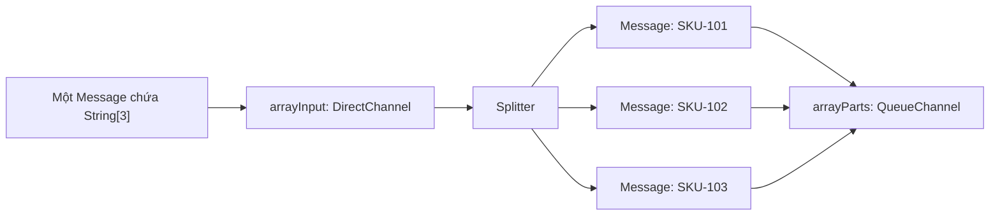

# Tách array

## 1. Mục tiêu và tình huống sử dụng

Trong chương **Splitter** của **SPRING_INTEGRATION_CORE**, tách array là chuyển một message chứa mảng thành nhiều message, mỗi message mang một phần tử. Đây là bước nối giữa dữ liệu nhận theo lô và các endpoint xử lý từng đơn vị nghiệp vụ.

Ví dụ, một hệ thống kho nhận mảng mã sản phẩm:

```java
String[] skus = {"SKU-101", "SKU-102", "SKU-103"};
```

Hệ thống cần kiểm tra tồn kho cho từng mã, định tuyến theo loại sản phẩm, rồi có thể tổng hợp kết quả của cả lô. Thay vì buộc endpoint kiểm tra tồn kho phải hiểu mảng, ta đặt splitter trước endpoint đó.

Sau bài này, bạn cần có khả năng:

- Thiết kế luồng từ `Message<T[]>` sang các message có payload kiểu `T`.
- Cấu hình splitter bằng Java DSL và quan sát dữ liệu qua `MessageChannel`.
- Đọc đúng các header tương quan và thứ tự.
- Phân biệt mảng object, mảng primitive, mảng nhiều chiều và dữ liệu nhị phân.
- Quyết định cách xử lý mảng rỗng, phần tử null, lỗi giữa chừng và kết quả cần gom lại.
- Viết kiểm thử cho số lượng, kiểu payload, nội dung và header của message con.

Các ví dụ dùng Java 17 và Spring Integration 6.2 trở lên; cấu hình được trình bày theo API có trong nhánh 6.5. Dự án cần dependency `org.springframework.integration:spring-integration-core`; các ví dụ kiểm thử cần JUnit Jupiter. Nếu dùng Spring Boot, hãy để BOM của phiên bản Boot đang dùng quản lý các phiên bản Spring tương thích. `splitWith(...)` có từ Spring Integration 6.2. [Nguồn API Java DSL](https://github.com/spring-projects/spring-integration/blob/v6.5.0/spring-integration-core/src/main/java/org/springframework/integration/dsl/BaseIntegrationFlowDefinition.java)

## 2. Một message chứa mảng khác nhiều message

Đầu vào của splitter vẫn là **một message**:

```text
Message
  payload = ["SKU-101", "SKU-102", "SKU-103"]
  headers = { batchId = "B-2026-001", ... }
```

Đầu ra gồm ba message:

```text
Message(payload = "SKU-101", headers = { batchId = "B-2026-001", ... })
Message(payload = "SKU-102", headers = { batchId = "B-2026-001", ... })
Message(payload = "SKU-103", headers = { batchId = "B-2026-001", ... })
```



Với một mảng có `n` phần tử hợp lệ, quá trình hoàn tất thành công sẽ phát `n` message. Splitter mặc định hỗ trợ array trực tiếp; bạn không cần đổi array thành `List` trước khi tách. [DefaultMessageSplitter](https://docs.spring.io/spring-integration/api/org/springframework/integration/splitter/DefaultMessageSplitter.html)

Cần phân biệt ba thao tác:

| Thành phần | Việc thực hiện trong ví dụ |
| --- | --- |
| Transformer | Đổi `String[]` thành một đối tượng hoặc một cấu trúc khác trong một message |
| Splitter | Từ một message chứa `String[]` tạo nhiều message chứa từng `String` |
| Router | Chọn đường đi của từng message sau khi tách |

Chỉ trả một array từ một transformer không thể hiện rõ hợp đồng tách thành nhiều message như một splitter. Khi thiết kế luồng, hãy chọn endpoint theo ý nghĩa thao tác, thay vì dựa riêng vào kiểu giá trị trả về.

## 3. Cấu hình Java DSL hoàn chỉnh

Ví dụ dưới đây có một kênh đầu vào, một kênh chứa các phần tử sau khi tách và một kênh nhận lô rỗng.

```java
package example.splitter;

import org.springframework.context.annotation.Bean;
import org.springframework.context.annotation.Configuration;
import org.springframework.integration.channel.DirectChannel;
import org.springframework.integration.channel.QueueChannel;
import org.springframework.integration.config.EnableIntegration;
import org.springframework.integration.dsl.IntegrationFlow;

@Configuration
@EnableIntegration
public class ArraySplitterConfig {

    @Bean
    public DirectChannel arrayInput() {
        return new DirectChannel();
    }

    @Bean
    public QueueChannel arrayParts() {
        return new QueueChannel();
    }

    @Bean
    public QueueChannel emptyArrays() {
        return new QueueChannel();
    }

    @Bean
    public IntegrationFlow splitArrayFlow() {
        return IntegrationFlow.from("arrayInput")
                .splitWith(spec -> spec
                        .applySequence(true)
                        .discardChannel("emptyArrays"))
                .channel("arrayParts")
                .get();
    }
}
```

Trong cấu hình này:

1. Producer gửi message vào `arrayInput`.
2. Splitter lấy array từ payload và tạo message cho từng phần tử.
3. Message con được gửi vào `arrayParts`.
4. Nếu array rỗng, message đầu vào được gửi vào `emptyArrays`.

`applySequence(true)` được viết tường minh để làm rõ mục đích tạo thông tin thứ tự; đây cũng là giá trị mặc định của splitter. `discardChannel` là cấu hình cho kết quả tách rỗng. [SplitterSpec trong Spring Integration 6.5](https://github.com/spring-projects/spring-integration/blob/v6.5.0/spring-integration-core/src/main/java/org/springframework/integration/dsl/SplitterSpec.java)

Nếu không cần cấu hình bổ sung, phần cốt lõi có thể viết ngắn:

```java
return IntegrationFlow.from("arrayInput")
        .split()
        .channel("arrayParts")
        .get();
```

Đây là **phương án thay thế** cho bean `splitArrayFlow`, không đăng ký thêm một flow nữa vào cùng `arrayInput`. Bản ngắn không khai báo kênh tiếp nhận lô rỗng.

Trong ví dụ, `QueueChannel` được đọc chủ động bằng `receive(...)`, nên không cần poller. Nếu muốn một endpoint tự động tiêu thụ queue trong ứng dụng, cần cấu hình poller cho endpoint đó. Các queue không giới hạn dung lượng ở đây phục vụ việc quan sát; ứng dụng thực tế cần quyết định dung lượng, thời gian chờ gửi và tốc độ tiêu thụ.

## 4. Gửi mảng và đọc message con

Đoạn mã sau dùng cấu hình ở phần trước:

```java
package example.splitter;

import org.springframework.context.annotation.AnnotationConfigApplicationContext;
import org.springframework.integration.channel.QueueChannel;
import org.springframework.messaging.Message;
import org.springframework.messaging.MessageChannel;
import org.springframework.messaging.support.MessageBuilder;

public class ArraySplitterDemo {

    public static void main(String[] args) {
        try (var context = new AnnotationConfigApplicationContext(
                ArraySplitterConfig.class)) {

            MessageChannel input =
                    context.getBean("arrayInput", MessageChannel.class);
            QueueChannel output =
                    context.getBean("arrayParts", QueueChannel.class);

            Message<String[]> request = MessageBuilder
                    .withPayload(new String[]{
                            "SKU-101", "SKU-102", "SKU-103"
                    })
                    .setHeader("batchId", "B-2026-001")
                    .build();

            if (!input.send(request)) {
                throw new IllegalStateException("Không gửi được lô");
            }

            for (int i = 0; i < 3; i++) {
                Message<?> part = output.receive(1_000);
                if (part == null) {
                    throw new IllegalStateException(
                            "Thiếu message ở vị trí " + i);
                }
                System.out.println(part.getPayload());
            }
        }
    }
}
```

Kết quả mong đợi trong cấu hình trên:

```text
SKU-101
SKU-102
SKU-103
```

Payload tại `arrayInput` là `String[]`; payload tại `arrayParts` là từng `String`. Endpoint đặt sau splitter vì vậy phải được thiết kế để nhận phần tử, chẳng hạn xử lý một mã SKU, thay vì tiếp tục yêu cầu `String[]`.

Một phương thức gateway để gửi lô cũng cần có hợp đồng phù hợp. Nếu chỉ tiếp nhận lô để xử lý, có thể dùng phương thức trả `void`. Nếu caller cần một kết quả tổng hợp cho cả array, phải có thiết kế gom kết quả và trả lời; splitter riêng lẻ chưa cung cấp hợp đồng đó.

## 5. Header tương quan và thứ tự

Với đầu vào là array và `applySequence=true`, splitter biết số phần tử ngay từ `array.length`. Trong trường hợp tách một cấp ở ví dụ này, các message con có:

| Header | Ý nghĩa | Giá trị ví dụ |
| --- | --- | --- |
| `correlationId` | Xác định nhóm message cùng sinh từ một lần tách | ID của message đầu vào |
| `sequenceNumber` | Vị trí trong chuỗi, bắt đầu từ 1 | `1`, `2`, `3` |
| `sequenceSize` | Số phần tử của kết quả tách | `3` |
| `batchId` | Header nghiệp vụ được truyền từ message cha | `B-2026-001` |

Splitter mặc định bật sequence, lấy ID message đầu vào làm correlation của lần tách và bắt đầu sequence từ 1. Header nghiệp vụ được sao chép sang message con khi phù hợp; nếu phần tử vốn là một `Message`, header riêng của phần tử còn tham gia vào việc xây dựng message đầu ra. [Mã nguồn AbstractMessageSplitter](https://github.com/spring-projects/spring-integration/blob/main/spring-integration-core/src/main/java/org/springframework/integration/splitter/AbstractMessageSplitter.java)

Có thể đọc các header bằng hằng số:

```java
import org.springframework.integration.IntegrationMessageHeaderAccessor;

Object correlationId = part.getHeaders().get(
        IntegrationMessageHeaderAccessor.CORRELATION_ID);

Integer number = part.getHeaders().get(
        IntegrationMessageHeaderAccessor.SEQUENCE_NUMBER,
        Integer.class);

Integer size = part.getHeaders().get(
        IntegrationMessageHeaderAccessor.SEQUENCE_SIZE,
        Integer.class);
```

Ở đây, `part` là một message con đã nhận.

Không nên dùng `correlationId` mặc định thay khóa nghiệp vụ lâu dài. Nếu gửi lại cùng một lô bằng message mới, ID message có thể khác. Hãy dùng header như `batchId`, kết hợp định danh phần tử hoặc vị trí trong lô, cho truy vết và chống xử lý trùng.

Khi có nhiều splitter lồng nhau, một chuỗi có thể mang nhiều tầng thông tin sequence. Cần xét đúng tầng đang được gom, thay vì áp dụng máy móc giả định chỉ có một lần tách.

## 6. Những loại array cần phân biệt

### 6.1. Mảng object

```java
String[] names = {"An", "Bình"};
Integer[] quantities = {2, 5};
```

Mỗi phần tử trở thành payload của một message. Với mảng các đối tượng nghiệp vụ như `OrderLine[]`, endpoint sau splitter nhận từng `OrderLine`.

Splitter không tự tạo bản sao sâu của từng đối tượng. Nếu một phần tử là object có thể thay đổi trạng thái, các tham chiếu còn giữ object đó có thể quan sát các thay đổi. Hãy tránh sửa array hay object đã gửi trong lúc luồng đang xử lý; ưu tiên dữ liệu bất biến hoặc sao chép tại ranh giới sở hữu phù hợp.

### 6.2. Mảng primitive

```java
int[] quantities = {2, 5, 8};
```

Mảng này có thể được gửi trực tiếp vào flow ở phần 3. Kết quả là ba message mang payload lần lượt là `Integer(2)`, `Integer(5)`, `Integer(8)`. Payload của message là object nên giá trị primitive được boxing.

Cơ chế tách array sử dụng `ObjectUtils.toObjectArray(...)`, hỗ trợ cả mảng primitive. Đây là lý do không nên ép một `int[]` thành `Object[]`. [Xử lý array trong AbstractMessageSplitter 6.5](https://github.com/spring-projects/spring-integration/blob/v6.5.0/spring-integration-core/src/main/java/org/springframework/integration/splitter/AbstractMessageSplitter.java), [ObjectUtils.toObjectArray](https://docs.spring.io/spring-framework/docs/current/javadoc-api/org/springframework/util/ObjectUtils.html#toObjectArray(java.lang.Object))

Một lỗi Java thường gặp khi chuẩn bị dữ liệu:

```java
int[] quantities = {2, 5, 8};

java.util.List<int[]> wrapped =
        java.util.Arrays.asList(quantities);

System.out.println(wrapped.size()); // 1
```

`Arrays.asList` nhận varargs kiểu tham chiếu; với `int[]`, phần tử được đưa vào list là cả array. Vì vậy, tách list này một lần tạo một message chứa `int[]`, thay vì ba message chứa `Integer`. Đây là hệ quả của kiểu dữ liệu Java và việc chỉ tách một cấp. [Arrays.asList](https://docs.oracle.com/en/java/javase/17/docs/api/java.base/java/util/Arrays.html#asList(T...))

Cách đơn giản trong bài này là gửi thẳng `int[]`. Nếu một API khác yêu cầu `List<Integer>`, hãy boxing rõ ràng:

```java
java.util.List<Integer> values =
        java.util.Arrays.stream(quantities)
                .boxed()
                .toList();
```

### 6.3. Mảng nhiều chiều

```java
String[][] groups = {
        {"SKU-101", "SKU-102"},
        {"SKU-201"}
};
```

Một splitter mặc định tách **một cấp**. Kết quả của lần tách trên là hai message, mỗi message có payload `String[]`. Nó không đệ quy để tự động tạo ba message `String`.

Nếu yêu cầu nghiệp vụ là một chuỗi SKU phẳng và không cần giữ các nhóm con, có thể tạo array phẳng trong hàm tách:

```java
return IntegrationFlow.from("matrixInput")
        .split(String[][].class, matrix ->
                java.util.Arrays.stream(matrix)
                        .flatMap(java.util.Arrays::stream)
                        .toArray(String[]::new))
        .channel("skuOutput")
        .get();
```

Đây là đoạn cấu hình minh họa độc lập; cần khai báo các channel tương ứng. Nó giả định các hàng và phần tử đều hợp lệ. Nếu nhóm con mang ý nghĩa nghiệp vụ, hãy thiết kế luồng tách từng cấp và cách gom từng nhóm thay vì làm phẳng ngay.

### 6.4. Mảng byte và mảng Message

| Payload đầu vào | Sau một lần tách | Điều cần quyết định |
| --- | --- | --- |
| `byte[]{10, 20}` | Hai payload `Byte` | Có thực sự muốn xử lý từng byte không? |
| `Message<?>[]` | Mỗi phần tử được xử lý như message đầu ra | Có cần header riêng theo phần tử không? |
| `Object[]{new int[]{1, 2}, "A"}` | Một payload `int[]`, một payload `String` | Endpoint sau tách có chấp nhận kiểu hỗn hợp không? |

`byte[]` thường biểu diễn toàn bộ tệp, ảnh hoặc nội dung mạng. Tách từng byte thường không phù hợp với đơn vị nghiệp vụ cần xử lý. Nếu muốn chia tệp thành các khối `byte[]`, hãy có thuật toán tạo các khối trước; mỗi khối mới là một phần tử đầu ra.

Với array chứa các `Message`, framework dùng từng phần tử như message, đồng thời bổ sung thông tin sequence khi được bật. Cách này hữu ích khi cần metadata khác nhau cho từng phần, nhưng làm hàm tách phụ thuộc vào API messaging nhiều hơn so với trả array object nghiệp vụ. [Mô hình lập trình splitter](https://docs.spring.io/spring-integration/reference/splitter.html)

## 7. Tách array nằm trong một đối tượng nghiệp vụ

Trong ứng dụng thực tế, payload thường là một lô có mã lô và array các dòng:

```java
package example.splitter;

import java.util.Objects;
import org.springframework.integration.dsl.IntegrationFlow;

public final class OrderArrayExample {

    public record OrderLine(String sku, int quantity) {
    }

    public record OrderBatch(String batchId, OrderLine[] lines) {
    }

    public static OrderLine[] validatedLines(OrderBatch batch) {
        Objects.requireNonNull(batch, "batch không được null");

        OrderLine[] lines = Objects.requireNonNull(
                batch.lines(), "lines không được null");

        for (int i = 0; i < lines.length; i++) {
            Objects.requireNonNull(
                    lines[i], "lines[" + i + "] không được null");
        }

        return lines;
    }

    public static IntegrationFlow flow() {
        return IntegrationFlow.from("orderBatchInput")
                .enrichHeaders(headers -> headers
                        .headerExpression("batchId", "payload.batchId()"))
                .split(OrderBatch.class, OrderArrayExample::validatedLines)
                .channel("orderLineOutput")
                .get();
    }
}
```

Muốn dùng ví dụ này, đăng ký `OrderArrayExample.flow()` thành một bean `IntegrationFlow` trong cấu hình có `@EnableIntegration`, đồng thời khai báo channel `orderBatchInput` và `orderLineOutput`.

Hàm `validatedLines` trả `OrderLine[]`; splitter mới chịu trách nhiệm chuyển array đó thành các message con. Nó không yêu cầu bạn tự viết vòng lặp gửi message.

Header `batchId` được đưa vào message **trước** khi payload đổi từ `OrderBatch` sang `OrderLine`. Nhờ vậy, các endpoint xử lý từng dòng vẫn truy được lô gốc.

Việc kiểm tra toàn bộ phần tử trước khi trả array giúp phát hiện null trước khi splitter phát các dòng. Đây là lựa chọn thiết kế cho ví dụ; cần bổ sung kiểm tra SKU, số lượng hoặc quy tắc khác theo hợp đồng nghiệp vụ. Record không làm array bên trong trở thành bất biến; producer vẫn phải tuân thủ quy tắc không sửa dữ liệu sau khi gửi.

## 8. Mảng rỗng, null và dữ liệu không đúng hợp đồng

### 8.1. Mảng rỗng

```java
String[] empty = {};
```

Mảng rỗng không tạo message con. Trong cấu hình phần 3, splitter gửi **message đầu vào** đến `emptyArrays`. Nếu không cấu hình discard channel, không có đầu ra cho trường hợp này. Tính năng discard cho kết quả tách rỗng có từ phiên bản 5.2. [Hành vi kết quả rỗng](https://docs.spring.io/spring-integration/reference/splitter.html)

Kênh này có thể phục vụ ghi nhận lô không có phần tử hoặc tạo một kết quả nghiệp vụ riêng. Việc gửi vào `emptyArrays` không tự động sinh phản hồi cho caller.

Nếu phía sau có aggregator, một lô rỗng không tạo nhóm để aggregator nhận và đếm. Vì vậy, luồng cần có cách xử lý lô rỗng rõ ràng khi hợp đồng yêu cầu trả kết quả cho mọi lô.

### 8.2. Phần tử null khác array rỗng

```java
String[] invalid = {"SKU-101", null, "SKU-103"};
```

Array này có độ dài 3 nhưng một phần tử không hợp lệ làm payload message. Message chuẩn của Spring không chấp nhận payload null. Đừng coi null như một phần tử sẽ được bỏ qua tự động. [GenericMessage và điều kiện payload](https://github.com/spring-projects/spring-framework/blob/v6.2.0/spring-messaging/src/main/java/org/springframework/messaging/support/GenericMessage.java)

Trong luồng đồng bộ, phần tử hợp lệ phía trước có thể đã được gửi trước khi gặp null. Nếu muốn từ chối cả lô trước khi phát phần tử, hãy kiểm tra toàn bộ array trước, như `validatedLines`.

Nếu nghiệp vụ cho phép loại bỏ null, hãy thực hiện việc đó có chủ đích trước khi splitter xác định kết quả cần tách:

```java
.split(String[].class, values ->
        java.util.Arrays.stream(values)
                .filter(java.util.Objects::nonNull)
                .toArray(String[]::new))
```

Ví dụ này thay đổi số phần tử đầu ra: array ba vị trí có một null sẽ tạo hai message, với sequence size bằng 2. Không dùng nó nếu từng vị trí đầu vào phải nhận một kết quả đối ứng.

### 8.3. Payload null và kết quả tách null

Ba trường hợp sau có ý nghĩa khác nhau:

| Trường hợp | Ý nghĩa |
| --- | --- |
| `MessageBuilder.withPayload(null)` | Không hợp lệ vì payload message không được null |
| Hàm splitter trả array rỗng | Không có phần tử; có thể gửi request vào discard channel |
| Hàm splitter trả `null` | Không sinh đầu ra; khác nhánh kết quả container rỗng |

Với cấu hình mặc định, kết quả tách null là dấu hiệu kết thúc nhánh xử lý; không nên dùng nó để thay thế một kết quả nghiệp vụ bắt buộc. [Quy tắc kết quả của splitter](https://docs.spring.io/spring-integration/reference/splitter.html)

### 8.4. Payload không phải array

`.split()` là splitter tổng quát, không phải bộ kiểm tra kiểu array. Nếu hợp đồng của channel chỉ cho phép `OrderLine[]`, hãy có bước kiểm tra đầu vào hoặc hàm tách có kiểu phù hợp. Việc một dữ liệu sai hợp đồng vẫn đi tiếp thành một message không chứng minh rằng luồng đã xử lý đúng lô.

## 9. Thứ tự, lỗi và việc gom kết quả

### 9.1. Tách array chưa tạo xử lý song song

Flow phần 3 gửi đầu vào qua `DirectChannel`; thao tác tách và đưa các phần tử vào queue diễn ra trên luồng gọi. Thứ tự quan sát trong ví dụ là thứ tự array.

Nếu thêm executor hoặc nhiều worker sau splitter, thời điểm xử lý hoàn tất có thể khác thứ tự ban đầu. `sequenceNumber` mô tả vị trí trong lần tách, không buộc các worker hoàn tất theo thứ tự đó. Khi cần trả kết quả theo thứ tự đầu vào, hãy sử dụng thông tin sequence trong thiết kế gom hoặc sắp thứ tự.

### 9.2. Lỗi có thể xảy ra sau khi một số phần đã xử lý

Giả sử endpoint nghiệp vụ đặt ngay sau splitter và xử lý đồng bộ:

```text
Phần tử 1 -> ghi dữ liệu thành công
Phần tử 2 -> phát sinh exception
Phần tử 3 -> có thể chưa được gửi vì lần gọi đã thất bại
```

Trong ví dụ thuần đồng bộ này, exception không được xử lý sẽ đi ngược về caller; các phần sau điểm lỗi không tiếp tục được phát. Splitter không tự đảm bảo hoàn tác tác động của phần tử 1.

Với `DirectChannel`, exception có thể truyền về nơi gọi `send(...)`. Chỉ thêm header `errorChannel` không tự biến mọi lỗi đồng bộ thành message lỗi. Khi chuyển sang xử lý bất đồng bộ, cần cấu hình cơ chế xử lý lỗi phù hợp cho executor hoặc poller và tuyến nhận lỗi. [Error Handling](https://docs.spring.io/spring-integration/reference/error-handling.html)

Nếu caller gửi lại cả lô sau một lỗi, các phần tử đã xử lý có thể chạy lại. Hãy xác định khóa chống trùng theo nghiệp vụ và ranh giới transaction cần thiết. Sequence và correlation phục vụ cấu trúc luồng; chúng không tự tạo bảo đảm xử lý đúng một lần.

### 9.3. Điều kiện để aggregator hoàn tất

Một luồng thường gặp:

```text
Array -> Splitter -> Xử lý từng phần -> Aggregator -> Kết quả của lô
```

Aggregator mặc định dùng correlation để gom nhóm và sequence size để xác định nhóm đã đủ phần tử. Vì vậy, các bước trung gian cần giữ các header liên quan. [Cơ chế correlation và release của aggregator](https://docs.spring.io/spring-integration/reference/aggregator.html)

Hãy xét một array có 5 phần tử. Splitter tạo sequence size bằng 5. Nếu filter phía sau loại một phần tử, aggregator chỉ nhận 4 kết quả và có thể chờ mãi nếu không có chính sách hết hạn hoặc release phù hợp.

Ba hướng thiết kế có thể áp dụng tùy hợp đồng:

- Lọc dữ liệu trước khi tách, để kích thước sequence phản ánh tập phần tử thực sự cần xử lý.
- Giữ một kết quả đối ứng cho mọi phần tử, kể cả kết quả từ chối hoặc lỗi nghiệp vụ.
- Thiết kế release strategy và timeout phù hợp nếu nghiệp vụ chấp nhận kết quả thiếu.

Tương tự, nếu router chia một nhóm sang nhiều nhánh, phải xác định các kết quả sẽ hội tụ ở đâu. Không kỳ vọng một aggregator chỉ nhìn thấy một phần của nhóm vẫn tự biết số kết quả còn thiếu đã đi nhánh khác.

## 10. Kiểm thử bằng JUnit Jupiter

Các kiểm thử sau dùng `ArraySplitterConfig` ở phần 3. Mỗi kiểm thử tạo context riêng để queue của lần chạy này không chứa dữ liệu của lần chạy khác. Chúng minh họa cách kiểm tra hợp đồng của flow, không chỉ kiểm tra rằng phương thức `send` không báo lỗi.

```java
package example.splitter;

import org.junit.jupiter.api.Test;
import org.springframework.context.annotation.AnnotationConfigApplicationContext;
import org.springframework.integration.channel.QueueChannel;
import org.springframework.messaging.Message;
import org.springframework.messaging.MessageChannel;
import org.springframework.messaging.support.MessageBuilder;

import static org.junit.jupiter.api.Assertions.*;
import static org.springframework.integration.IntegrationMessageHeaderAccessor.*;

class ArraySplitterConfigTest {

    @Test
    void splitsObjectArrayAndKeepsSequenceHeaders() {
        try (var context = new AnnotationConfigApplicationContext(
                ArraySplitterConfig.class)) {

            MessageChannel input =
                    context.getBean("arrayInput", MessageChannel.class);
            QueueChannel output =
                    context.getBean("arrayParts", QueueChannel.class);

            String[] expected = {"SKU-101", "SKU-102", "SKU-103"};
            Message<String[]> request = MessageBuilder
                    .withPayload(expected)
                    .setHeader("batchId", "B-2026-001")
                    .build();

            assertTrue(input.send(request));

            for (int i = 0; i < expected.length; i++) {
                Message<?> part = output.receive(1_000);

                assertNotNull(part);
                assertInstanceOf(String.class, part.getPayload());
                assertEquals(expected[i], part.getPayload());
                assertEquals("B-2026-001",
                        part.getHeaders().get("batchId"));
                assertEquals(request.getHeaders().getId(),
                        part.getHeaders().get(CORRELATION_ID));
                assertEquals(Integer.valueOf(i + 1),
                        part.getHeaders().get(
                                SEQUENCE_NUMBER, Integer.class));
                assertEquals(Integer.valueOf(expected.length),
                        part.getHeaders().get(
                                SEQUENCE_SIZE, Integer.class));
            }

            assertNull(output.receive(0));
        }
    }

    @Test
    void splitsPrimitiveArrayIntoBoxedPayloads() {
        try (var context = new AnnotationConfigApplicationContext(
                ArraySplitterConfig.class)) {

            MessageChannel input =
                    context.getBean("arrayInput", MessageChannel.class);
            QueueChannel output =
                    context.getBean("arrayParts", QueueChannel.class);

            assertTrue(input.send(MessageBuilder
                    .withPayload(new int[]{2, 5, 8})
                    .build()));

            for (int expected : new int[]{2, 5, 8}) {
                Message<?> part = output.receive(1_000);

                assertNotNull(part);
                assertInstanceOf(Integer.class, part.getPayload());
                assertEquals(Integer.valueOf(expected), part.getPayload());
            }

            assertNull(output.receive(0));
        }
    }

    @Test
    void sendsEmptyArrayRequestToDiscardChannel() {
        try (var context = new AnnotationConfigApplicationContext(
                ArraySplitterConfig.class)) {

            MessageChannel input =
                    context.getBean("arrayInput", MessageChannel.class);
            QueueChannel output =
                    context.getBean("arrayParts", QueueChannel.class);
            QueueChannel discarded =
                    context.getBean("emptyArrays", QueueChannel.class);

            Message<String[]> request = MessageBuilder
                    .withPayload(new String[0])
                    .setHeader("batchId", "B-EMPTY")
                    .build();

            assertTrue(input.send(request));
            assertNull(output.receive(0));

            Message<?> rejected = discarded.receive(1_000);
            assertNotNull(rejected);
            assertEquals(request.getHeaders().getId(),
                    rejected.getHeaders().getId());
            assertEquals("B-EMPTY",
                    rejected.getHeaders().get("batchId"));
            assertArrayEquals(new String[0],
                    assertInstanceOf(String[].class, rejected.getPayload()));
            assertNull(discarded.receive(0));
        }
    }

    @Test
    void splitsOnlyOuterDimension() {
        try (var context = new AnnotationConfigApplicationContext(
                ArraySplitterConfig.class)) {

            MessageChannel input =
                    context.getBean("arrayInput", MessageChannel.class);
            QueueChannel output =
                    context.getBean("arrayParts", QueueChannel.class);

            String[][] matrix = {
                    {"SKU-101", "SKU-102"},
                    {"SKU-201"}
            };

            assertTrue(input.send(MessageBuilder
                    .withPayload(matrix)
                    .build()));

            for (int i = 0; i < matrix.length; i++) {
                Message<?> part = output.receive(1_000);

                assertNotNull(part);
                String[] row = assertInstanceOf(
                        String[].class, part.getPayload());
                assertArrayEquals(matrix[i], row);
                assertEquals(Integer.valueOf(matrix.length),
                        part.getHeaders().get(
                                SEQUENCE_SIZE, Integer.class));
            }

            assertNull(output.receive(0));
        }
    }
}
```

`receive(0)` kiểm tra ngay rằng queue không còn message dư. Trong flow này, sau khi `send` trả thành công, thao tác đưa các phần tử vào queue đã hoàn tất đồng bộ. Với flow có executor, cần cách đợi hoàn tất có giới hạn thời gian trước khi kết luận thiếu hoặc thừa message.

Khi mở rộng bài thực hành, hãy bổ sung kiểm thử hợp đồng từ chối null trước khi tách, hai lô liên tiếp có correlation riêng, và lỗi của một phần tử khi phía sau có aggregator. Mỗi kiểm thử cần chỉ rõ chính sách nghiệp vụ mong đợi.

## 11. Các quyết định cần chốt khi áp dụng

| Câu hỏi | Tác động đến thiết kế |
| --- | --- |
| Một phần tử array có đúng là đơn vị cần xử lý độc lập không? | Quyết định có dùng splitter tại đây hay cần tạo đơn vị khác trước |
| Có cần kết quả của cả lô không? | Quyết định hợp đồng gateway và điểm gom kết quả |
| Lô rỗng được chấp nhận hay từ chối? | Quyết định nhánh xử lý rỗng và phản hồi cho caller |
| Phần tử lỗi cần dừng lô hay có kết quả lỗi riêng? | Quyết định validation, tuyến lỗi và khả năng hoàn tất nhóm |
| Có xử lý đồng thời không? | Quyết định executor, thứ tự, dung lượng queue và quyền sửa dữ liệu |
| Có gửi lại lô không? | Quyết định khóa chống trùng và phạm vi transaction |

Với array rất lớn, toàn bộ dữ liệu đầu vào đã nằm trong bộ nhớ, còn splitter tạo thêm các message và metadata tương ứng. Nếu chưa có yêu cầu giữ cả lô trong bộ nhớ, hãy cân nhắc nguồn đọc theo trang hoặc theo luồng trong thiết kế tổng thể. Việc đổi array đã có sẵn thành iterator không làm biến mất chi phí lưu array ban đầu.

## 12. Bài thực hành

Tạo một lô `OrderLine[]` có bốn dòng và header `batchId`. Xây dựng luồng kiểm tra từng dòng, trả một kết quả gồm SKU và trạng thái.

Tiêu chí hoàn thành:

1. Mỗi dòng hợp lệ tạo đúng một message sau splitter.
2. Các message con giữ mã lô và có sequence từ 1 đến 4.
3. Lô rỗng được ghi nhận qua một nhánh có thể quan sát.
4. Null được phát hiện theo chính sách đã chọn, không bị bỏ qua ngầm.
5. Nếu gom kết quả, cả trường hợp thành công và lỗi nghiệp vụ đều có cách kết thúc nhóm.
6. Kiểm thử xác nhận được kiểu payload, số phần tử và header; khi thêm executor, kiểm thử chờ theo điều kiện có timeout.

Trước khi chạy, hãy dự đoán kết quả nếu một filter loại dòng thứ hai sau splitter. Sau đó điều chỉnh thiết kế để aggregator vẫn kết thúc theo đúng hợp đồng của lô.
