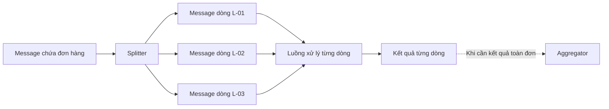

# Tách composite message

Trong module **SPRING_INTEGRATION_CORE**, chương **Splitter**, bài học này trình bày cách đưa một thông điệp chứa nhiều phần nghiệp vụ vào luồng Spring Integration để xử lý từng phần bằng các message riêng. Trọng tâm là thiết kế payload con, bảo toàn ngữ cảnh và hiểu hợp đồng giữa splitter với các endpoint phía sau, đặc biệt khi cần aggregator ghép kết quả.

Sau bài học, bạn có thể xây dựng splitter bằng POJO và Java DSL, kiểm tra các message đầu ra, đồng thời giải thích được chuyện gì xảy ra khi đầu vào rỗng, một phần bị lỗi hoặc đơn hàng được gửi lại.

## 1. Composite message là gì?

**Composite message** là một message có payload chứa nhiều phần có ý nghĩa xử lý riêng. Ví dụ, đơn hàng chứa nhiều dòng hàng; yêu cầu nhập dữ liệu chứa nhiều bản ghi; chứng từ chứa nhiều khoản mục.

Một payload có nhiều thuộc tính chưa đủ để quyết định phải tách. Điều cần xác định là có những đơn vị công việc nào cần đi qua luồng xử lý riêng. Với đơn hàng, `orderId` và `tenantId` mô tả ngữ cảnh chung, còn mỗi phần tử trong `lines` là một ứng viên để tách.

Splitter thực hiện quan hệ **một đầu vào → nhiều đầu ra**, mỗi đầu ra chứa dữ liệu cho một phần của composite. Đây là ý tưởng của mẫu [Splitter trong Enterprise Integration Patterns](https://www.enterpriseintegrationpatterns.com/patterns/messaging/Sequencer.html).

Ví dụ nghiệp vụ sử dụng trong bài:

```json
{
  "orderId": "ORD-2048",
  "tenantId": "TENANT-A",
  "lines": [
    { "lineId": "L-01", "sku": "BOOK-JAVA", "quantity": 2 },
    { "lineId": "L-02", "sku": "KEYBOARD", "quantity": 1 },
    { "lineId": "L-03", "sku": "MOUSE", "quantity": 3 }
  ]
}
```

Giả sử hệ thống cần kiểm tra tồn kho và tạo yêu cầu giữ hàng cho từng dòng. Splitter sẽ tạo ba message công việc thay vì buộc một handler xử lý nguyên đơn hàng trong một vòng lặp nội bộ.



Sơ đồ mô tả quan hệ giữa các message. Nó không hàm ý các dòng được chạy đồng thời hoặc mỗi dòng có một thread riêng.

## 2. Chọn đúng đơn vị tách và hợp đồng đầu ra

Với ví dụ trên, hợp đồng mong muốn là:

```text
Message<OrderBatch>
        |
        v
3 x Message<LineTask>
```

Payload đầu ra cần đủ thông tin để một consumer xử lý mà không phải giữ tham chiếu tới message cha:

| Message con | orderId | tenantId | lineId | sku | quantity |
|---|---|---|---|---|---|
| 1 | ORD-2048 | TENANT-A | L-01 | BOOK-JAVA | 2 |
| 2 | ORD-2048 | TENANT-A | L-02 | KEYBOARD | 1 |
| 3 | ORD-2048 | TENANT-A | L-03 | MOUSE | 3 |

Thiết kế này đưa định danh nghiệp vụ vào payload, còn các thông tin phục vụ vận hành như `traceId` nằm trong header. Nếu router sử dụng header để định tuyến, có thể bổ sung các header nghiệp vụ tương ứng bằng header enricher; vẫn cần thống nhất nguồn dữ liệu có thẩm quyền khi payload và header cùng chứa một giá trị.

Ba quyết định quan trọng trước khi viết code:

1. **Đơn vị công việc:** tách theo dòng đơn hàng, theo SKU hay theo lô? Hai dòng có cùng SKU vẫn có thể khác `lineId`, mức giá hoặc chương trình khuyến mại. Gộp chúng ngay khi tách có thể làm mất ý nghĩa nghiệp vụ.
2. **Ngữ cảnh cần mang theo:** consumer cần biết đơn hàng và tenant nào sở hữu dòng đó. Chỉ gửi `sku` và `quantity` sẽ không đủ cho truy vết hoặc chống xử lý trùng.
3. **Kết quả mong đợi:** mỗi dòng cần có một kết quả cuối cùng hay chỉ cần phát yêu cầu một chiều? Quyết định này ảnh hưởng trực tiếp đến việc có cần aggregator hay không.

Một splitter xử lý một cấp cấu trúc do bạn chọn. Với `Order → Shipment → Line`, hãy quyết định tạo một message cho mỗi shipment hay đi thẳng tới mỗi line. Nếu tách thành hai tầng, mỗi tầng cần có hợp đồng riêng về ngữ cảnh và kết quả; không nên mặc định rằng hai lần tách sẽ tự khôi phục đúng cấu trúc nghiệp vụ ban đầu.

## 3. Phân biệt tách thông điệp với các bước lân cận

Trong Java DSL, `split`, `transform`, `filter`, `route` và `aggregate` biểu diễn các endpoint tương ứng. Cách ghép chúng tạo nên luồng xử lý; xem [DSL Basics của Spring Integration](https://docs.spring.io/spring-integration/reference/dsl/java-basics.html).

Trong bài toán đơn hàng, có thể phân công như sau:

| Nhu cầu | Thành phần phù hợp trong thiết kế này |
|---|---|
| Chuyển chuỗi JSON thành `OrderBatch` | Transformer hoặc bước chuyển đổi tại biên vào |
| Từ một `OrderBatch` tạo nhiều tác vụ `LineTask` | Splitter |
| Chọn tuyến xử lý dựa vào loại dòng hàng | Router |
| Chấp nhận hoặc loại một tác vụ theo điều kiện | Filter |
| Gọi dịch vụ giữ hàng cho một tác vụ | Service activator |
| Gom các kết quả của một lần xử lý đơn hàng | Aggregator |

Một transformer trả về `List<LineTask>` vẫn có thể tạo **một message chứa danh sách**. Để thể hiện rõ việc phát từng phần thành message độc lập, cấu hình endpoint splitter tại vị trí tách.

Tương tự, việc nhiều consumer nhận cùng một bản tin phục vụ các mục đích khác nhau là một yêu cầu phân phối khác với việc chia payload thành các phần. Khi thiết kế, hãy diễn đạt rõ bạn muốn nhiều phần dữ liệu hay nhiều nơi nhận dữ liệu.

## 4. Header của các message con

Khi `applySequence` được bật, splitter bổ sung thông tin cho chuỗi kết quả. Bảng sau mô tả trường hợp một message cha được tách thành một danh sách ba phần:

| Header | Vai trò | Ví dụ |
|---|---|---|
| `id` | Định danh của từng message, không phải khóa nghiệp vụ | Các message con có ID riêng |
| `correlationId` | Liên kết các phần của cùng lần tách | ID của message đi trực tiếp vào splitter |
| `sequenceNumber` | Vị trí của phần trong lần tách | `1`, `2`, `3` |
| `sequenceSize` | Số phần trong kết quả biết kích thước | `3` |
| `traceId` | Header tùy chỉnh của ứng dụng | `trace-2048` |

Các tên hằng như `CORRELATION_ID`, `SEQUENCE_NUMBER` và `SEQUENCE_SIZE` thuộc `IntegrationMessageHeaderAccessor`. `MessageHeaders` cung cấp các header chuẩn như `id`. Xem [mô hình Message và các header](https://docs.spring.io/spring-integration/reference/message.html).

`correlationId` phục vụ lần xử lý hiện tại; `orderId` phục vụ định danh nghiệp vụ. Nếu cùng đơn hàng được gửi lại trong một message mới, lần tách mới thường có correlation ID khác. Chống xử lý trùng vì vậy cần dựa vào khóa nghiệp vụ phù hợp.

Cần chú ý vị trí của splitter: nếu một endpoint trước đó đã tạo message mới, ID của message đầu tiên do bên gọi gửi vào có thể không còn là ID dùng làm correlation. Ví dụ ở phần sau đặt splitter ngay sau kênh đầu vào nên không có bước tạo message trung gian này.

Header thứ tự cũng không bảo đảm thứ tự hoàn thành tác vụ. Dòng thứ ba có thể kết thúc trước dòng thứ nhất khi phía sau có xử lý bất đồng bộ. Nếu đầu ra toàn đơn cần thứ tự ổn định, hãy quy định cách sắp xếp bằng vị trí hoặc định danh dòng, thay vì suy ra từ thời điểm kết quả tới nơi.

## 5. Viết splitter theo mô hình POJO

Ví dụ dùng Java 17 và API Java DSL có trong Spring Integration 6.x. Các lớp nằm trong package `example.splitter`. Tên tệp bên dưới là tên gợi ý khi người học đưa ví dụ vào dự án riêng; bài học không yêu cầu thay đổi cấu trúc dự án hiện có.

### 5.1. Mô hình dữ liệu và hàm tách

`CompositeOrderSplitter.java` chứa các record lồng nhau để ví dụ gọn và đầy đủ:

```java
package example.splitter;

import java.util.HashSet;
import java.util.List;
import java.util.Objects;
import java.util.Set;

public class CompositeOrderSplitter {

    public record OrderLine(String lineId, String sku, int quantity) {
        public OrderLine {
            requireText(lineId, "lineId");
            requireText(sku, "sku");
            if (quantity <= 0) {
                throw new IllegalArgumentException("quantity must be positive");
            }
        }
    }

    public record OrderBatch(
            String orderId,
            String tenantId,
            List<OrderLine> lines) {

        public OrderBatch {
            requireText(orderId, "orderId");
            requireText(tenantId, "tenantId");
            Objects.requireNonNull(lines, "lines");
            lines = List.copyOf(lines);
        }
    }

    public record LineTask(
            String orderId,
            String tenantId,
            String lineId,
            String sku,
            int quantity) {
    }

    public List<LineTask> split(OrderBatch order) {
        Objects.requireNonNull(order, "order");

        Set<String> lineIds = new HashSet<>();
        for (OrderLine line : order.lines()) {
            if (!lineIds.add(line.lineId())) {
                throw new IllegalArgumentException(
                        "Duplicate lineId: " + line.lineId());
            }
        }

        return order.lines().stream()
                .map(line -> new LineTask(
                        order.orderId(),
                        order.tenantId(),
                        line.lineId(),
                        line.sku(),
                        line.quantity()))
                .toList();
    }

    private static void requireText(String value, String field) {
        if (value == null || value.isBlank()) {
            throw new IllegalArgumentException(field + " must not be blank");
        }
    }
}
```

Hàm tách chỉ trả về dữ liệu nghiệp vụ. Endpoint Spring Integration sẽ bao bọc từng `LineTask` thành message. Cách viết POJO giúp phần quyết định tách không phụ thuộc vào `MessageChannel` hay vòng đời Spring; đây cũng là cách lập trình được giới thiệu trong [tài liệu Splitter](https://docs.spring.io/spring-integration/reference/splitter.html).

Ví dụ chủ động áp dụng các quy tắc sau:

- `orderId`, `tenantId`, `lineId`, `sku` không được trống và số lượng phải dương.
- `List.copyOf` chụp danh sách đầu vào và không chấp nhận phần tử `null`. Các phần tử ở đây là record chỉ chứa chuỗi và số, thuận tiện cho việc chia sẻ dữ liệu không thay đổi.
- `lineId` phải duy nhất trong một đơn hàng. Kiểm tra toàn bộ danh sách trước khi trả kết quả giúp phát hiện lỗi này trước khi endpoint bắt đầu gửi các phần.
- Danh sách rỗng được phép đi tới splitter để minh họa nhánh `discardChannel` ở phần cấu hình.

Đây là các quy tắc của bài toán minh họa. Trong dự án thực tế, có thể đặt validation tại biên nhận dữ liệu hoặc trong lớp miền, miễn là luồng có hợp đồng nhất quán về đầu vào hợp lệ.

### 5.2. Đăng ký endpoint bằng Java DSL

`OrderSplitFlow.java`:

```java
package example.splitter;

import org.springframework.context.annotation.Bean;
import org.springframework.context.annotation.Configuration;
import org.springframework.integration.channel.DirectChannel;
import org.springframework.integration.channel.QueueChannel;
import org.springframework.integration.config.EnableIntegration;
import org.springframework.integration.dsl.IntegrationFlow;

import example.splitter.CompositeOrderSplitter.OrderBatch;

@Configuration
@EnableIntegration
public class OrderSplitFlow {

    @Bean
    public CompositeOrderSplitter compositeOrderSplitter() {
        return new CompositeOrderSplitter();
    }

    @Bean
    public DirectChannel ordersIn() {
        return new DirectChannel();
    }

    @Bean
    public QueueChannel lineTasks() {
        return new QueueChannel(100);
    }

    @Bean
    public QueueChannel emptyOrders() {
        return new QueueChannel(10);
    }

    @Bean
    public IntegrationFlow orderSplitFlow(
            CompositeOrderSplitter splitter) {

        return IntegrationFlow.from("ordersIn")
                .split(OrderBatch.class, splitter::split,
                        spec -> spec.applySequence(true)
                                .discardChannel("emptyOrders"))
                .channel("lineTasks")
                .get();
    }
}
```

Ba thành phần có vai trò riêng:

- `ordersIn` nhận một `Message<OrderBatch>` rồi chuyển ngay cho splitter trên thread đang gửi.
- Endpoint `.split(...)` gọi hàm POJO, tạo và phát từng message con. `applySequence(true)` viết rõ ý định dùng metadata của chuỗi.
- `lineTasks` giữ các message đầu ra để ví dụ và kiểm thử đọc chúng. Với danh sách rỗng, message đầu vào của splitter đi sang `emptyOrders`.

Các tùy chọn `applySequence` và `discardChannel` được mô tả trong [API SplitterSpec](https://docs.spring.io/spring-integration/docs/6.2.5/api/org/springframework/integration/dsl/SplitterSpec.html). Cấu hình trên dùng overload `split(expectedType, function, endpointConfigurer)` của Java DSL.

`QueueChannel` trong ví dụ có sức chứa hữu hạn và lưu trong bộ nhớ. Nếu không có consumer, gửi quá sức chứa có thể làm thread gửi chờ chỗ trống. Vì thế mẫu này phù hợp để quan sát một đơn hàng nhỏ; khi vận hành cần bố trí consumer, giới hạn kích thước đầu vào và chính sách chờ phù hợp. Các đặc điểm này được giải thích trong [Message Channel Implementations](https://docs.spring.io/spring-integration/reference/channel/implementations.html).

Không cần poller cho bước gửi kết quả vào queue. Nếu nối thêm một endpoint Spring Integration để tự động đọc `lineTasks`, endpoint đọc từ kênh pollable đó phải có cấu hình poller thích hợp. Trong phần kiểm thử, chính mã test gọi `receive(...)`.

### 5.3. Phát message đầu vào

Đoạn sau chạy khi các bean trong cấu hình đã được đăng ký và context đã khởi động. Biến `ordersIn` là bean `DirectChannel` được inject:

```java
var order = new CompositeOrderSplitter.OrderBatch(
        "ORD-2048",
        "TENANT-A",
        java.util.List.of(
                new CompositeOrderSplitter.OrderLine(
                        "L-01", "BOOK-JAVA", 2),
                new CompositeOrderSplitter.OrderLine(
                        "L-02", "KEYBOARD", 1),
                new CompositeOrderSplitter.OrderLine(
                        "L-03", "MOUSE", 3)));

var request = org.springframework.messaging.support.MessageBuilder
        .withPayload(order)
        .setHeader("traceId", "trace-2048")
        .build();

boolean accepted = ordersIn.send(request);
```

Với các queue còn chỗ trống và không có lỗi, `accepted` là `true` và `lineTasks` chứa ba message. Giá trị này xác nhận lần gửi qua luồng đang cấu hình; nó không xác nhận hệ thống kho đã giữ hàng, vì ví dụ mới dừng ở việc tạo tác vụ.

Trong cấu hình mặc định này, header tùy chỉnh `traceId` được truyền sang các message con. Nếu một bước sau đó tự tạo message mới hoặc cấu hình loại bỏ header, cần kiểm tra lại hợp đồng truyền metadata tại bước đó.

## 6. Kiểm thử hợp đồng tách thông điệp

Mẫu kiểm thử dưới đây cần `spring-integration-core`, `spring-test` và JUnit Jupiter, với các phiên bản tương thích theo BOM hoặc cơ chế quản lý dependency của dự án. Hai lớp ở phần trước phải cùng nằm trong nguồn mã của ví dụ.

Kiểm thử không chỉ đếm payload. Nó còn kiểm tra ngữ cảnh tenant, metadata của chuỗi và xử lý đầu vào rỗng.

`OrderSplitFlowTest.java`:

```java
package example.splitter;

import java.util.HashSet;
import java.util.List;
import java.util.Set;

import org.junit.jupiter.api.BeforeEach;
import org.junit.jupiter.api.Test;
import org.springframework.beans.factory.annotation.Autowired;
import org.springframework.beans.factory.annotation.Qualifier;
import org.springframework.integration.IntegrationMessageHeaderAccessor;
import org.springframework.integration.channel.DirectChannel;
import org.springframework.integration.channel.QueueChannel;
import org.springframework.messaging.Message;
import org.springframework.messaging.MessagingException;
import org.springframework.messaging.support.MessageBuilder;
import org.springframework.test.context.junit.jupiter.SpringJUnitConfig;

import example.splitter.CompositeOrderSplitter.LineTask;
import example.splitter.CompositeOrderSplitter.OrderBatch;
import example.splitter.CompositeOrderSplitter.OrderLine;

import static org.junit.jupiter.api.Assertions.*;

@SpringJUnitConfig(OrderSplitFlow.class)
class OrderSplitFlowTest {

    @Autowired
    @Qualifier("ordersIn")
    DirectChannel ordersIn;

    @Autowired
    @Qualifier("lineTasks")
    QueueChannel lineTasks;

    @Autowired
    @Qualifier("emptyOrders")
    QueueChannel emptyOrders;

    @BeforeEach
    void clearQueues() {
        while (lineTasks.receive(0) != null) {
            // Dọn queue của ví dụ trước mỗi test.
        }
        while (emptyOrders.receive(0) != null) {
            // Không có consumer nền trong cấu hình test.
        }
    }

    @Test
    void splitsOrderAndPreservesContext() {
        OrderBatch order = new OrderBatch(
                "ORD-2048", "TENANT-A", List.of(
                        new OrderLine("L-01", "BOOK-JAVA", 2),
                        new OrderLine("L-02", "KEYBOARD", 1),
                        new OrderLine("L-03", "MOUSE", 3)));

        Message<OrderBatch> request = MessageBuilder.withPayload(order)
                .setHeader("traceId", "trace-2048")
                .build();

        assertTrue(ordersIn.send(request));
        Set<Object> outputIds = new HashSet<>();

        for (int index = 0; index < order.lines().size(); index++) {
            Message<?> part = lineTasks.receive(1000);
            assertNotNull(part);
            LineTask task = assertInstanceOf(LineTask.class, part.getPayload());
            OrderLine source = order.lines().get(index);

            assertEquals(order.orderId(), task.orderId());
            assertEquals(order.tenantId(), task.tenantId());
            assertEquals(source.lineId(), task.lineId());
            assertEquals(source.sku(), task.sku());
            assertEquals(source.quantity(), task.quantity());
            assertEquals("trace-2048", part.getHeaders().get("traceId"));

            assertEquals(request.getHeaders().getId(), part.getHeaders().get(
                    IntegrationMessageHeaderAccessor.CORRELATION_ID));
            assertEquals(Integer.valueOf(index + 1), part.getHeaders().get(
                    IntegrationMessageHeaderAccessor.SEQUENCE_NUMBER,
                    Integer.class));
            assertEquals(Integer.valueOf(3), part.getHeaders().get(
                    IntegrationMessageHeaderAccessor.SEQUENCE_SIZE,
                    Integer.class));

            assertNotEquals(request.getHeaders().getId(),
                    part.getHeaders().getId());
            outputIds.add(part.getHeaders().getId());
        }

        assertEquals(3, outputIds.size());
        assertNull(lineTasks.receive(0));
        assertNull(emptyOrders.receive(0));
    }

    @Test
    void sendsEmptyOrderToDiscardChannel() {
        OrderBatch order = new OrderBatch("ORD-EMPTY", "TENANT-A", List.of());
        Message<OrderBatch> request = MessageBuilder.withPayload(order)
                .setHeader("traceId", "trace-empty")
                .build();

        assertTrue(ordersIn.send(request));
        assertNull(lineTasks.receive(0));

        Message<?> discarded = emptyOrders.receive(1000);
        assertNotNull(discarded);
        assertEquals(order, discarded.getPayload());
        assertEquals("trace-empty", discarded.getHeaders().get("traceId"));
        assertNull(emptyOrders.receive(0));
    }

    @Test
    void rejectsDuplicateLineIdBeforeEmittingParts() {
        OrderBatch order = new OrderBatch(
                "ORD-DUP", "TENANT-A", List.of(
                        new OrderLine("L-01", "BOOK-JAVA", 2),
                        new OrderLine("L-01", "MOUSE", 1)));

        Message<OrderBatch> request = MessageBuilder.withPayload(order).build();

        assertThrows(MessagingException.class, () -> ordersIn.send(request));
        assertNull(lineTasks.receive(0));
        assertNull(emptyOrders.receive(0));
    }
}
```

Việc kiểm tra thứ tự trong test đầu tiên dựa vào cấu hình cụ thể: danh sách có thứ tự, splitter chạy đồng bộ và đầu ra là một queue không có consumer nền. Khi thay đổi sang luồng xử lý đồng thời, nên kiểm tra tập hợp kết quả theo `lineId` và metadata tương ứng, đồng thời kiểm thử riêng yêu cầu thứ tự nếu có.

Test thứ ba chỉ xác nhận lỗi trùng ID được phát hiện trước khi tạo đầu ra trong ví dụ. Nó không chứng minh rằng mọi lỗi khi splitter đang gửi message hoặc mọi lỗi ở consumer đều có tính chất nguyên tử như vậy.

## 7. Trường hợp rỗng, null và cấu trúc không đúng hợp đồng

Không nên gộp tất cả trường hợp “không có kết quả” thành một trạng thái nghiệp vụ:

| Trường hợp | Chính sách trong ví dụ |
|---|---|
| `lines` có ba phần tử hợp lệ | Phát ba tác vụ |
| `lines` chỉ có một phần tử | Phát một tác vụ với kích thước chuỗi bằng `1` |
| `lines` là danh sách rỗng | Không có tác vụ; gửi request sang `emptyOrders` |
| `lines == null` hoặc chứa phần tử `null` | Bị từ chối khi dựng `OrderBatch` |
| Dòng có số lượng không dương | Bị từ chối khi dựng `OrderLine` |
| Trùng `lineId` trong một đơn | Hàm tách ném ngoại lệ trước khi trả danh sách |
| Hàm tách trả `null` | Với cấu hình mặc định, kết thúc luồng tại splitter |

Container rỗng và kết quả `null` có cách xử lý khác nhau: `discardChannel` của splitter áp dụng cho kết quả rỗng có thể duyệt, không phải nhánh bắt mọi lỗi hay mọi kết quả `null`. Xem [API AbstractMessageSplitter](https://docs.spring.io/spring-integration/api/org/springframework/integration/splitter/AbstractMessageSplitter.html).

Trong luồng có gateway chờ trả lời, “không phát message con” cần một hợp đồng rõ ràng cho request ban đầu. Nếu đơn hàng rỗng được coi là hợp lệ, có thể tạo phản hồi hoàn tất với danh sách kết quả rỗng ngay tại nhánh đó. Nếu bị coi là không hợp lệ, hãy trả lỗi nghiệp vụ phù hợp. Không nên để gateway chờ một aggregator vốn chưa từng nhận message nào cho đơn hàng này.

Với dữ liệu JSON hoặc XML, cần xác định rõ đầu vào đã được parse hay còn là chuỗi ký tự. Một chuỗi chứa mảng `lines` vẫn là chuỗi đối với bước xử lý nhận payload chuỗi. Hãy parse và chọn đúng cấu trúc con bằng logic phù hợp; không giả định `.split()` tự hiểu schema nghiệp vụ hoặc tự tìm trường `lines`.

Đối với `List<List<OrderLine>>`, một lần tách ở cấp ngoài tạo ra các phần là danh sách bên trong. Muốn mỗi đầu ra là một dòng hàng thì logic tách phải biểu đạt rõ việc duyệt phẳng hoặc sử dụng thêm tầng xử lý có chủ đích.

## 8. Ghép kết quả sau khi tách composite

Không phải luồng nào cũng cần ghép lại. Nếu mỗi dòng chỉ tạo một yêu cầu độc lập và bên gửi chỉ cần xác nhận đã tiếp nhận, luồng có thể kết thúc sau khi phát hoặc xử lý tác vụ.

Nếu cần câu trả lời cho toàn đơn hàng, hãy thiết kế đầu ra từng tác vụ, chẳng hạn:

```text
LineResult(
    orderId,
    tenantId,
    lineId,
    status,
    reason
)
```

Mỗi tác vụ sẽ tạo một kết quả cuối cùng: thành công hoặc thất bại được diễn đạt thành dữ liệu. Trong thiết kế này, không được tự ý làm mất một kết quả rồi vẫn yêu cầu aggregator trả lời rằng cả đơn đã hoàn tất.

Aggregator mặc định phân nhóm bằng correlation ID và xác định nhóm hoàn tất dựa trên kích thước chuỗi. Thành phần này có trạng thái và cần lưu nhóm message trong lúc chờ. Xem [Aggregator trong Spring Integration](https://docs.spring.io/spring-integration/reference/aggregator.html).

Ví dụ, sau khi tách ba dòng:

```text
L-01 -> LineResult(SUCCESS)
L-02 -> LineResult(REJECTED, "Không đủ tồn kho")
L-03 -> LineResult(SUCCESS)
```

Nếu cả ba kết quả giữ metadata cần thiết và đi tới cùng aggregator, nhóm có thể hoàn tất với trạng thái tổng hợp do ứng dụng quyết định. “Đã đủ kết quả” không tự đồng nghĩa với “mọi dòng đều thành công”.

Ngược lại, nếu filter loại hẳn `L-02` sau khi splitter đã tạo chuỗi kích thước `3`, aggregator chỉ thấy hai kết quả. Có ba hướng thiết kế thường dùng:

1. Giữ một kết quả từ chối cho dòng bị loại và đưa kết quả đó về cùng luồng gom.
2. Nếu điều kiện đủ tư cách đã biết trước khi tách, lọc dữ liệu trong bước chuẩn bị danh sách đầu ra để số phần phản ánh đúng công việc được chọn. Chính sách nghiệp vụ vẫn phải giải thích số dòng bị loại.
3. Xây dựng điều kiện hoàn tất riêng, timeout và cách thể hiện kết quả thiếu nếu nghiệp vụ chấp nhận hoàn tất không đầy đủ.

Trong cả ba hướng, cần kiểm thử câu trả lời của toàn đơn, không chỉ kết quả của các dòng còn lại. Timeout là một mốc ra quyết định; nó không chứng minh các tác vụ còn thiếu đã thành công hay đã dừng chạy.

Nếu chuyển ví dụ từ `List<LineTask>` sang `Iterator` hoặc nguồn dữ liệu lười mà splitter không xác định được tổng số phần, `sequenceSize` có thể là `0`. Khi đó phải thiết kế điều kiện hoàn tất khác; không sử dụng nguyên giả định “đếm đủ N phần” của ví dụ danh sách. Khả năng xử lý iterator được trình bày trong [tài liệu lập trình Splitter](https://docs.spring.io/spring-integration/reference/splitter.html#_iterators).

## 9. Lỗi ở cấp composite và lỗi ở cấp phần tử

Phân biệt hai thời điểm lỗi giúp chọn được vị trí retry phù hợp.

### 9.1. Lỗi trước khi bắt đầu phát các phần

Các lỗi như trùng `lineId` trong ví dụ khiến hàm tách thất bại trước khi endpoint nhận được danh sách kết quả. Với luồng `DirectChannel` đang cấu hình, ngoại lệ được chuyển về bên gọi `send(...)`, thường qua ngoại lệ messaging của framework.

Trong xử lý đồng bộ, chỉ đặt header `errorChannel` không làm mọi ngoại lệ tự động trở thành message lỗi. Cơ chế báo lỗi còn phụ thuộc thành phần thực thi và cấu hình gateway, poller hoặc executor. Xem [Error Handling](https://docs.spring.io/spring-integration/reference/error-handling.html).

### 9.2. Lỗi trong lúc phát hoặc xử lý một phần

Giả sử splitter đã gửi dòng thứ nhất và thứ hai, sau đó việc gửi dòng thứ ba thất bại. Việc gửi lại toàn bộ composite có thể khiến hai dòng trước được xử lý thêm một lần. Kiểm tra dữ liệu trước khi tách không loại bỏ được tình huống lỗi gửi như vậy.

Nếu xử lý từng dòng đồng bộ ngay sau splitter, lỗi ở một dòng có thể làm lần gọi gửi ban đầu thất bại sau khi các dòng trước đã gây tác dụng phụ. Nếu các dòng được đưa qua biên bất đồng bộ, bên gửi còn có thể đã hoàn tất bước tiếp nhận trước khi lỗi xử lý dòng xảy ra.

Vì thế cần quy định:

- Retry ở cấp toàn đơn hay riêng từng dòng.
- Consumer có chịu được việc nhận lại cùng tác vụ hay không.
- Lỗi sau khi đã giữ hàng được bù trừ hoặc đối soát ra sao.
- Kết quả thất bại của một dòng có cần đi vào aggregator hay đi sang một luồng xử lý khác.

Một khóa chống trùng có thể là bộ giá trị `(tenantId, orderId, lineId, operation)`. Nếu cùng dòng được phép sửa đổi và xử lý lại theo phiên bản mới, bổ sung phiên bản hoặc định danh yêu cầu nghiệp vụ. Việc chọn khóa phải phản ánh “cùng một tác vụ” theo nghiệp vụ, không chỉ giống dữ liệu đầu vào.

Không dùng `MessageHeaders.ID` làm khóa chống trùng giữa các lần gửi lại: một message mới có ID mới. Cũng không dùng riêng `sequenceNumber`, vì nhiều đơn hàng đều có phần số `1`, `2`, `3`.

Splitter không tự tạo một giao dịch bao trùm mọi tác dụng phụ. Muốn ràng buộc commit/rollback cần xem xét tài nguyên tham gia, transaction manager và biên thread. Trong bài toán gồm nhiều dịch vụ kho độc lập, có thể cần kết quả từng phần, cơ chế bù trừ hoặc đối soát thay vì giả định một lần tách sẽ bảo đảm toàn bộ thành công cùng nhau.

## 10. Kích thước composite và chi phí triển khai

Một đầu vào có `N` phần tạo ra gần `N` đơn vị xử lý phía sau. Nếu tốc độ nhận composite là `R` mỗi giây và số phần trung bình là `N`, năng lực tiêu thụ cần được đánh giá trên khoảng `R × N` tác vụ mỗi giây, cộng với retry và các nhánh bổ sung nếu có.

Ví dụ, `20` đơn mỗi giây với `50` dòng mỗi đơn tương ứng khoảng `1.000` tác vụ dòng mỗi giây. Một dashboard chỉ đếm số đơn nhận vào có thể che khuất tải thực tế ở dịch vụ tồn kho.

Trong ví dụ POJO, danh sách kết quả được dựng đầy đủ nên cần bộ nhớ theo số tác vụ. Đồng thời, queue đầu ra có thể tiếp tục giữ các tác vụ chưa được đọc. Cần đánh giá cả dữ liệu đang chuẩn bị, dữ liệu đang chờ và kết quả đang chờ gom.

Những quyết định cần đưa vào thiết kế vận hành:

| Vấn đề | Cách đặt yêu cầu cụ thể |
|---|---|
| Composite quá lớn | Giới hạn số dòng hoặc kích thước request tại biên vào |
| Queue bị đầy | Xác định sức chứa, timeout gửi và cách báo quá tải |
| Tác vụ xử lý chậm | Theo dõi độ sâu queue và thời gian chờ từng dòng |
| Kết quả thiếu | Theo dõi nhóm chưa hoàn tất và chính sách timeout |
| Replay sau sự cố | Có định danh nghiệp vụ và chính sách chống trùng |
| Lưu trữ message cha | Dùng tham chiếu cần thiết, tránh giữ nguyên composite lớn trong mọi tác vụ |

Nếu mỗi tác vụ chứa cả đơn hàng gốc và khi gửi qua broker toàn bộ đơn lại được serialize, kích thước dữ liệu truyền có thể tăng mạnh theo số dòng. Trong ví dụ, `LineTask` chỉ chứa thông tin phục vụ một dòng và các định danh cần thiết, tránh lặp toàn bộ danh sách.

Dùng iterator có thể giảm việc dựng trước danh sách kết quả, nhưng không tự giải quyết tải downstream, điều kiện gom hay vòng đời tài nguyên đọc. Khi thay đổi sang nguồn lười, cần thiết kế lại các giả định tương ứng thay vì chỉ đổi kiểu trả về.

## 11. Những lỗi thiết kế thường gặp

| Hiện tượng | Nguyên nhân cần kiểm tra | Hướng xử lý |
|---|---|---|
| Consumer nhận cả danh sách | Luồng mới biến đổi payload, chưa có bước tách tại vị trí mong muốn | Đặt splitter và xác nhận từng payload đầu ra |
| Không biết dòng thuộc tenant nào | Tách mất ngữ cảnh của composite | Đưa định danh tenant vào hợp đồng tác vụ |
| Dữ liệu các dòng ảnh hưởng lẫn nhau | Chia sẻ payload hoặc đối tượng con có thể bị thay đổi | Dùng dữ liệu bất biến hoặc sao chép ở biên cần thiết |
| Aggregator chờ mãi | Một nhánh bỏ mất kết quả hoặc điều kiện hoàn tất sai | Theo dõi từng dòng và quy định kết quả cuối cùng |
| Đơn rỗng không có phản hồi | Không có phần nào khởi tạo luồng gom | Xử lý request rỗng bằng nhánh phản hồi riêng |
| Giữ hàng lặp khi gửi lại đơn | Retry toàn composite nhưng consumer thiếu chống trùng | Xác định khóa tác vụ và biên retry |
| Kết quả toàn đơn sai thứ tự | Suy ra thứ tự từ thời điểm hoàn thành | Sắp xếp theo vị trí/định danh đã thỏa thuận |
| Thread gửi bị chờ lâu | Queue hữu hạn đã đầy mà không được tiêu thụ đủ nhanh | Bố trí consumer, giới hạn đầu vào và chính sách chờ |

Khi áp dụng vào một composite mới, hãy mô tả được bằng dữ liệu cụ thể: phần nào được tách, mỗi tác vụ mang ngữ cảnh gì, bao nhiêu kết quả được mong đợi và điều kiện nào cho phép tuyên bố toàn bộ yêu cầu đã hoàn tất. Đây là hợp đồng để splitter, channel, router, filter, gateway và aggregator cùng vận hành nhất quán trong một luồng thông điệp.