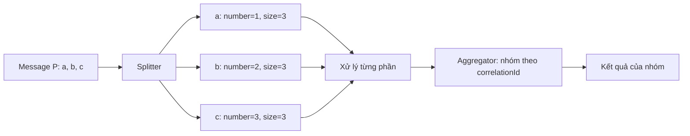

# sequenceSize và sequenceNumber

Trong chương **Splitter** của `SPRING_INTEGRATION_CORE`, hai header `sequenceNumber` và `sequenceSize` mô tả vị trí và số lượng message trong một lần chia. Chúng giúp nối bước tách dữ liệu với bước xử lý từng phần, sắp lại thứ tự hoặc tổng hợp kết quả.

Điểm cần phân biệt ngay: **vị trí của một phần tử, thứ tự phần tử đến đích và điều kiện nhóm đã hoàn tất là ba khái niệm khác nhau**. Hiểu sự khác nhau này giúp thiết kế luồng có transformer, router, filter và aggregator mà không vô tình làm mất kết quả hoặc chờ vô hạn.

## 1. Từ một message thành một chuỗi message

Giả sử một yêu cầu mang payload là ba mã hàng:

```text
Message gốc
  id      = P
  payload = ["a", "b", "c"]
```

Với splitter chuẩn và `applySequence = true`, mô hình đầu ra là:

| Payload con | correlationId | sequenceNumber | sequenceSize |
| --- | --- | ---: | ---: |
| `"a"` | `P` | 1 | 3 |
| `"b"` | `P` | 2 | 3 |
| `"c"` | `P` | 3 | 3 |

`P` trong bảng là ký hiệu cho ID của message đi vào splitter, không phải một chuỗi bắt buộc phải đặt tên như vậy. Mỗi message con có ID riêng; chúng được liên hệ với nhau bằng `correlationId`. Splitter chuẩn lấy ID của message đầu vào làm correlation của lần chia và bắt đầu đánh số từ 1. [Mã nguồn AbstractMessageSplitter](https://github.com/spring-projects/spring-integration/blob/main/spring-integration-core/src/main/java/org/springframework/integration/splitter/AbstractMessageSplitter.java).



Sơ đồ biểu diễn ba message độc lập về mặt thông điệp. Nó không tự khẳng định rằng ba message được thực thi trên ba thread; cách thực thi còn phụ thuộc loại channel và endpoint.

## 2. Ý nghĩa và phạm vi của từng header

| Header | Kiểu giá trị thường dùng | Trả lời câu hỏi |
| --- | --- | --- |
| `correlationId` | `Object`; splitter chuẩn thường dùng UUID của message cha | Message này thuộc lần chia nào? |
| `sequenceNumber` | `Integer` | Đây là phần tử thứ mấy của lần chia? |
| `sequenceSize` | `Integer` | Lần chia dự kiến có tổng cộng bao nhiêu phần tử? |

Trong Java, nên dùng các hằng `CORRELATION_ID`, `SEQUENCE_NUMBER`, `SEQUENCE_SIZE` từ `IntegrationMessageHeaderAccessor` để tránh sai chính tả. [API IntegrationMessageHeaderAccessor](https://docs.spring.io/spring-integration/api/org/springframework/integration/IntegrationMessageHeaderAccessor.html).

### 2.1. sequenceNumber là vị trí cục bộ

Với đầu vào có thứ tự xác định, `sequenceNumber` phản ánh vị trí khi splitter duyệt kết quả chia:

```text
Lần chia P: a -> 1, b -> 2, c -> 3
Lần chia Q: x -> 1, y -> 2
```

Vì số thứ tự bắt đầu lại ở mỗi lần chia, `sequenceNumber = 1` không phải định danh duy nhất trong toàn hệ thống. Khi cần định vị một phần của lần chia, phải xét cùng correlation và cấp chia tương ứng.

Vị trí còn phụ thuộc thứ tự duyệt của dữ liệu. Nếu đầu vào là một tập hợp không có thứ tự nghiệp vụ ổn định, việc xuất hiện số `1, 2, 3` không biến thứ tự đó thành thứ tự nghiệp vụ. Hãy sắp xếp dữ liệu trước khi chia nếu cần thứ tự theo ngày, mã hàng hoặc độ ưu tiên.

### 2.2. sequenceSize là tổng của lần chia

Trong ví dụ ba phần tử, cả ba message đều có `sequenceSize = 3`. Giá trị này không giảm thành `3, 2, 1` khi các phần tử được gửi đi.

Nó cũng không phải:

- Số message hiện đang có trong `QueueChannel`.
- Số message đã xử lý thành công.
- Số message còn thiếu tại aggregator.
- Tổng số phần tử của mọi yêu cầu đang chạy.

Nếu aggregator đã nhận hai phần khác nhau trong nhóm có tổng ba phần, nhóm hiện có hai message và còn thiếu một phần theo hợp đồng ban đầu. Header của các message vẫn mang tổng là `3`.

### 2.3. Các bất biến khi biết trước kích thước

Với một lần chia không rỗng, kích thước biết trước là `N` và sequence được tạo chuẩn, dữ liệu kỳ vọng có:

```text
sequenceSize = N > 0
1 <= sequenceNumber <= N
cùng correlationId ở cùng cấp chia
mỗi vị trí từ 1 đến N xuất hiện đúng một lần
```

Đây là hợp đồng để thiết kế luồng. Nó không có nghĩa mọi endpoint phía sau đều tự kiểm tra đủ bốn điều kiện. Một ứng dụng tự tạo header hoặc gửi message trùng vẫn có thể phá vỡ hợp đồng.

## 3. Đừng đồng nhất phần tử cuối với nhóm đã đủ

Giả sử ba phần được xử lý với thời gian khác nhau. Thứ tự hoàn thành là `c`, `a`, `b`, tương ứng `3 → 1 → 2`.

| Lần nhận tại aggregator | sequenceNumber vừa đến | Các vị trí đã nhận | Đủ ba phần? |
| --- | ---: | --- | --- |
| 1 | 3 | `{3}` | Chưa |
| 2 | 1 | `{1, 3}` | Chưa |
| 3 | 2 | `{1, 2, 3}` | Đủ, nếu dữ liệu hợp lệ và không trùng |

Ngay lần nhận đầu tiên đã có `sequenceNumber == sequenceSize`. Điều đó chỉ cho biết message vừa đến mang vị trí cuối của lần chia; message số 1 và số 2 có thể vẫn đang được xử lý.

Vì thế, điều kiện sau **không đủ** để chứng minh mọi kết quả đã đến:

```text
message.headers.sequenceNumber == message.headers.sequenceSize
```

Hãy phân biệt nhiệm vụ của ba thành phần:

| Thành phần | Vai trò trong ví dụ |
| --- | --- |
| Splitter | Tạo ba message và gắn thông tin của lần chia |
| Aggregator | Giữ các message liên quan, quyết định khi nào tổng hợp thành một kết quả |
| Resequencer | Phát các message riêng lẻ theo số thứ tự của chuỗi |

Resequencer dùng thông tin sequence để phát message theo thứ tự; nó không gộp payload thành một kết quả như aggregator. [Tài liệu Resequencer](https://docs.spring.io/spring-integration/reference/resequencer.html).

Nếu mục tiêu chỉ là tạo một danh sách kết quả đã sắp thứ tự, có thể sắp xếp ngay trong hàm tổng hợp. Nếu từng message phải đi qua một endpoint theo thứ tự trước khi tổng hợp, cần xem xét resequencer và cả cách thực thi ở phía sau nó.

## 4. Cấu hình và quan sát bằng Java DSL

Ví dụ sau tạo hai đoạn luồng:

```text
batchInput -> splitter -> parts
processedParts -> aggregator -> batchResults
```

Hai đoạn được nối bằng mã kiểm thử ở phần sau để chủ động gửi các kết quả theo thứ tự `3 → 1 → 2`. Trong ứng dụng thực tế, transformer hoặc service activator có thể nhận từng phần rồi chuyển kết quả sang `processedParts`.

Mã dùng Java DSL với `splitWith(...)`; cần `spring-integration-core` và các dependency Spring tương thích do dự án quản lý. Phần kiểm thử cần JUnit Jupiter. Có thể đặt hai lớp dưới đây trong cùng package để thực hành. [Cấu hình splitter bằng Java DSL](https://docs.spring.io/spring-integration/reference/dsl/java-splitters.html).

```java
import java.util.Comparator;
import java.util.stream.Collectors;

import org.springframework.context.annotation.Bean;
import org.springframework.context.annotation.Configuration;
import org.springframework.integration.channel.DirectChannel;
import org.springframework.integration.channel.QueueChannel;
import org.springframework.integration.config.EnableIntegration;
import org.springframework.integration.dsl.IntegrationFlow;
import org.springframework.messaging.Message;

import static org.springframework.integration.IntegrationMessageHeaderAccessor.SEQUENCE_NUMBER;

@Configuration
@EnableIntegration
public class SequenceHeadersConfig {

    @Bean
    public DirectChannel batchInput() {
        return new DirectChannel();
    }

    @Bean
    public QueueChannel parts() {
        return new QueueChannel();
    }

    @Bean
    public DirectChannel processedParts() {
        return new DirectChannel();
    }

    @Bean
    public QueueChannel batchResults() {
        return new QueueChannel();
    }

    @Bean
    public IntegrationFlow splitFlow() {
        return IntegrationFlow.from(batchInput())
                .splitWith(s -> s.applySequence(true))
                .channel(parts())
                .get();
    }

    @Bean
    public IntegrationFlow aggregateFlow() {
        return IntegrationFlow.from(processedParts())
                .aggregate(a -> a.outputProcessor(group ->
                        group.getMessages().stream()
                                .sorted(Comparator.comparingInt(
                                        SequenceHeadersConfig::sequenceNumber))
                                .map(message -> (String) message.getPayload())
                                .collect(Collectors.joining("|"))))
                .channel(batchResults())
                .get();
    }

    private static int sequenceNumber(Message<?> message) {
        Integer value = message.getHeaders().get(SEQUENCE_NUMBER, Integer.class);
        if (value == null) {
            throw new IllegalArgumentException("Missing sequenceNumber");
        }
        return value;
    }
}
```

`applySequence(true)` được viết tường minh để làm rõ chủ đề. Splitter chuẩn vốn bật cờ này mặc định. Cờ quyết định việc gắn sequence cho lần chia hiện tại; tắt cờ không đồng nghĩa xóa mọi sequence header đã có từ đầu vào. [Cách splitter tạo và sao chép header](https://github.com/spring-projects/spring-integration/blob/main/spring-integration-core/src/main/java/org/springframework/integration/splitter/AbstractMessageSplitter.java).

Trong đoạn aggregator, không cấu hình correlation strategy hay release strategy riêng: ví dụ dựa vào hợp đồng sequence mặc định. Hàm `outputProcessor` chỉ quyết định cách tạo kết quả khi nhóm được phép tổng hợp; nó sắp xếp theo số thứ tự rồi ghép payload thành chuỗi. Việc chọn nhóm và quyết định phát nhóm là trách nhiệm khác với việc tạo payload đầu ra. [Java DSL cho aggregator](https://docs.spring.io/spring-integration/reference/dsl/java-aggregators.html).

Ví dụ không đưa `QueueChannel` vào giữa mà thiếu consumer: mã kiểm thử chủ động lấy message từ `parts` và gửi tiếp. Nếu đưa cấu hình này vào ứng dụng, cần bổ sung consumer hoặc một flow có poller cho `parts` để dữ liệu tiếp tục được xử lý.

## 5. Đọc header và bảo toàn chúng khi tạo kết quả

Có thể đọc header theo kiểu cụ thể:

```java
import org.springframework.integration.IntegrationMessageHeaderAccessor;
import org.springframework.messaging.Message;

public static void printSequence(Message<?> message) {
    Object correlationId = message.getHeaders().get(
            IntegrationMessageHeaderAccessor.CORRELATION_ID);
    Integer number = message.getHeaders().get(
            IntegrationMessageHeaderAccessor.SEQUENCE_NUMBER, Integer.class);
    Integer size = message.getHeaders().get(
            IntegrationMessageHeaderAccessor.SEQUENCE_SIZE, Integer.class);

    System.out.printf("correlation=%s, number=%s, size=%s%n",
            correlationId, number, size);
}
```

Đọc trực tiếp dưới dạng `Integer` giúp phân biệt header không có (`null`) với header có giá trị `0`. Không ép `sequenceSize` thành `String` chỉ vì nó được hiển thị dưới dạng văn bản trong log.

Trong callback xử lý nghiệp vụ nhận `Message<?>`, nếu tự dựng message trả về để gửi tiếp, hãy chủ động giữ các header cần thiết:

```java
import java.util.Locale;

import org.springframework.messaging.Message;
import org.springframework.messaging.support.MessageBuilder;

public static Message<String> processPart(Message<?> part) {
    String result = ((String) part.getPayload()).toUpperCase(Locale.ROOT);

    return MessageBuilder.withPayload(result)
            .copyHeaders(part.getHeaders())
            .build();
}
```

`copyHeaders(...)` trong `org.springframework.messaging.support.MessageBuilder` sao chép các header ứng dụng; `id` và `timestamp` không bị ghi đè từ map nguồn. Vì vậy, message kết quả có thể có ID mới và vẫn giữ correlation cùng sequence của phần đang xử lý. [API MessageBuilder của Spring Messaging](https://docs.spring.io/spring-framework/docs/current/javadoc-api/org/springframework/messaging/support/MessageBuilder.html).

Đoạn trên minh họa việc tự tạo message. Với transformer chỉ trả về payload, framework thường đảm nhiệm tạo message và chuyển tiếp header. Khi đi qua adapter hoặc hệ thống ngoài tiến trình, cần kiểm tra mapping header thực tế thay vì giả định ba header này luôn đi qua nguyên vẹn.

## 6. Kiểm thử các tính chất quan trọng của sequence

Lớp dưới đây kiểm tra trực tiếp cấu hình ở phần 4 bằng JUnit Jupiter, không cần thêm Spring Test. Mỗi test mở context riêng để các nhóm và queue không ảnh hưởng lẫn nhau.

```java
import java.util.List;
import java.util.Locale;

import org.junit.jupiter.api.Test;
import org.springframework.context.annotation.AnnotationConfigApplicationContext;
import org.springframework.integration.channel.DirectChannel;
import org.springframework.integration.channel.QueueChannel;
import org.springframework.messaging.Message;
import org.springframework.messaging.support.GenericMessage;
import org.springframework.messaging.support.MessageBuilder;

import static org.junit.jupiter.api.Assertions.*;
import static org.springframework.integration.IntegrationMessageHeaderAccessor.CORRELATION_ID;
import static org.springframework.integration.IntegrationMessageHeaderAccessor.SEQUENCE_NUMBER;
import static org.springframework.integration.IntegrationMessageHeaderAccessor.SEQUENCE_SIZE;

class SequenceHeadersTest {

    @Test
    void assignsPositionSizeAndCorrelationForEachBatch() {
        try (var context = new AnnotationConfigApplicationContext(
                SequenceHeadersConfig.class)) {
            DirectChannel input = context.getBean("batchInput", DirectChannel.class);
            QueueChannel parts = context.getBean("parts", QueueChannel.class);

            Message<List<String>> first = MessageBuilder
                    .withPayload(List.of("a", "b", "c"))
                    .setHeader("batchId", "B-007")
                    .build();

            assertTrue(input.send(first));

            for (int index = 0; index < 3; index++) {
                Message<?> part = take(parts);
                assertEquals(first.getPayload().get(index), part.getPayload());
                assertEquals(Integer.valueOf(index + 1),
                        part.getHeaders().get(SEQUENCE_NUMBER, Integer.class));
                assertEquals(Integer.valueOf(3),
                        part.getHeaders().get(SEQUENCE_SIZE, Integer.class));
                assertEquals(first.getHeaders().getId(),
                        part.getHeaders().get(CORRELATION_ID));
                assertEquals("B-007", part.getHeaders().get("batchId"));
                assertNotEquals(first.getHeaders().getId(), part.getHeaders().getId());
            }
            assertNull(parts.receive(0));

            Message<List<String>> second = new GenericMessage<>(List.of("x"));
            assertTrue(input.send(second));

            Message<?> next = take(parts);
            assertEquals(Integer.valueOf(1),
                    next.getHeaders().get(SEQUENCE_NUMBER, Integer.class));
            assertEquals(Integer.valueOf(1),
                    next.getHeaders().get(SEQUENCE_SIZE, Integer.class));
            assertEquals(second.getHeaders().getId(),
                    next.getHeaders().get(CORRELATION_ID));
            assertNotEquals(first.getHeaders().getId(),
                    next.getHeaders().get(CORRELATION_ID));
            assertNull(parts.receive(0));
        }
    }

    @Test
    void waitsForAllPartsWhenTheLastPositionArrivesFirst() {
        try (var context = new AnnotationConfigApplicationContext(
                SequenceHeadersConfig.class)) {
            DirectChannel input = context.getBean("batchInput", DirectChannel.class);
            QueueChannel parts = context.getBean("parts", QueueChannel.class);
            DirectChannel processedParts = context.getBean(
                    "processedParts", DirectChannel.class);
            QueueChannel results = context.getBean("batchResults", QueueChannel.class);

            assertTrue(input.send(new GenericMessage<>(List.of("a", "b", "c"))));
            Message<?> first = take(parts);
            Message<?> second = take(parts);
            Message<?> third = take(parts);

            assertTrue(processedParts.send(process(third)));
            assertNull(results.receive(0));

            assertTrue(processedParts.send(process(first)));
            assertNull(results.receive(0));

            assertTrue(processedParts.send(process(second)));
            Message<?> result = take(results);
            assertEquals("A|B|C", result.getPayload());
            assertNull(results.receive(0));
        }
    }

    @Test
    void usesUnknownSizeForAnOrdinaryIterator() {
        try (var context = new AnnotationConfigApplicationContext(
                SequenceHeadersConfig.class)) {
            DirectChannel input = context.getBean("batchInput", DirectChannel.class);
            QueueChannel parts = context.getBean("parts", QueueChannel.class);

            Message<?> parent = new GenericMessage<>(List.of("x", "y").iterator());
            assertTrue(input.send(parent));

            for (int number = 1; number <= 2; number++) {
                Message<?> part = take(parts);
                assertEquals(Integer.valueOf(number),
                        part.getHeaders().get(SEQUENCE_NUMBER, Integer.class));
                assertEquals(Integer.valueOf(0),
                        part.getHeaders().get(SEQUENCE_SIZE, Integer.class));
                assertEquals(parent.getHeaders().getId(),
                        part.getHeaders().get(CORRELATION_ID));
            }
            assertNull(parts.receive(0));
        }
    }

    private static Message<String> process(Message<?> part) {
        String value = ((String) part.getPayload()).toUpperCase(Locale.ROOT);
        return MessageBuilder.withPayload(value)
                .copyHeaders(part.getHeaders())
                .build();
    }

    private static Message<?> take(QueueChannel channel) {
        Message<?> message = channel.receive(1_000);
        assertNotNull(message, "Expected an output message");
        return message;
    }
}
```

Ý nghĩa của ba test:

- Test thứ nhất xác nhận vị trí bắt đầu từ 1, tổng không đổi, correlation gắn với đúng message cha và lần chia tiếp theo bắt đầu lại từ 1.
- Test thứ hai chứng minh phần có số thứ tự cuối đến trước không làm nhóm phát sớm. Nó cũng xác nhận hàm tổng hợp tạo kết quả theo vị trí ban đầu.
- Test thứ ba xác nhận một `Iterator` thông thường vẫn có số thứ tự tăng dần dù tổng chưa biết trước.

`receive(0)` kiểm tra queue ngay tại thời điểm gọi. Trong ví dụ này, `processedParts` là `DirectChannel`, nên việc gửi và xử lý aggregator diễn ra đồng bộ trước khi kiểm tra queue. Với luồng dùng executor hoặc broker, cần cơ chế chờ có giới hạn phù hợp; không lấy giả định đồng bộ của test này áp vào mọi channel.

Đây là mã thực hành để người học đưa vào dự án và chạy. Việc có ví dụ kiểm thử trong bài không đồng nghĩa các test đã được thực thi trong môi trường của dự án.

## 7. sequenceSize bằng 0: chưa biết tổng, không phải nhóm rỗng

Khi kết quả chia là một `Collection` hoặc mảng, splitter thường biết số phần tử trước khi phát. Với một `Iterator` thông thường, hoặc `Iterable` không xác định được kích thước, tổng thường chưa biết và header nhận giá trị `0`. Một số splitter chuyên biệt có thể xác định được kích thước qua `obtainSizeIfPossible(...)`. [Tài liệu Splitter, phần Iterators](https://docs.spring.io/spring-integration/api/org/springframework/integration/splitter/AbstractMessageSplitter.html).

Ví dụ cùng dữ liệu nhưng khác hình thức cung cấp:

| Kết quả đưa cho splitter | sequenceNumber của các phần | sequenceSize thông thường |
| --- | --- | --- |
| `List.of("x", "y")` | `1, 2` | `2` |
| `new String[] {"x", "y"}` | `1, 2` | `2` |
| `List.of("x", "y").iterator()` | `1, 2` | `0` |
| `Stream.of("x", "y")` | `1, 2` | `0` khi tổng không được xác định trước |

Không nên suy luận rằng vì chương trình phía gọi biết iterator lấy từ một list có hai phần tử, splitter cũng phải biết điều đó. Đối tượng splitter nhận được là iterator; nó không nhất thiết truy cập được list gốc.

Sau khi phần cuối được phát, các message đã gửi trước đó không tự được cập nhật lại header thành tổng cuối cùng. Nếu bên nhận cần biết tổng, luồng phải truyền thông tin đó bằng một hợp đồng rõ ràng.

### 7.1. Vì sao aggregator có thể chờ mãi?

Với nhóm không rỗng có `sequenceSize = 0`, chiến lược chờ đủ số lượng theo tổng sequence không có một tổng dương để đạt tới. Nhận thêm phần tử không biến số `0` thành tổng thực tế. Tài liệu splitter yêu cầu chọn release strategy phù hợp hoặc xử lý hết hạn cho trường hợp tổng không biết trước. [Hướng dẫn tổng hợp đầu ra từ Iterator](https://docs.spring.io/spring-integration/reference/splitter.html).

Các hướng thiết kế thường gặp:

| Hướng xử lý | Điều kiện áp dụng | Đánh đổi cần hiểu |
| --- | --- | --- |
| Chuyển dữ liệu thành collection trước khi chia | Dữ liệu hữu hạn, đủ nhỏ để giữ trong bộ nhớ | Biết tổng nhưng tăng bộ nhớ và thời gian chờ trước phần đầu tiên |
| Truyền tổng kỳ vọng bằng metadata và dùng release strategy phù hợp | Nguồn biết tổng đáng tin cậy của đúng nhóm | Phải xác nhận tổng khớp dữ liệu và cùng phạm vi correlation |
| Dùng tín hiệu kết thúc cùng trạng thái số phần đã xử lý | Nguồn có giao thức kết thúc rõ ràng | Tín hiệu kết thúc có thể đến trước kết quả còn đang chạy |
| Hết hạn nhóm và xử lý kết quả thiếu | Nghiệp vụ chấp nhận thiếu, hoặc chuyển nhóm lỗi để xử lý riêng | Hết thời gian không chứng minh dữ liệu đầy đủ |

Đây là các lựa chọn thiết kế, không phải chỉ dẫn thay `sequenceSize = 0` bằng một con số tùy ý. Đặt tổng giả có thể khiến nhóm phát sớm và bỏ sót kết quả.

Nếu dùng tín hiệu kết thúc, một điều kiện đáng cân nhắc là: đã nhận thông tin tổng cuối cùng **và** đã xử lý đủ các phần tương ứng. Chỉ kiểm tra có marker `END` là không đủ khi các nhánh xử lý bất đồng bộ có thể về sau marker.

### 7.2. Đầu vào rỗng là trường hợp khác

Collection rỗng không có phần tử để phát ra như message con. Do đó, đừng chờ một message dữ liệu có `sequenceNumber = 0, sequenceSize = 0` đại diện tự động cho kết quả rỗng. Splitter có thể cấu hình `discardChannel` để xử lý message gốc có kết quả chia rỗng. [Hành vi kết quả chia rỗng](https://docs.spring.io/spring-integration/reference/splitter.html).

Nếu gateway của nghiệp vụ yêu cầu luôn có một câu trả lời, hãy quy định rõ kết quả cho đầu vào rỗng, chẳng hạn một đối tượng kết quả có danh sách rỗng, trước khi để luồng đi vào chu trình chia và tổng hợp.

## 8. Những thao tác làm mất hợp đồng về số lượng

### 8.1. Filter bỏ một phần tử sau splitter

Xét yêu cầu có ba dòng hàng, mỗi dòng ban đầu mang `sequenceSize = 3`:

```text
splitter -> dòng 1 -> xử lý thành công -> aggregator
         -> dòng 2 -> filter loại bỏ
         -> dòng 3 -> xử lý thành công -> aggregator
```

Nhóm chỉ có kết quả của dòng 1 và dòng 3. Tổng trên header vẫn là ba vì nó mô tả lần chia ban đầu. Nếu chính sách hoàn tất vẫn chờ ba message, nhóm sẽ thiếu một kết quả. Tài liệu aggregator lưu ý cần đổi release strategy hoặc dùng message bù khi filter làm mất thành viên trong sequence. [Filter phía trước aggregator](https://docs.spring.io/spring-integration/reference/aggregator.html).

Chọn cách sửa theo ý nghĩa nghiệp vụ:

- Nếu dòng bị loại không thuộc tập cần xử lý, lọc ngay trong collection trước khi đưa sang splitter để tổng được tính trên tập đã lọc.
- Nếu mỗi dòng phải có một kết quả cuối cùng, chuyển nhánh bị loại thành một kết quả như `SKIPPED`, giữ correlation và vị trí của chính dòng đó.
- Nếu nghiệp vụ chấp nhận chỉ một tập con, định nghĩa lại điều kiện hoàn tất và cách biểu diễn phần thiếu, kèm chính sách hết hạn.

Không hạ `sequenceSize` thành `2` trên riêng hai message còn lại mà thiếu một cơ chế thống nhất toàn nhóm. Khi nhiều nhánh cùng quyết định tổng, chúng có thể đưa ra các con số khác nhau hoặc quyết định sau khi nhóm đã phát.

### 8.2. Router chia thành các đích nhận khác nhau

Giả sử dòng 1 và dòng 3 được định tuyến về kho A, dòng 2 về kho B. Nếu mỗi kho có aggregator riêng nhưng vẫn chờ tổng gốc là ba, kho A chỉ thấy hai kết quả và kho B chỉ thấy một.

Cần xác định nhóm mong muốn là kết quả của cả yêu cầu hay kết quả theo từng kho. Với toàn yêu cầu, các kết quả của các nhánh phải quay về điểm tổng hợp phù hợp. Với từng kho, nên thiết kế các nhóm con có tổng và correlation theo đúng tập dữ liệu của kho.

Đổi đích gửi của một message không tự định nghĩa lại số lượng thành viên cần có tại từng aggregator.

### 8.3. Một phần xử lý lỗi

Giả sử dòng 2 gặp lỗi gọi dịch vụ ngoài. Một message lỗi đi vào `errorChannel` không mặc nhiên trở thành kết quả hợp lệ thứ hai của nhóm nghiệp vụ.

Cần quyết định rõ dòng 2 sẽ được retry, phát kết quả `FAILED`, hay khiến cả nhóm chuyển sang xử lý thất bại. Nếu chuyển lỗi thành kết quả của một phần, phải lấy đúng correlation và sequence của message đang lỗi để nhóm nhận biết nó thay thế phần nào.

Với luồng cần giữ đủ số lượng, một kiểu kết quả nghiệp vụ có thể là:

```text
PartResult(
    itemId = "line-2",
    outcome = FAILED,
    reason = "inventory service unavailable"
)
```

Payload trên chỉ là minh họa mô hình dữ liệu. Nó cần được bọc trong message giữ header của phần số 2, và không được đi cùng một kết quả thành công khác cho chính phần đó mà thiếu cơ chế chống trùng.

### 8.4. Message trùng có thể làm đủ số đếm nhưng thiếu vị trí

`SimpleSequenceSizeReleaseStrategy` so sánh kích thước nhóm với tổng sequence và không kiểm tra trùng số thứ tự. Vì vậy, không nên coi chiến lược này là bộ kiểm tra mọi vị trí xuất hiện đúng một lần. [API SimpleSequenceSizeReleaseStrategy](https://docs.spring.io/spring-integration/api/org/springframework/integration/aggregator/SimpleSequenceSizeReleaseStrategy.html).

Ví dụ ba message khác ID nhưng mang vị trí `1, 1, 3` đều ghi tổng bằng `3`. Nhóm có thể đạt số lượng ba dù chưa có vị trí `2`. Khi nguồn có khả năng redelivery, cần lựa chọn chống trùng, kiểm tra hợp đồng nhóm hoặc release strategy phù hợp với yêu cầu.

Không có nghĩa mọi lần gửi lại đều làm tăng kích thước nhóm: message store và danh tính message cũng ảnh hưởng cách lưu. Điều cần kiểm soát ở đây là một vị trí nghiệp vụ có thể xuất hiện lại dưới một message mới.

Ngoài ra, cặp correlation và vị trí chỉ định vị một lần chia. Nếu replay tạo message cha mới, correlation mặc định cũng mới. Khi cần chống xử lý lặp qua nhiều lần chạy, hãy thiết kế khóa nghiệp vụ ổn định, ví dụ `batchId + lineId + operation`, thay vì chỉ dùng số thứ tự.

## 9. Sequence khi chia lồng nhau

Một yêu cầu có thể được chia theo đơn hàng, rồi mỗi đơn hàng tiếp tục được chia theo dòng hàng:

```text
Lô P
  -> Đơn A: sequenceNumber=1, sequenceSize=2
      -> Dòng A1: sequenceNumber=1, sequenceSize=3
      -> Dòng A2: sequenceNumber=2, sequenceSize=3
      -> Dòng A3: sequenceNumber=3, sequenceSize=3
  -> Đơn B: sequenceNumber=2, sequenceSize=2
      -> Dòng B1: sequenceNumber=1, sequenceSize=1
```

Số `1/3` của dòng A1 mô tả vị trí trong đơn A, không mô tả vị trí của đơn A trong lô P. Correlation hiện tại của các dòng thuộc lần chia đơn tương ứng.

Spring Integration hỗ trợ giữ ngữ cảnh cấp ngoài trong `sequenceDetails` và khôi phục thông tin sau tổng hợp bằng cơ chế `popSequence`. Với luồng splitter–aggregator chuẩn, điều này giúp tổng hợp dòng thành đơn rồi tổng hợp đơn thành lô; hành vi còn phụ thuộc kiểu kết quả của bộ tổng hợp và cấu hình `popSequence`. [Sequence lồng nhau trong aggregator](https://docs.spring.io/spring-integration/reference/aggregator.html).

Hệ quả khi thiết kế và gỡ lỗi:

- Đọc `sequenceNumber` hiện tại theo đúng cấp chia đang xử lý.
- Để các cặp splitter và aggregator khớp theo cấp: tổng hợp dòng trước khi tổng hợp đơn.
- Khi tự tạo message, tránh làm mất `sequenceDetails` nếu còn cần quay lại cấp ngoài.
- Giữ mã nghiệp vụ như `batchId`, `orderId`, `lineId` ở các header hoặc payload riêng để theo dõi xuyên suốt các cấp.

Không nên ghi đè correlation hiện tại bằng `orderId` chỉ để log dễ đọc mà chưa xem xét correlation strategy và cơ chế lồng nhau. Có thể thêm header nghiệp vụ riêng để đạt mục đích quan sát.

## 10. Đọc log và chẩn đoán đúng phạm vi

Một dòng log hữu ích tại điểm ngay trước aggregator có thể chứa:

```text
stage=beforeAggregate batchId=B-007 correlation=P number=3 size=3 outcome=SUCCESS
stage=beforeAggregate batchId=B-007 correlation=P number=1 size=3 outcome=SUCCESS
stage=beforeAggregate batchId=B-007 correlation=P number=2 size=3 outcome=SUCCESS
```

Từ các dòng này có thể thấy thứ tự đến khác thứ tự sequence. Để kết luận nhóm hoàn tất, vẫn phải xét trạng thái nhóm và chính sách phát kết quả; ba dòng log độc lập không thay thế kiểm soát trạng thái tại aggregator.

| Hiện tượng | Khả năng cần kiểm tra | Hướng kiểm tra tiếp theo |
| --- | --- | --- |
| Có phần mang `number=3, size=3` nhưng chưa có kết quả | Phần 1 hoặc 2 chưa đến | Đối chiếu theo cùng correlation và cùng cấp chia |
| Có dữ liệu nhưng `size=0` | Tổng không biết trước | Xem kiểu kết quả chia và release strategy đang dùng |
| Nhóm dừng ở 2 trong khi tổng bằng 3 | Filter, router hoặc lỗi làm thiếu phần | Theo vết từng vị trí qua nhánh loại bỏ và nhánh lỗi |
| Đủ số lượng nhưng thiếu một dòng nghiệp vụ | Có message trùng hoặc trộn nhóm | So sánh vị trí, mã dòng và ID message |
| Các phần cùng yêu cầu lại nằm ở nhiều nhóm | Correlation bị đổi hoặc mất | Kiểm tra chỗ tự dựng message và mapping header |
| Nhóm nhận dữ liệu từ nhiều yêu cầu khác nhau | Khóa gom nhóm quá rộng | Kiểm tra correlation strategy, nhất là khóa tùy chỉnh |
| Kết quả đủ nhưng thứ tự sai với yêu cầu | Thứ tự hoàn thành bị dùng làm thứ tự nghiệp vụ | Sắp theo sequence hoặc khóa nghiệp vụ phù hợp |
| Số thứ tự dường như quay lại 1 ở giữa luồng | Có lần chia mới hoặc cấp chia mới | Kiểm tra ranh giới splitter và ngữ cảnh cấp ngoài |

Khi ghi log, nên giữ riêng định danh kỹ thuật của message, correlation của lần chia và định danh nghiệp vụ. Ba thông tin này giải thích những loại quan hệ khác nhau.

## 11. Thực hành mở rộng

Sau khi chạy các ví dụ, có thể thay đổi từng yếu tố để quan sát tác động:

1. Đổi payload từ list sang iterator và kiểm tra chỉ kích thước sequence chuyển từ tổng biết trước sang `0`, còn số thứ tự vẫn tăng.
2. Chèn một filter loại phần số 2 sau splitter; xác nhận phần còn lại vẫn mang tổng ban đầu, rồi chọn một cách xử lý phần bị loại theo nghiệp vụ.
3. Tạo hai batch khác nhau cùng có ba phần tử và xen kẽ kết quả; xác nhận chúng được gom riêng nhờ correlation.
4. Mô phỏng một vị trí được gửi lại dưới message ID mới để đánh giá chính sách chống trùng.
5. Chia đơn hàng thành dòng hàng theo hai cấp và quan sát header trước, sau từng aggregator.

Trọng tâm cần đạt là đọc được `sequenceNumber` như vị trí của một phần, đọc `sequenceSize` như tổng kỳ vọng của đúng lần chia và dùng `correlationId` để xác định nhóm. Khi một luồng thay đổi số lượng, thứ tự hoặc cấp chia, điều kiện hoàn tất phải tiếp tục phù hợp với hợp đồng dữ liệu thực tế.
