# correlationId do splitter tạo

Trong chương **Splitter** của module **SPRING_INTEGRATION_CORE**, bài này giải thích cách các thông điệp con giữ được quan hệ với một lần tách. Đây là nền tảng để thiết kế luồng `Message → MessageChannel → endpoint → aggregator`, quan sát lỗi và kiểm thử bằng Java DSL.

Điểm cần nắm: khi bật `applySequence` theo mặc định, splitter dùng **ID của thông điệp ngay tại đầu vào splitter** làm `correlationId` cho các thông điệp con. Các con thuộc cùng lần tách có chung khóa này; mỗi con vẫn có ID riêng. Có thể đối chiếu quy tắc đó trong [mã nguồn AbstractMessageSplitter 6.5.0](https://github.com/spring-projects/spring-integration/blob/v6.5.0/spring-integration-core/src/main/java/org/springframework/integration/splitter/AbstractMessageSplitter.java).

Ví dụ trong bài dùng Java 17, Spring Integration Core 6.5.x và JUnit Jupiter 5. Các thư viện Spring cần có phiên bản tương thích với nhau, thường được quản lý bằng BOM hoặc Spring Boot. Bài không yêu cầu broker hay dịch vụ bên ngoài.

## 1. Vì sao cần biết các thông điệp con thuộc lần tách nào?

Giả sử hệ thống nhận hai yêu cầu xử lý danh sách mã hàng:

```text
Yêu cầu A: ["book", "pen"]
Yêu cầu B: ["book", "pen"]
```

Payload giống nhau nhưng đây là hai lần xử lý độc lập. Sau splitter, bốn thông điệp cùng đi qua một kênh. Nếu chỉ nhìn payload `"book"`, consumer không biết nó thuộc yêu cầu A hay B.

Ta cần một khóa nhóm cho từng lần tách:

```mermaid
flowchart LR
    A["Message A: id=A"] --> S[Splitter]
    B["Message B: id=B"] --> S
    S --> A1["book: correlationId=A, số 1/2"]
    S --> A2["pen: correlationId=A, số 2/2"]
    S --> B1["book: correlationId=B, số 1/2"]
    S --> B2["pen: correlationId=B, số 2/2"]
    A1 --> GA["Nhóm A"]
    A2 --> GA
    B1 --> GB["Nhóm B"]
    B2 --> GB
```



Các ký hiệu `A`, `B` trong hình thay cho ID thực tế. Chúng không phải tên bean, tên channel hay giá trị do splitter suy ra từ nội dung danh sách.

Trong một pipeline đồng thời, con của B có thể đến trước con của A. Vì vậy, cách nghĩ “hai thông điệp nhận liên tiếp là một nhóm” không thể thay thế khóa tương quan.

## 2. Phân biệt ID, correlationId và các header thứ tự

Spring Integration khai báo các header tương quan và thứ tự trong `IntegrationMessageHeaderAccessor`. Riêng ID thông điệp thuộc `MessageHeaders`. Xem [API IntegrationMessageHeaderAccessor](https://docs.spring.io/spring-integration/api/org/springframework/integration/IntegrationMessageHeaderAccessor.html).

| Header | Hằng số Java | Câu hỏi mà nó trả lời |
| --- | --- | --- |
| `id` | `MessageHeaders.ID` | Đây là thông điệp nào? |
| `correlationId` | `IntegrationMessageHeaderAccessor.CORRELATION_ID` | Thông điệp này thuộc nhóm tương quan nào? |
| `sequenceNumber` | `IntegrationMessageHeaderAccessor.SEQUENCE_NUMBER` | Đây là phần tử thứ mấy trong chuỗi? |
| `sequenceSize` | `IntegrationMessageHeaderAccessor.SEQUENCE_SIZE` | Chuỗi dự kiến có bao nhiêu phần tử? |
| `sequenceDetails` | `IntegrationMessageHeaderAccessor.SEQUENCE_DETAILS` | Có ngữ cảnh chuỗi bên ngoài cần khôi phục không? |

Với thông điệp cha có `id=P` và payload `List.of("book", "pen", "bag")`, kết quả tách thông thường là:

| Payload con | ID của con | correlationId | sequenceNumber | sequenceSize |
| --- | --- | --- | --- | --- |
| `book` | `C1` | `P` | `1` | `3` |
| `pen` | `C2` | `P` | `2` | `3` |
| `bag` | `C3` | `P` | `3` | `3` |

Các ID `C1`, `C2`, `C3` phân biệt từng thông điệp. Khóa `P` nối chúng vào cùng một lần tách. Không kiểm tra `child.id == parent.id` để xác định quan hệ cha–con; quan hệ cần kiểm tra là `child.correlationId == parent.id`.

Giá trị do splitter lấy từ ID thông điệp thường là `UUID` với cơ chế tạo ID mặc định. Tuy nhiên, API correlation dùng `Object`: chiến lược tương quan tùy chỉnh có thể dùng kiểu khóa khác. Trong kiểm thử quy tắc splitter, so sánh với `parent.getHeaders().getId()` giúp tránh phụ thuộc một chuỗi UUID viết cứng.

## 3. “Do splitter tạo” có nghĩa chính xác là gì?

Một mô hình khái niệm cho trường hợp tách danh sách hữu hạn là:

```text
khóa_nhóm := ID của message nhận tại splitter
tổng_số := số phần tử của kết quả tách

với từng phần tử, bắt đầu ở vị trí 1:
    tạo message con mang payload của phần tử
    kế thừa các header phù hợp
    nếu applySequence được bật:
        thiết lập ngữ cảnh chuỗi mới:
            correlationId := khóa_nhóm
            sequenceNumber := vị trí phần tử
            sequenceSize := tổng_số
    gửi message con đi tiếp
```

Đây là mã giả để đọc luồng, không phải mã triển khai thay thế framework. Với splitter trả về sẵn các `Message`, việc sao chép và ưu tiên header còn phụ thuộc thông điệp kết quả; bật `applySequence` vẫn áp dụng ngữ cảnh chuỗi mới.

Ba hệ quả thực hành từ quy tắc trên:

1. Splitter không cần sinh thêm một UUID độc lập làm khóa nhóm; ID của thông điệp đầu vào đã cung cấp khóa đó.
2. Hai thông điệp đầu vào mới có cùng payload thông thường tạo hai nhóm khác nhau vì có ID khác nhau.
3. Gửi lại cùng một đối tượng `Message` qua cùng splitter giữ nguyên ID đầu vào, nên khóa nhóm cũng giữ nguyên. Vì vậy, xử lý gửi lại cần xét trạng thái aggregator và cơ chế chống trùng.

“Thông điệp đầu vào” ở đây là thông điệp **đến ngay trước splitter**. Nếu gateway hoặc transformer phía trước đã tạo một `Message` mới, ID được dùng là ID của thông điệp mới ấy, không nhất thiết là ID từng thấy lúc bắt đầu yêu cầu.

### Header correlation có sẵn có được giữ làm khóa hiện hành không?

Giả sử trước splitter có:

```text
id = P
correlationId = "purchase-2026-041"
```

Với `applySequence=true`, các con nhận `correlationId=P` ở mức chuỗi mới. Không được mặc định rằng chúng tiếp tục có `correlationId="purchase-2026-041"`.

Nếu cần giữ mã mua hàng xuyên suốt nghiệp vụ, đặt nó trong header riêng như `purchaseId`. Header tương quan của framework và mã nghiệp vụ có vòng đời khác nhau.

## 4. Quan sát trực tiếp bằng Java DSL

Để nhìn rõ header ngay sau splitter, dùng một `DirectChannel` nhận đầu vào và một `QueueChannel` để thu các con. Queue ở cuối chỉ phục vụ việc đọc kết quả; ví dụ không gắn consumer cần poller vào queue đó.

Cấu hình sau có hai luồng độc lập: luồng thứ nhất phục vụ quan sát header, luồng thứ hai minh họa tách, biến đổi rồi gom lại.

```java
import java.util.Locale;

import org.springframework.context.annotation.Bean;
import org.springframework.context.annotation.Configuration;
import org.springframework.integration.channel.DirectChannel;
import org.springframework.integration.channel.QueueChannel;
import org.springframework.integration.config.EnableIntegration;
import org.springframework.integration.dsl.IntegrationFlow;

@Configuration
@EnableIntegration
public class SplitterCorrelationConfig {

    @Bean
    public DirectChannel splitInput() {
        return new DirectChannel();
    }

    @Bean
    public QueueChannel parts() {
        return new QueueChannel();
    }

    @Bean
    public IntegrationFlow observeSplitHeaders() {
        return IntegrationFlow.from("splitInput")
                .split()
                .channel("parts")
                .get();
    }

    @Bean
    public DirectChannel processBatchInput() {
        return new DirectChannel();
    }

    @Bean
    public QueueChannel completedBatches() {
        return new QueueChannel();
    }

    @Bean
    public IntegrationFlow processBatch() {
        return IntegrationFlow.from("processBatchInput")
                .split()
                .<String, String>transform(
                        item -> item.toUpperCase(Locale.ROOT))
                .aggregate()
                .channel("completedBatches")
                .get();
    }
}
```

`.split()` sử dụng splitter mặc định, phù hợp với payload danh sách trong ví dụ. Các biến thể cấu hình DSL được mô tả trong [API BaseIntegrationFlowDefinition 6.5.0](https://docs.spring.io/spring-integration/docs/6.5.0/api/org/springframework/integration/dsl/BaseIntegrationFlowDefinition.html).

Có thể thử đọc một lần tách trong đoạn mã chạy cùng classpath với cấu hình trên:

```java
import java.util.List;

import org.springframework.context.annotation.AnnotationConfigApplicationContext;
import org.springframework.integration.IntegrationMessageHeaderAccessor;
import org.springframework.integration.channel.DirectChannel;
import org.springframework.integration.channel.QueueChannel;
import org.springframework.integration.support.MessageBuilder;
import org.springframework.messaging.Message;

try (var context = new AnnotationConfigApplicationContext(
        SplitterCorrelationConfig.class)) {

    DirectChannel input = context.getBean("splitInput", DirectChannel.class);
    QueueChannel output = context.getBean("parts", QueueChannel.class);

    Message<List<String>> parent = MessageBuilder
            .withPayload(List.of("book", "pen"))
            .setHeader("purchaseId", "PUR-041")
            .build();

    input.send(parent);

    for (int index = 0; index < 2; index++) {
        Message<?> child = output.receive(1000);
        if (child == null) {
            throw new IllegalStateException("Thiếu thông điệp con");
        }

        var headers = new IntegrationMessageHeaderAccessor(child);
        System.out.printf(
                "payload=%s, id=%s, correlationId=%s, sequence=%d/%d%n",
                child.getPayload(), child.getHeaders().getId(),
                headers.getCorrelationId(), headers.getSequenceNumber(),
                headers.getSequenceSize());
    }
}
```

Đặt phần `try` trong một phương thức, chẳng hạn `main`, nếu dùng file Java thông thường. Kết quả mong đợi có hai payload, hai ID con khác nhau, cùng một `correlationId` bằng ID của `parent`, và vị trí lần lượt `1/2`, `2/2`.

## 5. Aggregator dùng correlationId như thế nào?

Trong cấu hình aggregator mặc định, khóa nhóm được lấy từ header `correlationId`. Xem [Aggregator: correlation và release](https://docs.spring.io/spring-integration/reference/aggregator.html).

Với dữ liệu của ví dụ đầu bài, có thể hình dung trạng thái đang xử lý như sau:

```text
nhóm A: [book(A, 1/2), pen(A, 2/2)]
nhóm B: [book(B, 1/2), pen(B, 2/2)]
```

Cần tách biệt hai quyết định:

| Quyết định | Dữ liệu cần xét trong luồng thông thường |
| --- | --- |
| Thêm vào nhóm nào? | Khóa tương quan |
| Nhóm đã đủ để phát kết quả chưa? | Chính sách release và kích thước dự kiến |

Một khóa nhóm đúng không bảo đảm nhóm đã đủ phần tử. Chẳng hạn, với nhóm dự kiến ba kết quả, nhận hai kết quả cùng `correlationId` vẫn chưa đủ.

`SimpleSequenceSizeReleaseStrategy` so sánh số thông điệp trong nhóm với kích thước chuỗi dự kiến; nó không kiểm tra trùng `sequenceNumber`. Vì vậy, đừng dùng sự hiện diện của `correlationId` như một cam kết xử lý đúng một lần. Chi tiết này được nêu trong [API SimpleSequenceSizeReleaseStrategy 6.5.0](https://docs.spring.io/spring-integration/docs/6.5.0/api/org/springframework/integration/aggregator/SimpleSequenceSizeReleaseStrategy.html).

Ví dụ, nếu kết quả thứ nhất bị gửi lại thành một thông điệp mới, nhóm hai phần tử có thể nhận hai bản kết quả của vị trí `1`. Với chính sách chỉ đếm số lượng, cần cơ chế bổ sung để tránh xem đó là hai kết quả nghiệp vụ khác nhau.

`sequenceNumber` cũng không làm worker hoàn thành theo thứ tự. Khi đầu ra có yêu cầu thứ tự, kiểm thử rõ hợp đồng thứ tự của bước gom hoặc bổ sung bước resequencer phù hợp.

## 6. Khi tắt applySequence

Nếu không muốn splitter áp dụng bộ header chuỗi mới, có thể cấu hình:

```java
return IntegrationFlow.from("splitInput")
        .split(spec -> spec.applySequence(false))
        .channel("parts")
        .get();
```

Đây là cấu hình **thay thế** cho luồng quan sát ở phần 4, không đăng ký thêm một consumer cạnh tranh trên cùng `splitInput` để thử hai cấu hình đồng thời.

`applySequence(false)` có nghĩa splitter không thiết lập ngữ cảnh tương quan và thứ tự mới. Nó không phải thao tác xóa mọi header tương quan có sẵn. Các header kế thừa vẫn có thể xuất hiện. Mặc định và ý nghĩa của cờ này được mô tả trong [API @Splitter](https://docs.spring.io/spring-integration/api/org/springframework/integration/annotation/Splitter.html).

Trước khi tắt cờ, cần trả lời:

- Downstream có aggregator hoặc resequencer phụ thuộc bộ header chuỗi không?
- Nếu header cũ được giữ lại, nó có biểu diễn đúng nhóm và kích thước của các con mới không?
- Nếu dùng khóa nghiệp vụ riêng, ai xác định khi nào nhóm đó hoàn tất?

Tắt cờ chỉ để giữ một giá trị `correlationId` đẹp, dễ đọc có thể khiến nhóm vẫn mang `sequenceSize` của một cấp xử lý khác. Hãy mô hình hóa hợp đồng nhóm trước khi đổi cấu hình.

## 7. Splitter lồng nhau và sequenceDetails

Xét một đơn hàng gồm hai kiện. Mỗi kiện lại được tách thành các món:

```text
đơn hàng
  → splitter ngoài: kiện 1, kiện 2
      → splitter trong: các món của từng kiện
      → aggregator trong: một kết quả cho mỗi kiện
  → aggregator ngoài: một kết quả cho đơn hàng
```

Giả sử đơn hàng có ID `ORDER-MSG`, còn thông điệp kiện 1 có ID `PACKAGE-MSG-1`:

| Vị trí | correlationId hiện hành | Ý nghĩa |
| --- | --- | --- |
| Kiện 1 sau splitter ngoài | `ORDER-MSG` | Kiện thuộc chuỗi của đơn hàng |
| Các món sau splitter trong của kiện 1 | `PACKAGE-MSG-1` | Món thuộc chuỗi của kiện 1 |
| Kết quả kiện sau khi gom bên trong đúng cách | Khôi phục ngữ cảnh chuỗi ngoài | Kết quả kiện tiếp tục tham gia nhóm đơn hàng |

Spring Integration cung cấp cơ chế push/pop chi tiết chuỗi để hỗ trợ các cấp này. Có thể xem các phương thức tương ứng trong [API MessageBuilder](https://docs.spring.io/spring-integration/api/org/springframework/integration/support/MessageBuilder.html).

Với luồng splitter–aggregator tiêu chuẩn, aggregator có cơ chế `popSequence` để khôi phục ngữ cảnh ngoài. Không nên tự ghi đè `correlationId` của từng món thành ID đơn hàng: làm vậy khiến các món của nhiều kiện có nguy cơ vào cùng nhóm trước khi việc gom kiện hoàn tất.

Khi thay bộ xử lý kết quả của aggregator hoặc trả về các `Message` tùy chỉnh, cần kiểm tra riêng việc khôi phục header. Bài này dùng kết quả payload thông thường; không giả định mọi kiểu kết quả tùy chỉnh đều được xử lý giống nhau.

Từ đó, một hệ thống nên có hai loại thông tin quan sát: khóa nhóm của cấp hiện hành và mã nghiệp vụ xuyên suốt như `purchaseId`. Mã nghiệp vụ giúp tìm toàn bộ đơn hàng ngay cả khi khóa nhóm thay đổi theo cấp tách.

## 8. Giữ quan hệ tương quan qua transformer và endpoint tùy chỉnh

Trong luồng ở phần 4, transformer chỉ trả payload chuỗi đã đổi chữ hoa. Framework xử lý việc tạo thông điệp đầu ra và truyền các header phù hợp. Người viết nghiệp vụ không cần tự tái tạo bộ header ở mỗi phép đổi payload. Cách truyền thông tin chuỗi qua các endpoint được trình bày trong [Splitter reference](https://docs.spring.io/spring-integration/reference/splitter.html).

Rủi ro xuất hiện khi mã ứng dụng trực tiếp tạo và gửi một `Message` mới chỉ với payload:

```java
Message<String> detached = MessageBuilder
        .withPayload("BOOK")
        .build();
```

Biến `detached` không mang thông tin nhóm của thông điệp cũ. Nếu gửi trực tiếp nó vào aggregator mặc định, ứng dụng đã làm mất hợp đồng tương quan.

Khi thực sự cần tạo thông điệp mới trong mã tự quản lý, có thể dùng hàm sau:

```java
static Message<String> uppercaseKeepingHeaders(Message<String> source) {
    return MessageBuilder
            .withPayload(source.getPayload().toUpperCase(Locale.ROOT))
            .copyHeaders(source.getHeaders())
            .build();
}
```

Hàm dùng các import `Message`, `MessageBuilder`, `Locale` như ở phần 4. `copyHeaders` không ghi đè các header chỉ đọc mặc định `id` và `timestamp`; thông điệp mới vẫn có định danh của nó. Xem [triển khai BaseMessageBuilder 6.5.0](https://github.com/spring-projects/spring-integration/blob/v6.5.0/spring-integration-core/src/main/java/org/springframework/integration/support/BaseMessageBuilder.java).

Đây là ví dụ xử lý trong tiến trình. Khi đi qua HTTP, Kafka hoặc AMQP, cần kiểm thử thêm hợp đồng ánh xạ header của adapter đang dùng, đặc biệt kiểu giá trị của khóa nhóm ở hai đầu. Việc hai bên cùng hiển thị một UUID trong log chưa chứng minh chúng đang dùng cùng kiểu khóa khi so sánh.

## 9. Khóa nghiệp vụ và correlation strategy tùy chỉnh

Giả sử `purchaseId=PUR-041` có ba đợt cập nhật độc lập. Nếu chọn `purchaseId` làm khóa nhóm cho cả ba đợt, kết quả của các lần xử lý có thể bị trộn.

Một thiết kế có thể dùng:

```text
purchaseId = PUR-041           # định danh nghiệp vụ lâu dài
batchId = PUR-041:attempt-3    # định danh của một đợt xử lý
correlationId = UUID của cha   # ngữ cảnh chuỗi do splitter áp dụng
```

Chỉ khi hợp đồng yêu cầu gom theo `batchId`, mới đổi chiến lược của aggregator, ví dụ đoạn DSL sau:

```java
.aggregate(spec -> spec
        .correlationStrategy(message ->
                message.getHeaders().get("batchId")))
```

Đoạn này chỉ thay **khóa nhóm**, không sửa header `correlationId` của thông điệp. Mỗi message phải có `batchId` hợp lệ, và chính sách release phải phù hợp với toàn bộ nhóm mới. Nếu một nhóm nghiệp vụ chứa kết quả từ nhiều lần split, không thể mặc định dùng `sequenceSize` của riêng một lần split để xác định hoàn tất.

Ví dụ thiết kế: một đợt đồng bộ cần kết quả của hai nguồn, mỗi nguồn tách ba mục. Khóa `batchId` có thể giống nhau cho cả sáu kết quả, nhưng `sequenceSize=3` của từng nguồn không mô tả tổng sáu mục. Trường hợp đó cần mô hình đếm hoặc tín hiệu hoàn tất riêng thay vì chỉ đổi tên khóa.

## 10. Correlation đúng nhưng nhóm vẫn không hoàn tất

### 10.1. Không biết trước kích thước chuỗi

Với một `Iterator`, `Iterable` không xác định được kích thước hoặc nguồn stream, splitter có thể dùng `sequenceSize=0` để biểu diễn chưa biết tổng số. Không diễn giải giá trị này thành “không có con”. Framework có các điểm mở rộng để xác định kích thước khi khả thi; xem [Splitter 6.5: Iterators và Stream](https://docs.spring.io/spring-integration/reference/6.5/splitter.html).

Thiết kế cần quyết định một cách kết thúc phù hợp: biết trước số kết quả, có tín hiệu kết thúc, hoặc chấp nhận kết quả một phần theo timeout. `correlationId` vẫn hữu ích để nhóm dữ liệu, nhưng bản thân nó không mang thông tin kết thúc luồng.

### 10.2. Filter hoặc router làm mất một nhánh kết quả

Ví dụ splitter tạo ba con với `sequenceSize=3`, sau đó filter loại một con. Nhánh aggregator chỉ nhận hai kết quả:

```text
cùng correlationId=P
đã nhận: vị trí 1, vị trí 3
dự kiến: 3 kết quả
```

Một lựa chọn thiết kế là biến kết quả loại thành một kết quả nghiệp vụ có trạng thái `SKIPPED` và vẫn gửi về bước gom. Lựa chọn khác là lọc danh sách trước khi tách để kích thước chuỗi phản ánh tập mục thực sự cần xử lý. Dù chọn cách nào, cần định nghĩa rõ kết quả cuối cùng biểu diễn mục bị loại ra sao.

Với router, hãy kiểm tra đường về: mỗi nhánh có trả đúng một kết quả cho từng con không? Một nhánh kết thúc riêng có thể khiến nhóm chờ mãi dù các header chưa từng bị thay đổi.

### 10.3. Đầu vào rỗng

Không có phần tử nghĩa là không có con bình thường để gửi đến aggregator. Nếu caller gọi gateway và chờ một phản hồi, ứng dụng cần quy ước trả danh sách rỗng hoặc rẽ nhánh xử lý đầu vào rỗng. Không dựa vào việc aggregator tự nhận ra một nhóm chưa từng nhận thông điệp nào.

## 11. Lỗi, gửi lại và quan sát hệ thống

Trong luồng dùng `DirectChannel`, lỗi có thể truyền ngược về luồng gọi. Khi có ranh giới xử lý bất đồng bộ hoặc poller, cần xét cơ chế xuất bản `ErrorMessage` và kênh lỗi. Hai mô hình này được phân biệt trong [Error Handling reference](https://docs.spring.io/spring-integration/reference/error-handling.html).

Giả sử con thứ hai gọi dịch vụ bên ngoài thất bại. Dù hai con khác đã xử lý thành công, nhóm vẫn cần một quyết định cho mục lỗi: retry, ghi nhận thất bại như một kết quả, hoặc kết thúc nhóm theo chính sách đã định. Một `ErrorMessage` chứa exception không tự động trở thành kết quả hợp lệ của mục thứ hai.

Khi chuyển lỗi thành kết quả nghiệp vụ để gom, cần giữ được khóa nhóm, vị trí mục và số lượng dự kiến từ thông điệp thất bại. Kết quả cũng cần chỉ rõ trạng thái lỗi để bộ gom không coi nó là thành công.

Khi retry, phân biệt hai tình huống:

| Tình huống | Điều cần thiết kế |
| --- | --- |
| Retry một mục đã tách | Giữ nhóm cũ; ngăn cùng kết quả được ghi nhận nhiều lần |
| Chạy lại toàn bộ yêu cầu bằng một message cha mới | Quyết định đây là đợt mới hay cùng đợt nghiệp vụ |

Một bộ trường log hữu ích là:

```text
endpoint, messageId, correlationId, sequenceNumber,
sequenceSize, purchaseId, batchId, outcome
```

Khi tìm lỗi, bắt đầu từ một mã nghiệp vụ, xác định các lần xử lý liên quan, rồi theo từng khóa nhóm để xem vị trí nào chưa có kết quả. Không dùng ID của một con làm điều kiện tìm tất cả anh em của nó.

## 12. Kiểm thử các bất biến quan trọng

Chỉ kiểm tra payload sau splitter chưa đủ: chương trình có thể tạo đúng các phần tử nhưng làm mất khóa nhóm. Các kiểm thử sau chạy với `SplitterCorrelationConfig` ở phần 4, đặt trong cùng package hoặc bổ sung import phù hợp.

```java
import java.util.HashSet;
import java.util.List;
import java.util.Set;

import org.junit.jupiter.api.AfterEach;
import org.junit.jupiter.api.BeforeEach;
import org.junit.jupiter.api.Test;
import org.springframework.context.annotation.AnnotationConfigApplicationContext;
import org.springframework.integration.IntegrationMessageHeaderAccessor;
import org.springframework.integration.channel.DirectChannel;
import org.springframework.integration.channel.QueueChannel;
import org.springframework.integration.support.MessageBuilder;
import org.springframework.messaging.Message;

import static org.junit.jupiter.api.Assertions.*;

class SplitterCorrelationTest {

    private AnnotationConfigApplicationContext context;
    private DirectChannel input;
    private QueueChannel parts;

    @BeforeEach
    void start() {
        context = new AnnotationConfigApplicationContext(
                SplitterCorrelationConfig.class);
        input = context.getBean("splitInput", DirectChannel.class);
        parts = context.getBean("parts", QueueChannel.class);
    }

    @AfterEach
    void stop() {
        context.close();
    }

    @Test
    void childrenUseParentIdAndKeepTheirOwnIds() {
        Message<List<String>> parent = MessageBuilder
                .withPayload(List.of("book", "pen"))
                .setHeader("purchaseId", "PUR-041")
                .build();

        assertTrue(input.send(parent));

        Message<?> first = take(parts);
        Message<?> second = take(parts);
        assertEquals("book", first.getPayload());
        assertEquals("pen", second.getPayload());

        var firstHeaders = new IntegrationMessageHeaderAccessor(first);
        var secondHeaders = new IntegrationMessageHeaderAccessor(second);
        Object parentId = parent.getHeaders().getId();

        assertEquals(parentId, firstHeaders.getCorrelationId());
        assertEquals(parentId, secondHeaders.getCorrelationId());
        assertNotEquals(parentId, first.getHeaders().getId());
        assertNotEquals(first.getHeaders().getId(), second.getHeaders().getId());
        assertEquals(1, firstHeaders.getSequenceNumber());
        assertEquals(2, secondHeaders.getSequenceNumber());
        assertEquals(2, firstHeaders.getSequenceSize());
        assertEquals(2, secondHeaders.getSequenceSize());
        assertEquals("PUR-041", first.getHeaders().get("purchaseId"));
        assertEquals("PUR-041", second.getHeaders().get("purchaseId"));
        assertNull(parts.receive(0));
    }

    @Test
    void equalPayloadsInNewParentsProduceDifferentGroups() {
        Message<List<String>> firstParent = MessageBuilder
                .withPayload(List.of("book"))
                .build();
        Message<List<String>> secondParent = MessageBuilder
                .withPayload(List.of("book"))
                .build();

        assertTrue(input.send(firstParent));
        assertTrue(input.send(secondParent));

        Object firstKey = correlationOf(take(parts));
        Object secondKey = correlationOf(take(parts));
        assertEquals(firstParent.getHeaders().getId(), firstKey);
        assertEquals(secondParent.getHeaders().getId(), secondKey);
        assertNotEquals(firstKey, secondKey);
    }

    @Test
    void splitLevelUsesParentIdInsteadOfAnExistingBusinessCorrelation() {
        Message<List<String>> parent = MessageBuilder
                .withPayload(List.of("book"))
                .setHeader(IntegrationMessageHeaderAccessor.CORRELATION_ID,
                        "purchase-2026-041")
                .build();

        assertTrue(input.send(parent));

        Object childKey = correlationOf(take(parts));
        assertEquals(parent.getHeaders().getId(), childKey);
        assertNotEquals("purchase-2026-041", childKey);
    }

    @Test
    void transformedChildrenReturnAsSeparateCompletedBatches() {
        DirectChannel batchInput = context.getBean(
                "processBatchInput", DirectChannel.class);
        QueueChannel completed = context.getBean(
                "completedBatches", QueueChannel.class);

        assertTrue(batchInput.send(MessageBuilder
                .withPayload(List.of("book", "pen")).build()));
        assertTrue(batchInput.send(MessageBuilder
                .withPayload(List.of("bag", "cup")).build()));

        List<?> firstBatch = assertInstanceOf(
                List.class, take(completed).getPayload());
        List<?> secondBatch = assertInstanceOf(
                List.class, take(completed).getPayload());

        assertEquals(Set.of("BOOK", "PEN"), new HashSet<>(firstBatch));
        assertEquals(Set.of("BAG", "CUP"), new HashSet<>(secondBatch));
        assertNull(completed.receive(0));
    }

    private static Message<?> take(QueueChannel channel) {
        Message<?> result = channel.receive(1000);
        assertNotNull(result, "Không nhận được message trong thời gian chờ");
        return result;
    }

    private static Object correlationOf(Message<?> message) {
        return message.getHeaders().get(
                IntegrationMessageHeaderAccessor.CORRELATION_ID);
    }
}
```

Mỗi test tạo context mới để các queue và nhóm gom không lưu trạng thái từ test trước. Việc nhận theo thứ tự trong hai test đầu dựa trên luồng đồng bộ `DirectChannel` của ví dụ. Nếu đổi sang xử lý song song, hãy đối chiếu theo khóa nhóm và vị trí chuỗi thay vì thứ tự nhận toàn cục.

Test cuối so sánh tập payload vì mục tiêu ở đây là quan hệ nhóm, không phải hợp đồng sắp xếp. Tập dữ liệu test không có phần tử trùng; với nghiệp vụ cho phép trùng payload, cần so sánh cả số lần xuất hiện.

Các trường hợp nên bổ sung khi ứng dụng thực tế có dùng tính năng tương ứng là: tắt `applySequence`, hai cấp splitter–aggregator, một mục bị loại, retry sau thành công một phần, và truyền header qua broker.

## 13. Bảng chẩn đoán nhanh

| Hiện tượng | Hướng kiểm tra |
| --- | --- |
| Mọi con có khóa nhóm khác nhau | Có endpoint nào tự thay correlation bằng ID từng con không? |
| Nhiều yêu cầu nghiệp vụ bị gom chung | Có đang dùng một khóa nghiệp vụ quá rộng cho nhiều đợt xử lý không? |
| Không tìm được khóa nhóm tại aggregator | Kiểm tra `applySequence`, mã tạo message mới và bước ánh xạ header |
| Các khóa nhìn giống nhau trong log nhưng không vào cùng nhóm | Kiểm tra cả giá trị lẫn kiểu dữ liệu của khóa |
| Nhóm có khóa đúng nhưng chưa phát kết quả | Kiểm tra số kết quả, filter, nhánh router và lỗi chưa được xử lý |
| sequenceSize bằng 0 nhưng vẫn có dữ liệu | Xác định nguồn có biết kích thước hay không và chọn cách kết thúc nhóm |
| Gom bên trong xong nhưng gom bên ngoài bị treo | Kiểm tra ngữ cảnh chuỗi ngoài và việc khôi phục sequence details |
| Gửi lại cùng message có hành vi bất ngờ | Kiểm tra ID được giữ lại, trạng thái nhóm đã hoàn tất và chính sách chống trùng |

## 14. Các nguyên tắc áp dụng

- Với splitter mặc định, kiểm tra `child.correlationId` bằng ID của message nhận tại splitter.
- Giữ mã nghiệp vụ riêng khi cần tìm một giao dịch xuyên qua nhiều cấp xử lý.
- Bảo toàn thông tin nhóm khi tự tạo và gửi message mới.
- Thiết kế khóa nhóm, điều kiện hoàn tất và xử lý gửi lại như ba quyết định riêng.
- Kiểm thử cả header và khả năng hoàn tất nhóm; payload đúng chưa chứng minh luồng tích hợp đúng.
