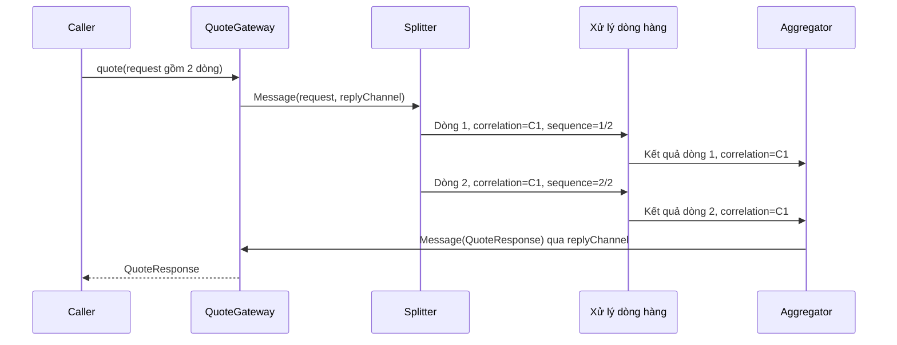

# Splitter trong request-reply

## 1. Bài toán: một yêu cầu, nhiều phần việc, một câu trả lời

Trong module `SPRING_INTEGRATION_CORE`, splitter là một endpoint giúp biến một thông điệp đầu vào thành nhiều thông điệp con. Với luồng request-reply, điều cần thiết kế thêm là cách đưa kết quả của các phần việc trở lại một lần gọi ban đầu.

Giả sử ứng dụng nhận yêu cầu tính giá cho một giỏ hàng gồm hai dòng. Mỗi dòng cần được tính thành tiền riêng; người gọi cần nhận một `QuoteResponse` chứa đủ hai kết quả và tổng tiền. Hợp đồng bên ngoài vẫn là:

```java
QuoteResponse quote(QuoteRequest request);
```

Phía trong, mô hình phù hợp là:

```text
1 request -> N thông điệp con -> N kết quả -> 1 response
```

Splitter đảm nhận bước `1 -> N`. Aggregator đảm nhận bước `N -> 1`. Gateway nối phương thức Java của người gọi với luồng thông điệp. Việc splitter phát ra nhiều message không khiến gateway tự động thu gom chúng thành danh sách. Đây là cách áp dụng mẫu Splitter–Aggregator trong một hợp đồng request-reply. [Tham khảo vai trò của splitter](https://docs.spring.io/spring-integration/reference/6.5/splitter.html).

Sau bài này, bạn có thể xây dựng luồng Java DSL hoàn chỉnh, giải thích đường đi của reply, giữ đúng nhóm và thứ tự kết quả, đồng thời nhận diện các trường hợp khiến người gọi chờ hết hạn.

## 2. Xác định hợp đồng trả lời trước khi viết flow

Không phải mọi luồng có splitter đều cần một aggregator. Quyết định phụ thuộc vào kết quả mà người gọi thực sự cần.

| Nhu cầu của người gọi | Thiết kế phù hợp |
| --- | --- |
| Nhận kết quả của tất cả phần tử trong một response | Splitter → xử lý từng phần → aggregator → reply |
| Chỉ cần xác nhận đã tiếp nhận yêu cầu | Trả acknowledgment theo hợp đồng riêng; xử lý kết quả về sau |
| Theo dõi từng kết quả khi nó xuất hiện | Thiết kế stream, sự kiện hoặc callback tương ứng |
| Chỉ cần trả lại danh sách đã tính toán trong một bước | Có thể dùng transformer/service activator trả về `List`; không cần tách thành nhiều message |

Kiểu trả về `List<LineQuote>` trên gateway chỉ mô tả payload mong đợi của một reply. Nó không phải chỉ dẫn để gateway gom nhiều reply độc lập.

Trong ví dụ của bài, hợp đồng là: đầu vào có ít nhất một dòng hàng hợp lệ; response chỉ thành công khi đã có kết quả của tất cả dòng; thứ tự response trùng với thứ tự đầu vào. Danh sách rỗng bị từ chối ngay khi tạo request. Quyết định này giúp ví dụ không có nhánh chờ một kết quả vốn không thể xuất hiện.

## 3. Vòng đời một lần gọi request-reply



Sơ đồ mô tả phiên bản xử lý đồng bộ. Nếu thêm executor sau splitter, hai dòng có thể xử lý và hoàn thành theo thứ tự khác nhau.

Gateway thường tạo một reply channel tạm cho lần gọi và đặt nó vào header `replyChannel` của request. Các message con cần giữ đường trả lời này. Endpoint cuối cùng có khả năng tạo reply sẽ sử dụng header khi không có output channel được cấu hình riêng. Không cần khai báo một reply channel chung chỉ để nối gateway với aggregator. [Cơ chế reply channel của gateway](https://docs.spring.io/spring-integration/reference/6.5/gateway.html).

Nếu bỏ aggregator và để từng kết quả con đi thẳng về gateway, một lần gọi có thể nhận payload sai kiểu hoặc gặp tình huống nhiều reply cạnh tranh trên cùng đường trả lời. Không nên dựa vào việc “lấy kết quả đầu tiên” để giải quyết một hợp đồng yêu cầu đủ kết quả.

## 4. Những header nối các phần việc với lần gọi ban đầu

| Header | Ý nghĩa trong ví dụ |
| --- | --- |
| `replyChannel` | Đường gửi response về lần gọi gateway đang chờ |
| `errorChannel` | Đường xử lý lỗi khi cơ chế thực thi có sử dụng header này |
| `correlationId` | Định danh nhóm message con cần được gộp |
| `sequenceNumber` | Vị trí phần tử trong chuỗi, bắt đầu từ 1 |
| `sequenceSize` | Số phần tử mà nhóm kỳ vọng nhận được |
| `requestId` | Header nghiệp vụ do ứng dụng thêm để đưa mã yêu cầu vào response |

Với splitter chuẩn bật `applySequence` theo mặc định, các message con của một lần tách có cùng `correlationId`; trong trường hợp một tầng tách, giá trị này dựa trên ID message đầu vào của splitter. Khi tách một `List` có hai phần tử, hai message nhận số thứ tự `1`, `2` và cùng kích thước `2`. Nếu tắt việc tạo sequence mà vẫn dùng aggregator mặc định, bạn phải cung cấp cơ chế nhóm và kết thúc nhóm thay thế.

`requestId` và `correlationId` có mục đích khác nhau. Một mã nghiệp vụ có thể được dùng lại khi người dùng tính lại giỏ hàng. Mỗi lần gọi vẫn cần một nhóm xử lý riêng. Ví dụ giữ correlation mặc định và chỉ dùng `requestId` để nhận diện nghiệp vụ; không cấu hình gom nhóm theo mã giỏ hàng.

`Message` chứa payload và headers. Khi tự tạo message mới trong handler, cần giữ các header phục vụ nhóm và trả lời; không chỉ chép `requestId`. Với transformer trả về payload như ví dụ dưới, framework xây dựng message đầu ra và truyền tiếp các header cần thiết. [Mô hình Message và headers](https://docs.spring.io/spring-integration/reference/6.5/message.html).

## 5. Ví dụ hoàn chỉnh bằng Java DSL

Ví dụ dùng Java 17 và API Spring Integration 6.5.x. Các lớp dưới đây cùng thuộc package `example.quote`; tên tệp tương ứng với tên lớp public. Đây là luồng trong bộ nhớ, chưa gọi HTTP, cơ sở dữ liệu hay dịch vụ định giá bên ngoài.

### 5.1. Dependency

Nếu dự án dùng Spring Boot với BOM đã quản lý phiên bản phù hợp, thêm các dependency sau vào phần `dependencies` của Maven:

```xml
<dependency>
    <groupId>org.springframework.boot</groupId>
    <artifactId>spring-boot-starter-integration</artifactId>
</dependency>
<dependency>
    <groupId>org.springframework.boot</groupId>
    <artifactId>spring-boot-starter-test</artifactId>
    <scope>test</scope>
</dependency>
```

Nếu không dùng Boot, cần quản lý phiên bản tương thích cho `spring-integration-core`, Spring Test và JUnit Jupiter. Không thêm một phiên bản Spring Integration tùy ý vào dự án đang có BOM quản lý dependency.

### 5.2. Dữ liệu nghiệp vụ

```java
package example.quote;

import java.math.BigDecimal;
import java.util.List;
import java.util.Objects;

public final class QuoteModel {

    private QuoteModel() {
    }

    public record QuoteRequest(String requestId, List<QuoteLine> lines) {
        public QuoteRequest {
            Objects.requireNonNull(requestId, "requestId");
            lines = List.copyOf(Objects.requireNonNull(lines, "lines"));
            if (lines.isEmpty()) {
                throw new IllegalArgumentException("At least one line is required");
            }
        }
    }

    public record QuoteLine(String sku, int quantity, BigDecimal unitPrice) {
        public QuoteLine {
            Objects.requireNonNull(sku, "sku");
            Objects.requireNonNull(unitPrice, "unitPrice");
            if (quantity <= 0 || unitPrice.signum() < 0) {
                throw new IllegalArgumentException("Invalid quantity or unitPrice");
            }
        }
    }

    public record LineQuote(String sku, int quantity, BigDecimal amount) {
    }

    public record QuoteResponse(
            String requestId,
            List<LineQuote> lines,
            BigDecimal total) {
        public QuoteResponse {
            lines = List.copyOf(lines);
        }
    }
}
```

Giá tiền dùng `BigDecimal` và được giả định cùng đơn vị tiền tệ. Ví dụ chỉ nhân đơn giá với số lượng; hệ thống thực tế cần bổ sung chính sách làm tròn, thuế hoặc chiết khấu của miền nghiệp vụ. `List.copyOf` giữ cấu trúc danh sách ổn định trong quá trình xử lý; các record con cũng không có trường có thể sửa trong ví dụ này.

### 5.3. Gateway có một kết quả trả về

```java
package example.quote;

import org.springframework.integration.annotation.MessagingGateway;

import static example.quote.QuoteModel.*;

@MessagingGateway(
        defaultRequestChannel = "quoteRequests",
        defaultRequestTimeout = "1000",
        defaultReplyTimeout = "3000",
        errorOnTimeout = true)
public interface QuoteGateway {

    QuoteResponse quote(QuoteRequest request);
}
```

`errorOnTimeout = true` yêu cầu báo lỗi khi hết thời gian chờ thay vì trả `null`. Ví dụ không cấu hình `errorChannel` riêng trên gateway, nên lỗi được truyền cho người gọi theo cơ chế gateway. Tùy chọn này có từ Spring Integration 6.2. [API `MessagingGateway`](https://docs.spring.io/spring-integration/docs/6.5.0/api/org/springframework/integration/annotation/MessagingGateway.html).

Giá trị 1.000 ms áp dụng cho việc gửi request khi thao tác gửi có thể phải chờ. Giá trị 3.000 ms là timeout nhận reply; phần sau giải thích vì sao nó không phải giới hạn cứng cho toàn bộ thời gian thực thi.

### 5.4. Cấu hình splitter, transformer và aggregator

```java
package example.quote;

import java.math.BigDecimal;
import java.util.ArrayList;
import java.util.Comparator;
import java.util.List;
import java.util.Objects;

import org.springframework.context.annotation.Bean;
import org.springframework.context.annotation.Configuration;
import org.springframework.integration.IntegrationMessageHeaderAccessor;
import org.springframework.integration.annotation.IntegrationComponentScan;
import org.springframework.integration.config.EnableIntegration;
import org.springframework.integration.dsl.IntegrationFlow;
import org.springframework.integration.store.MessageGroup;
import org.springframework.messaging.Message;

import static example.quote.QuoteModel.*;

@Configuration
@EnableIntegration
@IntegrationComponentScan(basePackageClasses = QuoteGateway.class)
public class QuoteFlowConfiguration {

    @Bean
    IntegrationFlow quoteFlow() {
        return IntegrationFlow.from("quoteRequests")
                .enrichHeaders(h -> h.headerExpression(
                        "requestId", "payload.requestId()"))
                .split(QuoteRequest.class, QuoteRequest::lines)
                .<QuoteLine, LineQuote>transform(QuoteFlowConfiguration::price)
                .aggregate(a -> a.outputProcessor(QuoteFlowConfiguration::merge))
                .get();
    }

    private static LineQuote price(QuoteLine line) {
        BigDecimal amount = line.unitPrice()
                .multiply(BigDecimal.valueOf(line.quantity()));
        return new LineQuote(line.sku(), line.quantity(), amount);
    }

    private static QuoteResponse merge(MessageGroup group) {
        List<Message<?>> messages = new ArrayList<>(group.getMessages());
        messages.sort(Comparator.comparingInt(
                QuoteFlowConfiguration::sequenceNumber));

        List<LineQuote> lines = messages.stream()
                .map(message -> (LineQuote) message.getPayload())
                .toList();

        BigDecimal total = lines.stream()
                .map(LineQuote::amount)
                .reduce(BigDecimal.ZERO, BigDecimal::add);

        String requestId = Objects.requireNonNull(
                messages.get(0).getHeaders().get("requestId", String.class),
                "requestId header");

        return new QuoteResponse(requestId, lines, total);
    }

    private static int sequenceNumber(Message<?> message) {
        return Objects.requireNonNull(message.getHeaders().get(
                IntegrationMessageHeaderAccessor.SEQUENCE_NUMBER,
                Integer.class), "sequenceNumber header");
    }
}
```

`@EnableIntegration` đăng ký hạ tầng Spring Integration trong context cấu hình trực tiếp. `@IntegrationComponentScan` tìm interface gateway trong package của `QuoteGateway`; chỉ quét component thông thường không đủ cho interface gateway.

Luồng thực hiện các bước sau:

1. Nhận payload `QuoteRequest` ở `quoteRequests`. Với cấu hình DSL này, channel đầu vào được tạo theo tên và các kết nối mặc định thực thi đồng bộ.
2. Chép `requestId` thành header trước khi payload request bị tách thành từng `QuoteLine`.
3. Splitter phát một message cho mỗi dòng hàng, kèm thông tin sequence.
4. Transformer tính ra một `LineQuote` cho mỗi message con.
5. Aggregator giữ các message cùng correlation, đợi đủ chuỗi rồi gọi `merge`.
6. `merge` tạo đúng một `QuoteResponse`. Aggregator gửi message kết quả theo `replyChannel`, vì ví dụ không chỉ định output channel riêng ở cuối flow.

Aggregator mặc định dùng correlation header để chọn nhóm và sequence size để xác định điều kiện đủ kết quả. `outputProcessor` chỉ tùy biến nội dung phản hồi; nó không tự thay đổi điều kiện release. [Cơ chế correlation và release](https://docs.spring.io/spring-integration/reference/6.5/aggregator.html), [API cấu hình aggregator](https://docs.spring.io/spring-integration/docs/6.5.0/api/org/springframework/integration/dsl/AggregatorSpec.html).

Không cấu hình release theo một số cố định như `group.size() == 2`: cùng flow cần xử lý được giỏ hàng một, hai hoặc nhiều dòng. Cũng không coi `sequenceNumber == sequenceSize` của một message là bằng chứng mọi phần tử đã tới; khi xử lý song song, phần tử cuối có thể hoàn thành trước.

`merge` sắp xếp theo `sequenceNumber` vì hợp đồng yêu cầu giữ thứ tự đầu vào. Không dùng thứ tự đến của kết quả để đại diện cho thứ tự nghiệp vụ. `requestId` được lấy từ nhóm message cùng request; mỗi dòng trong nhóm mang cùng giá trị do được enrich trước bước tách.

### 5.5. Dữ liệu và kết quả mong đợi

```java
QuoteRequest request = new QuoteRequest("REQ-100", List.of(
        new QuoteLine("BOOK", 2, new BigDecimal("120000.00")),
        new QuoteLine("PEN", 1, new BigDecimal("35000.00"))));

QuoteResponse response = quoteGateway.quote(request);
```

Kết quả mong đợi:

```text
requestId = REQ-100
lines[0] = BOOK, quantity=2, amount=240000.00
lines[1] = PEN,  quantity=1, amount=35000.00
total = 275000.00
```

Ở đây có hai message con và một reply cuối. `QuoteGateway` là bean được inject từ Spring; không tự tạo một implementation gateway bằng `new`.

## 6. Đồng bộ, song song và gateway gọi luồng con

Splitter tách message, không tự tạo thread xử lý cho từng phần tử. Với chuỗi `DirectChannel`, cùng thread của người gọi chạy qua các bước; dòng thứ nhất được xử lý trước khi splitter chuyển tiếp dòng thứ hai.

Muốn xử lý từng dòng bằng executor, có thể thêm hai bean sau vào lớp cấu hình. Các import bổ sung là `ExecutorChannel`, `MessageChannel` và `ThreadPoolTaskExecutor` từ các package được ghi trong ví dụ:

```java
@Bean
org.springframework.scheduling.concurrent.ThreadPoolTaskExecutor lineExecutor() {
    var executor = new org.springframework.scheduling.concurrent.ThreadPoolTaskExecutor();
    executor.setCorePoolSize(4);
    executor.setMaxPoolSize(4);
    executor.setQueueCapacity(100);
    executor.setThreadNamePrefix("quote-line-");
    return executor;
}

@Bean
org.springframework.messaging.MessageChannel quoteWork(
        org.springframework.scheduling.concurrent.ThreadPoolTaskExecutor lineExecutor) {
    return new org.springframework.integration.channel.ExecutorChannel(lineExecutor);
}
```

Trong `quoteFlow`, chèn `.channel("quoteWork")` ngay sau `.split(...)`, trước `.transform(...)`. Đây là thay đổi tùy chọn của ví dụ, không phải một flow thứ hai cùng đăng ký trên `quoteRequests`.

Executor cho phép các kết quả tới aggregator khác thứ tự. Cần giới hạn số dòng trên mỗi request và xử lý tình huống hàng đợi executor đầy; số worker không giới hạn tổng lượng công việc được chấp nhận. Việc chuyển thread cũng làm thay đổi phạm vi transaction và cách lỗi quay lại người gọi. [Đặc tính `DirectChannel` và `ExecutorChannel`](https://docs.spring.io/spring-integration/reference/6.5/channel/implementations.html).

Nếu mỗi dòng phải gửi sang một flow định giá khác rồi chờ một kết quả, có thể dùng operator `.gateway("linePricingRequests")` sau splitter. Khi đó có hai hợp đồng: gateway con phải trả đúng một kết quả cho mỗi dòng, còn gateway ngoài chỉ trả sau bước aggregator. Operator `.gateway(...)` là lời gọi request-reply tới flow khác; `.channel(...)` chỉ chuyển message sang channel và không tạo cùng ranh giới lời gọi. [Operator `gateway()` trong Java DSL](https://docs.spring.io/spring-integration/reference/6.5/dsl/java-gateway.html).

## 7. Những trường hợp làm mất reply hoặc không đủ nhóm

### 7.1. Splitter trả danh sách rỗng hoặc `null`

Danh sách rỗng tạo ra không message con nào, nên aggregator không có dữ liệu để bắt đầu nhóm và tạo reply. Kết quả split `null` cũng kết thúc nhánh xử lý. Splitter có hỗ trợ discard channel cho container rỗng, nhưng gửi request vào discard channel chưa bảo đảm có response về gateway.

Ví dụ chặn đầu vào rỗng trong constructor. Nếu nghiệp vụ chấp nhận giỏ hàng rỗng, nên phân nhánh trước splitter: tạo ngay một `QuoteResponse` rỗng có tổng bằng không ở nhánh đó; nhánh không rỗng tiếp tục split–aggregate. Hai nhánh đều phải hoàn thành hợp đồng trả lời của request.

### 7.2. Filter hoặc router làm thiếu phần tử

Giả sử splitter phát ba message với `sequenceSize = 3`. Nếu filter loại một message, aggregator chỉ nhận hai và vẫn chờ phần còn lại. Discard channel của filter không tự động giảm sequence size. [Hành vi loại bỏ message của filter](https://docs.spring.io/spring-integration/reference/6.5/filter.html).

Có thể chọn một trong các chính sách nghiệp vụ:

- Lọc dữ liệu trước khi tách, để số lượng được splitter công bố phản ánh tập thực sự cần xử lý; vẫn xử lý riêng trường hợp tập sau lọc rỗng.
- Với mỗi phần tử bị từ chối, phát một kết quả có trạng thái như `REJECTED`; aggregator vẫn nhận một kết quả kết thúc cho mỗi dòng gốc.
- Dùng quy tắc release riêng dựa trên metadata đủ rõ về số kết quả cuối cùng cần có.

Tương tự, khi router đưa các loại dòng sang nhiều nhánh, mọi nhánh cần đưa kết quả trở về cùng điểm gom. Một nhánh chỉ ghi log rồi kết thúc sẽ khiến request thiếu kết quả. Nếu một message con bị nhân bản thành nhiều kết quả, cũng phải xác định lại cách đếm; aggregator không tự suy ra ý định nghiệp vụ.

### 7.3. Nguồn tách không biết trước kích thước

Với `Iterator` hoặc nguồn iterable không xác định được số phần tử, splitter có thể đặt `sequenceSize = 0`. Giá trị này thể hiện chưa biết kích thước, không phải khẳng định rằng nhóm đã hoàn tất. Không nên kỳ vọng chiến lược release mặc định tự biết khi nào quá trình duyệt đã kết thúc.

Với request nhỏ, có thể materialize thành `List` trước khi split để có kích thước xác định. Với nguồn lớn, nên truyền metadata về số lượng dự kiến hoặc tín hiệu kết thúc và viết release strategy phù hợp. Thu gom toàn bộ dữ liệu lớn để phục vụ một lời gọi đồng bộ cũng cần được xem lại về bộ nhớ và độ trễ.

### 7.4. Handler tạo message mới và làm mất header

Một service có thể tính đúng số tiền nhưng trả về `Message<LineQuote>` chỉ chứa payload và header tùy chỉnh. Khi thiếu correlation hoặc reply channel, phần tiền tính được vẫn không trở thành response hoàn chỉnh.

Nếu không cần tự điều khiển header, hãy để handler trả payload. Nếu cần trả `Message`, xây dựng nó từ header đầu vào bằng API builder và chỉ thay những header có chủ đích. Với splitter lồng nhau, nên giữ cơ chế sequence của framework và gom đúng từng tầng, tránh tự ghi đè các header của tầng ngoài.

## 8. Timeout: phân biệt chờ reply, chờ nhóm và thời hạn nghiệp vụ

| Loại giới hạn | Nó kiểm soát điều gì? | Nó không tự thực hiện điều gì? |
| --- | --- | --- |
| Request timeout của gateway | Thời gian chờ gửi vào channel có thao tác gửi bị chặn | Ngắt handler đang chạy trên `DirectChannel` |
| Reply timeout của gateway | Thời gian chờ nhận reply sau khi phần gửi trả quyền điều khiển về gateway | Hủy mọi công việc đã gửi đi |
| Group timeout của aggregator | Thời gian chờ của nhóm trước xử lý timeout | Bảo đảm kết quả thiếu được coi là thành công |
| Timeout của dịch vụ định giá | Giới hạn lời gọi tài nguyên bên ngoài | Tự giải phóng toàn bộ nhóm của request |
| Deadline nghiệp vụ | Ngân sách thời gian mà ứng dụng tự truyền và thực thi | Có hiệu lực nếu các thành phần không kiểm tra nó |

Điểm dễ nhầm ở flow đồng bộ: nếu handler chạy ngay trong lời gọi `send()` và bị chặn trong 10 giây, cấu hình reply timeout 3 giây không tự ngắt handler sau 3 giây. Bộ đếm chờ reply bắt đầu khi thread quay về gateway sau bước gửi. [Mô tả `requestTimeout` và `replyTimeout` trong API `Gateway`](https://docs.spring.io/spring-integration/docs/6.5.0/api/org/springframework/integration/annotation/Gateway.html).

Với flow bất đồng bộ, gateway có thể đã hết thời gian chờ trong khi các dòng hàng vẫn đang được xử lý. Nếu chúng gây tác động phụ, retry toàn bộ request có thể lặp lại tác động đó. Cần chính sách idempotency theo request/lần thực thi và từng phần tử thay vì xem timeout như một rollback.

Ở aggregator, `groupTimeout` dạng khoảng thời gian được tính lại theo lần message mới đến khi nhóm chưa release. Nó không mặc nhiên là deadline tuyệt đối tính từ lúc gateway nhận request. Nếu cần thời hạn cố định, hãy truyền deadline và dùng biểu thức/chính sách phù hợp, đồng thời đặt timeout cho dịch vụ con.

Khi chỉ phát ra một phần kết quả lúc hết hạn, response cần thể hiện rõ `complete = false`, số lượng mong đợi, số lượng đã nhận và các dòng chưa có kết quả. Không áp dụng việc phát kết quả thiếu vào `QuoteResponse` của ví dụ rồi vẫn coi đó là báo giá đầy đủ.

Gateway hết hạn không tự dọn state của aggregator. Khi đưa flow vào vận hành, cần cấu hình timeout/reaper và đường xử lý nhóm hết hạn; đồng thời quyết định lưu metadata nhóm đã hoàn tất bao lâu để nhận diện message đến muộn. `expireGroupsUponCompletion(true)` xóa nhóm sau khi hoàn tất, nhưng message trùng tới sau đó có thể mở nhóm mới. Chọn chính sách dọn bộ nhớ cùng với chính sách chống trùng. [API quản lý correlation và expiry](https://docs.spring.io/spring-integration/docs/6.5.0/api/org/springframework/integration/dsl/CorrelationHandlerSpec.html).

## 9. Lỗi của từng phần tử và kết quả toàn request

Trong flow dùng `DirectChannel`, lỗi ném ra ở một bước xử lý chạy trên cùng call stack có thể truyền về người gọi gateway. Những message đã vào aggregator trước lỗi vẫn cần được xử lý theo chính sách vòng đời nhóm; việc ném exception không tự xóa mọi state đã tạo.

Khi có `ExecutorChannel` hoặc consumer chạy ở thread khác, không thể dựa vào exception Java của worker để tự xuất hiện trên stack của caller. Lỗi được xử lý bằng cơ chế error message/error channel của luồng. Chỉ ghi log `ErrorMessage` rồi kết thúc thường khiến gateway tiếp tục chờ response chưa được tạo. [Xử lý lỗi đồng bộ và bất đồng bộ](https://docs.spring.io/spring-integration/reference/6.5/error-handling.html).

Với bài toán báo giá, hãy chọn rõ một trong các hợp đồng:

| Chính sách | Hành vi mong muốn |
| --- | --- |
| Toàn bộ phải thành công | Một dòng lỗi làm request thất bại; cần ngăn reply thành công tới muộn và xử lý phần việc/state còn lại |
| Thu thập kết quả từng dòng | Mỗi dòng phát đúng một kết quả cuối dạng thành công hoặc lỗi; aggregator tạo response đủ các trạng thái |
| Chấp nhận thiếu khi hết hạn | Response mô tả rõ phần chưa xong và không tự coi tổng tạm tính là tổng cuối |

Với chính sách thu thập từng dòng, có thể thiết kế payload kiểu `LineOutcome(index, sku, status, amount, errorCode)`. Khi một lời gọi định giá thất bại, nhánh lỗi tạo một `LineOutcome` thất bại và bảo toàn correlation/sequence của dòng gốc. Không gửi trực tiếp một `ErrorMessage` vào aggregator đang ép payload sang `LineQuote`.

Nếu retry một dòng, chỉ nên đưa kết quả cuối cùng của dòng đó vào nhóm; không đếm mỗi lần thử như một phần tử mới. Dòng cuối theo thứ tự cũng không được nhận thêm quyền hoàn thành cả request khi các dòng trước chưa có kết quả cuối.

## 10. Kiểm thử hợp đồng request-reply

Kiểm thử toàn flow qua gateway giúp quan sát điều mà caller thực sự nhận được: một response đúng kiểu, đủ kết quả và đúng request. Ví dụ dưới dùng JUnit Jupiter và Spring Test; không cần chạy ứng dụng web hay dùng thời gian ngủ để đợi flow đồng bộ.

```java
package example.quote;

import java.math.BigDecimal;
import java.util.List;
import java.util.concurrent.ExecutorService;
import java.util.concurrent.Executors;
import java.util.concurrent.Future;
import java.util.concurrent.TimeUnit;

import org.junit.jupiter.api.Test;
import org.springframework.beans.factory.annotation.Autowired;
import org.springframework.test.context.junit.jupiter.SpringJUnitConfig;

import static example.quote.QuoteModel.*;
import static org.junit.jupiter.api.Assertions.*;

@SpringJUnitConfig(QuoteFlowConfiguration.class)
class QuoteFlowTest {

    @Autowired
    QuoteGateway gateway;

    @Test
    void returnsOneCompleteQuoteInInputOrder() {
        var request = new QuoteRequest("REQ-100", List.of(
                new QuoteLine("BOOK", 2, new BigDecimal("120000.00")),
                new QuoteLine("PEN", 1, new BigDecimal("35000.00"))));

        QuoteResponse response = gateway.quote(request);

        assertEquals("REQ-100", response.requestId());
        assertEquals(List.of("BOOK", "PEN"), response.lines().stream()
                .map(LineQuote::sku).toList());
        assertEquals(new BigDecimal("240000.00"),
                response.lines().get(0).amount());
        assertEquals(new BigDecimal("275000.00"), response.total());
    }

    @Test
    void keepsSeparateInvocationsEvenWhenBusinessIdIsReused() throws Exception {
        ExecutorService callers = Executors.newFixedThreadPool(2);
        try {
            Future<QuoteResponse> first = callers.submit(() -> gateway.quote(
                    twoLines("REUSED-ID", "A", "100.00")));
            Future<QuoteResponse> second = callers.submit(() -> gateway.quote(
                    twoLines("REUSED-ID", "B", "200.00")));

            QuoteResponse a = first.get(5, TimeUnit.SECONDS);
            QuoteResponse b = second.get(5, TimeUnit.SECONDS);

            assertEquals(new BigDecimal("200.00"), a.total());
            assertEquals(new BigDecimal("400.00"), b.total());
            assertEquals(List.of("A-1", "A-2"), a.lines().stream()
                    .map(LineQuote::sku).toList());
            assertEquals(List.of("B-1", "B-2"), b.lines().stream()
                    .map(LineQuote::sku).toList());
        }
        finally {
            callers.shutdownNow();
        }
    }

    @Test
    void rejectsEmptyRequestBeforeEnteringTheFlow() {
        assertThrows(IllegalArgumentException.class,
                () -> new QuoteRequest("EMPTY", List.of()));
    }

    private static QuoteRequest twoLines(
            String requestId, String skuPrefix, String unitPrice) {
        BigDecimal price = new BigDecimal(unitPrice);
        return new QuoteRequest(requestId, List.of(
                new QuoteLine(skuPrefix + "-1", 1, price),
                new QuoteLine(skuPrefix + "-2", 1, price)));
    }
}
```

Test thứ hai kiểm tra hai lần gọi đồng thời có cùng mã nghiệp vụ vẫn độc lập. Nó không chứng minh việc hoàn thành đảo thứ tự ở phiên bản executor. Khi thêm xử lý song song, nên điều khiển worker bằng latch hoặc stub để chủ động cho dòng thứ hai hoàn thành trước rồi xác nhận response vẫn giữ thứ tự ban đầu.

Các tình huống mở rộng nên được kiểm tra theo hợp đồng đã chọn:

| Tình huống | Điều cần xác nhận |
| --- | --- |
| Request chỉ có một dòng | Có đúng một kết quả và tổng đúng |
| Một dòng thất bại | Request báo lỗi hoặc có outcome lỗi theo chính sách |
| Filter loại một dòng | Không âm thầm đợi vô hạn vì vẫn kỳ vọng sequence cũ |
| Gateway hết thời gian chờ | Caller nhận lỗi đã chọn; có cơ chế xử lý công việc/state còn lại |
| Kết quả đến muộn hoặc trùng | Không phát thêm một response thành công ngoài hợp đồng |
| Nhiều request xen kẽ | Không trộn dòng hàng giữa các lần gọi |

Khi cần cô lập endpoint hoặc thay handler bằng mock, có thể dùng thêm `spring-integration-test`. Các bài kiểm thử ở trên chỉ cần context Spring và JUnit. [Hỗ trợ kiểm thử của Spring Integration](https://docs.spring.io/spring-integration/reference/6.5/testing.html).

## 11. Chẩn đoán khi gateway không nhận được kết quả

| Biểu hiện | Điểm kiểm tra đầu tiên |
| --- | --- |
| Hết hạn với đầu vào rỗng | Có nhánh tạo response trước splitter hay chỉ phát ra 0 message? |
| Chỉ một số request bị treo | Có filter, router, handler trả `null` hoặc lỗi làm mất một kết quả? |
| Có đủ dữ liệu tính toán nhưng nhóm không release | Correlation và sequence có bị mất hoặc sửa sai không? Kích thước có xác định được không? |
| Response sai thứ tự | Có sắp xếp theo sequence hoặc chỉ số nghiệp vụ thay vì thời gian đến không? |
| Response chứa dòng của lần gọi khác | Có dùng mã nghiệp vụ tái sử dụng làm correlation không? |
| Có log lỗi nhưng caller chỉ thấy timeout | Error flow đã tạo phản hồi/exception thích hợp cho caller chưa? |
| Timeout không ngắt handler chạy lâu | Handler có đang chạy đồng bộ trên thread của caller không? |
| Bộ nhớ tăng theo thời gian | Có nhóm thiếu kết quả hoặc metadata nhóm hoàn tất chưa được dọn không? |

Khi quan sát flow, nên ghi cùng `requestId`, `correlationId`, `sequenceNumber`, `sequenceSize` và tên endpoint ở các điểm tách, xử lý và gom. Theo dõi số nhóm chưa hoàn tất, số nhóm hết hạn và độ trễ toàn request giúp phân biệt vấn đề của một dòng hàng với vấn đề của cả lời gọi.
