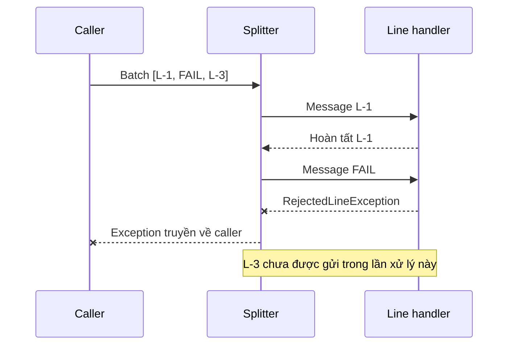

# Splitter exception

## 1. Vấn đề cần giải quyết

Trong luồng nhập đơn hàng, một message chứa cả batch gồm nhiều dòng. Splitter tạo message cho từng dòng, sau đó endpoint xử lý tồn kho, tính giá hoặc ghi dữ liệu. Khi một lỗi xuất hiện, cần xác định được: lỗi xảy ra trước hay sau khi phát message con, ai nhận lỗi, những dòng nào đã xử lý và đơn vị nào được phép chạy lại.

Bài học thuộc chương **Splitter**, module **SPRING_INTEGRATION_CORE**, tập trung vào sự phối hợp giữa `Message`, `MessageChannel`, endpoint, gateway và Java DSL khi luồng tách message gặp exception. Sau bài này, bạn có thể thiết kế đường lỗi, chọn phạm vi retry và giải thích vì sao một batch lỗi vẫn có thể đã tạo ra kết quả cho một số dòng.

Các ví dụ dùng **Java 17 trở lên, Spring Integration 6.5.x** và API `splitWith`. Ví dụ retry sử dụng thêm Spring Retry. Phiên bản được chọn để các đoạn mã có cùng một nền API; đây không phải tuyên bố về phiên bản mới nhất. Cấu hình minh họa dùng Spring thuần với `@EnableIntegration`; nếu chạy trong dự án Spring Boot, dùng bộ dependency tương thích do dự án quản lý. Chưa có thao tác biên dịch hoặc chạy test cho các đoạn mã trong bài.

## 2. Xác định vị trí phát sinh lỗi

Một splitter thực hiện nhiều việc hơn việc gọi hàm trả về danh sách. Có thể chia quá trình xử lý thành bốn điểm cần quan sát:

| Điểm phát sinh | Ví dụ | Phần dữ liệu có thể đã đi tiếp |
| --- | --- | --- |
| Trong hàm tách, trước khi trả kết quả | Batch sai định dạng; thiếu trường bắt buộc | Chưa có message con do kết quả của lần gọi này được phát |
| Khi duyệt kết quả lazy | `Iterator.next()` hoặc phép `map` trong `Stream` ném lỗi ở dòng thứ hai | Một số message con trước đó có thể đã được phát |
| Khi chuyển message con vào output channel | Không có subscriber; gửi vào queue hết thời gian chờ | Một số message con trước đó có thể đã được chấp nhận |
| Trong endpoint phía sau | Dịch vụ tồn kho từ chối dòng thứ hai | Tùy channel, các dòng trước đã xử lý và các dòng sau có thể đang chờ hoặc chưa được gửi |

Giả định hàm tách chỉ tạo dữ liệu và không tự gọi dịch vụ hay tự gửi message. Nếu hàm này vừa kiểm tra vừa ghi dữ liệu ra ngoài, exception trước khi trả về vẫn có thể để lại tác dụng phụ của chính hàm đó.

Với một flow đồng bộ, chỉ có một subscriber tại mỗi `DirectChannel`, không cấu hình recovery để nuốt lỗi:



Trong tình huống trên, lỗi ở handler khiến vòng phát message con bị gián đoạn. Splitter không tự thu hồi kết quả của L-1 và không tự tiếp tục từ L-3. Đây là hệ quả của việc duyệt rồi gửi từng kết quả trên cùng call stack, có thể đối chiếu trong [mã nguồn `AbstractMessageProducingHandler` 6.5.0](https://github.com/spring-projects/spring-integration/blob/v6.5.0/spring-integration-core/src/main/java/org/springframework/integration/handler/AbstractMessageProducingHandler.java).

Nếu sau splitter là `ExecutorChannel`, dòng L-3 có thể đã được giao cho executor trước khi lỗi ở FAIL được phát hiện. Vì vậy, cần mô tả hành vi lỗi cùng với ranh giới thực thi của flow.

## 3. Exception được truyền cho ai?

| Cách kích hoạt flow | Nơi xử lý exception | Ý nghĩa của việc gửi thành công |
| --- | --- | --- |
| Caller gửi vào chuỗi `DirectChannel` | Exception có thể truyền về caller | Các endpoint đồng bộ đã được gọi; tác dụng phụ vẫn phụ thuộc thiết kế nghiệp vụ |
| Caller gửi vào `QueueChannel`, một poller lấy message | Poller xử lý lỗi bằng cơ chế error handler | Queue đã nhận message, chưa chứng minh nghiệp vụ hoàn tất |
| Flow chuyển sang `ExecutorChannel` dùng executor bất đồng bộ | Lỗi của task được xử lý trong ngữ cảnh thực thi task | Công việc đã được tiếp nhận để thực thi; caller không biết kết quả nghiệp vụ qua giá trị `send` |
| Caller gọi messaging gateway | Gateway áp dụng hợp đồng exception hoặc error flow được cấu hình | Phải đọc theo hợp đồng gateway và kiểu trả về |

Với cơ chế phát lỗi chuẩn, `ErrorMessage` mang exception trong payload; header `errorChannel` của request được ưu tiên trước global channel tên `errorChannel`. Tuy nhiên, **thêm header này vào một message gửi trực tiếp qua `DirectChannel` không tự tạo khối bắt lỗi**. Cần có thành phần thực sự bắt rồi publish lỗi, chẳng hạn poller hoặc gateway đã cấu hình. Xem [Error Handling](https://docs.spring.io/spring-integration/reference/6.5/error-handling.html).

Ranh giới bất đồng bộ phụ thuộc executor thực tế. Ví dụ, một executor có thể chạy task ngay trên thread gọi trong một số chính sách thực thi; không nên suy luận tuyệt đối chỉ từ tên channel.

Gateway còn có thể tháo lớp `MessagingException` và ném lại exception nghiệp vụ. Nếu khai báo `errorChannel` cho gateway, error flow phải phù hợp hợp đồng gọi: phương thức cần phản hồi phải nhận được kết quả đúng kiểu hoặc có chính sách lỗi rõ ràng. Một error flow chỉ ghi log không tự sinh ra kết quả nghiệp vụ. Xem [Messaging Gateways — Error Handling](https://docs.spring.io/spring-integration/reference/6.5/gateway.html#error-handling).

## 4. Ví dụ Java DSL: kiểm tra toàn batch trước khi phát

Ví dụ sau tách batch thành các `Line`. Hàm `splitBatch` kiểm tra đầy đủ dữ liệu trước khi trả về một `List`. Handler phía sau cố ý từ chối dòng có mã `FAIL` để minh họa lỗi downstream.

Dependency chính là `org.springframework.integration:spring-integration-core`. Các test ở phần sau cần JUnit Jupiter và `spring-test` với phiên bản tương thích. Các queue trong ví dụ chỉ giữ dữ liệu trong bộ nhớ để quan sát kết quả.

```java
package demo;

import java.util.ArrayList;
import java.util.List;
import java.util.Map;

import org.springframework.context.annotation.Bean;
import org.springframework.context.annotation.Configuration;
import org.springframework.integration.channel.DirectChannel;
import org.springframework.integration.channel.QueueChannel;
import org.springframework.integration.config.EnableIntegration;
import org.springframework.integration.dsl.IntegrationFlow;

@Configuration
@EnableIntegration
public class SplitterExceptionExample {

    public record Line(String lineId, int quantity) {}

    public record Batch(String batchId, List<Line> lines) {}

    public static class InvalidBatchException extends RuntimeException {
        public InvalidBatchException(String message) {
            super(message);
        }
    }

    public static class RejectedLineException extends RuntimeException {
        public RejectedLineException(String message) {
            super(message);
        }
    }

    @Bean
    public DirectChannel batchInput() {
        return new DirectChannel();
    }

    @Bean
    public DirectChannel lineInput() {
        return new DirectChannel();
    }

    @Bean
    public QueueChannel processedLines() {
        return new QueueChannel(100);
    }

    @Bean
    public QueueChannel batchErrors() {
        return new QueueChannel(100);
    }

    @Bean
    public IntegrationFlow batchFlow() {
        return IntegrationFlow.from(batchInput())
                .splitWith(s -> s
                        .expectedType(Batch.class)
                        .function((Batch batch) -> splitBatch(batch))
                        .id("batchSplitter"))
                .channel(lineInput())
                .get();
    }

    @Bean
    public IntegrationFlow lineFlow() {
        return IntegrationFlow.from(lineInput())
                .handle(Line.class, this::processLine,
                        e -> e.id("lineProcessor"))
                .channel(processedLines())
                .get();
    }

    public List<Line> splitBatch(Batch batch) {
        if (batch.batchId() == null || batch.batchId().isBlank()) {
            throw new InvalidBatchException("Thiếu batchId");
        }
        if (batch.lines() == null || batch.lines().isEmpty()) {
            throw new InvalidBatchException("Batch phải có ít nhất một dòng");
        }

        List<Line> snapshot = new ArrayList<>(batch.lines());
        for (int i = 0; i < snapshot.size(); i++) {
            Line line = snapshot.get(i);
            if (line == null || line.lineId() == null
                    || line.lineId().isBlank() || line.quantity() <= 0) {
                throw new InvalidBatchException(
                        "Dòng không hợp lệ tại vị trí " + (i + 1));
            }
        }
        return List.copyOf(snapshot);
    }

    public Line processLine(Line line, Map<String, Object> headers) {
        if ("FAIL".equals(line.lineId())) {
            throw new RejectedLineException("Dòng bị từ chối: " + line.lineId());
        }
        return line;
    }
}
```

Ở đây, `batchFlow` và `lineFlow` tách riêng cấu hình nhưng vẫn nối với nhau bằng `DirectChannel`, nên cùng chạy trên thread gọi. Việc chia thành hai bean flow không tự tạo ranh giới bất đồng bộ.

`List.copyOf` tạo kết quả cố định sau khi kiểm tra; các `Line` là record có trường bất biến trong ví dụ. Bên gửi vẫn phải ngừng sửa danh sách đầu vào trong khi message đang được xử lý. Việc sao chép collection không phải một cơ chế đồng bộ cho dữ liệu đang bị thread khác thay đổi.

Hai kết quả cần phân biệt:

- Batch `[L-1 quantity=1, L-2 quantity=0, L-3 quantity=1]`: `splitBatch` ném lỗi trước khi trả kết quả, không có dòng nào tới `lineInput`.
- Batch `[L-1 quantity=1, FAIL quantity=1, L-3 quantity=1]`: kiểm tra cấu trúc thành công; L-1 tới `processedLines`, FAIL gây lỗi, L-3 chưa được phát.

API `expectedType`, `function`, `id` và các tùy chọn endpoint nằm trong [SplitterSpec 6.5.0](https://docs.spring.io/spring-integration/docs/6.5.0/api/org/springframework/integration/dsl/SplitterSpec.html).

## 5. Kiểm thử ranh giới đồng bộ

Test sau sử dụng đúng cấu hình ở phần 4. Header `batchId` là khóa nghiệp vụ do ví dụ tự thêm. Header `errorChannel` được gắn cố ý để chứng minh rằng nó không tự chuyển lỗi đồng bộ thành message lỗi.

```java
package demo;

import java.util.List;

import org.junit.jupiter.api.BeforeEach;
import org.junit.jupiter.api.Test;
import org.springframework.beans.factory.annotation.Autowired;
import org.springframework.beans.factory.annotation.Qualifier;
import org.springframework.integration.channel.QueueChannel;
import org.springframework.messaging.Message;
import org.springframework.messaging.MessageChannel;
import org.springframework.messaging.MessagingException;
import org.springframework.messaging.support.ErrorMessage;
import org.springframework.messaging.support.MessageBuilder;
import org.springframework.test.context.junit.jupiter.SpringJUnitConfig;

import static demo.SplitterExceptionExample.*;
import static org.junit.jupiter.api.Assertions.*;

@SpringJUnitConfig(SplitterExceptionExample.class)
class SplitterExceptionExampleTest {

    @Autowired
    @Qualifier("batchInput")
    MessageChannel input;

    @Autowired
    @Qualifier("processedLines")
    QueueChannel processed;

    @Autowired
    @Qualifier("batchErrors")
    QueueChannel errors;

    @BeforeEach
    void drainQueues() {
        while (processed.receive(0) != null) { }
        while (errors.receive(0) != null) { }
    }

    private static Message<Batch> request(Batch batch) {
        return MessageBuilder.withPayload(batch)
                .setHeader("batchId", batch.batchId())
                .setErrorChannelName("batchErrors")
                .build();
    }

    @Test
    void invalidBatchProducesNoChildMessage() {
        Batch batch = new Batch("B-01", List.of(
                new Line("L-1", 1),
                new Line("L-2", 0),
                new Line("L-3", 1)));

        MessagingException failure = assertThrows(
                MessagingException.class, () -> input.send(request(batch)));

        assertInstanceOf(InvalidBatchException.class,
                failure.getMostSpecificCause());
        assertNull(processed.receive(0));
        assertNull(errors.receive(0));
    }

    @Test
    void downstreamFailureLeavesEarlierResult() {
        Batch batch = new Batch("B-02", List.of(
                new Line("L-1", 1),
                new Line("FAIL", 1),
                new Line("L-3", 1)));

        MessagingException failure = assertThrows(
                MessagingException.class, () -> input.send(request(batch)));

        assertInstanceOf(RejectedLineException.class,
                failure.getMostSpecificCause());
        Message<?> first = processed.receive(0);
        assertNotNull(first);
        assertEquals(new Line("L-1", 1), first.getPayload());
        assertNull(processed.receive(0));
        assertNull(errors.receive(0));
    }
}
```

`processed` chứa kết quả quan sát được, chưa đại diện cho một transaction cơ sở dữ liệu. Nếu thay handler bằng thao tác ghi dữ liệu thật, cần kiểm tra thêm dữ liệu đã commit và tác dụng phụ của hệ thống ngoài.

Các test dùng assertion trên loại nguyên nhân, thay vì cố định toàn bộ chuỗi thông báo wrapper. Cách này giúp làm rõ hợp đồng nghiệp vụ mà không phụ thuộc nội dung chẩn đoán của framework.

## 6. Dùng QueueChannel và poller để nhận ErrorMessage

Để nhận batch trên một queue rồi xử lý bằng poller, thêm import sau và hai bean bên dưới vào `SplitterExceptionExample`:

```java
import org.springframework.integration.dsl.Pollers;
```

```java
@Bean
public QueueChannel queuedBatches() {
    return new QueueChannel(100);
}

@Bean
public IntegrationFlow queuedBatchFlow() {
    return IntegrationFlow.from(queuedBatches())
            .bridge(e -> e.poller(Pollers.fixedDelay(100)
                    .maxMessagesPerPoll(1)
                    .errorChannel("batchErrors")))
            .channel(batchInput())
            .get();
}
```

`bridge` là consumer có poller vì input là `QueueChannel`. Sau khi poller lấy message, phần `batchInput -> splitter -> lineInput -> lineProcessor` vẫn đồng bộ với thread của poller. Caller gửi vào `queuedBatches` đã tách khỏi thread đó.

Tùy chọn `errorChannel` ở đây thuộc **poller**, không phải một thuộc tính chung tự bắt mọi lỗi của splitter. Xem [PollerSpec 6.5.0](https://docs.spring.io/spring-integration/docs/6.5.0/api/org/springframework/integration/dsl/PollerSpec.html).

Sau khi bổ sung hai bean, có thể thêm test này vào lớp test phía trên:

```java
@Test
void queuedFailureIsPublishedAsErrorMessage(
        @Autowired @Qualifier("queuedBatches") QueueChannel queuedBatches) {

    Batch batch = new Batch("B-03", List.of(
            new Line("L-1", 1),
            new Line("FAIL", 1),
            new Line("L-3", 1)));

    assertTrue(queuedBatches.send(request(batch), 1000));

    Message<?> received = errors.receive(3000);
    ErrorMessage error = assertInstanceOf(ErrorMessage.class, received);
    MessagingException failure = assertInstanceOf(
            MessagingException.class, error.getPayload());
    assertInstanceOf(RejectedLineException.class,
            failure.getMostSpecificCause());

    Message<?> first = processed.receive(0);
    assertNotNull(first);
    assertEquals(new Line("L-1", 1), first.getPayload());
    assertNull(processed.receive(0));
}
```

Test chờ message lỗi bằng thao tác nhận có timeout, không cần `Thread.sleep`. Khi lỗi đã tới queue lỗi, lần chạy đồng bộ của batch này đã đi qua L-1 và dừng tại FAIL.

Trong cấu hình trên không có transaction hoặc cơ chế nạp lại request. `QueueChannel` trong bộ nhớ không tự đưa batch đã nhận trở lại queue sau lỗi. Muốn xử lý lại phải thiết kế riêng đường replay, hoặc sử dụng nguồn có khả năng redelivery cùng cấu hình tương ứng. Queue lỗi minh họa cũng cần consumer nếu chuyển thành ứng dụng chạy lâu dài.

## 7. Đọc ngữ cảnh lỗi mà không nhầm message cha và con

Một thông báo “splitter failed” trong log chưa đủ để kết luận dữ liệu nào hỏng. Payload của `ErrorMessage` là `Throwable`. Nếu chuỗi nguyên nhân có `MessagingException`, dùng `getFailedMessage()` để lấy message gắn với lỗi; giá trị này có thể vắng mặt. Xem [MessagingException Javadoc](https://docs.spring.io/spring-framework/docs/6.2.x/javadoc-api/org/springframework/messaging/MessagingException.html).

Đoạn helper độc lập sau chọn message lỗi ở lớp nguyên nhân sâu hơn, rồi mới dùng `originalMessage` làm thông tin dự phòng:

```java
import org.springframework.messaging.Message;
import org.springframework.messaging.MessagingException;
import org.springframework.messaging.support.ErrorMessage;

public final class FailureContext {

    private FailureContext() { }

    public static Message<?> findFailedMessage(ErrorMessage error) {
        Message<?> failed = null;
        for (Throwable current = error.getPayload();
                current != null; current = current.getCause()) {
            if (current instanceof MessagingException messaging
                    && messaging.getFailedMessage() != null) {
                failed = messaging.getFailedMessage();
            }
        }
        return failed != null ? failed : error.getOriginalMessage();
    }
}
```

Kết quả phải được diễn giải theo vị trí lỗi:

| Tình huống | Ngữ cảnh nên tìm | Ý nghĩa đối với replay |
| --- | --- | --- |
| `splitBatch` từ chối batch | Message chứa `Batch` | Sửa đầu vào hoặc quyết định gửi lại cả batch |
| `lineProcessor` từ chối dòng | Message chứa `Line`, kèm header liên quan | Có thể phục hồi riêng dòng nếu hợp đồng nghiệp vụ cho phép |
| Iterator lỗi trước khi tạo message cho dòng kế tiếp | Có thể chỉ còn ngữ cảnh batch | Cần checkpoint hoặc thông tin vị trí do ứng dụng ghi nhận |
| Hạ tầng giao nhận lỗi | Message gắn với điểm giao nhận | Cần xác định đã tiếp nhận, đã thực thi hay chưa rõ kết quả |

Không ép mọi `failedMessage.getPayload()` về `Line`. `originalMessage` cũng không mặc nhiên là message con: ý nghĩa của nó phụ thuộc thành phần tạo error message và chiến lược đóng gói lỗi.

Khi lưu hồ sơ phục hồi, nên ghi `batchId`, `lineId` nếu có, endpoint lỗi, loại nguyên nhân và lần thử. Các header kỹ thuật như `correlationId`, `sequenceNumber`, `sequenceSize` hỗ trợ truy vết, nhưng khóa nghiệp vụ cần được giữ riêng để nhận diện một dòng qua nhiều lần gửi lại.

## 8. Kết quả rỗng, null và lỗi lazy

### 8.1. Không dùng kết quả rỗng để che exception

Trong mô hình splitter thông thường, collection rỗng không tạo message con; có thể cấu hình `discardChannel` để nhận request không có phần tử. Kết quả `null` biểu thị kết thúc flow. Đây là hợp đồng kết quả, không phải cơ chế tự bắt exception. Xem [Splitter](https://docs.spring.io/spring-integration/reference/6.5/splitter.html).

Ví dụ sau làm mất tín hiệu lỗi nghiệp vụ:

```java
try {
    return splitBatch(batch);
}
catch (InvalidBatchException ex) {
    return List.of(); // Caller không còn nhận được exception này.
}
```

Nếu hợp đồng quy định batch không được rỗng, hãy kiểm tra và ném exception rõ ràng như phần 4. Nếu batch rỗng là hợp lệ, hãy quyết định có cần kết quả “không có dữ liệu” cho caller hay cần gửi request sang discard flow.

Với handler đồng bộ và `requiresReply(true)`, kết quả không sinh reply có thể dẫn tới `ReplyRequiredException`; tùy chọn này không thay thế kiểm tra nghiệp vụ. Trong triển khai 6.5.0, việc kiểm tra reply diễn ra sau lời gọi handler được advice. Xem [mã nguồn `AbstractReplyProducingMessageHandler`](https://github.com/spring-projects/spring-integration/blob/v6.5.0/spring-integration-core/src/main/java/org/springframework/integration/handler/AbstractReplyProducingMessageHandler.java).

### 8.2. Trả về Stream chưa thực hiện hết việc kiểm tra

Đoạn DSL sau minh họa một cách tách lazy; nó thay cho phần cấu hình splitter tương ứng, không thêm một splitter thứ hai vào flow:

```java
.splitWith(s -> s.expectedType(Batch.class)
        .function((Batch batch) -> batch.lines().stream().map(line -> {
            if (line.quantity() <= 0) {
                throw new InvalidBatchException(
                        "Số lượng không hợp lệ: " + line.lineId());
            }
            return line;
        })))
```

Hàm lambda bên ngoài trả về `Stream` trước khi các phép kiểm tra trong `map` được thực hiện hết. Giả sử L-1 hợp lệ, L-2 có số lượng 0: lỗi có thể xuất hiện khi framework đang lấy phần tử L-2, sau khi L-1 đã được gửi. Khối `try/catch` chỉ bao quanh việc tạo stream sẽ không bắt được exception xuất hiện lúc duyệt về sau.

Để đảm bảo phát hiện lỗi cấu trúc trước khi phát bất kỳ dòng nào, lựa chọn của ví dụ là duyệt kiểm tra toàn bộ và trả về list. Với dữ liệu quá lớn để giữ trong bộ nhớ, cần cân nhắc checkpoint, phân đoạn và chính sách phục hồi cho phần đã xử lý. Vị trí tạo iterator và kiểm tra phần tử ban đầu có thể xem trong [mã nguồn `AbstractMessageSplitter` 6.5.0](https://github.com/spring-projects/spring-integration/blob/v6.5.0/spring-integration-core/src/main/java/org/springframework/integration/splitter/AbstractMessageSplitter.java).

## 9. Đặt retry đúng đơn vị công việc

Trước khi thêm retry, phân loại nguyên nhân và chọn phạm vi có thể lặp lại an toàn:

| Nguyên nhân | Chính sách phù hợp trong ví dụ | Đơn vị phục hồi |
| --- | --- | --- |
| Thiếu mã dòng; số lượng bằng 0 | Từ chối, ghi lý do để sửa dữ liệu | Batch hoặc dữ liệu đầu vào |
| Dịch vụ ngoài tạm thời không sẵn sàng | Retry có giới hạn, có khoảng chờ | Lời gọi xử lý một dòng |
| Dòng bị từ chối theo quy tắc nghiệp vụ | Chuyển thành kết quả thất bại hoặc đưa vào đường xử lý riêng | Dòng bị từ chối |
| Timeout sau thao tác tạo tác dụng phụ | Tra cứu bằng khóa nghiệp vụ trước khi quyết định thử lại | Thao tác có kết quả chưa xác định |

### 9.1. Advice ở splitter không bao phủ mọi lỗi của batch

`RequestHandlerRetryAdvice` đặt tại splitter bao quanh công việc xử lý request của chính endpoint. Việc gửi các kết quả đi tiếp diễn ra ngoài lời gọi đó. Vì vậy, không nên kỳ vọng advice này retry được lỗi ở handler downstream hoặc toàn bộ quá trình duyệt lazy. Lỗi trong phép kiểm tra phần tử ban đầu có thể xuất hiện sớm hơn; cần dựa vào điểm thực sự ném exception.

Ngược lại, retry bọc toàn bộ lời gọi gửi batch hoặc toàn bộ call stack đồng bộ có thể chạy lại L-1 khi FAIL gặp lỗi. Nếu L-1 đã trừ tồn kho, lần chạy lại có thể trừ thêm lần nữa. Ranh giới advice của endpoint được mô tả tại [Adding Behavior to Endpoints](https://docs.spring.io/spring-integration/reference/6.5/handler-advice.html).

Đây cũng là lý do cần phân biệt request-handler advice với advice bao quanh `handleMessage`. Phạm vi bao rộng hơn phải được xét cùng tác dụng phụ của những endpoint mà nó gọi đồng bộ.

### 9.2. Minh họa retry cho lineProcessor

Nếu triển khai thật có một lỗi tạm thời riêng, có thể thêm lớp exception, import và bean sau vào cấu hình. Ví dụ dùng `org.springframework.retry:spring-retry`; lỗi nghiệp vụ `RejectedLineException` của phần 4 vẫn không nằm trong danh sách retry.

```java
import org.springframework.integration.handler.advice.RequestHandlerRetryAdvice;
import org.springframework.retry.backoff.FixedBackOffPolicy;
import org.springframework.retry.policy.SimpleRetryPolicy;
import org.springframework.retry.support.RetryTemplate;
```

```java
public static class TransientLineException extends RuntimeException {
    public TransientLineException(String message) {
        super(message);
    }
}

@Bean
public RequestHandlerRetryAdvice lineRetryAdvice() {
    SimpleRetryPolicy retryPolicy = new SimpleRetryPolicy(
            3, Map.of(TransientLineException.class, true), true);

    FixedBackOffPolicy backOff = new FixedBackOffPolicy();
    backOff.setBackOffPeriod(200);

    RetryTemplate template = new RetryTemplate();
    template.setRetryPolicy(retryPolicy);
    template.setBackOffPolicy(backOff);

    RequestHandlerRetryAdvice advice = new RequestHandlerRetryAdvice();
    advice.setRetryTemplate(template);
    return advice;
}
```

Thay phần khai báo handler trong `lineFlow` bằng:

```java
.handle(Line.class, this::processLine,
        e -> e.id("lineProcessor").advice(lineRetryAdvice()))
```

`maxAttempts = 3` tính cả lần gọi đầu. Tham số cuối của `SimpleRetryPolicy` cho phép xem xét cause chain, hữu ích khi lỗi nghiệp vụ được bọc trong messaging exception. Không có recovery callback thì sau khi thử hết, exception tiếp tục theo ranh giới đồng bộ hoặc poller như đã thiết kế. Backoff ở ví dụ giữ thread trong lúc chờ, nên cần tính tới khả năng chiếm dụng thread khi lưu lượng tăng. Xem [Provided Advice Classes — Retry Advice](https://docs.spring.io/spring-integration/reference/6.5/handler-advice/classes.html#retry-advice).

Trong bản mở rộng này, `processLine` cần ném `TransientLineException` khi thực sự gặp lỗi tạm thời từ dịch vụ ngoài; bản mô phỏng ban đầu chỉ ném `RejectedLineException` để hành vi từ chối có tính xác định.

### 9.3. Chống trùng khi chạy lại

Một cách thiết kế khóa chống trùng là `(batchId, lineId, operation)`. Handler lưu trạng thái xử lý và kiểm tra khóa trước khi lặp lại tác dụng phụ. Nếu nhiều worker có thể xử lý cùng khóa, việc ghi nhận khóa phải có cơ chế cạnh tranh phù hợp, ví dụ unique constraint kết hợp transaction cho thao tác nội bộ.

Không dùng một biến `Set` trong bộ nhớ làm bảo đảm chống trùng cho hệ thống nhiều instance. Với dịch vụ ngoài, ưu tiên idempotency key hoặc API tra cứu trạng thái nếu dịch vụ cung cấp. Khi timeout không cho biết thao tác đã hoàn tất hay chưa, chỉ lặp lại vì “chưa nhận phản hồi” có thể tạo kết quả trùng.

Nếu gửi lại cả batch bằng một message mới, metadata kỹ thuật của lượt tách có thể thay đổi. Khóa nghiệp vụ giúp nhận diện L-1 của cùng công việc ngay cả khi đó là một lượt gửi khác.

## 10. Khi cần tiếp tục các dòng còn lại và ghép kết quả

Có nghiệp vụ chấp nhận xử lý hết các dòng rồi báo cáo từng dòng thành công hoặc thất bại. Khi đó, có thể chuyển lỗi nghiệp vụ đã biết thành một payload kết quả tại endpoint xử lý dòng. Đây là thay đổi hợp đồng có chủ đích: lỗi từ chối đã được biểu diễn thành dữ liệu.

Thêm record sau vào cấu hình và thay phần handler tương ứng trong `lineFlow` bằng đoạn minh họa:

```java
public record LineResult(String lineId, boolean success, String reason) {}
```

```java
.handle(Line.class, (line, headers) -> {
    try {
        processLine(line, headers);
        return new LineResult(line.lineId(), true, null);
    }
    catch (RejectedLineException ex) {
        return new LineResult(line.lineId(), false, ex.getMessage());
    }
})
```

Với batch `[L-1, FAIL, L-3]`, biến thể này tạo ba `LineResult`. Queue `processedLines` lúc này chứa kết quả từng dòng thay vì `Line`, nên các assertion của biến thể cũ phải đổi theo hợp đồng mới. Các exception khác vẫn được truyền ra ngoài; không dùng `catch (Exception)` rồi báo thành công cho mọi lỗi.

Nếu có aggregator sau bước này, mỗi dòng có một kết quả cuối giúp định nghĩa hoàn thành batch rõ hơn. Header sequence cần được giữ khi transformer hoặc handler đổi payload. Theo cơ chế mặc định, aggregator tương quan bằng `correlationId` và xét đủ sequence để release; thiếu một kết quả có thể làm group chưa hoàn tất. Xem [Aggregator](https://docs.spring.io/spring-integration/reference/6.5/aggregator.html).

Ba lựa chọn thường cần quyết định ở cấp nghiệp vụ:

- **Chờ đủ kết quả cuối cho mọi dòng:** dòng bị từ chối vẫn đóng góp một `LineResult` thất bại; báo cáo batch thể hiện đủ số dòng.
- **Chấp nhận kết quả một phần:** đặt thời hạn và cách báo phần thiếu; phân biệt kết quả partial với hoàn tất đầy đủ.
- **Đánh dấu cả batch thất bại:** ghi nhận trạng thái và kế hoạch bù trừ những thao tác đã hoàn tất.

Nếu iterator hoặc stream không xác định được tổng số phần tử, `sequenceSize` thường bằng 0. Khi đó không thể chỉ trông vào việc đếm đủ sequence theo tổng số dòng; cần điều kiện kết thúc hoặc release strategy thích hợp. Một `ErrorMessage` đi sang error flow không tự động trở thành kết quả cho group aggregator.

Chỉ bật timeout ở gateway không làm các worker dừng lại, không thu hồi các kết quả đã xử lý và không định nghĩa trạng thái cuối cho group. Các quyết định này cần nằm trong hợp đồng xử lý batch.

## 11. Transaction và quan sát vận hành

Splitter không tạo transaction cho cả batch. Nếu cần rollback nhiều thao tác cơ sở dữ liệu, phải xác định transaction bắt đầu ở đâu, các thao tác nào dùng chung transaction manager và exception có được truyền qua ranh giới đó hay đã bị recovery chuyển thành dữ liệu.

Trong flow đồng bộ, một transaction được cấu hình phù hợp có thể bao phủ nhiều endpoint sử dụng cùng tài nguyên giao dịch. Khi chuyển sang worker bất đồng bộ, transaction gắn với thread gọi không tự trở thành transaction của worker. Các lời gọi HTTP đã tạo tác dụng phụ cũng cần cơ chế idempotency hoặc bù trừ phù hợp thay vì mặc định trông chờ rollback của cơ sở dữ liệu.

Khi vận hành, theo dõi cả trạng thái batch và trạng thái từng dòng:

| Thông tin | Mục đích |
| --- | --- |
| `batchId`, `lineId`, mã thao tác | Nhận diện công việc và chống trùng |
| Endpoint và loại nguyên nhân | Phân biệt lỗi kiểm tra, xử lý nghiệp vụ, dịch vụ ngoài hoặc giao nhận |
| Số dòng dự kiến, đã hoàn tất, bị từ chối, chưa rõ kết quả | Phát hiện batch chỉ hoàn tất một phần |
| Số lần thử và thời điểm thử cuối | Ngăn replay không giới hạn và hỗ trợ điều tra |
| Trạng thái phát lỗi, ghi hồ sơ phục hồi | Phân biệt lỗi nghiệp vụ ban đầu với lỗi của chính đường xử lý lỗi |

Error flow cần có một đích cuối xác định: phản hồi cho caller, lưu hồ sơ phục hồi, chuyển sang nơi xử lý thủ công hoặc kích hoạt một chính sách retry cụ thể. Tránh nối trực tiếp error flow về input batch mà không có điều kiện dừng, vì batch sai dữ liệu có thể chạy lặp liên tục.

Các tình huống kiểm thử nên bao phủ trước khi dùng flow cho dữ liệu thật:

| Tình huống | Điều cần xác nhận |
| --- | --- |
| Dữ liệu batch sai trước khi hàm tách trả về | Không có message con được phát từ kết quả lần gọi |
| Handler thứ hai lỗi trong flow đồng bộ | Kết quả dòng đầu còn tồn tại; dòng thứ ba chưa được phát |
| Poller xử lý batch lỗi | Caller đã gửi thành công; error flow nhận đúng ngữ cảnh |
| Lỗi trong quá trình duyệt lazy | Xác định phần đã phát và vị trí phục hồi |
| Lỗi tạm thời cần retry | Số lần gọi đúng giới hạn; không gọi lại các dòng đã hoàn tất ngoài phạm vi |
| Replay sau timeout chưa rõ kết quả | Tác dụng phụ không bị nhân đôi nhờ khóa nghiệp vụ |
| Aggregator nhận thiếu hoặc nhận kết quả đến muộn | Trạng thái group, timeout và báo cáo partial đúng hợp đồng |

Điểm cần giữ khi thiết kế là xác định **đơn vị thất bại**, **đơn vị retry** và **điều kiện hoàn tất**. Ba đơn vị này có thể khác nhau: batch là đầu vào, một dòng là đơn vị retry, còn báo cáo cuối chỉ được tạo khi mọi dòng đã có kết quả hoặc khi chính sách partial cho phép kết thúc.