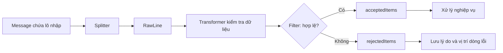
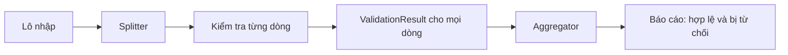

# Xử lý phần tử không hợp lệ

Trong chương **Splitter** của module **SPRING_INTEGRATION_CORE**, bài này giải quyết tình huống một thông điệp chứa nhiều phần tử nhưng chỉ một số phần tử đáp ứng quy tắc nghiệp vụ. Mục tiêu là thiết kế luồng bằng `Message`, `MessageChannel`, transformer, filter, router và Java DSL sao cho phần tử lỗi có kết quả rõ ràng, phần tử hợp lệ được xử lý theo chính sách đã chọn, và bước tổng hợp không bị chờ thiếu thông điệp.

Ví dụ xuyên suốt là nhập một lô dòng hàng có định dạng `sku,quantity`. Đây là định dạng hai trường đơn giản để minh họa; nếu dữ liệu thực tế là CSV có dấu phẩy trong trường hoặc dấu ngoặc kép, cần dùng thư viện đọc CSV phù hợp thay cho `String.split()`.

## 1. Xác định điều gì bị coi là không hợp lệ

Một lô nhập có thể chứa dữ liệu như sau:

| Vị trí gốc | Nội dung | Kết luận theo hợp đồng của ví dụ |
| --- | --- | --- |
| 1 | `BOOK-01,2` | Hợp lệ |
| 2 | `BOOK-02,-1` | Số lượng phải lớn hơn 0 |
| 3 | `BOOK-03,abc` | Số lượng không biểu diễn được bằng `int` |
| 4 | `BOOK-04,1` | Hợp lệ |

Cần tách ba loại vấn đề vì chúng dẫn đến cách xử lý khác nhau:

| Loại vấn đề | Ví dụ | Hướng xử lý |
| --- | --- | --- |
| Sai cấu trúc của cả lô | Không có mã lô, danh sách đầu vào là `null`, không xác thực được nguồn gửi | Từ chối lô ở biên tiếp nhận |
| Sai dữ liệu của một phần tử | Dòng rỗng, thiếu mã hàng, số lượng âm | Ghi nhận lỗi của dòng; tiếp tục hay dừng theo hợp đồng nghiệp vụ |
| Lỗi kỹ thuật khi xử lý | Cơ sở dữ liệu mất kết nối, dịch vụ đích hết thời gian chờ | Đưa vào cơ chế xử lý lỗi và retry có giới hạn khi thích hợp |

Một giá trị số lượng âm sẽ không tự trở thành hợp lệ sau ba lần retry. Ngược lại, gắn nhãn một lỗi mất kết nối là “dữ liệu không hợp lệ” sẽ che mất sự cố cần khắc phục.

Trong bài này, tính hợp lệ của dòng chỉ có nghĩa là **đủ điều kiện đi tiếp theo các quy tắc đang xét**. Nó chưa có nghĩa là đã kiểm tra tồn kho, đã ghi cơ sở dữ liệu hoặc đã hoàn tất giao dịch.

## 2. Chọn chính sách trước khi viết luồng

Có ba chính sách thường gặp:

| Chính sách | Khi gặp phần tử lỗi | Phù hợp với |
| --- | --- | --- |
| Dừng sớm | Báo lỗi và ngừng đường xử lý đang chạy | Yêu cầu không được tiếp tục khi phát hiện sai dữ liệu |
| Chấp nhận từng phần | Chuyển phần tử lỗi sang nhánh riêng; phần tử hợp lệ đi tiếp | Nhập danh mục hoặc dữ liệu độc lập theo dòng |
| Thu đủ kết quả | Mỗi phần tử tạo một kết quả thành công hoặc bị từ chối; sau đó tổng hợp | Cần báo cáo đầy đủ tình trạng từng dòng trong một lô |

“Dừng sớm” và “tất cả hoặc không gì cả” là hai cam kết khác nhau. Dừng ở dòng 2 không tự hoàn tác tác động đã xảy ra với dòng 1. Nếu nghiệp vụ yêu cầu toàn bộ lô cùng thành công hoặc cùng thất bại, phải thiết kế bước kiểm tra toàn lô và phạm vi giao dịch tương ứng trước khi thực hiện tác động nghiệp vụ.

Ví dụ chính của bài dùng **chấp nhận từng phần**. Phần sau trình bày biến thể **thu đủ kết quả**, phù hợp khi cần ghép splitter với aggregator hoặc trả một báo cáo qua gateway.

## 3. Đặt bước kiểm tra sau splitter



Splitter xác định đơn vị xử lý là một dòng. Transformer chuyển dòng thô thành kết quả kiểm tra. Filter chỉ quyết định kết quả có được đi theo nhánh chính hay không. Nhờ vậy, parser, quy tắc kiểm tra và chính sách chuyển kênh có trách nhiệm riêng.

Đầu ra kiểm tra nên giữ cả dữ liệu gốc, vị trí và lý do lỗi. Chỉ trả `true` hoặc `false` sẽ khiến nhánh xử lý lỗi phải kiểm tra lại mới biết nguyên nhân.

### 3.1. Phân biệt hai loại discard channel

`discardChannel` của **filter** nhận thông điệp không vượt qua điều kiện chọn. `discardChannel` của **splitter** dùng khi kết quả tách là một container rỗng, nên không có phần tử để phát ra; thông điệp chuyển sang đó là yêu cầu đầu vào. Hai điểm cấu hình này phục vụ hai tình huống khác nhau. Xem [Filter](https://docs.spring.io/spring-integration/reference/filter.html) và [Splitter](https://docs.spring.io/spring-integration/reference/splitter.html).

Không thể chỉ đặt `discardChannel` trên splitter rồi kỳ vọng mọi dòng sai số lượng sẽ tự đi vào đó. Muốn xử lý dòng sai, cần endpoint kiểm tra dòng.

### 3.2. Giữ phần tử `null` trong một đối tượng bao

Dòng nguồn có thể là `null`, nhưng không dùng `null` làm payload của thông điệp. Ví dụ tạo `RawLine` luôn khác `null`, còn thuộc tính `raw` bên trong được phép chứa `null`. Điều này giúp dòng thiếu dữ liệu cũng được ghi nhận đúng vị trí. Ràng buộc payload được mô tả tại [GenericMessage](https://docs.spring.io/spring-framework/docs/current/javadoc-api/org/springframework/messaging/support/GenericMessage.html).

Cũng cần chú ý `List.of(...)` và `List.copyOf(...)` không phù hợp để tạo danh sách thử nghiệm có phần tử `null`. Trong mô hình dưới đây, bản sao danh sách đầu vào được tạo bằng `ArrayList` rồi bọc chỉ đọc, để vẫn giữ được các phần tử thiếu dữ liệu cần kiểm tra.

## 4. Ví dụ Java DSL: chuyển phần tử lỗi sang kênh riêng

Ví dụ dùng cú pháp Java 17 và `IntegrationFlow.from(...)`, có thể áp dụng với Spring Integration 6.x trên Java 17. Nếu dùng một phiên bản framework khác, chọn JDK theo yêu cầu của phiên bản đó. Các dependency cần có là `spring-integration-core`, Spring Context và JUnit Jupiter cho đoạn kiểm thử; phiên bản dependency nên lấy từ BOM của dự án.

Đây là một cấu hình hoàn chỉnh cho luồng minh họa. Hai `QueueChannel` đầu ra giúp quan sát và kiểm thử kết quả bằng `receive()`. Chúng chưa có consumer nghiệp vụ và chưa lưu dữ liệu bền vững.

```java
package example.integration;

import java.util.ArrayList;
import java.util.Collections;
import java.util.List;
import java.util.Objects;
import java.util.stream.IntStream;

import org.springframework.context.annotation.Bean;
import org.springframework.context.annotation.Configuration;
import org.springframework.integration.channel.DirectChannel;
import org.springframework.integration.channel.QueueChannel;
import org.springframework.integration.config.EnableIntegration;
import org.springframework.integration.dsl.IntegrationFlow;
import org.springframework.messaging.MessageChannel;

@Configuration
@EnableIntegration
public class InvalidItemFlowConfiguration {

    public record ImportBatch(String batchId, List<String> lines) {
        public ImportBatch {
            if (batchId == null || batchId.isBlank()) {
                throw new IllegalArgumentException("batchId is required");
            }
            Objects.requireNonNull(lines, "lines is required");
            // Giữ cả phần tử null để validator ghi nhận lỗi của dòng.
            lines = Collections.unmodifiableList(new ArrayList<>(lines));
        }

        public List<RawLine> items() {
            return IntStream.range(0, lines.size())
                    .mapToObj(index -> new RawLine(
                            batchId, index + 1, lines.get(index)))
                    .toList();
        }
    }

    public record RawLine(String batchId, int lineNumber, String raw) {
    }

    public record OrderLine(String sku, int quantity) {
    }

    public record ValidationResult(
            RawLine source,
            OrderLine value,
            List<String> errors) {

        public ValidationResult {
            Objects.requireNonNull(source, "source is required");
            errors = List.copyOf(errors);
            if (errors.isEmpty() != (value != null)) {
                throw new IllegalArgumentException(
                        "Valid result requires a value and no errors");
            }
        }

        public boolean valid() {
            return errors.isEmpty();
        }

        public static ValidationResult accepted(
                RawLine source, OrderLine value) {
            return new ValidationResult(source, value, List.of());
        }

        public static ValidationResult rejected(
                RawLine source, String reason) {
            return new ValidationResult(source, null, List.of(reason));
        }
    }

    public static class LineValidator {
        public ValidationResult validate(RawLine line) {
            String raw = line.raw();
            if (raw == null || raw.isBlank()) {
                return ValidationResult.rejected(line, "EMPTY_LINE");
            }

            String[] fields = raw.split(",", -1);
            if (fields.length != 2) {
                return ValidationResult.rejected(line, "FIELD_COUNT");
            }

            String sku = fields[0].trim();
            if (sku.isBlank()) {
                return ValidationResult.rejected(line, "SKU_REQUIRED");
            }

            final int quantity;
            try {
                quantity = Integer.parseInt(fields[1].trim());
            }
            catch (NumberFormatException exception) {
                return ValidationResult.rejected(
                        line, "QUANTITY_INTEGER_REQUIRED");
            }

            if (quantity <= 0) {
                return ValidationResult.rejected(
                        line, "QUANTITY_MUST_BE_POSITIVE");
            }

            return ValidationResult.accepted(
                    line, new OrderLine(sku, quantity));
        }
    }

    @Bean
    public LineValidator lineValidator() {
        return new LineValidator();
    }

    @Bean
    public MessageChannel batchInput() {
        return new DirectChannel();
    }

    @Bean
    public QueueChannel acceptedItems() {
        return new QueueChannel();
    }

    @Bean
    public QueueChannel rejectedItems() {
        return new QueueChannel();
    }

    @Bean
    public IntegrationFlow importFlow(LineValidator validator) {
        return IntegrationFlow.from("batchInput")
                .split(ImportBatch.class, ImportBatch::items)
                .transform(RawLine.class, validator::validate)
                .filter(ValidationResult.class, ValidationResult::valid,
                        endpoint -> endpoint
                                .discardChannel("rejectedItems")
                                .throwExceptionOnRejection(false))
                .channel("acceptedItems")
                .get();
    }
}
```

### 4.1. Theo dõi một lần gửi

Khi nhận lô `B-100` với bốn dòng ở đầu bài:

1. `ImportBatch.items()` tạo bốn `RawLine`, giữ `batchId` và số dòng gốc từ 1 đến 4.
2. Splitter phát từng đối tượng thành thông điệp con.
3. `LineValidator` tạo một `ValidationResult` cho mỗi dòng.
4. Filter cho kết quả hợp lệ đi tới `acceptedItems`.
5. Kết quả không hợp lệ được gửi tới `rejectedItems`, không đi tiếp trên nhánh chính.

Đầu ra dự kiến:

```text
acceptedItems:
  B-100 / dòng 1 / OrderLine[sku=BOOK-01, quantity=2]
  B-100 / dòng 4 / OrderLine[sku=BOOK-04, quantity=1]

rejectedItems:
  B-100 / dòng 2 / QUANTITY_MUST_BE_POSITIVE
  B-100 / dòng 3 / QUANTITY_INTEGER_REQUIRED
```

Payload trên **cả hai kênh** vẫn là `ValidationResult`, không phải `OrderLine` và cũng không phải `ErrorMessage`. Consumer nghiệp vụ chỉ lấy `value()` sau khi biết kết quả hợp lệ. Nhánh bị từ chối lấy `source()` và `errors()` để tạo báo cáo.

Ví dụ chỉ ghi nhận lỗi đầu tiên của mỗi dòng. Nếu giao diện cần liệt kê nhiều lỗi cùng lúc, validator có thể tích lũy nhiều mã lỗi trước khi tạo `ValidationResult`, nhưng vẫn phải bảo đảm không dùng `value()` khi kết quả không hợp lệ.

### 4.2. Vì sao không trả `null` khi kiểm tra thất bại

Hợp đồng của validator là:

```text
Một RawLine đầu vào -> một ValidationResult đầu ra
```

Trả `null` làm mờ kết quả của dòng: luồng tiếp theo không còn một đối tượng để lưu lý do, tính số dòng bị từ chối hoặc tổng hợp báo cáo. Một kết quả có trạng thái rõ ràng giúp caller phân biệt “dòng đã được kiểm tra và bị từ chối” với “dòng chưa có kết quả”.

`NumberFormatException` được chuyển thành mã lỗi vì nó phản ánh một khả năng được dự kiến của đầu vào văn bản. Validator không bắt toàn bộ `Exception`; một lỗi lập trình hoặc lỗi hạ tầng ngoài dự kiến cần đi vào cơ chế xử lý lỗi kỹ thuật.

### 4.3. Chọn filter hay router

Filter phù hợp khi có một điều kiện chấp nhận và một nhánh bị loại. Khi hợp đồng mở rộng thành nhiều kết quả như `ACCEPTED`, `REJECTED`, `MANUAL_REVIEW`, có thể dùng router theo trạng thái để mỗi kênh biểu đạt rõ công việc phải làm.

Không nên nhét mọi quyết định vào nhiều phép parse lặp lại trong router hoặc filter. Hãy kiểm tra một lần, tạo kết quả có kiểu dữ liệu rõ ràng, rồi định tuyến theo kết quả đó.

## 5. Hiểu rõ `throwExceptionOnRejection`

Với một filter, hai thuộc tính cần được quyết định cùng nhau:

| `discardChannel` | `throwExceptionOnRejection` | Hành vi khi selector trả `false` |
| --- | --- | --- |
| Không cấu hình | `false` | Không chuyển tiếp trên nhánh chính |
| Có cấu hình | `false` | Gửi sang kênh discard rồi kết thúc nhánh chính |
| Không cấu hình | `true` | Ném `MessageRejectedException` |
| Có cấu hình | `true` | Gửi sang discard, sau đó vẫn ném exception nếu thao tác gửi hoàn tất |

Đặt cả discard channel và cờ ném exception không tạo cơ chế dự phòng. Cả hai hành động đều được áp dụng. Xem [FilterEndpointSpec](https://docs.spring.io/spring-integration/api/org/springframework/integration/dsl/FilterEndpointSpec.html).

Biến thể dừng sớm thay cấu hình filter trong ví dụ bằng:

```java
.filter(ValidationResult.class, ValidationResult::valid,
        endpoint -> endpoint.throwExceptionOnRejection(true))
```

Trong đường xử lý tuần tự của ví dụ, một exception không được xử lý ở dòng 2 sẽ lan ngược lên lời gọi gửi và ngắt lượt phát tiếp theo; dòng 4 có thể chưa được gửi. Dòng 1 đã được đưa vào `acceptedItems` trước đó. Vì vậy, cờ này không cung cấp tính nguyên tử cho cả lô.

Nếu nhánh discard cũng thất bại, chẳng hạn consumer của một `DirectChannel` ném lỗi khi lưu bản ghi bị từ chối, luồng có thể vẫn bị ngắt dù `throwExceptionOnRejection(false)`. Cờ `false` chỉ nói rằng filter không chủ động ném exception **vì điều kiện từ chối**; nó không nuốt lỗi phát sinh trong quá trình chuyển hoặc xử lý thông điệp.

Khi retry bao quanh một đoạn có cả ghi nhận discard và ném exception, một lần thử lại có thể ghi nhận cùng dòng lần nữa. Nên chọn phạm vi retry theo thao tác thực sự cần thử lại và thiết kế khóa chống trùng cho bản ghi kết quả.

## 6. Phân biệt nhánh dữ liệu lỗi với `errorChannel`

```text
Dữ liệu không hợp lệ theo quy tắc:
  Message<ValidationResult> -> rejectedItems

Exception kỹ thuật được cơ chế xử lý lỗi công bố:
  ErrorMessage có payload là Throwable -> kênh lỗi
```

Khi gửi trực tiếp vào `DirectChannel`, handler chạy trong luồng của caller và exception thường lan về caller. Không thể chỉ đặt header `errorChannel` rồi cho rằng mọi exception đồng bộ sẽ tự được gửi tới đó. Gateway hoặc advice có thể có cấu hình xử lý lỗi riêng. Xem [Error Handling](https://docs.spring.io/spring-integration/reference/error-handling.html).

Với xử lý bất đồng bộ do executor hoặc poller, caller không thể bắt lỗi ở thời điểm consumer xử lý chỉ bằng `try/catch` quanh `send()`. Cần cấu hình cơ chế công bố lỗi của thành phần thực thi; cơ chế tiêu chuẩn có thể dùng header `errorChannel`, hoặc kênh toàn cục cùng tên khi không có header phù hợp. Nếu thay executor hay error handler, phải kiểm tra chính sách thực tế của cấu hình đó.

Một message đã được đưa vào hàng đợi thành công chỉ xác nhận việc tiếp nhận ở ranh giới đó. Nó chưa khẳng định dòng đã được xử lý nghiệp vụ thành công. Trong ví dụ, `send()` thành công và có kết quả trong `acceptedItems` chỉ chứng minh các dòng đã qua bước kiểm tra và phân luồng.

## 7. Tác động đến sequence và aggregator

Khi tách một danh sách hữu hạn với cơ chế sequence được bật, splitter cung cấp các header liên quan đến nhóm và vị trí. Trong ví dụ bốn dòng:

| Header | Ý nghĩa |
| --- | --- |
| `correlationId` | Nhận diện nhóm thông điệp con của cùng một lần tách |
| `sequenceNumber` | Vị trí trong chuỗi do lần tách đó tạo ra |
| `sequenceSize` | Tổng số phần tử của chuỗi, ở đây là 4 |

Các header này dùng cho phối hợp thông điệp; chúng không thay thế mã lô và số dòng của miền nghiệp vụ. Một nguồn có thể bỏ qua dòng tiêu đề hoặc gộp nhiều tệp, khiến vị trí nghiệp vụ khác vị trí của chuỗi. Xem [AbstractMessageSplitter](https://docs.spring.io/spring-integration/api/org/springframework/integration/splitter/AbstractMessageSplitter.html).

### 7.1. Lỗi thiết kế: lọc bớt rồi aggregate mặc định

```text
Splitter: 4 phần tử
    -> Filter: giữ dòng 1 và 4
    -> Aggregator: nhận 2 thông điệp, sequenceSize vẫn là 4
```

Filter không tự tính lại độ dài chuỗi cho các phần tử còn lại. Nếu dùng chiến lược giải phóng dựa trên kích thước chuỗi, aggregator không có đủ điều kiện hoàn tất nhóm trong trường hợp này. Xem [SimpleSequenceSizeReleaseStrategy](https://docs.spring.io/spring-integration/api/org/springframework/integration/aggregator/SimpleSequenceSizeReleaseStrategy.html).

Không sửa `sequenceSize` trên từng thông điệp thành một hằng số hoặc thành số thông điệp đã thấy tới thời điểm đó. Trong một luồng song song, số đang có chưa cho biết số cuối cùng. Việc chỉnh header tùy tiện cũng dễ làm hỏng luồng lồng nhiều tầng splitter và aggregator.

### 7.2. Cách thứ nhất: giữ một kết quả cho mỗi phần tử

Nếu mục tiêu là báo cáo cả lô, giữ cả kết quả hợp lệ và không hợp lệ trên đường tới aggregator:



Trong cấu hình ví dụ, **thay** bean `importFlow` bằng bean sau, đồng thời thêm hai bean kênh đầu ra. Không đăng ký cả hai biến thể cùng tiêu thụ `batchInput`: `DirectChannel` có nhiều subscriber không phải cơ chế nhân bản lô cho từng biến thể.

```java
@Bean
public QueueChannel batchResults() {
    return new QueueChannel();
}

@Bean
public QueueChannel incompleteBatches() {
    return new QueueChannel();
}

@Bean
public IntegrationFlow importFlow(LineValidator validator) {
    return IntegrationFlow.from("batchInput")
            .split(ImportBatch.class, ImportBatch::items)
            .transform(RawLine.class, validator::validate)
            // Không loại ValidationResult trước khi tổng hợp.
            .aggregate(aggregator -> aggregator
                    .groupTimeout(10_000L)
                    .sendPartialResultOnExpiry(false)
                    .discardChannel("incompleteBatches"))
            .channel("batchResults")
            .get();
}
```

Với đầu vào bốn dòng và không có lỗi kỹ thuật, bốn `ValidationResult` đều tới aggregator. Kết quả tổng hợp chứa hai phần tử hợp lệ và hai phần tử bị từ chối. Ở biến thể này, `acceptedItems` và `rejectedItems` của cấu hình cũ không còn được dùng.

`groupTimeout(10_000L)` là khoảng chờ không có thông điệp mới của một nhóm chưa hoàn tất, không phải thời hạn tuyệt đối mười giây tính từ lúc caller gửi lô. Với chính sách trên, nhóm còn thiếu không được công bố như một báo cáo đầy đủ; các thông điệp đang có được xử lý theo nhánh discard khi nhóm bị loại do hết hạn. Consumer cần tự tạo trạng thái `INCOMPLETE` nếu hợp đồng báo cáo yêu cầu. Xem [Aggregator](https://docs.spring.io/spring-integration/reference/aggregator.html).

Nếu bước sau kiểm tra còn thực hiện ghi dữ liệu hoặc gọi hệ thống ngoài, cần chuyển kết quả xử lý thật sự của từng dòng thành một đối tượng kết quả tương ứng trước khi tổng hợp. `ValidationResult` trong bài chỉ mô tả bước kiểm tra dữ liệu.

### 7.3. Cách thứ hai: kiểm tra toàn bộ trước khi tách phần được chấp nhận

Một lựa chọn khác là tạo đối tượng chứa hai danh sách ngay từ đầu: danh sách hợp lệ và danh sách bị từ chối. Lưu báo cáo lỗi rồi đưa riêng danh sách hợp lệ vào một lần split mới. Khi splitter tách danh sách đã được chọn, độ dài chuỗi tương ứng với danh sách đó.

Cách này thuận tiện khi lô nhỏ, đã có toàn bộ dữ liệu trong bộ nhớ và hợp đồng chỉ cần tổng hợp phần được chấp nhận. Đổi lại, cần giữ rõ ánh xạ về dòng gốc và xử lý riêng trường hợp không còn dòng hợp lệ.

Không áp dụng cách này một cách máy móc cho luồng dữ liệu rất lớn hoặc chưa biết độ dài. Khi splitter không xác định được kích thước của iterator hay stream, `sequenceSize` có thể là 0. Khi đó phải có tiêu chí hoàn tất khác, chẳng hạn thông điệp đánh dấu kết thúc hoặc release strategy theo hợp đồng nguồn. Xem [Splitter](https://docs.spring.io/spring-integration/reference/splitter.html).

## 8. Lô rỗng, toàn bộ bị từ chối và lời gọi gateway

Ba trường hợp sau cần được định nghĩa riêng:

| Trường hợp | Luồng filter của ví dụ | Luồng thu đủ kết quả |
| --- | --- | --- |
| Lô có dòng hợp lệ và không hợp lệ | Chia ra hai kênh | Một nhóm kết quả có cả hai loại |
| Lô có dòng nhưng tất cả không hợp lệ | Tất cả vào `rejectedItems` | Vẫn có kết quả cho mọi dòng và có thể hoàn tất nhóm |
| Danh sách dòng rỗng | Không có thông điệp con | Không có nhóm kết quả được tạo từ các dòng |

Đối với lô rỗng, ứng dụng nên chọn một hành vi cụ thể: trả báo cáo rỗng, từ chối lô với mã `EMPTY_BATCH`, hoặc chuyển yêu cầu đầu vào sang nhánh xử lý riêng. Có thể kiểm tra tại đầu vào trước splitter; nếu dùng discard của splitter, consumer ở đó nhận toàn bộ lô chứ không nhận `RawLine`.

Nếu API ngoài là gateway yêu cầu một phản hồi cho mỗi lô, hai hàng đợi `acceptedItems` và `rejectedItems` chưa đáp ứng hợp đồng đó. Nhánh filter có thể kết thúc mà không tạo phản hồi, còn lô rỗng không tạo nhóm aggregator. Cần xây dựng đầu ra phản hồi chung cho mọi kết quả đã cam kết, và cấu hình thời gian chờ phù hợp. Xem [Messaging Gateways](https://docs.spring.io/spring-integration/reference/gateway.html).

Không dùng sự xuất hiện của một dòng hợp lệ làm tín hiệu “đã xong lô”. Đó chỉ là kết quả của một phần tử, chưa phải xác nhận tất cả phần tử đã có kết luận.

## 9. Kiểm thử đúng ranh giới splitter và filter

Đoạn kiểm thử dưới đây dành cho **cấu hình filter ở mục 4**, dùng JUnit Jupiter. Nó kiểm tra số lượng kết quả, lý do từ chối, vị trí gốc, header sequence và việc dòng hợp lệ phía sau dòng lỗi vẫn được phát ra.

```java
package example.integration;

import java.util.Arrays;
import java.util.List;

import org.junit.jupiter.api.Test;
import org.springframework.context.annotation.AnnotationConfigApplicationContext;
import org.springframework.integration.IntegrationMessageHeaderAccessor;
import org.springframework.integration.channel.QueueChannel;
import org.springframework.messaging.Message;
import org.springframework.messaging.MessageChannel;
import org.springframework.messaging.support.MessageBuilder;

import example.integration.InvalidItemFlowConfiguration.ImportBatch;
import example.integration.InvalidItemFlowConfiguration.ValidationResult;

import static org.junit.jupiter.api.Assertions.*;

class InvalidItemFlowTest {

    @Test
    void routesInvalidItemsAndContinuesWithLaterValidItems() {
        try (var context = new AnnotationConfigApplicationContext(
                InvalidItemFlowConfiguration.class)) {
            MessageChannel input = context.getBean(
                    "batchInput", MessageChannel.class);
            QueueChannel accepted = context.getBean(
                    "acceptedItems", QueueChannel.class);
            QueueChannel rejected = context.getBean(
                    "rejectedItems", QueueChannel.class);

            var batch = new ImportBatch("B-100", List.of(
                    "BOOK-01,2", "BOOK-02,-1",
                    "BOOK-03,abc", "BOOK-04,1"));
            assertTrue(input.send(MessageBuilder.withPayload(batch).build()));

            Message<?> first = accepted.receive(1_000);
            Message<?> fourth = accepted.receive(1_000);
            Message<?> second = rejected.receive(1_000);
            Message<?> third = rejected.receive(1_000);
            assertNotNull(first);
            assertNotNull(fourth);
            assertNotNull(second);
            assertNotNull(third);

            var firstResult = (ValidationResult) first.getPayload();
            var fourthResult = (ValidationResult) fourth.getPayload();
            var secondResult = (ValidationResult) second.getPayload();
            var thirdResult = (ValidationResult) third.getPayload();

            assertTrue(firstResult.valid());
            assertEquals(1, firstResult.source().lineNumber());
            assertEquals("BOOK-01", firstResult.value().sku());
            assertEquals(4, fourthResult.source().lineNumber());
            assertTrue(fourthResult.valid());
            assertEquals("BOOK-04", fourthResult.value().sku());

            assertFalse(secondResult.valid());
            assertEquals(2, secondResult.source().lineNumber());
            assertEquals(List.of("QUANTITY_MUST_BE_POSITIVE"),
                    secondResult.errors());
            assertEquals(List.of("QUANTITY_INTEGER_REQUIRED"),
                    thirdResult.errors());
            assertEquals("B-100", thirdResult.source().batchId());

            Object correlationId = first.getHeaders().get(
                    IntegrationMessageHeaderAccessor.CORRELATION_ID);
            assertNotNull(correlationId);
            for (Message<?> message : List.of(first, second, third, fourth)) {
                assertEquals(correlationId, message.getHeaders().get(
                        IntegrationMessageHeaderAccessor.CORRELATION_ID));
                assertEquals(Integer.valueOf(4), message.getHeaders().get(
                        IntegrationMessageHeaderAccessor.SEQUENCE_SIZE,
                        Integer.class));
            }
            assertEquals(Integer.valueOf(4), fourth.getHeaders().get(
                    IntegrationMessageHeaderAccessor.SEQUENCE_NUMBER,
                    Integer.class));

            assertNull(accepted.receive(0));
            assertNull(rejected.receive(0));
        }
    }

    @Test
    void preservesThePositionOfANullSourceLine() {
        try (var context = new AnnotationConfigApplicationContext(
                InvalidItemFlowConfiguration.class)) {
            MessageChannel input = context.getBean(
                    "batchInput", MessageChannel.class);
            QueueChannel accepted = context.getBean(
                    "acceptedItems", QueueChannel.class);
            QueueChannel rejected = context.getBean(
                    "rejectedItems", QueueChannel.class);

            var batch = new ImportBatch("B-NULL",
                    Arrays.asList(null, "BOOK-01,1"));
            assertTrue(input.send(MessageBuilder.withPayload(batch).build()));

            Message<?> rejectedMessage = rejected.receive(1_000);
            assertNotNull(rejectedMessage);
            var result = (ValidationResult) rejectedMessage.getPayload();
            assertEquals(1, result.source().lineNumber());
            assertNull(result.source().raw());
            assertEquals(List.of("EMPTY_LINE"), result.errors());

            Message<?> acceptedMessage = accepted.receive(1_000);
            assertNotNull(acceptedMessage);
            assertEquals(2, ((ValidationResult) acceptedMessage.getPayload())
                    .source().lineNumber());
            assertNull(accepted.receive(0));
            assertNull(rejected.receive(0));
        }
    }
}
```

Thứ tự nhận trong từng hàng đợi ở kiểm thử này dựa trên đường xử lý tuần tự của cấu hình minh họa. Khi đưa executor vào xử lý song song, hãy so sánh theo `batchId` và `lineNumber`, thay vì mặc định kết quả về theo thứ tự đầu vào.

Các ca cần bổ sung khi ứng dụng mở rộng:

| Ca kiểm thử | Điều cần xác nhận |
| --- | --- |
| Tất cả dòng hợp lệ | Không có kết quả bị từ chối |
| Tất cả dòng không hợp lệ | Mọi dòng có lý do; không có kết quả hợp lệ |
| Chuỗi số quá lớn cho `int` | Nhận `QUANTITY_INTEGER_REQUIRED`, không làm gián đoạn lô |
| Dòng thiếu dấu phẩy hoặc thừa trường | Nhận `FIELD_COUNT` |
| Mã hàng trống | Nhận `SKU_REQUIRED` |
| Lô rỗng | Đúng hợp đồng `EMPTY_BATCH` hoặc báo cáo rỗng đã chọn |
| Lưu kết quả bị từ chối thất bại | Lỗi kỹ thuật được quan sát và phục hồi theo chính sách |
| Biến thể aggregator nhận đủ kết quả | Số kết quả bằng số dòng nguồn; không thiếu dòng bị từ chối |
| Biến thể aggregator thiếu một kết quả | Kích hoạt chính sách nhóm không hoàn tất |
| Gửi lại một lô | Không tạo tác động nghiệp vụ trùng nếu hệ thống cam kết chống trùng |

Đây là mã và kế hoạch kiểm thử để tích hợp vào dự án; việc trình bày chúng trong bài không đồng nghĩa đã biên dịch hoặc chạy chúng trong môi trường ứng dụng cụ thể.

## 10. Lưu dấu vết và vận hành luồng nhập

Một bản ghi bị từ chối nên trả lời được: lô nào, dòng nào, vì sao không hợp lệ và người dùng có thể sửa gì. Với ví dụ này, dữ liệu tối thiểu có thể là:

```json
{
  "batchId": "B-100",
  "lineNumber": 2,
  "status": "REJECTED",
  "reasonCodes": ["QUANTITY_MUST_BE_POSITIVE"],
  "validationVersion": "order-line-v1"
}
```

`validationVersion` là trường minh họa cho phiên bản quy tắc nghiệp vụ, không phải phiên bản Spring Integration. Nó giúp giải thích vì sao cùng dữ liệu có thể được đánh giá khác nhau sau khi quy tắc thay đổi.

Khóa như `(batchId, lineNumber, validationVersion)` có thể dùng để chống ghi trùng kết quả kiểm tra nếu `batchId` định danh bất biến một nội dung lô. Nếu cho phép sửa nội dung dưới cùng mã lô, cần thêm revision hoặc định danh lần nhập. Chống trùng báo cáo và chống trùng thao tác nghiệp vụ là hai trách nhiệm riêng.

Các bộ đếm hữu ích gồm số dòng đã kiểm tra, hợp lệ, bị từ chối, lỗi kỹ thuật và chưa có kết quả. Trong một lô đã kiểm tra xong theo chính sách của ví dụ:

```text
số dòng nguồn = số kết quả hợp lệ + số kết quả bị từ chối
```

Khi còn dòng chưa xử lý do lỗi kỹ thuật hoặc lô bị ngắt, không công bố đẳng thức đó như dấu hiệu hoàn tất. Cần giữ trạng thái đang xử lý hoặc không hoàn tất để phản ánh đúng thực tế.

`QueueChannel` trong ví dụ dùng bộ nhớ và constructor không truyền dung lượng tạo hàng đợi có sức chứa rất lớn. Trong hệ thống chạy lâu dài, phải có consumer và chính sách dung lượng phù hợp; nếu cần giữ kết quả qua lần khởi động lại, dùng cơ chế lưu trữ bền vững tương ứng. Tham khảo [Message Channel Implementations](https://docs.spring.io/spring-integration/reference/channel/implementations.html).

Nếu consumer lấy từ `QueueChannel` qua endpoint Spring Integration, cần cấu hình poller cho endpoint đó. Nếu đổi `rejectedItems` thành `DirectChannel`, cần một subscriber thực sự; tên kênh không tự tạo tác vụ lưu lỗi.

## 11. Những lỗi triển khai dễ gặp

| Lỗi | Hệ quả | Cách thiết kế phù hợp |
| --- | --- | --- |
| Parse trực tiếp trong splitter rồi ném lỗi vì một dòng | Lỗi dữ liệu có thể ngắt cả lượt tách | Tách thành đối tượng dòng thô, kiểm tra ở bước kế tiếp |
| Trả `null` thay cho kết quả bị từ chối | Thiếu đối tượng để báo cáo và đếm dòng | Luôn tạo kết quả có trạng thái rõ ràng |
| Dùng discard của splitter để xử lý dòng sai | Nhầm hợp đồng giữa lô rỗng và phần tử bị loại | Dùng filter hoặc router sau bước kiểm tra |
| Filter loại dòng trước aggregator mặc định | Nhóm có thể chờ đủ kích thước chuỗi ban đầu | Giữ kết quả của mọi dòng hoặc tính danh sách hợp lệ trước lần split mới |
| Ném lỗi khi reject nhưng kỳ vọng các dòng sau vẫn chạy | Luồng đồng bộ có thể ngắt tại dòng lỗi | Chọn chấp nhận từng phần và nhánh discard được xử lý thành công |
| Retry nguyên lô sau khi một số dòng đã có tác động | Có thể lặp tác động nghiệp vụ | Chọn phạm vi retry và cơ chế idempotency phù hợp |
| Bắt mọi exception rồi gắn nhãn invalid | Lỗi hạ tầng bị biến thành lỗi dữ liệu | Chỉ chuyển các lỗi đầu vào dự kiến thành kết quả từ chối |
| Gateway luôn đợi một phản hồi nhưng có nhánh kết thúc sớm | Caller hết thời gian chờ hoặc không có kết quả theo hợp đồng | Thiết kế phản hồi cho lô lỗi, lô rỗng và lô không hoàn tất |

Với một luồng splitter có xử lý phần tử không hợp lệ, thiết kế hoàn chỉnh cần chỉ rõ đơn vị kiểm tra, chính sách tiếp tục, nơi nhận lý do lỗi và điều kiện hoàn tất lô. Khi bốn điểm này nhất quán, filter và router trở thành các bước định tuyến rõ ràng, còn aggregator có đủ thông tin để kết luận thay vì chờ một phần tử đã bị loại khỏi đường đi.
