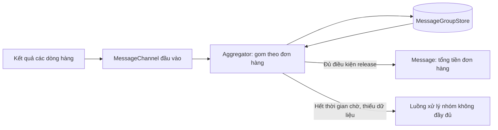

# Message aggregator là gì

## Mục tiêu bài học

Trong module `SPRING_INTEGRATION_CORE`, aggregator là một endpoint giúp nối các kết quả xử lý riêng lẻ thành một kết quả có ý nghĩa đối với nghiệp vụ. Bài học thuộc chương **Aggregator**, tập trung vào cách suy nghĩ và cấu hình luồng thông điệp bằng các thành phần cốt lõi của Spring Integration.

Sau bài học, bạn có thể:

- Giải thích vì sao aggregator cần giữ trạng thái giữa nhiều lần nhận thông điệp.
- Phân biệt khóa gom nhóm, điều kiện đủ dữ liệu và thuật toán tổng hợp.
- Đọc các header liên quan đến correlation và sequence.
- Xây dựng một luồng Java DSL nhận nhiều `Message` rồi phát một kết quả tổng hợp.
- Nhận diện nhóm chờ vô hạn, thông điệp trùng, thông điệp đến muộn và lỗi trong quá trình tổng hợp.

## 1. Bài toán: kết quả riêng lẻ chưa đủ để ra quyết định

Giả sử hệ thống bán hàng tính tiền cho từng dòng của một đơn hàng. Đơn `A-101` có ba dòng, với kết quả lần lượt là `100.00`, `40.00` và `60.00`. Các tác vụ có thể hoàn thành khác thứ tự ban đầu; kết quả của đơn khác cũng có thể xen vào.

| Thời điểm | Thông điệp đến | Nhóm liên quan | Có thể phát tổng tiền chưa? |
| --- | --- | --- | --- |
| T1 | Dòng 3 của `A-101`: `60.00` | `A-101` | Chưa, mới có 1/3 dòng |
| T2 | Dòng 1 của `B-202`: `15.00` | `B-202` | Phụ thuộc số dòng cần có của `B-202` |
| T3 | Dòng 1 của `A-101`: `100.00` | `A-101` | Chưa, mới có 2/3 dòng |
| T4 | Dòng 2 của `A-101`: `40.00` | `A-101` | Có, tổng là `200.00` |

Nếu một transformer cộng tiền ngay khi nhận từng thông điệp, nó chỉ biết giá trị của dòng hiện tại. Hệ thống cần một nơi ghi nhớ những kết quả đã đến, tách biệt từng đơn hàng và quyết định khi nào tổng tiền đã đủ căn cứ để sử dụng.

Đó là bài toán của **message aggregator**: thu thập các thông điệp có liên quan, chờ đến khi thỏa điều kiện hoàn tất rồi tạo thông điệp tổng hợp. Đây là một mẫu trong Enterprise Integration Patterns. [Nguồn: Aggregator pattern](https://www.enterpriseintegrationpatterns.com/patterns/messaging/Aggregator.html).



Aggregator không bắt buộc phải đứng sau một splitter. Nó cũng có thể nhận phản hồi từ nhiều dịch vụ, miễn các phản hồi có thông tin để xác định chúng thuộc cùng yêu cầu nào.

## 2. Ba quyết định độc lập của một aggregator

Thiết kế aggregator bắt đầu bằng ba câu hỏi. Mẫu Aggregator gọi chúng là correlation, completeness condition và aggregation algorithm. [Nguồn: Enterprise Integration Patterns](https://www.enterpriseintegrationpatterns.com/patterns/messaging/Aggregator.html).

| Câu hỏi | Thành phần trong Spring Integration | Ví dụ với đơn hàng |
| --- | --- | --- |
| Thông điệp này thuộc nhóm nào? | `CorrelationStrategy` | Thuộc đơn `A-101` |
| Nhóm đã đủ để xử lý chưa? | `ReleaseStrategy` | Đã có đủ ba kết quả |
| Biến cả nhóm thành kết quả gì? | `MessageGroupProcessor`, cấu hình qua `outputProcessor` | Tạo `OrderTotal` có số tiền `200.00` |

Ba quyết định này giải quyết ba việc khác nhau. Chẳng hạn, đổi cách cộng tiền thành chọn dòng có giá trị lớn nhất chỉ làm thay đổi thuật toán tổng hợp. Hệ thống vẫn phải gom đúng đơn và xác định đúng lúc được phép phát kết quả.

Một khóa nhóm tốt cũng chưa bảo đảm kết quả đầy đủ. Nếu tất cả thông điệp đều thuộc đúng `A-101` nhưng thiếu dòng số 2, nhóm vẫn chưa có đủ dữ liệu để lập hóa đơn.

### Aggregator giữ trạng thái gì?

Ở mức khái niệm, trạng thái của mỗi nhóm có thể được hình dung như sau:

```text
groupKey = A-101
received = [line-3, line-1]
expected = 3
status = đang chờ
```

Sau khi dòng còn lại đến, aggregator tạo kết quả và xử lý trạng thái nhóm theo chính sách hoàn tất. Trong Spring Integration, `AggregatingMessageHandler` phối hợp việc gom nhóm, lưu nhóm và phát kết quả; các chiến lược được cung cấp để tùy biến từng quyết định. [Nguồn: Aggregator trong Spring Integration](https://docs.spring.io/spring-integration/reference/aggregator.html).

## 3. Phân biệt aggregator với các thành phần gần giống

| Thành phần | Ví dụ đầu vào → đầu ra | Mục đích trong tình huống đơn hàng |
| --- | --- | --- |
| Transformer | Một dòng hàng → một dòng đã tính tiền | Thay đổi biểu diễn hoặc nội dung của từng thông điệp |
| Filter | Một kết quả → được đi tiếp hoặc bị loại | Chặn kết quả không hợp lệ |
| Router | Một kết quả → channel được chọn | Chọn nơi xử lý theo loại đơn hoặc trạng thái |
| Splitter | Một đơn có nhiều dòng → nhiều thông điệp dòng hàng | Tách công việc thành các phần riêng |
| Resequencer | Các dòng `3, 1, 2` → các thông điệp theo thứ tự `1, 2, 3` | Khôi phục thứ tự của chuỗi |
| Aggregator | Nhiều kết quả dòng hàng → một `OrderTotal` | Kết hợp thông tin để xử lý ở cấp đơn hàng |

Resequencer phát lại các thông điệp theo `sequenceNumber`, còn aggregator tính một kết quả từ cả nhóm. Nếu chỉ cần cộng tiền, thứ tự cộng không làm thay đổi kết quả nên thường không cần thêm resequencer. [Nguồn: Resequencer](https://docs.spring.io/spring-integration/reference/resequencer.html).

Tương tự, một `QueueChannel` có thể giữ nhiều thông điệp nhưng việc giữ hàng đợi không tự tạo ra quy tắc “ba kết quả này thuộc cùng đơn hàng và phải cộng thành một tổng”. Cần phân biệt vùng đệm truyền thông điệp với trạng thái nhóm của aggregator.

## 4. Message, header và cách nhận diện một nhóm

Một `Message<T>` gồm payload và headers. Trong ví dụ tính tiền:

```text
payload:
  orderId = A-101
  lineNo = 3
  amount = 60.00

headers:
  correlationId = A-101
  sequenceNumber = 3
  sequenceSize = 3
```

### 4.1. Các header thường gặp

| Hằng số | Ý nghĩa |
| --- | --- |
| `IntegrationMessageHeaderAccessor.CORRELATION_ID` | Xác định các thông điệp cùng nhóm theo correlation mặc định |
| `IntegrationMessageHeaderAccessor.SEQUENCE_NUMBER` | Vị trí của một phần trong chuỗi |
| `IntegrationMessageHeaderAccessor.SEQUENCE_SIZE` | Tổng số phần được mong đợi trong chuỗi |

Correlation mặc định đọc header `correlationId`. Việc payload có trường `orderId` không khiến aggregator tự chuyển sang gom theo trường đó; muốn dùng trường nghiệp vụ, phải cấu hình chiến lược tương ứng. [Nguồn: Correlation trong Aggregator](https://docs.spring.io/spring-integration/reference/aggregator.html).

Đừng nhầm `MessageHeaders.ID` với khóa nhóm. Mỗi thông điệp có định danh riêng; ba kết quả của cùng một đơn vẫn là ba thông điệp khác nhau. Khóa nhóm diễn tả quan hệ giữa chúng.

### 4.2. Chọn khóa theo phạm vi một lần tổng hợp

Trong bài thực hành, dùng `orderId` giúp quan sát dễ dàng. Với nghiệp vụ có nhiều lần tính lại một đơn, một thiết kế phù hợp hơn có thể là:

```text
tenantId + orderId + pricingAttemptId
```

Ví dụ, kết quả của lần tính giá `attempt-1` và `attempt-2` không nên được cộng chung. Nếu dùng cùng khóa `A-101`, hai đợt có thể lẫn dữ liệu hoặc kết quả của đợt mới bị xem là thông điệp đến muộn của đợt cũ.

Bạn có thể cấu hình correlation tường minh trong Java DSL:

```java
.aggregate(a -> a
    .correlationStrategy(message ->
        message.getHeaders().get("pricingAttemptId"))
    // Các cấu hình release và output được bổ sung tại đây.
)
```

Đây là đoạn cấu hình minh họa, giả sử bước trước đã kiểm tra và gắn `pricingAttemptId` hợp lệ. Không dùng một giá trị mặc định chung như `UNKNOWN` cho mọi thông điệp thiếu khóa, vì chúng sẽ bị gom vào cùng nhóm. Java DSL cho phép chỉ định riêng correlation, release và message store. [Nguồn: Aggregators and Resequencers trong Java DSL](https://docs.spring.io/spring-integration/reference/dsl/java-aggregators.html).

## 5. “Đã nhận đủ” phải được định nghĩa bằng hợp đồng dữ liệu

### 5.1. Release mặc định dựa trên kích thước chuỗi

`SimpleSequenceSizeReleaseStrategy` so sánh số thông điệp trong nhóm với `sequenceSize` mong đợi. Chiến lược này không tự kiểm tra số thứ tự trùng và không hỗ trợ phát từng phần của chuỗi. [Nguồn: SimpleSequenceSizeReleaseStrategy](https://docs.spring.io/spring-integration/api/org/springframework/integration/aggregator/SimpleSequenceSizeReleaseStrategy.html).

Điều đó phù hợp với dữ liệu đầu vào có hợp đồng rõ ràng: một kết quả cho mỗi dòng, cùng khai báo tổng số dòng và không có bản gửi lặp nghiệp vụ.

Nhưng giả sử dòng 1 được gửi lại dưới một `Message` mới:

```text
Thông điệp nhận được: line-1, line-1, line-3
Số thông điệp:       3
Số dòng khác nhau:   2
Dòng còn thiếu:      line-2
```

Đếm được ba thông điệp không có nghĩa đã có ba kết quả khác nhau. Vì vậy, không nên suy từ `sequenceNumber` rằng cơ chế mặc định đã bảo đảm chống trùng nghiệp vụ.

### 5.2. Release theo danh tính các phần cần có

Giả sử một yêu cầu cần đúng ba kết quả `STOCK`, `PAYMENT` và `SHIPPING`. Một điều kiện nghiệp vụ có thể kiểm tra tập loại kết quả:

```java
// Đoạn thay thế releaseStrategy trong một flow xử lý ServiceReply.
// ServiceReply là DTO của ứng dụng, có phương thức source().
Set<String> required = Set.of("STOCK", "PAYMENT", "SHIPPING");

// Trong cấu hình aggregator:
.releaseStrategy(group -> {
    Set<String> received = group.getMessages().stream()
        .map(message -> (ServiceReply) message.getPayload())
        .map(ServiceReply::source)
        .collect(Collectors.toSet());

    return received.containsAll(required);
})
```

Đoạn này cần `java.util.Set`, `java.util.stream.Collectors` và DTO `ServiceReply`. Nó minh họa điều kiện hoàn tất, chưa phải một lớp Java độc lập.

Nếu `STOCK` xuất hiện hai lần thì tập `received` vẫn chỉ có một phần tử `STOCK`. Tuy nhiên, các thông điệp trùng vẫn có thể đang nằm trong nhóm. Output processor còn phải quyết định lấy bản đầu, bản cuối, bản có version lớn nhất hay từ chối dữ liệu mâu thuẫn. Điều kiện release và chính sách xử lý trùng là hai phần của hợp đồng nghiệp vụ.

Cũng cần quyết định một phản hồi thất bại có được tính là “đã phản hồi” hay không. Ví dụ, `PAYMENT = REJECTED` có thể giúp hoàn tất việc thu thập kết quả, trong khi kết luận cuối cùng của đơn hàng là không được xác nhận.

## 6. Thực hành Java DSL: gom ba dòng thành tổng tiền

### 6.1. Giả định của ví dụ

Ví dụ dưới đây dùng Java 17 và API Java DSL của Spring Integration 6.x. Classpath cần `org.springframework.integration:spring-integration-core` cùng các dependency Spring tương thích. Nếu dự án dùng Spring Boot, lấy phiên bản từ dependency management của dự án; không tự trộn các phiên bản Spring Framework và Spring Integration.

Ví dụ khởi tạo Spring context trực tiếp, vì vậy không cần một ứng dụng Spring Boot để hiểu hoặc chạy lớp minh họa.

Hợp đồng đầu vào của bài thực hành:

- Mỗi đơn có số dòng cố định và ít nhất một dòng.
- Mỗi dòng chỉ gửi một kết quả; mọi thông điệp cùng đơn có `sequenceSize` nhất quán.
- `correlationId` bằng mã đơn; ví dụ chỉ thực hiện một lần tổng hợp cho mỗi mã đơn.
- Payload và headers đã được kiểm tra tại biên vào của hệ thống.
- Chỉ phát tổng tiền khi đủ dữ liệu; nhóm thiếu sẽ được đưa sang discard channel khi hết thời gian chờ.

### 6.2. Lớp minh họa đầy đủ

```java
import java.math.BigDecimal;
import java.util.List;

import org.springframework.context.annotation.AnnotationConfigApplicationContext;
import org.springframework.context.annotation.Bean;
import org.springframework.context.annotation.Configuration;
import org.springframework.integration.channel.DirectChannel;
import org.springframework.integration.channel.QueueChannel;
import org.springframework.integration.config.EnableIntegration;
import org.springframework.integration.dsl.IntegrationFlow;
import org.springframework.integration.store.MessageGroup;
import org.springframework.messaging.Message;
import org.springframework.messaging.support.MessageBuilder;

import static org.springframework.integration.IntegrationMessageHeaderAccessor
    .CORRELATION_ID;
import static org.springframework.integration.IntegrationMessageHeaderAccessor
    .SEQUENCE_NUMBER;
import static org.springframework.integration.IntegrationMessageHeaderAccessor
    .SEQUENCE_SIZE;

@Configuration
@EnableIntegration
public class OrderAggregationExample {

    public record LineResult(
        String orderId,
        int lineNo,
        BigDecimal amount
    ) {}

    public record OrderTotal(
        String orderId,
        int receivedLines,
        BigDecimal amount
    ) {}

    @Bean
    public DirectChannel lineResultInput() {
        return new DirectChannel();
    }

    @Bean
    public QueueChannel orderTotals() {
        return new QueueChannel(100);
    }

    @Bean
    public QueueChannel discardedLineResults() {
        return new QueueChannel(100);
    }

    @Bean
    public IntegrationFlow orderAggregationFlow() {
        return IntegrationFlow.from(lineResultInput())
            .aggregate(a -> a
                // Giữ correlation và release strategy mặc định.
                .outputProcessor(OrderAggregationExample::total)
                .groupTimeout(5_000)
                .sendPartialResultOnExpiry(false)
                .expireGroupsUponCompletion(false)
                .expireGroupsUponTimeout(false)
                .discardChannel(discardedLineResults()))
            .channel(orderTotals())
            .get();
    }

    private static OrderTotal total(MessageGroup group) {
        List<LineResult> lines = group.getMessages().stream()
            .map(message -> (LineResult) message.getPayload())
            .toList();

        String orderId = lines.get(0).orderId();

        boolean mixedOrders = lines.stream()
            .anyMatch(line -> !orderId.equals(line.orderId()));
        if (mixedOrders) {
            throw new IllegalArgumentException(
                "Một nhóm không được chứa nhiều đơn hàng");
        }

        BigDecimal amount = lines.stream()
            .map(LineResult::amount)
            .reduce(BigDecimal.ZERO, BigDecimal::add);

        return new OrderTotal(orderId, lines.size(), amount);
    }

    public static Message<LineResult> lineMessage(
        String orderId,
        int lineNo,
        int expectedLines,
        String amount
    ) {
        if (expectedLines < 1 || lineNo < 1 || lineNo > expectedLines) {
            throw new IllegalArgumentException("Sequence không hợp lệ");
        }
        if (orderId == null || orderId.isBlank()) {
            throw new IllegalArgumentException("Thiếu orderId");
        }

        LineResult payload = new LineResult(
            orderId, lineNo, new BigDecimal(amount));

        return MessageBuilder.withPayload(payload)
            .setHeader(CORRELATION_ID, orderId)
            .setHeader(SEQUENCE_NUMBER, lineNo)
            .setHeader(SEQUENCE_SIZE, expectedLines)
            .build();
    }

    public static void main(String[] args) {
        try (var context = new AnnotationConfigApplicationContext(
                OrderAggregationExample.class)) {

            DirectChannel input = context.getBean(
                "lineResultInput", DirectChannel.class);
            QueueChannel output = context.getBean(
                "orderTotals", QueueChannel.class);

            input.send(lineMessage("A-101", 3, 3, "60.00"));
            if (output.receive(0) != null) {
                throw new AssertionError("Nhóm chưa đủ ba dòng");
            }

            input.send(lineMessage("A-101", 1, 3, "100.00"));
            if (output.receive(0) != null) {
                throw new AssertionError("Nhóm mới có hai dòng");
            }

            input.send(lineMessage("A-101", 2, 3, "40.00"));
            Message<?> result = output.receive(0);
            if (result == null) {
                throw new AssertionError("Thiếu kết quả tổng hợp");
            }

            System.out.println(result.getPayload());
        }
    }
}
```

Kết quả mong đợi:

```text
OrderTotal[orderId=A-101, receivedLines=3, amount=200.00]
```

Ví dụ dùng `BigDecimal` để biểu diễn số tiền và khởi tạo từ chuỗi thập phân. Tổng hợp không phụ thuộc thứ tự dòng đến nên không cần sắp xếp nhóm trước khi cộng.

### 6.3. Đọc luồng từng bước

1. `lineResultInput` đưa từng kết quả vào endpoint aggregator.
2. Correlation mặc định đặt các thông điệp có `correlationId = A-101` vào cùng nhóm.
3. Sau dòng 3 và dòng 1, số thông điệp còn nhỏ hơn `sequenceSize = 3`, nên chưa phát tổng.
4. Dòng 2 làm nhóm đạt điều kiện release.
5. `total(...)` đọc cả nhóm và tạo một DTO `OrderTotal`.
6. Kết quả đi tới `orderTotals`; chương trình đọc bằng `receive(0)`.

`outputProcessor` nhận `MessageGroup`, không phải một payload đơn lẻ. Các tùy chọn `outputProcessor` và `expireGroupsUponCompletion` được cung cấp bởi `AggregatorSpec`. [Nguồn: AggregatorSpec API](https://docs.spring.io/spring-integration/api/org/springframework/integration/dsl/AggregatorSpec.html).

Điều kiện release của ví dụ vẫn là điều kiện theo kích thước chuỗi. Kiểm tra `mixedOrders` giúp phát hiện payload mâu thuẫn với cách gom nhóm, nhưng không thay thế cơ chế kiểm tra số dòng trùng hoặc thiếu. Khi thay hợp đồng đầu vào, phải thay phần kiểm tra và chiến lược tương ứng.

`DirectChannel` xử lý trên thread gửi nên trong luồng minh họa này, kết quả đã được đưa vào queue khi lần `send` cuối trả về. Nếu thêm `ExecutorChannel` hoặc một bước bất đồng bộ, phải chờ kết quả với thời hạn phù hợp thay cho `receive(0)`. [Nguồn: Mô hình thread và lỗi](https://docs.spring.io/spring-integration/reference/error-handling.html).

## 7. Kết hợp splitter, xử lý từng phần và aggregator

Một luồng thường gặp là:

```text
Message<List<OrderLine>>
    -> splitter
    -> Message<OrderLine> cho từng dòng
    -> xử lý hoặc tính giá từng dòng
    -> Message<LineResult>
    -> aggregator
    -> Message<OrderTotal>
```

Splitter thông thường cung cấp các header correlation và sequence để bước sau theo dõi những phần tách ra. Khi kết quả split là một collection biết được kích thước, aggregator có thể dùng số phần đó làm căn cứ hoàn tất. Với iterator không xác định được kích thước, `sequenceSize` có thể là `0`; khi ấy cần một hợp đồng release khác. [Nguồn: Splitter](https://docs.spring.io/spring-integration/reference/splitter.html).

Một khung Java DSL sử dụng lại output processor của ví dụ là:

```java
// Khung minh họa trong cùng lớp cấu hình.
// priceLine là hàm nghiệp vụ OrderLine -> LineResult của ứng dụng.
return IntegrationFlow.from("ordersInput")
    .split()
    .<OrderLine, LineResult>transform(this::priceLine)
    .aggregate(a -> a
        .outputProcessor(OrderAggregationExample::total))
    .channel("orderTotals")
    .get();
```

Khung này cần bổ sung DTO `OrderLine` và phương thức `priceLine`; nó diễn tả sự kết hợp các endpoint, không thay thế lớp minh họa đầy đủ ở mục 6. Java DSL hỗ trợ trực tiếp chuỗi `split()` rồi `aggregate()`. [Nguồn: Java DSL](https://docs.spring.io/spring-integration/reference/dsl/java-aggregators.html).

### Bẫy khi thêm filter vào giữa luồng

Giả sử splitter tạo ba phần, sau đó filter loại bỏ một phần. Nếu các phần còn lại vẫn khai báo `sequenceSize = 3`, aggregator sẽ chỉ nhận hai thông điệp và tiếp tục chờ.

Khi thiết kế luồng này, có thể chọn một trong các hướng sau tùy nghiệp vụ:

- Lọc danh sách trước khi split, để kích thước chuỗi phản ánh tập dữ liệu thực sự cần xử lý.
- Biểu diễn dòng bị bỏ qua bằng một kết quả có trạng thái rõ ràng, để quá trình thu thập vẫn biết dòng đó đã được xử lý.
- Dùng release strategy dựa trên tập phần cần có hoặc một tín hiệu hoàn tất có hợp đồng cụ thể.

Không chỉ sửa `sequenceSize` trên một thông điệp bất kỳ. Mọi bên tham gia phải cùng hiểu “đủ dữ liệu” nghĩa là gì.

Với publish-subscribe channel hoặc recipient list router dùng để phân nhánh rồi gom lại, cần xem xét bật `applySequence`; đừng mặc định mọi cơ chế phân nhánh đều tự gắn header giống splitter. [Nguồn: Header phục vụ aggregation](https://docs.spring.io/spring-integration/reference/aggregator.html).

## 8. Nhóm thiếu thông điệp và thời gian chờ

### 8.1. Timeout trả lời câu hỏi nào?

Giả sử `A-101` chỉ nhận được hai dòng. Một lần retry bị thất bại hoặc một nhánh xử lý không gửi kết quả. Release strategy chờ đủ ba phần sẽ không tự làm phần còn thiếu xuất hiện.

Trong ví dụ, `groupTimeout(5_000)` đặt khoảng chờ 5.000 mili giây khi nhóm chưa được release. Với giá trị timeout cố định này, lịch chờ được tính lại khi thông điệp mới đến; nó là thời gian không có phần mới, không phải deadline tuyệt đối từ phần đầu tiên. [Nguồn: Aggregator and Group Timeout](https://docs.spring.io/spring-integration/reference/aggregator.html).

Timeline minh họa:

```text
t = 0 giây:  dòng 1 đến -> bắt đầu chờ
t = 4 giây:  dòng 3 đến -> lịch chờ được đặt lại
t ≈ 9 giây:  vẫn thiếu dòng 2 -> xử lý timeout
```

Thời điểm thực thi còn phụ thuộc scheduler. Nếu hợp đồng yêu cầu kết thúc trong 5 giây kể từ lúc nhận phần đầu, cần xây dựng deadline dựa trên thời điểm bắt đầu và cấu hình timeout tương ứng.

### 8.2. Có được phát kết quả thiếu không?

Hai tùy chọn đáng chú ý là `groupTimeout(...)` và `sendPartialResultOnExpiry(...)`. API cấu hình cũng có `discardChannel(...)` để chỉ định nơi nhận dữ liệu bị loại. [Nguồn: CorrelationHandlerSpec API](https://docs.spring.io/spring-integration/api/org/springframework/integration/dsl/CorrelationHandlerSpec.html).

| Nghiệp vụ | Chính sách ví dụ | Ý nghĩa kết quả |
| --- | --- | --- |
| Lập hóa đơn phải đủ dòng | Không phát tổng thiếu; đưa dữ liệu sang discard flow | Không tạo một tổng tiền bị hiểu nhầm là đầy đủ |
| So sánh báo giá nhà cung cấp | Có thể tổng hợp những báo giá đã đến | Kết quả cần cho biết phạm vi phản hồi đã nhận |
| Dashboard tạm thời | Có thể chấp nhận dữ liệu chưa đủ | Phải biểu diễn trạng thái chưa hoàn tất |

Bật `sendPartialResultOnExpiry(true)` không tự biến DTO `OrderTotal` thành một kết quả có nhãn “thiếu dữ liệu”. Nếu cho phép kết quả một phần, nên thiết kế DTO có các trường như `expectedCount`, `receivedCount`, `missingParts` và `complete`.

Timeout cũng không tự mang nghĩa ném exception. Trong luồng minh họa, nhóm thiếu đi sang `discardedLineResults` vì đã chọn không phát kết quả một phần. Queue này dùng để quan sát trong bài; hệ thống thực tế cần consumer để lưu sự cố, điều tra hoặc điều phối xử lý tiếp. Queue hữu hạn sẽ đầy nếu không được tiêu thụ.

### 8.3. Reaper và nhóm chưa từng được tạo

`MessageGroupStoreReaper` là cơ chế chủ động yêu cầu expire các nhóm cũ trong store; cần bố trí việc gọi `run()` theo lịch phù hợp. Nó có thể phục vụ việc quản lý vòng đời nhóm, thay vì chỉ dựa vào một lần thông điệp mới đến. [Nguồn: MessageGroupStoreReaper API](https://docs.spring.io/spring-integration/api/org/springframework/integration/store/MessageGroupStoreReaper.html).

Nếu không có bất kỳ phản hồi nào cho một yêu cầu, aggregator chưa chắc đã có nhóm để timeout. Ví dụ, gửi yêu cầu đến ba dịch vụ nhưng cả ba đều không phản hồi thì không có message đầu vào nào tạo nhóm. Deadline của yêu cầu gốc vì vậy cần được quản lý tại nơi phát yêu cầu hoặc trong cơ chế điều phối riêng.

## 9. Hoàn tất nhóm, xóa nhóm và thông điệp đến muộn

Sau khi tổng `A-101 = 200.00` đã phát ra, một bản sao của dòng 2 có thể đến muộn. Thiết kế cần quyết định tiếp nhận hay từ chối nó.

`expireGroupsUponCompletion(false)` giữ dấu vết nhóm đã hoàn tất; đặt `true` sẽ xóa nhóm và cho phép thông điệp cùng khóa bắt đầu một nhóm mới. [Nguồn: expireGroupsUponCompletion](https://docs.spring.io/spring-integration/api/org/springframework/integration/dsl/AggregatorSpec.html).

`expireGroupsUponTimeout(false)` trong ví dụ thể hiện lựa chọn giữ dấu vết sau timeout; nếu xóa trạng thái timeout thì phần đến muộn có thể tạo nhóm mới. [Nguồn: expireGroupsUponTimeout](https://docs.spring.io/spring-integration/api/org/springframework/integration/dsl/CorrelationHandlerSpec.html).

| Lựa chọn thiết kế | Hệ quả cần tính đến |
| --- | --- |
| Giữ dấu vết nhóm đã đóng | Có căn cứ nhận diện và discard thông điệp đến muộn cùng khóa |
| Xóa hoàn toàn nhóm | Một phần đến muộn có thể mở lại một nhóm với khóa cũ |
| Dùng khóa mới cho mỗi lần tổng hợp | Có thể phân biệt lần tính lại với dữ liệu đến muộn của lần trước |

Giữ dấu vết mãi làm trạng thái tích lũy. Xóa quá sớm khiến hệ thống mất căn cứ phân biệt nhóm cũ. Hãy chọn khoảng lưu phù hợp với thời gian retry và độ trễ tối đa mà nghiệp vụ chấp nhận, đồng thời bố trí dọn nhóm đã đóng.

Lớp minh họa chỉ tồn tại trong một phiên chạy ngắn. Khi dùng như một dịch vụ dài hạn, cần bổ sung chính sách dọn trạng thái; hai giá trị `false` trong ví dụ không phải một cấu hình lưu trữ vô hạn nên sao chép nguyên vào production.

## 10. MessageGroupStore và vận hành nhiều instance

Aggregator cần lưu những phần đang chờ. `SimpleMessageStore` là lựa chọn lưu trong bộ nhớ; muốn dữ liệu chờ tồn tại qua khởi động lại, cần xem xét một store bền vững như JDBC. Store của aggregator phải hỗ trợ lưu nhóm, tức `MessageGroupStore`; store chuyên cho hàng đợi không mặc nhiên thay thế được nó. Khi persist, cũng phải kiểm tra khả năng serialize payload và headers. [Nguồn: Message Store](https://docs.spring.io/spring-integration/reference/message-store.html).

Trong ví dụ, nếu tiến trình dừng sau khi nhận hai dòng, trạng thái đang chờ trong bộ nhớ sẽ mất. Việc gửi lại hai dòng đó, chờ lại toàn bộ đợt hay hủy lần tính giá phải được quyết định ở cấp hệ thống.

Các thao tác cập nhật một nhóm cần đồng bộ. `LockRegistry` cung cấp khóa theo nhóm; khi nhiều instance dùng chung store, cơ chế khóa cũng phải phối hợp được giữa các instance. [Nguồn: Lock Registry của Aggregator](https://docs.spring.io/spring-integration/reference/aggregator.html).

Ba câu hỏi thiết kế cho một triển khai nhiều instance là:

1. Các phần của cùng yêu cầu có được đưa tới cùng nơi xử lý hay không?
2. Nếu nhiều instance có thể cập nhật cùng nhóm, store và khóa đã nhất quán chưa?
3. Nếu tiến trình chết sau khi tạo kết quả nhưng trước khi ghi nhận việc gửi thành công, ai chịu trách nhiệm phát lại và chống tác dụng phụ trùng?

Không nên suy từ “đã dùng persistent store” thành “đã bảo đảm mọi kết quả chỉ gây tác dụng một lần”. Chẳng hạn, consumer tạo hóa đơn có thể dùng khóa lần tính giá làm idempotency key, để một kết quả được giao lại không tạo thêm hóa đơn.

Một ước lượng dung lượng ban đầu cho tình huống đơn hàng là:

```text
Dữ liệu đang chờ
  ≈ số nhóm mở × số phần trung bình mỗi nhóm × kích thước mỗi phần
```

Công thức này chỉ ước lượng phần dữ liệu, chưa tính metadata và cấu trúc lưu trữ. Hãy theo dõi thêm số nhóm mở, tuổi nhóm lâu nhất, tỷ lệ timeout, discard và số kết quả được phát. Nhiều nhóm nhỏ không hoàn tất cũng có thể giữ một lượng trạng thái đáng kể.

## 11. Phân biệt lỗi xử lý với discard

Trong bài thực hành có hai tình huống khác nhau:

| Tình huống | Ví dụ | Cách hiểu |
| --- | --- | --- |
| Nhóm chưa đủ rồi hết thời gian chờ | Chỉ nhận hai trong ba dòng | Xử lý theo chính sách timeout và discard/partial result |
| Code tổng hợp ném exception | Payload nhiều đơn bị gom chung, hoặc dữ liệu sai kiểu | Lỗi trong quá trình xử lý message |

Với `DirectChannel`, exception của handler truyền về thread gửi. Chỉ đặt header `errorChannel` không tự chuyển mọi lỗi đồng bộ sang channel đó. Với tác vụ bất đồng bộ hoặc tác vụ scheduler do framework quản lý, cơ chế xử lý lỗi có thể phát `ErrorMessage` tới error channel tương ứng. [Nguồn: Error Handling](https://docs.spring.io/spring-integration/reference/error-handling.html).

Vì vậy, consumer của discard channel và consumer của error channel có trách nhiệm khác nhau. Một bên xử lý dữ liệu không được tiếp tục theo chính sách nhóm; bên kia xử lý lỗi thực thi. Nghiệp vụ có thể quy cả hai thành một sự cố cần theo dõi, nhưng phải giữ thông tin nguyên nhân.

Khi ghi nhận sự cố của ví dụ, các trường hữu ích gồm khóa lần tổng hợp, mã đơn, số phần mong đợi, các dòng đã nhận và thời điểm cuối cùng có dữ liệu. Tránh chỉ ghi “aggregation failed”, vì thông báo đó không giúp biết hệ thống đang thiếu dòng nào hay đang lỗi trong phép tính.

## 12. Kiểm thử hành vi của luồng

Kiểm thử aggregator cần quan sát cả việc **chưa phát** và việc **đã phát** kết quả. Chỉ kiểm tra một phép cộng của hàm `total(...)` chưa chứng minh correlation hoặc release đang được cấu hình đúng.

### 12.1. Một kiểm thử luồng với dữ liệu đến khác thứ tự

Ví dụ sau dùng JUnit 5 và lớp `OrderAggregationExample` ở mục 6. Không cần thay output channel bằng mock vì `QueueChannel` cho phép quan sát kết quả trực tiếp.

```java
import java.math.BigDecimal;

import org.junit.jupiter.api.Test;
import org.springframework.context.annotation.AnnotationConfigApplicationContext;
import org.springframework.integration.channel.DirectChannel;
import org.springframework.integration.channel.QueueChannel;
import org.springframework.messaging.Message;

import static org.junit.jupiter.api.Assertions.*;

class OrderAggregationExampleTest {

    @Test
    void releasesOnlyAfterAllThreeLinesArrive() {
        try (var context = new AnnotationConfigApplicationContext(
                OrderAggregationExample.class)) {

            DirectChannel input = context.getBean(
                "lineResultInput", DirectChannel.class);
            QueueChannel output = context.getBean(
                "orderTotals", QueueChannel.class);

            input.send(OrderAggregationExample.lineMessage(
                "A-101", 3, 3, "60.00"));
            input.send(OrderAggregationExample.lineMessage(
                "A-101", 1, 3, "100.00"));
            assertNull(output.receive(0));

            input.send(OrderAggregationExample.lineMessage(
                "A-101", 2, 3, "40.00"));

            Message<?> message = output.receive(0);
            assertNotNull(message);

            var total = assertInstanceOf(
                OrderAggregationExample.OrderTotal.class,
                message.getPayload());

            assertEquals("A-101", total.orderId());
            assertEquals(3, total.receivedLines());
            assertEquals(0,
                new BigDecimal("200.00").compareTo(total.amount()));
            assertNull(output.receive(0));
        }
    }
}
```

Kiểm thử này kiểm tra một hành vi cụ thể: hai phần chưa tạo kết quả; phần thứ ba tạo đúng một tổng cho nhóm. `compareTo` được dùng khi mục tiêu là so sánh giá trị tiền, không ép cùng scale biểu diễn.

### 12.2. Những kịch bản cần mở rộng khi thay hợp đồng

| Kịch bản | Quan sát mong đợi |
| --- | --- |
| Kết quả của hai đơn đến xen kẽ | Tổng của mỗi đơn chỉ chứa các dòng thuộc đơn đó |
| Thiếu một phần | Không phát tổng đầy đủ; sau timeout quan sát dữ liệu tại discard flow |
| Một dòng bị gửi lại | Chính sách chống trùng nghiệp vụ được thực hiện đúng |
| Phần đến sau khi nhóm hoàn tất | Được xử lý theo chính sách late arrival đã chọn |
| Payload có orderId khác correlation | Không tạo kết quả trộn đơn một cách im lặng |
| Filter loại một phần trong chuỗi | Luồng có cơ chế hoàn tất phù hợp, không chờ vô hạn |
| Khởi động lại khi đang gom dở | Hành vi đúng với lựa chọn lưu bộ nhớ hoặc lưu bền vững |

Với test timeout, dùng thời hạn chờ có giới hạn và có khoảng dư cho scheduler; tránh phụ thuộc một lần `Thread.sleep` đúng bằng timeout rồi kỳ vọng tác vụ đã chạy chính xác tại mili giây đó. Với luồng bất đồng bộ, kiểm tra không có kết quả sau cùng cũng cần một cửa sổ quan sát hợp lý.

Các đoạn Java là ví dụ thực hành để người học chạy trong dự án có dependency tương thích. Việc trình bày mã trong bài không đồng nghĩa mã đã được thực thi trong môi trường của người học.

## 13. Tự thiết kế một aggregator trước khi viết DSL

Hãy mô tả hợp đồng cho một lần xử lý bằng các câu có thể kiểm chứng:

1. **Một nhóm là gì?** Ví dụ: kết quả tính giá của một đơn trong đúng một lần yêu cầu.
2. **Phần nào phải xuất hiện?** Ví dụ: các dòng có định danh thuộc danh sách dòng ban đầu.
3. **Khi nào được phát kết quả?** Ví dụ: mọi dòng đã có kết quả thành công hoặc thất bại theo quy ước.
4. **Kết quả biểu diễn điều gì?** Ví dụ: tổng hợp đã đầy đủ hay mới là dữ liệu tạm thời.
5. **Chờ đến bao giờ?** Phân biệt thời gian không có phần mới với deadline của toàn yêu cầu.
6. **Nếu nhận lại dữ liệu thì sao?** Quy định rõ dữ liệu trùng, version mới và phần đến muộn.
7. **Trạng thái sống ở đâu, tồn tại bao lâu?** Chọn store, cơ chế đồng bộ và lịch dọn nhóm.

Với đơn `A-101`, câu “cộng ba số” chỉ mô tả thuật toán. Một thiết kế aggregator đầy đủ còn phải giải thích vì sao ba số đó thuộc cùng một lần tính giá, vì sao đã đủ dữ liệu và kết quả sẽ được xử lý ra sao khi một phần không đến.

Khi đọc `.aggregate(...)` trong một flow, hãy tìm ba điểm đầu tiên: **khóa nhóm**, **điều kiện release** và **output processor**. Sau đó kiểm tra **timeout** và **vòng đời nhóm** để biết luồng sẽ hành xử thế nào khi dữ liệu không đến đúng như dự kiến.
