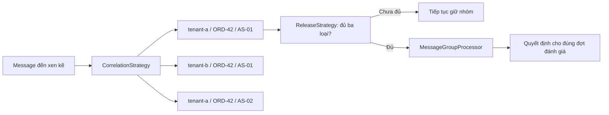

# CorrelationStrategy

Trong chương Aggregator của module **SPRING_INTEGRATION_CORE**, `CorrelationStrategy` quyết định một thông điệp thuộc nhóm nào trước khi aggregator tổng hợp kết quả. Chọn đúng khóa nhóm giúp luồng tích hợp ghép đúng những phản hồi của cùng một yêu cầu, ngay cả khi thông điệp đến xen kẽ, đến sai thứ tự hoặc được gửi lại.

Bài học sử dụng `Message`, `MessageChannel`, endpoint aggregator và Java DSL để xây dựng một luồng kiểm tra đơn hàng. Người học cần biết cách tạo `Message`, khai báo `IntegrationFlow` và hiểu vai trò cơ bản của aggregator. Các ví dụ dùng cú pháp Java 17 trở lên và API Java DSL của Spring Integration; phiên bản thư viện nên được quản lý nhất quán theo BOM của dự án.

## 1. Bài toán: phản hồi đến xen kẽ nhưng phải ghép đúng yêu cầu

Giả sử mỗi đơn hàng cần ba kết quả kiểm tra:

- `INVENTORY`: hàng còn đủ hay không.
- `PAYMENT`: thanh toán có hợp lệ hay không.
- `FRAUD`: kiểm tra gian lận có chấp nhận hay không.

Hai đơn hàng của hai khách thuê khác nhau có thể cùng mang mã `ORD-42`. Một đơn hàng cũng có thể được đánh giá lại khi thông tin thanh toán thay đổi. Vì vậy, chỉ dùng `orderId` chưa đủ để xác định một lần tổng hợp.

Trong ví dụ này, hợp đồng nghiệp vụ quy định:

```text
Khóa nhóm = (tenantId, orderId, assessmentId)

Một nhóm hoàn tất khi đã có:
INVENTORY + PAYMENT + FRAUD
```

`assessmentId` được tạo một lần khi bắt đầu một đợt đánh giá và truyền tới tất cả nhánh. Gửi lại thông điệp thuộc cùng đợt phải giữ nguyên giá trị này. Một đợt đánh giá mới có `assessmentId` mới.

| Thông điệp | Tenant | Đơn hàng | Đợt đánh giá | Loại kiểm tra | Nhóm |
|---|---|---|---|---|---|
| M1 | tenant-a | ORD-42 | AS-01 | INVENTORY | A |
| M2 | tenant-b | ORD-42 | AS-01 | PAYMENT | B |
| M3 | tenant-a | ORD-42 | AS-02 | FRAUD | C |
| M4 | tenant-a | ORD-42 | AS-01 | PAYMENT | A |
| M5 | tenant-a | ORD-42 | AS-01 | FRAUD | A |

M1, M4 và M5 phải được tổng hợp cùng nhau. M2 và M3 thuộc các nhóm khác dù có chung mã đơn hàng.



Sơ đồ mô tả trách nhiệm ở mức khái niệm; các nhóm được quản lý trong message group store của aggregator.

## 2. Hợp đồng của CorrelationStrategy

Interface nằm trong package `org.springframework.integration.aggregator` và có một phương thức chính:

```java
import org.springframework.messaging.Message;

public interface CorrelationStrategy {
    Object getCorrelationKey(Message<?> message);
}
```

Đầu vào là **một thông điệp**, vì vậy chiến lược có thể lấy khóa từ payload, header hoặc kết hợp cả hai. Kết quả là đối tượng đại diện cho nhóm. Đây là functional interface nên có thể triển khai bằng lambda hoặc method reference. Nếu không xác định được khóa hợp lệ, chiến lược nên ném ngoại lệ, thay vì trả về `null`. Xem [API CorrelationStrategy](https://docs.spring.io/spring-integration/api/org/springframework/integration/aggregator/CorrelationStrategy.html).

Ví dụ ngắn với một header nghiệp vụ:

```java
CorrelationStrategy strategy = message -> {
    String key = message.getHeaders().get("assessmentKey", String.class);

    if (key == null || key.isBlank()) {
        throw new IllegalArgumentException("Missing assessmentKey");
    }

    return key;
};
```

Đoạn này giả định `CorrelationStrategy` được import từ package aggregator. Nó chỉ xác định nhóm; nó không kiểm tra nhóm đã đủ thông điệp hay tổng hợp payload.

Có thể hình dung chiến lược như hàm:

```text
keyOf(message) -> khóa nhóm

keyOf(M1) bằng keyOf(M2)
    => M1 và M2 thuộc cùng nhóm
       trong cùng phạm vi lưu trữ của aggregator.
```

Khóa cần ổn định trong suốt vòng đời nhóm. Với đối tượng Java làm khóa, phải thiết kế `equals()` và `hashCode()` phù hợp. Không dùng một đối tượng có các trường định danh bị thay đổi sau khi đã đưa thông điệp vào nhóm.

## 3. Phân biệt ba quyết định của aggregator

| Thành phần | Câu hỏi được trả lời | Đầu vào chính | Kết quả |
|---|---|---|---|
| `CorrelationStrategy` | Thông điệp này thuộc nhóm nào? | Một `Message<?>` | Khóa nhóm |
| `ReleaseStrategy` | Nhóm này đã đủ điều kiện phát hành chưa? | Một `MessageGroup` | `boolean` |
| `MessageGroupProcessor` | Ghép các thông điệp thành kết quả nào? | Nhóm được xử lý | Kết quả tổng hợp |

Trong bài toán đơn hàng:

```text
Correlation:
    (tenant-a, ORD-42, AS-01)

Release:
    đã nhận đủ INVENTORY, PAYMENT, FRAUD

Aggregation:
    tạo OrderDecision với kết quả của các loại kiểm tra
```

Nếu thiếu `tenantId` trong khóa, nhóm có thể chứa phản hồi của nhiều tenant. Một release strategy vẫn có thể nhận đủ ba loại kiểm tra và trả về `true`, nhưng quyết định tạo ra đã sai về nghiệp vụ.

Nếu khóa đúng nhưng một nhánh không bao giờ trả lời, nhóm vẫn thiếu dữ liệu. Thay đổi khóa không giải quyết được tình huống đó; cần quyết định về timeout, lỗi hoặc kết quả thiếu.

Java DSL cho phép cấu hình riêng correlation, release và bộ xử lý đầu ra. Xem [Aggregators and Resequencers trong Java DSL](https://docs.spring.io/spring-integration/reference/dsl/java-aggregators.html).

## 4. Cơ chế mặc định và các header sequence

Nếu không cấu hình chiến lược riêng, aggregator dùng `HeaderAttributeCorrelationStrategy` dựa trên header `IntegrationMessageHeaderAccessor.CORRELATION_ID`. Hai thông điệp có cùng giá trị header này được đưa vào cùng nhóm. Splitter thường cung cấp bộ header sequence phục vụ việc ghép lại các phần đã tách. Xem [Aggregator Reference](https://docs.spring.io/spring-integration/reference/aggregator.html).

| Header | Vai trò |
|---|---|
| `CORRELATION_ID` | Xác định các phần thuộc cùng một lần phân tách |
| `SEQUENCE_NUMBER` | Vị trí của phần trong sequence |
| `SEQUENCE_SIZE` | Số phần dự kiến của sequence |

Ví dụ một sequence có hai phần:

```java
import org.springframework.integration.IntegrationMessageHeaderAccessor;
import org.springframework.messaging.Message;
import org.springframework.messaging.support.MessageBuilder;

Message<String> first = MessageBuilder.withPayload("inventory-ok")
        .setHeader(IntegrationMessageHeaderAccessor.CORRELATION_ID, "request-17")
        .setHeader(IntegrationMessageHeaderAccessor.SEQUENCE_NUMBER, 1)
        .setHeader(IntegrationMessageHeaderAccessor.SEQUENCE_SIZE, 2)
        .build();

Message<String> second = MessageBuilder.withPayload("payment-ok")
        .setHeader(IntegrationMessageHeaderAccessor.CORRELATION_ID, "request-17")
        .setHeader(IntegrationMessageHeaderAccessor.SEQUENCE_NUMBER, 2)
        .setHeader(IntegrationMessageHeaderAccessor.SEQUENCE_SIZE, 2)
        .build();
```

Hai thông điệp cùng nhóm vì cùng `CORRELATION_ID`; `SEQUENCE_NUMBER` không phải khóa nhóm.

Release strategy mặc định thông thường là `SimpleSequenceSizeReleaseStrategy`. Nó dựa vào kích thước sequence và không thực hiện kiểm tra số thứ tự sequence bị trùng. Vì vậy, đừng suy ra rằng bộ header sequence tự cung cấp đầy đủ khả năng chống xử lý trùng. Xem [API SimpleSequenceSizeReleaseStrategy](https://docs.spring.io/spring-integration/api/org/springframework/integration/aggregator/SimpleSequenceSizeReleaseStrategy.html).

Khi dùng publish-subscribe channel hoặc recipient list router để chia nhánh rồi tổng hợp, cần chủ động bật `applySequence` nếu muốn dựa vào các header sequence. Cơ chế này không bật mặc định ở hai thành phần đó. Nếu filter loại bỏ một phần của sequence, điều kiện chờ đủ số phần ban đầu cũng cần được xem lại. Xem [hướng dẫn aggregator và sequence](https://docs.spring.io/spring-integration/reference/aggregator.html).

Ví dụ thực hành ở phần 7 sử dụng khóa và release strategy nghiệp vụ, nên không yêu cầu ba phản hồi phải có header sequence.

## 5. Các cách cấu hình khóa nhóm

### 5.1. Dùng HeaderAttributeCorrelationStrategy

Nếu bên phát thông điệp đã cung cấp header thống nhất, dùng triển khai có sẵn:

```java
import org.springframework.integration.aggregator.HeaderAttributeCorrelationStrategy;

// Bên trong một IntegrationFlow:
.aggregate(a -> a
        .correlationStrategy(
                new HeaderAttributeCorrelationStrategy("assessmentKey"))
        .releaseStrategy(group -> group.size() == 3))
```

`HeaderAttributeCorrelationStrategy` lấy giá trị của header được chỉ định trong constructor làm khóa. Nó không tự xác nhận rằng giá trị đó là một khóa nghiệp vụ đầy đủ. Xem [API HeaderAttributeCorrelationStrategy](https://docs.spring.io/spring-integration/api/org/springframework/integration/aggregator/HeaderAttributeCorrelationStrategy.html).

Điều kiện `group.size() == 3` ở đây chỉ minh họa cú pháp. Trong bài toán có gửi lại thông điệp, ba phản hồi có thể cùng thuộc một loại kiểm tra. Phần 7 sẽ dùng điều kiện mạnh hơn.

Nếu cần từ chối cả chuỗi rỗng, hãy kiểm tra trước aggregator hoặc dùng lambda có kiểm tra như phần 2. Không thay header thiếu bằng một hằng số như `"UNKNOWN"`: các yêu cầu lỗi sẽ bị dồn vào cùng nhóm.

### 5.2. Dùng SpEL

Nếu quy tắc chỉ đọc một trường đơn giản, có thể dùng biểu thức:

```java
// Header đã được kiểm tra tại đầu vào.
.aggregate(a -> a
        .correlationExpression("headers['assessmentKey']")
        .releaseStrategy(group -> group.size() == 3))
```

Đối tượng gốc của correlation expression là thông điệp, nên có thể truy cập `headers` và `payload`. Khi cần nhiều nhánh kiểm tra hoặc tạo khóa tổng hợp, một lớp Java thường dễ đọc và kiểm thử hơn.

### 5.3. Dùng đối tượng có phương thức xử lý

Java DSL cũng hỗ trợ truyền đối tượng và tên phương thức:

```java
import org.springframework.messaging.Message;

public class AssessmentKeyResolver {

    public String resolve(Message<?> message) {
        String key = message.getHeaders()
                .get("assessmentKey", String.class);

        if (key == null || key.isBlank()) {
            throw new IllegalArgumentException("Missing assessmentKey");
        }

        return key;
    }
}

// Bên trong một IntegrationFlow:
// .aggregate(a -> a.correlationStrategy(resolver, "resolve") ...)
```

Ba cách cấu hình trên là các lựa chọn thay thế. Nên chọn một nguồn quyết định khóa cho mỗi aggregator để quy tắc không bị phân tán. Các overload `correlationStrategy(...)` và `correlationExpression(...)` được mô tả tại [API CorrelationHandlerSpec](https://docs.spring.io/spring-integration/api/org/springframework/integration/dsl/CorrelationHandlerSpec.html).

### 5.4. Phân biệt interface và annotation cùng tên

Spring Integration có cả:

- `org.springframework.integration.aggregator.CorrelationStrategy`: interface để triển khai trực tiếp.
- `org.springframework.integration.annotation.CorrelationStrategy`: annotation đánh dấu phương thức POJO xác định khóa.

Annotation mô tả khả năng của phương thức; chỉ thêm annotation không tự tạo một aggregator endpoint. Vẫn cần cấu hình endpoint hoặc đăng ký đối tượng với cơ chế xử lý tương ứng. Xem [API annotation CorrelationStrategy](https://docs.spring.io/spring-integration/api/org/springframework/integration/annotation/CorrelationStrategy.html).

Các ví dụ đầy đủ dưới đây dùng interface để thể hiện rõ hợp đồng.

## 6. Thiết kế khóa theo ranh giới nghiệp vụ

### 6.1. Các trường của khóa phải cùng mô tả một lần tổng hợp

| Thông tin | Có đưa vào khóa không? | Lý do trong ví dụ |
|---|---|---|
| `tenantId` | Có | Cùng mã đơn hàng có thể xuất hiện ở nhiều tenant |
| `orderId` | Có | Phân biệt các đơn hàng trong tenant |
| `assessmentId` | Có | Phân biệt các đợt đánh giá độc lập |
| Loại kiểm tra | Không | INVENTORY, PAYMENT, FRAUD phải gặp nhau |
| Message ID | Không | Mỗi phản hồi có thể có ID riêng |
| Số lần giao lại | Không | Giao lại cùng phản hồi phải giữ nguyên nhóm |
| Thời điểm nhận | Không | Các nhánh đến khác thời điểm vẫn cùng đợt |

Đây là quyết định của bài toán minh họa. Trong một nghiệp vụ khác, khóa có thể là `shipmentId`, `batchId` hoặc một định danh hội thoại duy nhất do hệ thống cấp.

Không nhất thiết đưa mọi định danh vào khóa. Nếu `assessmentId` đã được bảo đảm duy nhất toàn hệ thống và mọi nhánh đều có nó, chỉ dùng định danh đó cũng có thể đúng. Điều cần xác nhận là phạm vi duy nhất trong hợp đồng dữ liệu.

### 6.2. Khóa quá rộng và khóa quá hẹp

Khóa quá rộng làm nhiều yêu cầu bị gộp vào một nhóm:

```text
key = tenantId
=> nhiều đơn hàng của cùng tenant bị trộn
```

Khóa quá hẹp làm những phần cần ghép bị tách ra:

```text
key = (tenantId, orderId, assessmentId, check)
=> INVENTORY, PAYMENT, FRAUD nằm ở ba nhóm riêng
```

Tạo UUID mới ngay trong `getCorrelationKey()` cũng khiến mỗi lần gọi nhận một nhóm khác. Nếu cần UUID cho một đợt đánh giá, hãy cấp một lần ở đầu luồng và truyền nguyên giá trị đó xuống các nhánh.

### 6.3. Khóa tổng hợp nên biểu diễn cấu trúc rõ ràng

Nối chuỗi không có quy tắc mã hóa có thể gây nhập nhằng:

```text
("a:b", "c") -> "a:b:c"
("a", "b:c") -> "a:b:c"
```

Trong một ứng dụng Java, record bất biến là lựa chọn dễ đọc:

```java
public record OrderKey(
        String tenantId,
        String orderId,
        String assessmentId) {
}
```

Record tạo `equals()` và `hashCode()` dựa trên các thành phần. Với các thành phần kiểu `String`, hai instance có cùng bộ giá trị sẽ biểu diễn cùng khóa.

Nếu khóa đi qua JSON hoặc broker, hãy thống nhất schema, kiểu dữ liệu và quy tắc chuẩn hóa. Chuỗi `"42"` và số `42` không nên được coi là hai cách biểu diễn tùy ý của cùng định danh. Chỉ đổi chữ hoa, cắt khoảng trắng hoặc bỏ số 0 đầu khi hợp đồng nghiệp vụ cho phép; việc chuẩn hóa có thể làm hai định danh hợp lệ trở nên giống nhau.

### 6.4. Không dựa vào trạng thái ngầm của luồng xử lý

Chiến lược nên tính khóa từ dữ liệu đã có trong thông điệp, không dựa vào biến đếm cục bộ, người dùng trong `ThreadLocal`, giờ hiện tại hoặc một truy vấn có thể trả kết quả khác giữa các lần gửi lại.

Khi dùng executor hoặc adapter bất đồng bộ, các nhánh có thể chạy trên thread khác nhau. Việc truyền rõ `tenantId` và `assessmentId` giúp khóa giữ nguyên ý nghĩa qua các ranh giới đó.

## 7. Ví dụ Java DSL hoàn chỉnh

Ví dụ sau khai báo:

- Một `DirectChannel` nhận phản hồi.
- Một correlation strategy đọc định danh trong payload.
- Một aggregator chờ đủ ba loại kiểm tra.
- Một `QueueChannel` chứa quyết định để quan sát hoặc kiểm thử.
- Một `QueueChannel` nhận phản hồi bị loại khi nhóm hết hạn hoặc đã hoàn tất.

Dự án cần `spring-integration-core` và Spring Context tương thích. Nếu dùng Spring Boot, có thể lấy các thành phần qua starter integration và BOM của Boot. Không cần broker để chạy luồng trong bộ nhớ này.

```java
package example.integration;

import java.io.Serializable;
import java.util.EnumMap;
import java.util.EnumSet;
import java.util.Map;
import java.util.Objects;
import java.util.Set;
import java.util.stream.Collectors;

import org.springframework.beans.factory.annotation.Qualifier;
import org.springframework.context.annotation.Bean;
import org.springframework.context.annotation.Configuration;
import org.springframework.integration.aggregator.CorrelationStrategy;
import org.springframework.integration.channel.DirectChannel;
import org.springframework.integration.channel.QueueChannel;
import org.springframework.integration.config.EnableIntegration;
import org.springframework.integration.dsl.IntegrationFlow;
import org.springframework.integration.store.MessageGroup;
import org.springframework.messaging.Message;
import org.springframework.messaging.MessageChannel;

@Configuration
@EnableIntegration
public class OrderAggregationConfiguration {

    public enum Check {
        INVENTORY, PAYMENT, FRAUD
    }

    public record CheckResult(
            String tenantId,
            String orderId,
            String assessmentId,
            Check check,
            boolean accepted) implements Serializable {

        public CheckResult {
            Objects.requireNonNull(check, "check");
        }
    }

    public record OrderKey(
            String tenantId,
            String orderId,
            String assessmentId) implements Serializable {

        public OrderKey {
            requireText(tenantId, "tenantId");
            requireText(orderId, "orderId");
            requireText(assessmentId, "assessmentId");
        }
    }

    public record OrderDecision(
            OrderKey key,
            boolean accepted,
            Map<Check, Boolean> checks) {

        public OrderDecision {
            checks = Map.copyOf(checks);
        }
    }

    @Bean
    public DirectChannel checkResults() {
        return new DirectChannel();
    }

    @Bean
    public QueueChannel orderDecisions() {
        return new QueueChannel();
    }

    @Bean
    public QueueChannel rejectedCheckResults() {
        return new QueueChannel();
    }

    @Bean
    public CorrelationStrategy orderCorrelationStrategy() {
        return message -> {
            if (!(message.getPayload() instanceof CheckResult result)) {
                throw new IllegalArgumentException(
                        "Expected CheckResult payload");
            }

            return keyOf(result);
        };
    }

    @Bean
    public IntegrationFlow orderAggregationFlow(
            @Qualifier("checkResults") MessageChannel input,
            @Qualifier("orderDecisions") MessageChannel output,
            @Qualifier("rejectedCheckResults") MessageChannel rejected,
            @Qualifier("orderCorrelationStrategy")
            CorrelationStrategy correlationStrategy) {

        return IntegrationFlow.from(input)
                .aggregate(a -> a
                        .correlationStrategy(correlationStrategy)
                        .releaseStrategy(
                                OrderAggregationConfiguration::hasAllChecks)
                        .outputProcessor(
                                OrderAggregationConfiguration::toDecision)
                        .expireGroupsUponCompletion(false)
                        .groupTimeout(30_000L)
                        .expireGroupsUponTimeout(false)
                        .sendPartialResultOnExpiry(false)
                        .discardChannel(rejected))
                .channel(output)
                .get();
    }

    private static boolean hasAllChecks(MessageGroup group) {
        Set<Check> received = group.getMessages().stream()
                .map(Message::getPayload)
                .map(CheckResult.class::cast)
                .map(CheckResult::check)
                .collect(Collectors.toSet());

        return received.containsAll(EnumSet.allOf(Check.class));
    }

    private static OrderDecision toDecision(MessageGroup group) {
        Map<Check, Boolean> checks = new EnumMap<>(Check.class);
        CheckResult first = null;

        for (Message<?> message : group.getMessages()) {
            CheckResult result = (CheckResult) message.getPayload();

            if (first == null) {
                first = result;
            }

            checks.merge(
                    result.check(),
                    result.accepted(),
                    (left, right) -> left && right);
        }

        if (first == null) {
            throw new IllegalStateException("Cannot aggregate empty group");
        }

        boolean accepted = checks.values().stream()
                .allMatch(Boolean::booleanValue);

        return new OrderDecision(keyOf(first), accepted, checks);
    }

    private static OrderKey keyOf(CheckResult result) {
        return new OrderKey(
                result.tenantId(),
                result.orderId(),
                result.assessmentId());
    }

    private static void requireText(String value, String field) {
        if (value == null || value.isBlank()) {
            throw new IllegalArgumentException(
                    "Missing correlation field: " + field);
        }
    }
}
```

Các phương thức cấu hình timeout và store thuộc [CorrelationHandlerSpec](https://docs.spring.io/spring-integration/api/org/springframework/integration/dsl/CorrelationHandlerSpec.html); bộ xử lý đầu ra và tùy chọn hoàn tất nhóm thuộc [AggregatorSpec](https://docs.spring.io/spring-integration/api/org/springframework/integration/dsl/AggregatorSpec.html).

### 7.1. Vì sao không dùng group.size() == 3?

Xét luồng đến:

```text
INVENTORY accepted=true
INVENTORY accepted=true  // giao lại dưới một Message mới
PAYMENT   accepted=true
```

Đã có ba thông điệp, nhưng chưa có `FRAUD`. `hasAllChecks()` kiểm tra tập loại phản hồi, nên nhóm vẫn chờ. Hai phản hồi `INVENTORY` không thay thế cho loại còn thiếu.

`toDecision()` gộp các phản hồi của cùng loại theo phép AND. Nếu trước lúc phát hành đã nhận cả `PAYMENT=true` và `PAYMENT=false`, kết quả của PAYMENT là `false`. Chính sách này được chọn riêng cho ví dụ và không phụ thuộc thứ tự nhận.

Chính sách trên chỉ áp dụng cho những phản hồi đã có trong nhóm lúc phát hành. Nếu nghiệp vụ cho phép cập nhật kết quả sau khi đã đủ ba loại, cần thêm phiên bản phản hồi hoặc quy trình điều chỉnh quyết định. Aggregator trong ví dụ phát hành một lần cho mỗi đợt đánh giá.

### 7.2. Ý nghĩa các lựa chọn về vòng đời

`expireGroupsUponCompletion(false)` giữ thông tin nhóm đã hoàn tất, nhờ đó phản hồi muộn cùng khóa có thể bị loại thay vì bắt đầu một nhóm mới. Cách giữ dấu nhóm hoàn tất được mô tả trong [Aggregator Reference](https://docs.spring.io/spring-integration/reference/aggregator.html).

Ví dụ đặt timeout 30 giây và không gửi kết quả thiếu. `expireGroupsUponTimeout(false)` giữ trạng thái hoàn tất sau khi nhóm bị kết thúc bởi timeout, còn `discardChannel` tiếp nhận dữ liệu bị loại. Cấu hình này ưu tiên việc không mở lại cùng đợt đánh giá ngay khi phản hồi muộn đến. Cơ chế xử lý nhóm timeout có thể tham khảo ở [AbstractCorrelatingMessageHandler](https://github.com/spring-projects/spring-integration/blob/main/spring-integration-core/src/main/java/org/springframework/integration/aggregator/AbstractCorrelatingMessageHandler.java).

Timeout của nhóm phục vụ việc xử lý nhóm chờ; nó không phải cam kết thời gian phản hồi toàn bộ nghiệp vụ. Với constant group timeout, việc nhận thêm thông điệp có thể dời lịch xử lý hết hạn. Nếu cần hạn chót tính từ lúc bắt đầu đánh giá, hãy truyền deadline nghiệp vụ và thiết kế chính sách thời gian tương ứng.

Cấu hình minh họa giữ dấu các nhóm hoàn tất. Trong ứng dụng chạy lâu, cần thêm chính sách dọn metadata theo khoảng thời gian chấp nhận phản hồi muộn. `QueueChannel` chứa quyết định và thông điệp bị loại cũng cần có consumer hoặc được đọc trong kiểm thử.

### 7.3. Vì sao lấy định danh đầu ra từ payload?

`toDecision()` tạo lại `OrderKey` từ một `CheckResult` thay vì giả định mọi triển khai message store đều trả nguyên kiểu khóa nghiệp vụ qua `group.getGroupId()`.

Việc này cũng làm hợp đồng đầu ra rõ ràng: `OrderDecision.key()` chứa tenant, đơn hàng và đợt đánh giá. Bên xử lý tiếp theo không cần suy luận lại khóa từ header sequence hoặc từ message ID của kết quả.

Các phần tử trong nhóm đều đã đi qua cùng correlation strategy. Vì vậy, quy tắc nhóm chính là cơ sở để chúng có cùng định danh nghiệp vụ.

## 8. Kiểm thử ranh giới của khóa và hành vi của luồng

Có hai loại kiểm thử mang lại giá trị trực tiếp:

1. Kiểm thử correlation strategy để chứng minh trường nào làm thay đổi nhóm.
2. Kiểm thử luồng với thông điệp xen kẽ và gửi lại để chứng minh aggregator không trộn dữ liệu hoặc phát hành sớm.

Ví dụ sau dùng JUnit Jupiter và Spring Test. Các dependency kiểm thử cần thiết có thể được cung cấp bởi bộ dependency test của dự án. Đặt lớp kiểm thử cùng package `example.integration` với cấu hình ở phần 7.

```java
package example.integration;

import org.junit.jupiter.api.Test;
import org.springframework.beans.factory.annotation.Autowired;
import org.springframework.beans.factory.annotation.Qualifier;
import org.springframework.integration.aggregator.CorrelationStrategy;
import org.springframework.integration.channel.QueueChannel;
import org.springframework.messaging.Message;
import org.springframework.messaging.MessageChannel;
import org.springframework.messaging.support.MessageBuilder;
import org.springframework.test.context.junit.jupiter.SpringJUnitConfig;

import example.integration.OrderAggregationConfiguration.Check;
import example.integration.OrderAggregationConfiguration.CheckResult;
import example.integration.OrderAggregationConfiguration.OrderDecision;

import static org.junit.jupiter.api.Assertions.*;

@SpringJUnitConfig(OrderAggregationConfiguration.class)
class OrderCorrelationTest {

    @Autowired
    @Qualifier("checkResults")
    MessageChannel input;

    @Autowired
    @Qualifier("orderDecisions")
    QueueChannel output;

    @Autowired
    @Qualifier("rejectedCheckResults")
    QueueChannel rejected;

    @Autowired
    @Qualifier("orderCorrelationStrategy")
    CorrelationStrategy strategy;

    @Test
    void keyUsesTenantOrderAndAssessmentButNotCheckType() {
        Object key = strategy.getCorrelationKey(
                part("tenant-a", "ORD-42", "AS-key",
                        Check.INVENTORY, true));

        assertEquals(key, strategy.getCorrelationKey(
                part("tenant-a", "ORD-42", "AS-key",
                        Check.PAYMENT, true)));

        assertNotEquals(key, strategy.getCorrelationKey(
                part("tenant-b", "ORD-42", "AS-key",
                        Check.INVENTORY, true)));

        assertNotEquals(key, strategy.getCorrelationKey(
                part("tenant-a", "ORD-99", "AS-key",
                        Check.INVENTORY, true)));

        assertNotEquals(key, strategy.getCorrelationKey(
                part("tenant-a", "ORD-42", "AS-other",
                        Check.INVENTORY, true)));
    }

    @Test
    void missingAssessmentIdIsRejectedByStrategy() {
        assertThrows(IllegalArgumentException.class,
                () -> strategy.getCorrelationKey(
                        part("tenant-a", "ORD-42", "",
                                Check.INVENTORY, true)));
    }

    @Test
    void interleavedGroupsAndDuplicatesRemainIndependent() {
        assertTrue(input.send(part("tenant-a", "ORD-42", "AS-flow",
                Check.INVENTORY, true)));
        assertTrue(input.send(part("tenant-b", "ORD-42", "AS-flow",
                Check.INVENTORY, true)));
        assertTrue(input.send(part("tenant-a", "ORD-42", "AS-flow",
                Check.INVENTORY, true)));
        assertTrue(input.send(part("tenant-a", "ORD-42", "AS-flow",
                Check.PAYMENT, true)));

        // Bốn message tổng cộng, nhưng chưa nhóm nào đủ ba loại.
        assertNull(output.receive(0));

        assertTrue(input.send(part("tenant-a", "ORD-42", "AS-flow",
                Check.FRAUD, true)));

        OrderDecision decisionA = takeDecision();
        assertEquals("tenant-a", decisionA.key().tenantId());
        assertEquals("ORD-42", decisionA.key().orderId());
        assertEquals("AS-flow", decisionA.key().assessmentId());
        assertTrue(decisionA.accepted());
        assertEquals(3, decisionA.checks().size());
        assertNull(output.receive(0));

        // Phản hồi muộn không mở lại nhóm A đã hoàn tất.
        assertTrue(input.send(part("tenant-a", "ORD-42", "AS-flow",
                Check.PAYMENT, true)));

        Message<?> late = rejected.receive(1000);
        assertNotNull(late);
        CheckResult lateResult =
                assertInstanceOf(CheckResult.class, late.getPayload());
        assertEquals("tenant-a", lateResult.tenantId());
        assertNull(output.receive(0));

        // Nhóm B vẫn chờ phản hồi riêng của tenant-b.
        assertTrue(input.send(part("tenant-b", "ORD-42", "AS-flow",
                Check.PAYMENT, true)));
        assertNull(output.receive(0));

        assertTrue(input.send(part("tenant-b", "ORD-42", "AS-flow",
                Check.FRAUD, false)));

        OrderDecision decisionB = takeDecision();
        assertEquals("tenant-b", decisionB.key().tenantId());
        assertFalse(decisionB.accepted());
        assertEquals(Boolean.FALSE,
                decisionB.checks().get(Check.FRAUD));
        assertNull(output.receive(0));
    }

    private OrderDecision takeDecision() {
        Message<?> message = output.receive(1000);
        assertNotNull(message);
        return assertInstanceOf(OrderDecision.class, message.getPayload());
    }

    private static Message<CheckResult> part(
            String tenantId,
            String orderId,
            String assessmentId,
            Check check,
            boolean accepted) {

        return MessageBuilder.withPayload(new CheckResult(
                tenantId, orderId, assessmentId, check, accepted))
                .build();
    }
}
```

`DirectChannel` xử lý đồng bộ trong luồng minh họa nên kiểm tra `receive(0)` sau khi gửi là phù hợp. Với executor, broker hoặc xử lý nền, cần chờ kết quả theo thời hạn hữu hạn và cơ chế đồng bộ kiểm thử, thay vì kết luận chưa phát hành chỉ vì đọc queue ngay lập tức.

Trong lần kiểm thử luồng tiếp theo, dùng bộ định danh khác hoặc tạo context/store mới. Cấu hình đang giữ dấu nhóm hoàn tất; gửi lại đúng khóa của một lần chạy trước trong cùng store sẽ kiểm tra hành vi thông điệp muộn, không phải một nhóm mới.

Các đoạn kiểm thử là mã thực hành của bài học; việc đưa chúng vào dự án và chạy thuộc bước thực hành, không phải tuyên bố rằng chúng đã được chạy trong quá trình soạn tài liệu.

## 9. Correlation không cung cấp đầy đủ tính idempotent

Hai message cùng khóa chỉ có nghĩa là chúng được xét trong cùng nhóm. Điều đó không khẳng định chúng là hai phản hồi khác nhau, cũng không khẳng định tác động nghiệp vụ chỉ xảy ra một lần.

Cần phân biệt các định danh:

| Định danh | Phạm vi ý nghĩa trong bài toán |
|---|---|
| Message ID | Một instance thông điệp |
| Correlation key | Một đợt tổng hợp |
| Event ID | Một sự kiện nghiệp vụ dùng để nhận diện gửi lại |
| Loại kiểm tra | Một nhánh bắt buộc trong đợt đánh giá |
| Trace ID | Theo dõi thực thi, có thể bao trùm nhiều thao tác |

Một sự kiện được chuyển thành `Message` mới có thể nhận message ID mới. Nếu chỉ so message ID, ứng dụng có thể bỏ sót việc đây là cùng sự kiện được gửi lại.

Ví dụ ở phần 7 tránh việc duplicate làm tăng số **loại kiểm tra** và không cộng dồn nhiều lần cùng loại. Nó chưa cung cấp cơ chế idempotent cho mọi tác động sau aggregator, chẳng hạn gọi API chấp nhận đơn hàng hoặc ghi sổ kế toán. Bên thực hiện tác động vẫn cần khóa idempotency hoặc ràng buộc nghiệp vụ phù hợp.

Khi thiết kế gửi lại, xác định rõ:

- Giao lại cùng sự kiện: giữ correlation key và event ID.
- Chạy lại một đợt đánh giá độc lập: tạo `assessmentId` mới.
- Sửa một phản hồi trước khi quyết định: cần quy tắc phiên bản hoặc quy tắc hợp nhất rõ ràng.

Không thêm số lần retry vào khóa chỉ để tránh nhìn thấy duplicate. Cách đó có thể chia một đợt đánh giá thành nhiều nhóm không bao giờ đầy đủ.

## 10. Lỗi correlation, discard và phản hồi thiếu

### 10.1. Thiếu khóa là lỗi đầu vào

Nếu `assessmentId` trống, ví dụ chủ động ném ngoại lệ trước khi thông điệp được lưu vào nhóm.

Với `DirectChannel`, lỗi xử lý được truyền theo lời gọi gửi thông điệp; Spring có thể bọc lỗi gốc trong ngoại lệ messaging. Khi kiểm thử qua channel, nên kiểm tra cả nguyên nhân nếu cần xác nhận lỗi validation.

Trong luồng bất đồng bộ, cần cấu hình đường xử lý lỗi phù hợp với endpoint, poller hoặc adapter đang dùng. Không giả định cứ có bean `errorChannel` là mọi ngoại lệ của mọi channel đều tự đi vào đó.

`discardChannel` của aggregator có nhiệm vụ nhận những thông điệp bị loại theo vòng đời nhóm. Nó không tự biến thành nơi tiếp nhận mọi ngoại lệ phát sinh từ correlation strategy.

### 10.2. Không gán khóa dự phòng chung

Ví dụ không nên dùng:

```java
// Sai với các yêu cầu độc lập bị thiếu định danh:
return key == null ? "DEFAULT" : key;
```

Tất cả yêu cầu thiếu khóa sẽ gặp nhau trong cùng nhóm. Việc từ chối dữ liệu hoặc định tuyến sang luồng sửa lỗi giúp giữ ranh giới giữa các yêu cầu.

Nếu muốn cách ly từng thông điệp lỗi, có thể thiết kế một luồng validation trước aggregator và lưu thông tin lỗi riêng. Đừng xem mỗi thông điệp lỗi là một nhóm hợp lệ mới chỉ để tiếp tục xử lý.

### 10.3. Một nhánh không trả lời

Trong ví dụ, chỉ có INVENTORY và PAYMENT thì nhóm chưa đạt điều kiện phát hành. Timeout không biến hai phản hồi thành kết quả đủ ba loại.

Đội phát triển cần quyết định rõ đầu ra nghiệp vụ khi thiếu nhánh: thất bại cả đợt, đánh dấu chưa hoàn tất, yêu cầu gửi lại, hoặc cho phép một loại quyết định tạm thời. Nếu chọn quyết định tạm thời, bộ xử lý đầu ra cũng phải biểu diễn được những kiểm tra còn thiếu.

Chính sách xử lý phản hồi thiếu phải thống nhất với upstream filter. Một filter loại phản hồi mà không có thông điệp thay thế có thể khiến aggregator chờ đến hết hạn.

## 11. MessageGroupStore, nhiều instance và phạm vi khóa

### 11.1. Khóa đúng nhưng store cục bộ vẫn có thể chia đôi dữ liệu

Mặc định, luồng minh họa dùng lưu trữ trong bộ nhớ. Nếu ba phản hồi cùng khóa được chia đến hai instance với hai store riêng, mỗi instance chỉ thấy một phần nhóm.

Do đó, khi triển khai nhiều instance, cần thiết kế cách đưa các phần cùng nhóm đến cùng nơi, hoặc dùng message group store dùng chung phù hợp với cơ chế điều phối. Đổi correlation strategy không tự tạo ra bộ nhớ dùng chung.

Spring Integration có các triển khai store bền vững; payload và header phải phù hợp với cơ chế serialization của store đã chọn. Record `OrderKey` và `CheckResult` trong ví dụ có `Serializable`, nhưng vẫn phải xác nhận đầy đủ hợp đồng của store và dữ liệu thực tế. Không có quy tắc rằng chỉ thêm `implements Serializable` là mọi cấu hình persistence đều hoàn tất. Xem [Message Store](https://docs.spring.io/spring-integration/reference/message-store.html).

Với JDBC, thành phần dùng cho aggregator là `JdbcMessageStore`; `JdbcChannelMessageStore` dành cho việc lưu thông điệp của channel và không phải lựa chọn thay thế tương đương. Xem [JDBC Message Store](https://docs.spring.io/spring-integration/reference/jdbc/message-store.html).

### 11.2. Store dùng chung cần đồng bộ thao tác trên nhóm

Nếu nhiều instance cùng sửa một nhóm trong store dùng chung, cần lock registry dùng chung phù hợp. Lock cục bộ chỉ điều phối các thread trong một tiến trình, không bảo vệ thao tác giữa các tiến trình.

Khóa nhóm cũng ảnh hưởng mức tranh chấp: nếu vô tình dùng một hằng số cho toàn bộ thông điệp, mọi yêu cầu có thể tập trung vào một nhóm và một miền khóa. Vì vậy, sự cố correlation thường vừa làm sai dữ liệu vừa làm giảm khả năng xử lý đồng thời. Xem [Lock Registry của aggregator](https://docs.spring.io/spring-integration/reference/aggregator.html#_lock_registry).

### 11.3. Cùng store không có nghĩa là cùng nghiệp vụ

Nếu hai aggregator khác nghiệp vụ dùng chung một phạm vi lưu trữ và đều trả về khóa `"ORD-42"`, các nhóm có thể va chạm. Dùng store hoặc vùng lưu trữ riêng, hoặc đưa namespace của luồng vào khóa:

```text
("order-assessment", tenantId, orderId, assessmentId)
("shipment-confirmation", tenantId, orderId, shipmentId)
```

Namespace cũng là một phần của hợp đồng nhóm. Cần kiểm tra cách store ánh xạ khóa, region và bảng lưu trữ; đừng giả định tên bean aggregator tự động trở thành namespace lưu trữ.

Mã nguồn [AbstractCorrelatingMessageHandler](https://github.com/spring-projects/spring-integration/blob/main/spring-integration-core/src/main/java/org/springframework/integration/aggregator/AbstractCorrelatingMessageHandler.java) lưu ý việc bảo đảm khóa không va chạm khi nhiều handler dùng cùng message store.

### 11.4. Khóa thay đổi khi nâng cấp ứng dụng

Giả sử phiên bản cũ dùng `(tenantId, orderId)`, còn phiên bản mới dùng `(tenantId, orderId, assessmentId)`. Những nhóm chưa hoàn tất trong store cũ sẽ không tự chuyển sang hợp đồng khóa mới.

Trước khi thay đổi định dạng, cần kế hoạch xử lý nhóm đang mở, tương thích dữ liệu trong thời gian chạy song song hoặc tách namespace theo phiên bản luồng. Đây là thay đổi về định danh trạng thái, không chỉ là thay một lambda.

## 12. Thông điệp muộn và tái sử dụng khóa

Sau khi một nhóm đã hoàn tất, thông điệp cùng khóa có thể là:

1. Bản giao lại của một phản hồi cũ.
2. Một phản hồi đến trễ thuộc đợt vừa kết thúc.
3. Dữ liệu của một đợt mới nhưng bên gửi đã tái sử dụng khóa.

Hai trường hợp đầu cần chính sách phản hồi muộn. Trường hợp thứ ba cho thấy hợp đồng định danh chưa phân biệt được các vòng đời.

Với ví dụ đơn hàng:

```text
Đợt đầu:
(tenant-a, ORD-42, AS-01)

Đợt đánh giá lại:
(tenant-a, ORD-42, AS-02)
```

Không cần xóa dấu nhóm AS-01 chỉ để cho phép AS-02 chạy. Việc dùng định danh đợt mới biểu diễn trực tiếp ý định nghiệp vụ.

Khi dấu nhóm hoàn tất được dọn khỏi store, một thông điệp rất muộn có thể tạo lại nhóm nếu không còn cơ chế từ chối ở tầng khác. Vì vậy, khoảng thời gian giữ metadata nên gắn với cửa sổ giao lại và phản hồi muộn mà hệ thống chấp nhận. Giữ dấu hoàn tất mãi mãi cũng cần được cân nhắc vì số lượng nhóm sẽ tăng theo thời gian.

## 13. Chẩn đoán lỗi qua triệu chứng

| Triệu chứng | Nguyên nhân liên quan correlation có thể gặp | Hướng kiểm tra |
|---|---|---|
| Kết quả chứa dữ liệu của tenant khác | Khóa thiếu tenant hoặc namespace | Đối chiếu các thành phần khóa từ thông điệp nguồn |
| Nhóm luôn chỉ có một thông điệp | Dùng message ID hoặc UUID mới cho mỗi phản hồi | So khóa của các nhánh trong cùng đợt |
| Đủ ba thông điệp nhưng thiếu loại kiểm tra | Release chỉ đếm số lượng, có duplicate | Kiểm tra tập loại phản hồi và event ID |
| Nhóm không hoàn tất dù các nhánh đã trả lời | Khác kiểu dữ liệu khóa, khác assessment ID hoặc mất header | Quan sát khóa ngay trước aggregator |
| Một instance thấy phản hồi nhưng instance khác không thấy nhóm | Store cục bộ và phân phối phản hồi không nhất quán | Kiểm tra kiến trúc store và định tuyến |
| Gửi lại đơn hàng nhưng thông điệp vào discard | Đợt mới đang dùng khóa của nhóm đã hoàn tất | Xác nhận hợp đồng assessment ID |
| Số nhóm mở tăng nhanh | Khóa quá hẹp hoặc nhánh thiếu phản hồi | Kiểm tra số nhóm, tuổi nhóm và chính sách hết hạn |
| Thay phiên bản ứng dụng rồi không ghép được nhóm cũ | Định dạng khóa hoặc serialization đã đổi | Kiểm tra nhóm đang mở và kế hoạch chuyển đổi |

Khi ghi log, các thông tin hữu ích gồm tên luồng, tenant, order ID, assessment ID, loại phản hồi và khóa nhóm đã tính. Khóa nhóm thường có số lượng giá trị rất lớn, nên không đưa nguyên khóa vào nhãn metric nếu hệ thống giám sát không được thiết kế cho độ đa dạng đó.

Để xác nhận một thiết kế correlation, hãy kiểm tra hai chiều: các thông điệp bắt buộc ghép với nhau phải có khóa bằng nhau; các lần tổng hợp độc lập phải có khóa khác nhau. Sau đó kiểm tra riêng điều kiện phát hành và vòng đời nhóm. Ba quyết định này phối hợp mới tạo được một luồng aggregator đúng với hợp đồng nghiệp vụ.
