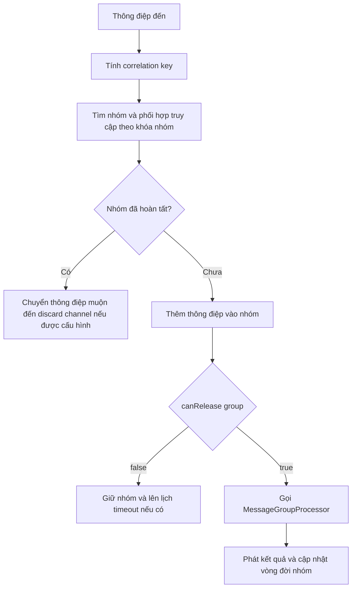

# ReleaseStrategy: quyết định khi nào Aggregator được phát kết quả

Trong một luồng Spring Integration, các thông điệp liên quan thường đến vào những thời điểm khác nhau. Aggregator lưu chúng thành nhóm, nhưng cần một quy tắc để biết lúc nào có thể tổng hợp. `ReleaseStrategy` biểu diễn quy tắc đó.

Bài học thuộc chương **Aggregator** của module `SPRING_INTEGRATION_CORE`, tập trung vào cách thiết kế điều kiện phát nhóm, cấu hình bằng Java DSL, phối hợp với timeout và kiểm thử hành vi khi thiếu hoặc trùng thông điệp. Các ví dụ dùng Java 17 và API Spring Integration 6.x; ứng dụng cần có `spring-integration-core`, Spring Context và JUnit Jupiter cho phần kiểm thử. Nếu dùng Spring Boot, có thể lấy các thành phần tích hợp qua `spring-boot-starter-integration` và để bộ quản lý dependency của dự án chọn phiên bản tương thích.

## 1. Bắt đầu từ một quy tắc nghiệp vụ cụ thể

Một hệ thống xử lý đơn hàng cần thu thập phản hồi từ ba dịch vụ:

- `inventory`: kiểm tra tồn kho.
- `pricing`: xác nhận giá.
- `fraud`: đánh giá gian lận.

Mỗi lần kiểm tra đơn hàng có một `requestKey` riêng, chẳng hạn `tenant-1:order-42:attempt-1`. Quy tắc phát nhóm là: **đã nhận ít nhất một phản hồi từ mỗi dịch vụ bắt buộc**.

| Phản hồi hiện có trong một nhóm | Được tổng hợp? | Giải thích |
| --- | --- | --- |
| `inventory` | Chưa | Thiếu `pricing`, `fraud` |
| `inventory`, `pricing` | Chưa | Thiếu `fraud` |
| `inventory`, `inventory`, `pricing` | Chưa | Ba thông điệp nhưng chỉ có hai dịch vụ khác nhau |
| `fraud`, `inventory`, `pricing` | Có | Đủ ba dịch vụ, không phụ thuộc thứ tự đến |
| `inventory=true`, `pricing=true`, `fraud=false` | Có | Đủ phản hồi; kết quả nghiệp vụ là không chấp thuận |

Điểm cuối cùng rất quan trọng: **đủ điều kiện tổng hợp không đồng nghĩa với nghiệp vụ thành công**. Một phản hồi từ chối vẫn là phản hồi hợp lệ. Nếu chỉ đếm phản hồi thành công, nhóm có thể chờ mãi một kết quả mà dịch vụ đã chính thức từ chối.

## 2. Hợp đồng của ReleaseStrategy

Interface nằm trong package `org.springframework.integration.aggregator`:

```java
public interface ReleaseStrategy {
    boolean canRelease(MessageGroup group);
}
```

`canRelease()` nhận một `MessageGroup` và trả về quyết định:

- `true`: nhóm đủ điều kiện để bước tổng hợp chạy.
- `false`: tiếp tục giữ nhóm, chờ thông điệp khác hoặc cơ chế hết hạn.

Đây là functional interface, nên có thể triển khai bằng lớp, lambda hoặc method reference. Xem [API ReleaseStrategy](https://docs.spring.io/spring-integration/docs/6.3.2/api/org/springframework/integration/aggregator/ReleaseStrategy.html).

Ba trách nhiệm trong Aggregator cần được phân biệt:

| Thành phần | Câu hỏi cần trả lời | Ví dụ |
| --- | --- | --- |
| `CorrelationStrategy` | Thông điệp thuộc nhóm nào? | Lấy `requestKey` từ header |
| `ReleaseStrategy` | Nhóm hiện tại đã sẵn sàng chưa? | Đủ các dịch vụ bắt buộc |
| `MessageGroupProcessor` | Tạo kết quả gì từ nhóm? | Tạo quyết định chấp thuận hoặc từ chối đơn hàng |

`ReleaseStrategy` đưa ra quyết định cho cả nhóm; nó không tự chọn một thông điệp để gửi, không phải bộ lọc từng thông điệp và không chịu trách nhiệm tạo payload đầu ra. Sự phân công này được mô tả trong [tài liệu Aggregator của Spring Integration](https://docs.spring.io/spring-integration/reference/aggregator.html#aggregator-functionality).

### Dữ liệu có thể đọc từ MessageGroup

| API | Ý nghĩa khi thiết kế điều kiện |
| --- | --- |
| `getGroupId()` | Khóa liên kết các thông điệp của nhóm |
| `size()` | Số thông điệp hiện có trong nhóm |
| `getMessages()` | Các thông điệp đang có để đọc payload hoặc header |
| `getSequenceSize()` | Kích thước sequence dự kiến; `0` khi chưa biết |
| `getTimestamp()` | Thời điểm tạo nhóm, tính bằng mili giây từ epoch |
| `getLastModified()` | Thời điểm nhóm được cập nhật gần nhất |
| `isComplete()` | Trạng thái nhóm đã được đánh dấu hoàn tất |

`size()` không phải số khách hàng, số dòng hàng hay số dịch vụ khác nhau. Muốn dùng số lượng thực thể nghiệp vụ, cần xác định khóa nghiệp vụ rồi tính tập các khóa tương ứng. Chi tiết các phương thức nằm trong [API MessageGroup](https://docs.spring.io/spring-integration/api/org/springframework/integration/store/MessageGroup.html).

## 3. Quyết định được đưa vào vòng đời nhóm như thế nào?

Luồng xử lý bình thường có thể hình dung như sau:



Sơ đồ lược bỏ chi tiết giao dịch và cơ chế gửi đầu ra để tập trung vào điều kiện phát nhóm. Ở nhánh bình thường, strategy nhìn thấy nhóm sau khi thông điệp mới được thêm. Khi xử lý hết hạn, framework cũng có thể hỏi lại strategy. Vì vậy, không được giả định mỗi nhóm chỉ được gọi `canRelease()` một lần. Có thể đối chiếu luồng gọi trong [mã nguồn AbstractCorrelatingMessageHandler](https://raw.githubusercontent.com/spring-projects/spring-integration/v6.3.2/spring-integration-core/src/main/java/org/springframework/integration/aggregator/AbstractCorrelatingMessageHandler.java).

Một strategy tốt nên có các đặc điểm sau:

1. Đọc trạng thái nhóm và tính quyết định, không xóa hoặc thêm thông điệp.
2. Không thay đổi kết quả chỉ vì bị gọi lại với cùng dữ liệu, trừ khi chủ động thiết kế điều kiện phụ thuộc thời gian.
3. Không gửi thông điệp đầu ra, cập nhật đơn hàng hay gọi thanh toán trong `canRelease()`.
4. Không lưu bộ đếm dùng chung giữa các nhóm trong một biến của singleton bean.

Ví dụ sau sai vì bộ đếm không gắn với nhóm và số lần gọi không tương đương số phản hồi hợp lệ:

```java
// Không dùng cách này cho điều kiện hoàn tất nhóm.
private final AtomicInteger invocations = new AtomicInteger();

public boolean canRelease(MessageGroup group) {
    return invocations.incrementAndGet() >= 3;
}
```

Thay vào đó, tính điều kiện từ `group`, hoặc dùng metadata nhóm được quản lý và lưu trữ có chủ đích.

## 4. Chọn kiểu điều kiện phát nhóm

### 4.1. Đủ thông điệp của một sequence

`SimpleSequenceSizeReleaseStrategy` so sánh số thông điệp hiện có với kích thước sequence dự kiến. Đây là strategy mặc định thông thường của Aggregator khi không cấu hình phát sequence từng phần. Nó không kiểm tra trùng `sequenceNumber` và không hỗ trợ phát partial sequence. Xem [API SimpleSequenceSizeReleaseStrategy](https://docs.spring.io/spring-integration/api/org/springframework/integration/aggregator/SimpleSequenceSizeReleaseStrategy.html).

Điều kiện trong implementation là phép so sánh bằng giữa `group.getSequenceSize()` và `group.size()`. Xem [mã nguồn strategy](https://raw.githubusercontent.com/spring-projects/spring-integration/v6.3.2/spring-integration-core/src/main/java/org/springframework/integration/aggregator/SimpleSequenceSizeReleaseStrategy.java).

Thiết kế này phù hợp khi upstream tạo sequence có kích thước biết trước và giữ nguyên hợp đồng của sequence trên đường đi. Cần xem xét lại nếu:

- Một filter loại bỏ một phần tử mà `sequenceSize` vẫn giữ giá trị cũ.
- Một nhánh không bao giờ gửi phản hồi.
- Một phần tử được gửi lại thành thông điệp mới nhưng vẫn mang cùng vị trí nghiệp vụ.
- Upstream phát dữ liệu dạng stream và chưa biết tổng số phần tử.

Ví dụ: sequence dự kiến có ba phần tử, nhưng chỉ phần tử 1 và 3 đi qua filter. Nếu vẫn chờ đủ ba, nhóm không thể hoàn tất bình thường. Có thể thay đổi quy tắc hoàn tất, hoặc biểu diễn kết quả bị loại bằng một phản hồi có trạng thái rõ ràng để giữ hợp đồng “mỗi nhánh đều có kết quả”.

Một chuỗi có các vị trí `1, 1, 3` cũng không chứng minh đã nhận vị trí `2`. Khi điều kiện nghiệp vụ yêu cầu đủ vị trí khác nhau, việc đếm thông điệp đơn thuần là chưa đủ.

### 4.2. Đạt một ngưỡng cố định

Đoạn Java DSL sau chỉ minh họa phần cấu hình Aggregator, cần đặt trong một `IntegrationFlow`:

```java
.aggregate(spec -> spec
    .correlationExpression("headers['batchId']")
    .releaseStrategy(group -> group.size() >= 10)
    .outputExpression("messages.![payload]"))
```

Điều kiện phù hợp với một batch có quy tắc kết thúc rõ ràng tại ngưỡng 10. Nó không tự tạo các cửa sổ mới cho một nguồn dữ liệu vô hạn. Nếu muốn cứ mỗi 10 sự kiện lại có một kết quả, phải thiết kế cả khóa batch và cách chuyển sang batch kế tiếp.

`>=` thể hiện ý định “đã đạt ngưỡng”, còn `==` thể hiện “đúng kích thước này”. Tuy nhiên, đổi toán tử không giải quyết được phản hồi trùng, nhóm sai correlation key hoặc dữ liệu thiếu.

### 4.3. Đủ danh tính nghiệp vụ hoặc đủ một quorum

Với bài toán ba dịch vụ, điều kiện phù hợp là:

```text
requiredServices ⊆ servicesPresentInGroup
```

Với quorum, cần đếm số bên tham gia khác nhau đáp ứng tiêu chí. Chẳng hạn “ít nhất hai trong ba nhà cung cấp xác nhận” phải đếm hai nhà cung cấp, không phải hai thông điệp của cùng nhà cung cấp.

Cũng cần xác định những trường hợp không thể đạt quorum nữa. Nếu tất cả nhà cung cấp đã trả lời nhưng chỉ một bên chấp thuận, hệ thống nên phát một quyết định thất bại thay vì tiếp tục chờ một phản hồi thứ tư không tồn tại.

### 4.4. Gặp thông điệp kết thúc

Một marker `END` chỉ đủ để kết thúc nếu hợp đồng giao nhận bảo đảm tất cả dữ liệu cần thiết đã đến trước marker. Khi nhiều nhánh chạy song song, marker có thể vượt các phần tử dữ liệu đang xử lý.

Một giao thức an toàn hơn có thể để marker mang `expectedCount`, sau đó chỉ phát khi đã thấy marker và đủ số phần tử nghiệp vụ khác nhau. Payload đầu ra cũng phải có quy tắc xử lý marker, tránh đưa marker vào danh sách dữ liệu người dùng.

## 5. Ví dụ đầy đủ: chờ đủ ba dịch vụ

Ví dụ dưới đây có một input channel nhận phản hồi, một output channel chứa quyết định và một discard channel nhận thông điệp muộn. Đặt mã trong tệp Java tương ứng với tên lớp, trong package của ứng dụng.

```java
package example.integration;

import java.util.HashMap;
import java.util.HashSet;
import java.util.Map;
import java.util.Set;

import org.springframework.context.annotation.Bean;
import org.springframework.context.annotation.Configuration;
import org.springframework.integration.aggregator.ReleaseStrategy;
import org.springframework.integration.channel.DirectChannel;
import org.springframework.integration.channel.QueueChannel;
import org.springframework.integration.config.EnableIntegration;
import org.springframework.integration.dsl.IntegrationFlow;
import org.springframework.integration.store.MessageGroup;
import org.springframework.messaging.Message;
import org.springframework.messaging.MessageChannel;
import org.springframework.messaging.PollableChannel;

@Configuration(proxyBeanMethods = false)
@EnableIntegration
public class ReleaseStrategyExample {

    private static final Set<String> REQUIRED_SERVICES =
            Set.of("inventory", "pricing", "fraud");

    public record ServiceReply(String service, boolean success) {
        public ServiceReply {
            if (service == null || service.isBlank()) {
                throw new IllegalArgumentException("service must not be blank");
            }
        }
    }

    public record OrderDecision(
            String requestKey,
            boolean complete,
            boolean approved,
            Set<String> missingServices,
            Map<String, Boolean> replies) {
    }

    public static final class RequiredServicesReleaseStrategy
            implements ReleaseStrategy {

        private final Set<String> requiredServices;

        public RequiredServicesReleaseStrategy(Set<String> requiredServices) {
            if (requiredServices == null || requiredServices.isEmpty()) {
                throw new IllegalArgumentException(
                        "requiredServices must not be empty");
            }
            this.requiredServices = Set.copyOf(requiredServices);
        }

        @Override
        public boolean canRelease(MessageGroup group) {
            Set<String> responders = new HashSet<>();

            for (Message<?> message : group.getMessages()) {
                if (!(message.getPayload() instanceof ServiceReply reply)) {
                    throw new IllegalArgumentException(
                            "Expected ServiceReply payload");
                }
                responders.add(reply.service());
            }

            return responders.containsAll(this.requiredServices);
        }
    }

    @Bean
    public MessageChannel serviceReplies() {
        return new DirectChannel();
    }

    @Bean
    public PollableChannel orderDecisions() {
        return new QueueChannel();
    }

    @Bean
    public PollableChannel discardedReplies() {
        return new QueueChannel();
    }

    @Bean
    public ReleaseStrategy releaseWhenAllServicesReply() {
        return new RequiredServicesReleaseStrategy(REQUIRED_SERVICES);
    }

    @Bean
    public IntegrationFlow orderDecisionFlow(
            ReleaseStrategy releaseWhenAllServicesReply) {

        return IntegrationFlow.from("serviceReplies")
                .aggregate(spec -> spec
                        .correlationExpression("headers['requestKey']")
                        .releaseStrategy(releaseWhenAllServicesReply)
                        .outputProcessor(ReleaseStrategyExample::toDecision)
                        .groupTimeout(5_000)
                        .sendPartialResultOnExpiry(true)
                        .expireGroupsUponCompletion(false)
                        .expireGroupsUponTimeout(false)
                        .discardChannel("discardedReplies"))
                .channel("orderDecisions")
                .get();
    }

    private static OrderDecision toDecision(MessageGroup group) {
        Map<String, Boolean> replies = new HashMap<>();

        for (Message<?> message : group.getMessages()) {
            ServiceReply reply = (ServiceReply) message.getPayload();
            if (REQUIRED_SERVICES.contains(reply.service())) {
                replies.merge(reply.service(), reply.success(),
                        (left, right) -> left && right);
            }
        }

        Set<String> missing = new HashSet<>(REQUIRED_SERVICES);
        missing.removeAll(replies.keySet());

        boolean complete = missing.isEmpty();
        boolean approved = complete
                && replies.values().stream().allMatch(Boolean.TRUE::equals);

        return new OrderDecision(
                group.getGroupId().toString(),
                complete,
                approved,
                Set.copyOf(missing),
                Map.copyOf(replies));
    }
}
```

Các phương thức như `releaseStrategy`, `releaseExpression`, `groupTimeout` và `discardChannel` thuộc cấu hình handler tương quan trong Java DSL; `outputProcessor` cấu hình hàm tạo đầu ra của Aggregator. Có thể đối chiếu chữ ký trong [API CorrelationHandlerSpec](https://docs.spring.io/spring-integration/docs/6.3.2/api/org/springframework/integration/dsl/CorrelationHandlerSpec.html) và [API AggregatorSpec](https://docs.spring.io/spring-integration/api/org/springframework/integration/dsl/AggregatorSpec.html).

### Những hợp đồng mà ví dụ đang sử dụng

**Khóa tương quan phải hiện diện.** Bên gửi cần đặt header `requestKey` hợp lệ cho mọi thông điệp. Trong hệ thống có nhiều tenant hoặc nhiều lần thử, khóa phải phân biệt được cả tenant và lần thử. Không dùng một giá trị mặc định chung cho tất cả thông điệp bị thiếu khóa.

**Strategy chỉ kiểm tra đủ bên phản hồi.** Phản hồi từ một dịch vụ ngoài danh sách bắt buộc không thay thế được dịch vụ đang thiếu. Ví dụ giả định một tập dịch vụ cố định; nếu tập bắt buộc thay đổi theo từng yêu cầu, hãy gắn phiên bản chính sách hoặc tập yêu cầu vào ngữ cảnh nhóm. Không dùng một tập cấu hình có thể thay đổi giữa lúc nhóm đang thu thập mà không định nghĩa cách xử lý.

**Kết quả từ chối vẫn giúp hoàn tất nhóm.** `fraud=false` làm `approved=false`, nhưng không ngăn nhóm kết thúc khi đã đủ các dịch vụ.

**Phản hồi trùng không làm tăng số dịch vụ.** Strategy dùng `Set`. Processor cũng gộp kết quả theo tên dịch vụ để không trả về nhiều bản ghi cho cùng bên phản hồi.

**Xung đột được giải quyết có chủ đích.** Trong ví dụ, nếu một dịch vụ gửi cả `true` và `false` trước khi nhóm được phát, `false` thắng. Phép `left && right` không phụ thuộc thứ tự duyệt của collection. Đây là chính sách minh họa; ứng dụng có thể dùng version hoặc dấu thời gian có thẩm quyền nếu muốn chọn phản hồi mới nhất.

**Quyết định đã phát không được sửa ngầm.** Phản hồi khác đến sau khi nhóm hoàn tất đi theo chính sách thông điệp muộn. Nếu nghiệp vụ cho phép sửa quyết định sau đó, cần một quy trình hiệu chỉnh hoặc lần kiểm tra mới với khóa riêng.

**Payload sai kiểu là lỗi hợp đồng.** Strategy ném exception thay vì biến dữ liệu sai thành trạng thái chờ vô hạn. Nên kiểm tra dữ liệu tại đầu vào và thiết kế đường xử lý lỗi của luồng; discard channel không thay thế error handling.

**Ví dụ dùng lưu trữ trong bộ nhớ.** Nó phù hợp để học và chạy thử hành vi. Độ bền qua restart, giới hạn dung lượng queue và cơ chế dọn metadata cần được thiết kế thêm cho ứng dụng vận hành thực tế.

## 6. Lambda, SpEL và POJO: ba cách cấu hình thay thế

Các đoạn dưới đây là những cách thay thế riêng lẻ cho phần `.releaseStrategy(...)`; không ghép tất cả vào cùng một Aggregator.

### Lambda

```java
.releaseStrategy(group -> group.size() >= 3)
```

Lambda dễ đọc khi điều kiện ngắn và số thông điệp thực sự là đại lượng nghiệp vụ cần đếm. Với tập dịch vụ, xử lý trùng và quy tắc phức tạp, một lớp đặt tên rõ ràng giúp diễn đạt ý định tốt hơn.

### Biểu thức SpEL

```java
.releaseExpression("size() >= 3")
```

Với `releaseExpression`, đối tượng gốc của biểu thức là `MessageGroup`; vì vậy `size()` ở đây là kích thước nhóm. Cách cấu hình này được cung cấp bởi [API CorrelationHandlerSpec](https://docs.spring.io/spring-integration/docs/6.3.2/api/org/springframework/integration/dsl/CorrelationHandlerSpec.html#releaseExpression(java.lang.String)).

Không dùng điều kiện “đã có thông điệp mang số thứ tự cuối” để thay thế “đã nhận đủ các vị trí” nếu thông điệp có thể đến sai thứ tự. Phần tử số 3 có thể đến trước phần tử số 2.

### Phương thức trên POJO

```java
import java.util.List;

import org.springframework.messaging.Message;

public class ThreeReplyPolicy {

    public boolean ready(List<Message<?>> messages) {
        return messages.size() >= 3;
    }
}
```

Tham chiếu đối tượng và tên phương thức trong DSL:

```java
.releaseStrategy(new ThreeReplyPolicy(), "ready")
```

Framework có `MethodInvokingReleaseStrategy` để gọi phương thức POJO; xem [API MethodInvokingReleaseStrategy](https://docs.spring.io/spring-integration/docs/6.3.2/api/org/springframework/integration/aggregator/MethodInvokingReleaseStrategy.html).

Có thể dùng annotation `org.springframework.integration.annotation.ReleaseStrategy` khi chọn mô hình cấu hình bằng annotation. Cần phân biệt annotation này với interface cùng tên thuộc package `aggregator`; xem [định nghĩa annotation ReleaseStrategy](https://raw.githubusercontent.com/spring-projects/spring-integration/v6.3.2/spring-integration-core/src/main/java/org/springframework/integration/annotation/ReleaseStrategy.java). Với ví dụ POJO trên, DSL đã chỉ rõ tên phương thức nên không cần thêm annotation.

## 7. Timeout: chờ đủ dữ liệu và giới hạn thời gian là hai quyết định phối hợp

### 7.1. Một biểu thức thời gian không tự tạo lịch gọi lại

Strategy sau chỉ trả lời câu hỏi khi có ai đó gọi nó:

```java
public boolean canRelease(MessageGroup group) {
    return System.currentTimeMillis() - group.getTimestamp() >= 5_000;
}
```

Giả sử thông điệp cuối đến ở giây thứ nhất và không có thông điệp nào đến nữa. Dù đồng hồ vượt giây thứ năm, đoạn mã không tự chạy. Cần một cơ chế kích hoạt xử lý như `groupTimeout` hoặc một reaper được lập lịch.

Trong ví dụ đầy đủ, `.groupTimeout(5_000)` đặt thời gian chờ không có thông điệp mới của nhóm. Nếu nhóm tiếp tục nhận thông điệp nhưng strategy chưa cho phát, lịch chờ được tính lại. Khi có yêu cầu hạn chót cố định từ lúc tạo nhóm, có thể thay dòng đó bằng:

```java
// Thay cho .groupTimeout(5_000), không cấu hình cả hai cùng lúc.
.groupTimeout(group -> new java.util.Date(group.getTimestamp() + 5_000L))
```

Trường hợp một nhóm nhận dữ liệu tại `t=0`, `t=3s`, `t=6s` cho thấy khác biệt: timeout im lặng 5 giây có thể dời đến khoảng `t=11s`; hạn chót từ lúc tạo nhóm vẫn là khoảng `t=5s`. Lịch thực thi có thể trễ do tải scheduler hoặc chờ khóa, nên đây không phải bảo đảm thời gian thực cứng. Hành vi timeout và kiểu kết quả `Date` được mô tả trong [mục Aggregator and Group Timeout](https://docs.spring.io/spring-integration/reference/aggregator.html#aggregator-and-group-timeout).

Hạn từ lúc tạo nhóm cũng không nhất thiết là hạn từ lúc người dùng bắt đầu yêu cầu. Nếu cần SLA cho toàn bộ quy trình, nên mang một deadline nghiệp vụ qua thông điệp và dùng cùng deadline trên các bước liên quan.

### 7.2. Đầu ra khi hết hạn phải thể hiện tình trạng thiếu dữ liệu

Ví dụ đã cấu hình:

```java
.sendPartialResultOnExpiry(true)
```

Nếu đến hạn mà `fraud` vẫn chưa phản hồi, processor có thể được gọi với nhóm chưa đủ. Vì vậy, `toDecision()` tính `missingServices` từ chính nhóm hiện tại và trả `complete=false`, `approved=false`.

Nếu chọn `sendPartialResultOnExpiry(false)` và strategy vẫn chưa cho phát khi xử lý hết hạn, các thông điệp được đưa theo đường discard thay vì tạo kết quả tổng hợp. Logic timeout cho strategy thêm một lần quyết định trước khi áp dụng nhánh hết hạn; xem [mã nguồn forceComplete](https://raw.githubusercontent.com/spring-projects/spring-integration/v6.3.2/spring-integration-core/src/main/java/org/springframework/integration/aggregator/AbstractCorrelatingMessageHandler.java).

Một processor chỉ chạy được khi đủ ba dịch vụ sẽ không phù hợp với cấu hình phát kết quả thiếu. Ví dụ, truy cập thẳng `replies.get("fraud")` rồi unbox thành `boolean` có thể gây lỗi khi dịch vụ đó vắng mặt.

Trong một API thực tế, có thể tách tiếp kết quả bằng router dựa trên `complete` hoặc trạng thái nghiệp vụ. Không đưa một quyết định thiếu dữ liệu vào cùng nhánh chấp thuận đơn hàng.

### 7.3. Reaper và restart

`MessageGroupStoreReaper` cung cấp thao tác hết hạn trên các nhóm trong store; ứng dụng phải bảo đảm việc gọi nó theo lịch thích hợp. Nó hữu ích khi cần thu dọn nhóm không còn tiến triển. Xem [API MessageGroupStoreReaper](https://docs.spring.io/spring-integration/docs/6.3.2/api/org/springframework/integration/store/MessageGroupStoreReaper.html).

Lưu nhóm vào database không tự biến mọi scheduled task trong bộ nhớ thành lịch bền vững. Khi thiết kế phục hồi sau restart, cần kiểm tra cách các nhóm cũ được phát hiện, xử lý hết hạn và dọn dẹp. Đây là một yêu cầu riêng bên cạnh việc lưu được payload.

## 8. Hoàn tất nhóm, xóa nhóm và thông điệp đến muộn

Phải quyết định liệu hệ thống có cần nhớ một `requestKey` đã hoàn tất hay không.

| Cấu hình khi hoàn tất bình thường | Hệ quả thiết kế |
| --- | --- |
| `expireGroupsUponCompletion(false)` | Giữ metadata hoàn tất; thông điệp muộn cùng khóa bị loại theo chính sách discard |
| `expireGroupsUponCompletion(true)` | Xóa nhóm; thông điệp tiếp theo cùng khóa có thể mở nhóm mới |

`AggregatingMessageHandler` quản lý bước sau khi phát nhóm và chỉ xóa toàn bộ nhóm theo tùy chọn tương ứng; xem [mã nguồn AggregatingMessageHandler](https://raw.githubusercontent.com/spring-projects/spring-integration/v6.3.2/spring-integration-core/src/main/java/org/springframework/integration/aggregator/AggregatingMessageHandler.java).

Timeout có tùy chọn riêng là `expireGroupsUponTimeout`. Ví dụ đặt cả hai tùy chọn thành `false` để giữ dấu vết hoàn tất sau cả kết quả bình thường lẫn kết quả thiếu khi hết hạn. Không nên chỉ đặt tùy chọn hoàn tất bình thường rồi mặc định cho rằng timeout có cùng hành vi; xem [API expireGroupsUponTimeout](https://docs.spring.io/spring-integration/docs/6.3.2/api/org/springframework/integration/dsl/CorrelationHandlerSpec.html#expireGroupsUponTimeout(boolean)).

Giữ metadata giúp nhận diện thông điệp muộn nhưng làm trạng thái tăng theo số yêu cầu đã hoàn tất. Cần đặt chính sách lưu giữ và dọn dẹp phù hợp. Sau khi metadata bị xóa hoặc mất do restart của store trong bộ nhớ, khả năng nhớ khóa cũ cũng mất.

Với nghiệp vụ yêu cầu chống trùng kết quả qua restart hoặc qua nhiều lần thử, cần thêm cơ chế idempotency ở nơi áp dụng kết quả. `canRelease()` trả `true` không tự bảo đảm chỉ có một tác động nghiệp vụ trong mọi tình huống gửi lại, lỗi đầu ra và khởi động lại.

## 9. Kiểm thử đúng ý nghĩa của điều kiện phát nhóm

Nên tách kiểm thử quy tắc `canRelease()` khỏi kiểm thử đường đi của thông điệp. Quy tắc có thể đúng nhưng flow vẫn sai vì correlation key, cấu hình đầu ra hoặc chính sách thông điệp muộn.

`SimpleMessageGroup` hỗ trợ tạo một nhóm theo khóa và thêm thông điệp, phù hợp để dựng dữ liệu kiểm thử strategy; xem [API SimpleMessageGroup](https://docs.spring.io/spring-integration/docs/6.3.2/api/org/springframework/integration/store/SimpleMessageGroup.html).

Ví dụ JUnit Jupiter dưới đây dùng lại lớp ở mục 5:

```java
package example.integration;

import java.util.Set;

import org.junit.jupiter.api.Test;
import org.springframework.context.annotation.AnnotationConfigApplicationContext;
import org.springframework.integration.aggregator.ReleaseStrategy;
import org.springframework.integration.store.SimpleMessageGroup;
import org.springframework.messaging.Message;
import org.springframework.messaging.MessageChannel;
import org.springframework.messaging.PollableChannel;
import org.springframework.messaging.support.MessageBuilder;

import example.integration.ReleaseStrategyExample.OrderDecision;
import example.integration.ReleaseStrategyExample.RequiredServicesReleaseStrategy;
import example.integration.ReleaseStrategyExample.ServiceReply;

import static org.junit.jupiter.api.Assertions.*;

class ReleaseStrategyExampleTest {

    @Test
    void duplicateRepliesDoNotReplaceAMissingService() {
        ReleaseStrategy strategy = new RequiredServicesReleaseStrategy(
                Set.of("inventory", "pricing", "fraud"));
        SimpleMessageGroup group = new SimpleMessageGroup("attempt-1");

        assertFalse(strategy.canRelease(group));

        group.add(reply("attempt-1", "inventory", true));
        group.add(reply("attempt-1", "inventory", true));
        group.add(reply("attempt-1", "pricing", true));

        assertEquals(3, group.size());
        assertFalse(strategy.canRelease(group));
        assertFalse(strategy.canRelease(group));

        group.add(reply("attempt-1", "fraud", false));

        assertTrue(strategy.canRelease(group));
        assertTrue(strategy.canRelease(group));
    }

    @Test
    void flowEmitsARejectionAfterAllServicesReply() {
        try (var context = new AnnotationConfigApplicationContext(
                ReleaseStrategyExample.class)) {

            MessageChannel input = context.getBean(
                    "serviceReplies", MessageChannel.class);
            PollableChannel output = context.getBean(
                    "orderDecisions", PollableChannel.class);
            PollableChannel discarded = context.getBean(
                    "discardedReplies", PollableChannel.class);

            String key = "tenant-1:order-42:attempt-1";
            input.send(reply(key, "inventory", true));
            input.send(reply(key, "inventory", true));
            input.send(reply(key, "pricing", true));

            assertNull(output.receive(0));

            input.send(reply(key, "fraud", false));
            Message<?> result = output.receive(1_000);

            assertNotNull(result);
            OrderDecision decision = assertInstanceOf(
                    OrderDecision.class, result.getPayload());
            assertEquals(key, decision.requestKey());
            assertTrue(decision.complete());
            assertFalse(decision.approved());
            assertTrue(decision.missingServices().isEmpty());
            assertEquals(3, decision.replies().size());

            input.send(reply(key, "fraud", true));

            assertNotNull(discarded.receive(1_000));
            assertNull(output.receive(0));
        }
    }

    private static Message<ServiceReply> reply(
            String requestKey, String service, boolean success) {

        return MessageBuilder.withPayload(new ServiceReply(service, success))
                .setHeader("requestKey", requestKey)
                .build();
    }
}
```

Hai thông điệp `inventory` trong kiểm thử được tạo riêng, nên có hai message ID khác nhau. Nhờ đó, kiểm thử chứng minh strategy chống việc đếm trùng **danh tính dịch vụ**, không chỉ tận dụng việc store có thể nhận diện cùng một đối tượng thông điệp.

Kiểm thử gọi lặp lại `canRelease()` trên cùng nhóm cũng giúp phát hiện lỗi dùng số lần gọi làm điều kiện hoàn tất.

### Các tình huống cần bổ sung khi áp dụng vào dự án

| Tình huống | Kết quả cần kiểm tra |
| --- | --- |
| Phản hồi đến theo mọi thứ tự hợp lệ | Chỉ phát khi đủ các dịch vụ bắt buộc |
| Hai `requestKey` được gửi xen kẽ | Mỗi nhóm có quyết định riêng, không vay phản hồi của nhau |
| Có phản hồi từ dịch vụ không bắt buộc | Không thay thế được dịch vụ đang thiếu |
| Thiếu `fraud` đến khi hết hạn | Có kết quả `complete=false`, thiếu `fraud`, không được chấp thuận |
| Một dịch vụ gửi kết quả xung đột trước khi nhóm phát | Áp dụng đúng quy tắc `false` thắng trong processor minh họa |
| Thông điệp muộn sau timeout | Đi theo chính sách nhóm hoàn tất đã cấu hình |
| Thiếu khóa tương quan hoặc payload sai kiểu | Được phát hiện và đi vào quy trình xử lý lỗi đã chọn |
| Khởi động lại với persistent store | Nhóm chưa hoàn tất được phục hồi và có cách tiếp tục hoặc hết hạn |

Trong kiểm thử timeout, nhận từ output channel với thời gian chờ hữu hạn rồi kiểm tra payload; tránh chỉ `Thread.sleep()` và coi việc không ném lỗi là thành công. Nếu kiểm thử deadline phụ thuộc thời gian phức tạp, có thể đưa đồng hồ hoặc scheduler thành dependency để điều khiển được trong kiểm thử.

## 10. Hiệu năng và xử lý đồng thời

### Chi phí quét lại nhóm

Strategy trong ví dụ duyệt các thông điệp để dựng tập dịch vụ. Với nhóm nhỏ, đây là cách rõ ràng và dễ kiểm tra. Với nhóm có `n` thông điệp và phải quét lại sau mỗi lần thêm, tổng số lượt xét có thể xấp xỉ:

```text
1 + 2 + ... + n = n × (n + 1) / 2
```

Chẳng hạn nhóm 10.000 thông điệp có thể dẫn tới khoảng 50 triệu lượt xét. Đây là ước lượng từ thuật toán duyệt lại, chưa tính chi phí đọc từ store hoặc tạo collection.

Khi nhóm lớn, hãy xem có thể diễn đạt điều kiện bằng metadata nhỏ hơn hay không: kích thước dự kiến, tập khóa đã chuẩn hóa, hoặc trạng thái nhóm được cập nhật nhất quán. Không tối ưu bằng một `Map` trong bộ nhớ cục bộ mà bỏ quên restart, nhiều instance và cleanup.

### Không kéo dài phần xử lý theo khóa nhóm

Strategy nên tránh gọi HTTP, truy vấn chậm hoặc chờ khóa của một hệ thống khác. Một nhóm đang chờ tài nguyên bên ngoài có thể làm các thông điệp cùng nhóm phải chờ theo.

Với nhiều instance cùng xử lý một store, cần phối hợp khóa giữa các instance và hiểu tính nhất quán của store đã chọn. `LockRegistry` là một phần của cấu hình tương quan; cấu hình khóa phân tán phải phù hợp với topology triển khai. Xem [API lockRegistry](https://docs.spring.io/spring-integration/docs/6.3.2/api/org/springframework/integration/dsl/CorrelationHandlerSpec.html#lockRegistry(org.springframework.integration.support.locks.LockRegistry)).

Một strategy thuần, không dùng trạng thái singleton có thể thay đổi, giúp tránh nhiều lỗi đồng thời; nó vẫn cần chạy trong một thiết kế store và khóa đúng.

## 11. Chẩn đoán các lỗi thường gặp

| Hiện tượng | Nguyên nhân cần xem xét | Hướng xử lý |
| --- | --- | --- |
| Nhóm không bao giờ phát | Chờ sequence bị thiếu phần tử, hoặc strategy chỉ đếm kết quả thành công | Xác định lại điều kiện kết thúc và quy tắc phản hồi thất bại |
| Phát sớm dù thiếu một dịch vụ | Đếm thông điệp thay vì danh tính dịch vụ | Dùng tập khóa nghiệp vụ hoặc loại trùng trước khi đếm |
| Chỉ một số đơn hàng hoàn tất ngẫu nhiên | Các đơn dùng chung correlation key hoặc bộ đếm singleton | Kiểm tra khóa nhóm và loại bỏ trạng thái dùng chung trong strategy |
| Đủ thời gian nhưng không có đầu ra | Chỉ viết điều kiện thời gian trong `canRelease()` | Cấu hình cơ chế timeout hoặc xử lý hết hạn theo lịch |
| Nhóm sống rất lâu dù có timeout | Timeout im lặng liên tục bị thông điệp mới dời lại | Xem lại việc cần timeout im lặng hay deadline cố định |
| Processor lỗi khi hết hạn | Processor giả định nhóm luôn đầy đủ | Xử lý dữ liệu thiếu hoặc chọn không phát partial result |
| Cùng một đơn có nhiều quyết định | Nhóm đã bị xóa, khóa bị dùng lại hoặc tác động đầu ra bị thực hiện lại | Thiết kế khóa theo lần thử, thời gian lưu metadata và idempotency |
| Bộ nhớ hoặc store tăng mãi | Nhóm chưa đủ không có hạn chờ, hoặc metadata hoàn tất không được dọn | Đặt chính sách hết hạn và lưu giữ phù hợp |

Khi quan sát một nhóm, nên ghi nhận correlation key, số thông điệp, tập bên đã phản hồi, tập bên còn thiếu, tuổi nhóm và lý do phát. Phân biệt lý do “đủ dữ liệu” với “hết hạn” sẽ giúp giải thích kết quả thiếu và phát hiện dịch vụ thường xuyên phản hồi chậm.

## 12. Tự thực hành

1. Đổi thứ tự gửi thành `fraud`, `pricing`, `inventory`. Xác nhận nhóm vẫn chỉ phát khi đủ ba dịch vụ.
2. Gửi nhiều phản hồi `inventory` trước khi gửi `fraud`. Xác nhận số thông điệp tăng nhưng điều kiện đủ dịch vụ vẫn chưa đạt.
3. Chỉ gửi `inventory` và `pricing`. Quan sát kết quả hết hạn, rồi kiểm tra `missingServices` và `approved`.
4. Gửi phản hồi cho hai lần thử khác nhau xen kẽ. Kiểm tra chúng không hợp thành một quyết định chung.
5. Đổi chính sách thành “ít nhất hai dịch vụ chấp thuận hoặc cả ba đã phản hồi”. Trước khi viết code, xác định đầu ra khi chỉ nhận hai phản hồi đều từ chối và phản hồi thứ ba chưa đến.

Qua các bài tập, hãy luôn diễn đạt riêng ba điều: **nhóm được xác định bằng khóa nào, điều kiện nào cho phép kết thúc, và kết quả nghiệp vụ được tính ra sao**. Khi ba quyết định này rõ ràng, `ReleaseStrategy` thường trở thành một hàm nhỏ, dễ đọc và dễ kiểm thử.
