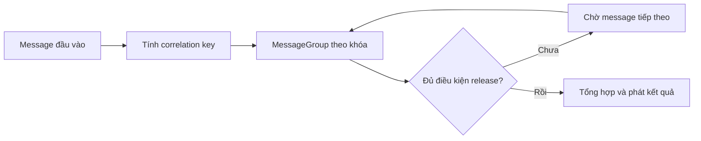

# Correlation key

## 1. Correlation key trả lời câu hỏi nào?

Trong chương **Aggregator** của module **SPRING_INTEGRATION_CORE**, correlation key là khóa xác định những message nào thuộc cùng một nhóm cần tổng hợp. Thiết kế khóa đúng giúp luồng thông điệp ghép đúng các phần của một nghiệp vụ, dù message đến xen kẽ, qua nhiều channel hoặc được xử lý trên các thread khác nhau.

Giả sử hệ thống nhận các phần của đơn hàng:

| Message | Tenant | Đơn hàng | Đợt xử lý | Phần dữ liệu |
| --- | --- | --- | --- | --- |
| M1 | shop-a | O-101 | B-1 | P-1 |
| M2 | shop-a | O-202 | B-1 | P-1 |
| M3 | shop-a | O-101 | B-1 | P-2 |
| M4 | shop-b | O-101 | B-1 | P-1 |

M1 và M3 cần vào cùng nhóm. M2 thuộc đơn hàng khác. M4 có cùng mã đơn hàng với M1 nhưng thuộc tenant khác nên phải tách nhóm.

Một khóa phù hợp cho tình huống này là bộ ba:

```text
K(message) = (tenantId, orderId, batchId)
```

`batchId` đại diện cho một đợt tổng hợp nghiệp vụ. Nếu đơn O-101 được tính lại trong đợt B-2, kết quả mới phải được tách khỏi B-1.

Sau bài này, bạn cần có thể chọn khóa theo phạm vi nghiệp vụ, cấu hình strategy trong Java DSL, bảo toàn khóa qua các endpoint và xác định nguyên nhân khi nhóm bị trộn hoặc không hoàn tất.

## 2. Tách biệt correlation, release và aggregation

Ba quyết định thường xuất hiện cạnh nhau trong cấu hình aggregator nhưng có trách nhiệm riêng:

| Quyết định | Câu hỏi | Ví dụ |
| --- | --- | --- |
| Correlation | Message thuộc nhóm nào? | Cùng tenant, đơn hàng và đợt xử lý |
| Release | Nhóm đã đủ điều kiện xuất kết quả chưa? | Đã nhận đủ hai phần hợp lệ |
| Aggregation | Tạo kết quả gì từ nhóm? | Cộng tổng tiền của các phần |

Mô hình tư duy:



Một release strategy tốt không sửa được lỗi trộn tenant do khóa quá rộng. Ngược lại, khóa chính xác cũng không bảo đảm nhóm được release nếu thiếu dữ liệu hoặc đặt điều kiện hoàn tất sai.

Đây là cách phân chia trách nhiệm của aggregator trong [tài liệu Spring Integration](https://docs.spring.io/spring-integration/reference/aggregator.html).

### Hai thuộc tính cần kiểm tra khi thiết kế khóa

Với hàm khóa `K`:

1. Message của cùng một lần tổng hợp phải cho ra các khóa bằng nhau.
2. Message của hai lần tổng hợp độc lập phải cho ra các khóa khác nhau trong phạm vi lưu trữ đang dùng.

Ví dụ, thêm `partId` vào khóa sẽ vi phạm thuộc tính thứ nhất: P-1 và P-2 bị tách nhóm. Chỉ dùng `orderId` trong hệ thống nhiều tenant sẽ vi phạm thuộc tính thứ hai.

Phải đánh giá cả hai chiều. Chỉ chứng minh rằng “hai message cùng đơn hàng có cùng khóa” là chưa đủ.

## 3. Các ID và header dễ bị nhầm

### 3.1. `id` không phải correlation key mặc định

`MessageHeaders.ID` định danh một message. Các phần khác nhau thường là những message khác nhau, vì vậy lấy ID riêng của từng phần làm khóa sẽ tạo nhiều nhóm chỉ có một phần tử.

Ví dụ sai cho bài toán gom các phần của cùng đơn hàng:

```java
.aggregate(a -> a
    .correlationStrategy(message -> message.getHeaders().getId())
    .releaseStrategy(group -> group.size() == 2))
```

Trong mô hình này, không có lý do để hai phần độc lập có cùng message ID; các nhóm có thể chờ mãi.

### 3.2. Header `correlationId`

Khi không cung cấp strategy riêng, aggregator dùng giá trị của header `IntegrationMessageHeaderAccessor.CORRELATION_ID`, có tên là `correlationId`, để xác định nhóm. Spring Integration cung cấp `HeaderAttributeCorrelationStrategy` cho cách lấy khóa từ một header. Xem [cơ chế mặc định của aggregator](https://docs.spring.io/spring-integration/reference/aggregator.html) và [API của HeaderAttributeCorrelationStrategy](https://docs.spring.io/spring-integration/api/org/springframework/integration/aggregator/HeaderAttributeCorrelationStrategy.html).

Ví dụ tạo một message với khóa nhóm rõ ràng:

```java
import org.springframework.integration.IntegrationMessageHeaderAccessor;
import org.springframework.messaging.Message;
import org.springframework.messaging.support.MessageBuilder;

Message<String> part = MessageBuilder.withPayload("phan-1")
    .setHeader(IntegrationMessageHeaderAccessor.CORRELATION_ID,
        "order-v1:shop-a:O-101:B-1")
    .setHeader(IntegrationMessageHeaderAccessor.SEQUENCE_NUMBER, 1)
    .setHeader(IntegrationMessageHeaderAccessor.SEQUENCE_SIZE, 2)
    .build();
```

Message thứ hai cần có cùng `correlationId`, `sequenceNumber` bằng 2 và `sequenceSize` bằng 2. Trong ví dụ này, các thành phần chuỗi đều đã được giới hạn để không chứa dấu phân cách.

### 3.3. Các trường có ý nghĩa khác nhau

| Trường | Vai trò | Có phù hợp làm khóa nhóm không? |
| --- | --- | --- |
| `MessageHeaders.ID` | Định danh một message | Thường không phù hợp cho nhiều phần độc lập |
| `correlationId` | Header thường dùng để liên kết message | Phù hợp nếu giá trị biểu diễn đúng lần tổng hợp |
| `sequenceNumber` | Vị trí của phần trong một sequence | Không thể tự phân biệt các nhóm |
| `sequenceSize` | Số phần dự kiến của sequence | Là dữ liệu cho release, không xác định nhóm |
| `orderId` | Định danh đơn hàng | Cần xét thêm tenant và đợt xử lý |
| `eventId` hoặc `partId` | Định danh sự kiện hoặc phần dữ liệu | Thường dành cho kiểm soát trùng lặp |
| Trace ID | Liên kết hoạt động để quan sát hệ thống | Chỉ phù hợp nếu trùng khớp với phạm vi nghiệp vụ đã thiết kế |

Không suy ra rằng một trace luôn tương ứng một nhóm: một request có thể tạo nhiều nhóm, và message của cùng nhóm có thể phát sinh từ nhiều request.

## 4. Hợp đồng của `CorrelationStrategy`

Strategy nhận `Message<?>` và cung cấp khóa qua phương thức `getCorrelationKey`. Đây là functional interface nên có thể triển khai bằng lambda. Nếu không xác định được khóa, hãy ném exception có ý nghĩa; không trả về `null`. Hợp đồng này được mô tả trong [API CorrelationStrategy](https://docs.spring.io/spring-integration/api/org/springframework/integration/aggregator/CorrelationStrategy.html).

Một strategy lấy khóa từ header có kiểm tra kiểu:

```java
import org.springframework.integration.aggregator.CorrelationStrategy;

CorrelationStrategy byBatchHeader = message -> {
    String key = message.getHeaders().get("aggregationKey", String.class);
    if (key == null || key.isBlank()) {
        throw new IllegalArgumentException("Missing aggregationKey");
    }
    return key;
};
```

Ngoài việc tồn tại, khóa phải có quy tắc so sánh nhất quán. Hãy thiết kế khóa như một giá trị bất biến, với `equals()` và `hashCode()` tương ứng nhau. Không đưa một object có trường có thể thay đổi vào vai trò khóa rồi sửa các trường đó sau khi message đã được nhận.

Các lựa chọn đơn giản thường là `String`, `UUID` hoặc một value object bất biến. Với kiểu tự định nghĩa, cần kiểm tra thêm cách biểu diễn khóa của message store dự kiến sử dụng.

### Những fallback nguy hiểm

```java
// Sai về nghiệp vụ: gom toàn bộ message thiếu khóa vào cùng một nhóm.
return key == null ? "UNKNOWN" : key;
```

```java
// Sai về nghiệp vụ: cùng nhóm nhưng mỗi lần gọi lại có khóa mới.
return java.util.UUID.randomUUID();
```

Nếu dùng UUID, hãy tạo một lần ở đầu đợt xử lý rồi truyền giá trị đó cho mọi phần và mọi lần retry của cùng đợt. Strategy chỉ đọc hoặc tính lại khóa từ dữ liệu ổn định.

## 5. Chọn khóa ghép theo phạm vi nghiệp vụ

### 5.1. Thêm tenant và đợt xử lý khi cần

Xét các phương án cho luồng tổng hợp đơn hàng:

| Phương án | Hậu quả có thể xảy ra |
| --- | --- |
| `orderId` | Hai tenant có thể bị ghép chung |
| `(tenantId, orderId)` | Hai đợt tính lại của cùng đơn hàng có thể bị ghép chung |
| `(tenantId, orderId, batchId)` | Tách tenant và tách đợt tổng hợp |
| `(tenantId, orderId, batchId, partId)` | Mỗi phần bị tách thành nhóm riêng |

`batchId` phải là định danh ổn định của đợt nghiệp vụ. Retry do lỗi mạng vẫn thuộc đợt cũ. Một yêu cầu chủ động tính lại có thể tạo đợt mới nếu đó là hợp đồng của hệ thống.

Không thêm mọi trường có sẵn vào khóa. Trạng thái xử lý, thời điểm nhận, số lần retry, hostname và thread name thường thay đổi giữa các phần của cùng một nhóm.

### 5.2. Dùng value object để tránh nhập nhằng khi nối chuỗi

Nối trực tiếp hai thành phần có thể tạo cùng biểu diễn:

```text
("ab", "c") -> "abc"
("a", "bc") -> "abc"
```

Ngay cả khi chèn dấu `:`, kết quả vẫn nhập nhằng nếu các trường được phép chứa dấu đó. Có thể dùng bộ mã hóa có quy tắc escape, biểu diễn có độ dài từng trường hoặc value object:

```java
public record OrderBatchKey(
    String tenantId,
    String orderId,
    String batchId
) implements java.io.Serializable {
}
```

Với các trường `String` bất biến, record cung cấp phép so sánh theo giá trị thích hợp cho ví dụ. Tránh dùng mảng làm trường khóa nếu bạn cần so sánh nội dung mà chưa tự định nghĩa lại phép so sánh.

`Serializable` chỉ là một lựa chọn phục vụ cơ chế lưu trữ tương ứng. Nó không chứng minh mọi store đều lưu và khôi phục kiểu khóa này theo cùng một cách.

### 5.3. Chuẩn hóa tại một ranh giới rõ ràng

Nếu hệ thống nhận `orderId` từ nhiều nguồn, cần thống nhất từ trước:

- Khoảng trắng đầu cuối có hợp lệ không?
- ID có phân biệt chữ hoa và chữ thường không?
- Mã `00101` có khác `101` không?
- Mã tenant nội bộ hay tên tenant hiển thị mới là giá trị chính thức?

Không tự chuyển tất cả ID sang chữ thường chỉ để “dễ nhóm”. Việc chuẩn hóa phải giữ nguyên ý nghĩa định danh của miền nghiệp vụ và được áp dụng nhất quán cho tất cả producer.

## 6. Các cách cấu hình trong Java DSL

Các đoạn sau là những lựa chọn thay thế tại endpoint aggregator, không phải các cấu hình cần xếp liên tiếp.

### 6.1. Dùng header mặc định

```java
.aggregate(a -> a
    .releaseStrategy(group -> group.size() == 2))
```

Đoạn này giữ correlation strategy mặc định và thay release strategy. Điều kiện đếm hai message chỉ phù hợp khi đầu vào đã bảo đảm mỗi phần xuất hiện đúng một lần.

### 6.2. Dùng header riêng

```java
.aggregate(a -> a
    .correlationStrategy(
        new org.springframework.integration.aggregator
            .HeaderAttributeCorrelationStrategy("aggregationKey"))
    .releaseStrategy(group -> group.size() == 2))
```

Header riêng hữu ích khi cần giữ nguyên `correlationId` đang phục vụ một sequence khác. Cần xác thực header trước aggregator nếu muốn thông báo lỗi và chính sách xử lý rõ ràng.

### 6.3. Dùng SpEL

```java
.aggregate(a -> a
    .correlationExpression("headers['aggregationKey']")
    .releaseStrategy(group -> group.size() == 2))
```

Biểu thức ngắn gọn với một trường đã được chuẩn hóa. Khi khóa có nhiều thành phần và quy tắc kiểm tra phức tạp, một strategy Java thường dễ kiểm thử hơn. Các tùy chọn `correlationExpression`, `correlationStrategy` và `releaseStrategy` có trong [API Java DSL](https://docs.spring.io/spring-integration/api/org/springframework/integration/dsl/CorrelationHandlerSpec.html).

### 6.4. Tính từ payload

```java
.aggregate(a -> a
    .correlationStrategy(message -> {
        OrderPart part = (OrderPart) message.getPayload();
        return new OrderBatchKey(
            part.tenantId(), part.orderId(), part.batchId());
    })
    .releaseStrategy(group -> group.size() == 2))
```

Ở đây `OrderPart` và `OrderBatchKey` là kiểu miền nghiệp vụ được định nghĩa trong ví dụ đầy đủ bên dưới. Khi transformer thay đổi kiểu payload, strategy ở sau nó cũng phải đọc đúng cấu trúc mới.

## 7. Ví dụ đầy đủ: tổng hợp hai phần của một đơn hàng

### 7.1. Hợp đồng đầu vào

Ví dụ sử dụng Java 17 và Java DSL của Spring Integration 6.x, với thư viện `spring-integration-core` và các phụ thuộc Spring tương ứng đã có trên classpath.

Hợp đồng của luồng minh họa:

- Một đợt `(tenantId, orderId, batchId)` có đúng hai phần, với hai `partId` khác nhau.
- Đầu vào đã được kiểm soát trùng lặp trước khi đưa vào luồng này.
- Các phần có thể đến xen kẽ giữa các đơn hàng hoặc tenant.
- Khóa được lấy từ payload và kiểm tra trước khi thêm message vào nhóm.

Điều kiện đếm hai message ở đây dựa vào hợp đồng đó. Nó không tự thực hiện deduplication hay kiểm chứng danh sách phần dự kiến.

### 7.2. Cấu hình luồng

```java
import java.io.Serializable;
import java.math.BigDecimal;
import java.util.List;
import java.util.Objects;

import org.springframework.context.annotation.Bean;
import org.springframework.context.annotation.Configuration;
import org.springframework.integration.channel.DirectChannel;
import org.springframework.integration.channel.QueueChannel;
import org.springframework.integration.config.EnableIntegration;
import org.springframework.integration.dsl.IntegrationFlow;
import org.springframework.integration.store.MessageGroup;
import org.springframework.messaging.Message;
import org.springframework.messaging.MessageChannel;

@Configuration
@EnableIntegration
public class CorrelationKeyFlowConfig {

    public record OrderPart(
        String tenantId,
        String orderId,
        String batchId,
        String partId,
        BigDecimal amount
    ) implements Serializable {
    }

    public record OrderBatchKey(
        String tenantId,
        String orderId,
        String batchId
    ) implements Serializable {
    }

    public record OrderTotal(
        OrderBatchKey key,
        BigDecimal amount
    ) implements Serializable {
    }

    @Bean
    public MessageChannel orderParts() {
        return new DirectChannel();
    }

    @Bean
    public QueueChannel completedOrders() {
        return new QueueChannel();
    }

    @Bean
    public QueueChannel lateOrExpiredParts() {
        return new QueueChannel();
    }

    @Bean
    public IntegrationFlow orderAggregationFlow() {
        return IntegrationFlow.from("orderParts")
            .transform(OrderPart.class, CorrelationKeyFlowConfig::validate)
            .aggregate(a -> a
                .correlationStrategy(CorrelationKeyFlowConfig::keyOf)
                .releaseStrategy(group -> group.size() == 2)
                .outputProcessor(CorrelationKeyFlowConfig::toTotal)
                .expireGroupsUponCompletion(false)
                .groupTimeout(30_000L)
                .sendPartialResultOnExpiry(false)
                .discardChannel("lateOrExpiredParts"))
            .channel("completedOrders")
            .get();
    }

    private static OrderPart validate(OrderPart part) {
        requireText(part.tenantId(), "tenantId");
        requireText(part.orderId(), "orderId");
        requireText(part.batchId(), "batchId");
        requireText(part.partId(), "partId");
        Objects.requireNonNull(part.amount(), "amount");
        return part;
    }

    private static void requireText(String value, String field) {
        if (value == null || value.isBlank()) {
            throw new IllegalArgumentException("Missing " + field);
        }
    }

    public static OrderBatchKey keyOf(Message<?> message) {
        OrderPart part = validate((OrderPart) message.getPayload());
        return new OrderBatchKey(
            part.tenantId(), part.orderId(), part.batchId());
    }

    private static OrderTotal toTotal(MessageGroup group) {
        List<OrderPart> parts = group.getMessages().stream()
            .map(message -> (OrderPart) message.getPayload())
            .toList();

        OrderPart first = parts.get(0);
        OrderBatchKey key = new OrderBatchKey(
            first.tenantId(), first.orderId(), first.batchId());

        BigDecimal total = parts.stream()
            .map(OrderPart::amount)
            .reduce(BigDecimal.ZERO, BigDecimal::add);

        return new OrderTotal(key, total);
    }
}
```

`orderParts` là `DirectChannel`, nên xử lý trong ví dụ diễn ra đồng bộ trên thread gửi. `completedOrders` giữ kết quả để consumer nhận sau. Không có gateway chờ một reply riêng cho mỗi phần; kết quả chỉ xuất hiện khi nhóm được release.

`toTotal` lấy khóa từ một phần bất kỳ vì strategy đã bảo đảm các thành phần khóa của mọi message trong nhóm bằng nhau. Phép cộng không phụ thuộc thứ tự message trong nhóm.

Việc tùy chỉnh correlation và release là mô hình được hỗ trợ trực tiếp trong [hướng dẫn Aggregators and Resequencers bằng Java DSL](https://docs.spring.io/spring-integration/reference/dsl/java-aggregators.html). Các lớp miền và quy tắc hai phần trong ví dụ là thiết kế minh họa của bài học.

### 7.3. Diễn tiến khi nhận message xen kẽ

```text
Nhận shop-a / O-101 / B-1 / P-1 / 100
  -> Nhóm (shop-a, O-101, B-1): 1 phần -> chờ

Nhận shop-b / O-101 / B-1 / P-1 / 500
  -> Nhóm (shop-b, O-101, B-1): 1 phần -> chờ

Nhận shop-a / O-101 / B-1 / P-2 / 200
  -> Nhóm (shop-a, O-101, B-1): 2 phần -> xuất tổng 300

Nhận shop-b / O-101 / B-1 / P-2 / 700
  -> Nhóm (shop-b, O-101, B-1): 2 phần -> xuất tổng 1200
```

Nếu bỏ tenant khỏi khóa, hai message đầu tiên có thể bị tổng hợp thành 600. Luồng vẫn phát output và không nhất thiết ném exception, nhưng kết quả đã sai nghiệp vụ. Vì vậy, chỉ kiểm tra “có output” không đủ để kiểm chứng correlation.

## 8. Kiểm thử tính đúng của khóa và tính cách ly nhóm

### 8.1. Kiểm thử strategy

Một tập kiểm tra hữu ích cần bao phủ các quan hệ:

| Hai message | Kỳ vọng về khóa |
| --- | --- |
| Cùng tenant, đơn hàng, batch; khác part | Bằng nhau |
| Khác tenant; cùng đơn hàng và batch | Khác nhau |
| Cùng tenant và đơn hàng; khác batch | Khác nhau |
| Cùng tenant và batch; khác đơn hàng | Khác nhau |
| Thiếu tenant hoặc batch | Bị từ chối |

Kiểm tra trực tiếp `keyOf` giúp phát hiện lỗi chọn trường mà chưa cần chạy cả luồng. Nhưng nó chưa chứng minh cấu hình endpoint đang sử dụng đúng strategy, nên vẫn cần kiểm tra nhóm thực tế.

### 8.2. Kiểm thử luồng bằng message xen kẽ

Đặt lớp sau trong cùng package với cấu hình trên. Ví dụ sử dụng JUnit Jupiter, không yêu cầu khởi động ứng dụng Spring Boot:

```java
import java.math.BigDecimal;

import org.junit.jupiter.api.Test;
import org.springframework.context.annotation.AnnotationConfigApplicationContext;
import org.springframework.integration.channel.QueueChannel;
import org.springframework.messaging.Message;
import org.springframework.messaging.MessageChannel;
import org.springframework.messaging.support.MessageBuilder;

import static org.junit.jupiter.api.Assertions.*;

class CorrelationKeyFlowTest {

    @Test
    void keepsTenantsAndBatchesSeparate() {
        try (var context = new AnnotationConfigApplicationContext(
                CorrelationKeyFlowConfig.class)) {

            MessageChannel input = context.getBean(
                "orderParts", MessageChannel.class);
            QueueChannel output = context.getBean(
                "completedOrders", QueueChannel.class);

            assertTrue(input.send(part("shop-a", "B-1", "P-1", "100")));
            assertTrue(input.send(part("shop-b", "B-1", "P-1", "500")));
            assertTrue(input.send(part("shop-a", "B-2", "P-1", "900")));
            assertNull(output.receive(0));

            assertTrue(input.send(part("shop-a", "B-1", "P-2", "200")));
            var first = total(output);
            assertEquals(new CorrelationKeyFlowConfig.OrderBatchKey(
                "shop-a", "O-101", "B-1"), first.key());
            assertEquals(new BigDecimal("300"), first.amount());
            assertNull(output.receive(0));

            assertTrue(input.send(part("shop-b", "B-1", "P-2", "700")));
            var second = total(output);
            assertEquals(new CorrelationKeyFlowConfig.OrderBatchKey(
                "shop-b", "O-101", "B-1"), second.key());
            assertEquals(new BigDecimal("1200"), second.amount());

            assertTrue(input.send(part("shop-a", "B-2", "P-2", "100")));
            var third = total(output);
            assertEquals(new CorrelationKeyFlowConfig.OrderBatchKey(
                "shop-a", "O-101", "B-2"), third.key());
            assertEquals(new BigDecimal("1000"), third.amount());
            assertNull(output.receive(0));
        }
    }

    private static Message<?> part(
            String tenant, String batch, String partId, String amount) {
        return MessageBuilder.withPayload(
            new CorrelationKeyFlowConfig.OrderPart(
                tenant, "O-101", batch, partId, new BigDecimal(amount)))
            .build();
    }

    private static CorrelationKeyFlowConfig.OrderTotal total(
            QueueChannel output) {
        Message<?> message = output.receive(1_000);
        assertNotNull(message);
        return assertInstanceOf(
            CorrelationKeyFlowConfig.OrderTotal.class, message.getPayload());
    }
}
```

Việc kiểm tra chưa có output sau ba message đầu tiên rất quan trọng: cả ba thuộc ba nhóm khác nhau. Nếu correlation bị cấu hình quá rộng, bài kiểm tra sẽ phát hiện tổng hợp sớm trước khi kiểm tra giá trị tổng.

Các đoạn kiểm thử trong bài là mã thực hành để người học chạy trong dự án phù hợp; việc có mã kiểm thử trong tài liệu không đồng nghĩa chúng đã được thực thi trong môi trường của bạn.

## 9. Bảo toàn khóa qua splitter, transformer và ranh giới transport

### 9.1. Khi đi từ splitter đến aggregator

Splitter có thể thiết lập các header correlation và sequence để liên kết những phần được tách ra. Vì vậy, mô hình splitter rồi aggregator thường tận dụng được metadata sequence có sẵn. Xem [hướng dẫn Splitter](https://docs.spring.io/spring-integration/reference/splitter.html).

Tuy nhiên, cần chọn rõ đơn vị tổng hợp:

- Gom các phần sinh ra từ một lần split: correlation của sequence thường phù hợp.
- Gom sự kiện độc lập từ nhiều producer theo đợt đơn hàng: cần khóa nghiệp vụ chung do các producer cùng hiểu.

Khi có nhiều tầng split, đừng ghi đè header correlation của một tầng chỉ vì cần thêm khóa nghiệp vụ. Có thể dùng header riêng như `orderAggregationKey` và cấu hình aggregator tương ứng đọc header đó.

### 9.2. Khi transformer tạo message mới

Nếu khóa nằm trong header, một bước tự tạo message mà chỉ sao chép payload có thể làm mất khóa. Khi cần tạo message mới một cách tường minh, hãy sao chép từ message gốc:

```java
Message<String> changed = MessageBuilder.fromMessage(part)
    .setPayload(part.getPayload().toUpperCase(java.util.Locale.ROOT))
    .build();
```

Ở đây `part` là `Message<String>` trong ví dụ header trước đó. Cách tạo này giữ các header liên quan từ message đầu vào. Nếu strategy đọc payload, cần giữ lại các trường định danh trong DTO sau biến đổi.

### 9.3. Khi qua broker hoặc HTTP

Một Java header không tự động trở thành metadata có cùng tên và kiểu ở phía nhận. Hợp đồng truyền tin cần quy định vị trí mang khóa, kiểu dữ liệu, quy tắc ánh xạ và xác thực khi nhận.

Ví dụ quy ước cho một sự kiện JSON:

```json
{
  "tenantId": "shop-a",
  "orderId": "O-101",
  "batchId": "B-1",
  "partId": "P-1",
  "amount": 100
}
```

Phía nhận khôi phục cùng bộ khóa nghiệp vụ từ dữ liệu này. Không cần phụ thuộc vào một object Java tùy biến được truyền nguyên vẹn qua mọi transport.

## 10. Retry, message trùng và message đến muộn

### 10.1. Correlation không thay thế deduplication

Hai message có cùng khóa được đưa vào cùng nhóm, nhưng chúng có thể mang cùng `partId`. Ví dụ:

```text
P-1 đến lần đầu  -> nhóm có 1 message
P-1 được gửi lại -> nhóm có thể có 2 message
P-2 chưa đến    -> điều kiện group.size() == 2 vẫn có thể thỏa
```

Do đó, phải phân biệt:

```text
Khóa nhóm:  (tenantId, orderId, batchId)
Khóa phần:  (tenantId, orderId, batchId, partId)
```

Khóa phần phục vụ nhận diện trùng. Khóa nhóm phục vụ ghép các phần khác nhau. Dùng khóa phần làm correlation key sẽ làm nhóm bị phân mảnh.

Tùy nghiệp vụ, có thể kiểm soát trùng ở upstream, dùng kho idempotency hoặc release theo tập `partId` dự kiến. Nếu output processor vẫn cộng cả những bản sao, chỉ thay release strategy sang đếm `partId` khác nhau vẫn chưa giải quyết xong việc tính tổng trùng.

### 10.2. Retry giữ nguyên danh tính của đợt tổng hợp

Giả sử P-2 bị gửi lại vì producer chưa nhận acknowledgement. Bản gửi lại vẫn cần `(shop-a, O-101, B-1)`. Nếu producer tạo `batchId` mới cho mỗi retry, P-1 và P-2 có thể nằm ở hai nhóm không bao giờ đầy đủ.

Ngược lại, khi người dùng chủ động yêu cầu tính lại đơn hàng, tái sử dụng B-1 có thể làm dữ liệu của hai lần tính lẫn nhau. Hợp đồng cần phân biệt retry kỹ thuật với một đợt nghiệp vụ mới.

### 10.3. Vòng đời nhóm ảnh hưởng đến việc tái sử dụng khóa

Với nhóm đã hoàn tất, `expireGroupsUponCompletion(false)` giữ dấu vết nhóm để message đến muộn cùng khóa được đưa sang discard channel. Nếu đặt `true`, nhóm được xóa và message cùng khóa có thể tạo nhóm mới. Cơ chế này được mô tả trong [tài liệu về nhóm hoàn tất của aggregator](https://docs.spring.io/spring-integration/reference/aggregator.html).

Lựa chọn `false` trong cấu hình minh họa giúp quan sát message đến muộn, nhưng dấu vết nhóm cần chính sách dọn dẹp phù hợp. Sau khi dấu vết bị xóa, không nên kỳ vọng aggregator vẫn ghi nhớ đợt đó vô thời hạn.

Không đổi sang `true` chỉ để một đơn hàng có thể tính lại. Trước hết, hãy xác định lần tính mới có cần `batchId` mới hay không.

### 10.4. Timeout và lỗi khóa là hai nhánh khác nhau

`groupTimeout(30_000L)` cấu hình thời gian chờ của nhóm; khi message mới được thêm, lịch chờ có thể được đặt lại. Không coi đây là deadline tuyệt đối 30 giây tính từ phần đầu tiên. Với `sendPartialResultOnExpiry(false)`, nhóm thiếu phần không được xuất thành kết quả từng phần; các message bị loại đi qua discard channel đã cấu hình. Xem [API cấu hình thời gian chờ và discard](https://docs.spring.io/spring-integration/api/org/springframework/integration/aggregator/AbstractCorrelatingMessageHandler.html).

Thiếu `tenantId` hoặc `batchId` là lỗi hợp đồng đầu vào. Trong ví dụ, validator ném exception trước aggregator; lỗi đó không tự chuyển thành message của `lateOrExpiredParts`. Với đường vào đồng bộ, bên gọi `send` nhận lỗi xử lý. Nếu muốn chuyển sang nhánh lỗi nghiệp vụ, cần cấu hình xử lý lỗi tại ranh giới nhận thích hợp.

Ngoài ra, xóa nhóm do timeout và giữ nhóm hoàn tất là hai chính sách khác nhau. Đừng suy ra rằng `expireGroupsUponCompletion(false)` sẽ giữ mọi nhóm hết thời gian chờ theo cùng một cách.

## 11. Khóa trong môi trường lưu trữ và chạy nhiều instance

### 11.1. Khóa giống nhau chưa đủ để chia sẻ trạng thái

Nếu instance A và B có store trong bộ nhớ riêng, cùng khóa K trên hai instance vẫn tương ứng hai tập trạng thái độc lập:

```text
Instance A nhận P-1 -> Store A: K có P-1
Instance B nhận P-2 -> Store B: K có P-2
```

Cả hai đều chưa đủ dữ liệu. Cần thiết kế cách phân phối các phần về cùng nơi xử lý hoặc cách chia sẻ store và phối hợp cập nhật giữa các instance.

Store mặc định giữ dữ liệu trong bộ nhớ. Khi dùng store bền, cần xét serialization của payload, header và biểu diễn khóa thay vì chỉ thay một bean cấu hình. Các giới hạn này được mô tả trong [hướng dẫn Message Store](https://docs.spring.io/spring-integration/reference/message-store.html).

### 11.2. Đồng bộ và khóa nóng

Các cập nhật cùng nhóm cần được phối hợp. Nếu dùng store chung giữa các instance, cần cơ chế lock phù hợp với triển khai; xem [quy tắc Lock Registry của aggregator](https://docs.spring.io/spring-integration/reference/aggregator.html).

Một khóa quá rộng như chỉ dùng `tenantId` có thể gom hàng nghìn đơn hàng vào một điểm xử lý. Hậu quả thiết kế có thể gồm nhóm rất lớn, chờ lâu và tranh chấp cập nhật. Khóa quá chi tiết như thêm timestamp nhận lại tạo nhiều nhóm nhỏ không đủ phần.

Độ phân biệt của khóa phải xuất phát từ đơn vị tổng hợp nghiệp vụ. Không tự thêm thành phần ngẫu nhiên để giảm tranh chấp nếu việc đó làm tách những phần cần tổng hợp chung.

### 11.3. Tách phạm vi giữa các luồng

Luồng tổng hợp tiền hàng và luồng tổng hợp vận chuyển có thể đều gặp `(shop-a, O-101, B-1)` nhưng không được chia sẻ nhóm nghiệp vụ. Khi nhiều endpoint dùng cùng hạ tầng lưu trữ, hãy thiết kế phạm vi dữ liệu riêng cho từng endpoint hoặc thêm namespace phù hợp vào biểu diễn khóa; đồng thời kiểm tra các giới hạn của store và callback hết hạn.

Một quy ước chuỗi có thể là:

```text
order-total:v1:<tenant>:<order>:<batch>
shipment-check:v1:<tenant>:<order>:<batch>
```

Đây là quy ước ứng dụng, không phải cú pháp bắt buộc của framework. Khi đổi từ v1 sang v2, cần có kế hoạch cho message còn đang chờ dưới khóa cũ; thay schema khóa giữa một đợt đang chạy có thể làm tách nhóm.

## 12. Chẩn đoán sự cố theo triệu chứng

| Triệu chứng | Giả thuyết liên quan đến khóa | Cách xác minh |
| --- | --- | --- |
| Tổng tiền chứa dữ liệu của tenant khác | Khóa thiếu tenant | So sánh khóa đã tính và tenant của các phần |
| Nhiều nhóm chỉ có một message | Khóa chứa ID message, part ID hoặc timestamp | Kiểm tra các thành phần thay đổi giữa hai phần |
| Retry khiến nhóm không hoàn tất | Batch mới được tạo ở mỗi lần gửi lại | Đối chiếu batch giữa bản đầu và bản retry |
| Tính lại đơn hàng bị discard | Tái sử dụng khóa của nhóm đã hoàn tất | Kiểm tra batch và trạng thái nhóm cũ |
| Đã đủ phần nhưng các instance vẫn chờ | Các phần cùng khóa nằm ở store riêng | Kiểm tra instance nhận và phạm vi store |
| Có header nhưng aggregator báo thiếu khóa | Đọc sai tên header hoặc mất header ở một endpoint | Quan sát message ngay trước aggregator |
| Nhóm xuất kết quả trước khi đủ phần nghiệp vụ | Bản gửi lại bị tính là phần mới | So sánh `partId`, không chỉ số message |
| Chỉ một tenant có độ trễ rất cao | Khóa gom quá nhiều nghiệp vụ | Đo số phần và số đơn hàng trong một nhóm |

Khi ghi log để chẩn đoán, có thể ghi tên luồng, các thành phần khóa đã chuẩn hóa, `partId`, quyết định release và instance xử lý. Tránh ghi toàn bộ payload chỉ để nhìn khóa.

Với metrics, tránh dùng mọi `orderId` hoặc `batchId` làm nhãn: số lượng giá trị có thể tăng không giới hạn. Những chỉ số tổng hợp hữu ích hơn là số nhóm đang chờ, số message thiếu khóa, số nhóm timeout và số message bị discard.

## 13. Quy trình thiết kế áp dụng cho một luồng mới

1. **Viết tên đơn vị tổng hợp.** Ví dụ: “Hai phần của một đơn hàng, thuộc một tenant và một đợt tính”.
2. **Liệt kê các message bắt buộc cùng nhóm.** Dùng ví dụ đến xen kẽ để tránh phụ thuộc vào thứ tự.
3. **Liệt kê các message bắt buộc khác nhóm.** Ưu tiên khác tenant, khác đợt và khác loại nghiệp vụ.
4. **Chọn dữ liệu ổn định để lập khóa.** Không phụ thuộc thời điểm nhận, thread hoặc số lần retry.
5. **Chọn nơi mang khóa.** Payload hoặc header đều được, nhưng hợp đồng qua các endpoint và transport phải rõ ràng.
6. **Xác định việc hoàn tất riêng.** Số phần, tập phần dự kiến và dữ liệu trùng là bài toán của release và idempotency.
7. **Quy định vòng đời.** Làm rõ retry, message đến muộn, timeout, tính lại và thời gian giữ dấu vết nhóm.
8. **Kiểm tra cách ly bằng dữ liệu xen kẽ.** Xác minh cả khóa, thời điểm có output và nội dung kết quả.

Một thiết kế correlation tốt diễn đạt được danh tính của lần tổng hợp bằng dữ liệu nghiệp vụ ổn định. Khi danh tính đó rõ ràng, việc nối Message, MessageChannel, endpoint và Java DSL thành một luồng tích hợp sẽ dễ giải thích và kiểm chứng hơn.
