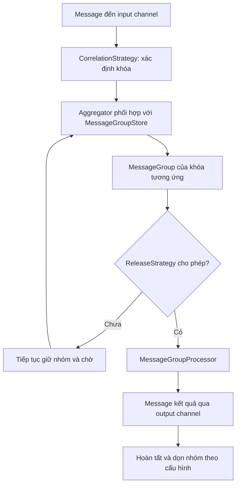

# MessageGroup

Trong chương Aggregator của module **SPRING_INTEGRATION_CORE**, `MessageGroup` là mô hình giúp nhìn thấy phần trạng thái của một luồng gom thông điệp: nhóm đang giữ những message nào, thuộc lần xử lý nào và đã đóng hay chưa. Hiểu mô hình này giúp kết nối việc truyền `Message` qua `MessageChannel` với hành vi của endpoint aggregator, thay vì chỉ xem aggregator như một hàm nhận danh sách rồi tính tổng.

Sau bài học, bạn có thể:

- Phân biệt message, group, kho lưu nhóm và kết quả tổng hợp.
- Đọc đúng `size()`, `getSequenceSize()`, `isComplete()` và các mốc thời gian.
- Thiết kế correlation key và điều kiện release theo danh tính phần dữ liệu.
- Quan sát nhóm trong Java DSL, xử lý nhóm thiếu dữ liệu và thông điệp đến muộn.
- Xác định các trạng thái cần kiểm thử khi nhóm được tạo, tích lũy, hoàn tất và xóa.

## 1. Bài toán: ba phần dữ liệu của một lần xử lý

Giả sử mỗi lần xử lý đơn hàng cần nhận ba phần `P1`, `P2`, `P3`. Các phần có thể hoàn thành trên những nhánh khác nhau và đến không theo thứ tự:

| Lượt nhận | Khóa lần xử lý | Phần | Giá trị |
| --- | --- | --- | --- |
| 1 | `parts:ORDER-42:attempt-1` | `P2` | 20 |
| 2 | `parts:ORDER-99:attempt-1` | `P1` | 100 |
| 3 | `parts:ORDER-42:attempt-1` | `P1` | 10 |
| 4 | `parts:ORDER-42:attempt-1` | `P3` | 30 |

Sau lượt thứ ba, nhóm của `ORDER-42` có hai message; nhóm của `ORDER-99` có một message. Chúng cần tồn tại đồng thời mà không trộn dữ liệu. Sau lượt thứ tư, nhóm thứ nhất đủ các phần để tạo tổng 60; nhóm thứ hai tiếp tục chờ.

Đây là ví dụ tự thiết kế cho bài học. Ba quyết định nghiệp vụ cần được diễn đạt riêng:

1. **Cùng nhóm nào?** Cùng khóa của một lần xử lý.
2. **Đã đủ chưa?** Có đúng ba phần cần thiết, mỗi phần một lần.
3. **Tạo kết quả gì?** Một bản tóm tắt chứa khóa, số phần và tổng giá trị.

Một `MessageGroup` biểu diễn nhóm message có quan hệ với nhau và được xử lý trong cùng ngữ cảnh. Interface này cho phép các implementation có đặc điểm thay đổi trạng thái và an toàn luồng khác nhau; không nên suy từ tên interface rằng mọi implementation đều có cùng bảo đảm. [Javadoc MessageGroup](https://docs.spring.io/spring-integration/api/org/springframework/integration/store/MessageGroup.html)

## 2. MessageGroup đứng ở đâu trong aggregator?

`MessageGroup` không phải endpoint và không tự nhận message từ channel. Trong một aggregator, handler phối hợp các thành phần sau:

| Thành phần | Trách nhiệm |
| --- | --- |
| `CorrelationStrategy` | Tính khóa nhóm từ message đến |
| `MessageGroupStore` | Lưu message và trạng thái theo khóa |
| `MessageGroup` | Biểu diễn một nhóm cụ thể |
| `ReleaseStrategy` | Quyết định nhóm đã sẵn sàng được xử lý hay chưa |
| `MessageGroupProcessor` | Tính kết quả từ nhóm được release |
| Kênh đầu ra | Nhận kết quả do endpoint phát |

Đây là cách phân chia trách nhiệm của aggregator trong Spring Integration. [Tài liệu Aggregator](https://docs.spring.io/spring-integration/reference/aggregator.html)



Sơ đồ mô tả đường xử lý thông thường. Khi thêm timeout, thông điệp đến muộn hoặc lỗi, cần xét thêm chính sách vòng đời ở các phần sau.

Trong ví dụ đơn hàng, nên theo dõi hai đối tượng khác nhau: nhóm đầu vào chứa từng phần và message đầu ra chứa `BatchSummary`. Việc đã nhận một kết quả ở output channel không có nghĩa mọi dấu vết của nhóm đã biến mất khỏi store.

## 3. Đọc trạng thái của một nhóm

### 3.1. Các phương thức thường dùng

| Phương thức | Cách đọc |
| --- | --- |
| `getGroupId()` | Khóa liên kết các message |
| `size()` | Số message hiện có |
| `getSequenceSize()` | Độ dài chuỗi dự kiến; `0` nếu chưa biết |
| `isComplete()` | Nhóm đã đóng, không còn mong đợi thêm message |
| `getMessages()` | Các message sẵn có khi truy cập |
| `getOne()` | Một message trong nhóm |
| `getTimestamp()` | Thời điểm tạo nhóm, theo epoch millisecond |
| `getLastModified()` | Mốc cập nhật gần nhất, theo epoch millisecond |

Các ý nghĩa trên là hợp đồng của `MessageGroup`. [Mã nguồn MessageGroup, nhánh 6.5.x](https://github.com/spring-projects/spring-integration/blob/6.5.x/spring-integration-core/src/main/java/org/springframework/integration/store/MessageGroup.java)

Khi điều tra nhóm của `ORDER-42`, một bản ghi quan sát như sau dễ đọc hơn việc chỉ in payload:

```text
groupId = parts:ORDER-42:attempt-1
size = 2
complete = false
partIds = [P2, P1]
```

Ở đây, hai phần đã đến nhưng phần `P3` chưa đến. Không thể kết luận nhóm đủ chỉ từ việc `size` lớn hơn 0.

### 3.2. Số lượng hiện có khác số lượng dự kiến

Nếu message có `sequenceSize = 3`, nhóm đang giữ hai message có thể có:

```text
size() = 2
getSequenceSize() = 3
```

Nếu một luồng dùng khóa nghiệp vụ và release tùy chỉnh, các message có thể không mang sequence header. Khi đó, `getSequenceSize()` bằng 0 không có nghĩa lô nghiệp vụ phải rỗng; ứng dụng cần một hợp đồng khác để biết cần chờ những phần nào.

Trong bài này, hợp đồng đó là tập `{P1, P2, P3}`. Với đơn hàng có số dòng thay đổi, hợp đồng có thể là danh sách mã dòng đã được xác định ở đầu luồng. Đây là quyết định thiết kế của ứng dụng.

### 3.3. isComplete() khác canRelease(group)

`ReleaseStrategy` cung cấp phương thức `canRelease(MessageGroup group)` để quyết định thời điểm nhóm có thể vượt qua điểm chờ. [Javadoc ReleaseStrategy](https://docs.spring.io/spring-integration/api/org/springframework/integration/aggregator/ReleaseStrategy.html)

Trong ví dụ:

- Khi `P3` vừa được thêm, nhóm có thể đủ các phần để `canRelease(group)` trả về `true`.
- Điều đó không yêu cầu `group.isComplete()` phải được đặt thành `true` trước.
- Handler thực hiện xử lý kết quả và quản lý việc hoàn tất nhóm.

Vì vậy, không viết release strategy như sau:

```java
group -> group.isComplete()
```

Predicate này không diễn đạt được yêu cầu “đã có P1, P2 và P3”. Hãy kiểm tra dữ liệu mà nghiệp vụ đang chờ.

### 3.4. Một message không đại diện cho toàn bộ nhóm

Với `SimpleMessageGroup`, `getOne()` có thể trả về `null` khi nhóm rỗng. Collection do `getMessages()` trả về không cho phép sửa trực tiếp trong implementation này. [Mã nguồn SimpleMessageGroup](https://github.com/spring-projects/spring-integration/blob/6.5.x/spring-integration-core/src/main/java/org/springframework/integration/store/SimpleMessageGroup.java)

Quy tắc thực hành:

- Chỉ lấy một message để đọc một thuộc tính khi đầu vào đã bảo đảm thuộc tính đó nhất quán trong cả nhóm.
- Muốn khẳng định mọi phần thuộc cùng một phiên bản dữ liệu, hãy kiểm tra mọi phần hoặc xác thực trước aggregator.
- Muốn kết quả có thứ tự nghiệp vụ, hãy sắp xếp bằng khóa nghiệp vụ hoặc sequence number.

Trong ví dụ đơn hàng, việc `P2` đến trước `P1` không được làm thay đổi tổng. Nếu kết quả là danh sách dòng hàng, cần xác định rõ thứ tự mong muốn.

## 4. Quan sát bằng SimpleMessageGroup

Ví dụ sau dùng Java 17 và dependency `spring-integration-core`. Nó minh họa trạng thái của một đối tượng nhóm trong bộ nhớ; không tạo integration flow.

```java
import java.util.List;

import org.springframework.integration.IntegrationMessageHeaderAccessor;
import org.springframework.integration.store.MessageGroup;
import org.springframework.integration.store.SimpleMessageGroup;
import org.springframework.messaging.Message;
import org.springframework.messaging.support.MessageBuilder;

public class MessageGroupBasics {

    private static Message<String> part(String payload, int number) {
        return MessageBuilder.withPayload(payload)
                .setHeader(
                        IntegrationMessageHeaderAccessor.CORRELATION_ID,
                        "parts:ORDER-42:attempt-1")
                .setHeader(
                        IntegrationMessageHeaderAccessor.SEQUENCE_NUMBER,
                        number)
                .setHeader(
                        IntegrationMessageHeaderAccessor.SEQUENCE_SIZE,
                        3)
                .build();
    }

    public static void main(String[] args) {
        Message<String> p1 = part("P1", 1);
        Message<String> p2 = part("P2", 2);
        Message<String> p3 = part("P3", 3);

        MessageGroup group = new SimpleMessageGroup(
                List.of(p2, p1), "parts:ORDER-42:attempt-1");

        System.out.println(group.size());            // 2
        System.out.println(group.getSequenceSize()); // 3
        System.out.println(group.isComplete());      // false

        group.add(p3);
        System.out.println(group.size());            // 3
        System.out.println(group.isComplete());      // false

        group.complete();
        System.out.println(group.isComplete());      // true
        System.out.println(group.size());            // 3

        group.clear();
        System.out.println(group.size());            // 0
        System.out.println(group.isComplete());      // true
    }
}
```

Ở `SimpleMessageGroup`, `complete()` đặt trạng thái hoàn tất, còn `clear()` xóa các phần tử. Hai thao tác này tách biệt; bản thân việc thêm đủ ba message không tự gọi `complete()`. [Mã nguồn SimpleMessageGroup](https://github.com/spring-projects/spring-integration/blob/6.5.x/spring-integration-core/src/main/java/org/springframework/integration/store/SimpleMessageGroup.java)

Tên khóa được truyền vào constructor trong ví dụ không tự kiểm tra correlation header của các message. Đây là đoạn mã tự dựng dữ liệu minh họa. Trong luồng thực, hãy để aggregator phối hợp correlation strategy và store để quản lý nhóm.

Cũng không gọi `group.complete()` trong release strategy để “giúp” endpoint. Strategy nên trả lời điều kiện; vòng đời của nhóm thuộc phần điều phối của handler.

## 5. Thiết kế khóa nhóm đúng ngữ cảnh

`CorrelationStrategy.getCorrelationKey(message)` trả về khóa tương quan của message. [Javadoc CorrelationStrategy](https://docs.spring.io/spring-integration/api/org/springframework/integration/aggregator/CorrelationStrategy.html)

Trong ví dụ, dùng riêng `ORDER-42` có thể chưa đủ. Cùng đơn hàng có thể được tổng hợp lại sau khi dữ liệu thay đổi. Khóa:

```text
parts:ORDER-42:attempt-1
```

diễn đạt ba thông tin: loại công việc, thực thể nghiệp vụ và lần xử lý.

Nếu phục vụ nhiều khách hàng độc lập, có thể chọn:

```text
tenant-A:parts:ORDER-42:attempt-1
```

Đây là đề xuất thiết kế cho tình huống minh họa, không phải định dạng Spring Integration bắt buộc.

| Lựa chọn khóa trong ví dụ | Hệ quả cần cân nhắc |
| --- | --- |
| Chỉ dùng `orderId` | Hai lần xử lý có thể nhập chung |
| Dùng message ID của từng phần | Mỗi phần có thể rơi vào một nhóm riêng |
| Dùng `orderId + attemptId` | Tách được các lần xử lý |
| Thêm tenant và loại công việc | Tách được các miền nghiệp vụ dùng chung hạ tầng |

`MessageHeaders.ID` định danh một message. `groupId` định danh cả tập message đang cần xử lý chung. Một header `correlationId` do upstream tạo có thể được dùng làm khóa, nhưng luồng cũng có thể tự tính khóa nghiệp vụ.

Quy tắc thiết kế là mọi phần của cùng một lần xử lý phải tính ra cùng khóa, còn những lần cần kết quả độc lập phải tính ra khóa khác nhau.

## 6. MessageGroupStore là nơi quản lý việc lưu trạng thái

`BasicMessageGroupStore` cung cấp các thao tác như `addMessageToGroup`, `getMessageGroup` và `removeMessageGroup`. Nếu khóa chưa có nhóm, `getMessageGroup` trả về một nhóm rỗng; vì vậy chỉ nhìn `size() == 0` chưa đủ để phân biệt khóa mới với nhóm đã đóng còn metadata. [Javadoc BasicMessageGroupStore](https://docs.spring.io/spring-integration/api/org/springframework/integration/store/BasicMessageGroupStore.html)

`MessageGroupStore` bổ sung các thao tác như `completeGroup`, xóa message trong nhóm và đăng ký callback hết hạn. [Javadoc MessageGroupStore](https://docs.spring.io/spring-integration/api/org/springframework/integration/store/MessageGroupStore.html)

Ví dụ độc lập sau chỉ minh họa store API:

```java
import org.springframework.integration.store.MessageGroup;
import org.springframework.integration.store.MessageGroupStore;
import org.springframework.integration.store.SimpleMessageStore;
import org.springframework.messaging.Message;
import org.springframework.messaging.support.MessageBuilder;

MessageGroupStore store = new SimpleMessageStore();
String key = "parts:ORDER-42:attempt-1";

Message<String> first = MessageBuilder.withPayload("P1").build();
store.addMessageToGroup(key, first);

MessageGroup observed = store.getMessageGroup(key);
System.out.println(observed.size());       // 1
System.out.println(observed.isComplete()); // false

store.completeGroup(key);
System.out.println(store.getMessageGroup(key).isComplete()); // true

store.removeMessageGroup(key);
```

Trong flow đang chạy, đoạn mã nghiệp vụ không nên đồng thời sửa nhóm mà aggregator sở hữu. Việc thêm hoặc đóng nhóm thủ công có thể làm điều kiện release không còn phù hợp với những gì endpoint đang xử lý.

Một đối tượng `MessageGroup` lấy từ store cũng không phải lời hứa rằng mọi thay đổi trực tiếp lên đối tượng sẽ được ghi bền vững. Hãy dùng API của store cho tác vụ quản trị đã được phối hợp, và dùng một lần đọc mới khi cần quan sát trạng thái sau xử lý.

`SimpleMessageStore` là store trong bộ nhớ; constructor không tham số tạo store không giới hạn dung lượng. [Javadoc SimpleMessageStore](https://docs.spring.io/spring-integration/api/org/springframework/integration/store/SimpleMessageStore.html)

## 7. Vòng đời: tích lũy, release, complete và xóa

Đối với aggregator thông thường, sau release, handler đánh dấu nhóm hoàn tất rồi dọn message. Khi `expireGroupsUponCompletion` bằng `false`, metadata nhóm được giữ lại; khi bằng `true`, nhóm được xóa hoàn toàn. [Mã nguồn AggregatingMessageHandler, nhánh 6.5.x](https://github.com/spring-projects/spring-integration/blob/6.5.x/spring-integration-core/src/main/java/org/springframework/integration/aggregator/AggregatingMessageHandler.java)

Có thể dùng bốn trạng thái để phân tích ví dụ:

| Trạng thái quan sát | Message đang giữ | Ý nghĩa trong lần xử lý |
| --- | --- | --- |
| Chưa có nhóm được lưu | Không có | Chưa nhận phần nào hoặc nhóm đã bị xóa |
| Nhóm mở | Một số phần | Đang chờ đủ dữ liệu |
| Nhóm đủ điều kiện release | Đủ các phần theo predicate | Handler có thể tạo kết quả |
| Nhóm hoàn tất còn metadata | Không còn phần đầu vào | Còn dấu vết để nhận diện khóa đã xử lý |

Bảng là mô hình giảng giải. “Đủ điều kiện release” là kết quả đánh giá predicate, không phải một enum trạng thái được lưu trong `MessageGroup`.

### 7.1. Vì sao giữ một nhóm rỗng?

Giả sử `P1`, `P2`, `P3` đã tạo tổng 60. Sau đó hệ thống nguồn gửi lại `P2` với cùng khóa.

Nếu giữ metadata hoàn tất, endpoint còn căn cứ để xử lý message này như thông điệp đến muộn. Nếu đã xóa hoàn toàn nhóm, khóa có thể mở một nhóm mới. Việc giữ hay xóa vì vậy ảnh hưởng trực tiếp đến cách tiếp nhận dữ liệu tiếp theo. [Mã nguồn AggregatingMessageHandler](https://github.com/spring-projects/spring-integration/blob/6.5.x/spring-integration-core/src/main/java/org/springframework/integration/aggregator/AggregatingMessageHandler.java)

Trong bài này, một khóa tương ứng một kết quả. Khi cần tính lại, ứng dụng cấp `attempt-2` thay vì tái sử dụng khóa `attempt-1`.

### 7.2. Không dùng isComplete() làm bằng chứng giao dịch nghiệp vụ

Cờ hoàn tất chỉ mô tả vòng đời nhóm. Ví dụ, nếu sau aggregator còn ghi sổ kế toán, ứng dụng vẫn cần biết việc ghi sổ có thành công hay không.

Tương tự, nếu nhận được hai yêu cầu tính lại, cần phân biệt hai yêu cầu ở cấp nghiệp vụ. Một marker nhóm hoàn tất không thay thế toàn bộ thiết kế idempotency, lưu kết quả và xác nhận xử lý của hệ thống.

## 8. Điều kiện release phải phản ánh danh tính dữ liệu

`SimpleSequenceSizeReleaseStrategy` so sánh số message hiện tại với `sequenceSize`. Strategy này không hỗ trợ release từng phần của chuỗi, và handler dùng strategy này không kiểm tra sequence number trùng theo cơ chế của nó. [Javadoc SimpleSequenceSizeReleaseStrategy](https://docs.spring.io/spring-integration/api/org/springframework/integration/aggregator/SimpleSequenceSizeReleaseStrategy.html)

Xét ví dụ có ba message mới được tạo với danh tính nghiệp vụ:

```text
P1, P1, P2
```

Có ba message nhưng vẫn thiếu `P3`. Vì thế, trong bài toán đang xét, predicate chỉ kiểm tra `group.size() == 3` không diễn đạt đầy đủ yêu cầu.

Ví dụ Java DSL bên dưới chọn quy tắc nghiêm ngặt:

```text
số message = 3
và tập partId = {P1, P2, P3}
```

Quy tắc này có chủ đích: lô chứa phần trùng sẽ không được phát kết quả thành công và sẽ đi theo chính sách timeout. Nó không tự xóa phần trùng.

Trong hệ thống thực, có thể chọn chính sách khác, chẳng hạn loại bản sao dựa trên event ID trước aggregator. Khi đó phải xác định bản sao bằng dữ liệu nghiệp vụ ổn định, thay vì mặc định rằng hai message có cùng payload sẽ luôn được coi là một.

Cũng cần phân biệt “phần cuối đã đến” và “mọi phần đã đến”. Với thứ tự `P3, P1, P2`, nhận `P3` ở lượt đầu không chứng minh đã có hai phần còn lại.

## 9. Java DSL: quan sát MessageGroup trong một flow

Ví dụ tự chứa dưới đây dùng Java 17, Spring Integration Java DSL kiểu 6.x và `spring-integration-core`. Đặt cấu hình trong file `MessageGroupConfig.java` của một dự án có các dependency Spring tương thích. Ví dụ không cần Spring Boot hay broker.

Hợp đồng đầu vào:

- Payload là `Part` với mã phần và giá trị hợp lệ.
- Header `batchKey` xác định duy nhất một lần xử lý.
- Một lô thành công có đúng `P1`, `P2`, `P3`.
- Lô thiếu hoặc có phần trùng không được công bố là thành công.

Các lựa chọn `messageStore`, `groupTimeout`, `releaseStrategy` và `discardChannel` thuộc DSL của correlation handler; `outputProcessor` thuộc `AggregatorSpec`. [Javadoc CorrelationHandlerSpec](https://docs.spring.io/spring-integration/api/org/springframework/integration/dsl/CorrelationHandlerSpec.html), [Javadoc AggregatorSpec](https://docs.spring.io/spring-integration/api/org/springframework/integration/dsl/AggregatorSpec.html)

```java
import java.math.BigDecimal;
import java.util.HashSet;
import java.util.Objects;
import java.util.Set;

import org.springframework.context.annotation.Bean;
import org.springframework.context.annotation.Configuration;
import org.springframework.integration.channel.DirectChannel;
import org.springframework.integration.channel.QueueChannel;
import org.springframework.integration.config.EnableIntegration;
import org.springframework.integration.dsl.IntegrationFlow;
import org.springframework.integration.store.MessageGroup;
import org.springframework.integration.store.MessageGroupStore;
import org.springframework.integration.store.SimpleMessageStore;
import org.springframework.messaging.Message;

@Configuration
@EnableIntegration
public class MessageGroupConfig {

    private static final Set<String> EXPECTED_IDS =
            Set.of("P1", "P2", "P3");

    public record Part(String partId, BigDecimal amount) {
        public Part {
            Objects.requireNonNull(partId, "partId");
            Objects.requireNonNull(amount, "amount");
        }
    }

    public record BatchSummary(
            String batchKey, int partCount, BigDecimal total) {
    }

    @Bean
    public DirectChannel partsInput() {
        return new DirectChannel();
    }

    @Bean
    public QueueChannel summaries() {
        return new QueueChannel();
    }

    @Bean
    public QueueChannel discardedParts() {
        return new QueueChannel();
    }

    @Bean
    public MessageGroupStore aggregationStore() {
        return new SimpleMessageStore();
    }

    @Bean
    public IntegrationFlow partsFlow(MessageGroupStore aggregationStore) {
        return IntegrationFlow.from("partsInput")
                .aggregate(spec -> spec
                        .messageStore(aggregationStore)
                        .correlationStrategy(message -> {
                            String key = message.getHeaders()
                                    .get("batchKey", String.class);
                            if (key == null || key.isBlank()) {
                                throw new IllegalArgumentException(
                                        "batchKey is required");
                            }
                            return key;
                        })
                        .releaseStrategy(MessageGroupConfig::hasAllParts)
                        .outputProcessor(MessageGroupConfig::summarize)
                        .groupTimeout(10_000L)
                        .sendPartialResultOnExpiry(false)
                        .expireGroupsUponCompletion(false)
                        .expireGroupsUponTimeout(false)
                        .discardChannel("discardedParts"))
                .channel("summaries")
                .get();
    }

    static boolean hasAllParts(MessageGroup group) {
        if (group.size() != EXPECTED_IDS.size()) {
            return false;
        }

        Set<String> actualIds = new HashSet<>();
        for (Message<?> message : group.getMessages()) {
            if (!(message.getPayload() instanceof Part part)) {
                return false;
            }
            actualIds.add(part.partId());
        }
        return actualIds.equals(EXPECTED_IDS);
    }

    private static BatchSummary summarize(MessageGroup group) {
        BigDecimal total = BigDecimal.ZERO;
        for (Message<?> message : group.getMessages()) {
            Part part = (Part) message.getPayload();
            total = total.add(part.amount());
        }
        return new BatchSummary(
                group.getGroupId().toString(), group.size(), total);
    }
}
```

`MessageGroupProcessor` nhận nhóm để tạo kết quả xử lý; method reference `MessageGroupConfig::summarize` triển khai vai trò đó trong ví dụ. [Javadoc MessageGroupProcessor](https://docs.spring.io/spring-integration/api/org/springframework/integration/aggregator/MessageGroupProcessor.html)

Đọc flow theo yêu cầu nghiệp vụ:

1. Message đi vào `partsInput`.
2. Giá trị `batchKey` quyết định nhóm.
3. `hasAllParts` kiểm tra số lượng và tập mã phần.
4. `summarize` tính `BatchSummary` khi đủ.
5. Kết quả được gửi tới `summaries`.
6. Nhóm thiếu dữ liệu theo timeout được chuyển sang nhánh discard theo cấu hình.

Không có sequence header trong hợp đồng của flow này vì release dùng `partId`. Không nên sao chép một predicate theo `sequenceSize` vào đây rồi kỳ vọng nó hiểu tập mã phần.

Flow giữ metadata sau khi hoàn tất và sau timeout. Để ví dụ dễ quan sát, chưa cấu hình tác vụ dọn các marker này; khi áp dụng lâu dài cần chọn thời gian giữ và cơ chế dọn tương ứng.

## 10. Chạy thử và đọc trạng thái trước, sau release

Đặt lớp sau cùng package với `MessageGroupConfig`:

```java
import java.math.BigDecimal;

import org.springframework.context.annotation.AnnotationConfigApplicationContext;
import org.springframework.integration.channel.DirectChannel;
import org.springframework.integration.channel.QueueChannel;
import org.springframework.integration.store.MessageGroup;
import org.springframework.integration.store.MessageGroupStore;
import org.springframework.messaging.Message;
import org.springframework.messaging.support.MessageBuilder;

public class MessageGroupDemo {

    public static void main(String[] args) {
        try (var context = new AnnotationConfigApplicationContext(
                MessageGroupConfig.class)) {

            DirectChannel input =
                    context.getBean("partsInput", DirectChannel.class);
            QueueChannel output =
                    context.getBean("summaries", QueueChannel.class);
            QueueChannel discarded =
                    context.getBean("discardedParts", QueueChannel.class);
            MessageGroupStore store =
                    context.getBean("aggregationStore", MessageGroupStore.class);

            String key = "parts:ORDER-42:attempt-1";

            input.send(part(key, "P2", "20"));
            input.send(part(key, "P1", "10"));

            MessageGroup pending = store.getMessageGroup(key);
            System.out.println(pending.size());       // 2
            System.out.println(pending.isComplete()); // false
            System.out.println(output.receive(0));    // null

            input.send(part(key, "P3", "30"));

            Message<?> result = output.receive(1_000);
            if (result == null) {
                throw new IllegalStateException("Expected a summary");
            }

            var summary =
                    (MessageGroupConfig.BatchSummary) result.getPayload();
            System.out.println(summary.partCount()); // 3
            System.out.println(summary.total());     // 60

            MessageGroup completed = store.getMessageGroup(key);
            System.out.println(completed.size());       // 0
            System.out.println(completed.isComplete()); // true

            input.send(part(key, "P2", "20"));
            System.out.println(discarded.receive(1_000) != null); // true
            System.out.println(output.receive(0));                // null
        }
    }

    private static Message<MessageGroupConfig.Part> part(
            String key, String id, String amount) {
        return MessageBuilder.withPayload(
                        new MessageGroupConfig.Part(
                                id, new BigDecimal(amount)))
                .setHeader("batchKey", key)
                .build();
    }
}
```

Đây là kết quả kỳ vọng khi chạy cấu hình trên. `DirectChannel` được dùng để đoạn thử quan sát trạng thái ngay sau khi lời gọi gửi hoàn tất. Các lần đọc dùng một đối tượng nhóm mới từ store, tránh suy luận từ biến `pending` đã lấy trước đó.

Tổng nằm trong payload `BatchSummary`; không đọc tổng từ nhóm đã dọn message. Mã ví dụ cũng đặt `batchKey` vào chính đối tượng kết quả, giúp downstream có khóa nghiệp vụ rõ ràng để tra cứu.

Với luồng qua executor, broker hoặc poller, hãy dùng cơ chế chờ có giới hạn khi kiểm tra kết quả. Việc gửi một message vào hệ thống bất đồng bộ chưa chứng minh aggregator đã xử lý xong message đó.

## 11. Timeout và nhóm không bao giờ đủ

Một lô có thể không bao giờ nhận `P3`. Timeout xác định lúc endpoint cần ngừng chờ theo chính sách đã chọn.

`groupTimeout` dạng khoảng thời gian được lập lịch lại theo message mới khi nhóm chưa release. Nó đo khoảng chờ kể từ lần nhận gần nhất, không tự tạo một deadline cố định tính từ lần đầu. [Javadoc CorrelationHandlerSpec](https://docs.spring.io/spring-integration/api/org/springframework/integration/dsl/CorrelationHandlerSpec.html), [Mã nguồn AbstractCorrelatingMessageHandler](https://github.com/spring-projects/spring-integration/blob/6.5.x/spring-integration-core/src/main/java/org/springframework/integration/aggregator/AbstractCorrelatingMessageHandler.java)

Ví dụ với ngưỡng 10 giây:

```text
t = 0s: nhận P1
t = 8s: nhận P2
t ≈ 18s: timeout nếu không nhận thêm phần
```

Nếu nghiệp vụ yêu cầu chốt trong 10 giây kể từ lúc mở nhóm, cần biểu diễn thời điểm đó riêng, chẳng hạn sử dụng biến thể timeout dựa trên thời điểm tạo nhóm. Việc chọn deadline là một phần của hợp đồng nghiệp vụ.

### 11.1. Tách ba lựa chọn

| Lựa chọn | Câu hỏi cần trả lời |
| --- | --- |
| `groupTimeout` | Khi nào kích hoạt xử lý nhóm đang chờ? |
| `sendPartialResultOnExpiry` | Khi chưa đủ, có phát kết quả từng phần không? |
| `expireGroupsUponTimeout` | Có xóa hoàn toàn nhóm sau xử lý timeout không? |

Ví dụ chọn không phát kết quả từng phần và không xóa marker. Khi chỉ có `P1`, `P2`, output thành công không được chứa một `BatchSummary` hai phần. Nhánh `discardedParts` cần có consumer xử lý trong ứng dụng thực, chẳng hạn ghi nhận lô thiếu và đề nghị xử lý lại bằng khóa mới.

Handler có thể kiểm tra lại release strategy lúc xử lý timeout. Do đó, cần phân biệt đường release thông thường với trường hợp vẫn chưa đủ dữ liệu rồi mới áp dụng chính sách partial hoặc discard. [Mã nguồn AbstractCorrelatingMessageHandler](https://github.com/spring-projects/spring-integration/blob/6.5.x/spring-integration-core/src/main/java/org/springframework/integration/aggregator/AbstractCorrelatingMessageHandler.java)

Nếu đổi sang phát partial result, mô hình kết quả nên có trạng thái rõ ràng như `PARTIAL` và danh sách phần còn thiếu. Đây là thay đổi hợp đồng đầu ra; không chỉ là bật một cờ cấu hình.

### 11.2. Timeout không phải mọi loại lỗi

Phân biệt ba sự kiện trong ví dụ:

- **Thiếu phần:** nhóm chờ đến timeout rồi đi theo chính sách discard.
- **Message đến sau khi nhóm đóng:** xử lý theo chính sách nhận thông điệp muộn.
- **Code ném exception:** chẳng hạn thiếu `batchKey` hoặc processor tính toán lỗi.

`discardChannel` là nhánh dữ liệu bị loại theo chính sách của endpoint. Nó không thay thế việc xử lý exception. Với lời gọi đồng bộ trong đoạn thử, lỗi có thể truyền về bên gọi; với hạ tầng bất đồng bộ, cần kiểm tra cơ chế chuyển lỗi của chính hạ tầng đó.

## 12. Lưu bền vững, xử lý đồng thời và chi phí truy cập nhóm

### 12.1. Lưu bền vững để phục hồi trạng thái

Spring Integration có các message store cho JDBC, Redis và những hệ lưu trữ khác. Với store bền vững, payload và header phải phù hợp cơ chế serialization được chọn. [Tài liệu Message Store](https://docs.spring.io/spring-integration/reference/message-store.html)

Ví dụ trong bài dùng record `Part` và `SimpleMessageStore` để học vòng đời. Nếu chuyển sang `JdbcMessageStore` với serializer mặc định, cần điều chỉnh khả năng serialize của dữ liệu thay vì chỉ thay bean store.

Nên xét một kịch bản cụ thể: ứng dụng nhận `P1` rồi khởi động lại, sau đó nhận `P2` và `P3`. Kết quả mong muốn phải được xác định rõ và kiểm chứng với loại store thật.

Việc lưu nhóm cũng chưa tự bảo đảm tác vụ downstream chỉ thực hiện một lần. Trong ví dụ ghi sổ, cần phối hợp trạng thái nhóm với khóa chống xử lý lặp và trạng thái giao dịch nghiệp vụ.

### 12.2. Đồng thời phải xét cả chuỗi thao tác

Hai thread có thể cùng thêm phần cuối vào một nhóm. Yêu cầu cần bảo vệ là cả chuỗi “đọc nhóm, thêm, kiểm tra, tạo kết quả, cập nhật vòng đời”.

Handler sử dụng `LockRegistry` để phối hợp theo khóa nhóm. Khi nhiều instance dùng chung trạng thái, cần chọn cơ chế khóa phù hợp cho các instance đó. [Mã nguồn AbstractCorrelatingMessageHandler](https://github.com/spring-projects/spring-integration/blob/6.5.x/spring-integration-core/src/main/java/org/springframework/integration/aggregator/AbstractCorrelatingMessageHandler.java)

Với bài toán ba phần, không nên đặt lời gọi HTTP chậm vào `hasAllParts`. Predicate cần câu trả lời nhanh từ dữ liệu sẵn có. Nếu phải hỏi dịch vụ bên ngoài, nên lấy dữ liệu đó thành một phần của luồng trước khi đánh giá nhóm.

Cũng nên dành store riêng cho endpoint khi dùng cơ chế quét nhóm, để tác vụ quản lý vòng đời có phạm vi rõ ràng.

### 12.3. Đọc toàn bộ nhóm có chi phí

`MessageGroupStore` có API lấy message trong nhóm và stream message của nhóm. Cách lưu và tải dữ liệu phụ thuộc implementation. [Javadoc MessageGroupStore](https://docs.spring.io/spring-integration/api/org/springframework/integration/store/MessageGroupStore.html)

Trong ví dụ, mỗi lần kiểm tra chỉ đọc tối đa vài phần. Với lô lớn, nếu sau mỗi message đều quét lại toàn bộ nhóm, số phần tử phải xét trong trường hợp tích lũy từ 1 đến `n` xấp xỉ:

```text
1 + 2 + ... + n = n(n + 1) / 2
```

Đây là ước lượng thuật toán cho cách cài đặt quét lặp, không phải khẳng định mọi store đều thực hiện cùng số truy vấn. Khi lô lớn, cần đo thực tế và cân nhắc kiểm tra số lượng trước, lưu metadata phục vụ điều kiện hoặc chia lô hợp lý.

`MessageGroup` cũng có `getCondition()`/`setCondition()` để mang điều kiện; giá trị này không tự trở thành bộ đếm hay predicate thực thi. Cách duy trì và sử dụng nó phải được thiết kế cùng strategy và store. [Javadoc MessageGroup](https://docs.spring.io/spring-integration/api/org/springframework/integration/store/MessageGroup.html)

## 13. Kiểm thử những gì quanh MessageGroup?

Cần kiểm tra cả kết quả và trạng thái nhóm, thay vì chỉ kiểm tra tổng cuối cùng.

| Tình huống của bài học | Kỳ vọng |
| --- | --- |
| Chỉ nhận `P1`, `P2` | Chưa có summary; nhóm mở có 2 message |
| Nhận `P2`, `P1`, `P3` | Một summary có tổng 60 |
| Hai batch key xen kẽ | Mỗi nhóm chỉ giữ phần của đúng khóa |
| Nhận các message mới `P1`, `P1`, `P2` | Không có summary thành công |
| Nhóm thiếu phần hết timeout | Đi theo nhánh discard đã cấu hình |
| Gửi lại `P2` sau hoàn tất | Có message ở discard, không có summary mới |
| Gửi bộ phần với `attempt-2` | Tạo được một kết quả độc lập |
| Thiếu `batchKey` | Bị báo lỗi, không nhập vào một nhóm mặc định |
| Hoàn tất với cấu hình giữ marker | Nhóm đọc lại rỗng và `isComplete() == true` |
| Khởi động lại với store bền vững | Hành vi phục hồi đúng hợp đồng đã chọn |

Bảng mô tả kế hoạch kiểm thử cho ví dụ, không phải kết quả kiểm thử đã chạy.

Đối với unit test của `hasAllParts`, dựng `SimpleMessageGroup` từ các `Part` để kiểm tra tập mã và bản sao. Đối với integration test, dùng context thật và kiểm tra channel cùng store.

Khi kiểm thử timeout, dùng khoảng chờ có giới hạn và điều kiện quan sát rõ ràng. Không khẳng định timeout phải chạy đúng một millisecond tuyệt đối. Đối với kiểm thử đồng thời, cần gửi phần cuối từ nhiều tác vụ rồi đếm số kết quả thực tế.

## 14. Chẩn đoán từ trạng thái nhóm

| Hiện tượng | Điều cần kiểm tra trước |
| --- | --- |
| Mỗi nhóm chỉ có một phần | Các phần có đang tính ra cùng khóa không? |
| Nhóm có đủ số lượng nhưng không release | Danh tính phần và predicate có khớp không? |
| Có tổng sai dù đủ ba message | Có phần trùng hoặc phần từ lần xử lý khác không? |
| Không thấy dữ liệu trong nhóm sau thành công | Endpoint đã dọn message và chỉ giữ marker chưa? |
| Message mới bị discard ngay | Khóa đó đã có nhóm hoàn tất chưa? |
| Nhóm thiếu phần tồn tại quá lâu | Có cấu hình timeout hoặc cơ chế xử lý nhóm cũ chưa? |
| Sau restart nhóm không đủ dữ liệu | Trạng thái trước restart có được lưu bền vững không? |
| Bộ nhớ tăng dù các lô đã thành công | Số marker giữ lại và chính sách dọn có phù hợp không? |

Khi ghi log cho ví dụ, bộ thông tin tối thiểu hữu ích là `batchKey`, `partId`, số message quan sát và trạng thái hoàn tất. Nếu có nhiều lần xử lý cùng đơn hàng, luôn ghi cả `attemptId`.

Đừng giữ payload lớn trong log chỉ để biết nhóm còn thiếu gì. Với tập phần đã biết, danh sách mã phần đã nhận và còn thiếu thường giúp điều tra trực tiếp hơn.

## 15. Thực hành củng cố

Thực hiện các thay đổi sau trên ví dụ để tự kiểm tra cách hiểu:

1. Gửi `P3` trước `P1` và `P2`. Giải thích tại sao phần có tên “cuối” chưa đủ để release.
2. Gửi xen kẽ hai khóa, mỗi khóa có đủ ba phần. Dự đoán số summary và trạng thái từng nhóm.
3. Gửi `P1` hai lần bằng hai message mới rồi gửi `P2`, `P3`. Giải thích tại sao predicate nghiêm ngặt của bài không cho lô đó thành công.
4. Giữ nguyên khóa sau hoàn tất rồi gửi lại một phần. Sau đó chuyển sang khóa có `attempt-2` và so sánh.
5. Đề xuất hợp đồng đầu ra cho partial result: cần thêm trạng thái và thông tin còn thiếu nào?

Điểm cần nắm là một nhóm có đồng thời **danh tính**, **tập message** và **trạng thái vòng đời**. Khi ba yếu tố này được thiết kế rõ, việc đọc Java DSL và giải thích hành vi của aggregator trở nên cụ thể: đang chờ dữ liệu nào, khi nào được tạo kết quả và một message đến sau sẽ thuộc lần xử lý nào.

