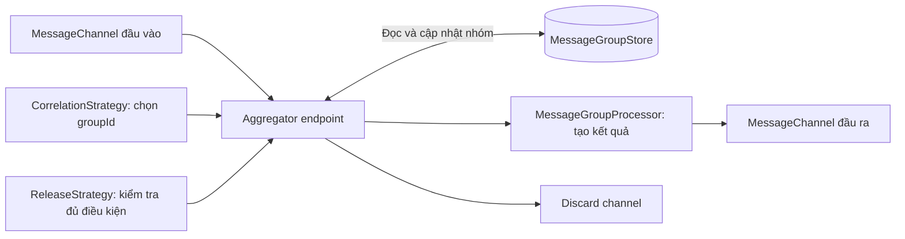
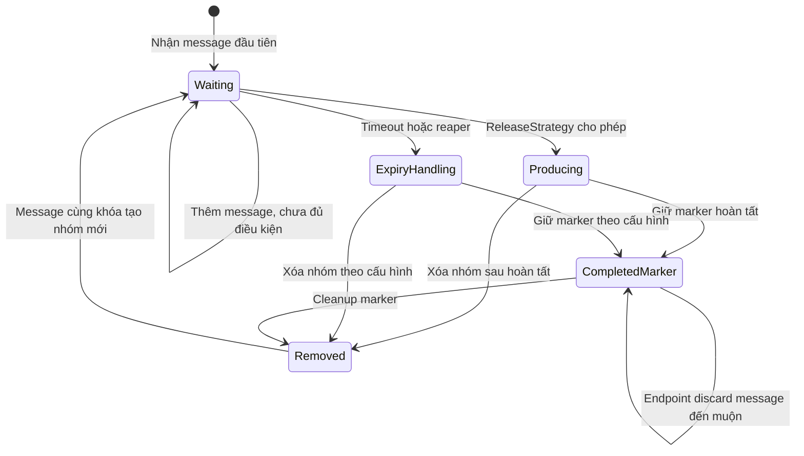

# MessageGroupStore

## Mục tiêu bài học

Trong module **SPRING_INTEGRATION_CORE**, `MessageGroupStore` là thành phần lưu trạng thái để aggregator có thể chờ và xử lý nhiều `Message` liên quan. Bài học này thuộc chương **Aggregator**, tập trung vào cách chọn store, kết nối với endpoint bằng Java DSL và quản lý dữ liệu nhóm trong thực tế.

Sau bài học, bạn có thể:

- Phân biệt kho lưu nhóm với channel, kho lưu từng message và kho metadata.
- Giải thích vòng đời nhóm, gồm tích lũy, release, hoàn tất và xóa.
- Cấu hình aggregator với store trong bộ nhớ hoặc JDBC.
- Thiết kế chính sách cho timeout, message đến muộn, restart và xử lý đồng thời.
- Kiểm tra cả kết quả đầu ra lẫn trạng thái còn lại trong store.

Ví dụ xuyên suốt là một yêu cầu kiểm tra tồn kho cần nhận phản hồi từ ba kho `HN`, `DN`, `HCM`. Các phản hồi có thể đến khác thứ tự và khác thời điểm.

## 1. Vì sao aggregator cần một kho lưu nhóm?

Giả sử yêu cầu `T01:req-001` đã nhận hai phản hồi nhưng kho thứ ba chưa trả lời. Endpoint phải nhớ hai phản hồi trước đó để ghép với phản hồi cuối. Một biến cục bộ trong phương thức xử lý từng message không đủ thể hiện trạng thái kéo dài qua nhiều lần nhận.

Luồng xử lý có thể hình dung như sau:



Store lưu trạng thái; correlation strategy chọn nhóm; release strategy quyết định lúc xử lý; processor tạo kết quả. Store không tự biết ba kho nào là bắt buộc và không tự quyết định rằng hai phản hồi đã đủ. Sự phân công này cho phép thay cách lưu mà giữ nguyên phần lớn logic nghiệp vụ. [Tham chiếu Aggregator](https://docs.spring.io/spring-integration/reference/aggregator.html).

Một `QueueChannel` có thể giữ message đang chờ consumer. Sau khi message đã được consumer nhận và thêm vào aggregator, trạng thái chờ các thành viên còn lại thuộc về group store. Đây là hai vị trí lưu dữ liệu có vòng đời khác nhau.

## 2. Phân biệt các abstraction dễ nhầm

| Thành phần | Đối tượng chính | Trách nhiệm |
|---|---|---|
| `MessageChannel` | Việc gửi và nhận message | Nối các endpoint, hỗ trợ cơ chế chuyển giao tương ứng với loại channel |
| `MessageStore` | Một message được định danh bằng ID | Thêm, lấy và xóa từng message |
| `BasicMessageGroupStore` | Nhóm theo `groupId` | Các thao tác nhóm cơ bản |
| `MessageGroupStore` | Nhóm và trạng thái liên quan | Bổ sung hoàn tất nhóm, expiry callback và các thao tác nhóm nâng cao |
| `ChannelMessageStore` | Dữ liệu phục vụ channel | Hợp đồng lưu trữ phù hợp cho channel dùng store |
| `MetadataStore` | Cặp khóa và giá trị metadata | Lưu dấu đã xử lý hoặc trạng thái nhỏ tùy endpoint |

`MessageGroupStore` mở rộng `BasicMessageGroupStore`; nó không phải interface con của `MessageStore`. Một implementation như `SimpleMessageStore` hoặc `JdbcMessageStore` có thể đồng thời triển khai cả hai hợp đồng. Vì vậy, khi khai báo dependency cho aggregator, dùng kiểu `MessageGroupStore` thể hiện đúng nhu cầu. [API MessageGroupStore](https://docs.spring.io/spring-integration/api/org/springframework/integration/store/MessageGroupStore.html), [API MessageStore](https://docs.spring.io/spring-integration/api/org/springframework/integration/store/MessageStore.html).

`MetadataStore` có thể phục vụ cơ chế chống xử lý trùng, nhưng không thay thế nơi giữ payload và trạng thái nhóm của aggregator. [Metadata Store](https://docs.spring.io/spring-integration/reference/meta-data-store.html).

## 3. MessageGroup chứa những thông tin nào?

Một `MessageGroup` mô tả các message cùng ngữ cảnh tương quan. Những thông tin thường cần quan sát là:

| API | Ý nghĩa |
|---|---|
| `getGroupId()` | Khóa định danh nhóm |
| `getMessages()` | Các message hiện có |
| `size()` | Số message hiện có trong nhóm |
| `isComplete()` | Nhóm đã được đánh dấu hoàn tất hay chưa |
| `getTimestamp()` | Mốc thời gian tạo nhóm |
| `getLastModified()` | Mốc cập nhật nhóm |
| `getSequenceSize()` | Thông tin kích thước sequence khi nhóm sử dụng sequence |
| `getLastReleasedMessageSequenceNumber()` | Trạng thái sequence đã release, hữu ích cho các thành phần có xử lý sequence |

Không đồng nhất `size()` với số thành viên nghiệp vụ hợp lệ. Ba message có thể là hai phản hồi từ `HN` và một phản hồi từ `DN`, trong khi vẫn thiếu `HCM`.

Tương tự, một nhóm có `size() == 0` có thể là marker của nhóm đã hoàn tất. Chỉ nhìn kích thước không đủ kết luận nhóm đã bị xóa. [API MessageGroup](https://docs.spring.io/spring-integration/api/org/springframework/integration/store/MessageGroup.html).

### Thiết kế groupId ổn định

Trong bài này, header `requestId` chứa cả tenant và mã của một lượt yêu cầu:

```text
requestId = T01:req-001
groupId   = stock-v1:T01:req-001
```

Một lượt kiểm tra mới cần mã mới, dù cùng SKU. Nếu dùng riêng mã sản phẩm làm khóa, phản hồi của hai lần kiểm tra có thể bị ghép chung hoặc bị marker của lần trước từ chối.

Khóa cần được tạo giống nhau giữa các lần gửi, sau restart và giữa các instance. Với khóa ghép, nên thống nhất cách mã hóa từng thành phần để tránh chuỗi nhập nhằng. Tiền tố trong ví dụ là quy ước nghiệp vụ của ứng dụng, không phải namespace tự sinh của framework.

## 4. Các thao tác store cần biết

| Thao tác | Công dụng | Điểm cần chú ý |
|---|---|---|
| `addMessageToGroup(id, message)` | Thêm một message vào nhóm | Trả về biểu diễn nhóm sau khi thêm |
| `addMessagesToGroup(id, messages...)` | Thêm nhiều message | Khả năng tối ưu phụ thuộc implementation |
| `getMessageGroup(id)` | Đọc biểu diễn nhóm | Với khóa chưa có, API trả nhóm rỗng |
| `messageGroupSize(id)` | Lấy kích thước nhóm | Hữu ích khi chỉ cần đếm |
| `completeGroup(id)` | Đánh dấu hoàn tất | Không tự gọi processor của aggregator |
| `removeMessagesFromGroup(id, messages...)` | Xóa các message khỏi nhóm | Khác với xóa cả nhóm |
| `removeMessageGroup(id)` | Xóa nhóm | Không còn marker để endpoint nhận diện lần hoàn tất trước |
| `registerMessageGroupExpiryCallback(callback)` | Đăng ký xử lý khi expiry được kích hoạt | Đăng ký callback không tạo lịch chạy |
| `expireMessageGroups(timeout)` | Tìm nhóm hết hạn và gọi callback | `timeout` là ngưỡng thời gian tính bằng mili giây |

Các thao tác cơ bản nằm trong `BasicMessageGroupStore`; API mở rộng mô tả thêm việc hoàn tất và expiry. [BasicMessageGroupStore](https://docs.spring.io/spring-integration/api/org/springframework/integration/store/BasicMessageGroupStore.html), [MessageGroupStore](https://docs.spring.io/spring-integration/api/org/springframework/integration/store/MessageGroupStore.html).

### Thử thao tác trên một store độc lập

Đoạn mã sau chỉ minh họa hợp đồng lưu trữ, không phải một flow aggregator:

```java
import org.springframework.integration.store.MessageGroupStore;
import org.springframework.integration.store.SimpleMessageStore;
import org.springframework.messaging.Message;
import org.springframework.messaging.support.MessageBuilder;

public class GroupStoreDemo {

    public static void main(String[] args) {
        MessageGroupStore store = new SimpleMessageStore();
        String groupId = "stock-v1:T01:req-001";

        Message<String> first = MessageBuilder
                .withPayload("HN:12")
                .build();

        Message<String> second = MessageBuilder
                .withPayload("DN:8")
                .build();

        store.addMessageToGroup(groupId, first);
        store.addMessageToGroup(groupId, second);

        System.out.println(store.messageGroupSize(groupId)); // 2

        store.completeGroup(groupId);
        System.out.println(
                store.getMessageGroup(groupId).isComplete()); // true

        store.removeMessageGroup(groupId);
        System.out.println(store.getMessageGroupCount()); // 0
    }
}
```

Gọi `completeGroup()` trực tiếp chỉ thao tác trạng thái store; không có kết quả tổng hợp tự xuất hiện. Trong flow thật, hãy để aggregator điều phối thêm message, release và cleanup.

Không sửa collection của nhóm đang được endpoint sử dụng để “đánh dấu đã xử lý”. Với `SimpleMessageStore`, biểu diễn được trả về có thể tham chiếu trực tiếp đến nhóm nội bộ; với store bền vững, cách biểu diễn và đồng bộ dữ liệu lại khác. [Lưu ý về SimpleMessageStore](https://docs.spring.io/spring-integration/reference/message-store.html).

## 5. Vòng đời nhóm: hoàn tất và xóa là hai việc khác nhau

Một vòng đời thường gặp:



Sơ đồ thể hiện các trạng thái logic trong trường hợp xử lý thành công; đường lỗi còn phụ thuộc transaction và error handling.

Trong ví dụ ba kho:

1. `HN` đến: nhóm có một message, chưa có output.
2. `DN` đến: nhóm có hai message, vẫn chờ.
3. `HCM` đến: đủ điều kiện, processor tạo một kết quả.
4. Endpoint dọn các thành viên đã xử lý và giữ marker hoặc xóa nhóm theo cấu hình.
5. Một phản hồi cùng khóa đến muộn sẽ được xử lý khác nhau tùy marker còn tồn tại hay không.

Marker hoàn tất có vai trò ghi nhớ rằng lượt yêu cầu đã kết thúc. Nó tiêu tốn metadata dù không còn payload. Khi xóa marker, ứng dụng chấp nhận rằng thông điệp cùng khóa có thể bắt đầu nhóm mới.

## 6. Chọn implementation

| Lựa chọn | Đặc điểm | Khi phù hợp | Điều phải thiết kế thêm |
|---|---|---|---|
| `SimpleMessageStore` | Lưu trong heap của JVM | Học tập, kiểm thử, trạng thái có thể mất | Giới hạn bộ nhớ, timeout, cách khôi phục nghiệp vụ |
| `JdbcMessageStore` | Lưu nhóm bằng cơ sở dữ liệu quan hệ | Cần giữ nhóm qua restart, đã có RDBMS | Schema, serializer, giao dịch và khóa khi nhiều instance |
| `RedisMessageStore` | Lưu bằng Redis | Hạ tầng Redis phù hợp với ứng dụng | Cấu hình durability, serializer và phối hợp truy cập |
| `MongoDbMessageStore` | Lưu bằng MongoDB | Hạ tầng document database phù hợp | Mapping, index, khả năng tương thích dữ liệu |

Việc dùng Redis hay MongoDB không tự xác định mức bảo toàn dữ liệu. Mức bảo toàn còn phụ thuộc cấu hình backend và cách ứng dụng ghi nhận thành công.

`SimpleMessageStore()` mặc định không đặt giới hạn dung lượng. Các constructor khác hỗ trợ giới hạn; giới hạn đó không phải cơ chế tự đẩy dữ liệu sang đĩa. [API SimpleMessageStore](https://docs.spring.io/spring-integration/api/org/springframework/integration/store/SimpleMessageStore.html).

Với JDBC, chọn `JdbcMessageStore` cho aggregator. `JdbcChannelMessageStore` phục vụ channel và không cung cấp đầy đủ hợp đồng nhóm mà aggregator yêu cầu. [JDBC Message Store](https://docs.spring.io/spring-integration/reference/jdbc/message-store.html).

## 7. Cấu hình Java DSL: gom phản hồi ba kho

Ví dụ dùng Java 17 trở lên và các API Java DSL có trong Spring Integration 6.5. Ứng dụng cần dependency `spring-integration-core` và cấu hình Spring tương ứng. Các ví dụ JDBC về sau cần thêm `spring-integration-jdbc`, driver và `DataSource`.

Để tập trung vào store, ví dụ giả định đầu vào đã được kiểm tra: mỗi lượt có đúng một phản hồi hợp lệ từ từng kho `HN`, `DN`, `HCM`. Khi transport có redelivery, cần bổ sung chính sách chống trùng như mục 11.

```java
import java.io.Serializable;
import java.util.Comparator;

import org.springframework.beans.factory.annotation.Qualifier;
import org.springframework.context.annotation.Bean;
import org.springframework.context.annotation.Configuration;
import org.springframework.integration.channel.DirectChannel;
import org.springframework.integration.channel.QueueChannel;
import org.springframework.integration.config.EnableIntegration;
import org.springframework.integration.dsl.IntegrationFlow;
import org.springframework.integration.store.MessageGroupStore;
import org.springframework.integration.store.SimpleMessageStore;
import org.springframework.messaging.Message;
import org.springframework.messaging.MessageChannel;

@Configuration
@EnableIntegration
public class StockAggregationConfig {

    public record WarehouseReply(String warehouse, int available)
            implements Serializable {
    }

    @Bean
    public MessageChannel stockInput() {
        return new DirectChannel();
    }

    @Bean
    public QueueChannel stockOutput() {
        return new QueueChannel();
    }

    @Bean
    public QueueChannel stockDiscard() {
        return new QueueChannel();
    }

    @Bean
    public MessageGroupStore stockMessageStore() {
        return new SimpleMessageStore();
    }

    @Bean
    public IntegrationFlow stockFlow(
            @Qualifier("stockMessageStore") MessageGroupStore store) {

        return IntegrationFlow.from("stockInput")
                .aggregate(a -> a
                        .messageStore(store)
                        .correlationStrategy(
                                StockAggregationConfig::groupId)
                        .releaseStrategy(group -> group.size() == 3)
                        .outputProcessor(group ->
                                group.getMessages().stream()
                                        .map(Message::getPayload)
                                        .map(WarehouseReply.class::cast)
                                        .sorted(Comparator.comparing(
                                                WarehouseReply::warehouse))
                                        .toList())
                        .groupTimeout(30_000L)
                        .sendPartialResultOnExpiry(false)
                        .expireGroupsUponCompletion(false)
                        .expireGroupsUponTimeout(false)
                        .discardChannel("stockDiscard"))
                .channel("stockOutput")
                .get();
    }

    private static String groupId(Message<?> message) {
        String requestId =
                message.getHeaders().get("requestId", String.class);

        if (requestId == null || requestId.isBlank()) {
            throw new IllegalArgumentException(
                    "Header requestId phải có giá trị");
        }

        return "stock-v1:" + requestId;
    }
}
```

Ý nghĩa các quyết định trong ví dụ:

- `messageStore(store)` đưa bean lưu trạng thái vào endpoint.
- `correlationStrategy` lấy khóa từ header nghiệp vụ; không cần dựa vào sequence do splitter tạo.
- `releaseStrategy` chờ ba message theo giả định đầu vào.
- `outputProcessor` trả một danh sách payload, sắp theo mã kho để kết quả có thứ tự rõ ràng.
- `groupTimeout` giới hạn khoảng chờ từ message gần nhất của nhóm.
- Hai tùy chọn `expireGroupsUpon...` được đặt `false` để giữ marker cho cả hoàn tất bình thường và timeout không đủ điều kiện.
- `sendPartialResultOnExpiry(false)` đưa nhóm thiếu dữ liệu vào đường discard thay vì tạo snapshot chưa đầy đủ.

Java DSL hỗ trợ thay correlation strategy, release strategy và store tại bước `.aggregate(...)`. [Aggregators and Resequencers](https://docs.spring.io/spring-integration/reference/dsl/java-aggregators.html). Các tùy chọn timeout, discard và store nằm trên `CorrelationHandlerSpec`. [API 6.5.4](https://docs.spring.io/spring-integration/docs/6.5.4/api/org/springframework/integration/dsl/CorrelationHandlerSpec.html).

Hai `QueueChannel` đầu ra trong ví dụ dùng bộ nhớ và phục vụ quan sát. Thay group store bằng JDBC chỉ bảo toàn trạng thái nhóm trong phạm vi cấu hình lưu trữ; kết quả đã gửi vào queue trong bộ nhớ vẫn có thể mất khi JVM dừng.

## 8. Thay store trong bộ nhớ bằng JDBC

Giữ nguyên flow và thay đúng phương thức bean `stockMessageStore()` ở ví dụ trước:

```java
import javax.sql.DataSource;

import org.springframework.context.annotation.Bean;
import org.springframework.integration.jdbc.store.JdbcMessageStore;

@Bean
public JdbcMessageStore stockMessageStore(DataSource dataSource) {
    JdbcMessageStore store = new JdbcMessageStore(dataSource);
    store.setRegion("stock-aggregate-v1");
    return store;
}
```

Đây là phương thức thay thế bên trong configuration, không phải bean thứ hai dùng chung tên.

Trước khi chạy, chuẩn bị schema theo script phù hợp với database trong artifact `spring-integration-jdbc`:

```text
org/springframework/integration/jdbc/schema-*.sql
```

Dùng script của phiên bản dependency đang triển khai làm cơ sở cho migration. Việc khai báo bean không thay thế bước tạo schema. [API JdbcMessageStore](https://docs.spring.io/spring-integration/api/org/springframework/integration/jdbc/store/JdbcMessageStore.html).

### Region và table prefix

`region` phân vùng dữ liệu logic trong các bảng dùng chung. Các instance cùng phục vụ một aggregator cần nhìn thấy cùng vùng dữ liệu; hai endpoint nghiệp vụ độc lập nên có store riêng và vùng dữ liệu được phân tách.

`tablePrefix` thay tiền tố tên bảng trong SQL của store. Nếu đổi prefix, schema triển khai phải khớp. Đổi region sau restart khiến dữ liệu vùng cũ không còn được endpoint hiện tại nhìn thấy, dù nó vẫn tồn tại trong database. [Phân vùng JDBC store](https://docs.spring.io/spring-integration/reference/jdbc/message-store.html#_partitioning_a_message_store), [API setRegion](https://docs.spring.io/spring-integration/api/org/springframework/integration/jdbc/store/JdbcMessageStore.html#setRegion(java.lang.String)).

### Một kịch bản phục hồi

| Thời điểm | Sự kiện | Trạng thái kỳ vọng |
|---|---|---|
| Trước restart | Nhận `HN`, `DN`; các cập nhật đã commit | Nhóm bền vững có hai message |
| Ứng dụng dừng | JVM kết thúc | Heap mất; dữ liệu database đã commit còn lại |
| Sau restart | Khởi động với cùng schema, region và khóa | Endpoint có thể truy cập nhóm đang chờ |
| Tiếp theo | Nhận `HCM` trước khi nhóm bị cleanup | Nhóm đủ điều kiện tạo một kết quả |

Phục hồi payload không đồng nghĩa phục hồi nguyên trạng mọi scheduled task trong JVM. Nhóm còn lại mà không nhận thêm message cần có đường xử lý orphan sau restart; phần timeout bên dưới trình bày cách tiếp cận này.

## 9. Payload, header và serialization

Khi dữ liệu đi qua ranh giới lưu trữ bền vững, toàn bộ message cần được xem xét, gồm payload và headers.

Với cơ chế mặc định của `JdbcMessageStore`, payload phải có thể serialize; các header không serializable có thể bị loại trước khi lưu. Record `WarehouseReply` trong ví dụ triển khai `Serializable`, các thành phần của nó là `String` và `int`.

Không đưa connection, stream đang mở hoặc service bean vào payload rồi kỳ vọng có thể phục hồi sau restart. Với DTO nghiệp vụ, nên lưu dữ liệu cần thiết hoặc định danh để tải lại tài nguyên.

Header `replyChannel` và `errorChannel` có thể chứa tham chiếu channel trong JVM. Nếu chúng bị loại khi lưu, luồng trả lời động có thể không còn hoạt động như trước. Framework có `HeaderChannelRegistry` để ánh xạ tham chiếu channel sang tên, nhưng registry trong bộ nhớ không làm một gateway đang chờ trở nên bền vững qua restart. Ví dụ trong bài chọn output channel cố định để đường kết quả rõ ràng. [Message Store và serialization](https://docs.spring.io/spring-integration/reference/message-store.html).

Khi thay đổi DTO giữa hai lần triển khai, hãy thử đọc dữ liệu đã ghi bằng bản cũ. Với serializer tùy chỉnh, cần thống nhất cả chiều ghi, chiều đọc và chính sách tương thích.

## 10. Nhiều instance: shared store cần đi cùng cơ chế khóa

Một lỗi suy luận thường gặp là cho rằng cùng đọc database thì toàn bộ thao tác aggregator đã được phối hợp. Thực tế, xử lý một message gồm nhiều bước: lấy nhóm, cập nhật nhóm, kiểm tra release và xử lý kết quả.

Ví dụ hai instance cùng nhìn thấy một nhóm đang có hai phản hồi. Nếu cả hai xử lý message tiếp theo mà thiếu khóa chung theo groupId, tính nhất quán của quá trình tổng hợp có thể bị ảnh hưởng.

Aggregator mặc định sử dụng khóa cục bộ. Khi nhiều instance cùng thao tác nhóm trong shared store, cấu hình `LockRegistry` dùng chung về mặt backend và namespace. [JDBC Lock Registry](https://docs.spring.io/spring-integration/reference/jdbc/lock-registry.html).

Một cấu hình JDBC minh họa:

```java
import javax.sql.DataSource;

import org.springframework.context.annotation.Bean;
import org.springframework.integration.jdbc.lock.DefaultLockRepository;
import org.springframework.integration.jdbc.lock.JdbcLockRegistry;

@Bean
public DefaultLockRepository stockLockRepository(
        DataSource dataSource) {

    DefaultLockRepository repository =
            new DefaultLockRepository(dataSource);
    repository.setRegion("stock-aggregate-v1");
    return repository;
}

@Bean
public JdbcLockRegistry stockLockRegistry(
        DefaultLockRepository stockLockRepository) {

    return new JdbcLockRegistry(stockLockRepository);
}
```

Sau đó inject `JdbcLockRegistry stockLockRegistry` vào phương thức tạo flow và thêm vào cấu hình aggregator:

```java
.lockRegistry(stockLockRegistry)
```

Các phương thức bean trên đặt trong configuration phù hợp và cần schema lock tương ứng. Region của lock và region của store là hai cấu hình riêng; dùng cùng chuỗi trong ví dụ chỉ là quy ước giúp quản lý.

Mỗi registry cần repository riêng; không chia sẻ cùng một đối tượng `DefaultLockRepository` cho nhiều `JdbcLockRegistry`. Các instance phối hợp vẫn trỏ về cùng backend và vùng khóa của endpoint đó. [API DefaultLockRepository](https://docs.spring.io/spring-integration/api/org/springframework/integration/jdbc/lock/DefaultLockRepository.html).

Nếu có nhiều aggregator liên tiếp, cần xem thứ tự giữ khóa và gọi downstream để tránh deadlock. Khóa bảo vệ thao tác nhóm không thay thế transaction và không làm việc gửi kết quả đến hệ thống ngoài trở nên nguyên tử.

## 11. Message trùng: phân biệt ID kỹ thuật với khóa nghiệp vụ

Xét ba message cùng `requestId`:

```text
message A: warehouse=HN,  available=12
message B: warehouse=HN,  available=12   // phát lại, Message ID mới
message C: warehouse=DN,  available=8
```

Release strategy `group.size() == 3` có thể cho phép tổng hợp dù thiếu `HCM`. Store không thể suy ra rằng hai message đầu là cùng một phản hồi nghiệp vụ chỉ vì payload giống nhau.

Để xử lý tình huống này, có thể:

- Đặt khóa idempotency `requestId + warehouse` và kiểm soát chống trùng trước aggregator.
- Kiểm tra tập kho đã nhận trong release strategy.
- Xác định quy tắc nếu một kho gửi nhiều phiên bản: giữ phản hồi đầu, lấy phiên bản mới nhất hoặc từ chối xung đột.

Một release strategy minh họa, giả sử đầu vào đã giới hạn trong ba kho hợp lệ:

```java
.releaseStrategy(group -> {
    long distinctWarehouses = group.getMessages().stream()
            .map(Message::getPayload)
            .map(WarehouseReply.class::cast)
            .map(WarehouseReply::warehouse)
            .distinct()
            .count();

    return distinctWarehouses == 3;
})
```

Đoạn mã chỉ sửa điều kiện release. Nếu nhóm vẫn chứa phản hồi trùng, processor trả danh sách ở ví dụ trước vẫn trả cả các phần tử đó. Vì vậy, processor cũng cần áp dụng quy tắc chọn phản hồi cho mỗi kho hoặc cần loại trùng trước khi message được thêm vào nhóm.

Cơ chế chống trùng phải xét cả lỗi giữa bước đánh dấu đã nhận và bước lưu nhóm: đánh dấu trước rồi lưu thất bại có thể làm lần phát lại bị chặn sai. Khi cần nhất quán giữa hai bước, hãy thiết kế transaction hoặc cơ chế phục hồi phù hợp.

## 12. Timeout, reaper và thời hạn giữ marker

Cần phân biệt bốn câu hỏi:

| Câu hỏi | Cấu hình hoặc cơ chế liên quan |
|---|---|
| Nhóm đang chờ được phép im lặng bao lâu? | `groupTimeout(...)` |
| Khi hết hạn có phát kết quả thiếu thành viên không? | `sendPartialResultOnExpiry(...)` |
| Sau hoàn tất bình thường có xóa nhóm luôn không? | `expireGroupsUponCompletion(...)` |
| Sau force completion do timeout có giữ marker không? | `expireGroupsUponTimeout(...)`, kết hợp đường release thực tế |

Timeout có thể kích hoạt release strategy thêm một lần. Nếu strategy cho phép release tại thời điểm đó, chính sách hoàn tất bình thường cũng tham gia quyết định cleanup. Vì thế không nên đọc riêng một cờ và suy ra mọi trường hợp. [Các tùy chọn Aggregator](https://docs.spring.io/spring-integration/reference/aggregator.html#_configuring_an_aggregator_with_xml).

### groupTimeout là khoảng chờ từ message gần nhất

Với `groupTimeout(30_000L)`, một message mới trong nhóm đang chờ sẽ làm lịch timeout được tính lại. Đây không mặc nhiên là deadline 30 giây từ lần đầu nhận.

Nếu yêu cầu nghiệp vụ là “tổng thời gian chờ tối đa tính từ lúc mở yêu cầu”, cần biểu thức timeout dựa trên mốc tương ứng, chẳng hạn timestamp tạo nhóm hoặc deadline nghiệp vụ. Khi thời gian phát sinh ở hệ thống nguồn quan trọng, timestamp tạo nhóm trong store có thể chưa phải mốc phù hợp.

### MessageGroupStoreReaper làm gì?

Reaper gọi cơ chế expiry của store theo một ngưỡng tuổi nhóm. Nó cần được scheduler hoặc mã điều phối gọi chạy; chỉ tạo bean không tạo lịch quét định kỳ. Aggregator đăng ký callback để việc expiry đi qua đường force completion của endpoint. [API MessageGroupStoreReaper](https://docs.spring.io/spring-integration/api/org/springframework/integration/store/MessageGroupStoreReaper.html).

Ví dụ bổ sung dưới đây đặt ngưỡng tuổi nhóm là năm phút và quét mỗi mười giây:

```java
import org.springframework.beans.factory.annotation.Qualifier;
import org.springframework.context.annotation.Bean;
import org.springframework.context.annotation.Configuration;
import org.springframework.integration.store.MessageGroupStore;
import org.springframework.integration.store.MessageGroupStoreReaper;
import org.springframework.scheduling.annotation.EnableScheduling;
import org.springframework.scheduling.annotation.Scheduled;

@Configuration
@EnableScheduling
public class StockCleanupConfig {

    @Bean
    public MessageGroupStoreReaper stockReaper(
            @Qualifier("stockMessageStore") MessageGroupStore store) {

        MessageGroupStoreReaper reaper =
                new MessageGroupStoreReaper(store);
        reaper.setTimeout(300_000L);
        reaper.setExpireOnDestroy(false);
        return reaper;
    }

    @Bean
    public StockReaperJob stockReaperJob(
            MessageGroupStoreReaper stockReaper) {

        return new StockReaperJob(stockReaper);
    }

    public static final class StockReaperJob {

        private final MessageGroupStoreReaper reaper;

        public StockReaperJob(MessageGroupStoreReaper reaper) {
            this.reaper = reaper;
        }

        @Scheduled(fixedDelay = 10_000L)
        public void run() {
            this.reaper.run();
        }
    }
}
```

Đây là chính sách bổ sung cần chủ động lựa chọn: reaper quét cả nhóm đang chờ lẫn nhóm còn marker trong phạm vi store, không chỉ xóa marker. Ngưỡng năm phút có thể force complete một nhóm lâu đời dù nhóm vẫn nhận message gần đây.

Với các store kế thừa `AbstractMessageGroupStore`, `timeoutOnIdle` mặc định là `false`, nghĩa là expiry theo tuổi từ lúc tạo nhóm. Đặt `setTimeoutOnIdle(true)` chuyển cách tính sang thời gian từ cập nhật gần nhất. Hai cách tính này cần được chọn theo yêu cầu nghiệp vụ. [API setTimeoutOnIdle](https://docs.spring.io/spring-integration/api/org/springframework/integration/store/AbstractMessageGroupStore.html#setTimeoutOnIdle(boolean)).

Thời điểm quét còn phụ thuộc chu kỳ scheduler và thời gian xử lý. “Năm phút” là ngưỡng đủ điều kiện, không phải cam kết xóa đúng mili giây thứ 300.000.

### Dọn nhóm sau restart và giữ quyền sở hữu store

Một persistent store có thể chứa nhóm chưa hoàn tất mà không còn scheduled task tương ứng sau restart. Có thể xử lý bằng reaper được lên lịch hoặc tính năng `expireTimeout` và `expireDuration` của correlating handler. [API AbstractCorrelatingMessageHandler](https://docs.spring.io/spring-integration/api/org/springframework/integration/aggregator/AbstractCorrelatingMessageHandler.html).

Mỗi aggregator nên có store chuyên biệt cho phạm vi dữ liệu của nó. Tránh đưa cùng một store bean vào hai aggregator độc lập, đặc biệt khi dùng expiry callback: callback của endpoint này có thể tác động nhóm thuộc endpoint kia. Với JDBC, dùng bean riêng và region hoặc bảng riêng giúp phân tách phạm vi.

Thời hạn giữ marker quyết định khoảng thời gian endpoint còn nhận diện được message đến muộn. Khi marker đã bị cleanup, cần khóa lượt yêu cầu không tái sử dụng hoặc lịch sử idempotency riêng nếu muốn tiếp tục từ chối các message cũ.

## 13. Persistence, transaction và giao kết quả

Lưu nhóm xuống database chỉ giải quyết một phần bài toán tin cậy. Hãy xét hai sự kiện:

```text
A. Ghi hoặc hoàn tất trạng thái nhóm trong database.
B. Gửi kết quả đến consumer hoặc hệ thống ngoài.
```

Nếu A và B không cùng một ranh giới nguyên tử, lỗi giữa hai bước có thể tạo ra kết quả mất hoặc lặp tùy thứ tự xử lý và cơ chế phát lại. Không thể kết luận có exactly-once chỉ từ việc dùng `JdbcMessageStore`.

Các quyết định thiết kế thường cần có:

- Transaction bao quanh những thao tác database nào.
- Consumer ghi nhận kết quả theo khóa nghiệp vụ nào để idempotent.
- Nếu cần phát ra broker sau commit, có dùng outbox hoặc cơ chế giao nhận tương ứng hay không.
- Khi lỗi, message được retry ở endpoint, phát lại từ transport hay chuyển sang đường phục hồi nào.

Transaction gắn với thread thực thi. Các bước đồng bộ qua `DirectChannel` có thể tham gia transaction đang có, còn chuyển giao qua queue hoặc executor tạo ranh giới cần xét riêng. Việc khai báo một bean transaction manager không tự bao mọi flow trong transaction. [Transaction Support](https://docs.spring.io/spring-integration/reference/transactions.html).

### Lỗi đồng bộ và lỗi từ scheduler

Với luồng đồng bộ, lỗi xử lý thường có thể truyền về nơi gọi `send()`. Force completion từ timeout hoặc reaper lại chạy trên thread scheduler, không có cùng người gọi đang chờ.

Khi cấu hình timeout, cần kiểm tra đường ghi nhận lỗi của scheduler và `errorChannel` nếu ứng dụng muốn nhận `ErrorMessage`. Discard vì thiếu thành viên là kết quả của chính sách; lỗi serializer hoặc lỗi database là lỗi xử lý. Hai loại sự kiện nên có log và hành động phục hồi khác nhau.

## 14. Chi phí bộ nhớ và truy cập dữ liệu

Một ước lượng ban đầu cho lượng message đang chờ là:

```text
số nhóm đang chờ ≈ số nhóm mới mỗi giây × thời gian chờ trung bình

dung lượng payload đang chờ
    ≈ số nhóm đang chờ
    × số message trung bình mỗi nhóm
    × kích thước trung bình mỗi message
```

Ví dụ do ứng dụng giả định:

```text
200 nhóm/giây × 20 giây chờ = khoảng 4.000 nhóm
4.000 nhóm × 2 message/nhóm × 4 KiB = khoảng 31,25 MiB
```

Con số trên chỉ tính phần dung lượng message theo giả định, chưa tính object overhead, headers, cấu trúc nhóm, marker, serializer và kết quả đầu ra. Với JDBC còn có dữ liệu bảng, index và chi phí I/O.

Persistent store hỗ trợ tải message theo nhu cầu để tránh đọc toàn bộ nhóm ở mỗi lần correlation. Một release strategy dùng `size()` có chi phí khác với strategy duyệt mọi payload để đếm kho khác nhau. Nếu mỗi lần nhận lại quét toàn bộ nhóm đang tăng dần, tổng số phần tử phải duyệt có thể tăng gần bậc hai theo kích thước nhóm. [Lazy-load của MessageGroupStore](https://docs.spring.io/spring-integration/reference/message-store.html#_persistent_messagegroupstore_and_lazy_load).

Các số đo hữu ích cho ứng dụng gồm số nhóm đang chờ, số marker, tuổi nhóm lâu nhất, tỷ lệ timeout, số message discard, thời gian truy cập store và thời gian chờ khóa.

Một số phương thức thống kê của interface là tùy chọn và implementation có thể không hỗ trợ. Đừng mặc định `getMessageGroupCount()` và `getMessageCountForAllMessageGroups()` đều rẻ hoặc khả dụng trên mọi backend. [API MessageGroupStore](https://docs.spring.io/spring-integration/api/org/springframework/integration/store/MessageGroupStore.html).

## 15. Kiểm thử kết quả và trạng thái nhóm

Một bài kiểm thử chỉ thấy output chưa đủ chứng minh cleanup và xử lý message đến muộn đúng. Với cấu hình ở mục 7, cần xác nhận:

1. Hai phản hồi đầu được lưu và chưa phát kết quả.
2. Phản hồi thứ ba tạo đúng một kết quả.
3. Payload trong nhóm đã được dọn nhưng marker hoàn tất còn tồn tại.
4. Message đến muộn đi vào discard channel.

Ví dụ JUnit 5 dưới đây đặt cùng package với `StockAggregationConfig`. Nó dùng Spring Test, không cần mock store:

```java
import java.util.List;

import org.junit.jupiter.api.Test;
import org.springframework.beans.factory.annotation.Autowired;
import org.springframework.beans.factory.annotation.Qualifier;
import org.springframework.integration.channel.QueueChannel;
import org.springframework.integration.store.MessageGroup;
import org.springframework.integration.store.MessageGroupStore;
import org.springframework.messaging.Message;
import org.springframework.messaging.MessageChannel;
import org.springframework.messaging.support.MessageBuilder;
import org.springframework.test.context.junit.jupiter.SpringJUnitConfig;

import static org.junit.jupiter.api.Assertions.*;

@SpringJUnitConfig(StockAggregationConfig.class)
class StockAggregationTest {

    @Autowired
    @Qualifier("stockInput")
    MessageChannel input;

    @Autowired
    @Qualifier("stockOutput")
    QueueChannel output;

    @Autowired
    @Qualifier("stockDiscard")
    QueueChannel discard;

    @Autowired
    @Qualifier("stockMessageStore")
    MessageGroupStore store;

    @Test
    void shouldKeepCompletionMarkerAndDiscardLateReply() {
        String requestId = "T01:test-001";
        String groupId = "stock-v1:" + requestId;

        assertTrue(input.send(reply(requestId, "HN", 12)));
        assertTrue(input.send(reply(requestId, "DN", 8)));

        assertNull(output.receive(0));
        assertEquals(2, store.messageGroupSize(groupId));

        assertTrue(input.send(reply(requestId, "HCM", 20)));

        Message<?> result = output.receive(1_000);
        assertNotNull(result);
        assertEquals(List.of(
                new StockAggregationConfig.WarehouseReply("DN", 8),
                new StockAggregationConfig.WarehouseReply("HCM", 20),
                new StockAggregationConfig.WarehouseReply("HN", 12)
        ), result.getPayload());
        assertNull(output.receive(0));

        MessageGroup completed = store.getMessageGroup(groupId);
        assertTrue(completed.isComplete());
        assertEquals(0, completed.size());

        assertTrue(input.send(reply(requestId, "HN", 12)));
        assertNotNull(discard.receive(1_000));
        assertNull(output.receive(0));
    }

    private static Message<?> reply(
            String requestId, String warehouse, int available) {

        return MessageBuilder.withPayload(
                        new StockAggregationConfig.WarehouseReply(
                                warehouse, available))
                .setHeader("requestId", requestId)
                .build();
    }
}
```

Bài kiểm thử dùng input đồng bộ nên việc kiểm tra ngay sau `send()` phù hợp với cấu hình này. Nếu thêm executor hoặc transport bất đồng bộ, cần chờ điều kiện bằng thời hạn hữu hạn.

Các kịch bản tiếp theo nên được kiểm tra độc lập:

| Kịch bản | Điều cần chứng minh |
|---|---|
| Hai request đan xen | Message không đi nhầm nhóm |
| Cùng request ID nhưng khác tenant | Quy ước khóa giữ hai nhóm riêng |
| Message trùng kho với ID mới | Không release sai trước khi đủ kho bắt buộc |
| Thiếu một kho | Đi đúng đường timeout/discard và giữ marker theo chính sách |
| Restart sau hai phản hồi | Nhóm JDBC đã commit được tiếp tục với phản hồi thứ ba |
| Restart rồi không có message mới | Nhóm orphan được cleanup bằng cơ chế đã chọn |
| Hai instance cùng khóa | Không xảy ra xử lý nhóm thiếu phối hợp |
| Lỗi downstream | Trạng thái store, rollback và khả năng phát lại đúng thiết kế |

Kiểm thử persistence nên dùng hai application context nối cùng một database còn dữ liệu, đóng context thứ nhất rồi mở context thứ hai. Tạo một bean `SimpleMessageStore` mới không phải kiểm thử khôi phục bền vững.

Spring Integration có các module hỗ trợ kiểm thử flow và mock endpoint; ví dụ nhỏ ở đây dùng trực tiếp channel và store để quan sát trạng thái. [Testing Support](https://docs.spring.io/spring-integration/reference/testing.html).

## 16. Chẩn đoán các biểu hiện thường gặp

| Biểu hiện | Khả năng cần kiểm tra | Hướng xử lý |
|---|---|---|
| Không có output dù nhận nhiều message | Sai correlation key, sai số thành viên kỳ vọng | Quan sát groupId, release strategy và headers |
| Ba message nhưng thiếu một kho | Message trùng nghiệp vụ được tính vào kích thước | Thiết kế deduplication và điều kiện release |
| Mất nhóm khi restart | Đang dùng bộ nhớ, ghi chưa commit hoặc đổi region | Kiểm tra implementation, transaction và cấu hình vùng dữ liệu |
| Store tăng dù ít payload | Marker tích lũy hoặc nhóm thiếu thành viên không hết hạn | Tách thống kê marker với nhóm chờ; bổ sung cleanup |
| JDBC có dữ liệu nhưng không tìm thấy nhóm | Region, prefix hoặc quy ước khóa đã đổi | Đối chiếu cấu hình trước và sau triển khai |
| Timeout không được xử lý sau restart | Nhóm còn dữ liệu nhưng không còn tác vụ JVM cũ | Cấu hình reaper hoặc purge orphan theo endpoint |
| Kết quả lặp khi retry | Xóa marker quá sớm hoặc khoảng lỗi giữa lưu và gửi | Xem retention, idempotency và giao dịch đầu ra |
| Reply không về gateway | Header channel không còn dùng được hoặc lời gọi đã kết thúc | Dùng đường kết quả phù hợp với vòng đời tác vụ |
| Chạy một instance đúng, nhiều instance sai | Chỉ có khóa cục bộ | Cấu hình cơ chế khóa chung cho cùng nhóm |
| Expiry tác động sai flow | Chia sẻ phạm vi store giữa các endpoint độc lập | Phân tách bean, region và quyền sở hữu nhóm |

Khi điều tra, nên log `requestId`, `groupId`, mã kho, số thành viên, trạng thái hoàn tất và instance xử lý. Không cần log toàn bộ payload nếu dữ liệu lớn hoặc chứa thông tin nhạy cảm.

## 17. Những điểm cần ghi nhớ

`MessageGroupStore` giữ dữ liệu và trạng thái nhóm để aggregator hoạt động qua nhiều lần nhận message. Độ tin cậy của luồng còn phụ thuộc cách tạo khóa, điều kiện release, serialization, khóa đồng thời, transaction và đường gửi kết quả.

Với mỗi cấu hình, hãy xác định rõ ba mốc: lúc nào nhóm đủ dữ liệu để release, lúc nào nhóm bị force complete vì chờ quá lâu, và lúc nào marker được phép xóa. Ba quyết định này chi phối trực tiếp cách ứng dụng xử lý phản hồi thiếu, phản hồi trùng và phản hồi đến muộn.
