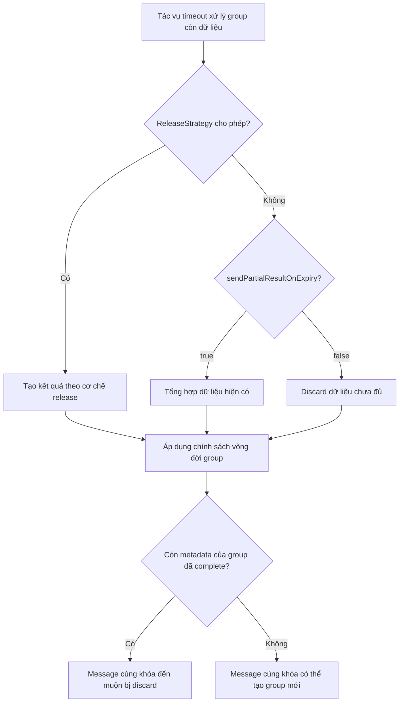

# Timeout của group

Trong chương **Aggregator** của module **SPRING_INTEGRATION_CORE**, timeout giúp luồng thông điệp kết thúc việc chờ một nhóm chưa đủ dữ liệu. Bài này kết nối `Message`, `MessageChannel`, endpoint aggregator, gateway và Java DSL qua tình huống thu thập báo giá: có đối tác trả lời chậm, có đối tác không trả lời, nhưng hệ thống vẫn phải đưa ra kết quả có ý nghĩa.

Sau bài học, bạn có thể:

- Phân biệt thời gian chờ do group không có message mới với hạn chót tính từ lúc tạo group.
- Chọn trả kết quả một phần hoặc đưa dữ liệu chưa đủ sang discard channel.
- Quyết định giữ hay xóa trạng thái group và dự đoán cách xử lý message đến muộn.
- Cấu hình scheduler, dọn group và đường xử lý lỗi.
- Thiết kế kiểm thử cho các mốc thời gian và trạng thái sau timeout.

Ví dụ Java dùng Java 17 và các API có trong Spring Integration 6.5. Khi đưa vào ứng dụng, dùng phiên bản dependency đồng bộ với cấu hình Spring hoặc Spring Boot của ứng dụng.

## 1. Vì sao aggregator cần timeout?

Giả sử dịch vụ so sánh giá gửi yêu cầu đến ba nhà cung cấp `A`, `B`, `C`. Mỗi phản hồi được chuẩn hóa thành một message; header `requestKey` nhận diện cùng một lượt hỏi giá.

```text
requestKey = Q-2026-001:round-1

A -> phản hồi sau 150 ms
B -> phản hồi sau 400 ms
C -> không có phản hồi
```

Điều kiện hoàn thành bình thường là nhận đủ ba nhà cung cấp. Nếu chỉ có điều kiện này, group chứa phản hồi của A và B có thể nằm lại trong store rất lâu.

Cần xác định trước ý nghĩa nghiệp vụ khi hết thời gian:

| Nghiệp vụ | Quyết định phù hợp |
| --- | --- |
| Hiển thị danh sách giá tham khảo | Có thể trả kết quả một phần và ghi rõ nhà cung cấp còn thiếu |
| Phê duyệt yêu cầu cần đủ ba bên xác nhận | Không dùng kết quả thiếu để phê duyệt |
| Thu thập dữ liệu để đối soát | Chuyển dữ liệu chưa đủ sang luồng đối soát |
| Gom sự kiện trong một cửa sổ thời gian | Chốt cửa sổ theo hạn xác định và xử lý sự kiện trễ theo chính sách riêng |

**Timeout chốt việc chờ; quy tắc nghiệp vụ quyết định kết quả sau khi chốt.** Hai phản hồi không tự trở thành kết quả đầy đủ chỉ vì thời gian đã hết.

Ngoài ra, aggregator chỉ có thể đặt lịch cho group mà nó đã biết. Nếu cả A, B và C đều không gửi message, không có group đầu vào để cơ chế này tự phát hiện yêu cầu đang bị treo. Trường hợp không có phản hồi nào cần được quản lý ở luồng phát yêu cầu, bằng deadline của request hoặc một cơ chế theo dõi riêng.

## 2. Phân biệt những loại timeout trong cùng một luồng

### 2.1. Group timeout dạng số là thời gian không có message mới

Với `.groupTimeout(5_000L)`, một group chưa đủ điều kiện release được đặt lịch xử lý sau khoảng 5 giây. Khi message mới được nhận vào group và group vẫn chưa được release, lịch cũ được thay bằng lịch tính từ lần xử lý mới. Tài liệu chính thức mô tả đây là timeout tính từ message đến gần nhất. [Spring Integration: cấu hình group timeout](https://docs.spring.io/spring-integration/reference/aggregator.html).

Ví dụ giả định group cần ba phản hồi khác nguồn:

```text
t = 0 s: A đến          -> dự kiến timeout tại 5 s
t = 3 s: B đến          -> dự kiến timeout chuyển sang 8 s
t = 5 s:                -> chưa timeout theo lịch mới
t ≈ 8 s: C vẫn chưa đến -> kích hoạt xử lý timeout
```

Nếu C đến lúc 4 giây, group đủ điều kiện và có thể được release ngay, không cần chờ đến 8 giây.

Nếu liên tục có message được chấp nhận nhưng điều kiện release vẫn chưa thỏa mãn, hạn chờ dạng này có thể bị đẩy tiếp. Vì vậy, không lấy `groupTimeout = 5 giây` để suy ra rằng một lượt hỏi giá chắc chắn kết thúc trong 5 giây kể từ lúc bắt đầu.

### 2.2. Hạn chót theo thời điểm tạo group

Một yêu cầu khác là: “Dù message mới tiếp tục đến, hãy chốt group khi đã qua 5 giây từ lúc group được tạo”.

Gọi:

- `t_created`: thời điểm tạo group.
- `t_last`: thời điểm gần nhất message được nhận vào group.
- `T`: khoảng thời gian cấu hình.

Hai cách tính lịch khác nhau:

```text
Chờ khi không có message mới: t_target ≈ t_last + T
Hạn chót theo tuổi group:     t_target = t_created + T
```

API timeout của Java DSL nhận hàm trên `MessageGroup`; kết quả có thể là khoảng thời gian dạng số hoặc một `java.util.Date` biểu diễn thời điểm đặt lịch. [Javadoc CorrelationHandlerSpec 6.5](https://docs.spring.io/spring-integration/docs/6.5.0/api/org/springframework/integration/dsl/CorrelationHandlerSpec.html).

Đây là thời gian xử lý của hệ thống. `MessageGroup.getTimestamp()` khác với header `timestamp` của từng message và cũng khác thời điểm sự kiện phát sinh tại nhà cung cấp. Nếu nghiệp vụ cần hạn chót tính từ lúc gửi request, hãy lưu deadline đó trong trạng thái request hoặc một header nhất quán rồi sử dụng nó để tính lịch.

Một mốc đặt lịch cũng chưa phải cơ chế từ chối tuyệt đối mọi message sau deadline. Khi yêu cầu rất chặt về thời điểm tiếp nhận, cần kiểm tra deadline trên đường vào; message có thể đến trong lúc tác vụ timeout còn đang chờ CPU hoặc chờ khóa.

### 2.3. Các timeout không thay thế nhau

| Cơ chế | Điều nó giới hạn | Hệ quả cần nhớ |
| --- | --- | --- |
| `groupTimeout` | Khoảng chờ của một group chưa release | Có thể dẫn đến partial result hoặc discard |
| Deadline từ lúc tạo group | Mốc dự kiến chốt group theo tuổi | Không bị kéo dài chỉ bởi message mới |
| `MessageGroupStoreReaper` | Việc xét hết hạn group theo từng đợt quét | Phụ thuộc store, callback và nhịp chạy |
| `sendTimeout` | Việc gửi message vào channel có hỗ trợ chờ khi gửi | Không biểu diễn thời gian chờ đủ thành viên |
| Gateway `replyTimeout` | Việc caller chờ phản hồi | Caller hết chờ không tự kết thúc group |
| `QueueChannel.receive(timeout)` | Việc consumer chờ lấy một message | Không làm group ở endpoint khác hết hạn |
| TTL do broker hoặc kho lưu trữ cung cấp | Vòng đời dữ liệu tại hệ thống đó | Không mặc nhiên gọi logic kết xuất của aggregator |

Gateway có cấu hình thời gian chờ riêng. Khi thiết kế API đồng bộ, cần tính cả khoảng phát yêu cầu, thời gian aggregator chờ, độ trễ scheduler và thời gian xử lý đầu ra. [Spring Integration: Messaging Gateways](https://docs.spring.io/spring-integration/reference/gateway.html).

Ví dụ, caller chỉ đợi 1 giây trong khi aggregator dự kiến trả partial result sau 2 giây sẽ khiến caller hết chờ trước. Hệ thống cần chọn thời gian phù hợp hoặc trả mã theo dõi để client lấy kết quả bất đồng bộ.

## 3. Điều gì xảy ra khi tác vụ timeout chạy?

Với một group còn dữ liệu và chưa hoàn tất, aggregator kiểm tra lại trạng thái dưới cơ chế đồng bộ theo group. Release strategy được hỏi lại; nếu vẫn chưa thể release, quyết định tiếp theo phụ thuộc `sendPartialResultOnExpiry`. Luồng xử lý này nằm trong `forceComplete` và `expireGroup` của handler. [Mã nguồn AbstractCorrelatingMessageHandler 6.5](https://github.com/spring-projects/spring-integration/blob/v6.5.0/spring-integration-core/src/main/java/org/springframework/integration/aggregator/AbstractCorrelatingMessageHandler.java).



Cần tách ba quyết định:

1. **Có đủ dữ liệu để hoàn thành bình thường không?** Do release strategy xác định.
2. **Nếu chưa đủ khi hết chờ, dữ liệu hiện có đi đâu?** Do partial-result/discard policy xác định.
3. **Sau đó còn nhớ group đã kết thúc không?** Do chính sách expire và dọn store xác định.

Không dùng `.releaseStrategy(group -> true)` để “bật timeout”. Cấu hình đó làm group đủ điều kiện release ngay từ message đầu tiên.

Cũng không giả định timeout tự tạo một `ErrorMessage`. Thiếu dữ liệu theo chính sách đã cấu hình có thể là một kết quả nghiệp vụ bình thường. Exception khi tổng hợp hoặc chuyển kết quả mới là vấn đề xử lý lỗi kỹ thuật.

## 4. Những cấu hình cần đọc cùng nhau

| Cấu hình Java DSL | Vai trò |
| --- | --- |
| `groupTimeout(2_000L)` | Đặt khoảng chờ dạng số, đơn vị millisecond |
| `groupTimeout(group -> ...)` | Tính lịch theo từng group |
| `groupTimeoutExpression("...")` | Tính lịch bằng SpEL trên `MessageGroup` |
| `sendPartialResultOnExpiry(true)` | Cho phép đưa dữ liệu hiện có qua output processor khi chưa release được |
| `discardChannel("...")` | Nhận dữ liệu bị loại, bao gồm message đến sau group đã complete |
| `expireGroupsUponTimeout(false)` | Yêu cầu giữ dấu vết group khi chốt do timeout |
| `expireGroupsUponCompletion(false)` | Giữ metadata sau completion thay vì xóa toàn bộ group |
| `minimumTimeoutForEmptyGroups(...)` | Tham gia chính sách dọn group rỗng đã giữ lại |
| `taskScheduler(...)` | Chọn scheduler cho tác vụ của aggregator |

Các API kết xuất như `outputProcessor` thuộc `AggregatorSpec`; các tùy chọn tương quan, timeout và discard được kế thừa từ `CorrelationHandlerSpec`. [Javadoc AggregatorSpec 6.5](https://docs.spring.io/spring-integration/docs/6.5.0/api/org/springframework/integration/dsl/AggregatorSpec.html).

Mặc định đáng chú ý là `sendPartialResultOnExpiry = false`, `expireGroupsUponTimeout = true` và `expireGroupsUponCompletion = false`. Như vậy, nếu chỉ bật group timeout mà không chủ động cấu hình các chính sách còn lại, bạn không nên kỳ vọng luôn nhận partial result hoặc luôn chặn được message đến muộn. [Javadoc AbstractCorrelatingMessageHandler](https://docs.spring.io/spring-integration/api/org/springframework/integration/aggregator/AbstractCorrelatingMessageHandler.html), [mã nguồn AggregatingMessageHandler](https://github.com/spring-projects/spring-integration/blob/v6.5.0/spring-integration-core/src/main/java/org/springframework/integration/aggregator/AggregatingMessageHandler.java).

Trong ví dụ giữ group của bài này, cả hai cờ expire đều đặt `false` để nhất quán giữa completion bình thường và timeout. Không diễn giải `expireGroupsUponTimeout(false)` thành “group tiếp tục chờ dữ liệu còn thiếu”: group đã chốt, metadata còn lại dùng để nhận diện message trễ.

### Giá trị động: phân biệt null và số không

Trong Spring Integration 6.5:

- Giá trị `null` nghĩa là không đặt lịch timeout cho lần đánh giá đó.
- Giá trị dương dạng số là khoảng chờ tính bằng millisecond.
- Giá trị `0` dẫn đến force completion ngay trên luồng hiện tại.
- Không dùng số âm như một quy ước chung để tắt timeout; nhánh xử lý giá trị không dương có thể force completion ngay.

Hành vi này được thể hiện trong `scheduleGroupToForceComplete`; khi muốn chưa đặt lịch, dùng `null` rõ ràng. [Mã nguồn xử lý lịch timeout 6.5](https://github.com/spring-projects/spring-integration/blob/v6.5.0/spring-integration-core/src/main/java/org/springframework/integration/aggregator/AbstractCorrelatingMessageHandler.java).

Ví dụ dưới đây chỉ đặt lịch khi đã có ít nhất hai message:

```java
.groupTimeout(group -> group.size() >= 2 ? 2_000L : null)
```

Group chỉ có một message sẽ không được cơ chế này tự chốt; cần cơ chế dọn bổ sung nếu nghiệp vụ không cho phép giữ nó mãi.

## 5. Ví dụ Java DSL: trả partial result và nhận diện message trễ

### 5.1. Hợp đồng của dữ liệu đầu vào

Luồng báo giá dùng các quy tắc sau:

- Payload là `Quote`; provider thuộc tập `A`, `B`, `C`.
- Header `requestKey` là chuỗi không rỗng, nhận diện duy nhất một lượt hỏi giá.
- Tầng tiếp nhận đã kiểm tra kiểu dữ liệu và loại bản sao theo `requestKey + provider`.
- Nhận đủ ba provider thì release ngay.
- Nếu chưa đủ và không có message mới trong 2 giây, trả phần đã có.
- Sau khi chốt, giữ metadata để phản hồi đến muộn được đưa sang `discardedQuoteReplies`.

Điều kiện release kiểm tra tập provider, tránh lấy số lượng message làm bằng chứng rằng đã có đủ ba nguồn. Ví dụ, ba bản sao từ A không được xem là ba nhà cung cấp.

### 5.2. Cấu hình luồng

```java
package example.integration;

import java.math.BigDecimal;
import java.util.Comparator;
import java.util.HashSet;
import java.util.List;
import java.util.Set;
import java.util.stream.Collectors;

import org.springframework.beans.factory.annotation.Qualifier;
import org.springframework.context.annotation.Bean;
import org.springframework.context.annotation.Configuration;
import org.springframework.integration.channel.DirectChannel;
import org.springframework.integration.channel.MessagePublishingErrorHandler;
import org.springframework.integration.channel.QueueChannel;
import org.springframework.integration.config.EnableIntegration;
import org.springframework.integration.dsl.IntegrationFlow;
import org.springframework.integration.store.MessageGroup;
import org.springframework.integration.store.SimpleMessageStore;
import org.springframework.messaging.Message;
import org.springframework.scheduling.concurrent.ThreadPoolTaskScheduler;

@Configuration
@EnableIntegration
public class QuoteAggregationConfig {

    private static final Set<String> EXPECTED = Set.of("A", "B", "C");

    public record Quote(String provider, BigDecimal amount) {
    }

    public record QuoteBatch(
            String requestKey,
            List<Quote> quotes,
            Set<String> missingProviders,
            boolean complete) {
    }

    @Bean
    public DirectChannel quoteReplies() {
        return new DirectChannel();
    }

    @Bean
    public QueueChannel quoteResults() {
        return new QueueChannel();
    }

    @Bean
    public QueueChannel discardedQuoteReplies() {
        return new QueueChannel();
    }

    @Bean
    public QueueChannel aggregationErrors() {
        return new QueueChannel();
    }

    @Bean
    public SimpleMessageStore quoteGroupStore() {
        return new SimpleMessageStore();
    }

    @Bean
    public MessagePublishingErrorHandler aggregationErrorHandler(
            @Qualifier("aggregationErrors") QueueChannel errors) {

        MessagePublishingErrorHandler handler =
                new MessagePublishingErrorHandler();
        handler.setDefaultErrorChannel(errors);
        return handler;
    }

    @Bean
    public ThreadPoolTaskScheduler aggregationScheduler(
            MessagePublishingErrorHandler aggregationErrorHandler) {

        ThreadPoolTaskScheduler scheduler = new ThreadPoolTaskScheduler();
        scheduler.setPoolSize(2);
        scheduler.setThreadNamePrefix("quote-group-");
        scheduler.setRemoveOnCancelPolicy(true);
        scheduler.setErrorHandler(aggregationErrorHandler);
        return scheduler;
    }

    @Bean
    public IntegrationFlow quoteAggregation(
            SimpleMessageStore quoteGroupStore,
            ThreadPoolTaskScheduler aggregationScheduler) {

        return IntegrationFlow.from("quoteReplies")
                .aggregate(spec -> spec
                        .messageStore(quoteGroupStore)
                        .correlationExpression("headers['requestKey']")
                        .releaseStrategy(group ->
                                providers(group).containsAll(EXPECTED))
                        .groupTimeout(2_000L)
                        .sendPartialResultOnExpiry(true)
                        .expireGroupsUponTimeout(false)
                        .expireGroupsUponCompletion(false)
                        .discardChannel("discardedQuoteReplies")
                        .taskScheduler(aggregationScheduler)
                        .outputProcessor(QuoteAggregationConfig::summarize))
                .channel("quoteResults")
                .get();
    }

    private static Set<String> providers(MessageGroup group) {
        return group.getMessages().stream()
                .map(Message::getPayload)
                .map(Quote.class::cast)
                .map(Quote::provider)
                .collect(Collectors.toSet());
    }

    private static QuoteBatch summarize(MessageGroup group) {
        List<Quote> quotes = group.getMessages().stream()
                .map(Message::getPayload)
                .map(Quote.class::cast)
                .sorted(Comparator.comparing(Quote::provider))
                .toList();

        Set<String> missing = new HashSet<>(EXPECTED);
        missing.removeAll(providers(group));

        Message<?> first = group.getMessages().iterator().next();
        String requestKey =
                first.getHeaders().get("requestKey", String.class);

        return new QuoteBatch(
                requestKey,
                quotes,
                Set.copyOf(missing),
                missing.isEmpty());
    }
}
```

Kết quả nghiệp vụ được tạo bởi output processor; Java DSL cho phép nhận trực tiếp `MessageGroup` để xây dựng payload trả ra. [API outputProcessor](https://docs.spring.io/spring-integration/docs/6.5.0/api/org/springframework/integration/dsl/AggregatorSpec.html#outputProcessor(org.springframework.integration.aggregator.MessageGroupProcessor)).

Với đầu vào chỉ có A và B:

```text
QuoteBatch:
  requestKey       = Q-2026-001:round-1
  quotes           = [báo giá của A, báo giá của B]
  missingProviders = [C]
  complete         = false
```

Trường `complete` được tính từ dữ liệu nghiệp vụ. Nó không phải header do Spring Integration tự thêm khi timeout. Nếu cần phân biệt “thiếu nguồn do timeout”, “bị hủy bởi người dùng” và “bị từ chối vì dữ liệu lỗi”, hãy thiết kế thêm trạng thái nghiệp vụ cùng đường phát sinh tương ứng.

Các `QueueChannel` ở đây giúp quan sát đầu ra và viết kiểm thử. Trong ứng dụng thực tế, chúng cần consumer để xử lý kết quả, lưu phản hồi trễ và tiếp nhận lỗi. Store in-memory cùng metadata được giữ lại cũng cần chính sách dọn; ví dụ này chưa phải cấu hình lưu trữ cho môi trường triển khai.

### 5.3. Chuyển sang chính sách không chấp nhận partial result

Thay tùy chọn:

```java
.sendPartialResultOnExpiry(false)
```

Khi timeout mà release strategy vẫn chưa thỏa mãn, không có `QuoteBatch` một phần ở `quoteResults`. Dữ liệu bị loại được đưa đến `discardedQuoteReplies` theo cấu hình discard.

Không suy ra rằng discard channel luôn nhận một message tổng hợp báo lỗi cho cả request. Nếu cần chính xác một sự kiện `QuoteRequestTimedOut` cho mỗi lượt hỏi giá, hãy bổ sung logic theo trạng thái request để tránh phát một sự kiện cho từng phản hồi bị discard.

## 6. Đặt deadline cố định hoặc kết hợp hai giới hạn

### 6.1. Chốt sau 2 giây từ lúc tạo group

Trong cấu hình trên, **thay** `.groupTimeout(2_000L)` bằng:

```java
.groupTimeout(group ->
        new java.util.Date(group.getTimestamp() + 2_000L))
```

Hoặc dùng SpEL tương đương:

```java
.groupTimeoutExpression(
        "new java.util.Date(timestamp + 2000)")
```

Chọn một cách tính lịch trong cùng cấu hình. Khi biểu thức được đánh giá lại sau message mới, giá trị thời điểm vẫn là mốc tạo group cộng 2 giây. Khả năng trả về `Date` được tài liệu aggregator mô tả từ Spring Integration 5.5. [Spring Integration: Aggregator and Group Timeout](https://docs.spring.io/spring-integration/reference/aggregator.html#_aggregator_and_group_timeout).

Nếu mốc này đã ở quá khứ, scheduler có thể thực thi tác vụ ngay khi có khả năng; không hiểu đó là yêu cầu ngủ thêm 2 giây.

### 6.2. Chốt khi im lặng 2 giây, nhưng tổng tuổi không quá 5 giây

Ví dụ cần vừa tránh chờ vô hạn, vừa cho các phản hồi gần nhau một khoảng đệm:

```java
.groupTimeout(group -> {
    long idleDeadline = System.currentTimeMillis() + 2_000L;
    long ageDeadline = group.getTimestamp() + 5_000L;
    return new java.util.Date(Math.min(idleDeadline, ageDeadline));
})
```

Đây là cách tính lịch do ứng dụng lựa chọn:

```text
Mốc dự kiến chốt = min(mốc không có message mới, mốc giới hạn tuổi group)
```

Cần đặt deadline nghiệp vụ, kiểm tra đầu vào và đồng hồ của các node nhất quán nếu ứng dụng chạy phân tán. Một tác vụ được đặt tại giây thứ 5 có thể thực sự được xử lý muộn hơn khi scheduler hoặc store quá tải.

## 7. Message đến muộn và vòng đời của group

Giả sử A và B được trả ra dưới dạng partial result, sau đó C mới đến.

| Trạng thái còn lại trong store | Cách xử lý phản hồi C cùng khóa |
| --- | --- |
| Group đã bị xóa hoàn toàn | Có thể tạo group mới, rồi phát sinh một lượt tổng hợp ngoài dự kiến |
| Metadata của group đã complete vẫn còn | Bị nhận diện là message trễ và đưa sang discard channel |
| Metadata đã được giữ nhưng sau đó bị dọn | Có thể lại tạo group mới |

Với aggregator, completion có thể giữ group rỗng để lưu dấu đã hoàn tất. `expireGroupsUponCompletion(true)` xóa cả dấu vết đó. [Mã nguồn AggregatingMessageHandler 6.5](https://github.com/spring-projects/spring-integration/blob/v6.5.0/spring-integration-core/src/main/java/org/springframework/integration/aggregator/AggregatingMessageHandler.java).

Có hai bài toán riêng:

- **Chặn phản hồi trễ trong một khoảng thời gian:** giữ metadata đủ lâu.
- **Bảo đảm một request chỉ được kết thúc một lần trong nghiệp vụ:** quản lý trạng thái và tính idempotent ở nơi có độ bền phù hợp.

Giữ metadata trong RAM không thay thế một bản ghi kết quả đã cam kết trong cơ sở dữ liệu. Khi metadata bị dọn hoặc ứng dụng khởi động lại với store in-memory, dấu vết chống phản hồi trễ không còn.

Khóa tương quan nên bao gồm định danh lượt xử lý. Ví dụ `orderId + pricingAttemptId` rõ nghĩa hơn chỉ dùng `orderId` nếu cùng đơn hàng có nhiều lượt hỏi giá. Khi muốn thử lại, tạo attempt mới thay vì vô tình dùng lại khóa của group đã complete.

## 8. Dọn group bằng reaper và xử lý sau restart

### 8.1. Reaper cần được lập lịch chạy

`MessageGroupStoreReaper` là một `Runnable` gọi chức năng expire của store. Chỉ khai báo bean không làm nó tự quét theo chu kỳ; cần cơ chế gọi `run()`. [Javadoc MessageGroupStoreReaper](https://docs.spring.io/spring-integration/api/org/springframework/integration/store/MessageGroupStoreReaper.html).

Ví dụ cấu hình bổ sung sau dùng lịch XML gọi reaper mỗi 5 giây. Nó tham chiếu bean `quoteGroupStore` đã có trong cấu hình Java:

```xml
<beans xmlns="http://www.springframework.org/schema/beans"
       xmlns:xsi="http://www.w3.org/2001/XMLSchema-instance"
       xmlns:task="http://www.springframework.org/schema/task"
       xsi:schemaLocation="
         http://www.springframework.org/schema/beans
         https://www.springframework.org/schema/beans/spring-beans.xsd
         http://www.springframework.org/schema/task
         https://www.springframework.org/schema/task/spring-task.xsd">

    <bean id="quoteGroupReaper"
          class="org.springframework.integration.store.MessageGroupStoreReaper">
        <constructor-arg ref="quoteGroupStore"/>
        <property name="timeout" value="60000"/>
    </bean>

    <task:scheduled-tasks scheduler="aggregationScheduler">
        <task:scheduled ref="quoteGroupReaper"
                        method="run"
                        fixed-rate="5000"/>
    </task:scheduled-tasks>
</beans>
```

Để sử dụng, đưa XML vào Spring context, chẳng hạn bằng `@ImportResource`. Đoạn này là một lựa chọn bổ sung; cấu hình Java ở phần trước không tự nạp nó.

Trong điều kiện scheduler rảnh, một group vừa đủ tiêu chí hết hạn có thể phải đợi gần thêm một chu kỳ quét. Quá tải và tranh chấp khóa còn có thể làm chậm hơn; không coi `60 giây + 5 giây` là cam kết thời gian tuyệt đối.

### 8.2. Phải biết store đang tính tuổi theo mốc nào

Với các store kế thừa `AbstractMessageGroupStore`, mặc định việc xét hết hạn dựa trên thời điểm tạo group. Có thể chọn `setTimeoutOnIdle(true)` để xét theo lần sửa đổi gần nhất. Đây là cấu hình của store, khác với `groupTimeout` của endpoint. [Mã nguồn AbstractMessageGroupStore 6.5](https://github.com/spring-projects/spring-integration/blob/v6.5.0/spring-integration-core/src/main/java/org/springframework/integration/store/AbstractMessageGroupStore.java).

Ví dụ:

```java
@Bean
public SimpleMessageStore quoteGroupStore() {
    SimpleMessageStore store = new SimpleMessageStore();
    store.setTimeoutOnIdle(true);
    return store;
}
```

Đây là phiên bản thay thế bean cùng tên ở ví dụ chính. Không khai báo đồng thời hai bean `quoteGroupStore`.

Nếu cần giữ dấu vết group rỗng tối thiểu 5 phút tính theo lần sửa đổi, có thể bổ sung:

```java
.minimumTimeoutForEmptyGroups(300_000L)
```

Thuộc tính này tham gia điều kiện dọn group rỗng; không biến thành viên thiếu thành thành viên đầy đủ, cũng không bảo đảm mọi loại group được dọn đúng tại mốc 5 phút. Cần xét cùng lịch reaper, chính sách store và các đường completion. [Javadoc minimumTimeoutForEmptyGroups](https://docs.spring.io/spring-integration/api/org/springframework/integration/aggregator/AbstractCorrelatingMessageHandler.html#setMinimumTimeoutForEmptyGroups(long)).

Không dùng một instance store cho nhiều aggregator độc lập rồi kỳ vọng callback hết hạn tự biết đúng endpoint. Tách store hoặc phân vùng dữ liệu phù hợp để tránh một endpoint tác động vào group thuộc endpoint khác. Cơ chế đăng ký callback duy nhất của store có cảnh báo cho tình huống này. [Mã nguồn đăng ký expiry callback](https://github.com/spring-projects/spring-integration/blob/v6.5.0/spring-integration-core/src/main/java/org/springframework/integration/store/AbstractMessageGroupStore.java).

### 8.3. Persistent store không tự khôi phục mọi timer

Lưu group trong kho bền vững giúp giữ dữ liệu qua restart, nhưng một `ScheduledFuture` trong bộ nhớ không trở thành một bản ghi lịch chạy bền vững. Nếu sau restart không có message mới, group cũ cần đường thu hồi phù hợp.

Aggregator cung cấp `expireTimeout` và `expireDuration` để quét các group cũ qua `purgeOrphanedGroups()` lúc khởi động và theo chu kỳ. Có thể dùng chúng hoặc một reaper đã được thiết kế cho ứng dụng; cần hiểu tác động khi bật cả hai. [Javadoc xử lý orphaned groups](https://docs.spring.io/spring-integration/api/org/springframework/integration/aggregator/AbstractCorrelatingMessageHandler.html#setExpireTimeout(long)).

Trong hệ thống nhiều node, kho lưu trữ dùng chung còn cần cơ chế khóa và chính sách sở hữu group phù hợp. Việc chọn thời gian timeout không tự giải quyết cạnh tranh đồng thời hoặc bảo đảm đầu ra chỉ xuất hiện đúng một lần.

## 9. Scheduler, lỗi và quan sát vận hành

### 9.1. Thời điểm đặt lịch khác thời điểm thực sự hoàn tất

Có thể phân tích độ trễ quan sát được bằng mô hình:

```text
Độ trễ thực tế
  ≈ khoảng chờ được cấu hình
  + độ trễ scheduler
  + thời gian chờ khóa và truy cập store
  + thời gian tổng hợp và gửi đầu ra
```

`ThreadPoolTaskScheduler` thực thi tác vụ trên các scheduler thread. Nếu luồng đầu ra đồng bộ chạy công việc chặn lâu, scheduler có thể bị chiếm dụng. [Javadoc ThreadPoolTaskScheduler](https://docs.spring.io/spring-framework/docs/current/javadoc-api/org/springframework/scheduling/concurrent/ThreadPoolTaskScheduler.html).

Trong ví dụ, kết quả được đưa vào `QueueChannel` để tách bước lấy kết quả khỏi tác vụ chốt group. Khi thay bằng flow khác, cần đánh giá độ trễ của consumer, dung lượng channel và chính sách khi channel đầy.

### 9.2. Lỗi trên scheduler cần đường tiếp nhận riêng

Khi timeout chạy sau khi caller đã gửi xong message, exception phát sinh ở scheduler không thể được bắt bằng một `try/catch` đã kết thúc trên luồng caller. Đây là khác biệt cơ bản giữa xử lý đồng bộ qua `DirectChannel` và công việc bất đồng bộ. [Spring Integration: Error Handling](https://docs.spring.io/spring-integration/reference/error-handling.html).

Ví dụ đã cấu hình `MessagePublishingErrorHandler` để chuyển lỗi từ scheduler sang `aggregationErrors`. Thành phần này thực hiện việc xuất `ErrorMessage` qua channel. [Javadoc MessagePublishingErrorHandler](https://docs.spring.io/spring-integration/api/org/springframework/integration/channel/MessagePublishingErrorHandler.html).

Nếu completion xảy ra ngay trên luồng gửi message vì đã đủ dữ liệu, đường lan truyền exception có thể khác. Khi lỗi được route ra channel, vẫn cần consumer thực sự để ghi nhận và xử lý; một queue không có người đọc chỉ tích lũy lỗi.

Các chỉ số nên thu thập từ flow và trạng thái nghiệp vụ:

| Chỉ số | Điều cần tìm hiểu khi tăng bất thường |
| --- | --- |
| Số group đang mở và tuổi group lâu nhất | Thiếu phản hồi, điều kiện release sai hoặc đường dọn không chạy |
| Số kết quả thiếu và tập provider còn thiếu | Chất lượng phản hồi của từng đối tác |
| Số message trễ hoặc bị discard | Timeout quá ngắn, retry chậm hoặc tái sử dụng khóa |
| Số metadata của group đã complete | Thời gian giữ dấu vết và tốc độ dọn |
| Độ trễ thực thi tác vụ timeout | Scheduler, khóa, store hoặc đầu ra bị nghẽn |
| Lỗi tổng hợp và gửi kết quả | Sai dữ liệu hoặc tài nguyên downstream không sẵn sàng |

Không gắn mỗi `requestKey` thành một nhãn metric không giới hạn. Có thể ghi khóa vào log hoặc trace và dùng các nhãn hữu hạn như provider, tên flow, loại kết quả.

## 10. Kiểm thử hành vi timeout

Kiểm thử cần quan sát cả message đầu ra lẫn trạng thái group. Nếu chỉ kiểm tra “có message sau vài giây”, bạn có thể bỏ sót lỗi tạo group mới khi phản hồi trễ đến.

Bảng tình huống tối thiểu:

| Tình huống | Kỳ vọng cần xác minh |
| --- | --- |
| A, B, C đều đến trước hạn | Một kết quả đầy đủ, không có kết quả timeout thứ hai |
| Chỉ A và B đến, cho phép partial | Một kết quả thiếu C |
| Chỉ A và B đến, không cho phép partial | Không có kết quả một phần ở output; dữ liệu đi theo discard policy |
| C đến sau khi group chốt và metadata còn | C vào discard channel, không tạo kết quả mới |
| Metadata đã bị dọn, lại dùng cùng khóa | Quan sát khả năng hình thành group mới |
| Message mới đến trước idle timeout | Lịch chốt được dời khi group vẫn chưa release |
| Cùng đầu vào nhưng dùng deadline cố định | Mốc dự kiến chốt giữ nguyên |
| Không có phản hồi nào | Cơ chế theo dõi request xử lý trường hợp chưa có group |
| Khởi động lại với persistent store | Group cũ được thu hồi theo chính sách đã chọn |

### 10.1. JUnit: partial result và phản hồi trễ

Mẫu dưới dùng JUnit Jupiter, đặt trong cùng package với cấu hình Java. Mỗi test tạo context riêng để tránh chia sẻ group và queue giữa các tình huống.

```java
package example.integration;

import java.math.BigDecimal;
import java.util.Set;

import org.junit.jupiter.api.Test;
import org.springframework.context.annotation.AnnotationConfigApplicationContext;
import org.springframework.integration.channel.DirectChannel;
import org.springframework.integration.channel.QueueChannel;
import org.springframework.integration.store.SimpleMessageStore;
import org.springframework.messaging.Message;
import org.springframework.messaging.support.MessageBuilder;

import static org.junit.jupiter.api.Assertions.*;

class QuoteAggregationTimeoutTest {

    @Test
    void returnsPartialThenDiscardsLateReply() {
        try (var context = new AnnotationConfigApplicationContext(
                QuoteAggregationConfig.class)) {

            DirectChannel input =
                    context.getBean("quoteReplies", DirectChannel.class);
            QueueChannel output =
                    context.getBean("quoteResults", QueueChannel.class);
            QueueChannel discarded =
                    context.getBean("discardedQuoteReplies", QueueChannel.class);
            SimpleMessageStore store =
                    context.getBean(SimpleMessageStore.class);

            String key = "Q-timeout:attempt-1";
            assertTrue(input.send(reply(key, "A")));
            assertTrue(input.send(reply(key, "B")));

            Message<?> result = output.receive(5_000);
            assertNotNull(result);

            var batch = assertInstanceOf(
                    QuoteAggregationConfig.QuoteBatch.class,
                    result.getPayload());

            assertEquals(key, batch.requestKey());
            assertEquals(2, batch.quotes().size());
            assertFalse(batch.complete());
            assertEquals(Set.of("C"), batch.missingProviders());

            var group = store.getMessageGroup(key);
            assertTrue(group.isComplete());
            assertEquals(0, group.size());

            Message<?> late = reply(key, "C");
            assertTrue(input.send(late));

            Message<?> rejected = discarded.receive(1_000);
            assertNotNull(rejected);
            assertEquals(late.getHeaders().getId(),
                    rejected.getHeaders().getId());
            assertNull(output.receive(0));
        }
    }

    @Test
    void releasesNormallyWhenEveryProviderReplies() {
        try (var context = new AnnotationConfigApplicationContext(
                QuoteAggregationConfig.class)) {

            DirectChannel input =
                    context.getBean("quoteReplies", DirectChannel.class);
            QueueChannel output =
                    context.getBean("quoteResults", QueueChannel.class);

            String key = "Q-complete:attempt-1";
            assertTrue(input.send(reply(key, "A")));
            assertTrue(input.send(reply(key, "B")));
            assertTrue(input.send(reply(key, "C")));

            Message<?> result = output.receive(1_000);
            assertNotNull(result);

            var batch = assertInstanceOf(
                    QuoteAggregationConfig.QuoteBatch.class,
                    result.getPayload());

            assertTrue(batch.complete());
            assertEquals(3, batch.quotes().size());
            assertTrue(batch.missingProviders().isEmpty());

            assertNull(output.receive(2_500));
        }
    }

    private static Message<?> reply(String key, String provider) {
        var quote = new QuoteAggregationConfig.Quote(
                provider, new BigDecimal("100.00"));

        return MessageBuilder.withPayload(quote)
                .setHeader("requestKey", key)
                .build();
    }
}
```

`receive(5_000)` ở test là ngân sách chờ của phép kiểm thử. Nó không thay cấu hình timeout 2 giây trong aggregator. Chờ có điều kiện trên channel giúp test chạy tiếp khi kết quả xuất hiện, thay vì luôn ngủ hết một khoảng cố định.

Test đầu xác minh metadata còn và phản hồi trễ bị discard. Test thứ hai quan sát thêm qua mốc timeout để phát hiện một đầu ra thứ hai ngoài dự kiến. Với các kiểm thử nhạy về ranh giới giữa idle timeout và deadline, nên dùng scheduler điều khiển được hoặc đồng bộ bằng tín hiệu; tránh đòi hỏi thời điểm chính xác đến từng millisecond trên máy CI.

Các đoạn kiểm thử là mẫu để chạy trong dự án có dependency phù hợp; chúng không phải báo cáo rằng môi trường hiện tại đã biên dịch hay thực thi mã.

## 11. Những lỗi thiết kế thường gặp

| Cách cấu hình hoặc suy luận | Vấn đề có thể xảy ra | Cách điều chỉnh |
| --- | --- | --- |
| Bật partial-result nhưng không có lịch expire | Group vẫn có thể chờ mãi | Cấu hình trigger timeout hoặc cơ chế quét |
| Đặt idle timeout bằng ngân sách toàn request | Message mới liên tục kéo dài thời gian chờ | Dùng deadline cố định hoặc kết hợp hai giới hạn |
| Chỉ kiểm tra `group.size() == 3` | Ba bản sao bị hiểu thành ba nguồn | Kiểm tra đủ thành viên nghiệp vụ và chống trùng |
| Trả danh sách thiếu nhưng không công bố trạng thái | Consumer hiểu nhầm dữ liệu đã đủ | Trả trạng thái hoàn thành và danh sách còn thiếu |
| Xóa group ngay rồi tái sử dụng correlation key | Phản hồi trễ tạo group mới | Thiết kế khóa theo attempt và thời gian giữ dấu vết |
| Giữ mọi metadata vô hạn | Store tăng dần theo số request | Có chính sách retention và theo dõi quy mô |
| Cho rằng gateway hết chờ sẽ hủy aggregator | Group tiếp tục tồn tại ngoài dự kiến | Quản lý timeout và hủy ở từng tầng có liên quan |
| Bắt lỗi timeout chỉ ở nơi gọi `send()` | Lỗi scheduler không được ghi nhận | Có error handler và consumer cho error channel |
| Cho rằng persistent store lưu cả lịch chạy | Group cũ bị bỏ quên sau restart | Có đường phục hồi hoặc thu hồi orphaned groups |

## 12. Ghi nhớ khi áp dụng

Khi thiết kế timeout cho một aggregator, hãy trả lời được: **group được nhận diện bằng khóa nào, điều kiện đủ là gì, thời gian tính từ mốc nào, dữ liệu thiếu được xử lý ra sao và dấu vết group được giữ bao lâu**.

Trong luồng báo giá, partial result có thể là lựa chọn hữu ích nếu consumer biết rõ phần còn thiếu. Trong luồng phê duyệt hoặc đối soát đòi hỏi đủ dữ liệu, timeout nên dẫn sang trạng thái hoặc luồng xử lý phù hợp. Việc đóng group, phản hồi cho caller và bảo vệ kết quả nghiệp vụ cần được thiết kế cùng nhau.
