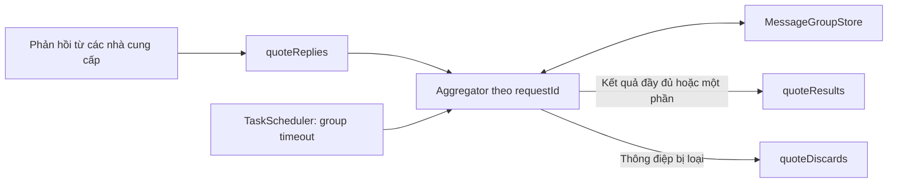
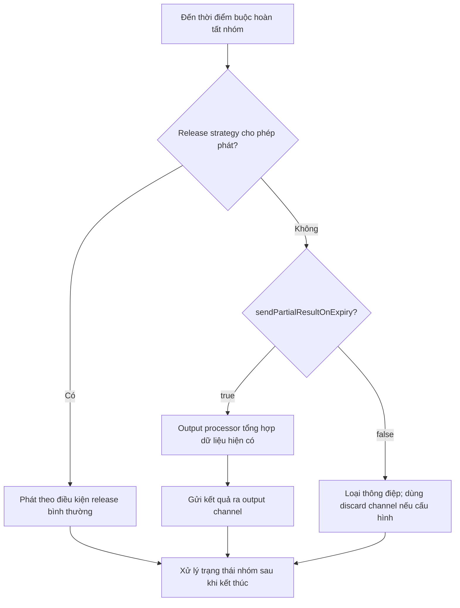

# Send partial result on expiry — Phát kết quả một phần khi Aggregator hết hạn

## 1. Mục tiêu và bài toán

Trong chương **Aggregator** của module **SPRING_INTEGRATION_CORE**, bài này tìm hiểu cách kết thúc một lượt gom thông điệp khi một số thành phần không đến đúng lúc. Trọng tâm là tùy chọn `sendPartialResultOnExpiry`, kết hợp với `Message`, `MessageChannel`, endpoint Aggregator và Java DSL. Bạn sẽ thiết kế kết quả có thông tin phần còn thiếu, xử lý thông điệp đến muộn và viết kiểm thử cho luồng tích hợp đó.

Giả sử một dịch vụ hỏi báo giá từ ba nhà cung cấp A, B và C. Mỗi phản hồi là một `Message<QuotePart>`. Aggregator cần gom các phản hồi cùng `requestId` thành một `QuoteSummary`:

- A, B, C đều phản hồi: trả kết quả đầy đủ ngay khi đủ dữ liệu.
- Chỉ A và B phản hồi, rồi nhóm hết hạn: trả kết quả một phần để khách hàng vẫn xem được hai báo giá.
- C phản hồi sau khi lượt gom đã kết thúc: xử lý theo chính sách thông điệp đến muộn.

Việc chấp nhận thiếu C là quyết định nghiệp vụ. Với giao diện so sánh giá, hai báo giá có thể vẫn hữu ích. Với quy trình yêu cầu đủ xác nhận từ ba bên mới được thực hiện giao dịch, phát kết quả một phần phải dẫn đến một trạng thái chờ hoặc từ chối phù hợp.

Sau bài học, bạn cần giải thích được ba câu hỏi riêng biệt: khi nào nhóm đủ dữ liệu, khi nào nhóm phải ngừng chờ, và kết quả thiếu dữ liệu được phép đi tiếp đến đâu.

## 2. Mô hình xử lý của Aggregator

Một luồng đơn giản có các vai trò sau:



Để hiểu cấu hình, hãy tách bốn trách nhiệm:

| Thành phần | Câu hỏi mà thành phần trả lời |
| --- | --- |
| Correlation strategy | Thông điệp thuộc lượt yêu cầu nào? |
| Release strategy | Nhóm hiện có đã đáp ứng điều kiện phát bình thường chưa? |
| Cơ chế timeout hoặc expiry | Khi nào ngừng chờ một nhóm chưa được phát? |
| Output processor | Từ các thông điệp thực sự có trong nhóm, tạo kết quả nào? |

Trong ví dụ báo giá, correlation key là `requestId`; release strategy kiểm tra sự hiện diện của các nhà cung cấp được kỳ vọng. Output processor tạo bản tổng hợp từ các báo giá đã nhận.

`sendPartialResultOnExpiry(true)` cho phép phát bản tổng hợp khi nhóm bị buộc kết thúc mà vẫn chưa đạt điều kiện release. Giá trị mặc định là `false`. Chỉ bật cờ này sẽ không tự làm nhóm hết hạn; phải có cơ chế kích hoạt expiry. Xem phần mô tả thuộc tính trong [Spring Integration: Aggregator](https://docs.spring.io/spring-integration/reference/6.3/aggregator.html).

## 3. Điều gì xảy ra khi timeout được kích hoạt?

Với một nhóm chưa hoàn tất và còn thông điệp, có thể hình dung nhánh xử lý như sau:



Release strategy được xét lại khi buộc hoàn tất. Vì thế, “timeout task đã chạy” không đồng nghĩa tuyệt đối với “kết quả thiếu dữ liệu”. Nếu strategy cho phép phát ở lần xét này, nhóm đi theo nhánh release bình thường. Cơ chế này được mô tả trong [Aggregator and Group Timeout](https://docs.spring.io/spring-integration/reference/aggregator.html#agg-and-group-to).

Có hai hệ quả quan trọng đối với code nghiệp vụ:

1. Output processor phải chấp nhận số lượng phản hồi nhỏ hơn kỳ vọng khi cho phép partial result. Hàm tổng hợp viết cứng `quotes.get(2)` sẽ hỏng nếu nhóm chỉ có hai phần tử.
2. Tình trạng thiếu dữ liệu phải được biểu diễn trong hợp đồng đầu ra. Một danh sách có hai phần tử chưa cho người nhận biết hệ thống chỉ kỳ vọng hai phần tử hay đã bỏ lỡ một phản hồi.

Partial result đi qua đường output của Aggregator. Đây không phải cơ chế tự tạo `ErrorMessage`, tự gửi lại phần còn thiếu hoặc tự gọi lại nhà cung cấp.

## 4. Chọn cơ chế hết hạn

### 4.1. `groupTimeout`: giới hạn thời gian im lặng của nhóm

Ví dụ:

```java
.aggregate(a -> a
    .groupTimeout(3_000L)
    .sendPartialResultOnExpiry(true))
```

Đoạn này chỉ minh họa hai tùy chọn; correlation, release và output processor sẽ được bổ sung trong cấu hình hoàn chỉnh.

Với giá trị timeout cố định, thời gian chờ được tính lại khi nhóm nhận thông điệp mới mà vẫn chưa đủ điều kiện release. Xét `groupTimeout = 3.000 ms`:

| Thời điểm | Sự kiện | Mốc timeout dự kiến sau sự kiện |
| --- | --- | --- |
| `t = 0 ms` | Nhận A | Khoảng `t = 3.000 ms` |
| `t = 800 ms` | Nhận B | Khoảng `t = 3.800 ms` |
| Sau đó | Không nhận C | Phát một phần vào khoảng mốc mới |

Mốc thực thi còn phụ thuộc scheduler và tranh chấp tài nguyên. Không nên suy ra từ cấu hình này rằng mọi yêu cầu đều kết thúc đúng ba giây sau khi bắt đầu.

### 4.2. Deadline tính từ lúc tạo nhóm

Nếu yêu cầu nghiệp vụ là “chờ tối đa ba giây kể từ phản hồi đầu tiên tạo nhóm”, có thể dùng một biểu thức trả về `java.util.Date`:

```java
.groupTimeoutExpression("new java.util.Date(timestamp + 3000)")
```

`timestamp` ở đây là thời điểm tạo `MessageGroup`, tính theo mili giây. Chọn cấu hình này **thay cho** `groupTimeout(3_000L)`. Khả năng trả về `Date` có từ Spring Integration 5.5; API timeout được mô tả trong [CorrelationHandlerSpec](https://docs.spring.io/spring-integration/api/org/springframework/integration/dsl/CorrelationHandlerSpec.html).

Đối với một yêu cầu gửi đi lúc 10:00:00 nhưng phản hồi đầu tiên đến lúc 10:00:02, tuổi nhóm bắt đầu ở 10:00:02. Nếu SLA tính từ thời điểm gửi yêu cầu, hãy mang deadline của yêu cầu vào luồng và thiết kế cơ chế chờ theo deadline đó. Tuổi nhóm chưa đại diện cho toàn bộ thời gian xử lý yêu cầu.

### 4.3. `MessageGroupStoreReaper`: quét store theo lịch

Một cách khác là dùng `MessageGroupStoreReaper` để gọi xử lý expiry cho các nhóm đủ điều kiện trong store. Reaper cần được gọi `run()` theo lịch; chỉ khai báo đối tượng không có nghĩa là đã có tác vụ quét định kỳ. API được mô tả tại [MessageGroupStoreReaper](https://docs.spring.io/spring-integration/api/org/springframework/integration/store/MessageGroupStoreReaper.html).

Ví dụ dưới đây là **phương án thay thế** cho timeout từng nhóm. Đặt các bean trong một lớp `@Configuration` có `@EnableScheduling`, đồng thời bỏ `groupTimeout(...)` khỏi Aggregator nếu muốn chỉ dùng chính sách quét:

```java
@Bean
MessageGroupStoreReaper quoteReaper(SimpleMessageStore quoteStore) {
    MessageGroupStoreReaper reaper = new MessageGroupStoreReaper(quoteStore);
    reaper.setTimeout(30_000L);
    return reaper;
}

@Bean
QuoteReaperJob quoteReaperJob(MessageGroupStoreReaper quoteReaper) {
    return new QuoteReaperJob(quoteReaper);
}

static class QuoteReaperJob {
    private final MessageGroupStoreReaper reaper;

    QuoteReaperJob(MessageGroupStoreReaper reaper) {
        this.reaper = reaper;
    }

    @Scheduled(fixedDelay = 1_000L)
    public void reap() {
        this.reaper.run();
    }
}
```

Các import bổ sung của đoạn này là `org.springframework.integration.store.MessageGroupStoreReaper`, `org.springframework.scheduling.annotation.EnableScheduling` và `org.springframework.scheduling.annotation.Scheduled`.

Với timeout 30 giây và chu kỳ quét một giây, thời điểm phát còn phụ thuộc lần quét tiếp theo và thời gian xử lý. Không giả định reaper tạo cùng một loại deadline như timeout riêng của mỗi nhóm. Khi dùng persistent store, cần hiểu tiêu chí tuổi nhóm của store và chính sách quét đang áp dụng.

Không dùng chung một instance `MessageGroupStore` cho nhiều Aggregator dựa vào expiry callback. Nếu dùng chung hạ tầng cơ sở dữ liệu, hãy phân vùng store phù hợp cho từng endpoint.

## 5. Thiết kế kết quả để người nhận hiểu dữ liệu còn thiếu

Trong ví dụ, ta định nghĩa hợp đồng đầu ra:

```text
QuoteSummary
  requestId
  quotes              // Các báo giá đã nhận
  expectedSuppliers   // Các nguồn cần có cho lượt yêu cầu
  missingSuppliers    // Các nguồn chưa có tại lúc tổng hợp
  partial             // Có thiếu nguồn theo hợp đồng hay không
```

Một kết quả một phần có thể được biểu diễn thành JSON:

```json
{
  "requestId": "REQ-42",
  "quotes": [
    {"requestId": "REQ-42", "supplier": "A", "amount": 120000},
    {"requestId": "REQ-42", "supplier": "B", "amount": 125000}
  ],
  "expectedSuppliers": ["A", "B", "C"],
  "missingSuppliers": ["C"],
  "partial": true
}
```

`partial`, `expectedSuppliers` và `missingSuppliers` là các trường do ứng dụng định nghĩa. Không coi chúng là header hoặc payload mà Spring Integration tự thêm.

Trong hợp đồng này, `partial` mô tả **độ đầy đủ của dữ liệu**, không ghi lại nguyên nhân gọi output processor. Nếu cần phân biệt “hết deadline”, “quét nhóm cũ”, “quản trị viên buộc kết thúc”, hãy thiết kế thêm thông tin nguyên nhân ở cơ chế điều phối hoặc theo dõi sự kiện tương ứng.

Danh sách nguồn kỳ vọng phải được xác định cho từng yêu cầu ngay khi fan-out. Nếu danh sách được lấy lại từ cấu hình toàn cục trong lúc tổng hợp, thay đổi cấu hình giữa chừng có thể làm sai cách xác định phần thiếu.

## 6. Cấu hình Java DSL hoàn chỉnh

Ví dụ sử dụng Java 17+ và các API có trong Spring Integration 6.3. Dùng dependency `org.springframework.integration:spring-integration-core` theo phiên bản được dependency management của dự án quản lý. Phần kiểm thử dùng JUnit Jupiter. Không cần broker để thực hành luồng này.

Đặt lớp sau trong package `example.integration`. Các lớp dữ liệu được khai báo dưới dạng nested record để giữ ví dụ tự chứa.

```java
package example.integration;

import java.math.BigDecimal;
import java.util.List;
import java.util.Set;
import java.util.TreeMap;
import java.util.TreeSet;
import java.util.stream.Collectors;

import org.springframework.context.annotation.Bean;
import org.springframework.context.annotation.Configuration;
import org.springframework.integration.channel.DirectChannel;
import org.springframework.integration.channel.QueueChannel;
import org.springframework.integration.config.EnableIntegration;
import org.springframework.integration.dsl.IntegrationFlow;
import org.springframework.integration.store.MessageGroup;
import org.springframework.integration.store.SimpleMessageStore;
import org.springframework.messaging.Message;

@Configuration
@EnableIntegration
public class QuoteAggregationConfig {

    public record QuotePart(
            String requestId,
            String supplier,
            BigDecimal amount) {
    }

    public record QuoteSummary(
            String requestId,
            List<QuotePart> quotes,
            Set<String> expectedSuppliers,
            Set<String> missingSuppliers,
            boolean partial) {
    }

    @Bean
    public DirectChannel quoteReplies() {
        return new DirectChannel();
    }

    @Bean
    public QueueChannel quoteResults() {
        return new QueueChannel();
    }

    @Bean
    public QueueChannel quoteDiscards() {
        return new QueueChannel();
    }

    @Bean
    public SimpleMessageStore quoteStore() {
        return new SimpleMessageStore();
    }

    @Bean
    public IntegrationFlow quoteAggregationFlow(SimpleMessageStore quoteStore) {
        return IntegrationFlow.from("quoteReplies")
                .aggregate(a -> a
                        .messageStore(quoteStore)
                        .correlationStrategy(message ->
                                ((QuotePart) message.getPayload()).requestId())
                        .releaseStrategy(QuoteAggregationConfig::hasAllSuppliers)
                        .outputProcessor(QuoteAggregationConfig::toSummary)
                        .groupTimeout(3_000L)
                        .sendPartialResultOnExpiry(true)
                        .expireGroupsUponTimeout(false)
                        .expireGroupsUponCompletion(false)
                        .discardChannel("quoteDiscards"))
                .channel("quoteResults")
                .get();
    }

    private static boolean hasAllSuppliers(MessageGroup group) {
        Set<String> received = group.getMessages().stream()
                .map(Message::getPayload)
                .map(QuotePart.class::cast)
                .map(QuotePart::supplier)
                .collect(Collectors.toSet());

        return received.containsAll(expectedSuppliers(group));
    }

    private static QuoteSummary toSummary(MessageGroup group) {
        Set<String> expected = expectedSuppliers(group);
        TreeMap<String, QuotePart> quotesBySupplier = new TreeMap<>();

        group.getMessages().stream()
                .map(Message::getPayload)
                .map(QuotePart.class::cast)
                .forEach(quote ->
                        quotesBySupplier.putIfAbsent(quote.supplier(), quote));

        Set<String> missing = new TreeSet<>(expected);
        missing.removeAll(quotesBySupplier.keySet());

        QuotePart first = quotesBySupplier.firstEntry().getValue();
        return new QuoteSummary(
                first.requestId(),
                List.copyOf(quotesBySupplier.values()),
                expected,
                Set.copyOf(missing),
                !missing.isEmpty());
    }

    private static Set<String> expectedSuppliers(MessageGroup group) {
        Object value = group.getOne().getHeaders().get("expectedSuppliers");
        if (!(value instanceof Set<?> expected)
                || expected.isEmpty()
                || expected.stream().anyMatch(item -> !(item instanceof String))) {
            throw new IllegalArgumentException(
                    "expectedSuppliers must be a non-empty Set<String>");
        }

        return expected.stream()
                .map(String.class::cast)
                .collect(Collectors.toUnmodifiableSet());
    }
}
```

Các giả định đầu vào của ví dụ:

- `requestId`, `supplier` và `amount` hợp lệ; supplier thuộc danh sách kỳ vọng.
- Mọi phản hồi cùng `requestId` mang cùng một `expectedSuppliers` bất biến.
- Mỗi lượt fan-out dùng một `requestId` riêng. Nếu thử lại cả lượt, dùng mã lượt mới hoặc thêm `attemptId` vào correlation key.
- Một nhà cung cấp có một báo giá có hiệu lực trong một lượt. Bản gửi trùng phải có cùng nội dung; nếu có nhiều phiên bản báo giá, cần quy tắc chọn phiên bản riêng.

Trong luồng thực tế, transformer có thể chuẩn hóa phản hồi từ HTTP hoặc broker về `QuotePart`. Filter hoặc bước validation trước Aggregator kiểm tra các giả định trên và chuyển dữ liệu sai sang luồng xử lý riêng.

### 6.1. Giải thích những lựa chọn trong cấu hình

`quoteReplies` là kênh đầu vào của endpoint Aggregator. `quoteResults` nhận một `QuoteSummary` cho lượt gom; nó nhận cả kết quả đầy đủ lẫn kết quả một phần. Dùng queue ở đầu ra giúp quan sát kết quả phát từ scheduler trong bài thực hành.

Release strategy kiểm tra **tập supplier**, thay vì chỉ kiểm tra `group.size() == 3`. Ba thông điệp A, A, B chưa đáp ứng hợp đồng A, B, C. Output processor cũng gom theo supplier và sắp báo giá theo tên supplier để kết quả dễ đọc. `putIfAbsent` chỉ thích hợp với giả định bản gửi trùng có cùng nội dung; thứ tự duyệt của store không phải cơ sở chọn báo giá mới nhất.

Ta chủ động đặt cả `expireGroupsUponTimeout(false)` và `expireGroupsUponCompletion(false)` để lưu dấu nhóm đã kết thúc. Hai cờ này điều khiển việc giữ hay xóa trạng thái nhóm, khác với cờ quyết định có phát partial result hay không. Chúng được mô tả trong [AbstractCorrelatingMessageHandler](https://docs.spring.io/spring-integration/api/org/springframework/integration/aggregator/AbstractCorrelatingMessageHandler.html) và [AggregatingMessageHandler](https://docs.spring.io/spring-integration/api/org/springframework/integration/aggregator/AggregatingMessageHandler.html).

Ví dụ dùng hạ tầng scheduling do `@EnableIntegration` thiết lập. `SimpleMessageStore` phù hợp cho bài thực hành trong một tiến trình; nó không làm dữ liệu nhóm tồn tại qua restart.

### 6.2. Gửi phản hồi vào luồng

Đoạn sau chạy trong một method của chương trình minh họa, với các import từ Java, Spring Context và Spring Messaging tương ứng:

```java
try (var context = new AnnotationConfigApplicationContext(
        QuoteAggregationConfig.class)) {

    DirectChannel input = context.getBean("quoteReplies", DirectChannel.class);
    QueueChannel results = context.getBean("quoteResults", QueueChannel.class);
    Set<String> expected = Set.of("A", "B", "C");

    input.send(MessageBuilder.withPayload(
                    new QuoteAggregationConfig.QuotePart(
                            "REQ-42", "A", new BigDecimal("120000")))
            .setHeader("expectedSuppliers", expected)
            .build());

    input.send(MessageBuilder.withPayload(
                    new QuoteAggregationConfig.QuotePart(
                            "REQ-42", "B", new BigDecimal("125000")))
            .setHeader("expectedSuppliers", expected)
            .build());

    Message<?> result = results.receive(6_000L);
    if (result == null) {
        throw new IllegalStateException("No aggregation result received");
    }

    System.out.println(result.getPayload());
}
```

Các import bổ sung là `org.springframework.context.annotation.AnnotationConfigApplicationContext` và `org.springframework.messaging.support.MessageBuilder`.

Vì C không được gửi, kết quả mong đợi có hai báo giá, `missingSuppliers = {C}` và `partial = true`. Khoảng chờ 6 giây của lệnh `receive` là giới hạn chờ của chương trình quan sát, khác với timeout 3 giây của Aggregator.

## 7. Thông điệp đến muộn và trạng thái nhóm

Sau khi đã phát kết quả A, B, giả sử C đến cùng `requestId = REQ-42`. Có hai chính sách cơ bản:

| Chính sách | Hệ quả cần thiết kế |
| --- | --- |
| Giữ dấu nhóm đã kết thúc | C được nhận diện là đến muộn và chuyển vào discard channel đã cấu hình |
| Xóa hoàn toàn nhóm | C có thể tạo một nhóm mới với cùng correlation key |

Trong cấu hình của bài, ta chọn giữ dấu nhóm. Việc giữ dấu không có nghĩa tiếp tục giữ toàn bộ báo giá A, B trong nhóm sau khi phát. Nó cho phép nhận diện rằng lượt gom đã kết thúc. Cách Aggregator đánh dấu hoàn tất và dọn thông điệp có thể xem trong [mã nguồn AggregatingMessageHandler](https://raw.githubusercontent.com/spring-projects/spring-integration/6.3.x/spring-integration-core/src/main/java/org/springframework/integration/aggregator/AggregatingMessageHandler.java).

Nếu chọn xóa nhóm ngay sau timeout, một mình C có thể bị gom thành một lượt mới và sau đó tạo thêm kết quả. Điều này thường không phù hợp với hợp đồng “một kết quả cuối cho một lượt yêu cầu”.

Cũng không nên mặc định giữ dấu nhóm mãi mãi. Giả sử mỗi phút có 10.000 requestId mới, số dấu nhóm sẽ tăng liên tục. Thiết kế retention cần trả lời:

- Thông điệp có thể đến muộn tối đa trong bao lâu?
- Sau thời hạn đó, có tầng nào khác ngăn requestId cũ mở lại một lượt gom?
- Có cần lưu phản hồi muộn để đối soát hoặc cải thiện thống kê nhà cung cấp không?

Reaper và chính sách dọn nhóm rỗng giúp quản lý vòng đời metadata. Ví dụ chính chưa cấu hình retention để giữ rõ hành vi của bài thực hành; cần bổ sung chính sách này trước khi vận hành lâu dài.

Partial result trong bài là **kết quả chốt cho lượt gom**. Nếu yêu cầu là phát A, B trước rồi cập nhật thêm C, cần một hợp đồng kết quả có phiên bản và cơ chế quản lý trạng thái cho các bản cập nhật. Bật cờ partial-on-expiry không tự cung cấp hành vi cập nhật đó.

## 8. Phân biệt output, discard và error

Ba đường xử lý cần được hiểu riêng:

| Tình huống | Đường xử lý trong ví dụ |
| --- | --- |
| Nhận đủ A, B, C | Một `QuoteSummary` đầy đủ tới `quoteResults` |
| Timeout khi chỉ có A, B và bật partial result | Một `QuoteSummary` thiếu C tới `quoteResults` |
| C đến sau khi nhóm đã kết thúc và dấu nhóm còn được giữ | Thông điệp C tới `quoteDiscards` |
| Output processor hoặc bước downstream ném exception | Xử lý lỗi theo thread và cơ chế error handling đang cấu hình |

Nếu đổi `sendPartialResultOnExpiry` sang `false`, nhóm chưa đạt điều kiện release khi hết hạn sẽ không tạo `QuoteSummary` một phần. Với cấu hình mặc định về discard trong Spring Integration 6.3, từng thông điệp của nhóm đi vào discard channel nếu đã cấu hình. Nhánh này có thể xem trong [mã nguồn AbstractCorrelatingMessageHandler](https://raw.githubusercontent.com/spring-projects/spring-integration/6.3.x/spring-integration-core/src/main/java/org/springframework/integration/aggregator/AbstractCorrelatingMessageHandler.java).

Trong vận hành, một partial result hợp lệ vẫn có thể được downstream chấp nhận thành công. Hãy dùng trường `partial` hoặc `missingSuppliers` để route kết quả đến bước phù hợp: hiển thị báo giá hiện có, yêu cầu người dùng xác nhận, hoặc chuyển sang quy trình chờ bổ sung.

### 8.1. Lỗi xảy ra ở thread nào?

Khi phản hồi cuối làm nhóm đủ dữ liệu qua `DirectChannel`, thao tác xử lý diễn ra trên thread gửi phản hồi đó. Khi timeout kích hoạt phát một phần, xử lý khởi đầu từ thread scheduler. `try/catch` quanh lần gửi A trước đó không bắt được exception phát sinh sau này trên scheduler.

Với scheduler tùy chỉnh, cần cấu hình `MessagePublishingErrorHandler` phù hợp nếu muốn chuyển exception của tác vụ vào error channel. Hạ tầng scheduling mặc định của Spring Integration có cơ chế error publishing riêng; chi tiết về lỗi đồng bộ và bất đồng bộ có trong [Spring Integration: Error Handling](https://docs.spring.io/spring-integration/reference/error-handling.html).

Ví dụ `QuoteSummary` gửi vào queue thành công chưa đảm bảo thao tác ghi dữ liệu hoặc gọi dịch vụ phía sau sẽ thành công. Hãy kiểm thử điểm phát sinh lỗi thực tế. Retry, transaction, persistent store và cơ chế chống ghi trùng cần được thiết kế theo ranh giới xử lý của ứng dụng; riêng cờ partial result không đảm bảo exactly-once.

### 8.2. Gateway cũng có thời gian chờ riêng

Nếu một gateway đứng trước toàn bộ quy trình hỏi giá và chờ kết quả tổng hợp, reply timeout của gateway phải phù hợp với thời gian fan-out, thời gian chờ nhóm và phần xử lý downstream.

Ví dụ gateway chỉ chờ một giây trong khi nhóm có thể chờ ba giây sau phản hồi cuối: phía gọi có thể hết thời gian chờ trước khi Aggregator phát partial result. Cần xác định cách xử lý kết quả được tạo sau khi phía gọi đã ngừng chờ, hoặc dùng giao diện bất đồng bộ tra cứu bằng `requestId`.

## 9. Kiểm thử hành vi phát kết quả

Đừng chỉ kiểm tra giá trị thuộc tính trên cấu hình. Bài thực hành cần quan sát thông điệp ra khỏi endpoint:

| Ca kiểm thử | Dữ liệu gửi | Điều cần xác nhận |
| --- | --- | --- |
| Đủ nguồn | A, B, C cùng requestId | `partial = false`, không thiếu supplier |
| Thiếu nguồn | A, B | Sau timeout có `partial = true`, thiếu C |
| Bản gửi trùng | A, A, B | Không bị xem là đã đủ A, B, C |
| Đến muộn | A, B, chờ kết quả, rồi C | C vào discard; không tạo kết quả mới trong chính sách giữ dấu |
| Hai nhóm độc lập | A của R1, B của R2 | Không trộn báo giá giữa hai requestId |
| Tắt partial result | A, B rồi hết hạn | Không có summary một phần; quan sát discard |
| Lỗi khi tổng hợp | Output processor ném exception | Quan sát lỗi ở đường đồng bộ hoặc scheduler tương ứng |

Sau đây là ba kiểm thử JUnit 5 dùng lớp cấu hình ở phần 6. Mỗi kiểm thử tạo context riêng để tách state của store và queue.

```java
package example.integration;

import java.math.BigDecimal;
import java.util.Set;

import org.junit.jupiter.api.Test;
import org.springframework.context.annotation.AnnotationConfigApplicationContext;
import org.springframework.integration.channel.DirectChannel;
import org.springframework.integration.channel.QueueChannel;
import org.springframework.messaging.Message;
import org.springframework.messaging.support.MessageBuilder;

import example.integration.QuoteAggregationConfig.QuotePart;
import example.integration.QuoteAggregationConfig.QuoteSummary;

import static org.junit.jupiter.api.Assertions.*;

class QuoteAggregationTest {

    @Test
    void emitsCompleteResultWhenAllSuppliersArrive() {
        try (var context = new AnnotationConfigApplicationContext(
                QuoteAggregationConfig.class)) {
            DirectChannel input = context.getBean(
                    "quoteReplies", DirectChannel.class);
            QueueChannel output = context.getBean(
                    "quoteResults", QueueChannel.class);

            send(input, "R-full", "A");
            send(input, "R-full", "B");
            assertNull(output.receive(0));

            send(input, "R-full", "C");
            QuoteSummary summary = receiveSummary(output);

            assertEquals("R-full", summary.requestId());
            assertFalse(summary.partial());
            assertTrue(summary.missingSuppliers().isEmpty());
            assertEquals(3, summary.quotes().size());
        }
    }

    @Test
    void emitsPartialResultOnExpiry() {
        try (var context = new AnnotationConfigApplicationContext(
                QuoteAggregationConfig.class)) {
            DirectChannel input = context.getBean(
                    "quoteReplies", DirectChannel.class);
            QueueChannel output = context.getBean(
                    "quoteResults", QueueChannel.class);

            send(input, "R-partial", "A");
            send(input, "R-partial", "B");

            QuoteSummary summary = receiveSummary(output);
            assertEquals("R-partial", summary.requestId());
            assertTrue(summary.partial());
            assertEquals(Set.of("C"), summary.missingSuppliers());
            assertEquals(2, summary.quotes().size());
        }
    }

    @Test
    void discardsLateReplyWhileCompletedGroupIsRetained() {
        try (var context = new AnnotationConfigApplicationContext(
                QuoteAggregationConfig.class)) {
            DirectChannel input = context.getBean(
                    "quoteReplies", DirectChannel.class);
            QueueChannel output = context.getBean(
                    "quoteResults", QueueChannel.class);
            QueueChannel discards = context.getBean(
                    "quoteDiscards", QueueChannel.class);

            send(input, "R-late", "A");
            send(input, "R-late", "B");
            assertTrue(receiveSummary(output).partial());

            send(input, "R-late", "C");
            Message<?> late = discards.receive(1_000L);
            assertNotNull(late);
            assertEquals("C", ((QuotePart) late.getPayload()).supplier());
            assertNull(output.receive(0));
        }
    }

    private static void send(
            DirectChannel input, String requestId, String supplier) {
        boolean sent = input.send(MessageBuilder.withPayload(
                        new QuotePart(requestId, supplier,
                                new BigDecimal("100000")))
                .setHeader("expectedSuppliers", Set.of("A", "B", "C"))
                .build());
        assertTrue(sent);
    }

    private static QuoteSummary receiveSummary(QueueChannel output) {
        Message<?> message = output.receive(6_000L);
        assertNotNull(message, "Expected an aggregation result");
        return assertInstanceOf(QuoteSummary.class, message.getPayload());
    }
}
```

`receive(timeout)` chờ có giới hạn và kết thúc ngay khi có thông điệp, nên không cần dùng `Thread.sleep` để đoán thời điểm timeout. Sáu giây là ngân sách chờ của kiểm thử cho cấu hình ba giây; trên môi trường tải cao cần chọn ngân sách phù hợp.

Ba kiểm thử này minh họa các nhánh chính. Chúng chưa chứng minh mọi race condition, chính sách retention hay hành vi khi restart. Để kiểm tra việc dời timeout khi nhận B, cần một ca riêng kiểm soát lịch gửi A, B và quan sát mốc phát, hoặc dùng scheduler có thể điều khiển trong kiểm thử.

Khi kiểm tra trường hợp tắt partial result, tạo cấu hình thử nghiệm riêng với `sendPartialResultOnExpiry(false)`, chờ đủ các thông điệp bị discard rồi xác nhận không có summary. Việc kiểm tra output rỗng ngay sau lần gửi A chưa chứng minh điều gì về nhánh expiry.

## 10. Những trường hợp biên cần quyết định

### 10.1. Không có nhà cung cấp nào phản hồi

Nếu không có thông điệp nào đến Aggregator, chưa có nhóm để timeout và chưa có dữ liệu để tạo `QuoteSummary`. Không thể chỉ bật partial result để tự nhận danh sách rỗng cho mọi yêu cầu không có phản hồi.

Một phương án là lưu trạng thái yêu cầu và deadline ở tầng điều phối fan-out, rồi tạo kết quả “không nhận được phản hồi” khi deadline qua. Nếu đưa thông điệp khởi tạo nhóm vào chính luồng gom, correlation, release strategy và output processor phải được thiết kế để phân biệt nó với phản hồi báo giá.

### 10.2. Trùng lặp và cập nhật báo giá

Việc đếm supplier phân biệt giúp tránh kết luận đầy đủ từ A, A, B. Tuy nhiên, nó chưa giải quyết trường hợp cùng supplier gửi hai mức giá khác nhau. Hãy chọn một quy tắc nghiệp vụ rõ ràng: bản đầu hợp lệ, bản có version cao nhất, hoặc chuyển xung đột sang luồng đối soát.

### 10.3. Thông điệp đến sát thời điểm timeout

C có thể đến khi tác vụ timeout đang cạnh tranh xử lý nhóm. Đừng viết hợp đồng dựa trên giả định mọi thông điệp có timestamp trước deadline đều chắc chắn được gom. Nếu điều kiện nghiệp vụ dựa trên event time của nguồn, cần kiểm tra event time và định nghĩa khoảng chấp nhận đến muộn rõ ràng.

### 10.4. Restart và nhiều instance

Đổi sang persistent store giúp giữ dữ liệu nhóm, nhưng không có nghĩa tác vụ timeout trong bộ nhớ của tiến trình cũ được tự lưu cùng dữ liệu. Kế hoạch khôi phục cần tính đến nhóm chưa hoàn tất, cơ chế quét nhóm cũ và xử lý bản gửi lại.

Với nhiều instance, thiết kế cách các thông điệp cùng correlation key đến đúng nơi xử lý, hoặc dùng store và cơ chế khóa phù hợp. Không suy ra rằng chỉ dùng chung cơ sở dữ liệu là đã giải quyết toàn bộ việc phối hợp giữa các instance.

## 11. Quan sát vận hành và chẩn đoán

Trong dịch vụ báo giá, nên theo dõi số kết quả đầy đủ, số kết quả một phần, thời gian từ lúc gửi yêu cầu đến lúc có kết quả, số nhóm đang mở và số phản hồi đến muộn. Khi cần log chi tiết, ghi `requestId`, số nguồn kỳ vọng, số nguồn nhận được và nguồn còn thiếu. Tránh dùng requestId làm nhãn metric vì số lượng giá trị sẽ tăng theo từng yêu cầu.

| Triệu chứng | Điểm cần kiểm tra trước |
| --- | --- |
| Nhóm chờ mãi | Có timeout hoặc tác vụ reaper thực sự chạy chưa; scheduler có bị chiếm dụng không |
| Có kết quả nhưng thiếu dữ liệu mà consumer không biết | Hợp đồng payload có khai báo phần thiếu hay không |
| Một requestId sinh thêm kết quả khi C đến muộn | Nhóm đã bị xóa chưa; correlation key có được tái sử dụng không |
| Bộ nhớ tăng theo số yêu cầu | Số nhóm đang mở, dấu nhóm đã hoàn tất và chính sách retention |
| `try/catch` tại chỗ gửi không thấy lỗi lúc expiry | Lỗi có phát sinh trên scheduler; error handler chuyển đi đâu |
| Người gọi timeout trước khi có summary | Ngân sách gateway, fan-out và timeout nhóm có nhất quán không |

Tỷ lệ partial result tăng có thể là tín hiệu một nhà cung cấp chậm, lỗi mạng hoặc scheduler bị quá tải. Chọn hành động dựa trên phần thiếu và thời gian xử lý đo được, thay vì chỉ tăng timeout cho mọi nhóm.

## 12. Tự thực hành

1. Chạy luồng với A, B, C rồi chỉ A, B; so sánh trường `missingSuppliers`.
2. Gửi A, A, B và giải thích vì sao release strategy chưa cho phát kết quả đầy đủ.
3. Đổi sang deadline tính từ lúc tạo nhóm; thiết kế một kiểm thử phân biệt với thời gian im lặng tính từ phản hồi cuối.
4. Route `QuoteSummary` có `partial = true` sang một channel riêng để hiển thị rõ phần thiếu cho người dùng.
5. Thử chính sách xóa nhóm sau timeout và quan sát điều gì xảy ra khi gửi C cùng requestId; sau đó chọn chính sách phù hợp với hợp đồng dịch vụ.

Khi hoàn thành, bạn cần diễn giải được toàn bộ hành trình: phản hồi trở thành `Message`, vào `MessageChannel`, được Aggregator gom theo requestId, được phát khi đủ nguồn hoặc khi hết hạn, rồi được downstream xử lý theo độ đầy đủ của kết quả.
