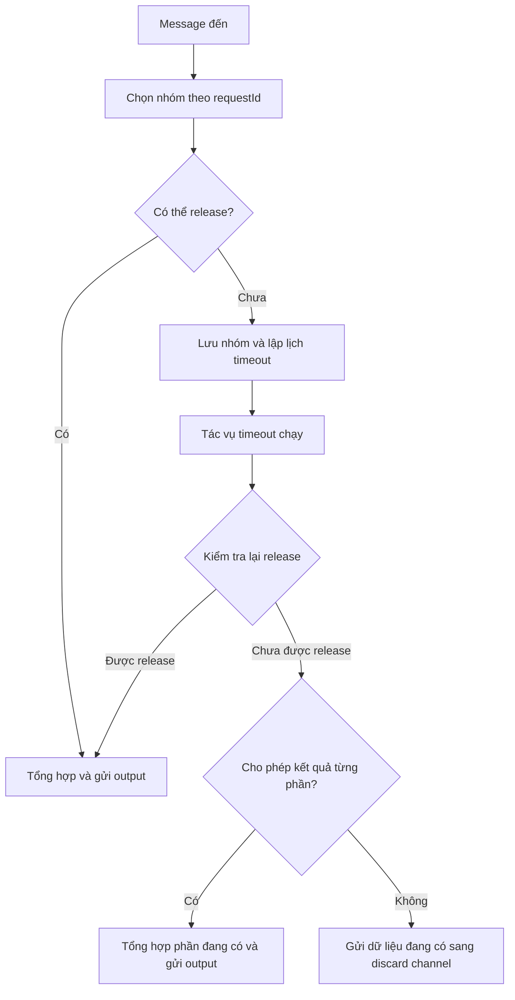

# Discard channel khi timeout

## Mục tiêu và bối cảnh

Trong chương **Aggregator** của module **SPRING_INTEGRATION_CORE**, bài này tập trung vào cách xử lý những thông điệp đã đến nhưng chưa tạo được một nhóm đủ điều kiện tổng hợp. Bạn sẽ nối `Message`, `MessageChannel`, aggregator endpoint và Java DSL thành hai nhánh có thể quan sát: kết quả hợp lệ và dữ liệu bị loại khỏi phép tổng hợp.

Sau bài học, bạn có thể:

- Cấu hình đường đi cho message của nhóm hết thời gian chờ.
- Phân biệt discard, xuất kết quả từng phần và lỗi xử lý.
- Chọn cách xử lý message đến muộn sau khi nhóm đã đóng.
- Kiểm thử riêng quyết định discard và hoạt động của bộ lập lịch.

Các ví dụ dùng API **Spring Integration 6.5**, Java 17 và JUnit Jupiter. Chỉ cần `spring-integration-core`, Spring Context tương thích và JUnit Jupiter cho phần kiểm thử; nếu dùng Spring Boot, để BOM của Boot quản lý các phiên bản tương thích. Tùy chọn `discardIndividuallyOnExpiry` trong bài có từ 6.5. Các lớp và phương thức DSL được đối chiếu với [API CorrelationHandlerSpec 6.5](https://docs.spring.io/spring-integration/docs/6.5.0/api/org/springframework/integration/dsl/CorrelationHandlerSpec.html).

## 1. Bài toán: nhận được hai trong ba báo giá

Một yêu cầu mua hàng `REQ-42` được gửi tới ba nhà cung cấp. Mỗi phản hồi mang một `requestId` để aggregator nhận diện nhóm. Nghiệp vụ của ví dụ yêu cầu đủ ba phản hồi trước khi chuyển sang bước so sánh giá.

Giả sử:

| Thời điểm minh họa | Message đến | Trạng thái mong muốn |
| --- | --- | --- |
| 0 ms | Báo giá của nhà cung cấp A | Tạo nhóm `REQ-42` |
| 400 ms | Báo giá của nhà cung cấp B | Tiếp tục chờ C |
| Khoảng 2.400 ms | Không có phản hồi mới trong 2 giây | Kết thúc lần chờ, chuyển A và B sang nhánh xử lý thiếu dữ liệu |
| 3.000 ms | Báo giá của nhà cung cấp C | Xử lý như message đến muộn nếu còn dấu vết nhóm đã đóng |

Nhánh discard giúp lưu lại A và B để tra cứu, đối soát hoặc quyết định mở một lần yêu cầu mới. Nó không tự tạo ra báo giá C, tự gọi lại nhà cung cấp hay quyết định thay nghiệp vụ.

Trong ví dụ, mỗi nhà cung cấp gửi tối đa một phản hồi trong một lần yêu cầu. Hệ thống thực tế cần kiểm tra dữ liệu đầu vào và xử lý trùng lặp trước khi dùng điều kiện đơn giản `group.size() == 3`. Ba message không nhất thiết là ba nhà cung cấp khác nhau.

## 2. Khi nào một nhóm đi vào discard channel?

Aggregator gom các message theo khóa tương quan. Khi một message được thêm vào nhóm, `ReleaseStrategy` quyết định nhóm đã sẵn sàng chưa. Khi tác vụ timeout thực sự chạy, chiến lược release được kiểm tra lại; vì vậy timeout không đồng nghĩa với discard trong mọi trường hợp.

| Kết quả kiểm tra khi tác vụ timeout chạy | `sendPartialResultOnExpiry` | Đường đi |
| --- | --- | --- |
| Được release | `true` hoặc `false` | Tổng hợp và gửi ra output |
| Chưa được release | `true` | Tổng hợp phần đang có và gửi ra output |
| Chưa được release | `false` | Chuyển các message đang có sang discard channel nếu đã cấu hình |

Nếu không cấu hình discard channel, nhánh cuối không có đích nhận để ứng dụng phục hồi dữ liệu. `sendPartialResultOnExpiry(false)` là chính sách xử lý expiry; nó không tự kích hoạt đồng hồ. Cần cơ chế như `groupTimeout` hoặc expiry qua store. Xem [Aggregator: Group Timeout](https://docs.spring.io/spring-integration/reference/aggregator.html#agg-and-group-to).



Sơ đồ lược bỏ cạnh tranh giữa message mới, khóa nhóm và tác vụ timeout để tập trung vào quyết định định tuyến.

## 3. Phân biệt các loại timeout

Với `groupTimeout(2_000L)`, một nhóm chưa release được lên lịch xử lý sau khoảng thời gian không nhận thêm message. Message mới được chấp nhận vào nhóm có thể làm lịch này được đặt lại. Đây không phải cam kết hoàn thành trong đúng hai giây kể từ phản hồi đầu tiên.

Ví dụ A đến ở 0 ms, B đến ở 1.500 ms: lần chờ có thể kéo dài đến khoảng 3.500 ms. Cần cộng thêm độ trễ thực thi của scheduler khi quan sát thời gian thực tế.

Ba mốc thời gian nên được thiết kế riêng:

| Mốc | Câu hỏi nghiệp vụ hoặc kỹ thuật |
| --- | --- |
| Thời gian chờ nhóm | Đã bao lâu nhóm không có phản hồi mới? |
| Deadline của yêu cầu | Yêu cầu mua hàng phải có kết luận trước thời điểm nào? |
| Thời gian gửi qua channel | Có thể chờ bao lâu để đưa message tới đích đang nghẽn? |

`sendTimeout` thuộc mốc gửi qua channel. Nó không thay thế `groupTimeout`. Với yêu cầu có deadline cố định, có thể dùng `groupTimeoutExpression` trả về `java.util.Date` dựa trên thời điểm tạo nhóm hoặc deadline nghiệp vụ đã được kiểm tra, thay vì hiểu timeout dạng số là deadline tuyệt đối. [API DSL về timeout](https://docs.spring.io/spring-integration/docs/6.5.0/api/org/springframework/integration/dsl/CorrelationHandlerSpec.html#groupTimeoutExpression(java.lang.String)).

Một giới hạn quan trọng của mô hình: nếu cả ba nhà cung cấp đều chưa gửi message nào, aggregator chưa có nhóm để chờ. Việc phát hiện yêu cầu không nhận được bất kỳ phản hồi nào cần trạng thái yêu cầu hoặc một cơ chế deadline ở phía điều phối.

## 4. Cấu hình Java DSL đầy đủ

Cấu hình sau có một input đồng bộ, một store giữ nhóm và hai queue để quan sát kết quả. Nhánh discard mặc định của ví dụ nhận từng message gốc.

```java
package example.integration;

import org.springframework.context.annotation.Bean;
import org.springframework.context.annotation.Configuration;
import org.springframework.integration.channel.DirectChannel;
import org.springframework.integration.channel.QueueChannel;
import org.springframework.integration.config.EnableIntegration;
import org.springframework.integration.dsl.IntegrationFlow;
import org.springframework.integration.store.MessageGroupStore;
import org.springframework.integration.store.SimpleMessageStore;
import org.springframework.messaging.Message;

@Configuration
@EnableIntegration
public class QuoteAggregationConfig {

    public record QuotePart(String supplier, int amount) {
    }

    @Bean
    public DirectChannel quoteParts() {
        return new DirectChannel();
    }

    @Bean
    public QueueChannel completedQuotes() {
        return new QueueChannel(100);
    }

    @Bean
    public QueueChannel discardedQuoteParts() {
        return new QueueChannel(100);
    }

    @Bean
    public MessageGroupStore quoteGroupStore() {
        return new SimpleMessageStore();
    }

    @Bean
    public IntegrationFlow collectQuotes(MessageGroupStore quoteGroupStore) {
        return IntegrationFlow.from(quoteParts())
                .aggregate(a -> a
                        .messageStore(quoteGroupStore)
                        .correlationExpression("headers['requestId']")
                        .releaseStrategy(group -> group.size() == 3)
                        .groupTimeout(2_000L)
                        .sendPartialResultOnExpiry(false)
                        .discardChannel(discardedQuoteParts())
                        .discardIndividuallyOnExpiry(true)
                        .expireGroupsUponTimeout(false)
                        .expireGroupsUponCompletion(false)
                        .outputProcessor(group -> group.getMessages().stream()
                                .map(Message::getPayload)
                                .toList()))
                .channel(completedQuotes())
                .get();
    }
}
```

`requestId` là header nghiệp vụ được chọn làm khóa nhóm; ví dụ không dựa vào `sequenceSize` hay `sequenceNumber`. Mọi input phải có `requestId` hợp lệ. `IntegrationFlow.from(...)` tạo chuỗi endpoint đăng ký trong Spring Context; cấu hình phải được nạp vào context để có consumer và scheduler hoạt động. [API IntegrationFlow](https://docs.spring.io/spring-integration/docs/6.5.0/api/org/springframework/integration/dsl/IntegrationFlow.html).

Một message đầu vào có thể được tạo như sau:

```java
Message<QuoteAggregationConfig.QuotePart> first =
        org.springframework.messaging.support.MessageBuilder
                .withPayload(new QuoteAggregationConfig.QuotePart("A", 120))
                .setHeader("requestId", "REQ-42")
                .build();
```

Gọi `quoteParts.send(first)` chỉ xác nhận việc gửi và xử lý tại input theo ngữ nghĩa channel. Nó không chứng minh ba báo giá đã đến. Phần kiểm thử bên dưới minh họa cách quan sát cả hai nhánh.

Các giả định cần giữ khi dùng cấu hình này:

- Ba phản hồi thuộc cùng một lần yêu cầu và không bị trùng về nhà cung cấp.
- `amount` chỉ là số liệu minh họa; quy tắc tiền tệ và tính hợp lệ của báo giá được kiểm tra ở biên hệ thống.
- `SimpleMessageStore` và hai `QueueChannel` phục vụ ví dụ trong bộ nhớ. Cần thiết kế nơi lưu bền vững nếu phải phục hồi sau khi tiến trình dừng.
- Ví dụ giữ dấu vết nhóm đã đóng để minh họa late message. Cần thêm chính sách dọn trạng thái khi vận hành lâu dài.

`outputProcessor` tạo một danh sách payload cho nhánh thành công. Không nên suy ra thứ tự A, B, C từ thứ tự phần tử của nhóm; bước so sánh giá nên nhận diện nhà cung cấp bằng trường `supplier`.

## 5. Discard channel nhận loại message nào?

### 5.1. Chế độ gửi từng message

Với `discardIndividuallyOnExpiry(true)`, nhóm đang có A và B tạo ra hai lần gửi sang discard channel. Consumer nhận từng message gốc, có payload `QuotePart` và các header gốc như `requestId`, `id`.

Điều này phù hợp khi cần lưu riêng từng phản hồi để tra cứu. Không nên ép payload thành `Throwable`, cũng không nên mặc định rằng framework bổ sung header `reason=TIMEOUT` cho mỗi message.

Nếu ứng dụng muốn chuẩn hóa dữ liệu bị loại, có thể tạo hồ sơ gồm:

| Trường do ứng dụng thiết kế | Mục đích |
| --- | --- |
| `requestId` và mã lần thử | Xác định đúng yêu cầu và vòng xử lý |
| `originalMessageId` | Đối chiếu message gốc |
| `supplier` | Biết phản hồi đến từ đâu |
| `observedAt` | Ghi thời điểm nhánh discard nhận dữ liệu |
| `reason` | Lý do đã được xác định từ ngữ cảnh xử lý |

Một nhãn trung tính như `DISCARDED_BY_QUOTE_AGGREGATOR` thích hợp nếu consumer chưa phân biệt được expiry và message đến muộn. Gán mọi message ở đây thành `TIMEOUT` sẽ làm dữ liệu giám sát thiếu chính xác.

### 5.2. Chế độ gửi cả nhóm

Từ Spring Integration 6.5, có thể thay đúng tùy chọn sau:

```java
.discardIndividuallyOnExpiry(false)
```

Khi nhóm bị discard do expiry, channel nhận một message có payload là danh sách các `Message<?>` trong nhóm. Đây là danh sách message, không phải danh sách `QuotePart`. Chế độ này chỉ có ý nghĩa khi `sendPartialResultOnExpiry(false)` và đã có discard channel. [API setDiscardIndividuallyOnExpiry](https://docs.spring.io/spring-integration/docs/6.5.0/api/org/springframework/integration/aggregator/AbstractCorrelatingMessageHandler.html#setDiscardIndividuallyOnExpiry(boolean)).

Ví dụ hình dạng dữ liệu:

```text
Chế độ từng message:
  Message(payload=QuotePart(A), headers.requestId=REQ-42)
  Message(payload=QuotePart(B), headers.requestId=REQ-42)

Chế độ cả nhóm:
  Message(payload=[
    Message(payload=QuotePart(A), headers.requestId=REQ-42),
    Message(payload=QuotePart(B), headers.requestId=REQ-42)
  ])
```

Consumer của chế độ cả nhóm phải đọc metadata nghiệp vụ từ các message bên trong hoặc từ một envelope do ứng dụng tạo. Không dựa vào việc outer message tự có `requestId`. Mã nguồn 6.5 tạo outer message mới cho danh sách và vẫn gửi riêng message đến muộn bị từ chối; vì vậy một discard channel dùng chung có thể nhận cả hai hình dạng. [Mã nguồn AbstractCorrelatingMessageHandler 6.5](https://github.com/spring-projects/spring-integration/blob/v6.5.0/spring-integration-core/src/main/java/org/springframework/integration/aggregator/AbstractCorrelatingMessageHandler.java).

Nếu muốn một hồ sơ thiếu phản hồi cho mỗi lần yêu cầu, chế độ cả nhóm giúp nhìn thấy ngay những phản hồi đang có. Tuy nhiên, danh sách A và B tự nó chưa cho biết C là thành viên còn thiếu. Thông tin tập nhà cung cấp được kỳ vọng phải đến từ trạng thái yêu cầu nghiệp vụ.

## 6. Vòng đời nhóm và message đến muộn

Discard quyết định dữ liệu đi đâu. Cấu hình expiry còn quyết định có xóa hoàn toàn dấu vết của nhóm hay giữ lại trạng thái đã đóng.

| Cấu hình sau timeout | Hệ quả đối với message mới cùng khóa |
| --- | --- |
| `expireGroupsUponTimeout(true)` | Nhóm bị xóa; message mới có thể khởi tạo một nhóm khác cùng khóa |
| `expireGroupsUponTimeout(false)` cùng chính sách giữ nhóm đã đóng | Nhóm được giữ ở trạng thái complete; message đến muộn bị từ chối và đi vào discard channel nếu có |

Giá trị mặc định của `expireGroupsUponTimeout` là `true`; ví dụ đã đặt `false` một cách tường minh. [API setExpireGroupsUponTimeout](https://docs.spring.io/spring-integration/docs/6.5.0/api/org/springframework/integration/aggregator/AbstractCorrelatingMessageHandler.html#setExpireGroupsUponTimeout(boolean)).

Ví dụ cũng đặt `expireGroupsUponCompletion(false)` để giữ dấu vết nhóm sau lần tổng hợp thành công. Trong aggregator, nhánh giữ nhóm đánh dấu complete và loại các message đã xử lý khỏi nhóm. Phần còn lại là metadata nhận diện một nhóm đã đóng. [Mã nguồn AggregatingMessageHandler 6.5](https://github.com/spring-projects/spring-integration/blob/v6.5.0/spring-integration-core/src/main/java/org/springframework/integration/aggregator/AggregatingMessageHandler.java).

Áp dụng cho `REQ-42`:

1. A và B đến nhưng thiếu C.
2. Timeout làm A và B được gửi sang discard channel.
3. Nhóm được giữ lại như một nhóm đã đóng.
4. C đến với cùng `requestId` và cũng bị đưa sang discard channel.

Sau khi metadata của nhóm bị dọn, cơ chế trên không còn đủ để nhận diện C là phản hồi cũ. Nếu phải chặn phản hồi cũ lâu hơn thời gian giữ metadata, cần kiểm tra trạng thái yêu cầu ở lớp nghiệp vụ.

Đối với lần thử mới, nên dùng khóa có cả mã lần thử, chẳng hạn `REQ-42:attempt-2`. Tái dùng `REQ-42` ngay khi nhóm cũ còn đóng khiến phản hồi mới bị hiểu là đến muộn.

### Dọn trạng thái có chủ đích

Giữ metadata vô hạn làm số lượng nhóm tăng dần. Hãy xác định thời gian tối đa còn chấp nhận phản hồi trễ, sau đó dọn những nhóm đã đóng vượt khoảng lưu giữ này.

`MessageGroupStoreReaper` cung cấp thao tác `run()` để kích hoạt expiry theo ngưỡng thời gian; scheduler phải gọi nó theo lịch thích hợp. Nó không chỉ là công cụ xóa metadata: các nhóm chưa hoàn tất đủ điều kiện expiry cũng có thể bị đưa qua callback xử lý. Không thêm reaper với ngưỡng ngắn rồi mặc định rằng nó sẽ giữ nguyên chính sách chờ hai giây của ví dụ. [API MessageGroupStoreReaper](https://docs.spring.io/spring-integration/docs/6.5.0/api/org/springframework/integration/store/MessageGroupStoreReaper.html).

Khi thiết kế cleanup, cần xét cả khoảng chạy reaper, ngưỡng expiry và thời gian giữ nhóm rỗng. Kiểm thử bằng tình huống cụ thể: C đến ngay trước khi dọn, ngay sau khi dọn và trong một lần thử mới.

## 7. Discard khác gì errorChannel và DLQ?

Nhóm thiếu phản hồi là một kết quả của chính sách chờ. Nó có thể xảy ra dù không có đoạn Java nào ném exception.

| Nhánh | Tình huống điển hình | Dữ liệu consumer cần hiểu |
| --- | --- | --- |
| Output | Đủ phản hồi hoặc chấp nhận kết quả từng phần | Kết quả tổng hợp |
| Discard | Các phản hồi bị loại theo chính sách nhóm | Message gốc hoặc envelope nhóm đã cấu hình |
| Error | Handler ném exception và cơ chế xử lý lỗi định tuyến lỗi | `ErrorMessage` với payload là exception |
| DLQ của ứng dụng hoặc broker | Dữ liệu không xử lý được theo chính sách lưu lỗi riêng | Hợp đồng do ứng dụng hoặc broker định nghĩa |

Spring Integration mô hình hóa lỗi bất đồng bộ bằng `ErrorMessage`. Với `DirectChannel`, exception thường lan về thread gửi. Khi tác vụ timeout chạy, công việc nằm trên thread scheduler; đừng chờ lời gọi gửi input trước đó bắt được lỗi phát sinh sau này. [Error Handling](https://docs.spring.io/spring-integration/reference/error-handling.html).

Ví dụ, consumer discard lưu A vào cơ sở dữ liệu rồi ném exception khi lưu B. Đây là lỗi xử lý của nhánh discard, khác với nguyên nhân ban đầu là thiếu C. Ứng dụng cần quyết định cách thử lại thao tác lưu và cách tránh ghi trùng A.

Tên channel `discardedQuoteParts` không tự tạo một DLQ bền vững. Nếu cần giữ dữ liệu qua lần khởi động lại, hãy nối consumer với kho lưu thích hợp và quy định ai được phép phát lại dữ liệu, phát lại vào đâu, dùng mã lần thử nào.

Tương tự, timeout chờ phản hồi ở một messaging gateway là một giới hạn của phía gọi. Nó cần được phối hợp với chính sách aggregator; hết thời gian của gateway không phải cơ chế tự động chuyển nhóm sang discard.

## 8. Đặc tính channel ảnh hưởng nhánh timeout

Hai queue trong ví dụ giúp đọc kết quả bằng `receive(timeout)` mà không cần gắn consumer phụ. `QueueChannel` có giới hạn dung lượng; khi đầy, việc gửi có thể phải chờ. `DirectChannel` gọi consumer ngay trên thread gửi, nên nếu dùng nó cho discard, thao tác chậm ở consumer có thể giữ thread scheduler. Các queue mặc định của ví dụ đều ở trong bộ nhớ. [Message Channel Implementations](https://docs.spring.io/spring-integration/reference/channel/implementations.html).

Vì vậy, thiết kế vận hành nên trả lời ba câu hỏi cụ thể:

- Khi discard tăng đột biến, ai lấy dữ liệu ra khỏi queue và với tốc độ nào?
- Khi nơi lưu bị chậm, có chấp nhận làm chậm tác vụ timeout của những nhóm khác không?
- Khi gửi discard thất bại, cách quan sát và xử lý trùng lặp là gì?

Không thể suy ra bảo đảm exactly-once chỉ từ việc có `MessageGroupStore` hoặc discard channel. Chẳng hạn, lưu được A rồi gặp lỗi với B có thể dẫn tới việc A được nhìn thấy lại trong một lần xử lý khác. Một consumer lưu dữ liệu nên có khóa chống trùng phù hợp với nghiệp vụ, thay vì coi mỗi lần nhận là một phản hồi mới.

Nếu đo lường, hãy tách **số nhóm hết thời gian chờ** và **số message bị discard**. Một nhóm thiếu C có thể tạo hai message bị discard; nếu C đến muộn, con số message còn tăng thêm. Hai chỉ số trả lời hai câu hỏi khác nhau.

## 9. Kiểm thử quyết định discard và tác vụ timeout

Bộ kiểm thử dưới đây dùng chính cấu hình ở mục 4. Mỗi test mở một Spring Context riêng để tránh chia sẻ queue, nhóm và lịch timeout.

Ba test đầu dùng luồng đồng bộ hoặc chủ động kích hoạt expiry. Test cuối kiểm tra đường lập lịch thực tế. Các đoạn mã là ví dụ học tập; cần chạy trong dự án có các dependency tương thích để xác nhận với môi trường cụ thể.

```java
package example.integration;

import java.util.List;
import java.util.Set;

import org.junit.jupiter.api.AfterEach;
import org.junit.jupiter.api.BeforeEach;
import org.junit.jupiter.api.Test;
import org.springframework.context.annotation.AnnotationConfigApplicationContext;
import org.springframework.integration.channel.DirectChannel;
import org.springframework.integration.channel.QueueChannel;
import org.springframework.integration.store.MessageGroupStore;
import org.springframework.messaging.Message;
import org.springframework.messaging.support.MessageBuilder;

import static org.junit.jupiter.api.Assertions.*;

class QuoteAggregationTest {

    private AnnotationConfigApplicationContext context;
    private DirectChannel input;
    private QueueChannel output;
    private QueueChannel discarded;
    private MessageGroupStore store;

    @BeforeEach
    void openContext() {
        context = new AnnotationConfigApplicationContext(
                QuoteAggregationConfig.class);
        input = context.getBean("quoteParts", DirectChannel.class);
        output = context.getBean("completedQuotes", QueueChannel.class);
        discarded = context.getBean("discardedQuoteParts", QueueChannel.class);
        store = context.getBean("quoteGroupStore", MessageGroupStore.class);
    }

    @AfterEach
    void closeContext() {
        context.close();
    }

    @Test
    void threePartsProduceOneAggregate() {
        input.send(quote("REQ-OK", "A", 120));
        input.send(quote("REQ-OK", "B", 115));
        input.send(quote("REQ-OK", "C", 125));

        Message<?> result = output.receive(0);
        assertNotNull(result);
        List<?> parts = assertInstanceOf(List.class, result.getPayload());
        assertEquals(3, parts.size());
        assertTrue(parts.stream().allMatch(
                QuoteAggregationConfig.QuotePart.class::isInstance));
        assertNull(output.receive(0));
        assertNull(discarded.receive(0));
    }

    @Test
    void forcedExpiryDiscardsOriginalMessagesAndClosesGroup() {
        Message<?> first = quote("REQ-EXPIRE", "A", 120);
        Message<?> second = quote("REQ-EXPIRE", "B", 115);
        input.send(first);
        input.send(second);

        // Kích hoạt callback expiry ngay; không đợi timer hai giây.
        store.expireMessageGroups(-1);

        Message<?> discardedFirst = discarded.receive(0);
        Message<?> discardedSecond = discarded.receive(0);
        assertNotNull(discardedFirst);
        assertNotNull(discardedSecond);
        assertEquals(
                Set.of(first.getHeaders().getId(), second.getHeaders().getId()),
                Set.of(discardedFirst.getHeaders().getId(),
                        discardedSecond.getHeaders().getId()));
        assertEquals("REQ-EXPIRE",
                discardedFirst.getHeaders().get("requestId"));
        assertEquals("REQ-EXPIRE",
                discardedSecond.getHeaders().get("requestId"));
        assertNull(discarded.receive(0));
        assertNull(output.receive(0));
        assertTrue(store.getMessageGroup("REQ-EXPIRE").isComplete());
        assertEquals(0, store.getMessageGroup("REQ-EXPIRE").size());
    }

    @Test
    void latePartIsDiscardedWhileClosedGroupIsRetained() {
        input.send(quote("REQ-LATE", "A", 120));
        input.send(quote("REQ-LATE", "B", 115));
        store.expireMessageGroups(-1);
        assertNotNull(discarded.receive(0));
        assertNotNull(discarded.receive(0));

        Message<?> late = quote("REQ-LATE", "C", 125);
        input.send(late);

        assertSame(late, discarded.receive(0));
        assertNull(discarded.receive(0));
        assertNull(output.receive(0));
    }

    @Test
    void scheduledTimeoutEventuallyDiscardsIncompleteGroup() {
        input.send(quote("REQ-TIMER", "A", 120));
        input.send(quote("REQ-TIMER", "B", 115));

        // Chờ có giới hạn cho tác vụ scheduler thực sự hoạt động.
        Message<?> first = discarded.receive(5_000);
        Message<?> second = discarded.receive(5_000);

        assertNotNull(first);
        assertNotNull(second);
        assertEquals("REQ-TIMER", first.getHeaders().get("requestId"));
        assertEquals("REQ-TIMER", second.getHeaders().get("requestId"));
        assertNull(discarded.receive(0));
        assertNull(output.receive(0));
    }

    private Message<QuoteAggregationConfig.QuotePart> quote(
            String requestId, String supplier, int amount) {
        return MessageBuilder.withPayload(
                        new QuoteAggregationConfig.QuotePart(supplier, amount))
                .setHeader("requestId", requestId)
                .build();
    }
}
```

`expireMessageGroups(-1)` yêu cầu store áp dụng expiry cho các nhóm đủ điều kiện mà không đợi ngưỡng tuổi dương. Lời gọi này đi qua callback do aggregator đăng ký; nó kiểm tra quyết định xử lý expiry, không chứng minh tác vụ `groupTimeout` đã chạy. Vì vậy cần test timer riêng. [API MessageGroupStore.expireMessageGroups](https://docs.spring.io/spring-integration/docs/6.5.0/api/org/springframework/integration/store/MessageGroupStore.html#expireMessageGroups(long)).

`receive(0)` phù hợp với phần kiểm thử đồng bộ sau khi thao tác đã hoàn thành. Test scheduler dùng `receive` có thời hạn thay cho `Thread.sleep` rồi khẳng định đúng tại mốc hai giây. Thời hạn năm giây là ngân sách chờ của test; môi trường CI chậm có thể cần điều chỉnh.

Khi mở rộng cấu hình, bổ sung những tình huống sau:

| Tình huống | Điều cần kiểm tra |
| --- | --- |
| `sendPartialResultOnExpiry(true)` và mới có hai phần | Output có một aggregate hai phần; discard trống |
| `discardIndividuallyOnExpiry(false)` | Một envelope chứa hai message gốc trong lần expiry |
| Xóa hoàn toàn nhóm sau timeout | Phản hồi mới cùng khóa có thể tạo nhóm mới |
| Hai `requestId` chạy xen kẽ | Chỉ những phần cùng khóa được tổng hợp với nhau |
| Input bị lặp nhà cung cấp | Chính sách chống trùng không cho đủ số lượng giả |
| Discard consumer lỗi sau khi xử lý một phần | Dữ liệu đã lưu không bị nhân đôi ngoài ý muốn |
| Không có phản hồi nào | Cơ chế deadline bên ngoài phát hiện yêu cầu bị bỏ quên |

Đây là các tình huống kiểm thử thiết kế; mỗi tình huống cần cấu hình và dữ liệu cô lập, tránh sửa một bean đang giữ nhóm của test khác.

## 10. Những hiểu nhầm thường gặp

| Hiểu nhầm | Cách hiểu cần dùng |
| --- | --- |
| Đặt `sendPartialResultOnExpiry(false)` là đã có timeout | Phải có cơ chế kích hoạt expiry hoặc group timeout |
| Hết timeout luôn đi discard | Release strategy được kiểm tra lại trước quyết định xử lý phần còn thiếu |
| Discard nhận exception | Thường nhận message nghiệp vụ gốc; chế độ cả nhóm nhận danh sách message |
| Một nhóm timeout tạo đúng một message discard | Phụ thuộc chế độ gửi; message đến muộn còn có thể xuất hiện thêm |
| Có `errorChannel` thì khỏi cần discard | Hai nhánh giải quyết những tình huống khác nhau |
| Xóa nhóm luôn giúp nhận diện message cũ | Xóa metadata cũng xóa dấu vết để aggregator nhận diện nhóm đã đóng |
| Gửi lại cùng `requestId` luôn là một lần thử mới | Có thể bị từ chối nếu nhóm cũ vẫn được giữ ở trạng thái complete |
| Queue trong ví dụ là nơi lưu lỗi bền vững | Queue mặc định chỉ giữ dữ liệu trong tiến trình |

## 11. Bài thực hành

Từ cấu hình ban đầu, thực hiện lần lượt:

1. Gửi A và B cho `REQ-LAB:attempt-1`, giữ thiếu C. Quan sát payload và header ở discard channel.
2. Gửi C sau khi đã nhận hai message bị discard. Giải thích vì sao không có aggregate thành công.
3. Tạo một context khác với `sendPartialResultOnExpiry(true)`. So sánh output và discard khi vẫn chỉ gửi A, B.
4. Tạo một context khác với `discardIndividuallyOnExpiry(false)`. Đọc `requestId` từ từng message bên trong envelope.
5. Mở `REQ-LAB:attempt-2`, gửi đủ A, B, C và chứng minh lần thử mới không trộn với dữ liệu cũ.
6. Thiết kế hồ sơ lưu phản hồi bị loại có khóa chống trùng. Xác định cách phân biệt một lần thử mới và việc xử lý lại cùng message.

Một lời giải tốt cần giải thích được cả đường đi của dữ liệu và trạng thái của nhóm sau mỗi bước. Khi đó, discard channel trở thành một phần rõ ràng của hợp đồng luồng tích hợp: những phản hồi không được dùng để tạo kết quả vẫn có nơi tiếp nhận, quan sát và xử lý tiếp theo chính sách nghiệp vụ.
