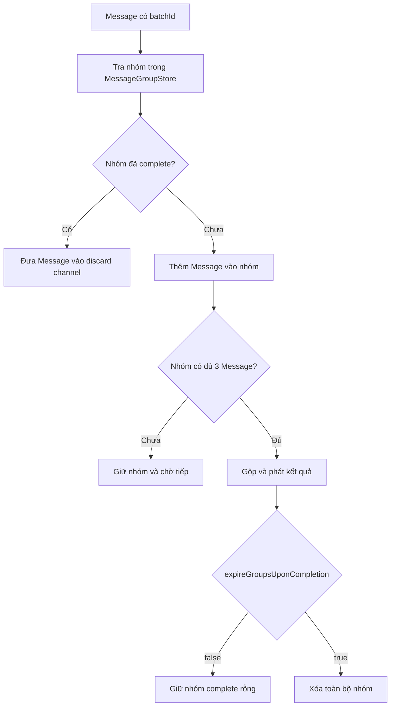

# Expire groups upon completion — Xóa nhóm khi Aggregator hoàn tất

Trong chương **Aggregator** của module **SPRING_INTEGRATION_CORE**, bài này tập trung vào quyết định quản lý trạng thái sau khi gộp thông điệp: giữ lại dấu vết của nhóm đã hoàn tất hay xóa toàn bộ nhóm để khóa tương quan có thể được dùng lại.

Sau bài học, bạn có thể cấu hình `expireGroupsUponCompletion` bằng Java DSL, dự đoán đường đi của thông điệp đến muộn, và kiểm tra đồng thời kết quả đầu ra với trạng thái trong `MessageGroupStore`. Những kỹ năng này giúp thiết kế luồng thông điệp qua `Message`, `MessageChannel` và endpoint Aggregator theo yêu cầu nghiệp vụ.

## 1. Câu hỏi thực sự của cấu hình này

Giả sử một luồng nhận ba phần của cùng một lô:

```text
batchId=batch-A: A1, A2, A3
             → Aggregator
             → một Message có payload chứa A1, A2, A3
```

Sau khi tạo kết quả, chuyện gì xảy ra nếu `A4` vẫn mang `batchId=batch-A`?

- Nếu đây là một phần đến muộn của lô đã đóng, ứng dụng muốn tách nó ra để kiểm tra.
- Nếu đây là phần mở đầu của một lượt gom mới, ứng dụng muốn tiếp nhận nó.

`expireGroupsUponCompletion` điều khiển phần trạng thái giúp phân biệt hai cách xử lý này. Giá trị mặc định là `false`.

| Giá trị | Trạng thái sau khi nhóm hoàn tất bình thường | Thông điệp tiếp theo có cùng correlation key |
| --- | --- | --- |
| `false` | Xóa thông điệp đã gộp, giữ nhóm rỗng được đánh dấu complete | Bị discard vì nhóm đã hoàn tất |
| `true` | Xóa cả nhóm và trạng thái hoàn tất khỏi store | Có thể bắt đầu một nhóm mới |

Ở đây, **expire** có nghĩa là loại bỏ toàn bộ bản ghi nhóm. Giữ nhóm rỗng vẫn giữ được thông tin “khóa này đã hoàn tất”. Quy tắc này được mô tả trong phần [Expiring Groups của tài liệu Aggregator](https://docs.spring.io/spring-integration/reference/aggregator.html).

## 2. Tách ba quyết định: gom nhóm, phát kết quả, dọn trạng thái

Để đọc cấu hình đúng, hãy xét ba câu hỏi theo thứ tự:

| Thành phần | Câu hỏi | Ví dụ trong bài |
| --- | --- | --- |
| `CorrelationStrategy` | Thông điệp thuộc nhóm nào? | Giá trị header `batchId` |
| `ReleaseStrategy` | Nhóm đã đủ điều kiện phát kết quả chưa? | Nhóm có ba thông điệp |
| `expireGroupsUponCompletion` | Sau lần hoàn tất đó, còn lưu dấu vết của nhóm không? | Giữ hoặc xóa nhóm rỗng |

Ví dụ, bật `expireGroupsUponCompletion(true)` không giúp nhóm hai phần tự đạt điều kiện ba phần. Cấu hình này chỉ có ý nghĩa ở bước dọn trạng thái sau release.

Trong `AggregatingMessageHandler`, nhánh dọn dẹp đánh dấu complete rồi chọn xóa toàn bộ nhóm hoặc chỉ xóa thông điệp trong nhóm. Có thể đối chiếu cách triển khai ở phương thức `afterRelease` trong [mã nguồn AggregatingMessageHandler](https://github.com/spring-projects/spring-integration/blob/main/spring-integration-core/src/main/java/org/springframework/integration/aggregator/AggregatingMessageHandler.java).

Sơ đồ sau mô tả đường đi bình thường của ví dụ, với output gửi thành công:



Trong sơ đồ này, nhánh nhóm complete bị loại trước khi xét release. Một `ReleaseStrategy` khác sẽ không tự mở lại nhóm complete còn được lưu. Đây là hành vi có thể đối chiếu ở `processMessageForGroup` trong [mã nguồn AbstractCorrelatingMessageHandler](https://github.com/spring-projects/spring-integration/blob/main/spring-integration-core/src/main/java/org/springframework/integration/aggregator/AbstractCorrelatingMessageHandler.java).

## 3. Dự đoán bằng một dòng thời gian

Giả sử tất cả thông điệp bên dưới có cùng `batchId=batch-A`, được gửi tuần tự và không có timeout hay cơ chế dọn nhóm nào khác:

| Thời điểm | Đầu vào | Khi cấu hình `false` | Khi cấu hình `true` |
| --- | --- | --- | --- |
| t1 | A1 | Nhóm đang mở, size 1 | Nhóm đang mở, size 1 |
| t2 | A2 | Nhóm đang mở, size 2 | Nhóm đang mở, size 2 |
| t3 | A3 | Phát lô thứ nhất, còn nhóm complete size 0 | Phát lô thứ nhất, nhóm bị xóa |
| t4 | A4 | A4 vào discard | Nhóm mới được tạo, size 1 |
| t5 | A5 | A5 vào discard | Nhóm mới có size 2 |
| t6 | A6 | A6 vào discard | Phát lô thứ hai, nhóm lại bị xóa |

Bảng này là suy luận trực tiếp cho kịch bản ba phần, không phải cơ chế chia cửa sổ theo thời gian. Với `true`, ranh giới lô ở đây được tạo bởi điều kiện ba thông điệp và thời điểm nhóm hoàn tất.

Nếu `A4` thực ra là một phần cũ đến trễ, nó sẽ bị tính vào lô mới. Nếu `A5`, `A6` là dữ liệu của một lượt xử lý khác nhưng vẫn dùng cùng khóa, kết quả có thể trộn các lượt với nhau.

Một cách thiết kế phù hợp hơn cho các lô nghiệp vụ độc lập là dùng khóa có danh tính lô, chẳng hạn:

```text
store-17 / import-2026-11-19-001
store-17 / import-2026-11-19-002
```

Quyết định giữ hay xóa trạng thái sau hoàn tất vẫn cần được đưa ra, nhưng khóa đã thể hiện đúng đơn vị công việc. Chỉ dùng `store-17` sẽ buộc ứng dụng suy ra ranh giới lô từ thứ tự đến.

## 4. Cấu hình Java DSL hoàn chỉnh

Ví dụ dưới đây dùng một `DirectChannel` làm đầu vào, hai `QueueChannel` để quan sát kết quả và thông điệp bị loại, cùng một `SimpleMessageStore` dành riêng cho Aggregator.

Mã dùng API `IntegrationFlow.from(...)`, phù hợp với dòng Spring Integration 6.x/7.x. Chọn phiên bản thư viện thông qua bộ quản lý dependency của dự án. Phần kiểm thử cần JUnit Jupiter; các lớp Spring được dùng bên dưới thuộc các dependency lõi của Spring Integration và Spring Context.

```java
package example.integration;

import org.springframework.beans.factory.annotation.Qualifier;
import org.springframework.beans.factory.annotation.Value;
import org.springframework.context.annotation.Bean;
import org.springframework.context.annotation.Configuration;
import org.springframework.integration.channel.DirectChannel;
import org.springframework.integration.channel.QueueChannel;
import org.springframework.integration.config.EnableIntegration;
import org.springframework.integration.dsl.IntegrationFlow;
import org.springframework.integration.store.SimpleMessageStore;

@Configuration(proxyBeanMethods = false)
@EnableIntegration
public class ExpireGroupsConfig {

    @Bean
    public DirectChannel partsInput() {
        return new DirectChannel();
    }

    @Bean
    public QueueChannel batchesOutput() {
        return new QueueChannel();
    }

    @Bean
    public QueueChannel lateParts() {
        return new QueueChannel();
    }

    @Bean
    public SimpleMessageStore batchStore() {
        return new SimpleMessageStore();
    }

    @Bean
    public IntegrationFlow batchesFlow(
            @Qualifier("partsInput") DirectChannel input,
            @Qualifier("batchesOutput") QueueChannel output,
            @Qualifier("lateParts") QueueChannel discard,
            SimpleMessageStore batchStore,
            @Value("${demo.expire-on-completion:true}")
            boolean expireOnCompletion) {

        return IntegrationFlow.from(input)
                .aggregate(a -> a
                        .messageStore(batchStore)
                        .correlationStrategy(message ->
                                message.getHeaders().get("batchId"))
                        .releaseStrategy(group -> group.size() == 3)
                        .expireGroupsUponCompletion(expireOnCompletion)
                        .discardChannel(discard))
                .channel(output)
                .get();
    }
}
```

Phương thức DSL `expireGroupsUponCompletion(boolean)` nằm trên [AggregatorSpec](https://docs.spring.io/spring-integration/api/org/springframework/integration/dsl/AggregatorSpec.html). Các phương thức `messageStore`, `correlationStrategy`, `releaseStrategy` và `discardChannel` được cung cấp qua [CorrelationHandlerSpec](https://docs.spring.io/spring-integration/api/org/springframework/integration/dsl/CorrelationHandlerSpec.html).

Các lựa chọn có chủ đích trong ví dụ:

- Header `batchId` phải có giá trị hợp lệ trước khi vào endpoint. Trong ứng dụng thực, nên kiểm tra đầu vào bằng filter hoặc nhánh xử lý dữ liệu không hợp lệ.
- Điều kiện `size() == 3` giúp tập trung quan sát vòng đời nhóm. Nó đếm thông điệp, chưa xác nhận đủ ba phần nghiệp vụ khác nhau.
- Không cấu hình timeout, reaper hoặc thời hạn cho nhóm rỗng; các kiểm thử bên dưới chỉ khảo sát hoàn tất bình thường.
- Thuộc tính `demo.expire-on-completion` mặc định `true` **do ví dụ đặt ra**. Mặc định của framework vẫn là `false`.

Khi không chỉ định output processor, ví dụ sử dụng cách gộp mặc định: tạo một kết quả chứa tập payload của nhóm. Có thể xem [DefaultAggregatingMessageGroupProcessor](https://github.com/spring-projects/spring-integration/blob/main/spring-integration-core/src/main/java/org/springframework/integration/aggregator/DefaultAggregatingMessageGroupProcessor.java). Bài kiểm tra coi payload là `Collection<?>`, không ràng buộc thứ tự phần tử.

`SimpleMessageStore` lưu dữ liệu trong bộ nhớ; constructor không tham số không đặt giới hạn dung lượng. Đây là lựa chọn thuận tiện để quan sát bài học, theo [API SimpleMessageStore](https://docs.spring.io/spring-integration/api/org/springframework/integration/store/SimpleMessageStore.html).

### Ánh xạ sang XML hoặc cấu hình handler trực tiếp

Nếu dự án dùng XML, thuộc tính tương ứng là `expire-groups-upon-completion`:

```xml
<int:aggregator
        input-channel="partsInput"
        output-channel="batchesOutput"
        discard-channel="lateParts"
        message-store="batchStore"
        correlation-strategy-expression="headers['batchId']"
        release-strategy-expression="size() == 3"
        expire-groups-upon-completion="true"/>
```

Đây là đoạn cấu hình thay thế cho endpoint Java DSL, giả sử các channel và store đã được khai báo và namespace `int` đã được cấu hình. Chỉ đăng ký một endpoint cho luồng minh họa này.

Với `AggregatingMessageHandler` được xây dựng trực tiếp, setter tương ứng là:

```java
handler.setExpireGroupsUponCompletion(true);
```

Tên setter và ý nghĩa tham số được mô tả trong [API AggregatingMessageHandler](https://docs.spring.io/spring-integration/api/org/springframework/integration/aggregator/AggregatingMessageHandler.html).

## 5. Kiểm thử cả đầu ra và trạng thái nhóm

Chỉ kiểm tra có kết quả đầu ra chưa đủ để xác minh lựa chọn này: cả `true` và `false` đều có thể phát cùng một lô đầu tiên. Khác biệt xuất hiện ở store và thông điệp gửi tiếp.

Lớp dưới đây đặt cùng package với `ExpireGroupsConfig`. Mỗi test tạo context riêng, nên số nhóm và số thông điệp trong store chỉ thuộc kịch bản đang xét.

```java
package example.integration;

import java.util.Collection;
import java.util.HashSet;
import java.util.Map;
import java.util.Set;

import org.junit.jupiter.api.Test;
import org.springframework.context.annotation.AnnotationConfigApplicationContext;
import org.springframework.core.env.MapPropertySource;
import org.springframework.integration.channel.DirectChannel;
import org.springframework.integration.channel.QueueChannel;
import org.springframework.integration.store.SimpleMessageStore;
import org.springframework.messaging.Message;
import org.springframework.messaging.support.MessageBuilder;

import static org.junit.jupiter.api.Assertions.*;

class ExpireGroupsCompletionTest {

    @Test
    void trueRemovesGroupAndAcceptsNextBatch() {
        try (var context = openContext(true)) {
            var input = context.getBean("partsInput", DirectChannel.class);
            var output = context.getBean("batchesOutput", QueueChannel.class);
            var discard = context.getBean("lateParts", QueueChannel.class);
            var store = context.getBean(SimpleMessageStore.class);

            send(input, "A1");
            send(input, "A2");
            assertNull(output.receive(0));
            assertEquals(1, store.getMessageGroupCount());
            assertEquals(2, store.getMessageCountForAllMessageGroups());

            send(input, "A3");
            assertBatch(output.receive(0), "A1", "A2", "A3");
            assertEquals(0, store.getMessageGroupCount());
            assertEquals(0, store.getMessageCountForAllMessageGroups());

            send(input, "A4");
            assertNull(output.receive(0));
            assertNull(discard.receive(0));
            assertEquals(1, store.getMessageGroupCount());
            assertEquals(1, store.getMessageCountForAllMessageGroups());

            send(input, "A5");
            send(input, "A6");
            assertBatch(output.receive(0), "A4", "A5", "A6");
            assertEquals(0, store.getMessageGroupCount());
            assertEquals(0, store.getMessageCountForAllMessageGroups());
            assertNull(output.receive(0));
            assertNull(discard.receive(0));
        }
    }

    @Test
    void falseKeepsCompletionStateAndDiscardsLateMessage() {
        try (var context = openContext(false)) {
            var input = context.getBean("partsInput", DirectChannel.class);
            var output = context.getBean("batchesOutput", QueueChannel.class);
            var discard = context.getBean("lateParts", QueueChannel.class);
            var store = context.getBean(SimpleMessageStore.class);

            send(input, "A1");
            send(input, "A2");
            send(input, "A3");
            assertBatch(output.receive(0), "A1", "A2", "A3");
            assertEquals(1, store.getMessageGroupCount());
            assertEquals(0, store.getMessageCountForAllMessageGroups());
            assertTrue(store.getMessageGroup("batch-A").isComplete());

            send(input, "A4");
            Message<?> late = discard.receive(0);
            assertNotNull(late);
            assertEquals("A4", late.getPayload());
            assertNull(output.receive(0));
            assertEquals(1, store.getMessageGroupCount());
            assertEquals(0, store.getMessageCountForAllMessageGroups());
        }
    }

    private static AnnotationConfigApplicationContext openContext(
            boolean expireOnCompletion) {
        var context = new AnnotationConfigApplicationContext();
        context.getEnvironment().getPropertySources().addFirst(
                new MapPropertySource("testProperties", Map.of(
                        "demo.expire-on-completion",
                        String.valueOf(expireOnCompletion))));
        context.register(ExpireGroupsConfig.class);
        context.refresh();
        return context;
    }

    private static void send(DirectChannel input, String payload) {
        assertTrue(input.send(MessageBuilder.withPayload(payload)
                .setHeader("batchId", "batch-A")
                .build()));
    }

    private static void assertBatch(Message<?> result, String... expected) {
        assertNotNull(result);
        Collection<?> values = assertInstanceOf(
                Collection.class, result.getPayload());
        assertEquals(expected.length, values.size());
        assertEquals(Set.of(expected), new HashSet<>(values));
    }
}
```

`getMessageGroupCount()` và `getMessageCountForAllMessageGroups()` đo hai đại lượng khác nhau, theo [API MessageGroupStore](https://docs.spring.io/spring-integration/api/org/springframework/integration/store/MessageGroupStore.html). Trong test `false`, một nhóm với không thông điệp là trạng thái mong đợi.

Dùng số nhóm để chứng minh nhóm đã bị xóa. Một đối tượng nhóm rỗng trả về từ thao tác đọc theo khóa không đủ để kết luận còn bản ghi lưu trữ; cần xét hành vi của implementation store. Các assertion ở đây dành cho `SimpleMessageStore` riêng của từng context.

`receive(0)` đọc ngay và không chờ. Cách kiểm tra này phù hợp với luồng đồng bộ dùng `DirectChannel` rồi đưa kết quả vào `QueueChannel`. Khi thêm executor, broker hoặc timeout, cần chờ có giới hạn và đồng bộ theo điều kiện thực tế.

Đây là mã kiểm thử minh họa để đưa vào dự án thực hành; bài viết không khẳng định các test đã được biên dịch hoặc chạy trong workspace hiện tại.

## 6. Hoàn tất bình thường và timeout là hai tình huống khác nhau

Có ba lựa chọn thường bị gộp làm một:

| Lựa chọn | Việc nó quyết định |
| --- | --- |
| `expireGroupsUponCompletion` | Dọn nhóm sau hoàn tất bình thường |
| `expireGroupsUponTimeout` | Chính sách xóa nhóm trong đường xử lý timeout |
| `sendPartialResultOnExpiry` | Khi buộc kết thúc nhóm chưa đủ điều kiện, phát phần hiện có hay discard |

Mặc định `expireGroupsUponTimeout` là `true`, còn `sendPartialResultOnExpiry` là `false`. Khi timeout xảy ra, framework hỏi lại release strategy trước khi chọn cách kết thúc nhóm; vì vậy không thể suy toàn bộ hành vi timeout chỉ từ cờ completion. Chi tiết tương tác nằm trong [Aggregator — Expiring Groups và Group Timeout](https://docs.spring.io/spring-integration/reference/aggregator.html).

Trong kịch bản ba phần của bài, nếu release strategy vẫn trả `false` và ứng dụng muốn loại nhóm thiếu phần khi timeout:

```java
// Các tùy chọn thêm vào cùng AggregatorSpec của ví dụ.
.groupTimeout(30_000L)
.expireGroupsUponTimeout(true)
.sendPartialResultOnExpiry(false)
```

Đoạn này quy định một chính sách riêng cho nhóm chờ quá lâu. Các phương thức tương ứng và đơn vị millisecond của `groupTimeout` có trong [API CorrelationHandlerSpec](https://docs.spring.io/spring-integration/api/org/springframework/integration/dsl/CorrelationHandlerSpec.html).

Ngược lại, bật mỗi `expireGroupsUponCompletion(true)` vẫn để một nhóm hai phần tiếp tục chờ nếu không có chính sách kết thúc nào khác. Từ góc độ thiết kế, cần xác định cả hai mốc: khi nào đủ dữ liệu và khi nào phải ngừng đợi dữ liệu.

## 7. Giữ dấu vết một thời gian rồi dọn

Xóa ngay thuận tiện cho việc tái sử dụng khóa. Giữ trạng thái vô hạn lại làm số khóa đã hoàn tất tích lũy theo thời gian. Có thể chọn giữ nhóm complete trong một khoảng thời gian để nhận diện thông điệp đến trễ rồi mới dọn.

Ví dụ thay lựa chọn completion trong DSL bằng:

```java
.expireGroupsUponCompletion(false)
.minimumTimeoutForEmptyGroups(300_000L)
```

`minimumTimeoutForEmptyGroups` tính bằng millisecond. Các phiên bản hiện đại hỗ trợ lên lịch dọn nhóm rỗng sau release; thuộc tính này cũng được dùng khi xử lý dọn nhóm rỗng bằng reaper. Cần đảm bảo scheduler/cơ chế dọn được cấu hình và hoạt động. Xem [setMinimumTimeoutForEmptyGroups và phần lên lịch trong AbstractCorrelatingMessageHandler](https://github.com/spring-projects/spring-integration/blob/main/spring-integration-core/src/main/java/org/springframework/integration/aggregator/AbstractCorrelatingMessageHandler.java).

Thời hạn này chỉ bảo vệ trong lúc dấu vết nhóm còn tồn tại. Ví dụ giả định nhóm thực sự được dọn ở t+5 phút:

```text
Nhóm hoàn tất              Thông điệp cũ           Nhóm đã bị dọn
      t0                     t+2 phút                  t+5 phút
      |-------------------------|--------------------------|
      còn dấu vết complete → discard
                                                        |
                                             thông điệp cũ đến sau
                                             có thể mở nhóm mới
```

Vì vậy, năm phút là một giả định về độ trễ và khả năng phát lại của nguồn gửi, chưa phải một bảo đảm chống xử lý trùng lâu dài.

Một phép ước lượng thiết kế: nếu mỗi giây hoàn tất 50 khóa mới và giữ dấu vết khoảng một giờ, số dấu vết ở trạng thái ổn định vào khoảng `50 × 3.600 = 180.000`. Đây chỉ là số lượng nhóm ước tính, chưa bao gồm nhóm đang gom, độ trễ dọn, chỉ mục hoặc chi phí bộ nhớ của implementation.

Nên theo dõi riêng số nhóm đang mở, số nhóm complete còn lưu và số thông điệp bị discard. Nếu số thông điệp bằng không nhưng số nhóm tăng đều, cần kiểm tra chính sách lưu trạng thái complete.

## 8. Chống trùng, lỗi xử lý và lưu trữ bền vững

### 8.1. Phát lại cả lô có thể tạo một kết quả nữa

Với cấu hình `true`, giả sử nguồn gửi lại ba sự kiện nghiệp vụ `A1`, `A2`, `A3` sau khi lô đầu đã hoàn tất. Vì trạng thái nhóm trước đã bị xóa, một lô mới có thể đủ ba phần và phát thêm kết quả.

Đây là hệ quả thiết kế của việc quên khóa đã hoàn tất. Nếu kết quả dùng để tạo hóa đơn hoặc ghi sổ, nên có khóa idempotency theo nghiệp vụ ở ranh giới ghi dữ liệu, chẳng hạn `(batchId, operationType)`. Việc kiểm tra khóa và ghi tác động cần một cơ chế nhất quán phù hợp với nơi lưu dữ liệu.

Với cấu hình `false`, dấu vết complete giúp chặn các thông điệp cùng khóa sau lần hoàn tất, trong thời gian dấu vết còn tồn tại. Nhưng trong lúc nhóm đang mở, điều kiện `size() == 3` vẫn có thể đếm ba sự kiện nghiệp vụ trùng nhau nếu chúng được gửi thành ba `Message` khác nhau. Bởi vậy ví dụ đếm số phần chỉ phục vụ quan sát vòng đời; yêu cầu đủ các phần khác nhau cần có `partId` và quy tắc kiểm tra riêng.

### 8.2. Discard và lỗi kỹ thuật cần được quan sát riêng

`lateParts` trong ví dụ dùng để quan sát các thông điệp bị loại do nhóm đã complete. Một exception từ processor hoặc downstream cần được xử lý theo cơ chế truyền lỗi của luồng, không nên mặc định tìm nó trong kênh này.

Cũng không nên diễn giải “completion” thành “mọi tác động downstream đã commit”. Đường release bình thường có bước dọn trạng thái trong `finally`; ngoại lệ, transaction và cơ chế retry cần được thiết kế cùng nhau. Có thể đối chiếu cấu trúc này trong [AbstractCorrelatingMessageHandler](https://github.com/spring-projects/spring-integration/blob/main/spring-integration-core/src/main/java/org/springframework/integration/aggregator/AbstractCorrelatingMessageHandler.java). Khi nghiệp vụ cần retry an toàn, phải kiểm tra cả trạng thái nhóm lẫn tác động đã xảy ra ở đích.

### 8.3. Đổi store không thay thế chính sách vòng đời

`SimpleMessageStore` không giữ dữ liệu qua việc khởi động lại tiến trình. Nếu muốn giữ nhóm đang gom hoặc trạng thái complete qua restart, cần xem xét store bền vững phù hợp. Spring Integration cung cấp các implementation như JDBC, Redis và MongoDB; xem [Message Store](https://docs.spring.io/spring-integration/reference/message-store.html).

Giả sử một persistent store đã lưu thành công dấu vết complete và chưa dọn nó: sau restart, chính dấu vết đó có thể tiếp tục giúp loại thông điệp cùng khóa. Nếu cấu hình đã xóa nhóm khi hoàn tất, chuyển sang persistent store không tự phục hồi lịch sử đã xóa.

Khi nhiều instance cùng xử lý, nên xác minh cách đồng bộ theo group ID và tính nhất quán giữa store, khóa, transaction và downstream. Cờ completion tự nó không giải quyết các yêu cầu phối hợp đó. Bắt đầu bằng store dành riêng cho endpoint giúp việc quan sát và dọn nhóm rõ ràng hơn.

## 9. Chọn chính sách từ yêu cầu nghiệp vụ

Các tình huống sau là gợi ý thiết kế dựa trên hành vi đã phân tích:

| Yêu cầu | Hướng lựa chọn | Điều cần kiểm tra |
| --- | --- | --- |
| Một khóa đại diện cho đúng một lô, thông điệp đến trễ cần bị loại | Giữ trạng thái complete bằng `false` | Thời gian lưu dấu vết và khả năng khôi phục sau restart |
| Chủ đích gom liên tiếp mỗi ba thông điệp cùng khóa | Có thể dùng `true` | Nguồn có thể gửi lại lô cũ hoặc làm trộn các lượt hay không |
| Lô nghiệp vụ có ID độc lập | Dùng ID lô trong correlation key | Có cần giữ dấu vết sau hoàn tất để chặn phát lại không |
| Giữ trạng thái quá lâu làm tăng số nhóm | Xác định thời hạn rồi dọn | Khoảng thời gian nguồn có thể phát lại dữ liệu cũ |
| Nhóm thiếu phần bị treo | Bổ sung chính sách timeout | Có phát kết quả thiếu phần và có chấp nhận phần đến sau không |

Trước khi áp dụng vào một luồng thực tế, hãy xác định rõ đơn vị của correlation key, điều kiện đủ phần, đường đi của thông điệp đến sau và thời điểm hệ thống được phép quên một khóa đã xử lý. Bộ kiểm tra nên bao gồm lô đầu tiên, một phần đến muộn, việc tái sử dụng khóa và phát lại toàn bộ lô. Các tình huống đó thể hiện trực tiếp ý nghĩa nghiệp vụ của `expireGroupsUponCompletion`.