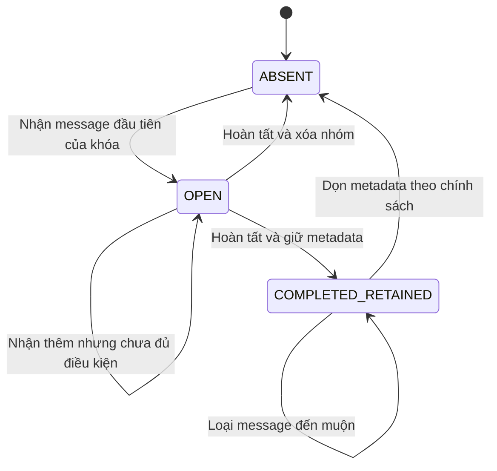

# Aggregator stateful

Trong chương **Aggregator** của module **SPRING_INTEGRATION_CORE**, bài này giải thích cách một luồng thông điệp ghi nhớ những message đã nhận, chờ điều kiện hoàn tất và giải phóng trạng thái. Trọng tâm là thiết kế trạng thái theo nhóm bằng `MessageGroupStore`, phối hợp `CorrelationStrategy`, `ReleaseStrategy`, bộ tạo kết quả và chính sách hết hạn.

Ví dụ xuyên suốt là dịch vụ xét duyệt yêu cầu đặt hàng. Mỗi lần xét duyệt cần kết quả từ ba nhánh: kiểm tra tồn kho, thanh toán và gian lận. Các nhánh có thể trả lời khác thứ tự, gửi lại kết quả hoặc không trả lời. Bài học kết nối `Message`, `MessageChannel`, endpoint và Java DSL với những tình huống đó; phần cuối đưa ra cách kiểm chứng luồng và xử lý lỗi.

Ví dụ Java dùng Java 17 trở lên và API Spring Integration 6.5.x. Dự án cần `spring-integration-core`; có thể dùng `spring-boot-starter-integration` trong ứng dụng Spring Boot. Phần JDBC cần thêm `spring-integration-jdbc`, driver và `DataSource`. Quản lý phiên bản các dependency bằng BOM tương thích của dự án.

## 1. Stateful có nghĩa là gì?

Một transformer chuyển đổi từng message có thể tính kết quả chỉ từ message hiện tại. Với yêu cầu xét duyệt, kết quả thanh toán riêng lẻ chưa đủ để quyết định: hệ thống cần biết kết quả tồn kho và gian lận của **cùng lần xét duyệt** đã đến hay chưa.

Aggregator vì thế duy trì trạng thái qua nhiều lần nhận message. Trạng thái gắn với **nhóm message**, không đồng nghĩa với việc phải đặt một danh sách dùng chung trong field của bean nghiệp vụ. Spring Integration tách việc quản lý nhóm khỏi các chiến lược xử lý; logic của các chiến lược vẫn có thể không giữ trạng thái riêng. [Spring Integration — Aggregator](https://docs.spring.io/spring-integration/reference/6.5/aggregator.html).

Có thể mô hình hóa một lần tiếp nhận như sau:

```text
khóa k = xác địnhNhóm(message)
nhóm mới = cậpNhật(nhóm đang lưu của k, message)

nếu đủ điều kiện:
    kết quả = tổngHợp(nhóm mới)
    chuyển kết quả tới đầu ra
    áp dụng chính sách hoàn tất nhóm
nếu chưa đủ:
    giữ nhóm để chờ message tiếp theo hoặc xử lý hết hạn
```

Đây là mô hình tư duy, không phải mã nguồn hay mô tả thứ tự transaction nội bộ của framework.

Nếu hai yêu cầu A và B đang chạy đồng thời, hệ thống có hai trạng thái độc lập. Không được để kết quả thanh toán của A bù cho kết quả còn thiếu của B. Cũng không được coi lần xét duyệt thứ hai của A là phần tiếp nối của lần đầu đã kết thúc.

## 2. Trạng thái nằm ở đâu?

Các thành phần phối hợp với nhau như sau:

| Thành phần | Trách nhiệm | Câu hỏi trong ví dụ |
| --- | --- | --- |
| `CorrelationStrategy` | Xác định khóa nhóm từ message | Kết quả thuộc lần xét duyệt nào? |
| `MessageGroup` | Biểu diễn nhóm và metadata | Nhóm đang có những kết quả nào? |
| `MessageGroupStore` | Lưu và truy xuất trạng thái nhóm | Giữ nhóm ở đâu trong thời gian chờ? |
| `ReleaseStrategy` | Quyết định nhóm đủ điều kiện xử lý | Đã có đủ ba loại kiểm tra chưa? |
| `MessageGroupProcessor` | Tạo kết quả từ nhóm được release | Chấp thuận hay từ chối yêu cầu? |
| `AggregatingMessageHandler` | Điều phối hoạt động của endpoint | Khi nào tiếp nhận, tổng hợp và kết thúc? |

`MessageGroup` cung cấp các thông tin như group ID, tập message, số lượng, thời điểm tạo/cập nhật và dấu hoàn tất. Những dữ liệu này có ý nghĩa khác nhau: nhóm không còn message vẫn có thể tồn tại để ghi nhận rằng lần xét duyệt đã kết thúc. [Javadoc — MessageGroup](https://docs.spring.io/spring-integration/docs/6.5.0/api/org/springframework/integration/store/MessageGroup.html).

`MessageGroupStore` là hợp đồng lưu trạng thái nhóm. Khi aggregator sử dụng store bền vững, hãy phân biệt bản ghi trong cơ sở dữ liệu với các đối tượng Java được nạp lên để xử lý. Không nên sửa một `MessageGroup` lấy từ store bằng công cụ quản trị tùy ý trong lúc endpoint đang hoạt động; thao tác ngoài cơ chế điều phối có thể phá vỡ những giả định về khóa và vòng đời.

## 3. Vòng đời của một nhóm

Sơ đồ sau biểu diễn ba trạng thái phục vụ thiết kế nghiệp vụ. `OPEN`, `COMPLETED_RETAINED` và `ABSENT` là nhãn minh họa của bài học, không phải một enum của Spring Integration.



Có hai quyết định riêng:

1. **Hoàn tất xử lý:** có tạo kết quả tổng hợp hoặc kết thúc nhóm do hết hạn hay chưa?
2. **Xóa dấu vết:** còn giữ metadata để nhận diện message thuộc nhóm đã kết thúc hay không?

Với hoàn tất thông thường, `expireGroupsUponCompletion(false)` giữ dấu hoàn tất; `true` xóa nhóm để cùng khóa có thể tạo nhóm mới. Giá trị mặc định là `false`. [Javadoc — AggregatingMessageHandler](https://docs.spring.io/spring-integration/docs/6.5.0/api/org/springframework/integration/aggregator/AggregatingMessageHandler.html).

Giả sử yêu cầu `REQ-101` đã đủ ba kết quả. Sau đó một bản phát lại của kết quả thanh toán tới:

| Trạng thái được giữ | Hành vi cần hiểu |
| --- | --- |
| Metadata nhóm hoàn tất còn tồn tại | Message cùng khóa bị coi là đến muộn và chuyển tới discard channel nếu có cấu hình |
| Nhóm đã bị xóa | Message có thể mở một nhóm mới cùng khóa và bắt đầu chờ lại |

Dấu hoàn tất được giữ lại thường được gọi là *tombstone*. Nó có ích trong một khoảng thời gian hữu hạn, nhưng không thay thế kho lịch sử nghiệp vụ hay cơ chế chống lặp lâu dài.

## 4. Chọn correlation key theo vòng đời nghiệp vụ

Trong ví dụ, `requestId` định danh **một lần xét duyệt**, chẳng hạn `tenant-7/order-105/attempt-2`. Mọi nhánh nhận cùng giá trị từ lúc bắt đầu xử lý. Khi chủ động xét duyệt lại đơn hàng, hệ thống tạo attempt mới.

Một khóa tốt cần có các đặc điểm sau:

- Có mặt và hợp lệ trước khi message đi vào aggregator.
- Giống nhau ở tất cả nhánh của cùng lần xử lý.
- Phân biệt tenant, loại quy trình hoặc lần thử khi các phạm vi đó cùng dùng một vùng lưu trữ.
- Ổn định trong suốt vòng đời nhóm; tránh đối tượng khóa có field thay đổi sau khi đã dùng làm khóa.

Theo cấu hình mặc định, correlation dựa vào header `correlationId`. Có thể thay bằng chiến lược nghiệp vụ. Khóa trả về phải khác `null` và có quy tắc `equals()`/`hashCode()` phù hợp. [Spring Integration — Correlation Strategy](https://docs.spring.io/spring-integration/reference/6.5/aggregator.html#aggregator-correlation-strategy).

Một lựa chọn thường gây lỗi là dùng `customerId`: hai đơn hàng của cùng khách hàng có thể bị trộn. Dùng `orderId` cũng chưa đủ nếu nhiều lần xét duyệt của cùng đơn có thể chạy chồng nhau.

Cần phân biệt các loại định danh:

| Định danh | Ví dụ | Mục đích |
| --- | --- | --- |
| `MessageHeaders.ID` | UUID của một message | Nhận diện đối tượng thông điệp |
| Correlation key | `tenant-7/order-105/attempt-2` | Xác định nhóm cần tổng hợp |
| Khóa kết quả nhánh | `(requestId, PAYMENT)` | Nhận diện kết quả nghiệp vụ bị gửi lặp |

Khi adapter tạo message mới cho cùng một sự kiện, UUID có thể khác. Do đó, phát hiện trùng theo message ID không đủ để kết luận rằng đã chống lặp theo nghiệp vụ.

## 5. Đủ message chưa chắc đã đủ thông tin

Giả sử điều kiện release chỉ là `group.size() == 3`. Luồng sau có ba message nhưng thiếu một loại kiểm tra:

| Thứ tự nhận | Loại kết quả | Các loại đã có |
| --- | --- | --- |
| 1 | `INVENTORY` | Tồn kho |
| 2 | `PAYMENT` | Tồn kho, thanh toán |
| 3 | `PAYMENT` gửi lại | Vẫn chỉ có tồn kho, thanh toán |
| 4 | `FRAUD` | Đủ ba loại |

Bài học sử dụng điều kiện:

```text
các loại kiểm tra hiện có bao phủ {INVENTORY, PAYMENT, FRAUD}
```

Bộ tổng hợp xử lý bản lặp có nội dung giống nhau theo hướng chỉ lấy một kết quả. Nếu hai kết quả cùng loại có nội dung mâu thuẫn, bộ tổng hợp báo lỗi để đưa vào quy trình xử lý xung đột.

Ba câu hỏi cần được trả lời độc lập:

- **Correlation:** message thuộc nhóm nào?
- **Release:** nhóm có đủ thông tin để đưa ra quyết định chưa?
- **Aggregation:** từ thông tin đó, quyết định là gì?

Một kết quả `accepted=false` vẫn là kết quả kiểm tra hợp lệ. Trong chính sách của ví dụ, hệ thống đợi đủ ba nhánh rồi đưa ra quyết định từ chối. Nếu nghiệp vụ muốn từ chối sớm, phải thiết kế lại điều kiện release và cách xử lý những nhánh còn đang chạy.

Nếu dùng splitter và release dựa trên sequence, cần giữ metadata sequence nhất quán qua các endpoint. Việc một filter loại message ở giữa luồng có thể làm aggregator chờ số phần tử không bao giờ đến. Một cách biểu diễn khác là gửi kết quả nhánh mang trạng thái bị từ chối hoặc không áp dụng, thay vì âm thầm làm mất phần tử mà nhóm vẫn đang đợi.

## 6. Ví dụ Java DSL hoàn chỉnh trong bộ nhớ

Cấu hình dưới đây định nghĩa đầu vào `DirectChannel`, hai `QueueChannel` cho kết quả và loại bỏ, cùng store riêng cho aggregator. `QueueChannel` giúp quan sát đầu ra trong ví dụ; ứng dụng thực tế cần consumer xử lý liên tục và chính sách dung lượng phù hợp.

```java
package example.integration;

import java.io.Serializable;
import java.util.EnumMap;
import java.util.EnumSet;
import java.util.List;
import java.util.Map;
import java.util.Objects;
import java.util.Set;

import org.springframework.beans.factory.annotation.Qualifier;
import org.springframework.context.annotation.Bean;
import org.springframework.context.annotation.Configuration;
import org.springframework.integration.channel.DirectChannel;
import org.springframework.integration.channel.QueueChannel;
import org.springframework.integration.config.EnableIntegration;
import org.springframework.integration.dsl.IntegrationFlow;
import org.springframework.integration.store.MessageGroup;
import org.springframework.integration.store.MessageGroupStore;
import org.springframework.integration.store.SimpleMessageStore;
import org.springframework.messaging.Message;
import org.springframework.messaging.MessageChannel;

@Configuration
@EnableIntegration
public class ApprovalAggregationConfiguration {

    public enum CheckType { INVENTORY, PAYMENT, FRAUD }

    public record CheckResult(
            String requestId,
            CheckType type,
            boolean accepted) implements Serializable {

        public CheckResult {
            Objects.requireNonNull(requestId, "requestId");
            Objects.requireNonNull(type, "type");
            if (requestId.isBlank()) {
                throw new IllegalArgumentException("requestId must not be blank");
            }
        }
    }

    public record Decision(
            String requestId,
            boolean accepted,
            List<CheckResult> checks) implements Serializable {
    }

    private static final Set<CheckType> REQUIRED =
            Set.of(CheckType.INVENTORY, CheckType.PAYMENT, CheckType.FRAUD);

    @Bean
    public MessageChannel approvalInput() {
        return new DirectChannel();
    }

    @Bean
    public QueueChannel approvalOutput() {
        return new QueueChannel();
    }

    @Bean
    public QueueChannel approvalDiscard() {
        return new QueueChannel();
    }

    @Bean
    public MessageGroupStore approvalStore() {
        return new SimpleMessageStore();
    }

    @Bean
    public IntegrationFlow approvalFlow(
            @Qualifier("approvalInput") MessageChannel input,
            @Qualifier("approvalOutput") QueueChannel output,
            @Qualifier("approvalDiscard") QueueChannel discard,
            @Qualifier("approvalStore") MessageGroupStore store) {

        return IntegrationFlow.from(input)
                .aggregate(a -> a
                        .messageStore(store)
                        .correlationStrategy(message ->
                                ((CheckResult) message.getPayload()).requestId())
                        .releaseStrategy(
                                ApprovalAggregationConfiguration::hasAllChecks)
                        .outputProcessor(
                                ApprovalAggregationConfiguration::makeDecision)
                        .groupTimeout(30_000L)
                        .sendPartialResultOnExpiry(false)
                        .expireGroupsUponCompletion(false)
                        .expireGroupsUponTimeout(false)
                        .minimumTimeoutForEmptyGroups(300_000L)
                        .discardChannel(discard))
                .channel(output)
                .get();
    }

    private static boolean hasAllChecks(MessageGroup group) {
        Set<CheckType> received = EnumSet.noneOf(CheckType.class);
        for (Message<?> message : group.getMessages()) {
            received.add(((CheckResult) message.getPayload()).type());
        }
        return received.containsAll(REQUIRED);
    }

    private static Decision makeDecision(MessageGroup group) {
        Map<CheckType, CheckResult> unique = new EnumMap<>(CheckType.class);

        for (Message<?> message : group.getMessages()) {
            CheckResult current = (CheckResult) message.getPayload();
            CheckResult previous = unique.putIfAbsent(current.type(), current);
            if (previous != null && !previous.equals(current)) {
                throw new IllegalStateException(
                        "Conflicting result: " + current.requestId()
                                + "/" + current.type());
            }
        }

        if (!unique.keySet().containsAll(REQUIRED)) {
            throw new IllegalStateException("Incomplete approval group");
        }

        List<CheckResult> checks = List.copyOf(unique.values());
        String requestId = checks.get(0).requestId();
        boolean accepted = checks.stream().allMatch(CheckResult::accepted);
        return new Decision(requestId, accepted, checks);
    }
}
```

`outputProcessor(...)` nhận một `MessageGroupProcessor`. Các thiết lập correlation, release, store và timeout là các tùy chọn riêng trong Java DSL. [Javadoc — AggregatorSpec](https://docs.spring.io/spring-integration/docs/6.5.0/api/org/springframework/integration/dsl/AggregatorSpec.html), [Javadoc — CorrelationHandlerSpec](https://docs.spring.io/spring-integration/docs/6.5.0/api/org/springframework/integration/dsl/CorrelationHandlerSpec.html).

Những điểm cần đọc kỹ trong ví dụ:

- `REQUIRED` là hằng bất biến. Mỗi lần đánh giá tạo một tập `received` cục bộ; không dùng field để cộng dồn kết quả giữa nhiều nhóm.
- `hasAllChecks()` không gọi dịch vụ ngoài, không sửa nhóm và không tạo tác dụng phụ.
- `makeDecision()` tạo một đối tượng kết quả mới. Thứ tự danh sách được xác định bởi `EnumMap`, không dựa vào thứ tự message tới.
- Bản lặp giống nhau vẫn có thể nằm trong store trong thời gian chờ. Việc thu gọn khi tạo kết quả chưa phải cơ chế bảo vệ dung lượng trước dòng message trùng liên tục.
- Xung đột chỉ được phát hiện ở bước tổng hợp. Nếu cần phát hiện ngay khi nhánh gửi kết quả thứ hai, hãy kiểm tra trước aggregator bằng cơ chế quản lý phiên bản hoặc idempotency phù hợp.
- Vì `sendPartialResultOnExpiry(false)`, nhóm thiếu dữ liệu không đi vào `makeDecision()` để được xử lý như một kết quả đầy đủ. Các message của nhóm hết hạn được chuyển sang nhánh discard.

Đầu vào của cấu hình có hợp đồng chỉ nhận `CheckResult` hợp lệ. Với nguồn bên ngoài, transformer hoặc endpoint kiểm tra dữ liệu phải đảm bảo hợp đồng này trước khi gửi vào `approvalInput`.

### Gateway cho việc tiếp nhận

Có thể cung cấp cổng gửi một chiều để các nhánh không phải tự tạo message:

```java
package example.integration;

import example.integration.ApprovalAggregationConfiguration.CheckResult;
import org.springframework.integration.annotation.MessagingGateway;

@MessagingGateway(defaultRequestChannel = "approvalInput")
public interface ApprovalResultsGateway {
    void submit(CheckResult result);
}
```

Ứng dụng cần đăng ký gateway bằng cơ chế quét phù hợp, chẳng hạn `@IntegrationComponentScan`. Đây là cổng tiếp nhận kết quả nhánh; quyết định cuối cùng đi tới `approvalOutput` khi nhóm đủ điều kiện.

Nếu thiết kế gateway request/reply cho toàn bộ yêu cầu xét duyệt, phải xác định quan hệ giữa request ban đầu và kết quả tổng hợp, thời hạn chờ và nơi trả kết quả khi caller đã hết hạn. Không gắn kỳ vọng mỗi `submit()` sẽ nhận ngay một `Decision`.

## 7. Timeout là chính sách kết thúc chờ

`groupTimeout(30_000L)` biểu diễn khoảng chờ không có message mới cho nhóm, không phải mặc nhiên là 30 giây tính từ lần nhận đầu. Với chuỗi message đến ở các giây 0, 20 và 40 mà chưa đủ điều kiện release, mốc hết hạn có thể tiếp tục được dời theo lần nhận gần nhất.

Muốn đặt mốc dựa trên thời điểm tạo nhóm, có thể thay `groupTimeout(...)` bằng:

```java
.groupTimeoutExpression("new java.util.Date(timestamp + 30_000L)")
```

Ở đây `timestamp` thuộc `MessageGroup`. Không cấu hình đồng thời cả hai cách. Scheduler thực thi tác vụ theo khả năng lập lịch nên mốc này không phải bảo đảm thời gian thực cứng. Nếu deadline thuộc nghiệp vụ và phải tồn tại qua restart, hãy lưu deadline đó trong dữ liệu bền vững và thiết kế cơ chế phục hồi. [Javadoc — CorrelationHandlerSpec.groupTimeoutExpression](https://docs.spring.io/spring-integration/docs/6.5.0/api/org/springframework/integration/dsl/CorrelationHandlerSpec.html#groupTimeoutExpression(java.lang.String)).

Khi tác vụ hết hạn chạy, release strategy được đánh giá lại. Nếu vẫn chưa đủ điều kiện, chính sách `sendPartialResultOnExpiry` quyết định cách kết thúc:

| Chính sách | Nhóm còn thiếu dữ liệu được xử lý ra sao? | Ý nghĩa với ví dụ |
| --- | --- | --- |
| `false` | Đưa message sang discard channel nếu được cấu hình | Không phát quyết định từ tập kiểm tra chưa đầy đủ |
| `true` | Tổng hợp phần dữ liệu hiện có thành kết quả đầu ra | Cần đổi processor và mô hình kết quả để biểu diễn thiếu dữ liệu |

Không nên bật `true` cho cấu hình ở trên mà giữ nguyên `makeDecision()`: processor đang chủ động từ chối nhóm thiếu kiểm tra. Nếu muốn xuất kết quả tạm thời, thiết kế kiểu kết quả có `complete=false`, các loại còn thiếu và lý do kết thúc. Downstream phải phân biệt kết quả đầy đủ với kết quả tạm thời.

`expireGroupsUponTimeout` giải quyết việc xóa hay giữ nhóm sau nhánh hết hạn, khác với lựa chọn có gửi phần kết quả hay không. Mặc định của tùy chọn này là `true`; ví dụ đặt `false` để nhận diện message đến muộn sau timeout. Khi release strategy cho phép release ngay trong lần đánh giá lúc timeout, cần xem cả chính sách hoàn tất thông thường để xác định việc xóa nhóm. [Javadoc — AbstractCorrelatingMessageHandler](https://docs.spring.io/spring-integration/api/org/springframework/integration/aggregator/AbstractCorrelatingMessageHandler.html#setExpireGroupsUponTimeout(boolean)).

Timeout không tự hủy công việc đang chạy ở hệ thống thanh toán hay chống gian lận. Kết quả của các hệ thống đó có thể tới sau khi nhóm đã đóng và cần được quan sát, đối soát hoặc bù trừ theo nghiệp vụ.

## 8. Dọn nhóm và phục hồi sau restart

### 8.1. Nhóm không có thêm message cũng phải có lối thoát

Không phải mọi nhóm đều đi tới release. Một nhánh có thể mất message hoặc producer dừng giữa chừng. Ngoài nhóm đang chờ, metadata nhóm hoàn tất cũng chiếm dung lượng.

`SimpleMessageStore` giữ dữ liệu trong bộ nhớ; constructor mặc định không đặt giới hạn dung lượng. Nó phù hợp để học và kiểm thử nhanh nhưng không duy trì nhóm sau khi JVM dừng. [Javadoc — SimpleMessageStore](https://docs.spring.io/spring-integration/docs/6.5.0/api/org/springframework/integration/store/SimpleMessageStore.html).

`MessageGroupStoreReaper` cung cấp phương thức `run()` để kích hoạt hết hạn các nhóm trong store theo timeout. Việc đặt bean reaper không thay thế cho lập lịch gọi phương thức đó. [Javadoc — MessageGroupStoreReaper](https://docs.spring.io/spring-integration/docs/6.5.0/api/org/springframework/integration/store/MessageGroupStoreReaper.html).

Có thể bổ sung cấu hình sau cùng với ví dụ chính:

```java
package example.integration;

import org.springframework.beans.factory.annotation.Qualifier;
import org.springframework.context.annotation.Bean;
import org.springframework.context.annotation.Configuration;
import org.springframework.integration.store.MessageGroupStore;
import org.springframework.integration.store.MessageGroupStoreReaper;
import org.springframework.scheduling.annotation.EnableScheduling;
import org.springframework.scheduling.annotation.Scheduled;

@Configuration
@EnableScheduling
public class ApprovalCleanupConfiguration {

    @Bean
    public MessageGroupStoreReaper approvalReaper(
            @Qualifier("approvalStore") MessageGroupStore store) {
        MessageGroupStoreReaper reaper = new MessageGroupStoreReaper(store);
        reaper.setTimeout(60_000L);
        return reaper;
    }

    @Bean
    public CleanupJob approvalCleanupJob(
            @Qualifier("approvalReaper") MessageGroupStoreReaper reaper) {
        return new CleanupJob(reaper);
    }

    public static class CleanupJob {
        private final MessageGroupStoreReaper reaper;

        public CleanupJob(MessageGroupStoreReaper reaper) {
            this.reaper = reaper;
        }

        @Scheduled(fixedDelay = 10_000L)
        public void reap() {
            reaper.run();
        }
    }
}
```

Các mốc trong bài có vai trò khác nhau:

| Thiết lập | Vai trò |
| --- | --- |
| `groupTimeout(30_000L)` | Kết thúc chờ khi nhóm không nhận thêm message trong khoảng đã định |
| `reaper.setTimeout(60_000L)` | Ngưỡng tuổi nhóm để store gọi callback hết hạn |
| `fixedDelay = 10_000L` | Khoảng nghỉ giữa các lượt quét của ví dụ |
| `minimumTimeoutForEmptyGroups(300_000L)` | Giữ nhóm rỗng đủ lâu trước khi dọn, phục vụ xử lý message đến muộn |

`expireMessageGroups(timeout)` chọn các nhóm dựa trên timestamp của nhóm; không được diễn giải ngưỡng reaper thành timeout bất hoạt giống `groupTimeout`. Việc hết hạn đi qua callback đã đăng ký, có thể tạo kết quả hoặc discard tùy cấu hình endpoint. [Javadoc — MessageGroupStore.expireMessageGroups](https://docs.spring.io/spring-integration/docs/6.5.0/api/org/springframework/integration/store/MessageGroupStore.html#expireMessageGroups(long)).

Mốc 5 phút của nhóm rỗng không bảo đảm bản ghi bị xóa chính xác ở giây thứ 300. Việc quét và lập lịch ảnh hưởng thời gian thực tế. Quan trọng hơn, sau khi dấu hoàn tất bị xóa, message cùng khóa có thể mở nhóm mới. Vì vậy, thời gian giữ metadata phải gắn với khoảng phát lại dự kiến của nguồn và chính sách idempotency của ứng dụng.

### 8.2. Store bền vững không tự khôi phục mọi thứ

Store bền vững có thể giữ nhóm đang chờ qua restart; các tác vụ scheduler trong bộ nhớ không trở thành bền vững chỉ vì thay store. Hệ thống cần quét lại nhóm còn tồn, phục hồi lịch hoặc áp dụng chính sách xử lý nhóm cũ.

Một lựa chọn của correlation endpoint là cấu hình `expireTimeout(...)` và `expireDuration(...)` để xử lý nhóm cũ lúc khởi động và định kỳ. Đây là cơ chế kết thúc nhóm theo ngưỡng đã chọn, không phải cam kết khôi phục chính xác từng thời điểm timer trước khi dừng. [Javadoc — AbstractCorrelatingMessageHandler, quản lý nhóm cũ](https://docs.spring.io/spring-integration/api/org/springframework/integration/aggregator/AbstractCorrelatingMessageHandler.html#setExpireTimeout(long)).

Trong hệ thống xét duyệt, cần quyết định rõ: sau restart, tiếp tục chờ tới deadline nghiệp vụ, đóng yêu cầu đã quá hạn hay yêu cầu các nhánh phát lại. Mỗi lựa chọn cần trạng thái và quy tắc riêng; không thể suy ra chỉ từ việc nhóm vẫn còn trong database.

## 9. Chuyển sang lưu trữ JDBC và chạy nhiều instance

### 9.1. Thay store

Để thử lưu bền vững, thay bean `approvalStore()` bằng bean sau, không khai báo đồng thời hai bean cùng tên:

```java
@Bean
public MessageGroupStore approvalStore(DataSource dataSource) {
    JdbcMessageStore store = new JdbcMessageStore(dataSource);
    store.setRegion("approval-aggregation");
    return store;
}
```

Các import bổ sung:

```java
import javax.sql.DataSource;
import org.springframework.integration.jdbc.store.JdbcMessageStore;
```

`JdbcMessageStore` hỗ trợ trạng thái cho aggregator. `JdbcChannelMessageStore` phục vụ lưu message của channel và không phải lựa chọn thay thế tương đương cho nhu cầu này. Cần tạo schema đúng database và phiên bản thư viện; `region` giúp phân vùng dữ liệu khi dùng chung bảng. [Spring Integration — JDBC Message Store](https://docs.spring.io/spring-integration/reference/jdbc/message-store.html).

Với serialization mặc định của `JdbcMessageStore`, payload cần có khả năng serialize; các header không serialize được có thể bị loại bỏ. Vì thế ví dụ dùng record `Serializable`, nhưng vẫn cần kiểm chứng toàn bộ dữ liệu thực tế. Một tham chiếu `replyChannel` tạm thời không thể được coi là đường trả lời sống mãi sau restart; có thể cần ánh xạ tên channel hoặc thiết kế trả kết quả bất đồng bộ. [Spring Integration — Message Store](https://docs.spring.io/spring-integration/reference/message-store.html).

Với store riêng cho mỗi endpoint, nhiều node của **cùng endpoint** có thể dùng cùng region. Hai aggregator khác nhau cần vùng lưu trữ và phạm vi callback hết hạn riêng. Chỉ làm correlation key khác nhau chưa đủ để bảo đảm một lượt quét toàn store không tác động nhầm nhóm của endpoint khác.

### 9.2. Phối hợp khóa giữa các node

Khi A và B cùng nhận message cho một nhóm, cần ngăn cả hai đồng thời kết luận rằng mình phải phát quyết định. Shared database cung cấp nơi lưu chung, nhưng chưa thay thế cơ chế điều phối thao tác nhóm ở cấp endpoint.

`JdbcLockRegistry` có thể được cấu hình cho aggregator dùng chung `MessageGroupStore` để phối hợp nhiều instance. Các node phải cùng sử dụng phạm vi khóa phù hợp với cùng khóa nhóm. [Spring Integration — JDBC Lock Registry](https://docs.spring.io/spring-integration/reference/jdbc/lock-registry.html).

Từ Spring Integration 6.5, `AbstractMessageGroupStore` còn có cơ chế khóa riêng cho thao tác metadata. Khóa store và khóa của correlation endpoint phục vụ các lớp điều phối khác nhau; cần kiểm tra cả hai theo implementation sử dụng. [Javadoc — AbstractMessageGroupStore](https://docs.spring.io/spring-integration/docs/6.5.0/api/org/springframework/integration/store/AbstractMessageGroupStore.html).

Một thiết kế triển khai cần trả lời được:

1. Hai node có trỏ vào cùng nhóm dữ liệu và cùng không gian khóa không?
2. Khóa có còn hiệu lực suốt thao tác cần bảo vệ không?
3. Một node chết khi đang giữ khóa được phục hồi như thế nào?
4. Khi nhiều scheduler cùng quét, các thao tác hết hạn có được phối hợp không?

Khóa giúp tránh cập nhật cạnh tranh. Nó không đồng nghĩa với kết quả chỉ được gửi tới hệ thống ngoài đúng một lần.

## 10. Lỗi, transaction và tác dụng phụ

### 10.1. Discard và error là hai nhánh có ý nghĩa khác nhau

Discard channel xử lý các message không được tiếp tục theo chính sách nhóm, chẳng hạn message đến muộn hoặc nhóm chưa đủ dữ liệu đã hết hạn. `errorChannel` phục vụ xử lý ngoại lệ của luồng theo cơ chế chạy tương ứng.

Ở ví dụ chính, đầu vào là `DirectChannel`. Nếu `makeDecision()` ném ngoại lệ vì kết quả mâu thuẫn, ngoại lệ lan về luồng gửi. Không nên giả định mọi lỗi đó tự trở thành message trên `errorChannel`. Với tác vụ bất đồng bộ hoặc scheduler, cần cấu hình error handler để đưa lỗi tới nơi giám sát và xử lý. [Spring Integration — Error Handling](https://docs.spring.io/spring-integration/reference/error-handling.html).

Một bản ghi discard nên giữ correlation key, loại nhánh, thời điểm nhận và đủ thông tin để tra nguyên nhân. Nếu muốn gắn nhãn rõ “đến muộn” hay “hết hạn”, cần bổ sung logic phân loại; không tự giả định mọi message ở cùng discard channel đã có sẵn lý do nghiệp vụ đó.

### 10.2. Kho trạng thái và tác dụng phụ có thể thất bại ở các thời điểm khác nhau

Xét hai tình huống thiết kế:

| Sự cố | Nguy cơ cần xử lý |
| --- | --- |
| Hệ thống ngoài đã nhận quyết định, ứng dụng dừng trước khi ghi nhận đủ trạng thái cục bộ | Phát lại có thể tạo quyết định hoặc tác dụng phụ trùng |
| Trạng thái cục bộ đã coi yêu cầu kết thúc nhưng việc chuyển kết quả không hoàn tất | Downstream có thể thiếu quyết định nếu không có cơ chế phục hồi |

Đây là các ranh giới cần phân tích, không phải khẳng định mọi cấu hình aggregator đều thực hiện theo một thứ tự cố định. Kết quả thực tế phụ thuộc loại channel, transaction manager, store, broker và phạm vi transaction.

Có thể tổ chức xử lý theo các nguyên tắc sau:

- Bộ tổng hợp tạo dữ liệu quyết định thuần túy; bước downstream chịu trách nhiệm thực hiện tác dụng phụ.
- Consumer nhận quyết định dùng khóa idempotency theo `requestId` và loại hành động.
- Khi cần gắn kết việc lưu quyết định với gửi ra ngoài, cân nhắc outbox và cơ chế phát lại có kiểm soát.
- Retry có giới hạn; xung đột dữ liệu không được xử lý bằng cách lặp vô hạn cùng một thao tác.

Không dùng một field `Map<requestId, result>` tự quản trong singleton để vá tính nhất quán của store. Nó tạo thêm nguồn trạng thái có vòng đời, khóa và cơ chế phục hồi riêng.

### 10.3. Thời gian giữ khóa ảnh hưởng throughput

Một nhóm có nhiều message có thể trở thành điểm tranh chấp. Nếu processor quét toàn bộ nhóm ở mỗi lần nhận và gọi thêm HTTP trong lúc xử lý, thời gian giữ khóa và độ trễ tăng nhanh.

Với chuỗi gồm nhiều aggregator chạy đồng bộ, cần xem xét thứ tự lấy khóa và nguy cơ giữ khóa qua downstream. Các phương án gồm tách luồng bằng channel bất đồng bộ, phân tách phạm vi khóa hoặc đánh giá tùy chọn `releaseLockBeforeSend(true)` theo yêu cầu nhất quán. Tùy chọn này không bảo đảm chống phát trùng tác dụng phụ. [Javadoc — CorrelationHandlerSpec.releaseLockBeforeSend](https://docs.spring.io/spring-integration/docs/6.5.0/api/org/springframework/integration/dsl/CorrelationHandlerSpec.html#releaseLockBeforeSend(boolean)).

## 11. Kiểm chứng hành vi stateful

Không chỉ kiểm tra phép tính tổng hợp. Cần chứng minh nhóm được tách đúng, chưa release khi thiếu dữ liệu và xử lý được message lặp/đến muộn.

Ví dụ JUnit 5 dưới đây cần `spring-test`, JUnit Jupiter và AssertJ, có thể lấy qua `spring-boot-starter-test`. Test chỉ nạp cấu hình chính, không nạp cấu hình quét dọn. Các khoảng chờ ngắn ở đầu ra cho phép test nhận kết quả; các kiểm tra ngay sau khi gửi dựa trên đầu vào đồng bộ `DirectChannel`.

```java
package example.integration;

import example.integration.ApprovalAggregationConfiguration.CheckResult;
import example.integration.ApprovalAggregationConfiguration.CheckType;
import example.integration.ApprovalAggregationConfiguration.Decision;
import org.junit.jupiter.api.Test;
import org.springframework.beans.factory.annotation.Autowired;
import org.springframework.beans.factory.annotation.Qualifier;
import org.springframework.integration.channel.QueueChannel;
import org.springframework.messaging.Message;
import org.springframework.messaging.MessageChannel;
import org.springframework.messaging.support.MessageBuilder;
import org.springframework.test.context.junit.jupiter.SpringJUnitConfig;

import static org.assertj.core.api.Assertions.assertThat;

@SpringJUnitConfig(ApprovalAggregationConfiguration.class)
class ApprovalAggregationTest {

    @Autowired
    @Qualifier("approvalInput")
    MessageChannel input;

    @Autowired
    @Qualifier("approvalOutput")
    QueueChannel output;

    @Autowired
    @Qualifier("approvalDiscard")
    QueueChannel discard;

    @Test
    void keepsRequestsSeparateAndAllowsOutOfOrderResults() {
        send("isolation-A", CheckType.PAYMENT);
        send("isolation-B", CheckType.FRAUD);
        send("isolation-A", CheckType.INVENTORY);
        assertThat(output.receive(0)).isNull();

        send("isolation-A", CheckType.FRAUD);
        Decision a = receiveDecision();
        assertThat(a.requestId()).isEqualTo("isolation-A");
        assertThat(a.accepted()).isTrue();
        assertThat(a.checks()).hasSize(3);
        assertThat(output.receive(0)).isNull();

        send("isolation-B", CheckType.PAYMENT);
        send("isolation-B", CheckType.INVENTORY);
        assertThat(receiveDecision().requestId()).isEqualTo("isolation-B");
    }

    @Test
    void doesNotReplaceMissingCheckWithDuplicateAndDiscardsLateResult() {
        send("duplicate-C", CheckType.INVENTORY);
        send("duplicate-C", CheckType.PAYMENT);
        send("duplicate-C", CheckType.PAYMENT);
        assertThat(output.receive(0)).isNull();

        send("duplicate-C", CheckType.FRAUD);
        Decision decision = receiveDecision();
        assertThat(decision.checks()).hasSize(3);

        send("duplicate-C", CheckType.PAYMENT);
        Message<?> late = discard.receive(1_000L);
        assertThat(late).isNotNull();
        assertThat(late.getPayload()).isEqualTo(
                new CheckResult("duplicate-C", CheckType.PAYMENT, true));
        assertThat(output.receive(0)).isNull();
    }

    private void send(String requestId, CheckType type) {
        input.send(MessageBuilder.withPayload(
                new CheckResult(requestId, type, true)).build());
    }

    private Decision receiveDecision() {
        Message<?> message = output.receive(1_000L);
        assertThat(message).isNotNull();
        return (Decision) message.getPayload();
    }
}
```

Hai test dùng request ID riêng và tiêu thụ những đầu ra do mình tạo. Nếu bổ sung chạy song song hoặc test lỗi, cần cô lập context/kênh/store hoặc có cơ chế reset để tránh dữ liệu của test này làm sai kết quả test khác.

Các tình huống tiếp theo cần được kiểm chứng ở môi trường phù hợp:

| Tình huống | Điều cần chứng minh |
| --- | --- |
| Một nhánh trả `accepted=false` | Đủ ba nhánh vẫn release, quyết định là từ chối |
| Thiếu một loại kiểm tra | Không tạo `Decision` đầy đủ; hết hạn đi tới discard |
| Hai kết quả cùng loại mâu thuẫn | Có đường xử lý lỗi, không chấp thuận âm thầm |
| Message tới sát thời điểm timeout | Kết thúc theo chính sách hợp lệ, không phát hai quyết định ngoài ý muốn |
| Dọn metadata rồi phát lại cùng khóa | Hiểu rõ khả năng tạo nhóm mới và idempotency downstream |
| Dừng rồi khởi động với JDBC store | Nhóm cũ được tiếp tục hoặc kết thúc theo chính sách phục hồi |
| Hai instance nhận cùng khóa | Khóa phân tán và trạng thái dùng chung hoạt động đúng |
| Downstream lỗi sau khi nhận quyết định | Retry/đối soát không tạo tác dụng phụ trùng |

Với test timeout, dùng cấu hình thời gian riêng ngắn hơn cho test và chờ theo điều kiện có giới hạn. Với test restart, đóng rồi tạo application context mới trong khi giữ nguyên database; tiếp tục dùng cùng context không chứng minh được khả năng phục hồi.

## 12. Dung lượng và dấu hiệu vận hành

Một ước lượng phục vụ lập kế hoạch là:

```text
số nhóm đang chờ ≈ tốc độ tạo nhóm mới × thời gian chờ trung bình

dữ liệu message đang giữ ≈ số nhóm đang chờ
                         × số message trung bình mỗi nhóm
                         × kích thước lưu trung bình mỗi message
```

Đây là ước lượng cho hệ thống tương đối ổn định, chưa gồm metadata, index, đối tượng Java, bản sao serialization và đầu ra đang nằm trong queue. Khi nhánh trả lời chậm hoặc không trả lời, thời gian chờ tăng và dung lượng tăng theo, kể cả khi lưu lượng đầu vào không đổi.

Ví dụ tạo 100 nhóm mỗi giây với thời gian chờ trung bình 20 giây cho khoảng 2.000 nhóm đang mở. Nếu một sự cố khiến nhóm phải giữ tới 120 giây, con số có thể lên khoảng 12.000 nhóm trước khi tính tác dụng của chính sách hết hạn.

Nên thu thập các chỉ số với ý nghĩa rõ ràng:

- Số nhóm mở, nhóm hoàn tất còn giữ metadata và tổng message đang lưu.
- Tuổi nhóm đang chờ lâu nhất và thời gian từ mở nhóm đến kết thúc.
- Số lần release đủ dữ liệu, timeout, discard và lỗi tổng hợp.
- Tỷ lệ kết quả nhánh bị lặp hoặc mâu thuẫn.
- Thời gian chờ khóa, độ trễ store và độ trễ consumer đầu ra.

Không dùng số nhóm trong store thay trực tiếp cho số yêu cầu đang xử lý: store có thể còn nhiều dấu hoàn tất. Khi quan sát một nhóm chờ lâu, kiểm tra correlation key, các loại kết quả thực nhận, thời điểm nhận cuối, điều kiện release và chính sách hết hạn trước khi quyết định phát lại.

Aggregator stateful phù hợp khi cần phối hợp nhiều message liên quan qua thời gian. Để thiết kế đúng, phải xác định đồng thời ranh giới nhóm, ý nghĩa “đủ dữ liệu”, nơi lưu trạng thái, thời điểm kết thúc chờ và cách xử lý các message tới sau khi vòng xử lý đã đóng.
