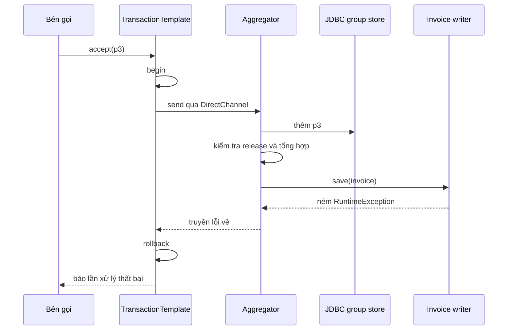
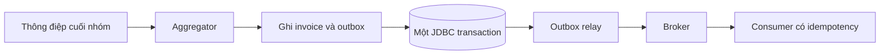

# Aggregator và transaction

Trong module **SPRING_INTEGRATION_CORE**, bài này thuộc chương **Aggregator**, tập trung vào cách phối hợp trạng thái nhóm thông điệp với giao dịch cơ sở dữ liệu. Mục tiêu là thiết kế luồng bằng `Message`, `MessageChannel`, endpoint, gateway và Java DSL sao cho biết chính xác phần việc nào được commit, phần việc nào có thể rollback và thông điệp nào cần được gửi lại.

Một aggregator có thể chờ các mảnh dữ liệu trong vài phút, trong khi mỗi transaction chỉ tồn tại trong một lần xử lý ngắn. Vì vậy, **vòng đời nhóm thông điệp và vòng đời transaction là hai khái niệm riêng biệt**. Đây là điểm xuất phát để thiết kế khả năng phục hồi cho mẫu tích hợp này.

## 1. Bài toán: lưu nhóm và lưu kết quả phải nhất quán

Giả sử một đơn hàng có ba kết quả tính tiền từ ba bước xử lý. Các thông điệp mang cùng `orderId` được gom lại; khi đủ ba phần, hệ thống tạo hóa đơn.

```text
Part 1 ─┐
Part 2 ─┼─> aggregator ─> ghi invoice
Part 3 ─┘       │
                └─> MessageGroupStore
```

Trong ví dụ nghiệp vụ này, có hai trạng thái cần thống nhất:

- **Trạng thái tích hợp:** nhóm đang có những phần nào, đã hoàn thành hay đã bị xóa.
- **Trạng thái nghiệp vụ:** hóa đơn tương ứng đã được ghi thành công hay chưa.

Nếu nhóm bị xóa nhưng hóa đơn chưa được ghi, dữ liệu đầu vào để thử lại có thể đã mất. Nếu hóa đơn đã được ghi nhưng nguồn đầu vào chưa xác nhận thành công, nguồn có thể gửi lại và tạo tác dụng phụ trùng.

Aggregator tổ chức việc gom nhóm, còn transaction xác định các thay đổi tài nguyên được thực hiện nguyên tử trong một phạm vi cụ thể. Tài liệu chính thức mô tả aggregator thông qua correlation, release strategy và message store. [Spring Integration — Aggregator](https://docs.spring.io/spring-integration/reference/aggregator.html).

## 2. Một nhóm thường đi qua nhiều transaction

Giả sử mỗi lần tiếp nhận một phần đều mở một transaction riêng:

| Lần nhận | Công việc trong transaction | Trạng thái sau commit |
|---|---|---|
| `T1`: nhận `p1` | Thêm `p1`, chưa đủ điều kiện release | Nhóm có `p1` |
| `T2`: nhận `p2` | Thêm `p2`, chưa đủ điều kiện release | Nhóm có `p1, p2` |
| `T3`: nhận `p3` | Thêm `p3`, tổng hợp, ghi hóa đơn, cập nhật nhóm | Hóa đơn có hiệu lực nếu commit |

Nếu việc ghi hóa đơn làm `T3` rollback, trong thiết kế JDBC dùng chung transaction:

```text
Trước T3:     group = {p1, p2}; invoice = chưa có
Trong T3:     thêm p3; tính kết quả; thử ghi invoice
T3 rollback:  group = {p1, p2}; invoice = chưa có
```

`p1` và `p2` vẫn tồn tại vì chúng đã commit trong `T1` và `T2`. `p3` cần được gửi lại hoặc được nguồn transactional khôi phục để xử lý lại.

Đây là phân tích của kịch bản trên, với giả định việc thêm thông điệp, xử lý nhóm và ghi hóa đơn cùng tham gia một JDBC transaction. Không thể suy ra hành vi đó chỉ từ tên thành phần aggregator.

Không nên giữ một transaction mở để chờ đủ cả nhóm. Việc chờ kéo dài thời gian chiếm connection, giữ khóa và tăng nguy cơ timeout. Thay vào đó, lưu bền từng bước tiến triển của nhóm, rồi mở transaction ngắn cho lần xử lý kế tiếp.

## 3. Ba điều kiện để rollback có ý nghĩa

### 3.1. Có ranh giới transaction thực sự bao quanh công việc

Đối với flow được ứng dụng gọi trực tiếp, có thể bắt đầu transaction bằng `TransactionTemplate`, bằng một service có `@Transactional`, hoặc bằng transaction advice được đặt đúng phạm vi.

Đặt transaction ở service chỉ ghi hóa đơn sẽ bảo vệ phần ghi đó. Nó không tự mở rộng về các thao tác aggregator đã chạy trước khi service được gọi.

Spring Integration sử dụng cơ chế transaction của Spring; các điểm bắt đầu flow như gateway hay `MessageChannel.send(...)` có thể nằm trong transaction do ứng dụng khởi tạo. [Spring Integration — Transaction Support](https://docs.spring.io/spring-integration/reference/transactions.html).

### 3.2. Tài nguyên lưu trạng thái tham gia đúng transaction

Lựa chọn thường gặp cho bài toán này:

| Cấu hình | Khả năng cần hiểu |
|---|---|
| Store trong bộ nhớ và JDBC nghiệp vụ | JDBC rollback không hoàn tác toàn bộ thay đổi của store trong bộ nhớ |
| `JdbcMessageStore` và bảng nghiệp vụ cùng `DataSource` | Có thể cùng tham gia local JDBC transaction |
| Store và bảng nghiệp vụ thuộc hai database độc lập | Một local transaction manager không tạo atomic commit cho cả hai |
| JDBC và cuộc gọi HTTP | Rollback database không hoàn tác tác dụng phụ đã xảy ra ở hệ thống HTTP |

`JdbcMessageStore` dùng được cho aggregator. `JdbcChannelMessageStore` được tối ưu cho message channel; hai lớp có mục đích sử dụng khác nhau. Cần khởi tạo schema tương ứng với database và phiên bản thư viện đang dùng. [Spring Integration — JDBC Message Store](https://docs.spring.io/spring-integration/reference/jdbc/message-store.html).

### 3.3. Luồng đồng bộ và lỗi đi tới nơi quyết định transaction

`DirectChannel` gọi subscriber trên thread của bên gửi. Vì vậy, một transaction đã mở có thể bao quanh việc gửi, aggregator và xử lý JDBC ở phía sau. Nếu chưa mở transaction, bản thân `DirectChannel` không tạo transaction. [Spring Integration — Message Channel Implementations](https://docs.spring.io/spring-integration/reference/channel/implementations.html).



Sơ đồ thể hiện đường lỗi. Ở đường thành công, thay đổi của group store và bảng hóa đơn được commit cùng transaction, nếu cùng tham gia tài nguyên JDBC đã cấu hình.

## 4. Ví dụ Java DSL: transaction bao quanh một lần nhận

### 4.1. Giả định và chuẩn bị

Ví dụ dùng API imperative của Spring Integration và Spring JDBC. Mã sử dụng Java record; hãy chọn JDK, Spring Framework, Spring Integration và dependency BOM tương thích với dự án.

Các thư viện cần có:

- `spring-integration-core`.
- `spring-integration-jdbc`.
- Spring JDBC và Spring Transaction.
- JDBC driver của database.
- Khi chạy kiểm thử minh họa: JUnit Jupiter và một database kiểm thử.

Ứng dụng cung cấp một bean `DataSource`. Khởi tạo các bảng message store từ schema JDBC đi kèm đúng phiên bản Spring Integration. Tạo thêm bảng nghiệp vụ cho bài thực hành:

```sql
create table invoice (
    order_id varchar(100) primary key,
    total decimal(19, 2) not null
);
```

Để tập trung vào transaction, giả định mỗi đơn có đúng ba phần khác nhau, được gửi tuần tự và chưa có xử lý đồng thời cho cùng đơn. Mỗi phần chỉ gửi lại khi lần trước đã thất bại và rollback được xác nhận. Quy tắc `group.size() == 3` bên dưới không xử lý việc nguồn gửi trùng ngoài giả định này.

### 4.2. Cấu hình, payload và endpoint

```java
import java.io.Serializable;
import java.math.BigDecimal;
import java.util.List;
import java.util.concurrent.atomic.AtomicBoolean;

import javax.sql.DataSource;

import org.springframework.context.annotation.Bean;
import org.springframework.context.annotation.Configuration;
import org.springframework.integration.channel.DirectChannel;
import org.springframework.integration.config.EnableIntegration;
import org.springframework.integration.dsl.IntegrationFlow;
import org.springframework.integration.jdbc.store.JdbcMessageStore;
import org.springframework.jdbc.core.JdbcTemplate;
import org.springframework.jdbc.datasource.DataSourceTransactionManager;
import org.springframework.messaging.MessageChannel;
import org.springframework.messaging.MessageDeliveryException;
import org.springframework.messaging.support.MessageBuilder;
import org.springframework.transaction.PlatformTransactionManager;
import org.springframework.transaction.support.TransactionTemplate;

@Configuration(proxyBeanMethods = false)
@EnableIntegration
public class AggregatorTransactionConfig {

    public record Part(
            String orderId,
            String itemId,
            BigDecimal amount) implements Serializable {
    }

    public record Invoice(String orderId, BigDecimal total) {
    }

    @Bean
    DirectChannel partsInput() {
        return new DirectChannel();
    }

    @Bean
    JdbcMessageStore groupStore(DataSource dataSource) {
        JdbcMessageStore store = new JdbcMessageStore(dataSource);
        store.setRegion("invoice-aggregation");
        return store;
    }

    @Bean
    PlatformTransactionManager transactionManager(DataSource dataSource) {
        return new DataSourceTransactionManager(dataSource);
    }

    @Bean
    JdbcTemplate businessJdbc(DataSource dataSource) {
        return new JdbcTemplate(dataSource);
    }

    @Bean
    AtomicBoolean failAfterInsert() {
        // Cờ phục vụ bài thực hành rollback.
        return new AtomicBoolean(false);
    }

    @Bean
    InvoiceWriter invoiceWriter(
            JdbcTemplate businessJdbc,
            AtomicBoolean failAfterInsert) {
        return new InvoiceWriter(businessJdbc, failAfterInsert);
    }

    @Bean
    IntegrationFlow invoiceFlow(
            DirectChannel partsInput,
            JdbcMessageStore groupStore,
            InvoiceWriter invoiceWriter) {

        return IntegrationFlow.from(partsInput)
                .aggregate(a -> a
                        .messageStore(groupStore)
                        .correlationStrategy(message ->
                                ((Part) message.getPayload()).orderId())
                        .releaseStrategy(group -> group.size() == 3)
                        .outputProcessor(group -> {
                            List<Part> parts = group.getMessages().stream()
                                    .map(message -> (Part) message.getPayload())
                                    .toList();

                            BigDecimal total = parts.stream()
                                    .map(Part::amount)
                                    .reduce(BigDecimal.ZERO, BigDecimal::add);

                            return new Invoice(parts.get(0).orderId(), total);
                        })
                        .expireGroupsUponCompletion(true))
                .handle(invoiceWriter, "save")
                .get();
    }

    @Bean
    PartIngress partIngress(
            DirectChannel partsInput,
            PlatformTransactionManager transactionManager) {
        return new PartIngress(partsInput, transactionManager);
    }

    public static final class PartIngress {

        private final MessageChannel input;
        private final TransactionTemplate transactions;

        public PartIngress(
                MessageChannel input,
                PlatformTransactionManager transactionManager) {
            this.input = input;
            this.transactions = new TransactionTemplate(transactionManager);
            this.transactions.setTimeout(5); // Đơn vị: giây.
        }

        public void accept(Part part) {
            transactions.executeWithoutResult(status -> {
                var message = MessageBuilder.withPayload(part).build();
                if (!input.send(message)) {
                    throw new MessageDeliveryException(
                            message, "Không gửi được part vào flow");
                }
            });
        }
    }

    public static final class InvoiceWriter {

        private final JdbcTemplate jdbc;
        private final AtomicBoolean failAfterInsert;

        public InvoiceWriter(
                JdbcTemplate jdbc,
                AtomicBoolean failAfterInsert) {
            this.jdbc = jdbc;
            this.failAfterInsert = failAfterInsert;
        }

        public void save(Invoice invoice) {
            jdbc.update(
                    "insert into invoice(order_id, total) values (?, ?)",
                    invoice.orderId(),
                    invoice.total());

            if (failAfterInsert.get()) {
                throw new IllegalStateException("Lỗi mô phỏng sau INSERT");
            }
        }
    }
}
```

Các điểm quyết định tính nhất quán của ví dụ:

1. `PartIngress.accept(...)` mở hoặc tham gia transaction trước khi gửi thông điệp.
2. `partsInput` là `DirectChannel`; các bước tiếp theo chạy đồng bộ.
3. Group store, `JdbcTemplate` và transaction manager dùng cùng bean `DataSource`.
4. `InvoiceWriter.save(...)` trả về `void`, kết thúc flow sau khi ghi dữ liệu.
5. Ngoại lệ không bị bắt và chuyển thành thành công trong callback.

`TransactionTemplate` thực thi công việc trong callback và áp dụng commit/rollback cho transaction tương ứng. [Spring Framework — Programmatic Transaction Management](https://docs.spring.io/spring-framework/reference/data-access/transaction/programmatic.html).

`Part` có thể serialize để lưu trong JDBC store. Tránh đặt các đối tượng chỉ sống trong bộ nhớ như connection, stream hay callback vào payload/header cần khôi phục. Khả năng serialize của payload và header là một yêu cầu riêng của persistent store. [Spring Integration — Message Store](https://docs.spring.io/spring-integration/reference/message-store.html).

`expireGroupsUponCompletion(true)` được chọn để quan sát nhóm bị xóa sau lần thành công. Với chính sách này, thông điệp đến muộn có cùng khóa có thể tạo nhóm mới. Trong hệ thống thật cần quyết định rõ việc giữ dấu hoàn thành và thời hạn chống trùng. [Spring Integration — AggregatorSpec](https://docs.spring.io/spring-integration/api/org/springframework/integration/dsl/AggregatorSpec.html).

### 4.3. Thay bằng service hoặc gateway có transaction

Có thể đặt `@Transactional` ở service gọi `partsInput.send(...)` hay gọi một messaging gateway có request channel đồng bộ. Khi dùng kiểu proxy thông thường, lời gọi phải đi qua Spring proxy; tự gọi phương thức trong cùng đối tượng không kích hoạt advice theo cách đó.

Điều cần giữ là transaction bắt đầu **trước** thao tác gửi vào aggregator. Chỉ chú thích phương thức tính payload tổng hợp không chứng minh rằng thao tác thêm thông điệp vào store đã nằm trong transaction.

Nếu cần tạo transaction ngay tại endpoint, phải xét advice bọc `handleMessage()` hay chỉ bọc xử lý nội bộ của handler. Spring Integration có `HandleMessageAdvice` cho phạm vi xử lý toàn bộ message; vị trí đặt advice quyết định phần downstream được bao quanh. [Spring Integration — Handling Message Advice](https://docs.spring.io/spring-integration/reference/handler-advice/handle-message.html).

## 5. Quan sát rollback bằng kiểm thử tích hợp

Kiểm thử có giá trị ở đây phải dùng group store JDBC và database thật hoặc database nhúng. Mock `MessageGroupStore` không chứng minh rằng việc ghi nhóm và ghi hóa đơn cùng rollback.

Đoạn kiểm thử sau giả định Spring test context đã nạp cấu hình ở trên, cung cấp `DataSource`, khởi tạo schema store và bảng `invoice`. Các field `ingress`, `store`, `jdbc`, `failAfterInsert` được inject từ context. Dùng các import JUnit Jupiter `assertEquals` và `assertThrows`, cùng kiểu `AggregatorTransactionConfig.Part`.

```java
@Test
void rollbackLastArrivalThenRetry() {
    String orderId = "ORDER-TX-001";

    Part p1 = new Part(orderId, "ITEM-1", new BigDecimal("10.00"));
    Part p2 = new Part(orderId, "ITEM-2", new BigDecimal("20.00"));
    Part p3 = new Part(orderId, "ITEM-3", new BigDecimal("30.00"));

    ingress.accept(p1); // T1 commit.
    ingress.accept(p2); // T2 commit.

    assertEquals(2, store.getMessageGroup(orderId).size());

    failAfterInsert.set(true);
    try {
        assertThrows(RuntimeException.class, () -> ingress.accept(p3));

        // Các phép đọc này diễn ra sau khi T3 đã rollback.
        assertEquals(2, store.getMessageGroup(orderId).size());

        Integer failedCount = jdbc.queryForObject(
                "select count(*) from invoice where order_id = ?",
                Integer.class,
                orderId);
        assertEquals(0, failedCount.intValue());
    }
    finally {
        failAfterInsert.set(false);
    }

    // Lần trước p3 chưa commit nên gửi lại p3.
    ingress.accept(p3); // T4 commit.

    BigDecimal total = jdbc.queryForObject(
            "select total from invoice where order_id = ?",
            BigDecimal.class,
            orderId);
    assertEquals(0, new BigDecimal("60.00").compareTo(total));

    Integer successCount = jdbc.queryForObject(
            "select count(*) from invoice where order_id = ?",
            Integer.class,
            orderId);
    assertEquals(1, successCount.intValue());

    // Đã xóa nhóm sau completion; nhóm không còn thông điệp.
    assertEquals(0, store.getMessageGroup(orderId).size());
}
```

Không đặt `@Transactional` bao toàn bộ phương thức kiểm thử này. Nếu có transaction bên ngoài, các lần `accept(...)` dùng propagation mặc định có thể tham gia chung transaction đó; lúc ấy `T1`, `T2`, `T3` không còn là ba lần commit/rollback độc lập như bài toán.

Ba dấu hiệu cần quan sát đồng thời là nhóm còn hai phần sau lỗi, bảng hóa đơn chưa có bản ghi và lần gửi lại tạo đúng một hóa đơn. Chỉ kiểm tra có exception là chưa đủ.

Khi chuyển sang database sản xuất, bổ sung kiểm thử đồng thời và kiểm thử khởi động lại với cùng persistent store. Database nhúng giúp kiểm tra luồng rollback cơ bản nhưng không thay thế việc xác minh isolation, khóa và truy vấn trên database đích.

## 6. Flow bắt đầu bằng poller: transaction cần bao cả receive

Với đầu vào là `PollableChannel`, poller có thể mở transaction trước `receive()`. Điều này quan trọng nếu việc lấy thông điệp khỏi nguồn cũng phải được hoàn tác khi aggregator thất bại.

Đoạn DSL sau minh họa cách gắn transaction vào poller. Đây là cấu hình thay thế phần đầu flow, giả định `durableParts` đã là một bean `PollableChannel` có store phù hợp:

```java
return IntegrationFlow.from("durableParts")
        .aggregate(a -> a
                .messageStore(groupStore)
                .correlationStrategy(message ->
                        ((Part) message.getPayload()).orderId())
                .releaseStrategy(group -> group.size() == 3)
                .poller(Pollers.fixedDelay(500)
                        .maxMessagesPerPoll(1)
                        .transactional(transactionManager)))
        .handle((payload, headers) -> {
            // Minh họa vị trí xử lý đồng bộ sau aggregator.
            // Cần dùng outputProcessor và invoice writer phù hợp
            // nếu thay vào cấu hình hóa đơn ở phần trước.
            return null;
        })
        .get();
```

Import bổ sung là `org.springframework.integration.dsl.Pollers`. Tham số transaction manager trên poller được dùng để cấu hình advice cho polling task. [Spring Integration — PollerSpec](https://docs.spring.io/spring-integration/api/org/springframework/integration/dsl/PollerSpec.html).

Cần phân biệt:

| Đầu vào được poll | Sau khi xử lý thất bại |
|---|---|
| `QueueChannel` bộ nhớ thông thường | Không thể mặc định coi thông điệp đã lấy ra được JDBC transaction đưa lại vào queue |
| Queue dùng JDBC store và tham gia cùng JDBC transaction | Việc lấy thông điệp có thể rollback cùng các thay đổi database |
| Broker ngoài database | Phụ thuộc transaction/ack của broker và khả năng phối hợp với JDBC |

Để tập trung vào một lần nhận, ví dụ đặt `maxMessagesPerPoll(1)`. Không suy ra rằng tăng giá trị này sẽ biến toàn bộ nhóm kéo dài nhiều phút thành một transaction.

Nếu nguồn là HTTP hoặc lời gọi ứng dụng trực tiếp như phần 4, rollback chỉ hoàn tác tài nguyên đã tham gia transaction; bên gọi phải có cơ chế gửi lại. Transaction không tự tạo một nguồn redelivery.

## 7. Chuyển thread tạo ranh giới transaction mới

Xét thay đổi sau:

```text
Transaction T
  → aggregator
  → ExecutorChannel
      → invoice writer chạy trên thread khác
```

Khi việc giao công việc cho executor đã thành công, bên gửi có thể hoàn thành transaction trong khi invoice writer chưa xử lý xong. Lỗi ghi hóa đơn ở thread nhận không truyền ngược để rollback transaction đã kết thúc.

Với `QueueChannel`, bên gửi và consumer cũng cần được xem là hai giai đoạn xử lý. Một durable queue có thể lưu bền việc bàn giao, nhưng consumer vẫn cần transaction riêng cho công việc của mình. [Spring Integration — Message Channel Implementations](https://docs.spring.io/spring-integration/reference/channel/implementations.html).

Không nên hiểu rằng transaction commit ngay tại dòng gọi channel trong mọi cấu hình. Chính xác hơn, **phạm vi công việc ở thread mới không tự tham gia transaction imperative của thread gửi**; transaction phía gửi hoàn tất ở ranh giới đã được cấu hình.

Vì vậy, khi thêm executor để tăng thông lượng, cần thiết kế lại điểm bàn giao bền vững và cơ chế xử lý lại, đồng thời kiểm tra các giả định về atomicity.

## 8. Timeout của nhóm cần đường transaction riêng

Có hai tình huống hoàn thành:

- Thông điệp mới đến làm release strategy chấp nhận nhóm.
- Scheduler hoặc reaper yêu cầu hoàn thành/xử lý nhóm cũ.

Ở tình huống thứ hai, transaction của lần nhận thông điệp trước đã kết thúc. Có thể cấu hình transaction advice cho `forceComplete()` thông qua `forceReleaseAdvice(...)`.

Đoạn sau là các tùy chọn bổ sung cho aggregator, bên trong lambda `a -> a...`:

```java
.groupTimeout(30_000)
.sendPartialResultOnExpiry(false)
.discardChannel("expiredParts")
.forceReleaseAdvice(
        new TransactionInterceptorBuilder()
                .transactionManager(transactionManager)
                .build())
```

Import bổ sung là `org.springframework.integration.transaction.TransactionInterceptorBuilder`. Channel `expiredParts` phải được định nghĩa và có consumer phù hợp. Nếu cần lưu bền việc hết hạn, consumer đồng bộ có thể ghi bản ghi thất bại bằng cùng `DataSource`.

`forceReleaseAdvice` áp dụng cho thao tác forced completion. Nó không thay transaction cần thiết cho đường nhận thông điệp bình thường. [Spring Integration — CorrelationHandlerSpec](https://docs.spring.io/spring-integration/api/org/springframework/integration/dsl/CorrelationHandlerSpec.html).

Trong chính sách minh họa này, nhóm hết hạn được chuyển sang nhánh discard thay vì xuất hóa đơn thiếu phần. Cần quyết định cách xử lý thông điệp đến muộn và việc khôi phục nhóm cũ sau restart. Việc lưu nhóm xuống database không có nghĩa lịch tác vụ trong bộ nhớ cũng được lưu bền. Xem phần quản lý expiration của [Spring Integration — Aggregator](https://docs.spring.io/spring-integration/reference/aggregator.html).

`groupTimeout` diễn tả thời điểm xử lý nhóm chờ, còn transaction timeout giới hạn thời gian thực hiện một transaction. Không dùng transaction timeout để biểu diễn thời gian chờ đầy đủ của nghiệp vụ.

## 9. Error channel và rollback là hai trách nhiệm khác nhau

Error channel giúp chuyển thông tin lỗi tới một flow xử lý lỗi. Quyết định rollback lại phụ thuộc vào transaction boundary, exception đi qua boundary đó và rollback rule.

Với flow đồng bộ gọi trực tiếp channel, exception thường đi về bên gửi. Với flow bất đồng bộ hoặc scheduler, cơ chế xử lý lỗi cần đưa thông tin lỗi qua channel thích hợp. [Spring Integration — Error Handling](https://docs.spring.io/spring-integration/reference/error-handling.html).

Một lỗi dễ gặp:

```java
transactions.executeWithoutResult(status -> {
    try {
        input.send(message);
    }
    catch (RuntimeException ex) {
        logger.error("Xử lý thất bại", ex);
        // Không ném lại và cũng không đánh dấu rollback.
    }
});
```

Nếu không có thành phần nào khác đã đánh dấu rollback-only, callback trên có thể kết thúc bình thường và cho phép commit. Việc log exception không thể hiện yêu cầu rollback.

Trong bài thực hành, hãy để exception thoát khỏi callback. Nếu có lý do để bắt lỗi ngay trong callback, cần chủ động `status.setRollbackOnly()` và thiết kế cách báo thất bại cho bên gọi.

Đối với `@Transactional`, mặc định rollback áp dụng với `RuntimeException` và `Error`; checked exception cần rollback rule phù hợp nếu muốn rollback. Cần xem cả loại exception thực sự thoát khỏi messaging layer vì nó có thể đã được bọc lại. [Spring Framework — Rolling Back a Declarative Transaction](https://docs.spring.io/spring-framework/reference/data-access/transaction/declarative/rolling-back.html).

Không nên bắt một lỗi database rồi tiếp tục ghi nhiều thao tác khác trong cùng transaction để coi lần xử lý đã hồi phục. Một số lỗi hoặc advice có thể đã đánh dấu transaction rollback-only.

## 10. Retry phải tạo được lần xử lý hợp lệ mới

Trong ví dụ hóa đơn, chuỗi thử lại đúng là:

```text
Attempt 1 → begin T3 → lỗi → rollback T3
Attempt 2 → begin T4 → xử lý lại p3 → commit T4
```

Nếu retry chạy bên trong một transaction đã rollback-only, lần gọi sau không tạo ra một trạng thái transaction sạch. Với ứng dụng gọi trực tiếp, cách dễ quan sát là chỉ gọi lại `ingress.accept(p3)` sau khi lần gọi thất bại đã thoát ra.

Khi phối hợp advice, cần đọc thứ tự thực thi thực tế. Retry bọc transaction có thể mở transaction mới cho từng attempt; transaction bọc retry có thể khiến các attempt cùng nằm trong transaction đang lỗi.

Propagation cũng cần được lựa chọn theo tính nhất quán:

| Lựa chọn | Hệ quả với ví dụ |
|---|---|
| `REQUIRED` | Writer có thể tham gia transaction hiện tại khi dùng đúng manager/tài nguyên |
| `REQUIRES_NEW` ở writer | Writer có transaction độc lập; nó có thể commit rồi outer transaction rollback |
| `NESTED` | Phụ thuộc hỗ trợ savepoint, không biến tài nguyên ngoài database thành atomic |
| `readOnly = true` | Không phù hợp cho phạm vi dự định thêm message và ghi hóa đơn |

Spring phân biệt transaction vật lý với phạm vi transaction logic; `REQUIRES_NEW` sử dụng transaction độc lập. [Spring Framework — Transaction Propagation](https://docs.spring.io/spring-framework/reference/data-access/transaction/declarative/tx-propagation.html).

Retry cần có giới hạn, phân loại lỗi tạm thời và lỗi dữ liệu. Một nhóm có dữ liệu sai cần được đưa đến đường xử lý thất bại có khả năng lưu vết thay vì lặp vô hạn.

## 11. Lock bảo vệ đồng thời; transaction bảo vệ tính nguyên tử

Hai thông điệp cùng `orderId` có thể đến gần như đồng thời. Khóa nhóm giúp giới hạn việc nhiều luồng cùng thao tác một nhóm.

Khi nhiều instance dùng chung persistent group store, khóa chỉ trong một JVM không đủ phối hợp các instance. `JdbcLockRegistry` là một lựa chọn khóa chia sẻ cho aggregator. [Spring Integration — JDBC Lock Registry](https://docs.spring.io/spring-integration/reference/jdbc/lock-registry.html).

Tuy nhiên, khóa và transaction giải quyết các vấn đề khác nhau:

| Cơ chế | Trách nhiệm chính |
|---|---|
| Group lock | Phối hợp quyền truy cập nhóm |
| JDBC transaction | Commit hoặc rollback những thay đổi đã tham gia transaction |
| Unique constraint nghiệp vụ | Ngăn lưu hai kết quả có cùng khóa nghiệp vụ |
| Idempotency | Quy định cách xử lý lại cùng một yêu cầu hoặc sự kiện |

Khóa của handler cũng không chứng minh rằng toàn bộ outer transaction vẫn đang được khóa cho tới commit. Khi thiết kế nhiều instance, cần xem thời điểm nhả khóa, isolation của database và khả năng retry khi có xung đột.

Giữ phần xử lý đồng bộ phía sau aggregator ngắn. Một chuỗi aggregator hoặc lời gọi chậm có thể kéo dài thời gian giữ khóa. Tùy chọn `releaseLockBeforeSend(true)` thay đổi thời điểm nhả group lock; nó không có nghĩa commit transaction. [Spring Integration — CorrelationHandlerSpec](https://docs.spring.io/spring-integration/api/org/springframework/integration/dsl/CorrelationHandlerSpec.html).

Nếu giải quyết tranh chấp bằng cách thêm `ExecutorChannel`, phải đồng thời xử lý ranh giới transaction mới đã phân tích ở phần 7.

## 12. Gửi kết quả ra ngoài: thiết kế với outbox và idempotency

Giả sử sau khi ghi hóa đơn, flow phải gửi sự kiện `InvoiceCreated` tới broker.

```text
ghi invoice → gửi broker → commit JDBC
```

Trong thiết kế chỉ có local JDBC transaction, có hai cửa sổ lỗi:

1. Broker nhận sự kiện nhưng JDBC rollback: sự kiện công bố một hóa đơn chưa có hiệu lực.
2. JDBC commit nhưng tiến trình chết trước khi gửi sự kiện: hóa đơn tồn tại nhưng sự kiện chưa được công bố.

Đây là hệ quả phân tích từ việc hai tài nguyên không cùng một atomic commit. Một cách thiết kế cho tình huống này là transactional outbox:



Trong transaction kết thúc nhóm, ghi hóa đơn và một bản ghi outbox vào cùng database. Relay đọc các bản ghi đã commit và thực hiện việc công bố độc lập.

Ví dụ các khóa dữ liệu:

```sql
create table integration_outbox (
    event_id varchar(100) primary key,
    aggregate_id varchar(100) not null,
    event_type varchar(100) not null,
    payload_text clob not null,
    published boolean not null
);
```

DDL trên chỉ minh họa; kiểu cột cần điều chỉnh theo database. Có thể dùng event ID xác định từ phiên bản nghiệp vụ, chẳng hạn `InvoiceCreated:ORDER-123:v1`.

Outbox khắc phục cửa sổ mất ý định gửi giữa commit database và công bố. Relay vẫn có thể gửi trùng nếu broker đã nhận nhưng relay chưa kịp đánh dấu published. Consumer cần xử lý idempotent theo `event_id`.

Tương tự, phía đầu vào nên phân biệt:

- `orderId`: khóa correlation để gom nhóm.
- `itemId` hoặc `eventId`: khóa nhận diện một phần/sự kiện để chống trùng.
- Phiên bản nghiệp vụ: phân biệt lần tổng hợp mới với thông điệp muộn của lần cũ.

Không dùng số lượng message làm bằng chứng rằng đã có đủ các phần nghiệp vụ khác nhau. Ví dụ ba message `ITEM-1, ITEM-1, ITEM-2` không tạo thành bộ ba hợp lệ `ITEM-1, ITEM-2, ITEM-3`.

Nếu thêm bảng inbox/dedup, việc ghi dấu đã nhận phải nhất quán với việc cập nhật nhóm trong transaction thích hợp. Nếu ghi dấu trước rồi cập nhật nhóm thất bại, retry có thể bị chặn sai.

## 13. Chẩn đoán các lỗi thường gặp

| Hiện tượng | Giả thuyết cần xác minh | Hướng xử lý |
|---|---|---|
| Hóa đơn rollback nhưng nhóm không trở về trạng thái trước | Store bộ nhớ hoặc thao tác store nằm ngoài transaction | Kiểm tra store, điểm bắt đầu transaction và manager |
| Exception downstream không làm lần gửi thất bại | Có async boundary hoặc recovery đã chuyển lỗi thành kết quả bình thường | Vẽ lại thread và đường truyền lỗi |
| Poller lỗi nhưng mất thông điệp đầu vào | Nguồn nhận không tham gia transaction có thể khôi phục | Dùng nguồn transactional hoặc cơ chế redelivery rõ ràng |
| Nhận lại sự kiện tạo kết quả trùng | Thiếu idempotency theo khóa nghiệp vụ | Thiết kế dedup, constraint và hành vi khi gặp bản trùng |
| Retry liên tục nhận rollback-only | Các attempt dùng chung transaction đã lỗi | Tạo transaction mới sau khi attempt trước đã rollback |
| Có deadlock hoặc giữ connection lâu | Thứ tự khóa xung đột, downstream chậm hoặc transaction quá rộng | Rút ngắn xử lý, phân tích khóa và điểm bàn giao |
| Restart còn nhóm cũ nhưng không xử lý tiếp | Thiếu kế hoạch phục hồi nhóm chưa hoàn thành | Thiết kế expiration/reaper hoặc phát lại đầu vào phù hợp |

Khi ghi log, nên có correlation key, mã phần, số attempt và nguyên nhân gốc của exception. Các phép đọc để kiểm tra kết quả rollback nên chạy sau khi transaction lỗi đã kết thúc; quan sát từ một transaction chưa hoàn tất có thể dẫn đến kết luận sai.

## 14. Những điều cần tự giải thích được sau bài học

Sau bài học này, người học cần diễn giải được luồng của một thông điệp từ đầu vào qua channel đến aggregator và endpoint ghi kết quả, đồng thời xác định:

1. Transaction bắt đầu và kết thúc ở đâu.
2. Group store và dữ liệu nghiệp vụ có tham gia cùng transaction hay không.
3. Khi thông điệp cuối gây lỗi, các thông điệp đã commit trước đó còn ở trạng thái nào.
4. Nguồn nào chịu trách nhiệm đưa thông điệp thất bại trở lại.
5. Khi chuyển thread hoặc timeout, phần việc nào cần transaction riêng.
6. Cách ngăn tác dụng phụ trùng khi tiếp nhận lại hoặc công bố lại một sự kiện.

Trong một thiết kế tốt, các câu trả lời đó được thể hiện bằng cấu hình, khóa dữ liệu nghiệp vụ và kiểm thử rollback có quan sát trạng thái. Aggregator quản lý tiến trình gom nhóm; tính nhất quán của toàn bộ luồng đến từ ranh giới transaction cùng cơ chế lưu bền và xử lý lại được thiết kế rõ ràng.
