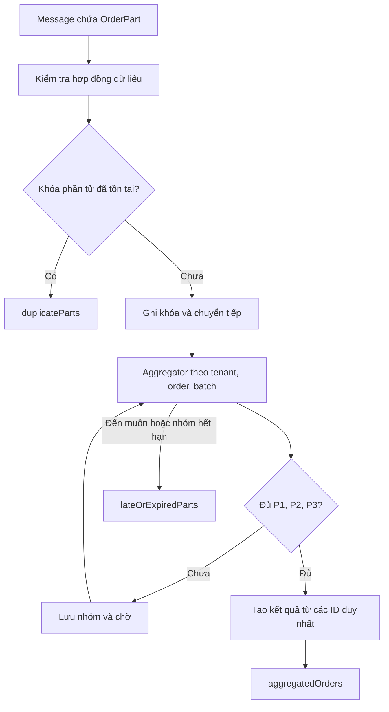

# Aggregator và duplicate message

## Mục tiêu và phạm vi

Trong chương **Aggregator** của module **SPRING_INTEGRATION_CORE**, bài này giải thích cách một luồng gom thông điệp bị ảnh hưởng khi cùng một sự kiện hoặc cùng một phần tử nghiệp vụ được giao nhiều lần. Mục tiêu là thiết kế điều kiện hoàn tất nhóm, khóa chống trùng và chính sách xử lý lại sao cho kết quả tổng hợp không thiếu phần tử hoặc cộng lặp dữ liệu.

Bài học kết nối `Message`, `MessageChannel`, filter, aggregator endpoint, `MessageGroupStore` và Java DSL trong một ví dụ đơn hàng. Nội dung tập trung vào duplicate tại ranh giới aggregator, đồng thời xét lỗi downstream, timeout, restart và kiểm thử hành vi của luồng tích hợp.

Sau bài học, bạn có thể:

- Phân biệt message ID, correlation key, sequence number và khóa chống trùng theo nghiệp vụ.
- Giải thích vì sao đủ số message chưa có nghĩa là đủ các phần tử cần gom.
- Đặt bộ lọc chống trùng trước aggregator và kiểm tra tính duy nhất khi tạo kết quả.
- Nhận diện khoảng hở giữa ghi dấu đã nhận, lưu nhóm và tạo tác động downstream.
- Xác định chính sách retention, replay và các tình huống kiểm thử cần có.

Các ví dụ dùng Java 17 và API Spring Integration 6.4 để có mốc tham chiếu cụ thể. Đây là lựa chọn cho bài thực hành, không phải khẳng định về phiên bản mới nhất. Phần cấu hình dùng các store trong bộ nhớ để minh họa; phần triển khai bền vững được phân tích riêng.

## 1. Một duplicate có thể làm sai cả điều kiện hoàn tất lẫn kết quả

Giả sử một đợt tổng hợp đơn hàng cần ba phần tử `P1`, `P2`, `P3`:

| Phần tử | Giá trị, tính bằng đơn vị tiền nhỏ nhất |
| --- | ---: |
| P1 | 100 |
| P2 | 200 |
| P3 | 300 |

Kết quả hợp lệ gồm đủ ba phần tử và có tổng bằng `600`. Tuy nhiên, thứ tự giao thực tế có thể là:

```text
P1 -> P2 -> P1 được giao lại -> P3
```

Nếu điều kiện release chỉ là `group.size() == 3`, lần giao lại của `P1` có thể làm nhóm hoàn tất trước khi nhận `P3`. Khi đó phép cộng ngây thơ tạo ra `100 + 200 + 100 = 400`.

Có hai lỗi khác nhau:

1. **Hoàn tất sớm:** bản sao bị tính như một phần tử còn thiếu.
2. **Tổng hợp sai:** cùng một phần tử được đưa vào phép tính nhiều lần.

Chỉ sửa phép cộng để bỏ bản sao chưa giải quyết lỗi đầu tiên. Nhóm có thể xuất kết quả với `P1`, `P2` rồi đóng trước khi `P3` đến. Ngược lại, điều kiện release nhận diện đủ các ID nhưng bộ xử lý kết quả vẫn cộng tất cả message thì tổng vẫn có thể sai.

Với tập phần tử dự kiến `E` và tập ID thực nhận hợp lệ `U`, hợp đồng của ví dụ là:

```text
Được release khi U = E.
Mỗi ID trong U chỉ đóng góp một lần vào kết quả.
```

Duplicate thường xuất hiện khi producer gửi lại sau một phản hồi bị mất, consumer bị lỗi trước khi xác nhận với broker, hoặc một tác vụ replay chạy lại lịch sử. Đây là các tình huống thiết kế cần xử lý khi dùng cơ chế giao ít nhất một lần. Riêng việc gọi `MessageChannel.send()` trong ứng dụng không tự xác định cơ chế xác nhận của một broker bên ngoài.

## 2. Xác định đúng thứ được coi là trùng

### 2.1. Bốn loại định danh có trách nhiệm khác nhau

| Định danh | Câu hỏi nó trả lời | Ví dụ | Có đủ để chống trùng nghiệp vụ? |
| --- | --- | --- | --- |
| `MessageHeaders.ID` | Đây là đối tượng thông điệp nào ở tầng messaging? | Một UUID | Không bảo đảm ổn định qua gửi lại hoặc dựng lại message |
| Correlation key | Message này thuộc nhóm nào? | `tenantA\|O42\|B1` | Không; các phần tử khác nhau trong cùng nhóm đều dùng khóa này |
| `sequenceNumber` | Message nằm ở vị trí nào trong một chuỗi? | `1`, `2`, `3` | Chỉ hữu ích trong phạm vi chuỗi có hợp đồng sequence rõ ràng |
| Deduplication key | Đây có phải phần tử nghiệp vụ đã nhận trước đó? | `v1\|tenantA\|O42\|B1\|P1` | Có, nếu khóa biểu diễn đúng hợp đồng nghiệp vụ |

Một producer có thể dựng message mới cho cùng `P1`, khiến UUID của envelope thay đổi nhưng phần tử nghiệp vụ vẫn trùng. Hai message có payload bằng nhau cũng có thể là hai giao dịch hợp lệ khác nhau. Vì vậy, so sánh payload hoặc dùng UUID một cách máy móc đều có thể sai.

### 2.2. Duplicate sự kiện và duplicate phần tử

Có ít nhất hai câu hỏi cần tách ra:

- **Sự kiện đã được giao lại hay chưa?** Dùng một `eventId` ổn định do nguồn cấp.
- **Phần tử này đã được đóng góp vào nhóm hay chưa?** Dùng khóa gồm batch và ID phần tử.

Ví dụ, nguồn phát hai sự kiện có `eventId` khác nhau nhưng cùng biểu diễn `P1` của batch `B1`. Lọc theo `eventId` sẽ chấp nhận cả hai. Nếu hợp đồng là một đóng góp cho mỗi phần tử trong batch, aggregator vẫn cần bảo vệ theo `batchId + partId`.

Ngược lại, nếu mỗi sự kiện là một biến động cần cộng dồn, hai sự kiện khác nhau của cùng mặt hàng có thể đều hợp lệ. Khi đó khóa chỉ gồm `productId` sẽ làm mất dữ liệu. Bạn phải xác định đơn vị đóng góp trước khi chọn khóa.

### 2.3. Phạm vi khóa phải bao gồm vòng đời nghiệp vụ

Với ví dụ đơn hàng, ta chọn:

```text
correlationKey = tenantId | orderId | batchId
fragmentKey    = order-fragments:v1 | correlationKey | partId
aggregateKey   = order-result:v1 | correlationKey
```

`tenantId` ngăn trộn dữ liệu giữa khách hàng; `batchId` phân biệt các lần tổng hợp của cùng đơn hàng; tiền tố phiên bản giúp phân biệt hợp đồng khóa khi hệ thống tiến hóa.

Việc ghép chuỗi phải tránh nhập nhằng. Bài thực hành giới hạn các ID vào tập ký tự không chứa dấu `|`. Nếu ID thực tế chứa ký tự tùy ý, dùng cách mã hóa có độ dài từng trường hoặc một biểu diễn chuẩn hóa trước khi băm. Nếu dùng hash, vẫn cần chính sách xử lý va chạm và cách truy vết về dữ liệu gốc.

## 3. Spring Integration hỗ trợ gì và cần bổ sung gì?

### 3.1. Release strategy mặc định không phải bộ lọc duplicate nghiệp vụ

Trong Spring Integration 6.4, `SimpleSequenceSizeReleaseStrategy` quyết định dựa trên phép so sánh `group.getSequenceSize() == group.size()` và không kiểm tra sequence number bị trùng. Ví dụ ba message có sequence number `1, 1, 2`, đều khai báo sequence size bằng `3`, có thể đạt điều kiện số lượng dù vị trí `3` chưa xuất hiện. Xem [mã nguồn SimpleSequenceSizeReleaseStrategy 6.4.0](https://raw.githubusercontent.com/spring-projects/spring-integration/v6.4.0/spring-integration-core/src/main/java/org/springframework/integration/aggregator/SimpleSequenceSizeReleaseStrategy.java).

Không nên dựa vào việc một kiểu collection hoặc một implementation store có thể nhận diện cùng một `Message` để suy ra rằng mọi bản sao nghiệp vụ đều được loại. Một message dựng mới cho cùng phần tử vẫn cần được đánh giá bằng định danh nghiệp vụ.

### 3.2. Kiểm tra sequence có phạm vi riêng

`SequenceSizeReleaseStrategy` cung cấp đường xử lý có nhận diện sequence bị lặp; đây là lựa chọn khác với strategy mặc định đơn giản. Tuy nhiên, bảo vệ theo sequence chỉ đúng khi nguồn giữ ổn định tương quan, số thứ tự và kích thước chuỗi. Nó không tự biết hai sự kiện có sequence number khác nhau đang đại diện cùng phần tử nghiệp vụ. Tham khảo phần release strategy trong [tài liệu Aggregator 6.4](https://docs.spring.io/spring-integration/reference/6.4/aggregator.html).

Nếu chọn cách này, cần truyền implementation cụ thể vào cấu hình, chẳng hạn:

```java
.aggregate(a -> a.releaseStrategy(new SequenceSizeReleaseStrategy()))
```

Đoạn trên cần import `org.springframework.integration.aggregator.SequenceSizeReleaseStrategy`. Đừng thay nó bằng một lambda gọi hộ rồi mặc định cho rằng hành vi nhận diện sequence của correlating handler sẽ giống hệt: handler 6.4 xác định chế độ sequence-aware theo kiểu của release strategy. Chi tiết này có thể xem trong [mã nguồn AbstractCorrelatingMessageHandler](https://raw.githubusercontent.com/spring-projects/spring-integration/v6.4.0/spring-integration-core/src/main/java/org/springframework/integration/aggregator/AbstractCorrelatingMessageHandler.java).

Bài này dùng hợp đồng ID phần tử, nên cấu hình release theo tập ID dự kiến và không phụ thuộc các header sequence.

### 3.3. Message group store và metadata store là hai trạng thái khác nhau

| Trạng thái | Thành phần trong ví dụ | Nội dung cần nhớ |
| --- | --- | --- |
| Nhóm đang gom | `MessageGroupStore` | Những message đã vào nhóm và trạng thái hoàn tất |
| Lịch sử phần tử đã nhận | `ConcurrentMetadataStore` | Khóa của các đóng góp đã được bộ lọc chấp nhận |
| Tác động nghiệp vụ đã commit | Bảng kết quả hoặc dịch vụ đích | Kết quả nào đã được áp dụng thành công |

Không có lý do để mặc định ba trạng thái này cùng tồn tại lâu như nhau hoặc cùng được commit nguyên tử. Chọn store bền vững cho một trạng thái cũng không làm hai trạng thái còn lại tự bền vững.

`SimpleMetadataStore` chỉ giữ dữ liệu trong vòng đời application context. Tài liệu [Metadata Store](https://docs.spring.io/spring-integration/reference/6.4/meta-data-store.html) mô tả các lựa chọn lưu bền vững. Khi dùng nhiều node, cần một backend được chia sẻ thực sự; interface hỗ trợ thao tác đồng thời không biến các map riêng trên từng JVM thành dữ liệu chung.

## 4. Thiết kế luồng xử lý

Luồng học tập gồm hai lớp bảo vệ về nội dung:

1. Bộ lọc trước aggregator chặn các phần tử đã nhận theo khóa nghiệp vụ.
2. Release strategy và output processor cùng dùng một biểu diễn phần tử duy nhất theo ID.



Mũi tên quay lại từ nhóm đang chờ biểu diễn việc đánh giá lại khi có message tiếp theo, không phải vòng lặp gửi message chủ động.

Đầu vào cần được xác thực trước khi giữ khóa chống trùng. Nếu một message sai định dạng đã chiếm khóa rồi mới bị từ chối, bản gửi lại được sửa có thể không còn đi qua bộ lọc. Trong ví dụ Java bên dưới, constructor của `OrderPart` kiểm tra dữ liệu trước khi đối tượng được gửi vào channel.

## 5. Ví dụ Java DSL hoàn chỉnh cho một tiến trình

### 5.1. Hợp đồng của ví dụ

Một batch có đúng ba phần tử `P1`, `P2`, `P3`. Mỗi phần tử bất biến trong batch: gửi lại phải giữ nguyên nội dung. Một lần tính mới sử dụng `batchId` mới.

Mỗi `amountMinor` là giá trị không âm tính bằng đơn vị tiền nhỏ nhất, tránh dùng số thực cho phép cộng tiền. Tập ID dự kiến được cố định để bài học tập trung vào duplicate. Ở hệ thống có số phần tử thay đổi, thay hằng số này bằng manifest đáng tin cậy gắn với batch, có kiểm tra phiên bản và tư cách thành viên.

Cấu hình cần `spring-integration-core` cùng các dependency Spring tương ứng. Phần test cần JUnit Jupiter. Nếu dự án đã dùng Spring Boot/BOM, dùng cơ chế quản lý phiên bản của dự án để các thư viện đồng bộ.

### 5.2. Cấu hình

```java
package example.integration;

import java.util.List;
import java.util.Map;
import java.util.Set;
import java.util.TreeMap;

import org.springframework.beans.factory.annotation.Qualifier;
import org.springframework.context.annotation.Bean;
import org.springframework.context.annotation.Configuration;
import org.springframework.integration.channel.DirectChannel;
import org.springframework.integration.channel.QueueChannel;
import org.springframework.integration.config.EnableIntegration;
import org.springframework.integration.dsl.IntegrationFlow;
import org.springframework.integration.metadata.ConcurrentMetadataStore;
import org.springframework.integration.metadata.SimpleMetadataStore;
import org.springframework.integration.selector.MetadataStoreSelector;
import org.springframework.integration.store.MessageGroup;
import org.springframework.integration.store.MessageGroupStore;
import org.springframework.integration.store.SimpleMessageStore;
import org.springframework.messaging.Message;
import org.springframework.messaging.MessageChannel;
import org.springframework.messaging.support.MessageBuilder;

@Configuration(proxyBeanMethods = false)
@EnableIntegration
public class DuplicateSafeAggregatorConfig {

    private static final Set<String> EXPECTED_PARTS = Set.of("P1", "P2", "P3");

    public record OrderPart(
            String tenantId,
            String orderId,
            String batchId,
            String partId,
            int amountMinor) {

        public OrderPart {
            requireToken(tenantId);
            requireToken(orderId);
            requireToken(batchId);
            requireToken(partId);
            if (!EXPECTED_PARTS.contains(partId)) {
                throw new IllegalArgumentException("Unexpected partId: " + partId);
            }
            if (amountMinor < 0) {
                throw new IllegalArgumentException("amountMinor must be non-negative");
            }
        }
    }

    public record OrderResult(
            String tenantId,
            String orderId,
            String batchId,
            List<String> partIds,
            long totalMinor) {
    }

    @Bean
    DirectChannel partsInput() {
        return new DirectChannel();
    }

    @Bean
    QueueChannel aggregatedOrders() {
        return new QueueChannel();
    }

    @Bean
    QueueChannel duplicateParts() {
        return new QueueChannel();
    }

    @Bean
    QueueChannel lateOrExpiredParts() {
        return new QueueChannel();
    }

    @Bean
    ConcurrentMetadataStore fragmentKeys() {
        return new SimpleMetadataStore();
    }

    @Bean
    MessageGroupStore orderGroups() {
        return new SimpleMessageStore();
    }

    @Bean
    MetadataStoreSelector firstDelivery(ConcurrentMetadataStore fragmentKeys) {
        return new MetadataStoreSelector(
                message -> fragmentKey(part(message)),
                message -> "accepted",
                fragmentKeys);
    }

    @Bean
    IntegrationFlow orderAggregationFlow(
            @Qualifier("partsInput") MessageChannel input,
            @Qualifier("aggregatedOrders") MessageChannel output,
            MetadataStoreSelector firstDelivery,
            MessageGroupStore orderGroups) {

        return IntegrationFlow.from(input)
                .filter(firstDelivery,
                        filter -> filter.discardChannel("duplicateParts"))
                .aggregate(aggregator -> aggregator
                        .messageStore(orderGroups)
                        .correlationStrategy(message -> groupKey(part(message)))
                        .releaseStrategy(DuplicateSafeAggregatorConfig::allPartsPresent)
                        .outputProcessor(DuplicateSafeAggregatorConfig::toResult)
                        .expireGroupsUponCompletion(false)
                        .expireGroupsUponTimeout(false)
                        .groupTimeout(30_000L)
                        .sendPartialResultOnExpiry(false)
                        .discardChannel("lateOrExpiredParts"))
                .channel(output)
                .get();
    }

    public static String groupKey(OrderPart part) {
        return part.tenantId() + "|" + part.orderId() + "|" + part.batchId();
    }

    public static String fragmentKey(OrderPart part) {
        return "order-fragments:v1|" + groupKey(part) + "|" + part.partId();
    }

    private static OrderPart part(Message<?> message) {
        return (OrderPart) message.getPayload();
    }

    private static void requireToken(String value) {
        if (value == null || !value.matches("[A-Za-z0-9_-]{1,40}")) {
            throw new IllegalArgumentException("Invalid identifier");
        }
    }

    private static Map<String, OrderPart> uniqueParts(MessageGroup group) {
        Map<String, OrderPart> unique = new TreeMap<>();
        for (Message<?> message : group.getMessages()) {
            OrderPart current = part(message);
            OrderPart previous = unique.putIfAbsent(current.partId(), current);
            if (previous != null && !previous.equals(current)) {
                throw new IllegalStateException(
                        "Conflicting content for partId=" + current.partId());
            }
        }
        return unique;
    }

    private static boolean allPartsPresent(MessageGroup group) {
        return uniqueParts(group).keySet().equals(EXPECTED_PARTS);
    }

    private static Message<OrderResult> toResult(MessageGroup group) {
        Map<String, OrderPart> unique = uniqueParts(group);
        OrderPart first = unique.values().iterator().next();
        long total = unique.values().stream()
                .mapToLong(OrderPart::amountMinor)
                .sum();
        OrderResult result = new OrderResult(
                first.tenantId(), first.orderId(), first.batchId(),
                List.copyOf(unique.keySet()), total);

        return MessageBuilder.withPayload(result)
                .setHeader("aggregateKey", "order-result:v1|" + groupKey(first))
                .build();
    }
}
```

### 5.3. Cách đọc cấu hình

`MetadataStoreSelector` đặt khóa khi lần đầu chấp nhận message. Khi khóa đã có, selector trả về từ chối và filter chuyển message sang `duplicateParts`. Việc chấp nhận và đặt khóa diễn ra ngay tại selector, trước khi aggregator xử lý. Điều này được thể hiện trực tiếp trong [mã nguồn MetadataStoreSelector](https://raw.githubusercontent.com/spring-projects/spring-integration/v6.4.0/spring-integration-core/src/main/java/org/springframework/integration/selector/MetadataStoreSelector.java).

`uniqueParts()` tạo một map theo `partId`. Cả điều kiện release và output processor đều dựa vào map này, nên cùng diễn giải một đóng góp theo cùng hợp đồng. `TreeMap` giúp danh sách ID đầu ra có thứ tự xác định; thứ tự đến của message không quyết định kết quả.

`OrderResult` được bọc trong một `Message` có header `aggregateKey` do ứng dụng đặt. Khóa này được giữ ổn định cho cùng một batch và có thể dùng ở downstream để chống áp dụng kết quả nhiều lần.

Nhánh `duplicateParts` và `lateOrExpiredParts` dùng `QueueChannel` để test đọc trực tiếp. Đây là các queue trong bộ nhớ, cần consumer và giới hạn dung lượng phù hợp nếu áp dụng ý tưởng này vào ứng dụng chạy lâu dài.

### 5.4. Hợp đồng first-wins và giới hạn phát hiện xung đột

Bộ lọc trong ví dụ dùng giá trị metadata cố định `accepted`. Vì vậy, cùng khóa sẽ bị chặn dù nội dung mới giống hay khác nội dung cũ. Chính sách tại ranh giới này là **chấp nhận lần đầu và chuyển mọi lần sau sang nhánh duplicate**.

Kiểm tra xung đột trong `uniqueParts()` chỉ phát hiện các bản có cùng `partId` nhưng khác nội dung nếu chúng thực sự cùng lọt vào nhóm, chẳng hạn metadata bị xóa nhầm khi nhóm còn mở. Nó không nhìn thấy message đã bị filter chặn trước đó.

Nếu nguồn có thể gửi cùng khóa với nội dung khác nhau, phải bổ sung phát hiện conflict ngay tại tầng chống trùng hoặc tại inbox bền vững. Không coi kiểm tra trong output processor là cơ chế phát hiện mọi xung đột.

### 5.5. Chi phí của điều kiện release

Ví dụ chỉ có ba phần tử nên việc dựng map khi đánh giá release rất nhỏ. Với nhóm lớn, quét lại toàn nhóm sau mỗi lần đến có thể làm tổng chi phí tăng gần bậc hai theo số phần tử. Khi tối ưu, cần duy trì trạng thái ID duy nhất một cách nhất quán với transaction và store, thay vì bỏ kiểm tra đúng đắn để chỉ đếm message.

## 6. Kiểm thử hành vi quan sát được

Kiểm thử phải dựng message mới cho cùng phần tử, vì gửi lại đúng một đối tượng Java chưa thể hiện đầy đủ tình huống redelivery với envelope khác.

Ví dụ sau dùng cùng package với cấu hình phía trên. Mỗi test mở context riêng để không chia sẻ lịch sử chống trùng. `partsInput` là `DirectChannel`, nên các xử lý đồng bộ được hoàn tất trước khi `send()` trả về; các phép `receive(0)` kiểm tra ngay queue, không cần ngủ chờ.

```java
package example.integration;

import java.util.List;

import org.junit.jupiter.api.AfterEach;
import org.junit.jupiter.api.BeforeEach;
import org.junit.jupiter.api.Test;
import org.springframework.context.annotation.AnnotationConfigApplicationContext;
import org.springframework.integration.channel.QueueChannel;
import org.springframework.integration.metadata.ConcurrentMetadataStore;
import org.springframework.messaging.Message;
import org.springframework.messaging.MessageChannel;
import org.springframework.messaging.support.MessageBuilder;

import example.integration.DuplicateSafeAggregatorConfig.OrderPart;
import example.integration.DuplicateSafeAggregatorConfig.OrderResult;

import static org.junit.jupiter.api.Assertions.*;

class DuplicateSafeAggregatorTest {

    private AnnotationConfigApplicationContext context;
    private MessageChannel input;
    private QueueChannel output;
    private QueueChannel duplicates;
    private QueueChannel late;

    @BeforeEach
    void openContext() {
        context = new AnnotationConfigApplicationContext(
                DuplicateSafeAggregatorConfig.class);
        input = context.getBean("partsInput", MessageChannel.class);
        output = context.getBean("aggregatedOrders", QueueChannel.class);
        duplicates = context.getBean("duplicateParts", QueueChannel.class);
        late = context.getBean("lateOrExpiredParts", QueueChannel.class);
    }

    @AfterEach
    void closeContext() {
        context.close();
    }

    @Test
    void duplicateDoesNotReleaseEarlyOrIncreaseTotal() {
        OrderPart p1 = part("B1", "P1", 100);
        Message<OrderPart> original = MessageBuilder.withPayload(p1).build();
        Message<OrderPart> replay = MessageBuilder.withPayload(p1).build();
        assertNotEquals(original.getHeaders().getId(), replay.getHeaders().getId());

        send(part("B1", "P2", 200));
        assertTrue(input.send(original));
        assertNull(output.receive(0));

        assertTrue(input.send(replay));
        assertNotNull(duplicates.receive(0));
        assertNull(output.receive(0));

        send(part("B1", "P3", 300));
        Message<?> emitted = output.receive(0);
        assertNotNull(emitted);
        OrderResult result = (OrderResult) emitted.getPayload();
        assertEquals(List.of("P1", "P2", "P3"), result.partIds());
        assertEquals(600L, result.totalMinor());
        assertEquals("order-result:v1|T1|O42|B1",
                emitted.getHeaders().get("aggregateKey"));

        send(part("B1", "P3", 300));
        assertNotNull(duplicates.receive(0));
        assertNull(output.receive(0));
    }

    @Test
    void newBatchOfSameOrderIsAccepted() {
        sendBatch("B1");
        sendBatch("B2");

        Message<?> first = output.receive(0);
        Message<?> second = output.receive(0);
        assertNotNull(first);
        assertNotNull(second);
        assertEquals("B1", ((OrderResult) first.getPayload()).batchId());
        assertEquals("B2", ((OrderResult) second.getPayload()).batchId());
        assertNull(output.receive(0));
        assertNull(duplicates.receive(0));
    }

    @Test
    void completedGroupStillRejectsReplayAfterDedupKeyIsRemoved() {
        sendBatch("B1");
        assertNotNull(output.receive(0));

        OrderPart replay = part("B1", "P1", 100);
        ConcurrentMetadataStore keys = context.getBean(
                "fragmentKeys", ConcurrentMetadataStore.class);
        keys.remove(DuplicateSafeAggregatorConfig.fragmentKey(replay));

        send(replay);
        assertNotNull(late.receive(0));
        assertNull(duplicates.receive(0));
        assertNull(output.receive(0));
    }

    private void sendBatch(String batchId) {
        send(part(batchId, "P1", 100));
        send(part(batchId, "P2", 200));
        send(part(batchId, "P3", 300));
    }

    private void send(OrderPart part) {
        assertTrue(input.send(MessageBuilder.withPayload(part).build()));
    }

    private OrderPart part(String batchId, String partId, int amount) {
        return new OrderPart("T1", "O42", batchId, partId, amount);
    }
}
```

Test thứ ba cố ý xóa một khóa để chứng minh hai lớp trạng thái độc lập: message vượt qua filter vẫn có thể bị aggregator từ chối vì nhóm đã hoàn tất. Đây là thao tác thử nghiệm, không phải cách dọn metadata trong vận hành.

Các test này minh họa luồng đồng bộ trong một context. Chúng chưa chứng minh tính bền vững qua restart, tính nguyên tử khi lỗi, hoặc phối hợp giữa nhiều node.

## 7. Phân biệt duplicate hợp lệ và nội dung xung đột

Giả sử cùng khóa `T1|O42|B1|P1` xuất hiện hai lần:

| Nội dung trước | Nội dung sau | Ý nghĩa nên xem xét |
| --- | --- | --- |
| Giá trị 100 | Giá trị 100 | Có thể là bản giao lại của cùng phần tử |
| Giá trị 100 | Giá trị 150 | Xung đột dữ liệu hoặc một cập nhật chưa được định danh đúng |
| Schema v1 | Schema v2 | Cần hợp đồng chuyển đổi và phiên bản rõ ràng |

Có thể dùng một fingerprint chuẩn hóa để phân loại. Fingerprint phải tính trên nội dung nghiệp vụ bất biến, loại các trường thay đổi theo lần giao như thời điểm nhận, retry count hoặc trace ID.

Một thuật toán minh họa cho backend có `putIfAbsent` nguyên tử:

```text
key = khóa phần tử
fingerprint = băm nội dung nghiệp vụ đã chuẩn hóa
old = store.putIfAbsent(key, fingerprint)

nếu old không tồn tại:
    chấp nhận lần nhận đầu
nếu old bằng fingerprint:
    chuyển sang nhánh duplicate
nếu old khác fingerprint:
    chuyển sang nhánh conflict để điều tra
```

Đây vẫn là bước giữ chỗ trước khi xử lý hoàn tất. Để phục hồi đáng tin cậy sau lỗi, cần thêm trạng thái xử lý và ranh giới commit như phần tiếp theo.

Nếu nghiệp vụ cho phép sửa `P1`, hãy chọn một trong các hợp đồng rõ ràng:

- Tạo một batch hoặc revision tổng hợp mới.
- Định nghĩa sự kiện điều chỉnh với ID riêng và quy tắc tính delta.
- Duy trì phiên bản phần tử và một cơ chế cập nhật trạng thái nhóm có kiểm soát.

Không đơn giản thêm `revision` vào dedup key rồi tiếp tục cộng mọi message. Khi đó hai revision của cùng phần tử có thể cùng nằm trong một nhóm và bị cộng thành hai đóng góp.

`MetadataStoreSelector.compareValues` có thể so sánh giá trị cũ và mới để quyết định nhận message, nhưng việc cho qua một phiên bản mới không tự thay thế đóng góp cũ đã có trong aggregator. Xem [Idempotent Receiver](https://docs.spring.io/spring-integration/reference/6.4/handler-advice/idempotent-receiver.html).

## 8. Khoảng hở quan trọng: đã giữ khóa không có nghĩa là đã xử lý xong

### 8.1. Lỗi giữa selector và aggregator

Trong cấu hình học tập, quá trình diễn ra như sau:

```text
t1: selector ghi khóa P1 -> accepted
t2: chuyển message sang aggregator
t3: aggregator lưu P1 vào nhóm
t4: xử lý tiếp hoặc chờ các phần tử khác
```

Giả sử lỗi xảy ra sau `t1` nhưng trước khi `t3` được lưu bền vững. Nếu khóa chống trùng còn tồn tại nhưng message chưa được lưu vào nhóm, lần gửi lại của `P1` sẽ bị chặn. Nhóm có thể thiếu `P1` vĩnh viễn cho đến khi timeout.

Một biến thể khác là dedup store bền vững nhưng group store ở RAM. Restart làm mất nhóm nhưng giữ lịch sử đã nhận, khiến các phần tử đã từng đến không thể bổ sung lại bằng đường thông thường.

Đây là lý do không thể suy ra xử lý đúng qua lỗi chỉ từ việc bộ lọc chống trùng hoạt động tốt trong test thành công.

### 8.2. Lỗi sau khi phát kết quả

Giả sử aggregator đã gửi kết quả ra ngoài và downstream đã tạo một bút toán, nhưng phản hồi thành công bị mất. Việc xử lý lại có thể phát cùng kết quả một lần nữa. Chống trùng từng phần tử đầu vào không thay thế được cơ chế chống áp dụng lặp ở đích.

Downstream nên nhận một `aggregateKey` ổn định. Một cách thiết kế là đặt unique constraint trên khóa kết quả và ghi kết quả cùng tác động nghiệp vụ trong cùng transaction phù hợp. Nếu cùng khóa đến lại, kiểm tra nội dung để phân biệt bản lặp giống nhau với xung đột dữ liệu.

Trường hợp gọi dịch vụ ngoài transaction, cần một giao thức idempotency được dịch vụ đích hỗ trợ hoặc quy trình đối soát, bù trừ thích hợp. Đặt một khóa trong database cục bộ không làm một cuộc gọi HTTP bên ngoài tham gia transaction đó.

### 8.3. Hai hướng triển khai bền vững

**Hướng A: transaction bao phủ các thao tác lưu trữ tương thích.**

Khi dùng JDBC, có thể thiết kế để việc giữ khóa và ghi trạng thái liên quan cùng tham gia một transaction sử dụng đúng transaction manager và resource. Cần kiểm tra thực tế đường gọi, propagation, commit, rollback và ranh giới xác nhận đầu vào. Chỉ dùng cùng một database chưa đủ để kết luận mọi thao tác đã nằm trong một transaction.

`JdbcMetadataStore` hỗ trợ các thao tác metadata nguyên tử và tham gia transaction; tài liệu mô tả việc dữ liệu xuất hiện sau commit và không được thêm khi rollback. Xem [JDBC Metadata Store](https://docs.spring.io/spring-integration/reference/6.4/jdbc/metadata-store.html).

**Hướng B: inbox bền vững và outbox cho kết quả.**

Một mô hình ứng dụng có thể là:

```text
Nhận message
  -> Ghi inbox với khóa phần tử duy nhất
  -> Xác nhận sau khi nhận bền vững theo giao thức đầu vào
  -> Worker đọc inbox chưa hoàn tất
  -> Cập nhật trạng thái tổng hợp
  -> Ghi kết quả/outbox trong transaction phù hợp
  -> Dispatcher phát kết quả, có thể phát lại
  -> Downstream xử lý idempotent theo aggregateKey
```

Trạng thái inbox nên phân biệt `RECEIVED`, `PROCESSING`, `APPLIED`, hoặc một mô hình tương đương có thể phục hồi. Bản gửi lại của message đang `RECEIVED` không được biến thành một lý do bỏ quên công việc chưa hoàn thành.

Đây là một hướng kiến trúc ứng dụng; đoạn DSL ở trên chưa triển khai inbox/outbox hay giao dịch phân tán.

### 8.4. Không xóa khóa mù quáng khi bắt exception

Một cách sửa vội là bắt mọi lỗi rồi `remove(key)` để lần gửi lại được nhận. Cách này có thể mở lại khóa trong khi phần tử đã được lưu vào nhóm, hoặc trong khi tác động downstream đã xảy ra.

Việc bỏ giữ chỗ phải dựa trên trạng thái đã commit và quyền sở hữu thao tác. Trong hệ thống có nhiều worker, một worker lỗi cũng không nên xóa giữ chỗ hợp lệ của worker khác. Transaction rollback hoặc chuyển trạng thái có điều kiện thường rõ ràng hơn một lệnh xóa không có điều kiện.

## 9. Nhiều luồng và nhiều node

Có hai bài toán đồng thời cần xử lý riêng:

| Bài toán | Công cụ cần xem xét | Điều nó không tự giải quyết |
| --- | --- | --- |
| Hai bản sao cùng cạnh tranh một khóa | Thao tác giữ khóa nguyên tử trên store chia sẻ | Không điều phối hai phần tử khác nhau cùng thuộc một nhóm |
| Hai node cùng sửa một nhóm aggregator | Cơ chế khóa hoặc partition phù hợp với group store | Không nhận diện hai sự kiện cùng biểu diễn một phần tử |

Không dùng chuỗi `get(key)` rồi `put(key)` như một phép kiểm tra và ghi nguyên tử:

```text
Node A: get(key) -> chưa có
Node B: get(key) -> chưa có
Node A: put(key) -> cho qua
Node B: put(key) -> cũng cho qua
```

`MetadataStoreSelector` dùng `putIfAbsent` trong đường chấp nhận thông thường. Hiệu lực giữa các node phụ thuộc implementation backend được chia sẻ, không chỉ phụ thuộc việc ứng dụng khai báo cùng tên bean.

Đối với nhóm, Spring Integration cung cấp tùy chọn `lockRegistry`; khóa mặc định của handler là cục bộ. Nếu nhiều instance cùng thao tác nhóm trên store chia sẻ, cần cấu hình cơ chế phối hợp phù hợp. Tham khảo [CorrelationHandlerSpec 6.4.0](https://raw.githubusercontent.com/spring-projects/spring-integration/v6.4.0/spring-integration-core/src/main/java/org/springframework/integration/dsl/CorrelationHandlerSpec.java).

Một lựa chọn kiến trúc khác là định tuyến tất cả message của cùng correlation key về một consumer sở hữu nhóm. Dù chọn partition hay khóa chia sẻ, vẫn phải xác định hành vi khi consumer chuyển chủ, restart hoặc mất quyền sở hữu.

## 10. Nhóm hoàn tất, timeout và retention

### 10.1. Giữ dấu hoàn tất khác với giữ nguyên mọi message

Sau khi nhóm release thành công, hệ thống có thể giữ metadata rằng nhóm đã hoàn tất để từ chối message đến muộn. Nếu xóa hoàn toàn nhóm, một message cùng correlation key có thể khởi tạo nhóm mới.

Trong ví dụ:

- `expireGroupsUponCompletion(false)` giữ dấu nhóm đã hoàn tất bình thường.
- `expireGroupsUponTimeout(false)` yêu cầu giữ metadata khi nhóm bị hoàn tất do timeout theo cấu hình này.
- `sendPartialResultOnExpiry(false)` không tạo kết quả đầy đủ giả định từ một nhóm còn thiếu phần tử.
- `groupTimeout(30_000L)` giới hạn thời gian chờ khi không có message mới tới aggregator; các duplicate đã bị filter chặn không đi tới đó.

`groupTimeout` không phải TTL cho dedup key và cũng không phải một thời hạn tuyệt đối tính từ sự kiện đầu tiên. Chi tiết timeout và vòng đời nhóm được mô tả trong [Aggregator 6.4](https://docs.spring.io/spring-integration/reference/6.4/aggregator.html).

### 10.2. Ba khoảng lưu giữ cần thiết kế cùng nhau

| Khoảng thời gian | Mục đích | Nếu xóa quá sớm |
| --- | --- | --- |
| Nhóm đang gom | Chờ các phần tử cần thiết | Mất phần tử đã nhận hoặc buộc phục hồi |
| Dấu nhóm đã đóng | Ngăn nhóm cũ được mở lại | Có thể tạo kết quả lặp cho cùng correlation key |
| Khóa chống trùng phần tử | Nhận diện các lần giao lại | Bản sao có thể đi vào đường xử lý mới |

Ngoài ra, lịch sử `aggregateKey` ở downstream phải đủ để bảo vệ cửa sổ phát lại kết quả mà nghiệp vụ cho phép.

Retention nên xuất phát từ độ trễ tối đa, chính sách retry, khoảng gián đoạn dịch vụ và khả năng replay lịch sử. Một ước lượng chỉ có ý nghĩa khi các giới hạn đó thực sự được hệ thống thực thi. Nếu người vận hành có thể replay dữ liệu cũ không giới hạn, TTL ngắn không thể bảo đảm chống trùng vô thời hạn.

Ví dụ, nếu bản giao lại có thể đến trong 24 giờ nhưng cả khóa và dấu hoàn tất đều bị xóa sau một giờ, một lần replay đủ ba phần tử ở giờ thứ hai có thể tạo lại kết quả. Tăng timeout chờ nhóm từ 30 giây lên 60 giây không giải quyết khoảng hở retention này.

### 10.3. Đừng dọn độc lập hai loại store

| Trạng thái sau sự cố hoặc dọn dẹp | Hành vi có thể xảy ra |
| --- | --- |
| Mất nhóm, còn dedup key | Gửi lại bị chặn dù nhóm đang thiếu dữ liệu |
| Còn nhóm đang mở, mất dedup key | Bản sao có thể vào nhóm; output cần bảo vệ ID duy nhất |
| Còn dấu hoàn tất, mất dedup key | Bản sao có thể qua filter rồi bị aggregator từ chối |
| Mất cả dấu hoàn tất và dedup key | Toàn bộ batch cũ có thể được tổng hợp lại |

Cấu hình học tập chưa có quy trình dọn nhóm và metadata định kỳ. Nếu chạy lâu dài, phải bổ sung chính sách dọn có theo dõi; giữ tất cả khóa và dấu nhóm mãi mãi sẽ làm trạng thái tăng theo số batch.

## 11. Gateway và xử lý lỗi trong luồng có duplicate

Aggregator thường giữ message mà chưa trả kết quả ngay. Filter chặn duplicate cũng có thể kết thúc đường xử lý mà không có reply. Vì vậy, nếu đặt một messaging gateway kiểu request-reply trước luồng này, cần xác định rõ người gọi sẽ nhận gì khi message bị chặn hoặc batch chưa đủ.

Có thể chọn giao thức gửi một chiều, trả xác nhận đã tiếp nhận riêng, hoặc cung cấp API truy vấn trạng thái theo batch. Không để việc không có reply vô tình trở thành timeout khó hiểu đối với người gọi.

Đối với lỗi, cần phân biệt:

- **Duplicate giống nhau:** thường là nhánh điều khiển dự kiến, không cần tạo retry vô hạn.
- **Cùng khóa nhưng khác nội dung:** chuyển sang xử lý conflict với thông tin truy vết.
- **Lỗi kỹ thuật khi ghi store:** cần cơ chế retry/rollback phù hợp, chưa được xem là đã nhận thành công.
- **Nhóm thiếu phần tử khi hết hạn:** cần đối soát hoặc quy trình phục hồi batch.

Trong ví dụ dùng `DirectChannel`, exception phát sinh đồng bộ có thể truyền về bên gọi `send()`. Nhánh discard không tự đồng nghĩa với `errorChannel`. Với luồng bất đồng bộ hoặc tác vụ timeout chạy trên scheduler, cần cấu hình đường xử lý lỗi tương ứng thay vì suy ra rằng mọi exception đều quay về người gửi ban đầu.

Nếu dùng `IdempotentReceiverInterceptor` thay cho filter, lưu ý cấu hình mặc định có thể chỉ thêm header `duplicateMessage=true` rồi vẫn gọi handler. Muốn chặn trước aggregator, cần cấu hình discard hoặc chính sách từ chối thích hợp. Hành vi này được nêu trong [Idempotent Receiver](https://docs.spring.io/spring-integration/reference/6.4/handler-advice/idempotent-receiver.html).

## 12. Ma trận kiểm thử cho bản triển khai thực tế

Ngoài các test minh họa, cần chọn kiểm thử theo cam kết của hệ thống:

| Kịch bản | Điều cần chứng minh |
| --- | --- |
| `P2, P1, P1, P3` với UUID mới ở lần giao lại | Chưa release khi thiếu `P3`; tổng cuối là `600` |
| `P1, P1, P1` | Không đủ điều kiện hoàn tất chỉ vì nhận ba message |
| Các hoán vị của ba phần tử | Kết quả không phụ thuộc thứ tự đến |
| Cùng đơn hàng, batch khác | Mỗi batch được tổng hợp riêng |
| Cùng order/batch nhưng tenant khác | Không trộn nhóm hoặc chặn nhầm giữa tenant |
| Cùng khóa, nội dung khác | Thực thi đúng chính sách conflict được công bố |
| Hai bản sao đến đồng thời | Chỉ một đóng góp hợp lệ được giữ nhận |
| Hai phần tử khác nhau đến hai node | Không mất cập nhật nhóm khi cạnh tranh |
| Lỗi ngay sau khi giữ dedup key | Gửi lại hoặc worker phục hồi vẫn xử lý được phần tử |
| Restart giữa lúc đang gom | Phục hồi đủ trạng thái hoặc có quy trình replay rõ ràng |
| Downstream đã commit rồi mất phản hồi | Gửi lại kết quả không tạo thêm tác động nghiệp vụ |
| Timeout trước khi đủ tập phần tử | Không phát kết quả đầy đủ; có dấu vết batch thiếu |
| Replay sau khi hết retention | Hành vi phù hợp hợp đồng, không mặc định an toàn vô hạn |

Test đồng thời nên dùng latch/barrier hoặc cơ chế đồng bộ có chủ đích để tạo điểm tranh chấp. Test timeout nên điều khiển scheduler nếu hạ tầng cho phép, hoặc chờ có giới hạn theo một sự kiện quan sát được. Tránh dùng thời gian ngủ tùy ý như bằng chứng duy nhất cho tính đúng đắn.

Khi kiểm thử JDBC hoặc store chia sẻ, cần dùng backend có đặc tính transaction và đồng thời tương ứng với triển khai thực tế; một test với map trong RAM không thay thế được các kiểm thử đó.

## 13. Quan sát vận hành và chẩn đoán

Một bộ số liệu hữu ích gồm số phần tử nhận mới, số duplicate, số conflict, số batch đang mở, số batch hết hạn và số kết quả downstream từ chối do trùng khóa. Số liệu duplicate cần được đọc cùng số batch hoàn tất và số batch thiếu dữ liệu: tỷ lệ duplicate tăng có thể là retry bình thường, nhưng cũng có thể là vòng lặp phát lại.

Log có cấu trúc nên cho phép lần theo:

```text
messageId
sourceEventId, nếu có
correlationKey
fragmentKey
aggregateKey, nếu có
outcome: accepted / duplicate / conflict / late / expired / failed
```

Dùng log hoặc trace có kiểm soát để tra cứu các khóa có số lượng lớn; không đưa từng `orderId` hoặc `fragmentKey` vào nhãn metric vì số chuỗi thời gian có thể tăng quá mức.

Nếu nhóm chờ mãi dù nguồn đã gửi đủ message, kiểm tra theo thứ tự:

1. Xác minh những ID nghiệp vụ nào thực sự có trong nhóm.
2. Kiểm tra khóa có thiếu batch hoặc tenant khiến chặn nhầm không.
3. Đối chiếu dedup key đã ghi với trạng thái lưu message vào nhóm.
4. Kiểm tra message đi vào nhánh duplicate, conflict hay discard nào.
5. Đối chiếu thời điểm restart, rollback, dọn retention và chuyển quyền consumer.

Nếu tổng bị cộng lặp, kiểm tra liệu output processor đang cộng toàn bộ message thay vì các đóng góp duy nhất, hoặc khóa đang nhận diện sự kiện nhưng nghiệp vụ yêu cầu nhận diện phần tử.

## 14. Thực hành mở rộng

Bắt đầu từ cấu hình trên và thực hiện lần lượt:

1. Thêm một tầng lưu fingerprint, tách duplicate giống nhau khỏi conflict khác nội dung. Giữ nguyên hợp đồng một đóng góp bất biến cho mỗi phần tử trong batch.
2. Thay tập `P1`, `P2`, `P3` bằng manifest theo batch, từ chối phần tử ngoài manifest và bảo vệ phiên bản manifest.
3. Thiết kế kiểm thử tạo lỗi giữa bước giữ khóa và bước lưu nhóm, rồi xây dựng cơ chế phục hồi có thể giải thích bằng trạng thái đã commit.
4. Thêm consumer downstream ghi kết quả với unique constraint theo `aggregateKey`, rồi mô phỏng phát lại cùng kết quả.
5. Xác định retention từ hợp đồng retry/replay và mô tả quy trình replay có chủ đích sau khi lịch sử chống trùng đã được dọn.

Tiêu chí hoàn thành là chỉ ra được mỗi phần tử hợp lệ đóng góp tối đa một lần trong phạm vi batch, điều kiện đủ dữ liệu được kiểm tra theo đúng hợp đồng, và công việc chưa hoàn tất vẫn có đường phục hồi sau lỗi. Những cam kết này cần được chứng minh tại các ranh giới lưu trữ và tác động nghiệp vụ mà ứng dụng thực sự sử dụng.
