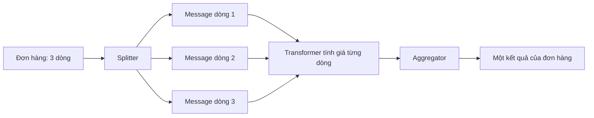

# Aggregator sau splitter

Trong chương **Aggregator** của module **SPRING_INTEGRATION_CORE**, bài này xây dựng luồng xử lý một thông điệp thành nhiều phần rồi gom các kết quả về một phản hồi. Các thành phần `Message`, `MessageChannel`, endpoint, transformer và Java DSL được kết nối trong cùng một ví dụ; gateway, router, filter và xử lý lỗi được xem xét ở những vị trí ảnh hưởng trực tiếp đến việc hoàn tất nhóm.

Sau bài học, bạn có thể giải thích dữ liệu mà splitter phải chuyển cho aggregator, viết một luồng tính giá đơn hàng, xác định vì sao nhóm bị chờ và thiết kế kiểm thử cho việc gom đủ phần, sai thứ tự hoặc thiếu kết quả.

## 1. Bài toán: xử lý từng phần nhưng trả kết quả của cả yêu cầu

Giả sử một đơn hàng chứa ba dòng hàng. Mỗi dòng cần được tính thành tiền riêng; sau đó hệ thống trả tổng tiền và danh sách các dòng đã xử lý cho ứng dụng gọi.



Các mũi tên mô tả các message có thể đi qua luồng, không khẳng định ba phần được chạy đồng thời. Việc thực thi phụ thuộc vào channel và executor được cấu hình.

Splitter tách dữ liệu; aggregator giữ trạng thái của những phần liên quan, chờ điều kiện hoàn tất rồi tạo kết quả chung. Mẫu này thường được gọi là **split-process-aggregate**, một cách triển khai Composed Message Processor. [Tham chiếu về splitter](https://docs.spring.io/spring-integration/reference/splitter.html).

“Gom lại” không nhất thiết là phục hồi payload ban đầu. Đầu vào có thể là đơn hàng, còn đầu ra là báo giá, báo cáo lỗi hoặc một giá trị tổng. Cần định nghĩa đầu ra theo nhu cầu nghiệp vụ trước khi viết hàm tổng hợp.

## 2. Hợp đồng giữa splitter và aggregator

### 2.1. Ba header mô tả một lần chia

Với splitter chuẩn bật `applySequence`, các phần được gắn thông tin sequence. Trong tình huống một tầng chia thông thường:

| Header | Ý nghĩa | Ví dụ cho phần thứ hai |
| --- | --- | --- |
| `correlationId` | Khóa liên hệ các phần của cùng lần chia | ID của message đầu vào splitter |
| `sequenceNumber` | Vị trí của phần trong sequence, bắt đầu từ 1 | `2` |
| `sequenceSize` | Tổng số phần nếu xác định được | `3` |

Các hằng tương ứng thuộc `IntegrationMessageHeaderAccessor`: `CORRELATION_ID`, `SEQUENCE_NUMBER`, `SEQUENCE_SIZE`. Splitter chuẩn bật việc áp dụng sequence theo mặc định. [API của splitter](https://docs.spring.io/spring-integration/api/org/springframework/integration/splitter/AbstractMessageSplitter.html).

Ví dụ một message cha có ID ký hiệu `M-100`:

```text
Trước splitter:
  id = M-100
  payload = [dòng A, dòng B, dòng C]

Sau splitter:
  message A: correlationId=M-100, sequenceNumber=1, sequenceSize=3
  message B: correlationId=M-100, sequenceNumber=2, sequenceSize=3
  message C: correlationId=M-100, sequenceNumber=3, sequenceSize=3
```

`M-100` chỉ là ký hiệu minh họa; ID message thực tế thường là UUID. Mỗi message con có ID riêng. Vì vậy, lấy `headers.id` của message con làm correlation key sẽ tạo các nhóm khác nhau và phá hỏng việc gom chung.

### 2.2. Correlation và release trả lời hai câu hỏi khác nhau

Aggregator thường dùng `correlationId` để xác định **message thuộc nhóm nào**, còn chiến lược release quyết định **nhóm đã đủ điều kiện tạo kết quả chưa**. Hàm tổng hợp chỉ quyết định **kết quả của nhóm là gì**. [Mô hình aggregator](https://docs.spring.io/spring-integration/reference/aggregator.html).

| Trách nhiệm | Ví dụ với đơn hàng |
| --- | --- |
| Correlation | Ba kết quả cùng lần tính giá thuộc một nhóm |
| Release | Chỉ tính báo giá khi đã có đủ kết quả cần thiết |
| Output processing | Tạo danh sách dòng và cộng thành tiền |
| Message group store | Giữ những kết quả đang chờ |

Không dùng điều kiện release để chữa một correlation key sai. Nếu hai yêu cầu bị gom nhầm vào một nhóm, điều kiện đếm đủ phần có thể cho phép tạo kết quả chứa dữ liệu của cả hai yêu cầu.

### 2.3. Đủ số lượng chưa chắc đủ các phần duy nhất

Trong trường hợp thông thường, chiến lược mặc định `SimpleSequenceSizeReleaseStrategy` so sánh số message trong nhóm với `sequenceSize`. Chiến lược này không kiểm tra trùng `sequenceNumber`. Do đó, nó phù hợp khi luồng bảo đảm mỗi phần tạo đúng một kết quả; bản thân nó không cung cấp khử trùng nghiệp vụ. [API của chiến lược release](https://docs.spring.io/spring-integration/api/org/springframework/integration/aggregator/SimpleSequenceSizeReleaseStrategy.html).

Ví dụ về rủi ro thiết kế:

```text
Mong đợi: phần 1, phần 2, phần 3
Thực nhận: phần 1, bản phát lại của phần 1, phần 3
```

Nếu bản phát lại mang ID message mới và vẫn được nhận vào nhóm, việc đếm ba message có thể che giấu phần 2 đang thiếu. Với kênh có redelivery, hãy định nghĩa khóa phần duy nhất, chẳng hạn `(requestId, lineNo)`, cùng cơ chế loại trùng trước khi dựa vào phép đếm.

## 3. Những điều kiện cần giữ trong đoạn xử lý giữa hai endpoint

Với thiết kế gom đủ các phần của một danh sách hữu hạn, hãy đặt ra bốn bất biến:

1. Mỗi phần tạo đúng một kết quả cuối cùng cho aggregator, kể cả kết quả thất bại nếu nghiệp vụ cho phép tổng hợp lỗi.
2. Các phần cùng yêu cầu có cùng correlation key; các yêu cầu độc lập có key khác nhau.
3. Metadata sequence được giữ qua transformer, service activator và các nhánh xử lý.
4. Có chính sách cho phần không bao giờ trả về, thay vì để nhóm mở vô hạn.

Ví dụ hai yêu cầu đến xen kẽ:

| Lần nhận | Correlation | Sequence | Trạng thái mong đợi |
| --- | --- | --- | --- |
| 1 | `request-A` | `1/2` | A đang chờ |
| 2 | `request-B` | `2/2` | B đang chờ, dù đã nhận phần có số thứ tự cuối |
| 3 | `request-A` | `2/2` | Phát một kết quả của A |
| 4 | `request-B` | `1/2` | Phát một kết quả của B |

Ví dụ này cũng cho thấy nhận `sequenceNumber == sequenceSize` chưa chứng minh mọi phần trước đó đã đến. Không dùng riêng phép so sánh đó làm điều kiện hoàn tất cho luồng có thể nhận sai thứ tự.

## 4. Ví dụ Java DSL: tính giá từng dòng rồi tổng hợp đơn hàng

### 4.1. Phạm vi của ví dụ

Ví dụ dùng Java 17 và API Java DSL của Spring Integration 6.x, với dependency `org.springframework.integration:spring-integration-core`. Nếu dự án dùng Spring Boot, có thể lấy dependency qua starter integration và để BOM của dự án quản lý phiên bản tương thích.

Đây là cấu hình Spring độc lập, không phụ thuộc vào việc chạy một ứng dụng Spring Boot. Các kiểu dữ liệu được đặt trong một lớp để có thể sao chép ví dụ mà không cần tìm thêm lớp nghiệp vụ.

Quy ước của bài toán:

- Đơn hàng có ít nhất một dòng; mỗi dòng có số lượng dương, đơn giá không âm.
- Mọi dòng dùng cùng đơn vị tiền. Ví dụ chưa có thuế, giảm giá hoặc quy tắc làm tròn.
- `orderId` là thông tin nghiệp vụ được mang theo bằng header.
- Correlation mặc định của splitter phân biệt từng lần xử lý, kể cả khi hai lần xử lý có cùng `orderId`.
- Kết quả được đưa vào một output queue có tên để dễ quan sát và kiểm thử.

### 4.2. Cấu hình đầy đủ

```java
package example.integration;

import java.math.BigDecimal;
import java.util.ArrayList;
import java.util.Comparator;
import java.util.List;

import org.springframework.context.annotation.Bean;
import org.springframework.context.annotation.Configuration;
import org.springframework.integration.config.EnableIntegration;
import org.springframework.integration.channel.DirectChannel;
import org.springframework.integration.channel.QueueChannel;
import org.springframework.integration.dsl.IntegrationFlow;
import org.springframework.integration.store.MessageGroup;
import org.springframework.integration.IntegrationMessageHeaderAccessor;
import org.springframework.messaging.Message;

@Configuration
@EnableIntegration
public class OrderAggregationConfig {

    public record OrderLine(
            int lineNo, String sku, int quantity, BigDecimal unitPrice) {
    }

    public record OrderRequest(String orderId, List<OrderLine> lines) {
        public OrderRequest {
            if (orderId == null || orderId.isBlank()) {
                throw new IllegalArgumentException("orderId is required");
            }
            lines = List.copyOf(lines);
            if (lines.isEmpty()) {
                throw new IllegalArgumentException("Order must not be empty");
            }
        }
    }

    public record PricedLine(int lineNo, String sku, BigDecimal amount) {
    }

    public record OrderSummary(
            String orderId, List<PricedLine> lines, BigDecimal total) {
        public OrderSummary {
            lines = List.copyOf(lines);
        }
    }

    @Bean(name = "orders.input")
    public DirectChannel orderInput() {
        return new DirectChannel();
    }

    @Bean(name = "orders.output")
    public QueueChannel orderOutput() {
        return new QueueChannel(100);
    }

    @Bean(name = "orders.discard")
    public QueueChannel orderDiscard() {
        return new QueueChannel(100);
    }

    @Bean
    public IntegrationFlow orderPricingFlow() {
        return IntegrationFlow.from("orders.input")
                .enrichHeaders(h -> h.headerFunction(
                        "orderId",
                        (Message<OrderRequest> message) ->
                                message.getPayload().orderId(),
                        true))
                .split(OrderRequest.class, OrderRequest::lines)
                .transform(OrderLine.class, OrderAggregationConfig::price)
                .channel("orders.toAggregate")
                .aggregate(a -> a
                        .outputProcessor(OrderAggregationConfig::summarize)
                        .groupTimeout(5_000)
                        .sendPartialResultOnExpiry(false)
                        .expireGroupsUponCompletion(false)
                        .expireGroupsUponTimeout(false)
                        .discardChannel("orders.discard"))
                .channel("orders.output")
                .get();
    }

    private static PricedLine price(OrderLine line) {
        if (line.quantity() <= 0
                || line.unitPrice() == null
                || line.unitPrice().signum() < 0) {
            throw new IllegalArgumentException("Invalid line: " + line.lineNo());
        }
        BigDecimal amount = line.unitPrice()
                .multiply(BigDecimal.valueOf(line.quantity()));
        return new PricedLine(line.lineNo(), line.sku(), amount);
    }

    private static OrderSummary summarize(MessageGroup group) {
        List<Message<?>> messages = new ArrayList<>(group.getMessages());
        messages.sort(Comparator.comparingInt(
                OrderAggregationConfig::sequenceNumber));

        List<PricedLine> lines = messages.stream()
                .map(message -> (PricedLine) message.getPayload())
                .toList();

        BigDecimal total = lines.stream()
                .map(PricedLine::amount)
                .reduce(BigDecimal.ZERO, BigDecimal::add);

        String orderId = messages.get(0).getHeaders()
                .get("orderId", String.class);
        return new OrderSummary(orderId, lines, total);
    }

    private static int sequenceNumber(Message<?> message) {
        Integer number = message.getHeaders().get(
                IntegrationMessageHeaderAccessor.SEQUENCE_NUMBER,
                Integer.class);
        if (number == null) {
            throw new IllegalArgumentException("Missing sequenceNumber");
        }
        return number;
    }
}
```

`headerFunction(..., true)` lấy `orderId` từ payload hiện tại và ghi đè giá trị cũ nếu có. Điều này làm rõ nguồn dữ liệu được tin dùng trong ví dụ. Header này phục vụ nghiệp vụ; luồng không thay correlation mặc định bằng `orderId`. [API của HeaderEnricherSpec](https://docs.spring.io/spring-integration/api/org/springframework/integration/dsl/HeaderEnricherSpec.html).

Các endpoint không khai báo channel riêng được DSL nối qua `DirectChannel`. Channel `orders.toAggregate` là một điểm nối được đặt tên, hữu ích khi cần kiểm tra trực tiếp đầu vào aggregator. [Cách Java DSL nối các endpoint](https://docs.spring.io/spring-integration/reference/dsl/java-channels.html).

### 4.3. Dữ liệu thay đổi như thế nào?

```text
OrderRequest
    -> splitter
OrderLine + correlationId + sequenceNumber + sequenceSize
    -> transformer
PricedLine + cùng metadata sequence
    -> aggregator
OrderSummary
```

Transformer trả payload `PricedLine`, không tự xây dựng một message mới chỉ chứa payload. Hàm `summarize` nhận cả `MessageGroup` để có thể đọc sequence và sắp xếp trước khi tạo `OrderSummary`.

`outputProcessor` tạo dữ liệu kết quả sau khi nhóm được release; nó không thay thế điều kiện release. Nếu chỉ cần danh sách payload và không cần tính tổng riêng, processor mặc định có thể đáp ứng nhu cầu gom các payload vào một message. [API AggregatorSpec](https://docs.spring.io/spring-integration/api/org/springframework/integration/dsl/AggregatorSpec.html), [processor mặc định](https://docs.spring.io/spring-integration/api/org/springframework/integration/aggregator/DefaultAggregatingMessageGroupProcessor.html).

Ví dụ đầu vào và đầu ra kỳ vọng:

| Dòng | Số lượng | Đơn giá | Thành tiền |
| --- | --- | --- | --- |
| `BOOK` | 2 | 10.000 | 20.000 |
| `PEN` | 1 | 30.000 | 30.000 |
| `CLIP` | 5 | 1.000 | 5.000 |
| Tổng | | | **55.000** |

### 4.4. Vì sao phải sắp xếp rõ ràng?

Một danh sách trong kết quả phải tuân theo yêu cầu nghiệp vụ đã chọn. Trong ví dụ, đó là thứ tự của danh sách gửi vào splitter. Hàm tổng hợp vì thế sao chép message của nhóm rồi sắp xếp theo `sequenceNumber`.

Không sửa trực tiếp collection của `MessageGroup`, và không trả collection nội bộ đó cho mã bên ngoài giữ lại. Kết quả nghiệp vụ nên có dữ liệu độc lập với vòng đời lưu trữ của nhóm.

Nếu doanh nghiệp muốn thứ tự theo mã hàng hay theo độ ưu tiên, hãy viết comparator tương ứng. `sequenceNumber` chỉ diễn tả thứ tự của lần chia, không tự trở thành thứ tự nghiệp vụ cho mọi bài toán.

### 4.5. Giới hạn vận hành của cấu hình minh họa

Ví dụ chủ động không trả tổng tiền thiếu dòng khi hết thời gian chờ. Nó cũng giữ dấu nhóm đã hoàn tất hoặc timeout để có thể nhận biết phần đến muộn theo chính sách của handler. Đây là ví dụ học tập có lưu trạng thái trong bộ nhớ, chưa phải cấu hình lưu trữ cho mọi tải sản xuất.

Hai queue giới hạn 100 message cần được consumer đọc thường xuyên. `QueueChannel` lưu message chờ người nhận; queue đầy có thể khiến thao tác gửi phải chờ. [Hành vi QueueChannel](https://docs.spring.io/spring-integration/reference/channel/implementations.html).

Việc thu dọn metadata của nhóm được bàn ở mục 9. Nếu dùng cấu hình này trong một tiến trình sống lâu, phải bổ sung chính sách thu dọn phù hợp.

## 5. Kiểm thử luồng và hợp đồng của aggregator

Các kiểm thử dưới đây là mã minh họa để đưa vào dự án có JUnit Jupiter. Chúng không cần broker, HTTP server hoặc cơ sở dữ liệu. Kiểm thử thứ nhất đi qua toàn bộ splitter-transformer-aggregator; kiểm thử thứ hai đưa các phần đã xử lý trực tiếp đến aggregator để kiểm soát thứ tự nhận.

```java
package example.integration;

import java.math.BigDecimal;
import java.util.List;

import org.junit.jupiter.api.Test;
import org.springframework.context.annotation.AnnotationConfigApplicationContext;
import org.springframework.integration.channel.QueueChannel;
import org.springframework.integration.IntegrationMessageHeaderAccessor;
import org.springframework.messaging.Message;
import org.springframework.messaging.MessageChannel;
import org.springframework.messaging.support.MessageBuilder;

import example.integration.OrderAggregationConfig.OrderLine;
import example.integration.OrderAggregationConfig.OrderRequest;
import example.integration.OrderAggregationConfig.OrderSummary;
import example.integration.OrderAggregationConfig.PricedLine;

import static org.junit.jupiter.api.Assertions.*;

class OrderAggregationTest {

    @Test
    void aggregatesAllPricedLinesIntoOneSummary() {
        try (var context = new AnnotationConfigApplicationContext(
                OrderAggregationConfig.class)) {
            MessageChannel input = context.getBean(
                    "orders.input", MessageChannel.class);
            QueueChannel output = context.getBean(
                    "orders.output", QueueChannel.class);

            var request = new OrderRequest("ORD-42", List.of(
                    new OrderLine(1, "BOOK", 2, new BigDecimal("10000")),
                    new OrderLine(2, "PEN", 1, new BigDecimal("30000")),
                    new OrderLine(3, "CLIP", 5, new BigDecimal("1000"))));

            assertTrue(input.send(
                    MessageBuilder.withPayload(request).build()));

            Message<?> reply = output.receive(1_000);
            assertNotNull(reply);
            OrderSummary summary = assertInstanceOf(
                    OrderSummary.class, reply.getPayload());

            assertEquals("ORD-42", summary.orderId());
            assertEquals(List.of("BOOK", "PEN", "CLIP"),
                    summary.lines().stream().map(PricedLine::sku).toList());
            assertEquals(0, new BigDecimal("55000")
                    .compareTo(summary.total()));
            assertNull(output.receive(0));
        }
    }

    @Test
    void waitsForAllPartsAndRestoresSequenceOrder() {
        try (var context = new AnnotationConfigApplicationContext(
                OrderAggregationConfig.class)) {
            MessageChannel aggregateInput = context.getBean(
                    "orders.toAggregate", MessageChannel.class);
            QueueChannel output = context.getBean(
                    "orders.output", QueueChannel.class);

            assertTrue(aggregateInput.send(part("request-42", 3)));
            assertNull(output.receive(0));

            assertTrue(aggregateInput.send(part("request-42", 1)));
            assertNull(output.receive(0));

            assertTrue(aggregateInput.send(part("request-42", 2)));
            Message<?> reply = output.receive(1_000);
            assertNotNull(reply);
            OrderSummary summary = assertInstanceOf(
                    OrderSummary.class, reply.getPayload());

            assertEquals(List.of("SKU-1", "SKU-2", "SKU-3"),
                    summary.lines().stream().map(PricedLine::sku).toList());
            assertNull(output.receive(0));
        }
    }

    private Message<PricedLine> part(String correlationId, int number) {
        return MessageBuilder.withPayload(new PricedLine(
                        number, "SKU-" + number, new BigDecimal("1000")))
                .setHeader("orderId", "ORD-42")
                .setHeader(IntegrationMessageHeaderAccessor.CORRELATION_ID,
                        correlationId)
                .setHeader(IntegrationMessageHeaderAccessor.SEQUENCE_NUMBER,
                        number)
                .setHeader(IntegrationMessageHeaderAccessor.SEQUENCE_SIZE, 3)
                .build();
    }
}
```

`receive(0)` kiểm tra ngay lập tức có message hay không. Với đầu vào đồng bộ trong ví dụ, nó phù hợp để xác nhận chưa release sau từng lần gửi. Với flow bất đồng bộ, kiểm tra âm tính cần một cơ chế đồng bộ hoặc một khoảng quan sát hữu hạn phù hợp; không suy ra “không bao giờ có kết quả” chỉ từ một lần đọc tức thời.

Nên mở rộng các ca kiểm thử theo rủi ro thực tế:

| Trường hợp | Kết quả cần xác nhận |
| --- | --- |
| Hai nhóm nhận message xen kẽ | Không trộn dòng của hai yêu cầu |
| Cùng `orderId`, hai lần gửi độc lập | Hai lần tính giá được phân biệt |
| Thiếu một phần | Không có báo giá đầy đủ; timeout đưa nhóm sang hướng xử lý đã chọn |
| Một phần bị gửi lại với ID mới | Cơ chế khử trùng hoặc release tùy biến xử lý đúng hợp đồng |
| Dòng bị filter loại | Không để nhóm chờ vô hạn mà không có chính sách |
| Danh sách rỗng | Bị từ chối hoặc có phản hồi rỗng được thiết kế trước splitter |
| Message thiếu metadata sequence | Luồng phát hiện đầu vào sai hợp đồng |
| Phần đến sau khi nhóm đã hoàn tất | Không tạo một báo giá phụ ngoài ý muốn |

Không dùng `Thread.sleep()` như cách duy nhất để xác nhận timeout. Có thể chờ nhận từ discard queue với thời hạn hữu hạn, hoặc điều khiển scheduler trong một kiểm thử chuyên biệt.

## 6. Filter và router có thể làm nhóm không đủ phần

### 6.1. Filter sau splitter làm thay đổi số lượng thực tế

Giả sử splitter chia ba dòng rồi một filter bỏ dòng có số lượng không hợp lệ:

```text
Splitter tạo:    A(1/3), B(2/3), C(3/3)
Filter cho qua:  A(1/3),         C(3/3)
Aggregator có:  2 message, vẫn mong đợi 3
```

Việc filter loại B không tự sửa `sequenceSize` của A và C. Từ hợp đồng ba phần ban đầu, aggregator không thể biết B đã bị loại có chủ ý hay vẫn đang xử lý.

Có ba hướng thiết kế:

| Hướng | Khi thích hợp | Điều cần định nghĩa |
| --- | --- | --- |
| Lọc danh sách trước splitter | Biết ngay phần nào được đưa vào xử lý | Đầu vào sau lọc có thể rỗng hay không |
| Trả một kết quả đánh dấu cho phần bị loại | Cần báo cáo đủ từng dòng | Payload trạng thái thành công, bỏ qua, thất bại |
| Release tùy biến cùng tín hiệu hoàn tất | Số kết quả không theo danh sách cố định | Giao thức cho biết tổng số phần hoặc kết thúc batch |

Với bài toán báo giá, một thiết kế hợp lý là từ chối đơn không hợp lệ trước khi chia, hoặc trả một kết quả lỗi cho chính dòng đó. Chỉ bỏ message rồi hy vọng aggregator tự suy ra số lượng mới là hợp đồng không đầy đủ.

### 6.2. Router phải đưa các kết quả cần gom về cùng điểm

Sau splitter, router có thể chuyển dòng thường và dòng khuyến mại đến hai nhánh khác nhau. Nếu một báo giá cần cả hai loại dòng, kết quả của cả hai nhánh phải quay về cùng aggregator, mang metadata của cùng lần chia.

Nếu một phần được nhân bản đến nhiều nhánh và mỗi nhánh trả một kết quả, tổng số kết quả đã thay đổi. Khi đó, hãy thiết kế một tầng fan-out/gom riêng hoặc một release strategy mới. Không tiếp tục dùng nguyên số lượng phần của tầng splitter trước đó mà không xem xét lại.

## 7. Lỗi xử lý một phần không tự trở thành kết quả của phần đó

Trong flow đồng bộ dùng `DirectChannel`, lỗi xử lý có thể truyền về bên gửi. Với xử lý bất đồng bộ, lỗi thường được biểu diễn qua `ErrorMessage` và chuyển đến error channel phù hợp. [Cơ chế xử lý lỗi của Spring Integration](https://docs.spring.io/spring-integration/reference/error-handling.html).

Ví dụ dòng 1 đã đến aggregator, nhưng tính giá dòng 2 ném exception. Nhóm có thể đã chứa một phần; đồng thời bên gọi nhận lỗi. Việc ghi log exception không làm phần còn thiếu xuất hiện trong nhóm, cũng không tự hủy nhóm đã tạo.

Trước khi triển khai retry hoặc error flow, cần chọn một trong các hợp đồng nghiệp vụ:

- **Yêu cầu phải thành công toàn bộ:** lỗi một dòng làm yêu cầu thất bại; các phần đã lưu cần được hết hạn hoặc hủy theo cơ chế quản lý yêu cầu.
- **Báo cáo trạng thái từng dòng:** mỗi dòng, kể cả dòng lỗi, đều trả đúng một outcome cho aggregator.
- **Cho phép dữ liệu thiếu:** kết quả phải thể hiện thiếu bao nhiêu phần và vì sao; người nhận phân biệt được với kết quả đầy đủ.

Với hướng thứ hai, có thể dùng một payload thống nhất:

```java
public enum LineStatus {
    SUCCESS, FAILED, SKIPPED
}

public record LineOutcome(
        int lineNo,
        LineStatus status,
        BigDecimal amount,
        String reason) {
}
```

Đây là mô hình thay thế cho `PricedLine` trong ví dụ chính, không phải một kiểu payload có thể trộn trực tiếp vào `summarize` hiện tại. Khi chuyển thiết kế, phải đổi cả bước xử lý từng dòng và hàm tổng hợp.

Một error flow tạo `LineOutcome` cần lấy metadata từ **message phần đã thất bại**, không dùng metadata của vỏ `ErrorMessage` như thể đó là phần gốc. Ngoài ra phải bảo đảm chỉ một outcome cuối cùng được gửi: thành công sau retry và một outcome lỗi đã gửi trước đó không được cùng tính cho một dòng.

Khi tự xây dựng message từ kết quả xử lý, hãy chuyển các header cần thiết một cách rõ ràng. Ví dụ đoạn sau giả định `failedPart` chính là message con và `outcome` là kết quả thay thế:

```java
Message<LineOutcome> replacement = MessageBuilder.withPayload(outcome)
        .copyHeaders(failedPart.getHeaders())
        .build();
```

Mẫu này vẫn cần được đặt trong một error flow có kiểm soát retry, nhánh gửi và kiểu dữ liệu phù hợp. Chuyển toàn bộ `ErrorMessage` thẳng vào aggregator tính tiền sẽ vi phạm hợp đồng payload.

## 8. Timeout của nhóm và timeout của gateway

### 8.1. Timeout giới hạn việc chờ, không xác nhận đủ kết quả

Trong ví dụ, `groupTimeout(5_000)` cho phép xử lý nhóm không được release sau khoảng chờ tương ứng. Giá trị là mili giây. Với timeout cố định thông thường, lịch chờ được tính lại khi nhóm nhận thêm message; đây là khoảng không có phần mới đến, không phải deadline tuyệt đối kể từ lúc gateway nhận yêu cầu. [API cấu hình correlation handler](https://docs.spring.io/spring-integration/api/org/springframework/integration/dsl/CorrelationHandlerSpec.html).

Nếu cần SLA từ lúc bắt đầu yêu cầu, hãy đưa deadline vào hợp đồng xử lý. Ví dụ một yêu cầu có deadline 10 giây không được kéo dài vô hạn chỉ vì thỉnh thoảng lại có một phần đến.

### 8.2. Hết hạn có thể bỏ nhóm hoặc phát kết quả thiếu

Hai lựa chọn cần được quyết định ở cấp nghiệp vụ:

| Cấu hình | Ý nghĩa khi nhóm chưa đủ và bị hết hạn |
| --- | --- |
| `sendPartialResultOnExpiry(false)` | Không tạo kết quả tổng hợp thiếu phần; đưa phần bị loại tới discard channel nếu cấu hình |
| `sendPartialResultOnExpiry(true)` | Cho phép tạo kết quả tổng hợp từ các phần hiện có |

Hàm tổng hợp phục vụ báo cáo từng phần có thể cần trả `expectedCount`, `receivedCount`, danh sách phần lỗi và trạng thái hoàn tất. Chỉ cộng tiền của những dòng đã đến rồi đặt tên kết quả là “tổng tiền đơn hàng” có thể dẫn đến quyết định nghiệp vụ sai.

Trong ví dụ chính, discard queue là nơi quan sát message bị loại; nó chưa chuyển việc hết hạn thành một phản hồi lỗi gửi người gọi. Muốn có phản hồi lỗi của cả yêu cầu, cần thêm cơ chế xác định request đã hết hạn và tạo phản hồi tương ứng.

### 8.3. Gateway hết chờ không đồng nghĩa aggregator đã ngừng

Messaging gateway cung cấp giao diện gọi nghiệp vụ và có cơ chế chờ phản hồi. Timeout chờ reply của gateway là một cấu hình khác với thời gian chờ của nhóm aggregator. [Tài liệu Messaging Gateways](https://docs.spring.io/spring-integration/reference/gateway.html).

Giả sử xử lý bất đồng bộ:

```text
0 giây: gateway gửi yêu cầu.
2 giây: gateway hết thời gian chờ reply.
4 giây: một phần xử lý mới hoàn tất và đến aggregator.
```

Không nên suy ra yêu cầu đã được hủy chỉ vì bên gọi hết chờ. Cần có quyết định cho kết quả đến sau thời hạn: lưu để tra cứu, gửi thông báo hoặc loại bỏ theo trạng thái yêu cầu.

Với chuỗi chạy đồng bộ trong thread của người gọi, reply timeout cũng không phải cơ chế ngắt một handler đang thực thi. Nếu bước gọi dịch vụ bên ngoài có thể treo, phải cấu hình timeout của chính thao tác I/O đó.

Ví dụ chính kết thúc ở `orders.output`. Khi chuyển sang mô hình gateway request-reply, cần thiết kế đường trả reply phù hợp, chẳng hạn để kết quả về `replyChannel` của yêu cầu. Không chỉ thêm gateway vào đầu flow rồi giả định output queue cố định tự trở thành phản hồi của gateway.

## 9. Vòng đời nhóm, message đến muộn và lưu trạng thái

### 9.1. Hai kiểu hết hạn cần được phân biệt

`expireGroupsUponCompletion` điều khiển việc xóa nhóm sau hoàn tất bình thường; `expireGroupsUponTimeout` điều khiển việc xóa nhóm khi hết thời gian chờ. Nếu xóa hoàn toàn dấu nhóm, một phần đến muộn có cùng key có thể mở nhóm mới. Giữ dấu hoàn tất hỗ trợ nhận biết phần đến muộn, nhưng cần quản lý thời gian giữ dấu. [API của AbstractCorrelatingMessageHandler](https://docs.spring.io/spring-integration/api/org/springframework/integration/aggregator/AbstractCorrelatingMessageHandler.html).

Ví dụ chính đặt cả hai tùy chọn là `false` để làm rõ việc giữ trạng thái sau lần xử lý. Tuy vậy, không thể giữ metadata của mọi yêu cầu mãi mãi. Cần định nghĩa cửa sổ chấp nhận message đến muộn và thời điểm xóa dấu nhóm, bằng cơ chế như reaper hoặc purge được lập lịch.

Hãy phân biệt các quyết định:

| Quyết định | Câu hỏi nghiệp vụ |
| --- | --- |
| Thời gian chờ nhóm đang mở | Chờ phần còn thiếu trong bao lâu? |
| Kết quả khi hết chờ | Báo thất bại hay cho phép kết quả thiếu? |
| Thời gian giữ dấu đã hoàn tất | Nhận biết message đến muộn trong bao lâu? |
| Khử trùng nghiệp vụ | Có cần chống xử lý lặp sau khi dấu nhóm bị xóa? |

### 9.2. Bộ nhớ trong tiến trình và persistent store

Store mặc định trong bộ nhớ thuận tiện cho ví dụ nhỏ, nhưng trạng thái đang chờ có thể mất khi tiến trình dừng. Nếu yêu cầu cần tiếp tục sau restart, hãy chọn `MessageGroupStore` bền vững phù hợp, đồng thời xem xét khả năng serialize payload và header. [Tài liệu Message Store](https://docs.spring.io/spring-integration/reference/message-store.html).

Lưu trạng thái bền vững chỉ giải quyết một phần bài toán. Còn cần định nghĩa cách tiếp tục hoặc hết hạn nhóm đang dở sau restart, cách ngăn hai tiến trình cùng sửa một nhóm và cách tránh phát kết quả trùng khi gửi đầu ra thất bại.

Trong triển khai nhiều instance, các phần cùng key phải được đưa đến nơi cùng nhìn thấy trạng thái nhóm hoặc được định tuyến về cùng chủ sở hữu. Nếu mỗi instance có store riêng mà các phần bị phân tán ngẫu nhiên, từng instance chỉ thấy một phần của yêu cầu.

Về dung lượng, có thể ước lượng ban đầu theo mô hình của chính hệ thống:

```text
Bộ nhớ cho nhóm đang mở xấp xỉ
    số nhóm đang mở
  × số phần trung bình đã lưu mỗi nhóm
  × kích thước message trung bình

Sau đó cộng overhead của store, header và dấu nhóm đã hoàn tất.
```

Một luồng chạy đúng với ba dòng đơn hàng có thể giữ quá nhiều dữ liệu khi có hàng nghìn yêu cầu đồng thời và một dịch vụ phụ thuộc trả lời chậm. Hãy quan sát cả số nhóm mở và tuổi của nhóm lâu nhất.

## 10. Các trường hợp không thể dùng máy móc mô hình danh sách hữu hạn

### 10.1. Danh sách rỗng

Nếu không có phần nào được splitter phát ra, sẽ không có message đầu tiên để tạo nhóm. Không thể chờ aggregator tự phát một danh sách rỗng chỉ từ thông tin “không có message”.

Ví dụ chính từ chối danh sách rỗng ngay ở `OrderRequest`. Một API tìm kiếm hoặc một batch tùy chọn có thể chọn trả kết quả rỗng bằng nhánh riêng trước splitter. Splitter cũng có hỗ trợ discard cho kết quả chia rỗng, nhưng discard không tự tạo phản hồi thành công. [Tài liệu splitter](https://docs.spring.io/spring-integration/reference/splitter.html).

### 10.2. Iterator hoặc luồng dữ liệu chưa biết tổng số phần

Nếu splitter không biết tổng số phần, `sequenceSize` có thể là `0`. Khi đó không nên dựa vào release mặc định theo kích thước sequence như với một `List` đã biết số phần.

Bạn cần một giao thức khác: số lượng kỳ vọng do nguồn cung cấp, tín hiệu kết thúc batch, hoặc cửa sổ thời gian có ngữ nghĩa rõ ràng. Nếu dùng tín hiệu kết thúc và phần có thể đến sai thứ tự, phải bảo đảm tín hiệu đó không khiến nhóm release trước những phần còn đang trên đường tới.

### 10.3. Splitter lồng nhau

Một đơn hàng có thể được chia thành các kiện, mỗi kiện lại chia thành các dòng. Cần gom dòng thành kết quả kiện trước, rồi gom các kiện thành kết quả đơn hàng:

```text
Đơn hàng
  -> split các kiện
      -> split các dòng của một kiện
      -> xử lý dòng
      -> aggregate thành kết quả kiện
  -> aggregate thành kết quả đơn hàng
```

Ở mỗi tầng, phải giữ metadata của đúng sequence. Spring Integration hỗ trợ việc khôi phục ngữ cảnh sequence qua cơ chế `popSequence`; không nên tự gán một correlation key chung cho mọi tầng mà không thiết kế lại khóa nhóm và chiến lược release.

## 11. Chuyển sang xử lý song song

Thêm splitter không tự làm tăng số thread. Trong ví dụ chính, các bước xử lý từng dòng chạy theo cách nối channel đồng bộ. Nếu tính giá cần I/O độc lập cho từng dòng, có thể đưa executor channel vào **sau splitter, trước bước xử lý dòng**.

Đoạn thay đổi tại vị trí đó, giả định `pricingExecutor` là executor do Spring quản lý:

```java
.split(OrderRequest.class, OrderRequest::lines)
.channel(c -> c.executor(pricingExecutor))
.transform(OrderLine.class, OrderAggregationConfig::price)
```

Khi đưa executor vào, phải xét lại các điều kiện của bài toán:

- Phần hoàn thành có thể tới sai thứ tự; comparator trong `summarize` cần giữ đúng thứ tự đầu ra đã cam kết.
- Không giả định transaction hay thread-local của thread gửi tự đi qua ranh giới bất đồng bộ.
- Executor cần giới hạn tài nguyên theo sức chịu tải của dịch vụ tính giá.
- Error flow cần tạo trạng thái cuối cùng của phần hoặc của cả yêu cầu.
- Timeout phải tính đến thời gian xếp hàng, gọi dịch vụ, retry và độ trễ gom nhóm.

Trong bài toán ba dòng độc lập, tăng số worker có thể giảm thời gian chờ khi dịch vụ bên ngoài cho phép. Nhưng nếu tất cả worker cùng gọi một hệ thống bị giới hạn kết nối, tăng concurrency có thể chỉ làm hàng đợi dài hơn. Quyết định dựa trên đo đạc và giới hạn thực tế của phụ thuộc.

## 12. Chẩn đoán khi nhóm không cho ra kết quả

Khi thấy thông báo “aggregator bị treo”, hãy quan sát message ngay trước aggregator và trả lời lần lượt:

1. Message có cùng correlation key như các phần khác của yêu cầu không?
2. `sequenceSize` có giá trị dự kiến hay đang bằng `0`?
3. Thực tế đã có bao nhiêu kết quả, có phần nào bị filter, router hoặc exception chặn lại?
4. Có phần nào được gửi lại hoặc nhân bản làm phép đếm lệch không?
5. Nhóm đã bị hoàn tất, hết hạn hoặc chuyển discard trước khi phần cuối tới chưa?
6. Kết quả đã được tạo nhưng đang nằm ở queue hoặc reply channel khác với nơi người gọi chờ không?

Thông tin log hữu ích gồm request ID, order ID, correlation key, sequence number, sequence size, tên endpoint và thời điểm nhận. Không cần log toàn bộ payload để chứng minh nhóm nhận đủ phần.

Ví dụ dấu vết đủ để nhận ra phần bị thiếu:

```text
request=req-42 correlation=g-42 sequence=1/3 endpoint=orders.toAggregate
request=req-42 correlation=g-42 sequence=3/3 endpoint=orders.toAggregate
```

Từ hai dòng này có thể đưa ra giả thuyết phần 2 chưa đến; chưa thể kết luận nó bị mất vĩnh viễn. Bước điều tra tiếp theo là kiểm tra đường đi của chính phần 2 và trạng thái hết hạn của nhóm.

Một thiết kế hoàn chỉnh cần chỉ rõ ba điều: các phần nào thuộc cùng một yêu cầu, khi nào được phép xem yêu cầu đã hoàn tất và cách phản ánh phần thiếu hoặc lỗi. Khi các hợp đồng đó rõ ràng, splitter, channel, transformer, router, filter, aggregator và gateway mới phối hợp thành một luồng thông điệp có thể kiểm thử và vận hành.
