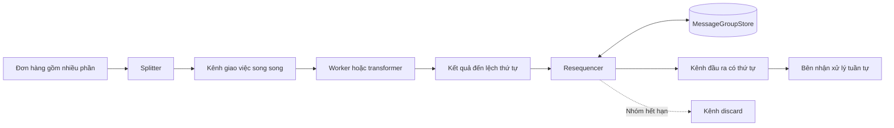

# Message resequencer là gì

## 1. Vấn đề: kết quả đến trước chưa chắc phải được xử lý trước

Giả sử một đơn hàng có ba phần dữ liệu, được đánh số `1`, `2`, `3`. Hệ thống gửi mỗi phần đến một worker để kiểm tra hoặc làm giàu dữ liệu. Worker xử lý phần `3` nhanh nhất, phần `1` hoàn thành tiếp theo, còn phần `2` phải chờ một dịch vụ bên ngoài:

```text
Thứ tự nghiệp vụ:       1 → 2 → 3
Thứ tự hoàn thành:      3 → 1 → 2
Thứ tự bên nhận cần:    1 → 2 → 3
```

Nếu bên nhận ghi từng phần vào một tài liệu theo thứ tự đến, tài liệu có thể bị đảo nội dung dù từng worker đều xử lý đúng. Thành phần cần bổ sung là một **message resequencer**: endpoint giữ các thông điệp có liên quan và phát chúng theo thứ tự được mô tả trong metadata.

Trong Spring Integration, resequencer mặc định nhóm theo `correlationId`, sắp xếp theo `sequenceNumber` và sử dụng thông tin `sequenceSize` để nhận biết một chuỗi hữu hạn. Nó tiếp tục phát các message riêng lẻ, giữ nguyên nội dung của chúng. Xem [tài liệu Resequencer của Spring Integration](https://docs.spring.io/spring-integration/reference/6.5/resequencer.html).

Bài này thuộc phạm vi **SPRING_INTEGRATION_CORE**: dùng `Message`, `MessageChannel`, endpoint và Java DSL để thiết kế luồng tích hợp. Sau bài học, bạn cần giải thích được vì sao phải lưu trạng thái, chọn cách phát chuỗi phù hợp, cấu hình một flow cơ bản và xác định điều gì xảy ra khi một phần của chuỗi không bao giờ đến.

## 2. Đặt resequencer vào đúng vị trí trong luồng



Ví dụ này thể hiện một lựa chọn thiết kế: giữ phần xử lý tốn thời gian ở trước resequencer để tận dụng xử lý song song, rồi khôi phục thứ tự tại ranh giới mà bên nhận cần.

Nếu chính thao tác của worker đã đòi hỏi thứ tự, chẳng hạn phần `2` cập nhật dữ liệu dựa trên thay đổi của phần `1`, đặt resequencer sau worker là quá muộn. Khi đó cần bảo vệ thứ tự trước thao tác phụ thuộc này hoặc thay đổi cách phân chia công việc.

Một `QueueChannel` dạng FIFO cũng chưa giải quyết được tình huống trên. Nếu kết quả được đưa vào queue theo thứ tự `3, 1, 2`, bên nhận sẽ lấy ra theo chính thứ tự đó. `PriorityChannel` có thể chọn thông điệp theo độ ưu tiên hoặc comparator trong các phần tử đang có, nhưng việc chọn một phần tử chưa bao hàm quyết định chờ một phần tử chưa đến. Các đặc tính kênh này được mô tả tại [Message Channel Implementations](https://docs.spring.io/spring-integration/reference/6.5/channel/implementations.html).

## 3. Hợp đồng dữ liệu: nhóm nào, vị trí nào, bao nhiêu phần

### 3.1. Ba header cần hiểu

| Header | Hằng số Java | Câu hỏi được trả lời | Ví dụ |
| --- | --- | --- | --- |
| `correlationId` | `IntegrationMessageHeaderAccessor.CORRELATION_ID` | Message thuộc chuỗi nào? | `order-42:export-7` |
| `sequenceNumber` | `IntegrationMessageHeaderAccessor.SEQUENCE_NUMBER` | Message đứng ở vị trí nào? | `2` |
| `sequenceSize` | `IntegrationMessageHeaderAccessor.SEQUENCE_SIZE` | Chuỗi có tổng cộng bao nhiêu message? | `3` |

Các hằng số và accessor tương ứng nằm trong [API IntegrationMessageHeaderAccessor](https://docs.spring.io/spring-integration/docs/6.5.0/api/org/springframework/integration/IntegrationMessageHeaderAccessor.html). Dùng hằng số giúp tránh nhầm tên header; trong ví dụ Java bên dưới, hai giá trị thứ tự được truyền bằng số nguyên.

Với bài toán chuỗi hữu hạn trong bài học này, hãy đặt hợp đồng đầu vào như sau:

- Các phần của cùng một lần xử lý dùng chung một correlation key.
- Mỗi vị trí xuất hiện một lần, đánh số liên tiếp từ `1` đến `N`.
- Mọi phần trong chuỗi cùng khai báo `sequenceSize = N`.
- Correlation key phân biệt được những lần xử lý khác nhau của cùng một đối tượng nghiệp vụ.

Ví dụ, `order-42` có thể trải qua hai lần xuất dữ liệu. Nếu cả hai lần đều dùng `order-42` làm correlation key, các phần có thể bị trộn. Khóa `order-42:export-7` thể hiện rõ cả đối tượng lẫn lần xử lý.

`MessageHeaders.ID` định danh một message cụ thể. Nó không thay thế vai trò gom nhóm của correlation key. Tương tự, thời điểm tạo message hoặc thời điểm worker hoàn thành không tự thể hiện vị trí nghiệp vụ mà bên nhận mong muốn.

### 3.2. Một tập message hợp lệ

| Thứ tự đến | Payload | `correlationId` | `sequenceNumber` | `sequenceSize` |
| --- | --- | --- | --- | --- |
| 1 | `part-3` | `batch-A` | 3 | 3 |
| 2 | `part-1` | `batch-A` | 1 | 3 |
| 3 | `part-2` | `batch-A` | 2 | 3 |

Resequencer có đủ thông tin để xác định rằng cả ba message thuộc một chuỗi và kết quả phải là `part-1`, `part-2`, `part-3`. Nó không cần đoán thứ tự từ chuỗi ký tự trong payload.

### 3.3. Header đến từ đâu?

Một splitter thông thường có thể tạo các header liên quan đến chuỗi. Với publish-subscribe channel hoặc recipient-list router, cần xem xét cấu hình `applySequence` nếu dùng chúng để tạo các nhánh cần gom lại. Không nên giả định mọi router đều tự sinh metadata chuỗi. Xem [Splitter](https://docs.spring.io/spring-integration/reference/6.5/splitter.html) và [hướng dẫn correlation trong Aggregator](https://docs.spring.io/spring-integration/reference/6.5/aggregator.html).

Khi thông điệp đến từ một hệ thống bên ngoài, lớp chuyển đổi đầu vào có thể ánh xạ `batchId`, `partIndex`, `partCount` thành các header nói trên. Cần giữ được chúng qua các bước transformer, qua broker hoặc qua giao thức truyền tải.

Một tình huống cần thiết kế riêng là đầu vào dạng iterator hoặc stream chưa biết số phần. Splitter có thể không xác định được kích thước và đặt `sequenceSize = 0`. Khi đó, không thể dựa vào hợp đồng “đủ `N` phần” của ví dụ này để kết luận chuỗi đã hoàn tất. Cần có tín hiệu kết thúc, giới hạn cửa sổ hoặc chiến lược phát phù hợp; xem [phần Iterators của Splitter](https://docs.spring.io/spring-integration/reference/6.5/splitter.html#splitter-iterators).

## 4. Resequencer hoạt động như thế nào?

Có thể mô tả vòng xử lý ở mức khái niệm như sau. Đây là mô hình để hiểu trách nhiệm của endpoint, không phải mã triển khai nội bộ của Spring Integration:

```text
Khi nhận một message:
    xác định correlation key
    đưa message vào trạng thái của nhóm tương ứng
    kiểm tra điều kiện được phép phát
    nếu đủ điều kiện:
        chọn các message có thể phát theo quy tắc chuỗi
        phát chúng theo sequenceNumber tăng dần
        cập nhật trạng thái và tiến độ của nhóm
    nếu chưa đủ điều kiện:
        tiếp tục giữ các message cần chờ
```

Ba câu hỏi cần tách rõ trong thiết kế là:

| Trách nhiệm | Ý nghĩa |
| --- | --- |
| Correlation | Những message nào thuộc cùng một chuỗi? |
| Release | Đã có thể phát tiếp hay cần chờ thêm? |
| Resequencing | Trong phần được phép phát, message nào phải đi trước? |

Java DSL cung cấp cấu hình correlation strategy và release strategy cho các endpoint thuộc nhóm này; xem [Aggregators and Resequencers trong Java DSL](https://docs.spring.io/spring-integration/reference/6.5/dsl/java-aggregators.html).

### 4.1. Vì sao cần lưu trạng thái?

Khi chỉ mới nhận phần `3`, endpoint chưa thể phát nó mà vẫn bảo đảm phần `1` và `2` được phát trước. Nó phải giữ message lại. Với chế độ phát từng đoạn, nó còn phải biết đã phát đến vị trí nào để xác định đoạn tiếp theo.

Vì vậy, resequencer là endpoint **có trạng thái**. Việc `inputChannel.send(message)` trả về thành công có thể chỉ có nghĩa endpoint đã tiếp nhận message vào nhóm chờ. Điều đó chưa chứng minh bên nhận cuối cùng đã xử lý message.

### 4.2. Thứ tự được xác định trong từng nhóm

Giả sử đầu vào xen kẽ hai nhóm:

```text
A3, B2, A1, B1, A2
```

Ở chế độ chờ đủ chuỗi, một kết quả có thể là:

```text
B1, B2, A1, A2, A3
```

Nhóm B hoàn tất trước nên được phát trước. Điều cần bảo đảm trong ví dụ là `A1` trước `A2` trước `A3`, và `B1` trước `B2`. Không có yêu cầu gom tất cả message của mọi đơn hàng thành một trật tự toàn cục.

Nếu nghiệp vụ cần một thứ tự chung cho nhiều đối tượng, phải xác định lại miền correlation và nguồn cấp số thứ tự. Dùng chung một correlation key cho toàn hệ thống có thể biến mọi công việc thành một điểm chờ lớn.

## 5. Hai cách phát trong vận hành bình thường

### 5.1. Chờ đủ toàn bộ chuỗi

Với `releasePartialSequences(false)`, ví dụ có `sequenceSize = 4` và các vị trí hợp lệ `1..4`:

| Message vừa đến | Những phần đang chờ | Đầu ra mới |
| --- | --- | --- |
| `3` | `3` | Chưa có |
| `1` | `1, 3` | Chưa có |
| `4` | `1, 3, 4` | Chưa có |
| `2` | Đủ `1, 2, 3, 4` | `1, 2, 3, 4` |

Cách này dễ hiểu khi bên nhận chỉ được bắt đầu sau khi đã thu đủ mọi phần. Đổi lại, phần `1` vẫn phải chờ dù nó đã đến sớm.

Phát cả chuỗi nghĩa là endpoint gửi lần lượt bốn message. Nó không tạo một message có payload là danh sách bốn phần. Theo [tài liệu Resequencer](https://docs.spring.io/spring-integration/reference/6.5/resequencer.html), chế độ phát từng đoạn mặc định tắt; ví dụ trong bài vẫn cấu hình tường minh để người đọc nhìn thấy lựa chọn.

Việc thu đủ chuỗi trước khi phát cũng không tự biến bốn lần gửi thành một giao dịch nguyên tử. Nếu bên nhận xử lý được hai phần rồi gặp lỗi, ứng dụng vẫn cần quy tắc retry, rollback hoặc đối soát phù hợp.

### 5.2. Phát sớm đoạn liên tiếp đang sẵn sàng

Với `releasePartialSequences(true)`, có thể phát một đoạn hợp lệ trước khi toàn bộ chuỗi đến. Điểm quan trọng là phải nối tiếp vị trí đã phát gần nhất:

| Message vừa đến | Tiến độ trước đó | Đầu ra mới | Còn giữ lại |
| --- | --- | --- | --- |
| `3` | Chưa phát phần nào | Chưa có | `3` |
| `1` | Chưa phát phần nào | `1` | `3` |
| `4` | Đã phát đến `1` | Chưa có | `3, 4` |
| `2` | Đã phát đến `1` | `2, 3, 4` | Không còn |

Đoạn `3, 4` liên tiếp với nhau nhưng chưa nối tiếp phần `1`, vì còn thiếu phần `2`. Chỉ riêng việc sắp xếp các phần đang có không làm mất khoảng trống đó.

Quy tắc phát từng đoạn và quan hệ với tiến độ đã phát được mô tả trong [API SequenceSizeReleaseStrategy](https://docs.spring.io/spring-integration/docs/6.5.0/api/org/springframework/integration/aggregator/SequenceSizeReleaseStrategy.html). Bảng trên là một tình huống suy ra từ quy tắc này với đầu vào hợp lệ, không có message trùng và chưa xảy ra timeout.

Cách phát sớm phù hợp nếu bên nhận có thể xử lý lần lượt các phần đầu ngay khi chúng sẵn sàng. Bạn đổi một phần thời gian chờ lấy yêu cầu quản lý tiến độ và xử lý chuỗi bị đứt giữa chừng.

### 5.3. Chọn chế độ theo điều kiện nghiệp vụ

| Yêu cầu của ví dụ | Lựa chọn hợp lý |
| --- | --- |
| Chỉ bắt đầu khi đã thu đủ mọi phần của một hồ sơ | Chờ đủ chuỗi |
| Có thể ghi tuần tự các trang đầu trong khi chờ trang sau | Phát từng đoạn liên tiếp |
| Có thể hiển thị dữ liệu chưa đầy đủ khi hết thời hạn | Cần thêm chính sách kết quả thiếu lúc hết hạn |
| Luồng sự kiện kéo dài vô hạn, chưa có ranh giới kết thúc | Cần thiết kế cửa sổ và vòng đời trạng thái riêng |

## 6. Ví dụ Java DSL: nhận `3, 1, 2`, phát `1, 2, 3`

Ví dụ dùng Java 17 trở lên và API Spring Integration 6.5.x. Dự án học tập cần có dependency `org.springframework.integration:spring-integration-core`; phần kiểm thử cần thêm JUnit Jupiter. Phiên bản dependency nên được quản lý thống nhất bằng cấu hình của dự án hoặc BOM đang dùng.

Các đoạn mã dưới đây là ví dụ học tập. Queue đầu ra cho phép quan sát kết quả trực tiếp mà chưa cần thêm consumer hoặc broker.

### 6.1. Khai báo kênh và endpoint

```java
import org.springframework.context.annotation.Bean;
import org.springframework.context.annotation.Configuration;
import org.springframework.integration.channel.DirectChannel;
import org.springframework.integration.channel.QueueChannel;
import org.springframework.integration.config.EnableIntegration;
import org.springframework.integration.dsl.IntegrationFlow;
import org.springframework.integration.store.MessageGroupStore;
import org.springframework.integration.store.SimpleMessageStore;
import org.springframework.messaging.MessageChannel;

@Configuration
@EnableIntegration
public class ResequencerConfiguration {

    @Bean
    public MessageChannel resequencerInput() {
        return new DirectChannel();
    }

    @Bean
    public QueueChannel orderedOutput() {
        return new QueueChannel(100);
    }

    @Bean
    public QueueChannel resequencerDiscard() {
        return new QueueChannel(100);
    }

    @Bean
    public MessageGroupStore resequencerStore() {
        return new SimpleMessageStore();
    }

    @Bean
    public IntegrationFlow resequencerFlow() {
        return IntegrationFlow.from(resequencerInput())
                .resequence(r -> r
                        .id("orderPartsResequencer")
                        .messageStore(resequencerStore())
                        .releasePartialSequences(false)
                        .groupTimeout(5_000L)
                        .sendPartialResultOnExpiry(false)
                        .discardChannel(resequencerDiscard())
                        .sendTimeout(1_000L))
                .channel(orderedOutput())
                .get();
    }
}
```

`@EnableIntegration` kích hoạt hạ tầng Spring Integration trong một application context Java thuần. Các lời gọi phương thức `@Bean` ở đây sử dụng cấu hình `@Configuration` mặc định có proxy; mỗi lời gọi lấy đúng bean được quản lý.

Flow có ba điểm cần quan sát:

- `resequencerInput` nhận từng phần của chuỗi.
- `orderedOutput` nhận các message được phát đúng thứ tự.
- `resequencerDiscard` nhận message bị loại theo chính sách của endpoint, trong đó có nhóm không hoàn tất khi hết hạn ở cấu hình này.

Ví dụ giữ cơ chế correlation mặc định bằng header `CORRELATION_ID`. Các tùy chọn lưu trữ, thời hạn và kênh discard nằm trong [API CorrelationHandlerSpec](https://docs.spring.io/spring-integration/docs/6.5.0/api/org/springframework/integration/dsl/CorrelationHandlerSpec.html).

`groupTimeout(5_000L)` liên quan đến thời gian chờ nhóm. `sendTimeout(1_000L)` giới hạn thời gian gửi vào một kênh có thể chặn khi đầy. Hai con số này phục vụ hai quyết định khác nhau; queue có capacity `100` trong ví dụ giúp giới hạn bộ đệm đầu ra và discard.

### 6.2. Kiểm thử hành vi thu đủ rồi phát

Đặt lớp kiểm thử cùng package với `ResequencerConfiguration`. Mỗi lần kiểm thử tạo context mới nên trạng thái nhóm và queue được cô lập.

```java
import org.junit.jupiter.api.Test;
import org.springframework.context.annotation.AnnotationConfigApplicationContext;
import org.springframework.integration.IntegrationMessageHeaderAccessor;
import org.springframework.integration.channel.QueueChannel;
import org.springframework.messaging.Message;
import org.springframework.messaging.MessageChannel;
import org.springframework.messaging.support.MessageBuilder;

import static org.junit.jupiter.api.Assertions.assertEquals;
import static org.junit.jupiter.api.Assertions.assertNotNull;
import static org.junit.jupiter.api.Assertions.assertNull;
import static org.junit.jupiter.api.Assertions.assertTrue;

class ResequencerFlowTest {

    @Test
    void releasesThreeMessagesInSequenceOrder() {
        try (var context = new AnnotationConfigApplicationContext(
                ResequencerConfiguration.class)) {

            MessageChannel input = context.getBean(
                    "resequencerInput", MessageChannel.class);
            QueueChannel output = context.getBean(
                    "orderedOutput", QueueChannel.class);
            QueueChannel discard = context.getBean(
                    "resequencerDiscard", QueueChannel.class);

            assertTrue(input.send(part("batch-A", 3, 3)));
            assertNull(output.receive(0));

            assertTrue(input.send(part("batch-A", 1, 3)));
            assertNull(output.receive(0));

            assertTrue(input.send(part("batch-A", 2, 3)));

            for (int expected = 1; expected <= 3; expected++) {
                Message<?> actual = output.receive(1_000);
                assertNotNull(actual);
                assertEquals("part-" + expected, actual.getPayload());
                assertEquals(
                        Integer.valueOf(expected),
                        actual.getHeaders().get(
                                IntegrationMessageHeaderAccessor.SEQUENCE_NUMBER,
                                Integer.class));
                assertEquals(
                        "batch-A",
                        actual.getHeaders().get(
                                IntegrationMessageHeaderAccessor.CORRELATION_ID));
            }

            assertNull(output.receive(0));
            assertNull(discard.receive(0));
        }
    }

    private static Message<String> part(
            String batchId, int number, int size) {
        return MessageBuilder.withPayload("part-" + number)
                .setHeader(
                        IntegrationMessageHeaderAccessor.CORRELATION_ID,
                        batchId)
                .setHeader(
                        IntegrationMessageHeaderAccessor.SEQUENCE_NUMBER,
                        number)
                .setHeader(
                        IntegrationMessageHeaderAccessor.SEQUENCE_SIZE,
                        size)
                .build();
    }
}
```

Hai lần `assertNull` đầu tiên kiểm tra đúng phần quan trọng của chế độ chờ đủ: endpoint chưa phát khi mới có hai trong ba vị trí. Vòng lặp sau đó kiểm tra cả payload lẫn thứ tự header; kiểm tra cuối xác nhận không có phần thừa trong hai queue.

Đầu vào là `DirectChannel`, vì vậy endpoint tiếp nhận message ngay trên thread gọi `send`. Không cần chèn `Thread.sleep` giữa các lần gửi trong kiểm thử này. Đó là đặc tính của cấu hình ví dụ, không phải giả định nên áp dụng cho flow có executor hoặc poller.

Nếu chuyển sang `releasePartialSequences(true)`, cần sửa kỳ vọng: sau khi gửi phần `1`, queue đã có phần `1`; sau khi gửi phần `2`, mới có tiếp `2, 3`. Giữ nguyên các assertion “chưa có đầu ra” sẽ kiểm thử sai hợp đồng vừa chọn.

## 7. Đặt sau splitter và transformer: chú ý đường đi của mọi phần

Java DSL có thể biểu diễn chuỗi xử lý bằng các bước `split()`, chuyển sang kênh executor, biến đổi từng phần rồi `resequence()`. Ví dụ cấu trúc trong [hướng dẫn Java DSL](https://docs.spring.io/spring-integration/reference/6.5/dsl/java-aggregators.html) minh họa cách nối các endpoint này.

Trong bài toán đơn hàng, hãy kiểm tra đường đi của từng vị trí:

```text
Một message chứa 3 phần
    → splitter tạo 3 message mang vị trí 1, 2, 3
    → worker xử lý từng phần
    → resequencer nhận kết quả và phát theo vị trí gốc
```

Ba lựa chọn thiết kế thường gây ra khoảng trống ngoài ý muốn:

1. **Filter loại phần `2` nhưng giữ nguyên kích thước `3`.** Phần còn lại không đủ để hoàn tất chuỗi ban đầu. Cần quyết định lọc trước khi đánh số, tạo kết quả đánh dấu “bỏ qua”, hoặc đổi hợp đồng hoàn tất.
2. **Router đưa một số phần sang nhánh không quay về.** Hãy xác định resequencer đang chờ kết quả của nhánh nào; số phần mong đợi phải tương ứng với luồng thực tế.
3. **Worker trả về một message mới làm mất metadata.** Payload có thể đúng nhưng endpoint phía sau không còn biết nhóm và vị trí. Khi tự dựng message, cần chủ động giữ hoặc ánh xạ lại các header liên quan.

Một kết quả đánh dấu “bỏ qua” cũng là dữ liệu nghiệp vụ phải được xử lý rõ ràng. Ví dụ, phần `2` không đủ điều kiện xuất có thể được thay bằng một message mang vị trí `2` và payload mô tả lý do. Bên nhận có thể ghi nhận rồi bỏ nội dung đó, thay vì khiến cả chuỗi chờ vô hạn.

## 8. Thiếu message: timeout là một chính sách nghiệp vụ

### 8.1. Phát từng đoạn và phát khi hết hạn là hai lựa chọn độc lập

| Cấu hình | Câu hỏi được trả lời |
| --- | --- |
| `releasePartialSequences` | Có phát đoạn liên tiếp trước khi thu đủ chuỗi không? |
| `groupTimeout` | Bao lâu không nhận thêm phần thì bắt đầu xử lý nhóm chưa hoàn tất? |
| `sendPartialResultOnExpiry` | Khi buộc kết thúc nhóm chưa đủ, có gửi những phần còn giữ ra đầu ra không? |
| `discardChannel` | Những message bị loại được chuyển đến đâu? |

`groupTimeout` dạng khoảng thời gian là thời hạn theo hoạt động của nhóm: khi message mới đến và nhóm chưa được phát, lịch chờ được tính lại theo cơ chế của correlation handler. Vì vậy, `5_000` không có nghĩa cứng là “đúng năm giây kể từ phần đầu tiên”. Nếu cần hạn tuyệt đối tính từ lúc tạo nhóm hoặc từ thời điểm nghiệp vụ, phải dùng biểu thức/chính sách thời gian phù hợp. Xem [Aggregator and Group Timeout](https://docs.spring.io/spring-integration/reference/6.5/aggregator.html#aggregator-timeout).

### 8.2. Hai lựa chọn khi chuỗi không còn đủ phần

Giả sử nhóm có kích thước `3`, mới nhận `1` và `3`, còn phần `2` không đến. Với chế độ chờ đủ trong ví dụ Java:

| Chính sách khi hết hạn | Hành vi mong đợi với các phần đang giữ | Ý nghĩa trong bài toán đơn hàng |
| --- | --- | --- |
| `sendPartialResultOnExpiry(false)` | Không đưa `1, 3` ra đầu ra bình thường; chuyển theo đường discard đã cấu hình | Từ chối xuất một bộ dữ liệu thiếu |
| `sendPartialResultOnExpiry(true)` | Có thể phát các phần hiện có theo thứ tự `1, 3` | Chấp nhận kết quả thiếu và cần thông báo rõ tình trạng đó |

Tài liệu [Resequencer](https://docs.spring.io/spring-integration/reference/6.5/resequencer.html) mô tả tùy chọn gửi kết quả còn thiếu khi nhóm hết hạn. Từ đó có thể thấy rằng “các phần được phát có thứ tự tăng dần” không đồng nghĩa “đã nhận đủ mọi vị trí”.

Ở chế độ phát từng đoạn, phần `1` có thể đã ra ngoài trước khi hết hạn. Chính sách discard chỉ áp dụng cho những phần còn bị giữ, không thu hồi được tác động của phần đã phát. Nếu chỉ lưu các message discard, hồ sơ phục hồi sẽ không tự chứa toàn bộ lịch sử của chuỗi; ứng dụng cần lưu thêm tiến độ đã xử lý.

Chỉ bật cờ gửi kết quả khi hết hạn cũng chưa tạo ra đồng hồ hết hạn. Endpoint cần có cơ chế kích hoạt tương ứng, như `groupTimeout` hoặc việc quét nhóm bằng `MessageGroupStoreReaper`.

### 8.3. Message đến muộn và vòng đời nhóm

Trong API Spring Integration 6.5, `ResequencingMessageHandler` cưỡng chế việc giữ trạng thái nhóm sau timeout để message đến muộn bị discard ngay. Đây là điểm cần đối chiếu ở đúng loại endpoint, thay vì sao chép mọi tùy chọn vòng đời từ aggregator; xem [API ResequencingMessageHandler](https://docs.spring.io/spring-integration/docs/6.5.0/api/org/springframework/integration/aggregator/ResequencingMessageHandler.html).

Ứng dụng vẫn cần chính sách dọn metadata và cửa sổ chấp nhận message muộn. Sau khi dấu vết nhóm bị dọn, khả năng nhận biết một lần xử lý cũ có thể thay đổi. Vì vậy, hãy dùng correlation key riêng cho mỗi lần xử lý và thiết kế rõ việc replay có tạo một lần xử lý mới hay tiếp tục lần cũ.

### 8.4. Discard khác với lỗi thực thi

Trong ví dụ, discard là một đường xử lý có chủ đích cho nhóm không thể tiếp tục theo hợp đồng. Lỗi gọi dịch vụ bên ngoài, lỗi chuyển đổi kiểu dữ liệu hoặc lỗi gửi vào queue đầy lại là vấn đề thực thi.

Với `DirectChannel`, exception của handler thường quay về thread gọi. Với tác vụ bất đồng bộ hoặc scheduled task, cần cơ chế chuyển lỗi phù hợp sang `errorChannel`. Scheduler tùy chỉnh cũng cần error handler thích hợp nếu muốn giữ hành vi chuyển lỗi của Spring Integration. Xem [Error Handling](https://docs.spring.io/spring-integration/reference/6.5/error-handling.html).

Với bài toán xuất đơn hàng, một phương án cụ thể là ghi sự kiện `BATCH_INCOMPLETE` khi nhận discard, kèm correlation key và danh sách vị trí đã biết. Bước đối soát có thể xác minh phần còn thiếu ở nguồn trước khi quyết định phát lại. Resequencer không tự tải lại phần bị mất từ hệ thống bên ngoài.

## 9. Phân biệt resequencer với các endpoint khác

| Thành phần | Việc chính | Ví dụ kết quả |
| --- | --- | --- |
| Resequencer | Khôi phục thứ tự các message trong chuỗi | `M3, M1, M2` thành `M1, M2, M3` |
| Aggregator | Kết hợp nhiều message thành một kết quả | Ba phần thành một message chứa báo cáo |
| Transformer | Chuyển đổi dữ liệu của từng message | Chuỗi JSON thành đối tượng nghiệp vụ |
| Router | Chọn đường đi cho message | Đơn nội địa sang nhánh xử lý trong nước |
| Filter | Quyết định cho message đi tiếp hay loại bỏ | Loại yêu cầu không đạt điều kiện |
| Delayer | Hoãn phát theo thời gian được xác định | Đợi đến thời điểm gửi thông báo |

Nếu bên nhận cần một tài liệu hoàn chỉnh duy nhất, aggregator mới là thành phần chịu trách nhiệm kết hợp. Có thể nối resequencer với aggregator khi thứ tự đầu vào là một phần của hợp đồng ghép dữ liệu, nhưng không cần thêm cả hai endpoint cho mọi flow. Hãy bắt đầu từ hình dạng đầu ra: nhiều message có thứ tự hay một message tổng hợp.

Một gateway cũng không thay thế chức năng sắp xếp lại. Đặc biệt, trong thiết kế chờ đủ ba phần, nếu một thread gọi gateway đồng bộ cho phần `1` rồi chờ kết quả trước khi gửi phần `2` và `3`, chính phía gọi có thể ngăn chuỗi hoàn tất. Có thể dùng cách gửi một chiều cho từng phần rồi nhận kết quả qua kênh riêng, hoặc gửi cả yêu cầu chứa nhiều phần để flow tự tách và xử lý.

## 10. Lưu trữ, khả năng mở rộng và giới hạn bảo đảm

### 10.1. Chọn nơi lưu trạng thái

`SimpleMessageStore` trong ví dụ lưu trạng thái trong bộ nhớ. Nếu tiến trình dừng, không thể dựa vào store này để phục hồi các phần đang chờ. Spring Integration có các cách lưu bền vững; dữ liệu payload và header phải phù hợp với cơ chế serialization của store được chọn. Xem [Message Store](https://docs.spring.io/spring-integration/reference/6.5/message-store.html).

Để một flow tiếp tục sau khi khởi động lại, chỉ lưu được payload là chưa đủ. Thiết kế còn phải xét thông tin nhóm, tiến độ phát, cách kích hoạt lại việc dọn nhóm cũ và cách bên nhận xử lý kết quả được giao lại. Đồng thời, store của resequencer không tự làm cho `orderedOutput` hoặc `resequencerDiscard` trong ví dụ trở thành queue bền vững.

### 10.2. Ước lượng lượng dữ liệu đang chờ

Giả sử tại một thời điểm có `200` nhóm đang chờ, trung bình mỗi nhóm giữ `10` message, mỗi payload khoảng `8 KiB`. Riêng payload chiếm xấp xỉ:

```text
200 × 10 × 8 KiB = 16.000 KiB ≈ 15,6 MiB
```

Con số này chưa tính header, đối tượng Java, cấu trúc nhóm, khóa, lịch timeout và các bản sao phát sinh trong quá trình xử lý. Nếu mỗi nhóm chỉ thiếu một phần mà không có giới hạn chờ, số nhóm treo có thể tiếp tục tăng dù worker vẫn chạy nhanh.

Tài liệu [Resequencer](https://docs.spring.io/spring-integration/reference/6.5/resequencer.html) khuyến nghị dùng thành phần này cho các chuỗi tương đối ngắn với ít khoảng trống. Với luồng sự kiện rất dài, nên đánh giá lại ranh giới nhóm, cửa sổ và nơi duy trì tiến độ.

### 10.3. Nhiều instance phải thống nhất cách sở hữu nhóm

Trong ví dụ triển khai hai instance A và B, nếu `A` chỉ nhận phần `1`, còn `B` nhận phần `2` và `3`, hai store cục bộ không tự ghép thành một chuỗi hoàn chỉnh. Có hai hướng thiết kế thường gặp:

- Định tuyến nhất quán để mọi phần có cùng correlation key đến cùng một instance.
- Dùng trạng thái chia sẻ cùng cơ chế khóa theo nhóm phù hợp với nhiều instance.

Từ yêu cầu “đọc, cập nhật và phát cùng một nhóm” có thể suy ra rằng chỉ chia sẻ nơi lưu mà không bảo vệ thao tác đồng thời là chưa đủ. Spring Integration cung cấp `LockRegistry` cho correlation handler; xem [Lock Registry trong Aggregator](https://docs.spring.io/spring-integration/reference/6.5/aggregator.html#aggregator-lock-registry).

### 10.4. Thứ tự đầu ra chưa bảo đảm thứ tự hoàn thành phía sau

Nếu sau resequencer lại dùng executor để xử lý song song, phần `2` có thể hoàn thành tác động nghiệp vụ trước phần `1`. Với bài toán ghi từng phần vào tài liệu, cần giữ consumer tuần tự trong cùng miền thứ tự hoặc dùng cơ chế phân vùng phù hợp.

Thứ tự cũng không đồng nghĩa với xử lý đúng một lần. Retry hoặc replay có thể giao lại cùng một sự kiện. Việc phát hiện trùng số thứ tự trong phạm vi nhóm không thay thế idempotency của thao tác nghiệp vụ, đặc biệt sau khi trạng thái nhóm đã bị dọn. Bên nhận có thể cần khóa duy nhất như `(batchId, partIndex)` hoặc một event ID được lưu bền vững.

## 11. Các tình huống nên kiểm thử tiếp

Ngoài ví dụ JUnit thu đủ ba phần, hãy kiểm thử những ranh giới phản ánh hợp đồng của flow:

| Tình huống | Điều cần quan sát |
| --- | --- |
| Một nhóm đến theo thứ tự `3, 1, 2` | Đầu ra cuối cùng là `1, 2, 3` |
| Phát từng đoạn, đầu vào `3, 1, 4, 2` | Phát `1` sớm, giữ `3, 4`, sau đó phát `2, 3, 4` |
| Hai correlation key xen kẽ | Nhóm đủ phần được tiến lên mà không chờ nhóm khác |
| Thiếu phần giữa, chính sách discard | Không phát chuỗi thiếu ra đầu ra bình thường; có dữ liệu trên đường discard |
| Cho phép kết quả thiếu khi hết hạn | Bên nhận biết kết quả chưa đầy đủ, không hiểu nhầm là chuỗi hoàn tất |
| Hai message trùng vị trí | Xác định cách endpoint xử lý và cách nghiệp vụ nhận biết nội dung xung đột |
| `sequenceSize` không nhất quán hoặc header bị mất | Đầu vào bị phát hiện sai hợp đồng, có đường xử lý lỗi rõ ràng |
| Message đến sau timeout | Quan sát hành vi trong thời gian metadata nhóm còn được giữ |
| Queue đầu ra đầy | Lỗi hoặc thời gian chờ gửi được xử lý theo cấu hình |
| Khởi động lại khi đang giữ nhóm | Hành vi đúng với lựa chọn store và cơ chế phục hồi |

Với kiểm thử timeout, dùng thao tác nhận có giới hạn thời gian và chừa biên cho scheduler, thay vì khẳng định một tác vụ phải chạy đúng tại một mili giây. Với kiểm thử phát từng đoạn, kiểm tra đầu ra ở từng mốc gửi; chỉ kiểm tra danh sách cuối cùng sẽ bỏ sót việc endpoint có phát quá sớm qua một khoảng trống hay không.

Các ca liên quan đến store bền vững, retry và nhiều instance cần môi trường tương ứng. Kiểm thử bằng queue trong một context chỉ xác nhận hành vi cục bộ của flow đó.

## 12. Chẩn đoán khi flow không phát hoặc phát sai kỳ vọng

| Biểu hiện | Điểm cần kiểm tra trước |
| --- | --- |
| Đã nhận nhiều message nhưng chưa có đầu ra | Correlation key, các vị trí còn thiếu, `sequenceSize`, chế độ release |
| Một phần bị treo dù các phần khác đã phát | Khoảng trống phía trước vị trí đó và tiến độ đã phát |
| Hai lần xuất dữ liệu bị lẫn | Correlation key có chứa định danh lần xử lý hay không |
| Nhóm treo sau khi thêm filter | Filter có làm mất một vị trí trong chuỗi đã đánh số không |
| Có thứ tự trong queue nhưng dữ liệu cuối bị đảo | Các consumer hoặc executor phía sau có chạy song song không |
| Bộ nhớ tăng theo thời gian | Số nhóm chưa hoàn tất, số phần đang giữ và chính sách dọn trạng thái |
| Message bị discard sau một thời gian | Timeout, message đến muộn và vòng đời metadata nhóm |
| Retry tạo tác động lặp lại | Idempotency và phạm vi lưu lịch sử xử lý ở bên nhận |

Log phục vụ chẩn đoán nên có correlation key, số thứ tự, kích thước khai báo, thời điểm tiếp nhận và kết quả phát/discard. Với bài toán đơn hàng, bốn thông tin `batchId`, vị trí đến, vị trí đã phát và vị trí còn thiếu thường hữu ích hơn việc ghi toàn bộ payload.

## 13. Bài tập vận dụng

Một hệ thống nhận bốn trang của hồ sơ `DOC-18:RUN-2`. Các kết quả đến theo thứ tự `4, 2, 1, 3`.

1. Với chế độ chờ đủ, ghi đầu ra mới sau mỗi lần nhận.
2. Với chế độ phát từng đoạn, ghi đầu ra mới và những trang còn bị giữ sau mỗi lần nhận.
3. Giả sử trang `3` không bao giờ đến: đề xuất cách xử lý khi hết hạn cho hồ sơ bắt buộc phải đủ trang.
4. Nếu thêm một lần xử lý mới của `DOC-18`, chọn correlation key để không trộn hai lần.

**Đối chiếu kết quả:**

| Message vừa đến | Đầu ra mới khi chờ đủ | Đầu ra mới khi phát từng đoạn | Phần còn giữ khi phát từng đoạn |
| --- | --- | --- | --- |
| `4` | Chưa có | Chưa có | `4` |
| `2` | Chưa có | Chưa có | `2, 4` |
| `1` | Chưa có | `1, 2` | `4` |
| `3` | `1, 2, 3, 4` | `3, 4` | Không còn |

Với hồ sơ bắt buộc đủ trang, có thể chọn chờ đủ, không phát kết quả thiếu khi hết hạn và đưa các phần đang giữ sang đường đối soát. Nếu dùng phát từng đoạn, phải chấp nhận rằng trang `1, 2` đã có thể được xử lý trước khi phát hiện thiếu trang `3`. Một lần xử lý tiếp theo có thể dùng `DOC-18:RUN-3` để phân biệt rõ với lần cũ.
