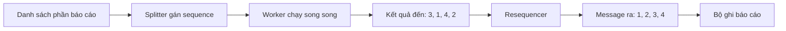

# Sắp xếp message theo sequence

Trong chương **Resequencer** của module **SPRING_INTEGRATION_CORE**, bài này tập trung vào cách khôi phục thứ tự message sau một bước xử lý có thể làm đảo thứ tự. Bạn sẽ kết nối kiến thức về `Message`, `MessageChannel`, endpoint và Java DSL để thiết kế luồng có quản lý trạng thái, xử lý message thiếu và kiểm thử đầu ra.

Sau bài học, bạn có thể:

- Thiết kế bộ header sequence cho một nhóm message hữu hạn.
- Chọn giữa chờ đủ nhóm và nhả sớm từng đoạn liên tục.
- Cấu hình `resequence()` bằng Java DSL.
- Nhận diện lỗi correlation, thiếu sequence và mất thứ tự ở downstream.
- Kiểm thử cả thứ tự đầu ra và thời điểm được phép phát message.

## 1. Bài toán: hoàn thành trước không đồng nghĩa đứng trước

Một yêu cầu xuất báo cáo được tách thành bốn phần. Các worker chạy độc lập và hoàn thành theo thứ tự:

```text
Thứ tự nghiệp vụ:       1 → 2 → 3 → 4
Thứ tự kết quả đến:     3 → 1 → 4 → 2
Thứ tự cần chuyển tiếp: 1 → 2 → 3 → 4
```

Nếu nối thẳng kết quả vào bộ ghi báo cáo, phần 3 có thể được ghi trước phần 1. Một hàng đợi FIFO ở đây chỉ giữ thứ tự **đến hàng đợi**: `3, 1, 4, 2`. Thứ tự cần khôi phục đã được xác định trước khi các worker chạy.

Resequencer giữ các message liên quan thành nhóm theo `correlationId` rồi chuyển tiếp từng message theo `sequenceNumber`. Nó không ghép các payload thành một message kết quả duy nhất như aggregator. Framework hỗ trợ chờ toàn bộ sequence hoặc phát một đoạn hợp lệ sớm hơn. [Chức năng Resequencer](https://docs.spring.io/spring-integration/reference/resequencer.html).



Trong bài toán này, đặt resequencer sau bước làm đảo thứ tự và trước bước cần sử dụng thứ tự.

## 2. Hợp đồng ba header

Với một nhóm hữu hạn có bốn phần:

| Header | Hằng số Java trong `IntegrationMessageHeaderAccessor` | Ví dụ | Vai trò |
|---|---|---|---|
| `correlationId` | `CORRELATION_ID` | `report-42/run-7` | Định danh một lần tạo báo cáo |
| `sequenceNumber` | `SEQUENCE_NUMBER` | `3` | Vị trí trong nhóm, bắt đầu từ 1 |
| `sequenceSize` | `SEQUENCE_SIZE` | `4` | Tổng số vị trí của nhóm |

Trong hợp đồng của bài, số thứ tự và kích thước là `Integer`, mọi message cùng nhóm khai cùng kích thước và `1 <= sequenceNumber <= sequenceSize`. Đây là dữ liệu mà cơ chế release theo sequence sử dụng; số lượng message đã đến không thay thế được vị trí còn thiếu. [Mã nguồn SequenceSizeReleaseStrategy](https://github.com/spring-projects/spring-integration/blob/v6.5.10/spring-integration-core/src/main/java/org/springframework/integration/aggregator/SequenceSizeReleaseStrategy.java).

Ví dụ message thứ ba:

```java
import org.springframework.integration.IntegrationMessageHeaderAccessor;
import org.springframework.messaging.Message;
import org.springframework.messaging.support.MessageBuilder;

Message<String> thirdPart = MessageBuilder
        .withPayload("Nội dung phần 3")
        .setHeader(
                IntegrationMessageHeaderAccessor.CORRELATION_ID,
                "report-42/run-7")
        .setHeader(
                IntegrationMessageHeaderAccessor.SEQUENCE_NUMBER,
                3)
        .setHeader(
                IntegrationMessageHeaderAccessor.SEQUENCE_SIZE,
                4)
        .build();
```

Ba quy tắc thiết kế:

1. **Gán vị trí trước khi xử lý song song.** Nếu đánh số theo lúc worker hoàn thành, thông tin thứ tự gốc đã mất.
2. **Phân biệt các lần thực hiện.** `report-42/run-7` và `report-42/run-8` phải là hai nhóm khác nhau dù cùng một báo cáo.
3. **Giữ header khi tạo message kế tiếp.** Transformer có thể đổi payload nhưng kết quả phải quay về đúng nhóm và đúng vị trí.

Splitter chuẩn tự điền các header correlation và sequence. Với một `List`, kích thước đã biết. Với iterator không xác định được kích thước, `sequenceSize` có thể là `0`; khi đó không thể dựa đơn thuần vào kích thước để chờ đủ nhóm. [Tham chiếu Splitter](https://docs.spring.io/spring-integration/reference/splitter.html).

Các ví dụ tiếp theo dùng sequence hữu hạn đã biết kích thước. Một luồng sự kiện không có điểm kết thúc cần bổ sung cửa sổ hoặc quy tắc đóng nhóm.

## 3. Phân biệt gom nhóm, quyết định nhả và sắp thứ tự

Khi đọc một cấu hình, hãy trả lời bốn câu hỏi:

| Câu hỏi | Thành phần liên quan | Quyết định trong bài |
|---|---|---|
| Message thuộc nhóm nào? | Correlation strategy | Header `correlationId` |
| Khi nào được phép phát? | Release strategy | Chờ đủ hoặc nhả đoạn liên tục |
| Giữ message chưa phát ở đâu? | `MessageGroupStore` | Store trong bộ nhớ |
| Phát theo thứ tự nào? | Bộ xử lý nhóm của resequencer | Tăng dần theo `sequenceNumber` |

Java DSL cho phép tùy chỉnh correlation, release và store trong `resequence(...)`. Đây là endpoint có trạng thái: nhận một message chưa chắc tạo đầu ra ngay. [Aggregators and Resequencers trong Java DSL](https://docs.spring.io/spring-integration/reference/dsl/java-aggregators.html).

Release strategy trả lời **khi nào**, không phải **vị trí nào đứng trước**. Tránh thay bằng điều kiện `group.size() == 4` chỉ vì ví dụ có bốn phần; hợp đồng nghiệp vụ có thể tạo nhóm gồm bảy phần.

## 4. Hai chế độ nhả message

### 4.1. Chờ đủ nhóm: `releasePartialSequences(false)`

Chế độ mặc định không nhả sớm. Với nhóm hợp lệ có kích thước 4, resequencer chờ đủ rồi chuyển tiếp `1, 2, 3, 4` dưới dạng từng message riêng. [API SequenceSizeReleaseStrategy](https://docs.spring.io/spring-integration/docs/7.1.x/api/org/springframework/integration/aggregator/SequenceSizeReleaseStrategy.html).

| Message vừa đến | Các vị trí đang giữ | Message phát thêm |
|---|---|---|
| 3 | 3 | Không có |
| 1 | 1, 3 | Không có |
| 4 | 1, 3, 4 | Không có |
| 2 | Đủ 1, 2, 3, 4 | 1, 2, 3, 4 |

Chọn chế độ này nếu yêu cầu là “Chưa nhận đủ các phần thì chưa bắt đầu chuyển tiếp”.

Việc phát nhiều message liên tiếp không tự tạo một giao dịch nghiệp vụ nguyên khối. Nếu bộ ghi đã lưu phần 1 rồi lỗi ở phần 2, tính nguyên tử vẫn phải được giải quyết bằng giao dịch hoặc cơ chế phục hồi riêng.

### 4.2. Nhả sớm: `releasePartialSequences(true)`

Ở chế độ nhả sớm, vị trí nhỏ nhất đang chờ phải nối tiếp vị trí đã phát cuối cùng. Bộ xử lý chọn đoạn liên tục rồi dừng tại khoảng trống. Ban đầu chưa phát gì nên vị trí có thể bắt đầu là 1. [API release từng phần](https://docs.spring.io/spring-integration/docs/6.3.2/api/org/springframework/integration/aggregator/SequenceSizeReleaseStrategy.html), [mã nguồn bộ xử lý nhóm](https://github.com/spring-projects/spring-integration/blob/v6.5.10/spring-integration-core/src/main/java/org/springframework/integration/aggregator/ResequencingMessageGroupProcessor.java).

Cùng đầu vào `3, 1, 4, 2`:

| Message vừa đến | Đã phát trước bước này | Message phát thêm | Các vị trí còn chờ |
|---|---|---|---|
| 3 | Chưa có | Không có | 3 |
| 1 | Chưa có | 1 | 3 |
| 4 | 1 | Không có | 3, 4 |
| 2 | 1 | 2, 3, 4 | Không có |

Sau khi đã phát 1, resequencer vẫn chờ 2; nó không phát 3 chỉ vì 3 nhỏ hơn 4.

Mô hình để đọc bảng:

```text
lastReleased = 0

Nhận 3: vị trí kế tiếp cần có là 1 → chờ
Nhận 1: phát 1 → lastReleased = 1
Nhận 4: vị trí kế tiếp cần có là 2 → chờ
Nhận 2: phát 2, 3, 4 → lastReleased = 4
```

Đây là mô hình giải thích, không phải mã thay thế implementation của framework.

### 4.3. Chọn theo hợp đồng đầu ra

| Yêu cầu của bộ ghi báo cáo | Lựa chọn |
|---|---|
| Chỉ bắt đầu khi đã có đủ mọi phần | Chờ đủ nhóm |
| Có thể ghi phần 1 trong khi phần 2 đang chạy | Nhả sớm đoạn liên tục |
| Thiếu phần 2 nhưng vẫn muốn ghi phần 3 và đánh dấu thiếu | Cần thêm chính sách xử lý thiếu |
| Phải hoàn tác mọi phần khi một phần thất bại | Cần giao dịch hoặc cơ chế bù trừ |

Nhả sớm giảm thời gian chờ của những phần đứng đầu đã sẵn sàng. Nếu phần 1 là phần chậm nhất, cả nhóm vẫn phải chờ nó.

## 5. Cấu hình Java DSL để thực hành

Ví dụ dùng API Java DSL của Spring Integration 6.x. Mỗi flow có một store riêng. Đầu vào là `DirectChannel` để quan sát hành vi đồng bộ; đầu ra là `QueueChannel` để kiểm thử nhận từng message.

Dự án học tập cần:

- `org.springframework.integration:spring-integration-core`.
- `org.junit.jupiter:junit-jupiter` cho kiểm thử ở phần tiếp theo.

Dùng phiên bản do BOM của dự án quản lý; với Spring Boot, giữ sự đồng bộ giữa Spring Boot, Spring Framework và Spring Integration.

```java
import org.springframework.context.annotation.Bean;
import org.springframework.context.annotation.Configuration;
import org.springframework.integration.channel.DirectChannel;
import org.springframework.integration.channel.QueueChannel;
import org.springframework.integration.config.EnableIntegration;
import org.springframework.integration.dsl.IntegrationFlow;
import org.springframework.integration.store.SimpleMessageStore;

@Configuration
@EnableIntegration
public class ResequencingFlows {

    @Bean
    public DirectChannel strictInput() {
        return new DirectChannel();
    }

    @Bean
    public QueueChannel strictOutput() {
        return new QueueChannel(32);
    }

    @Bean
    public DirectChannel partialInput() {
        return new DirectChannel();
    }

    @Bean
    public QueueChannel partialOutput() {
        return new QueueChannel(32);
    }

    @Bean
    public QueueChannel discarded() {
        return new QueueChannel(32);
    }

    @Bean
    public SimpleMessageStore strictStore() {
        return new SimpleMessageStore();
    }

    @Bean
    public SimpleMessageStore partialStore() {
        return new SimpleMessageStore();
    }

    @Bean
    public IntegrationFlow strictFlow() {
        return IntegrationFlow.from(strictInput())
                .resequence(spec -> spec
                        .releasePartialSequences(false)
                        .messageStore(strictStore())
                        .groupTimeout(30_000L)
                        .sendPartialResultOnExpiry(false)
                        .discardChannel(discarded()))
                .channel(strictOutput())
                .get();
    }

    @Bean
    public IntegrationFlow partialFlow() {
        return IntegrationFlow.from(partialInput())
                .resequence(spec -> spec
                        .releasePartialSequences(true)
                        .messageStore(partialStore())
                        .groupTimeout(30_000L)
                        .sendPartialResultOnExpiry(false)
                        .discardChannel(discarded()))
                .channel(partialOutput())
                .get();
    }
}
```

`messageStore`, `groupTimeout`, `sendPartialResultOnExpiry` và `discardChannel` là các tùy chọn của endpoint correlation; `releasePartialSequences` được cung cấp bởi `ResequencerSpec`. [API cấu hình correlation](https://docs.spring.io/spring-integration/api/org/springframework/integration/dsl/CorrelationHandlerSpec.html), [API ResequencerSpec](https://docs.spring.io/spring-integration/docs/current/api/org/springframework/integration/dsl/ResequencerSpec.html).

Cả hai flow đều giữ thứ tự liên tục khi nhả bình thường; khác biệt là thời điểm bắt đầu phát.

Sức chứa 32 phục vụ tập dữ liệu nhỏ. Khi triển khai lâu dài, `discarded` cần consumer và chính sách lưu phù hợp, thay vì giữ message vô thời hạn.

## 6. Kiểm thử thứ tự và thời điểm nhả

Đặt lớp cấu hình và lớp kiểm thử trong cùng package, hoặc thêm import tương ứng. Mỗi kiểm thử tạo context riêng để không chia sẻ trạng thái.

```java
import org.junit.jupiter.api.Test;
import org.springframework.context.annotation.AnnotationConfigApplicationContext;
import org.springframework.integration.IntegrationMessageHeaderAccessor;
import org.springframework.integration.channel.QueueChannel;
import org.springframework.messaging.Message;
import org.springframework.messaging.MessageChannel;
import org.springframework.messaging.support.MessageBuilder;

import static org.junit.jupiter.api.Assertions.assertEquals;
import static org.junit.jupiter.api.Assertions.assertNotNull;
import static org.junit.jupiter.api.Assertions.assertNull;
import static org.junit.jupiter.api.Assertions.assertTrue;

class ResequencingFlowsTest {

    @Test
    void waitsForTheWholeSequence() {
        try (var context =
                     new AnnotationConfigApplicationContext(
                             ResequencingFlows.class)) {
            MessageChannel input =
                    context.getBean("strictInput", MessageChannel.class);
            QueueChannel output =
                    context.getBean("strictOutput", QueueChannel.class);

            assertTrue(input.send(part("batch-A", 3, 4)));
            assertTrue(input.send(part("batch-A", 1, 4)));
            assertTrue(input.send(part("batch-A", 4, 4)));
            assertNull(output.receive(0));

            assertTrue(input.send(part("batch-A", 2, 4)));
            for (int number = 1; number <= 4; number++) {
                assertNext(output, "batch-A", number, 4);
            }
            assertNull(output.receive(0));
        }
    }

    @Test
    void releasesOnlyTheNextContiguousSegment() {
        try (var context =
                     new AnnotationConfigApplicationContext(
                             ResequencingFlows.class)) {
            MessageChannel input =
                    context.getBean("partialInput", MessageChannel.class);
            QueueChannel output =
                    context.getBean("partialOutput", QueueChannel.class);

            assertTrue(input.send(part("batch-B", 3, 4)));
            assertNull(output.receive(0));

            assertTrue(input.send(part("batch-B", 1, 4)));
            assertNext(output, "batch-B", 1, 4);
            assertNull(output.receive(0));

            assertTrue(input.send(part("batch-B", 4, 4)));
            assertNull(output.receive(0));

            assertTrue(input.send(part("batch-B", 2, 4)));
            for (int number = 2; number <= 4; number++) {
                assertNext(output, "batch-B", number, 4);
            }
            assertNull(output.receive(0));
        }
    }

    @Test
    void ordersEachCorrelationGroupIndependently() {
        try (var context =
                     new AnnotationConfigApplicationContext(
                             ResequencingFlows.class)) {
            MessageChannel input =
                    context.getBean("strictInput", MessageChannel.class);
            QueueChannel output =
                    context.getBean("strictOutput", QueueChannel.class);

            assertTrue(input.send(part("A", 2, 2)));
            assertTrue(input.send(part("B", 1, 2)));
            assertNull(output.receive(0));

            assertTrue(input.send(part("B", 2, 2)));
            assertNext(output, "B", 1, 2);
            assertNext(output, "B", 2, 2);
            assertNull(output.receive(0));

            assertTrue(input.send(part("A", 1, 2)));
            assertNext(output, "A", 1, 2);
            assertNext(output, "A", 2, 2);
            assertNull(output.receive(0));
        }
    }

    private static Message<String> part(
            String group, int number, int size) {
        return MessageBuilder.withPayload(group + "-" + number)
                .setHeader(
                        IntegrationMessageHeaderAccessor.CORRELATION_ID,
                        group)
                .setHeader(
                        IntegrationMessageHeaderAccessor.SEQUENCE_NUMBER,
                        number)
                .setHeader(
                        IntegrationMessageHeaderAccessor.SEQUENCE_SIZE,
                        size)
                .build();
    }

    private static void assertNext(
            QueueChannel output, String group, int number, int size) {
        Message<?> result = output.receive(1_000);
        assertNotNull(result);
        assertEquals(group + "-" + number, result.getPayload());
        assertEquals(
                group,
                result.getHeaders().get(
                        IntegrationMessageHeaderAccessor.CORRELATION_ID));
        assertEquals(
                Integer.valueOf(number),
                result.getHeaders().get(
                        IntegrationMessageHeaderAccessor.SEQUENCE_NUMBER,
                        Integer.class));
        assertEquals(
                Integer.valueOf(size),
                result.getHeaders().get(
                        IntegrationMessageHeaderAccessor.SEQUENCE_SIZE,
                        Integer.class));
    }
}
```

Ba kiểm thử trả lời ba câu hỏi:

- Khi thiếu một vị trí, chế độ chờ đủ có giữ toàn bộ nhóm không?
- Chế độ nhả sớm có dừng ở khoảng trống và nhả tiếp khi khoảng trống được lấp không?
- Hai correlation có độc lập với nhau không?

Kiểm thử thứ ba cho thấy nhóm B có thể hoàn thành trước A. Không có thứ tự toàn cục “A rồi B” chỉ vì message A xuất hiện trước.

Trong cấu hình này, `DirectChannel` gọi endpoint trên luồng gửi và `QueueChannel` cho phép nhận có timeout. Vì vậy có thể kiểm tra `receive(0)` ngay sau `send`, không cần `Thread.sleep`. Khi đổi sang xử lý bất đồng bộ, hãy chờ điều kiện quan sát được thay vì suy đoán thời gian hoàn thành. [DirectChannel và QueueChannel](https://docs.spring.io/spring-integration/reference/channel/implementations.html).

## 7. Ghép với splitter và worker song song

Đoạn cấu hình bổ sung sau giả định payload đầu vào là `List<String>`. Thêm các bean vào một lớp `@Configuration` có `@EnableIntegration`:

```java
import java.util.Locale;
import java.util.concurrent.ExecutorService;
import java.util.concurrent.Executors;

import org.springframework.context.annotation.Bean;
import org.springframework.integration.channel.QueueChannel;
import org.springframework.integration.dsl.IntegrationFlow;
import org.springframework.integration.dsl.MessageChannels;

@Bean(destroyMethod = "shutdown")
public ExecutorService reportWorkers() {
    return Executors.newFixedThreadPool(4);
}

@Bean
public QueueChannel processedLines() {
    return new QueueChannel(64);
}

@Bean
public IntegrationFlow reportPartsFlow() {
    return IntegrationFlow.from("reportPartsInput")
            .split()
            .channel(MessageChannels.executor(reportWorkers()))
            .transform(
                    String.class,
                    value -> value.toUpperCase(Locale.ROOT))
            .resequence(spec -> spec
                    .releasePartialSequences(true)
                    .groupTimeout(30_000L)
                    .sendPartialResultOnExpiry(false)
                    .discardChannel("discarded"))
            .channel(processedLines())
            .get();
}
```

`discarded` là bean đã có trong cấu hình thực hành. `reportPartsInput` là channel được DSL tham chiếu theo tên. Mẫu `split → executor → resequence` được Java DSL hỗ trợ trực tiếp. [Luồng Java DSL với resequencer](https://docs.spring.io/spring-integration/reference/dsl/java-aggregators.html).

Với đầu vào `["mở đầu", "chi tiết", "kết luận"]`:

1. Splitter gán vị trí 1, 2, 3 trước khi gửi qua executor.
2. Worker đổi payload thành chữ hoa; thứ tự hoàn thành có thể khác thứ tự gốc.
3. Resequencer phát từng phần theo vị trí.
4. Consumer đọc `MỞ ĐẦU`, `CHI TIẾT`, `KẾT LUẬN`.

Phép đổi chữ hoa đại diện cho một bước xử lý như render trang hoặc chuẩn hóa dòng dữ liệu. Ví dụ không cố ép một thứ tự hoàn thành bằng độ trễ; các kiểm thử trước đã chủ động gửi sai thứ tự.

Nếu cần **một message chứa toàn bộ báo cáo**, bổ sung aggregator hoặc bộ ghép kết quả thích hợp. `resequence()` chưa thực hiện việc ghép này.

## 8. Message thiếu, timeout và discard

Giả sử nhóm có kích thước 4 nhưng chỉ nhận `1, 3, 4`:

- Chế độ chờ đủ chưa chuyển tiếp message nào.
- Chế độ nhả sớm có thể đã phát 1; phần 3 và 4 đang chờ 2.
- Nếu phần 2 không bao giờ đến, nhóm không hoàn thành theo điều kiện sequence bình thường.

Cấu hình thực hành dùng:

```java
.groupTimeout(30_000L)
.sendPartialResultOnExpiry(false)
.discardChannel(discarded())
```

`groupTimeout` lên lịch xử lý nhóm chưa được release. Khi message mới đến, lịch chờ được đánh giá lại và có thể được đặt lại; giá trị cố định này không phải hạn tuyệt đối từ lúc bắt đầu công việc. Khi nhóm buộc kết thúc do thiếu phần, `sendPartialResultOnExpiry(false)` chọn discard message còn giữ. [Quy tắc group timeout](https://docs.spring.io/spring-integration/reference/aggregator.html#aggregator-and-group-timeout).

Trong thí nghiệm nhả sớm, discard phần đang chờ không thu hồi được phần 1 đã phát. Nếu cần hủy toàn bộ báo cáo, bộ ghi phải quản lý phiên báo cáo và có thao tác bù trừ.

Hai tùy chọn gần tên nhưng khác tình huống:

| Tùy chọn | Tình huống | Ý nghĩa |
|---|---|---|
| `releasePartialSequences(true)` | Nhả bình thường | Cho phép phát đoạn kế tiếp liên tục |
| `sendPartialResultOnExpiry(true)` | Xử lý nhóm hết hạn | Cho phép phát kết quả chưa đầy đủ theo cơ chế expiry |

Bật phát kết quả khi expiry thay đổi hợp đồng về tính đầy đủ. Cần xác định consumer chấp nhận thiếu phần ra sao và kiểm thử các vị trí thực sự được phát; không suy diễn hành vi expiry từ bảng nhả bình thường. [Tùy chọn expiry của endpoint correlation](https://github.com/spring-projects/spring-integration/blob/v6.5.10/spring-integration-core/src/main/java/org/springframework/integration/aggregator/AbstractCorrelatingMessageHandler.java).

Resequencer có trạng thái nhóm sau timeout để nhận diện message muộn. Khi metadata của nhóm đã kết thúc được giữ lại, message muộn được đưa sang discard. Khả năng nhận diện phụ thuộc vòng đời metadata và việc dọn store. [API ResequencingMessageHandler](https://docs.spring.io/spring-integration/api/org/springframework/integration/aggregator/ResequencingMessageHandler.html).

### Phân biệt discard với exception

Message bị loại theo chính sách không nhất thiết gây exception. Header sai hoặc downstream thất bại lại có thể gây lỗi xử lý.

Đối với đầu vào `DirectChannel`, exception có thể truyền về lời gọi `send`. Khi chạy qua executor hoặc scheduler, cần đường xử lý lỗi tương ứng với ngữ cảnh bất đồng bộ. Một channel mang tên `errorChannel` không tự thay thế chính sách ghi nhận và phục hồi.

Trong bài toán báo cáo, đường discard nên ghi nhận:

- Khóa báo cáo và mã lần chạy.
- Vị trí phần bị giữ hoặc bị loại.
- Kích thước sequence dự kiến.
- Thời điểm và quyết định tiếp theo: chạy lại, hủy phiên hoặc xử lý thủ công.

Các dữ liệu này giúp xác định phần còn thiếu thay vì chỉ biết tổng số lỗi.

## 9. Hợp đồng đầu vào và lỗi thường gặp

### 9.1. Thiếu header hoặc sai kiểu

Đặt kiểm tra tại biên nếu message đến từ hệ thống ngoài. Hàm sau minh họa hợp đồng nhóm hữu hạn của bài:

```java
import org.springframework.integration.IntegrationMessageHeaderAccessor;
import org.springframework.messaging.Message;

static boolean validFiniteSequence(Message<?> message) {
    Object group = message.getHeaders().get(
            IntegrationMessageHeaderAccessor.CORRELATION_ID);
    Object number = message.getHeaders().get(
            IntegrationMessageHeaderAccessor.SEQUENCE_NUMBER);
    Object size = message.getHeaders().get(
            IntegrationMessageHeaderAccessor.SEQUENCE_SIZE);

    return group != null
            && number instanceof Integer sequenceNumber
            && size instanceof Integer sequenceSize
            && sequenceSize > 0
            && sequenceNumber >= 1
            && sequenceNumber <= sequenceSize;
}
```

Đây chỉ là kiểm tra một message độc lập. Nó chưa phát hiện nhóm khai lẫn `sequenceSize = 4` và `sequenceSize = 5`. Tính nhất quán giữa các message phải do hợp đồng producer và kiểm tra có trạng thái bảo đảm khi cần.

Nếu nguồn dùng chỉ số `0..N-1` hoặc mã vị trí dạng `"003"`, chuẩn hóa sang `1..N` và kiểu số tại adapter hoặc transformer ở biên.

### 9.2. Gộp nhầm các lần chạy

Hai lần xuất báo cáo đều có vị trí `1..4`. Nếu cùng dùng `correlationId = report-42` khi chạy chồng nhau, các phần có nguy cơ bị gộp nhầm.

Khóa nên phân biệt cả lần thực hiện:

```text
tenant-8/report-42/run-7
tenant-8/report-42/run-8
```

Nếu dùng correlation strategy riêng, header hoặc dữ liệu làm khóa phải tồn tại và giữ nguyên trong cả hành trình.

### 9.3. Sequence trùng và gửi lại

Resequencer không thay thế cơ chế idempotency cho toàn bộ hệ thống. Việc nhận diện sequence trùng trong một nhóm đang tồn tại không ngăn tác dụng phụ lặp sau restart, dọn metadata hoặc mở nhóm mới.

Ở bộ ghi báo cáo, có thể dùng khóa nghiệp vụ `(runId, partNumber)` để tránh ghi một phần hai lần. Cùng khóa nhưng nội dung khác nhau là xung đột cần xử lý rõ ràng.

### 9.4. Filter làm mất một vị trí

Splitter tạo bốn message rồi filter loại vị trí 2. Ba message còn lại vẫn có thể khai kích thước 4, khiến resequencer tiếp tục chờ phần đã bị loại.

Tùy nghiệp vụ, có thể:

- Lọc danh sách trước khi splitter gán sequence.
- Gửi kết quả đại diện cho phần được bỏ qua để vẫn có đủ vị trí.
- Tạo hợp đồng nhóm mới và đánh lại sequence có chủ đích.

Không giảm kích thước riêng trên một message; cả nhóm phải thống nhất.

## 10. Phạm vi của cam kết thứ tự

### 10.1. Mỗi correlation là một miền thứ tự

```text
A đến: A2 ........ A1
B đến: ... B1 B2 ...

Một đầu ra hợp lệ: B1, B2, A1, A2
```

Cam kết cần kiểm tra là `A1 trước A2` và `B1 trước B2`. Muốn mọi nhóm tuân một thứ tự chung, hệ thống phải có quy tắc thứ tự chung.

### 10.2. Downstream có thể hoàn thành lệch thứ tự

Nếu resequencer phát `1, 2, 3` sang một executor khác:

```text
Resequencer phát:         1 → 2 → 3
Downstream hoàn tất:      3, 1, 2
```

`ExecutorChannel` giao công việc cho worker, nên thứ tự hoàn thành có thể thay đổi. Nếu bộ ghi cần thứ tự hoàn tất, dùng consumer tuần tự cho từng miền thứ tự hoặc bước commit kiểm soát vị trí. [Đặc điểm ExecutorChannel](https://docs.spring.io/spring-integration/reference/channel/implementations.html#executorchannel).

Ngay cả khi resequencer sửa đúng thứ tự phát, bước gọi dịch vụ bên ngoài vẫn cần quy tắc retry và xác nhận thành công.

### 10.3. Đúng thứ tự và không tác động lặp là hai tiêu chí riêng

Bộ ghi lưu phần 1 rồi tiến trình chết trước khi lưu xác nhận. Khi gửi lại, phần 1 có thể được xử lý lần nữa. Sequence vẫn đúng nhưng dữ liệu có thể bị ghi trùng.

Vì vậy, hãy ghi riêng ba tiêu chí: đúng thứ tự, không tác động lặp và không mất phần.

## 11. Store và vận hành

Bản thực hành dùng `SimpleMessageStore` trong bộ nhớ. Nếu tiến trình dừng khi còn nhóm đang chờ, không nên kỳ vọng dữ liệu đó vẫn tồn tại. Với yêu cầu phục hồi, chọn `MessageGroupStore` bền vững. Nếu nhiều instance cùng thao tác một nhóm, cần khóa tương thích với mô hình chia sẻ; khóa trong một tiến trình không phối hợp được các tiến trình khác. [Cấu hình store và lock](https://docs.spring.io/spring-integration/api/org/springframework/integration/dsl/CorrelationHandlerSpec.html).

Ước lượng đơn giản cho bài toán báo cáo:

```text
500 nhóm đang chờ
× trung bình 6 phần chưa phát / nhóm
× 4 KiB payload / phần
≈ 12 MiB payload đang giữ
```

Đây mới là payload, chưa gồm header, đối tượng Java, cấu trúc nhóm và metadata. Cần đo bộ nhớ thực tế thay vì chỉ cộng kích thước nội dung.

| Chỉ số nên quan sát | Dấu hiệu cần điều tra |
|---|---|
| Số nhóm chưa hoàn thành | Producer mất phần hoặc khóa nhóm quá phân mảnh |
| Số message đang giữ | Tích lũy dữ liệu chờ |
| Tuổi nhóm lâu nhất | Một vài nhóm bị kẹt |
| Số timeout và discard | Thiếu phần hoặc message muộn |
| Độ trễ từ lúc nhận đến lúc phát | Thời gian chờ thứ tự |
| Độ sâu hàng đợi downstream | Consumer xử lý chậm |

Spring Integration hướng resequencer tới sequence tương đối ngắn với khoảng trống nhỏ. Nhiều nhóm rời rạc có khoảng trống kéo dài đòi hỏi đánh giá lại cách chia nhóm và lưu trữ. [Phạm vi sử dụng Resequencer](https://docs.spring.io/spring-integration/reference/resequencer.html).

Lưu bền vững cũng chưa có nghĩa mọi lịch timeout được phục hồi sau restart. Thiết kế khôi phục cần tính tới nhóm cũ trong store và cơ chế quét hoặc xử lý chúng.

## 12. Thực hành mở rộng

Dùng correlation mới hoặc context mới cho từng thí nghiệm:

| Đầu vào | Chế độ | Điều cần xác nhận |
|---|---|---|
| `4, 2, 1, 3`; kích thước 4 | Chờ đủ | Chỉ sau lần gửi cuối mới có `1, 2, 3, 4` |
| `2, 1, 4, 3`; kích thước 4 | Nhả sớm | Khi 1 đến nhả `1, 2`; khi 3 đến nhả `3, 4` |
| `1, 3`; kích thước 3 | Chờ đủ | Chưa có đầu ra bình thường |
| `1, 3`; kích thước 3 | Nhả sớm | Có 1 sớm; 3 chờ vị trí 2 |
| `A2, B1, B2, A1`; mỗi nhóm có 2 phần | Chờ đủ | B hoàn thành trước A; từng nhóm vẫn đúng thứ tự |
| `sequenceNumber = 0` | Kiểm tra biên | Từ chối theo hợp đồng trước khi nhập resequencer |

Khi kiểm thử timeout, tạo cấu hình riêng có timeout ngắn và quan sát `discarded.receive(timeout)` với thời hạn phù hợp. Xác nhận các message bị discard không xuất hiện ở output bình thường. Không kết luận timeout đúng chỉ vì kiểm thử đã đợi một khoảng thời gian.

Để đánh giá một thiết kế, hãy trả lời cụ thể: khóa nhóm là gì, ai gán sequence, nhóm kết thúc bằng điều kiện nào, message thiếu đi đâu và bước nào cam kết thứ tự ghi cuối cùng. Các câu trả lời đó biến cấu hình `resequence()` thành một luồng tích hợp có hành vi kiểm chứng được.
