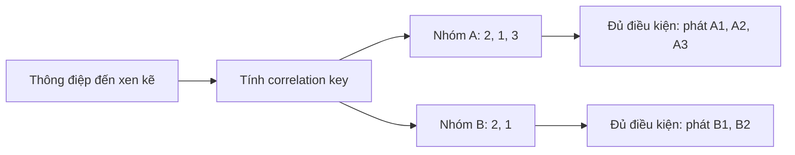

# Correlation key của resequencer

Trong module `SPRING_INTEGRATION_CORE`, resequencer là endpoint giữ tạm các thông điệp đến sai thứ tự rồi phát chúng theo thứ tự của chuỗi. Bài thuộc chương **Resequencer** này tập trung vào quyết định xảy ra trước khi sắp xếp: **mỗi thông điệp thuộc chuỗi nào?** Câu trả lời được biểu diễn bằng correlation key, tức khóa xác định nhóm thông điệp.

Mục tiêu là thiết kế được khóa nhóm phù hợp nghiệp vụ, cấu hình bằng Java DSL, giữ khóa qua các bước xử lý và kiểm thử khả năng cách ly những chuỗi đến xen kẽ. Ví dụ xuyên suốt là một luồng nhập hóa đơn cho nhiều tenant; mỗi lô có nhiều phần được xử lý độc lập.

## 1. Khóa nhóm, số thứ tự và điều kiện phát

Một resequencer cần phân biệt ba câu hỏi:

| Câu hỏi | Thành phần trả lời | Ví dụ |
| --- | --- | --- |
| Thông điệp thuộc chuỗi nào? | `CorrelationStrategy` trả về correlation key | Chuỗi nhập hóa đơn của tenant A, lô 42, phiên R1 |
| Thông điệp đứng ở đâu trong chuỗi? | Header `SEQUENCE_NUMBER` với cơ chế sắp xếp thông thường | Phần 2 |
| Khi nào được phát các thông điệp đang giữ? | `ReleaseStrategy`, có thể sử dụng `SEQUENCE_SIZE` | Đã nhận đủ 3 phần |

Theo cấu hình mặc định, resequencer lấy khóa từ header `IntegrationMessageHeaderAccessor.CORRELATION_ID` và phát các thông điệp theo `SEQUENCE_NUMBER`. Có thể cấu hình correlation strategy riêng để thay nguồn lấy khóa. Resequencer phát các thông điệp riêng lẻ; việc gom payload thành một kết quả là trách nhiệm của aggregator. [Tài liệu Resequencer](https://docs.spring.io/spring-integration/reference/6.5/resequencer.html).

Ví dụ hai chuỗi đến xen kẽ:

```text
Đầu vào: A2, B2, A1, B1, A3

Nhóm A: 2, 1, 3  →  A1, A2, A3
Nhóm B: 2, 1     →  B1, B2
```

Thứ tự được xác lập trong từng nhóm. Không suy ra rằng toàn bộ đầu ra phải phát nhóm A trước nhóm B. Với chế độ chờ đủ nhóm, B có thể phát trước vì B hoàn tất trước.



Nếu chọn sai khóa, resequencer sẽ giữ và xét phát trên các nhóm sai ngay từ đầu. Thay bộ so sánh số thứ tự không giải quyết được lỗi phân nhóm đó.

## 2. Hợp đồng của correlation key

Về ý nghĩa, có thể xem correlation strategy là hàm:

```text
K(message) → định danh của một phiên chuỗi
```

Thiết kế khóa cần đáp ứng đồng thời:

1. Các phần của cùng một phiên chuỗi trả về cùng một giá trị khóa.
2. Các phiên chuỗi độc lập trả về các khóa khác nhau trong phạm vi lưu nhóm.
3. Giá trị khóa của một phần giữ ổn định khi phần đó đi qua transformer, router, retry và các ranh giới truyền tải liên quan.

Đây là các bất biến thiết kế của ứng dụng. Ví dụ, hai phần của cùng lô nhưng khác khóa sẽ bị chia thành hai nhóm thiếu dữ liệu. Ngược lại, hai lô độc lập dùng cùng khóa có thể gây xung đột vị trí và điều kiện hoàn tất.

### 2.1. Phân biệt các loại định danh

| Định danh | Ý nghĩa | Có phù hợp làm correlation key? |
| --- | --- | --- |
| ID của message con hiện tại | Phân biệt từng message | Thường không; mỗi phần có ID riêng |
| ID message cha của một lần split | Nhận diện đầu vào chung của các phần | Phù hợp nếu một lần split chính là một chuỗi |
| `orderId` hoặc `batchId` | Nhận diện đối tượng nghiệp vụ | Chỉ đủ nếu xác định duy nhất phiên chuỗi trong phạm vi sử dụng |
| Trace ID | Theo dõi một hoạt động phân tán | Chỉ dùng khi ranh giới trace trùng chính xác ranh giới chuỗi |
| Delivery attempt hoặc số lần retry | Nhận diện lần giao lại một phần | Không nên làm thay đổi khóa của cùng phiên chuỗi |
| `runId` của tác vụ nhập dữ liệu | Nhận diện một lần chạy nghiệp vụ | Phù hợp để tách hai lần xử lý độc lập của cùng lô |

`MessageHeaders.ID` là định danh của từng message, còn `CORRELATION_ID` dùng để liên hệ nhiều message. Các header `SEQUENCE_NUMBER` và `SEQUENCE_SIZE` có kiểu `Integer`; correlation ID có thể là một đối tượng. Vì vậy không nên đồng nhất ID của từng phần với ID chung của chuỗi. [Tài liệu Message và các header](https://docs.spring.io/spring-integration/reference/6.5/message.html).

Một UUID được tạo **một lần cho cả phiên chuỗi**, sau đó gắn vào mọi phần, là lựa chọn hợp lệ. Tạo UUID mới bên trong correlation strategy cho từng message sẽ làm mỗi phần rơi vào một nhóm khác nhau.

### 2.2. Thiếu khóa phải được phát hiện rõ ràng

API `CorrelationStrategy` có phương thức chính:

```java
Object getCorrelationKey(Message<?> message);
```

Strategy nên ném ngoại lệ khi không xác định được khóa, thay vì trả về `null`. Đây cũng là hợp đồng được mô tả trong mã nguồn của interface. [CorrelationStrategy, nhánh 6.5.10](https://github.com/spring-projects/spring-integration/blob/v6.5.10/spring-integration-core/src/main/java/org/springframework/integration/aggregator/CorrelationStrategy.java).

Không dùng khóa dự phòng như `"UNKNOWN"` để che lỗi thiếu dữ liệu. Nếu nhiều message lỗi cùng rơi vào khóa đó, chúng sẽ bị coi là các phần của cùng một chuỗi. Với ứng dụng nhập hóa đơn, nên từ chối message thiếu thông tin trước khi đưa vào vùng giữ nhóm và lưu đủ ngữ cảnh để xử lý lại.

## 3. Thiết kế khóa theo ranh giới nghiệp vụ

Giả sử hệ thống nhận các phần dữ liệu sau:

| Tenant | Batch | Run | Sequence number | Sequence size |
| --- | --- | --- | ---: | ---: |
| A | 42 | R1 | 2 | 3 |
| B | 42 | R1 | 2 | 2 |
| A | 42 | R1 | 1 | 3 |
| B | 42 | R1 | 1 | 2 |
| A | 42 | R1 | 3 | 3 |

Nếu chỉ lấy `batchId = 42`, cả hai tenant sẽ cùng khóa. Nhóm có các vị trí trùng nhau và hai kỳ vọng kích thước khác nhau. Không nên dựa vào cơ chế từ chối phần trùng để phát hiện lỗi thiết kế này; hậu quả cụ thể phụ thuộc message nào đến trước và trạng thái nhóm lúc đó.

Với nghiệp vụ đang xét, một cấu trúc khóa phù hợp là:

```text
(flowNamespace, tenantId, batchId, runId)
```

Ví dụ biểu diễn đọc được:

```text
invoice-import|A|42|R1
invoice-import|B|42|R1
invoice-import|A|42|R2
```

Các chuỗi minh họa trên giả định từng thành phần không chứa ký tự `|`. Khi dữ liệu thực cho phép ký tự phân cách, cần dùng quy tắc escape hoặc encoding thống nhất; không nối chuỗi tùy ý.

Vai trò của từng thành phần:

- `flowNamespace` phân biệt loại luồng hoặc giai đoạn xử lý có thể dùng chung vùng lưu nhóm.
- `tenantId` cách ly các khách hàng có mã lô giống nhau.
- `batchId` liên kết các phần của cùng lô.
- `runId` tách hai phiên xử lý độc lập của cùng lô.

Không phải mọi ứng dụng đều cần đủ bốn thành phần. Nếu mỗi lô đã có UUID toàn cục và chỉ được xử lý trong một phiên, UUID đó có thể đáp ứng yêu cầu. Điểm quyết định là ranh giới chuỗi của nghiệp vụ, thay vì số trường có trong khóa.

### 3.1. Phân biệt retry và chạy lại nghiệp vụ

```text
Giao lại phần A2 của phiên R1:
    giữ khóa invoice-import|A|42|R1

Chạy một phiên nhập mới R2 cho lô A/42:
    dùng khóa invoice-import|A|42|R2
```

Nếu mỗi lần retry A2 lại tạo `runId` mới, A1 và A3 vẫn nằm ở R1 trong khi A2 chuyển sang nhóm khác. Nếu một lần chạy mới vẫn dùng R1, dữ liệu mới có nguy cơ tương tác với trạng thái hoặc thông điệp muộn của phiên trước.

Vì vậy `runId` nên được xác lập ở thời điểm bắt đầu phiên nghiệp vụ và được truyền cùng mọi phần. Nó không nên được tính từ thời gian hiện tại lúc từng phần đến resequencer.

### 3.2. Khóa phải có biểu diễn ổn định

Với khóa dạng đối tượng, cần giữ tính bất biến và ngữ nghĩa `equals()`/`hashCode()` phù hợp. Tuy nhiên, khi triển khai thực tế còn phải kiểm tra cách message store mã hóa hoặc ánh xạ group ID. Không nên giả định mọi store đều sử dụng đối tượng Java theo đúng một cách.

Khóa dạng `String` chuẩn hóa thường thuận tiện khi đi qua broker, cơ sở dữ liệu và nhiều ngôn ngữ lập trình. Đội phát triển cần thống nhất kiểu dữ liệu, cách escape, phân biệt hoa thường và phiên bản cấu trúc khóa. Không tự động chuyển tất cả mã sang chữ thường nếu nghiệp vụ coi `Ab1` và `ab1` là hai mã khác nhau.

Một cách encoding không nhập nhằng là ghi độ dài từng thành phần:

```text
invoice-import|1:A2:422:R1
              └── tenant A, batch 42, run R1
```

Đây chỉ là ví dụ quy ước ứng dụng. Nếu áp dụng cách này, mọi producer và công cụ vận hành phải sử dụng cùng một bộ mã hóa; không trộn nó với cách nối chuỗi bằng dấu phân cách trong cùng phiên chuỗi.

## 4. Dùng correlation ID mặc định

Khi producer đã quản lý chuỗi, có thể gắn trực tiếp các header chuẩn:

```java
import org.springframework.integration.IntegrationMessageHeaderAccessor;
import org.springframework.messaging.Message;
import org.springframework.messaging.support.MessageBuilder;

Message<String> part2 = MessageBuilder.withPayload("A2")
        .setHeader(IntegrationMessageHeaderAccessor.CORRELATION_ID,
                "invoice-import|A|42|R1")
        .setHeader(IntegrationMessageHeaderAccessor.SEQUENCE_NUMBER, 2)
        .setHeader(IntegrationMessageHeaderAccessor.SEQUENCE_SIZE, 3)
        .build();
```

Với cấu hình resequencer mặc định, các phần còn lại của chuỗi A phải có cùng correlation ID; số thứ tự lần lượt là 1 và 3. Phần của tenant B phải dùng correlation ID riêng.

Nếu đầu vào là một collection được splitter tách ra, splitter có thể thiết lập bộ header chuỗi. Cần giữ chúng qua các bước xử lý độc lập sau đó. Đặc biệt, đầu ra kiểu iterator có thể chưa biết kích thước và mang `SEQUENCE_SIZE = 0`; khi đó không được áp dụng giả định chờ đủ một kích thước hữu hạn như ví dụ của bài. [Tài liệu Splitter](https://docs.spring.io/spring-integration/reference/6.5/splitter.html).

Ví dụ cấu trúc luồng xử lý song song:

```text
Message cha
    → splitter tạo các phần và metadata chuỗi
    → xử lý các phần qua executor
    → resequencer
    → endpoint tiêu thụ từng phần đã sắp xếp
```

Khi có nhiều tầng splitter, mỗi tầng có ranh giới chuỗi riêng. Cần xác định resequencer đang khôi phục thứ tự của tầng nào trước khi thay correlation metadata. Nếu cần giữ một mã nghiệp vụ xuyên suốt, có thể dùng header nghiệp vụ riêng như `batchId` hoặc `sequenceKey`.

## 5. Cấu hình correlation strategy riêng bằng Java DSL

Ví dụ sau sử dụng Java 17 và API Spring Integration 6.5.x. Ứng dụng cần dependency `org.springframework.integration:spring-integration-core`, với các dependency Spring được quản lý tương thích. Phần kiểm thử dùng JUnit Jupiter. Ví dụ chủ động dùng kênh vào đồng bộ và kênh ra dạng hàng đợi để quan sát rõ kết quả.

Producer đưa khóa đã chuẩn hóa vào header ứng dụng `sequenceKey`. Resequencer được cấu hình lấy khóa từ header đó:

```java
import org.springframework.beans.factory.annotation.Qualifier;
import org.springframework.context.annotation.Bean;
import org.springframework.context.annotation.Configuration;
import org.springframework.integration.aggregator.CorrelationStrategy;
import org.springframework.integration.channel.DirectChannel;
import org.springframework.integration.channel.QueueChannel;
import org.springframework.integration.config.EnableIntegration;
import org.springframework.integration.dsl.IntegrationFlow;
import org.springframework.messaging.MessageChannel;

@Configuration(proxyBeanMethods = false)
@EnableIntegration
public class ResequencerCorrelationConfig {

    public static final String SEQUENCE_KEY = "sequenceKey";

    @Bean
    public DirectChannel resequenceInput() {
        return new DirectChannel();
    }

    @Bean
    public QueueChannel resequenceOutput() {
        return new QueueChannel();
    }

    @Bean
    public CorrelationStrategy sequenceKeyStrategy() {
        return message -> {
            String key = message.getHeaders().get(SEQUENCE_KEY, String.class);
            if (key == null || key.isBlank()) {
                throw new IllegalArgumentException(
                        "Missing or blank sequenceKey");
            }
            return key;
        };
    }

    @Bean
    public IntegrationFlow invoicePartsFlow(
            @Qualifier("resequenceInput") MessageChannel input,
            @Qualifier("resequenceOutput") QueueChannel output,
            @Qualifier("sequenceKeyStrategy") CorrelationStrategy strategy) {

        return IntegrationFlow.from(input)
                .resequence(r -> r
                        .correlationStrategy(strategy)
                        .releasePartialSequences(false))
                .channel(output)
                .get();
    }
}
```

Java DSL hỗ trợ tùy chỉnh correlation strategy trên `.resequence(...)`. Với cấu hình trên, `sequenceKey` quyết định nhóm; `CORRELATION_ID` không còn là nguồn khóa mà endpoint này sử dụng. `sequenceKey` là header do ứng dụng định nghĩa, không phải một header chuẩn mà mọi resequencer tự hiểu. [Java DSL: Aggregators and Resequencers](https://docs.spring.io/spring-integration/reference/6.5/dsl/java-aggregators.html).

Strategy chỉ xác định nhóm và kiểm tra khóa. Nó không cấp lại `SEQUENCE_NUMBER`, không suy ra `SEQUENCE_SIZE` và không sửa header correlation ID. Producer vẫn phải cung cấp số thứ tự và kích thước đúng với chuỗi hữu hạn của ví dụ.

Ở đây `releasePartialSequences(false)` được đặt rõ để chờ đủ nhóm theo chiến lược kích thước mặc định. Với metadata hợp lệ, duy nhất và nhất quán, chuỗi kích thước 3 phát khi nhận đủ ba phần. Nếu bật phát từng phần, resequencer có thể phát đoạn liên tiếp bắt đầu từ vị trí kế tiếp chưa phát; nhận phần 2 trước phần 1 không có nghĩa phần 2 được phát ngay. [SequenceSizeReleaseStrategy, nhánh 6.5.10](https://github.com/spring-projects/spring-integration/blob/v6.5.10/spring-integration-core/src/main/java/org/springframework/integration/aggregator/SequenceSizeReleaseStrategy.java).

Không nên thay release strategy bằng `group.size() == 3` chỉ để che sự không nhất quán giữa các nhóm có kích thước khác nhau. Điều kiện phát và tính đúng của khóa là hai hợp đồng cần thiết kế riêng.

### 5.1. Cấu hình ngắn bằng biểu thức

Nếu đầu vào đã được kiểm tra chặt chẽ, có thể thay phần cấu hình resequencer bằng:

```java
.resequence(r -> r
        .correlationExpression("headers['sequenceKey']")
        .releasePartialSequences(false))
```

`correlationExpression` là lựa chọn Java DSL được cung cấp bên cạnh `correlationStrategy`. Chỉ chọn một cách xác định khóa cho endpoint để người đọc cấu hình hiểu rõ nguồn khóa có hiệu lực. [CorrelationHandlerSpec, nhánh 6.5.10](https://github.com/spring-projects/spring-integration/blob/v6.5.10/spring-integration-core/src/main/java/org/springframework/integration/dsl/CorrelationHandlerSpec.java).

Biểu thức trên không thay thế việc kiểm tra header thiếu hoặc rỗng. Phiên bản strategy có ngoại lệ rõ ràng thường thuận tiện hơn khi cần chỉ ra lỗi hợp đồng đầu vào.

## 6. Kiểm thử các chuỗi đến xen kẽ

Kiểm thử chỉ gửi A2 rồi A1 chưa chứng minh được tính đúng của correlation key: ngay cả một khóa hằng cũng có thể vượt qua trường hợp chỉ có một nhóm. Cần có ít nhất hai nhóm cùng tồn tại, tốt nhất có kích thước khác nhau và metadata nghiệp vụ gần giống nhau.

Lớp kiểm thử dưới đây đặt cùng package với `ResequencerCorrelationConfig`. Mỗi kiểm thử luồng tạo context mới nên không dùng lại message store của một kiểm thử khác.

```java
import org.junit.jupiter.api.Test;
import org.springframework.context.annotation.AnnotationConfigApplicationContext;
import org.springframework.integration.IntegrationMessageHeaderAccessor;
import org.springframework.integration.aggregator.CorrelationStrategy;
import org.springframework.integration.channel.DirectChannel;
import org.springframework.integration.channel.QueueChannel;
import org.springframework.messaging.Message;
import org.springframework.messaging.support.MessageBuilder;

import static org.junit.jupiter.api.Assertions.assertEquals;
import static org.junit.jupiter.api.Assertions.assertNotNull;
import static org.junit.jupiter.api.Assertions.assertNull;
import static org.junit.jupiter.api.Assertions.assertThrows;
import static org.junit.jupiter.api.Assertions.assertTrue;

class ResequencerCorrelationTest {

    @Test
    void keepsInterleavedSequencesSeparate() {
        try (var context = new AnnotationConfigApplicationContext(
                ResequencerCorrelationConfig.class)) {

            DirectChannel input = context.getBean(
                    "resequenceInput", DirectChannel.class);
            QueueChannel output = context.getBean(
                    "resequenceOutput", QueueChannel.class);

            String keyA = "invoice-import|A|42|R1";
            String keyB = "invoice-import|B|42|R1";

            assertTrue(input.send(part(keyA, 2, 3, "A2")));
            assertTrue(input.send(part(keyB, 2, 2, "B2")));
            assertTrue(input.send(part(keyA, 1, 3, "A1")));

            // Cả A và B đều chưa đủ phần.
            assertNull(output.receive(0));

            assertTrue(input.send(part(keyB, 1, 2, "B1")));
            assertPart(output, keyB, 1, "B1");
            assertPart(output, keyB, 2, "B2");
            assertNull(output.receive(0));

            // A hoàn tất sau B dù A xuất hiện trước.
            assertTrue(input.send(part(keyA, 3, 3, "A3")));
            assertPart(output, keyA, 1, "A1");
            assertPart(output, keyA, 2, "A2");
            assertPart(output, keyA, 3, "A3");
            assertNull(output.receive(0));
        }
    }

    @Test
    void rejectsMissingOrBlankKey() {
        CorrelationStrategy strategy =
                new ResequencerCorrelationConfig().sequenceKeyStrategy();

        Message<String> missing = MessageBuilder.withPayload("A1").build();
        Message<String> blank = MessageBuilder.withPayload("A1")
                .setHeader(ResequencerCorrelationConfig.SEQUENCE_KEY, " ")
                .build();

        assertThrows(IllegalArgumentException.class,
                () -> strategy.getCorrelationKey(missing));
        assertThrows(IllegalArgumentException.class,
                () -> strategy.getCorrelationKey(blank));
    }

    private static Message<String> part(
            String key, int number, int size, String payload) {

        return MessageBuilder.withPayload(payload)
                .setHeader(ResequencerCorrelationConfig.SEQUENCE_KEY, key)
                .setHeader(IntegrationMessageHeaderAccessor.SEQUENCE_NUMBER,
                        number)
                .setHeader(IntegrationMessageHeaderAccessor.SEQUENCE_SIZE,
                        size)
                .build();
    }

    private static void assertPart(
            QueueChannel output, String key, int number, String payload) {

        Message<?> message = output.receive(1_000);
        assertNotNull(message);
        assertEquals(payload, message.getPayload());
        assertEquals(key, message.getHeaders().get(
                ResequencerCorrelationConfig.SEQUENCE_KEY));
        assertEquals(Integer.valueOf(number), message.getHeaders().get(
                IntegrationMessageHeaderAccessor.SEQUENCE_NUMBER,
                Integer.class));
    }
}
```

`output.receive(0)` phù hợp để kiểm tra tức thời ở đây vì `DirectChannel` xử lý lời gọi gửi trên luồng gọi. Nếu đổi sang executor hoặc broker, cần đợi theo điều kiện với giới hạn thời gian phù hợp; không giả định việc gửi đã đồng nghĩa với xử lý xong.

Hai kiểm thử kiểm tra hai lớp hợp đồng khác nhau: kiểm thử đầu quan sát hành vi endpoint; kiểm thử sau gọi trực tiếp strategy để kiểm tra lỗi khóa. Ngoại lệ đi qua một endpoint có thể được Spring bọc lại, vì vậy không nên lấy kiểu ngoại lệ của kiểm thử strategy làm cam kết về ngoại lệ ngoài cùng của cả luồng.

Các tình huống nên bổ sung khi áp dụng vào ứng dụng:

| Tình huống | Điều cần chứng minh |
| --- | --- |
| Cùng tenant và batch, khác `runId` | Hai phiên được giữ độc lập |
| Các thành phần khóa chứa ký tự phân cách | Bộ mã hóa không tạo khóa trùng |
| Một phần được giao lại | Không tạo tác dụng phụ nghiệp vụ lặp ngoài chính sách cho phép |
| Thiếu một phần | Có chính sách timeout và phục hồi rõ ràng |
| Đổi cấu trúc khóa khi còn nhóm trong store | Không chia đôi một phiên đang xử lý |
| Dùng persistent store và khởi động lại | Khóa, metadata và trạng thái có thể được đọc lại đúng |

## 7. Giữ khóa và metadata qua các endpoint

### 7.1. Transformer

Nếu tự tạo một message mới chỉ từ payload, ứng dụng có thể làm mất metadata cần cho resequencer:

```java
// Không sao chép metadata của thông điệp gốc.
Message<String> changed = MessageBuilder
        .withPayload(original.getPayload().trim())
        .build();
```

Khi chủ động xây dựng message mới từ một `Message<String>` gốc, có thể giữ các header liên quan bằng:

```java
Message<String> changed = MessageBuilder.fromMessage(original)
        .setPayload(original.getPayload().trim())
        .build();
```

Đoạn mã này minh họa việc tự dựng message; không có nghĩa mọi transformer đều làm mất header. Cần kiểm tra hành vi sao chép và cấu hình lọc header của endpoint thực tế. Với khóa tùy chỉnh, hãy theo dõi đồng thời `sequenceKey`, `SEQUENCE_NUMBER` và `SEQUENCE_SIZE` tại đầu vào resequencer.

### 7.2. Router và filter

Router có thể phân các phần đến những nhánh xử lý khác nhau. Nếu chúng vẫn thuộc cùng chuỗi, các nhánh phải giữ cùng khóa và cuối cùng đưa dữ liệu về nơi có thể truy cập cùng trạng thái nhóm.

Filter cần được xét cùng hợp đồng kích thước. Ví dụ producer khai báo 3 phần nhưng filter loại bỏ phần 2; hai phần còn lại không thể đáp ứng kỳ vọng nhận đủ ba phần. Đổi correlation key cho hai phần còn lại không tự giải quyết khoảng trống.

Nên xác định rõ một trong các chính sách nghiệp vụ: không tạo phần bị loại ngay từ đầu và đánh lại metadata trước khi xử lý song song; cung cấp kết quả đại diện cho phần bị loại; hoặc chấp nhận chuỗi không hoàn tất và xử lý bằng cơ chế hết hạn. Chính sách phải phù hợp với ý nghĩa của dữ liệu, không chỉ làm cho nhóm phát được.

### 7.3. Gateway và ranh giới truyền tải

Mã request/reply của gateway hoặc mã tracing không tự động trở thành khóa chuỗi phù hợp. Một request có thể sinh nhiều chuỗi độc lập, và một chuỗi cũng có thể được truyền qua nhiều lời gọi.

Nếu message đi qua HTTP, JMS hoặc một broker khác, cần định nghĩa ánh xạ header sang định dạng truyền tải rồi khôi phục đúng kiểu khi nhận lại. Ví dụ số thứ tự chuỗi `"2"` trong giao thức bên ngoài cần được chuyển thành `Integer` khi tạo Spring message cho cấu hình trong bài.

## 8. Khóa nhóm, timeout và xử lý lỗi

Một khóa đúng vẫn có thể gặp chuỗi không hoàn tất do phần bị mất, đến quá muộn hoặc bị từ chối. Cần thiết kế chính sách hết hạn thay vì giữ vô thời hạn mọi nhóm thiếu.

Có thể thay phần `.resequence(...)` của cấu hình trước bằng đoạn sau, đồng thời bổ sung bean kênh loại bỏ:

```java
.resequence(r -> r
        .correlationStrategy(strategy)
        .releasePartialSequences(false)
        .groupTimeout(30_000)
        .sendPartialResultOnExpiry(false)
        .discardChannel("resequenceDiscard"))
```

```java
@Bean
public QueueChannel resequenceDiscard() {
    return new QueueChannel();
}
```

Trong ví dụ này, các thông điệp thuộc nhóm hết hạn được đưa sang kênh loại bỏ thay vì phát như kết quả đầy đủ. `groupTimeout` được lên lịch lại khi xử lý thêm message của nhóm; không nên hiểu `30_000` là hạn chót bất biến tính từ phần đầu tiên. Hai tùy chọn phát đoạn liên tiếp bình thường và phát kết quả khi hết hạn phục vụ hai tình huống khác nhau. [Cấu hình timeout trong CorrelationHandlerSpec](https://github.com/spring-projects/spring-integration/blob/v6.5.10/spring-integration-core/src/main/java/org/springframework/integration/dsl/CorrelationHandlerSpec.java), [cơ chế lập lịch của correlating handler](https://github.com/spring-projects/spring-integration/blob/v6.5.10/spring-integration-core/src/main/java/org/springframework/integration/aggregator/AbstractCorrelatingMessageHandler.java).

`QueueChannel` loại bỏ ở đây là điểm quan sát phục vụ ví dụ. Trong ứng dụng, cần có consumer đọc kênh đó và thực hiện phục hồi, ghi nhận hoặc chuyển sang hàng đợi xử lý lỗi theo yêu cầu.

Không đồng nhất hai loại sự kiện:

- **Không tính được khóa:** strategy ném ngoại lệ trước khi nhóm được xử lý; với kênh đồng bộ, lỗi có thể trả về bên gửi. Cần thiết kế cơ chế bắt và định tuyến lỗi cho luồng thực tế.
- **Nhóm hết hạn hoặc phần không được nhóm chấp nhận:** áp dụng chính sách loại bỏ và kênh discard đã cấu hình. Không giả định mọi ngoại lệ đều tự đi vào discard channel.

Trong nhánh 6.5, resequencer mặc định giữ metadata hoàn tất do timeout để loại các phần đến muộn. Việc giữ và dọn trạng thái này ảnh hưởng khả năng tái sử dụng khóa. Với hoàn tất bình thường của chuỗi có kích thước hữu hạn, resequencer có đường xử lý loại bỏ nhóm khi đạt kích thước; vì vậy không được coi trạng thái nhóm là một kho chống trùng vĩnh viễn. [ResequencingMessageHandler, nhánh 6.5.10](https://github.com/spring-projects/spring-integration/blob/v6.5.10/spring-integration-core/src/main/java/org/springframework/integration/aggregator/ResequencingMessageHandler.java).

Thiết kế an toàn về nghiệp vụ là giữ cùng khóa cho các lần giao lại của cùng phiên, cấp khóa phiên mới cho một lần chạy độc lập, và thực hiện idempotency ở nơi phát sinh tác dụng phụ khi cần. Resequencing không tự cung cấp bảo đảm xử lý nghiệp vụ đúng một lần.

## 9. Phạm vi store và nhiều instance

Correlation key chỉ có tác dụng khi các phần có thể tìm thấy cùng trạng thái nhóm. Nếu A1 đến instance thứ nhất và A2 đến instance thứ hai, trong khi mỗi instance có store trong bộ nhớ riêng, cả hai nhóm đều thiếu phần dù khóa giống nhau.

Tùy kiến trúc, có thể định tuyến các phần cùng khóa đến cùng instance hoặc dùng message group store chia sẻ với cơ chế khóa tương thích giữa các instance. Cùng một khóa cần gắn với cùng phạm vi trạng thái và cùng cơ chế đồng bộ. Chỉ thêm một cơ sở dữ liệu mà vẫn giữ khóa cục bộ giữa nhiều tiến trình chưa đủ để suy ra tính đúng của cập nhật đồng thời.

Khi nhiều endpoint dùng chung một phạm vi store, cần tránh việc chúng dùng cùng group ID cho các mục đích khác nhau. Tiền tố như `invoice-import` và `payment-reconcile` là một cách phân vùng tên; dùng store hoặc vùng dữ liệu độc lập là lựa chọn khác. Yêu cầu giữ group ID duy nhất giữa các handler dùng chung store được nêu trong lớp cơ sở của correlating handler. [AbstractCorrelatingMessageHandler](https://github.com/spring-projects/spring-integration/blob/v6.5.10/spring-integration-core/src/main/java/org/springframework/integration/aggregator/AbstractCorrelatingMessageHandler.java).

Persistent store còn có hợp đồng serialization cho payload và header. Việc dùng khóa chuỗi ổn định không tự bảo đảm mọi dữ liệu trong message đều lưu được; cần kiểm tra serializer của store đã chọn. [Tài liệu Message Store](https://docs.spring.io/spring-integration/reference/6.5/message-store.html).

Khi thay cấu trúc khóa, chẳng hạn thêm `runId`, phải tính đến các nhóm đang chờ. Nếu phần đầu dùng khóa cũ còn phần sau dùng khóa mới, cùng một chuỗi bị chia đôi. Có thể để các phiên cũ hoàn tất theo hợp đồng cũ trước khi chuyển producer, hoặc áp dụng quy trình chuyển đổi trạng thái được thiết kế riêng.

## 10. Chẩn đoán lỗi correlation

| Hiện tượng | Câu hỏi cần kiểm tra | Hướng xử lý |
| --- | --- | --- |
| Nhiều nhóm chỉ có một phần | Có dùng ID từng message, UUID mới hoặc thời gian nhận làm khóa không? | Tạo khóa một lần ở cấp phiên và truyền cho mọi phần |
| Hai tenant ảnh hưởng lẫn nhau | Khóa có thiếu tenant trong phạm vi mã lô cục bộ không? | Bổ sung ranh giới tenant hoặc dùng ID toàn cục |
| Nhóm chờ mãi dù tưởng đã gửi đủ | Các phần có thật sự cùng khóa, đúng kiểu và cùng phiên bản cấu trúc không? | Đối chiếu khóa, metadata và nơi lưu trạng thái |
| Retry tạo thêm nhóm thiếu | Lần giao lại có thay `runId` không? | Giữ định danh phiên nghiệp vụ |
| Chạy lại lô bị lẫn với lần trước | Hai phiên độc lập có dùng cùng khóa không? | Cấp khóa phiên mới và quản lý thông điệp muộn |
| Sau khi thêm filter, nhóm không phát | Filter có loại phần trong khi `SEQUENCE_SIZE` giữ nguyên không? | Xác định lại hợp đồng chuỗi và chính sách phục hồi |
| Thứ tự đầu ra endpoint đúng nhưng xử lý sau đó hoàn tất sai thứ tự | Có xử lý song song sau resequencer không? | Xác định nơi cần giữ thứ tự và cấu hình thực thi tương ứng |

Khi ghi log tại đầu vào resequencer, nên có tên luồng, khóa hoặc biểu diễn đã che dữ liệu nhạy cảm, số thứ tự, kích thước kỳ vọng và mã phiên. Các trường này giúp phân biệt lỗi phân nhóm với lỗi thiếu phần.

Ví dụ:

```text
flow=invoice-import tenant=A batch=42 run=R1 sequence=2 expectedSize=3
```

Khóa nhóm thường có số lượng giá trị lớn. Có thể đưa nó vào log phục vụ truy vết; khi thiết kế metrics, nên tổng hợp theo luồng và loại lỗi thay vì tạo một nhãn metrics cho mọi khóa.

## 11. Điểm cần ghi nhớ

Correlation key biểu diễn danh tính của **một phiên chuỗi**. Các phần của phiên đó cần cùng khóa; các phiên độc lập cần tách khóa trong phạm vi lưu trạng thái. Khóa nhóm không xác định vị trí và cũng không thay thế điều kiện phát.

Khi triển khai resequencer, hãy kiểm chứng bằng thông điệp đến xen kẽ từ nhiều nhóm, giữ metadata xuyên suốt các endpoint và xác định rõ cách xử lý retry, hết hạn, chạy lại nghiệp vụ cùng việc chia sẻ store. Với ví dụ nhập hóa đơn, khóa gồm phạm vi luồng, tenant, lô và phiên xử lý làm cho ranh giới nhóm có thể giải thích, kiểm thử và vận hành được.
