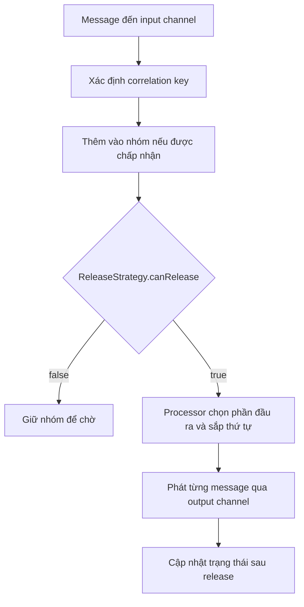

# ReleaseStrategy của resequencer

## 1. Bài toán: message đã đến nhưng đã được phép đi tiếp chưa?

Trong một hệ thống xử lý tài liệu, bốn trang của cùng một tài liệu được chuyển đổi song song. Kết quả có thể quay về theo thứ tự `3, 1, 4, 2`, trong khi bước ghi tài liệu cần nhận `1, 2, 3, 4`.

Resequencer giữ các message liên quan trong một nhóm rồi phát chúng theo thứ tự. `ReleaseStrategy` là chính sách trả lời câu hỏi: **với trạng thái hiện tại của nhóm, resequencer đã được phép thực hiện một lần phát chưa?**

Hai yêu cầu nghiệp vụ dẫn đến hai chính sách khác nhau:

- **Chờ đủ tài liệu:** chỉ bắt đầu phát khi đã nhận đủ bốn trang.
- **Phát sớm phần hợp lệ:** trang 1 có thể đi tiếp ngay; trang 3 vẫn phải chờ trang 2.

Trong module `SPRING_INTEGRATION_CORE`, nội dung này kết nối `Message`, `MessageChannel`, endpoint và Java DSL với một Enterprise Integration Pattern có trạng thái. Sau bài học, bạn có thể chọn điều kiện release, giải thích vì sao một nhóm đang chờ, cấu hình chính sách tùy biến và thiết kế kiểm thử quan sát cả thời điểm lẫn thứ tự đầu ra.

Resequencer phát các message riêng lẻ; aggregator thường kết hợp chúng thành một kết quả. Đây là khác biệt cần giữ khi thiết kế consumer phía sau. [Spring Integration: Resequencer](https://docs.spring.io/spring-integration/reference/resequencer.html).

## 2. Phân chia trách nhiệm trong một lần xử lý

### 2.1. Hợp đồng của ReleaseStrategy

Interface nằm trong package `org.springframework.integration.aggregator`, dù cũng được dùng bởi resequencer:

```java
public interface ReleaseStrategy {
    boolean canRelease(MessageGroup group);
}
```

Đây là functional interface, nên có thể được triển khai bằng class, lambda hoặc method reference. Đối số là **nhóm message**, không phải riêng message vừa đến. Giá trị `true` cho phép đi vào bước xử lý đầu ra; nó không tự thực hiện việc gửi message. [Javadoc ReleaseStrategy 6.3.2](https://docs.spring.io/spring-integration/docs/6.3.2/api/org/springframework/integration/aggregator/ReleaseStrategy.html).

| Thành phần | Quyết định hoặc công việc | Ví dụ trong luồng tài liệu |
| --- | --- | --- |
| `CorrelationStrategy` | Message thuộc nhóm nào | Cùng `documentId` và cùng lần xử lý |
| `MessageGroupStore` | Lưu message và trạng thái nhóm | Giữ trang 3 trong khi chờ trang 2 |
| `ReleaseStrategy` | Có được thực hiện một lần phát không | Đã đủ bốn trang hoặc có phần liên tiếp tiếp theo |
| `MessageGroupProcessor` | Chọn và sắp thứ tự phần đầu ra | Lấy các trang liên tiếp theo `sequenceNumber` |
| Endpoint và output channel | Chuyển message đi tiếp | Đưa từng trang sang bước ghi tài liệu |

Một strategy trả về `true` không có nghĩa mọi message đang lưu đều phải được phát, hoặc toàn bộ nhóm đã hoàn tất.



### 2.2. canRelease không phải một lịch chạy

Trong đường xử lý thông thường, handler đánh giá strategy sau khi thêm message vào nhóm. Nếu `false`, nhóm tiếp tục chờ. Timeout hoặc reaper là những cơ chế kích hoạt xử lý khác; chúng không được tạo ra chỉ bằng một biểu thức thời gian nằm trong strategy.

Ví dụ, biểu thức Java giả định sau **không tự đánh thức nhóm sau 10 giây**:

```java
group -> System.currentTimeMillis() - group.getTimestamp() >= 10_000
```

Nếu không có lần đánh giá tiếp theo, điều kiện có thể trở thành đúng theo đồng hồ mà nhóm vẫn nằm yên. Muốn xử lý theo thời gian, cần cấu hình cơ chế timeout tương ứng.

## 3. Các header làm nền cho chính sách release

Với một chuỗi hữu hạn gồm `N` message, giao thức đầu vào nên quy định:

| Header | Ý nghĩa | Giá trị ví dụ |
| --- | --- | --- |
| `IntegrationMessageHeaderAccessor.CORRELATION_ID` | Định danh một chuỗi | `document-42:attempt-1` |
| `IntegrationMessageHeaderAccessor.SEQUENCE_NUMBER` | Vị trí message trong chuỗi, bắt đầu từ 1 | `3` |
| `IntegrationMessageHeaderAccessor.SEQUENCE_SIZE` | Tổng số message dự kiến | `4` |

Trong cùng một chuỗi, các vị trí hợp lệ là `1..N`, mỗi vị trí xuất hiện đúng một lần và các message khai báo cùng `N`. Đặt header số thứ tự và kích thước bằng `Integer` giúp phù hợp với API truy cập header trong các ví dụ dưới đây.

```java
import org.springframework.integration.IntegrationMessageHeaderAccessor;
import org.springframework.messaging.Message;
import org.springframework.messaging.support.MessageBuilder;

final class PageMessages {

    private PageMessages() {
    }

    static Message<String> page(String correlationId, int number, int size) {
        if (correlationId == null || correlationId.isBlank()
                || size <= 0 || number < 1 || number > size) {
            throw new IllegalArgumentException("Invalid finite page sequence");
        }

        return MessageBuilder.withPayload("page-" + number)
                .setHeader(IntegrationMessageHeaderAccessor.CORRELATION_ID,
                        correlationId)
                .setHeader(IntegrationMessageHeaderAccessor.SEQUENCE_NUMBER,
                        number)
                .setHeader(IntegrationMessageHeaderAccessor.SEQUENCE_SIZE,
                        size)
                .build();
    }
}
```

Ví dụ này dùng correlation header mặc định. Nếu đổi correlation strategy sang một header nghiệp vụ khác, cần bảo đảm các message của cùng một lần xử lý vẫn được gom đúng nhóm.

### 3.1. Biết tổng số và biết thứ tự là hai thông tin riêng

Một luồng có thể biết message tiếp theo mang số 18 nhưng chưa biết tổng số message cuối cùng. Trong trường hợp đó:

- Chính sách chờ đủ chuỗi không có một `N` hợp lệ để xác định hoàn tất.
- Chính sách phát phần liên tiếp có thể cho dữ liệu đi tiếp khi nối được vào phần đã phát.
- Hệ thống vẫn cần giao thức kết thúc, timeout hoặc vòng đời nhóm rõ ràng để thu hồi trạng thái.

Không dùng `sequenceSize = 0` để diễn đạt “đã nhận đủ”. Trong bài này, các ví dụ thực hành đều dùng chuỗi hữu hạn có tổng số dương.

### 3.2. Filter phía trước có thể tạo khoảng trống

Giả sử splitter đánh số bốn message là `1..4`, sau đó filter loại message số 2. Resequencer sẽ nhìn thấy `1, 3, 4`:

- Chờ đủ chuỗi: không đủ bốn message.
- Phát phần liên tiếp: phát được số 1 rồi chờ số 2.

Nếu việc loại bỏ là hợp lệ về nghiệp vụ, cần thiết kế lại giao thức, chẳng hạn lọc trước khi đánh số, đánh số lại chuỗi đã chấp nhận hoặc dùng một sự kiện thay thế có ý nghĩa nghiệp vụ cho vị trí bị loại. Không sửa tùy tiện `sequenceSize` trên một message để làm nhóm thoát chờ.

## 4. Chờ đủ chuỗi và phát phần liên tiếp

### 4.1. Chính sách chờ đủ chuỗi

Với dữ liệu tuân thủ giao thức `1..N`, điều kiện cơ bản là số message trong nhóm đạt tổng số dự kiến. Khi đó resequencer có thể phát chuỗi theo thứ tự.

Trong triển khai Spring Integration 6.3.2, cấu hình mặc định dùng `SimpleSequenceSizeReleaseStrategy`. Strategy này so sánh `group.size()` với `group.getSequenceSize()`, không hỗ trợ partial release và không bật cơ chế kiểm tra trùng số thứ tự của handler. Vì vậy, chỉ đếm đủ message chưa chứng minh dữ liệu đầu vào hợp lệ. [Mã nguồn SimpleSequenceSizeReleaseStrategy 6.3.2](https://github.com/spring-projects/spring-integration/blob/v6.3.2/spring-integration-core/src/main/java/org/springframework/integration/aggregator/SimpleSequenceSizeReleaseStrategy.java).

Khi muốn chọn tường minh strategy có xử lý nhận biết sequence trong handler, có thể dùng:

```java
new SequenceSizeReleaseStrategy(false)
```

Tham số `false` biểu thị chờ đủ chuỗi. Với cấu hình hỗ trợ sequence tương ứng, handler có thể từ chối sequence trùng trong nhóm. Điều này vẫn cần đi cùng giao thức header hợp lệ và chính sách xử lý message bất thường.

Ví dụ `N = 4`, đầu vào `3, 1, 4, 2`:

| Message vừa đến | Các số đang chờ trước khi phát | Đầu ra của lần này |
| --- | --- | --- |
| 3 | `{3}` | Chưa có |
| 1 | `{1, 3}` | Chưa có |
| 4 | `{1, 3, 4}` | Chưa có |
| 2 | `{1, 2, 3, 4}` | `1, 2, 3, 4` |

Phù hợp khi consumer chỉ nên bắt đầu sau khi tất cả phần đã đến. Tuy nhiên, một lần phát bốn message vẫn gồm nhiều thao tác gửi; nó không tự tạo một giao dịch nguyên tử cho cả bốn tác động ở consumer.

### 4.2. Chính sách phát phần liên tiếp

`SequenceSizeReleaseStrategy(true)` cho phép phát phần tiếp theo trước khi nhận đủ cả chuỗi. Với nhóm không rỗng, strategy xét số nhỏ nhất đang chờ và số cuối đã phát; có thể release khi hai giá trị nối tiếp nhau. [Mã nguồn SequenceSizeReleaseStrategy 6.3.2](https://github.com/spring-projects/spring-integration/blob/v6.3.2/spring-integration-core/src/main/java/org/springframework/integration/aggregator/SequenceSizeReleaseStrategy.java).

Gọi `L` là số cuối đã phát; ban đầu `L = 0`. Một lần phát hợp lệ bắt đầu ở `L + 1` và tiếp tục tới trước khoảng trống đầu tiên.

Vẫn với `N = 4`, đầu vào `3, 1, 4, 2`:

| Message vừa đến | `L` trước lần xét | Đầu ra của lần này | Các số còn chờ | `L` sau đó |
| --- | --- | --- | --- | --- |
| 3 | 0 | Chưa có | `{3}` | 0 |
| 1 | 0 | `1` | `{3}` | 1 |
| 4 | 1 | Chưa có | `{3, 4}` | 1 |
| 2 | 1 | `2, 3, 4` | `{}` | 4 |

Các hệ quả có thể kiểm tra trực tiếp từ bảng:

- `{3, 4}` liên tiếp với nhau nhưng chưa nối vào vị trí cần tiếp theo là 2.
- Khi số 2 đến, nhóm phát được ba message trong cùng một lần release.
- Partial release giảm độ trễ của số 1, nhưng không khắc phục việc mất số 2.
- Một lần release thành công chưa chắc đã kết thúc chuỗi; cần tiếp tục giữ trạng thái của phần đã phát.

Processor mặc định sắp xếp theo sequence number rồi lấy đoạn liên tiếp trước khoảng trống. Vì vậy, cần phân biệt điều kiện cho phép release với việc chọn các message thực sự được phát. [Mã nguồn ResequencingMessageGroupProcessor 6.3.2](https://github.com/spring-projects/spring-integration/blob/v6.3.2/spring-integration-core/src/main/java/org/springframework/integration/aggregator/ResequencingMessageGroupProcessor.java).

## 5. Cấu hình Java DSL có thể dùng làm bài thực hành

Ví dụ dưới đây dùng API Spring Integration 6.x, Java 17 trở lên và module `spring-integration-core`. Các nhận xét về triển khai được đối chiếu với phiên bản 6.3.2. Dùng dependency management của ứng dụng để chọn các phiên bản Spring tương thích.

Hai flow có input và output riêng để có thể gửi cùng một chuỗi vào hai chính sách rồi so sánh. `DirectChannel` giúp việc nhận message và xử lý resequencer diễn ra đồng bộ trong ví dụ; `QueueChannel` giữ đầu ra để quan sát.

```java
import org.springframework.context.annotation.Bean;
import org.springframework.context.annotation.Configuration;
import org.springframework.integration.aggregator.SequenceSizeReleaseStrategy;
import org.springframework.integration.channel.DirectChannel;
import org.springframework.integration.channel.QueueChannel;
import org.springframework.integration.config.EnableIntegration;
import org.springframework.integration.dsl.IntegrationFlow;

@Configuration
@EnableIntegration
public class ResequencerReleaseConfig {

    @Bean
    public DirectChannel fullInput() {
        return new DirectChannel();
    }

    @Bean
    public QueueChannel fullOutput() {
        return new QueueChannel();
    }

    @Bean
    public IntegrationFlow fullFlow() {
        return IntegrationFlow.from("fullInput")
                .resequence(r -> r.releaseStrategy(
                        new SequenceSizeReleaseStrategy(false)))
                .channel("fullOutput")
                .get();
    }

    @Bean
    public DirectChannel partialInput() {
        return new DirectChannel();
    }

    @Bean
    public QueueChannel partialOutput() {
        return new QueueChannel();
    }

    @Bean
    public IntegrationFlow partialFlow() {
        return IntegrationFlow.from("partialInput")
                .resequence(r -> r.releasePartialSequences(true))
                .channel("partialOutput")
                .get();
    }
}
```

Java DSL cung cấp cấu hình correlation và release trên endpoint resequencer qua lambda cấu hình. [Spring Integration: Aggregators and Resequencers trong Java DSL](https://docs.spring.io/spring-integration/reference/dsl/java-aggregators.html).

Ở `partialFlow`, `releasePartialSequences(true)` sử dụng cơ chế sequence có sẵn. Một cách khai báo trực tiếp chính sách tương ứng là:

```java
.resequence(r -> r.releaseStrategy(new SequenceSizeReleaseStrategy(true)))
```

Chọn một cách thể hiện chính sách cho dễ đọc. Khi dùng custom strategy, hãy cấu hình trực tiếp `releaseStrategy(...)` và tự định nghĩa điều kiện của nó. Trong 6.3.2, bật thêm `releasePartialSequences(true)` đòi hỏi strategy thuộc kiểu `SequenceSizeReleaseStrategy`; ghép cờ này với một implementation tùy ý có thể làm khởi tạo endpoint thất bại. [Mã nguồn AbstractCorrelatingMessageHandler 6.3.2](https://github.com/spring-projects/spring-integration/blob/v6.3.2/spring-integration-core/src/main/java/org/springframework/integration/aggregator/AbstractCorrelatingMessageHandler.java).

### 5.1. Chọn biểu thức đơn giản khi điều kiện thực sự đơn giản

Java DSL có `releaseExpression(...)`; root object của biểu thức release là `MessageGroup`. Tuy nhiên, biểu thức sau chỉ có ý nghĩa đếm:

```java
.resequence(r -> r.releaseExpression("size() == 4"))
```

Nó không biểu đạt “đã có đủ các vị trí `1, 2, 3, 4`”. Chẳng hạn tập số `{1, 2, 4, 5}` cũng có bốn phần tử. Dùng biểu thức này làm chính sách cho chuỗi tùy ý sẽ đánh đồng số lượng với tính đầy đủ. [Javadoc CorrelationHandlerSpec 6.3.2](https://docs.spring.io/spring-integration/docs/6.3.2/api/org/springframework/integration/dsl/CorrelationHandlerSpec.html).

## 6. Custom ReleaseStrategy: chỉ phát một chuỗi hữu hạn hợp lệ

Giả sử hệ thống nhận message từ một đối tác không bảo đảm header nhất quán. Yêu cầu là chỉ release khi:

1. Nhóm có tổng số dự kiến dương.
2. Số message bằng tổng số dự kiến.
3. Mọi message khai báo cùng tổng số.
4. Các số thứ tự khác nhau và nằm trong `1..N`.

Với bốn điều kiện này, đủ `N` số khác nhau trong miền `1..N` chứng minh không thiếu vị trí nào. Đây là chính sách **chờ đủ chuỗi**, không dùng sau những lần partial release.

```java
import java.util.HashSet;
import java.util.Set;

import org.springframework.integration.IntegrationMessageHeaderAccessor;
import org.springframework.integration.aggregator.ReleaseStrategy;
import org.springframework.integration.store.MessageGroup;
import org.springframework.messaging.Message;

public final class StrictFullSequenceReleaseStrategy implements ReleaseStrategy {

    @Override
    public boolean canRelease(MessageGroup group) {
        if (group.size() == 0) {
            return false;
        }

        int expectedSize = group.getSequenceSize();
        if (expectedSize <= 0 || group.size() != expectedSize) {
            return false;
        }

        Set<Integer> positions = new HashSet<>();

        for (Message<?> message : group.getMessages()) {
            Integer number = message.getHeaders().get(
                    IntegrationMessageHeaderAccessor.SEQUENCE_NUMBER,
                    Integer.class);
            Integer declaredSize = message.getHeaders().get(
                    IntegrationMessageHeaderAccessor.SEQUENCE_SIZE,
                    Integer.class);

            if (number == null || declaredSize == null
                    || declaredSize != expectedSize
                    || number < 1 || number > expectedSize
                    || !positions.add(number)) {
                return false;
            }
        }

        return true;
    }
}
```

Gắn vào một flow bằng:

```java
.resequence(r -> r.releaseStrategy(new StrictFullSequenceReleaseStrategy()))
```

Đây là implementation do bài học xây dựng, không phải class có sẵn của Spring. Nó chỉ đọc nhóm và trả quyết định. Các API `getMessages()`, `getSequenceSize()` và `size()` thuộc mô hình `MessageGroup`; `SimpleMessageGroup` là một implementation có thể dùng để dựng dữ liệu kiểm thử. [Javadoc SimpleMessageGroup 6.3.2](https://docs.spring.io/spring-integration/docs/6.3.2/api/org/springframework/integration/store/SimpleMessageGroup.html).

### 6.1. Giới hạn của việc kiểm tra ngay trong strategy

`false` nghĩa là chưa cho phép release. Nó không tự loại message sai, không tự đưa dữ liệu sang dead-letter flow và không sửa nhóm.

Ví dụ, nếu nhóm đã có `N` message nhưng hai message cùng mang vị trí số 2, strategy sẽ giữ nhóm. Nếu không có timeout hoặc cơ chế xử lý dữ liệu sai, nhóm có thể chờ vô hạn.

Vì vậy, trong một thiết kế thực tế:

- Kiểm tra kiểu và miền giá trị header trước khi message vào resequencer.
- Phát hiện duplicate theo định danh nghiệp vụ và có chính sách rõ ràng cho bản phát lại.
- Dùng strategy để quyết định tính sẵn sàng của một nhóm hợp lệ.
- Dùng timeout và nhánh xử lý riêng để giải quyết nhóm không thể hoàn tất.

Class trên không giữ trạng thái dùng chung và không thay đổi `MessageGroup`. Việc truy cập dịch vụ từ xa, gửi email, ghi nghiệp vụ hoặc xóa message trong `canRelease()` sẽ làm quyết định khó lặp lại và có thể kéo dài thời gian giữ khóa của nhóm.

## 7. Release thông thường và xử lý hết hạn

### 7.1. Một nhóm thiếu message cần một đường thoát

Nếu trang số 2 bị mất vĩnh viễn, chờ thêm không thể tạo ra trang đó. Một chính sách cho hệ thống cần thứ tự nghiêm ngặt là giữ dữ liệu thiếu ở nhánh lỗi nghiệp vụ để đối soát hoặc yêu cầu phát lại.

Ví dụ sau là phương án thay thế cho `fullFlow` ở trên. Bổ sung bean `resequenceDiscard` vào cùng configuration:

```java
@Bean
public QueueChannel resequenceDiscard() {
    return new QueueChannel();
}

@Bean
public IntegrationFlow fullFlow() {
    return IntegrationFlow.from("fullInput")
            .resequence(r -> r
                    .releaseStrategy(new SequenceSizeReleaseStrategy(false))
                    .groupTimeout(10_000)
                    .sendPartialResultOnExpiry(false)
                    .discardChannel("resequenceDiscard"))
            .channel("fullOutput")
            .get();
}
```

Đây là cấu hình thay thế, không khai báo thêm một bean `fullFlow` trùng tên trong cùng class. Queue ở nhánh discard chỉ giúp quan sát; ứng dụng cần consumer để ghi nhận và xử lý dữ liệu đó.

| Cơ chế | Mục đích | Điều không thể suy ra |
| --- | --- | --- |
| `ReleaseStrategy` | Quyết định release dựa trên trạng thái nhóm | Không tự tạo scheduler |
| `releasePartialSequences(true)` | Phát đoạn nối tiếp khi chưa đủ toàn chuỗi | Không cho phép bỏ qua khoảng trống |
| `groupTimeout(...)` | Kích hoạt xử lý nhóm sau khoảng chờ được cấu hình | Không bổ sung message đang thiếu |
| `sendPartialResultOnExpiry(false)` | Khi nhóm hết hạn và không đủ điều kiện release, đưa phần đang chờ sang nhánh discard | Không thu hồi message đã phát trước đó |
| `sendPartialResultOnExpiry(true)` | Cho phép xử lý đầu ra còn thiếu khi nhóm hết hạn | Không chứng minh chuỗi nghiệp vụ đã đủ |
| `sendTimeout(...)` | Giới hạn chờ trong thao tác gửi tới channel có hỗ trợ giới hạn chờ | Không phải thời gian chờ đủ nhóm |

Không đồng nhất “partial” trong partial sequence với “partial result” khi hết hạn. Một bên giữ yêu cầu nối tiếp ở đường xử lý bình thường; bên kia là lựa chọn xử lý dữ liệu chưa đầy đủ khi kết thúc thời gian chờ. [Spring Integration: cấu hình Resequencer](https://docs.spring.io/spring-integration/reference/resequencer.html).

Với giá trị timeout hằng, lịch chờ có thể được hủy và đặt lại khi nhóm tiếp tục nhận message. Vì vậy, không diễn giải `groupTimeout(10_000)` thành một SLA tuyệt đối 10 giây kể từ message đầu tiên. Cần xác định rõ timeout theo thời gian không hoạt động hay theo hạn cuối của toàn bộ nghiệp vụ.

### 7.2. Discard không đồng nghĩa với exception

Message bị loại theo chính sách chưa chắc tạo exception. `discardChannel` là đường xử lý riêng; không nên chờ mọi trường hợp thiếu hoặc trùng dữ liệu xuất hiện trên `errorChannel`.

Ngược lại, nếu code của custom strategy ném exception, đó là lỗi xử lý. Cách lỗi đến caller hay hạ tầng error handling còn phụ thuộc channel và ranh giới thực thi đồng bộ hoặc bất đồng bộ.

Trong ví dụ dùng `DirectChannel`, cần quan sát exception ở lời gọi gửi message. Khi chuyển sang channel thực thi trên executor, phải thiết kế cả đường xử lý lỗi cho tác vụ bất đồng bộ.

## 8. Kiểm thử phải quan sát thời điểm phát và thứ tự

Một kiểm thử chỉ so sánh danh sách cuối cùng có thể bỏ sót việc resequencer đã phát quá sớm. Với partial release, cần chứng minh cả hai việc: có thể phát khi đoạn đầu hợp lệ và vẫn giữ message nằm sau khoảng trống.

Các test sau dùng JUnit Jupiter, configuration `ResequencerReleaseConfig` và helper `PageMessages` đã trình bày. Đặt các class cùng package hoặc điều chỉnh visibility phù hợp trong dự án thực hành.

```java
import static org.junit.jupiter.api.Assertions.assertEquals;
import static org.junit.jupiter.api.Assertions.assertNotNull;
import static org.junit.jupiter.api.Assertions.assertNull;
import static org.junit.jupiter.api.Assertions.assertTrue;

import org.junit.jupiter.api.Test;
import org.springframework.context.annotation.AnnotationConfigApplicationContext;
import org.springframework.integration.channel.QueueChannel;
import org.springframework.messaging.Message;
import org.springframework.messaging.MessageChannel;

class ResequencerReleaseTest {

    @Test
    void fullSequenceWaitsUntilEveryPageArrives() {
        try (var context = new AnnotationConfigApplicationContext(
                ResequencerReleaseConfig.class)) {
            MessageChannel input = context.getBean("fullInput", MessageChannel.class);
            QueueChannel output = context.getBean("fullOutput", QueueChannel.class);

            send(input, "doc-full", 3, 4);
            send(input, "doc-full", 1, 4);
            send(input, "doc-full", 4, 4);
            assertNull(output.receive(0));

            send(input, "doc-full", 2, 4);
            assertPayloads(output, "page-1", "page-2", "page-3", "page-4");
            assertNull(output.receive(0));
        }
    }

    @Test
    void partialSequenceWaitsAtTheFirstGap() {
        try (var context = new AnnotationConfigApplicationContext(
                ResequencerReleaseConfig.class)) {
            MessageChannel input = context.getBean("partialInput", MessageChannel.class);
            QueueChannel output = context.getBean("partialOutput", QueueChannel.class);

            send(input, "doc-partial", 3, 4);
            assertNull(output.receive(0));

            send(input, "doc-partial", 1, 4);
            assertPayloads(output, "page-1");
            assertNull(output.receive(0));

            send(input, "doc-partial", 4, 4);
            assertNull(output.receive(0));

            send(input, "doc-partial", 2, 4);
            assertPayloads(output, "page-2", "page-3", "page-4");
            assertNull(output.receive(0));
        }
    }

    @Test
    void waitingDocumentDoesNotBlockAnotherCorrelationGroup() {
        try (var context = new AnnotationConfigApplicationContext(
                ResequencerReleaseConfig.class)) {
            MessageChannel input = context.getBean("partialInput", MessageChannel.class);
            QueueChannel output = context.getBean("partialOutput", QueueChannel.class);

            send(input, "doc-A", 2, 2);
            assertNull(output.receive(0));

            send(input, "doc-B", 1, 1);
            Message<?> fromB = output.receive(0);
            assertNotNull(fromB);
            assertEquals("doc-B", fromB.getHeaders().get("correlationId"));
            assertEquals("page-1", fromB.getPayload());

            send(input, "doc-A", 1, 2);
            assertPayloads(output, "page-1", "page-2");
            assertNull(output.receive(0));
        }
    }

    private static void send(MessageChannel input, String id, int number, int size) {
        assertTrue(input.send(PageMessages.page(id, number, size)));
    }

    private static void assertPayloads(QueueChannel output, String... expected) {
        for (String payload : expected) {
            Message<?> received = output.receive(0);
            assertNotNull(received);
            assertEquals(payload, received.getPayload());
        }
    }
}
```

`receive(0)` phù hợp trong fixture này vì đường gửi tới resequencer dùng `DirectChannel` và không có bước bất đồng bộ. Khi thay bằng executor, cần chờ có giới hạn và đồng bộ kiểm thử đúng cách; việc queue tạm thời rỗng ngay sau `send()` chưa chứng minh message đã bị giữ bởi strategy.

### 8.1. Kiểm thử custom strategy độc lập với endpoint

Đoạn sau minh họa việc dựng một nhóm và gọi chính sách trực tiếp. Nó kiểm tra quyết định của custom strategy, không thay thế kiểm thử flow:

```java
import static org.junit.jupiter.api.Assertions.assertFalse;
import static org.junit.jupiter.api.Assertions.assertTrue;

import java.util.List;

import org.junit.jupiter.api.Test;
import org.springframework.integration.store.SimpleMessageGroup;

class StrictFullSequenceReleaseStrategyTest {

    @Test
    void acceptsCompletePositionsRegardlessOfArrivalOrder() {
        var group = new SimpleMessageGroup(List.of(
                PageMessages.page("valid", 3, 3),
                PageMessages.page("valid", 1, 3),
                PageMessages.page("valid", 2, 3)), "valid");

        assertTrue(new StrictFullSequenceReleaseStrategy().canRelease(group));
    }

    @Test
    void rejectsDuplicatePositionEvenWhenMessageCountMatches() {
        var group = new SimpleMessageGroup(List.of(
                PageMessages.page("duplicate", 1, 3),
                PageMessages.page("duplicate", 2, 3),
                PageMessages.page("duplicate", 2, 3)), "duplicate");

        assertFalse(new StrictFullSequenceReleaseStrategy().canRelease(group));
    }

    @Test
    void rejectsInconsistentDeclaredSizes() {
        var group = new SimpleMessageGroup(List.of(
                PageMessages.page("inconsistent", 1, 3),
                PageMessages.page("inconsistent", 2, 4),
                PageMessages.page("inconsistent", 3, 3)), "inconsistent");

        assertFalse(new StrictFullSequenceReleaseStrategy().canRelease(group));
    }
}
```

Hai message cùng vị trí trong test duplicate được tạo riêng nên có message ID khác nhau. Test này cố ý mô phỏng duplicate nghiệp vụ, thay vì gửi lại cùng một object rồi phụ thuộc cơ chế lưu trữ có loại nó hay không.

Với ứng dụng thực tế, bổ sung kiểm thử thiếu vị trí đầu, mất vị trí giữa, nhóm hết hạn, message đến muộn và dữ liệu phát lại sau khi khôi phục. Các trường hợp này xác nhận giao thức và vòng đời trạng thái, không chỉ thuật toán sắp xếp.

## 9. Những giới hạn cần đưa vào thiết kế luồng

### 9.1. Thứ tự được bảo đảm trong phạm vi nào?

Resequencer sắp thứ tự theo từng correlation group. Nếu tài liệu A thiếu trang 2, điều đó không tạo yêu cầu nghiệp vụ phải giữ tài liệu B đã đầy đủ.

Thứ tự đưa message ra output channel cũng khác với thứ tự hoàn thành tác động ở consumer. Nếu consumer tiếp tục xử lý song song, trang 3 có thể ghi xong trước trang 2. Khi nghiệp vụ cần thứ tự tác động, phải giữ cách tiêu thụ phù hợp theo khóa tài liệu ở các bước phía sau.

### 9.2. Gateway đồng bộ có thể khiến producer không gửi đủ chuỗi

Một gateway kiểu request-reply có thể chờ đầu ra trong khi resequencer đang giữ nhóm. Nếu caller gửi trang 3 rồi đợi reply trước khi gửi trang 1, 2 và 4, chính caller đã ngăn chuỗi hoàn tất.

Với tác vụ gom nhiều message, cần thiết kế cách gửi không phụ thuộc vào reply của từng phần, hoặc tách rõ thao tác nộp dữ liệu và thao tác nhận kết quả cuối. Timeout của gateway không đồng nghĩa nhóm trong resequencer đã hết hạn.

### 9.3. Release thành công không thay thế idempotency

Ứng dụng có thể gửi lại một trang sau lỗi mạng hoặc khởi động lại. Quy tắc xử lý duplicate trong một nhóm không tương đương bảo đảm exactly-once cho toàn bộ đường đi.

Nên định danh nghiệp vụ bằng các thành phần như `(documentId, processingAttempt, pageNumber)`, rồi quyết định bản phát lại được bỏ qua, thay thế hay chuyển đối soát. Không giả định `MessageHeaders.ID` mới đồng nghĩa với một trang nghiệp vụ mới.

### 9.4. Trạng thái nhóm phải có vòng đời

Với partial release, handler cập nhật thông tin về sequence đã phát và loại các message đã xử lý khỏi phần đang chờ. Với nhóm hết hạn, việc giữ hoặc xóa metadata ảnh hưởng đến xử lý message đến muộn. Không xóa trực tiếp dữ liệu store để “giải phóng bộ nhớ” mà bỏ qua giao thức vòng đời. [Mã nguồn ResequencingMessageHandler 6.3.2](https://github.com/spring-projects/spring-integration/blob/v6.3.2/spring-integration-core/src/main/java/org/springframework/integration/aggregator/ResequencingMessageHandler.java).

Về vận hành, nên quan sát ít nhất số nhóm đang chờ, số message lưu, tuổi nhóm và số lần discard. Ghi correlation key cùng khoảng trống đầu tiên giúp phân biệt một nhóm chờ hợp lệ với một chuỗi không thể hoàn tất.

Nếu cần phục hồi qua lần khởi động lại hoặc chạy nhiều instance cùng xử lý một nhóm, phải thiết kế đồng bộ cả message store, cơ chế khóa và cách phân phối theo correlation key. Custom strategy thuần hàm không tự giải quyết sự phối hợp giữa các instance.

## 10. Chọn chính sách và chẩn đoán nhanh

| Nhu cầu hoặc hiện tượng | Cách suy luận | Hướng xử lý |
| --- | --- | --- |
| Consumer chỉ bắt đầu khi nhận đủ mọi phần | Cần điều kiện hoàn tất chuỗi hữu hạn | Chính sách full sequence và kiểm tra giao thức header |
| Muốn giảm độ trễ nhưng vẫn giữ vị trí liên tiếp | Cần phát đoạn nối vào phần đã phát | `releasePartialSequences(true)` |
| Có `{3, 4}` nhưng chưa có đầu ra | Vẫn đang cần vị trí 1 hoặc 2 tùy lịch sử | Kiểm tra số cuối đã phát và khoảng trống kế tiếp |
| Đếm đủ message nhưng chuỗi sai | Số lượng không chứng minh các vị trí hợp lệ | Kiểm tra duplicate, miền giá trị và tổng số nhất quán |
| Message sai làm nhóm chờ mãi | `false` không phải thao tác loại dữ liệu | Validate trước resequencer và cấu hình timeout/discard |
| Strategy có kiểm tra tuổi nhóm nhưng không chạy khi đến hạn | Thiếu cơ chế kích hoạt đánh giá | Cấu hình group timeout hoặc reaper phù hợp |
| Đầu ra sắp đúng nhưng kết quả ghi sai thứ tự | Bước phía sau xử lý song song | Kiểm tra mô hình tiêu thụ và thứ tự tác động theo khóa |
| Bộ nhớ tăng khi thiếu message | Các nhóm giữ trạng thái quá lâu | Theo dõi tuổi nhóm, xử lý khoảng trống và dọn trạng thái theo vòng đời |

Khi xây dựng một flow mới, hãy ghi rõ bộ ba: **cách gom nhóm, điều kiện cho phép phát và cách xử lý nhóm không thể hoàn tất**. Sau đó dùng dữ liệu đến lệch thứ tự để kiểm tra cả đầu ra xuất hiện ở thời điểm nào và các message được phát theo thứ tự nào.
