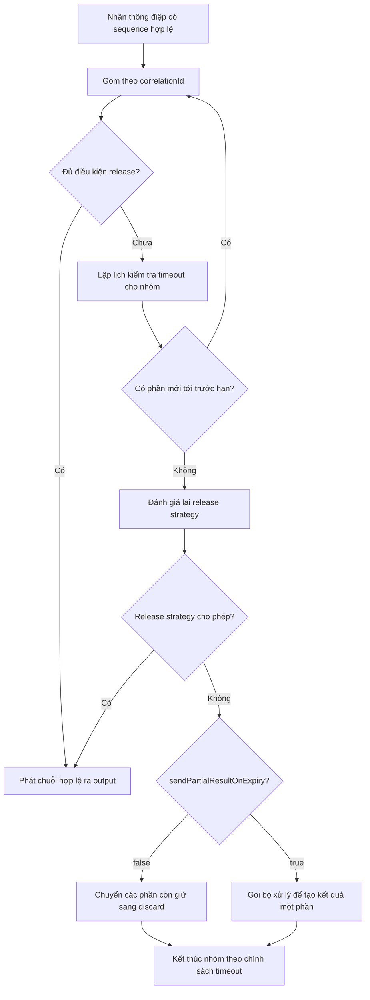

# Timeout khi thiếu sequence

Trong một luồng xử lý song song, các phần của cùng một tác vụ có thể hoàn thành khác thứ tự. Resequencer giữ các `Message` cùng nhóm và phát chúng theo số thứ tự. Vấn đề xuất hiện khi một phần không bao giờ tới: những phần đã có vẫn chiếm bộ nhớ, còn bên nhận có thể chờ mãi.

Bài học thuộc chương **Resequencer** của **SPRING_INTEGRATION_CORE**, tập trung vào cách giới hạn thời gian chờ, chọn đầu ra khi thiếu phần và kiểm soát thông điệp đến muộn. Các ví dụ kết nối `Message`, `MessageChannel`, endpoint và Java DSL với một tình huống tích hợp thực tế. Phần mô tả hành vi chi tiết của bộ xử lý mặc định được đối chiếu với mã nguồn **Spring Integration 6.5.10**; đây là mốc cho ví dụ, không phải yêu cầu nâng cấp dự án.

## 1. Thiếu sequence nghĩa là thiếu điều gì?

Giả sử dịch vụ xuất báo cáo chia một báo cáo thành bốn phần. Mỗi phần được xử lý độc lập rồi gửi vào resequencer với các header:

| Header | Giá trị ví dụ | Vai trò trong luồng |
| --- | --- | --- |
| `IntegrationMessageHeaderAccessor.CORRELATION_ID` | `report-42:attempt-1` | Xác định nhóm của một lần xử lý báo cáo |
| `IntegrationMessageHeaderAccessor.SEQUENCE_NUMBER` | `3` | Vị trí của phần trong nhóm, bắt đầu từ `1` |
| `IntegrationMessageHeaderAccessor.SEQUENCE_SIZE` | `4` | Tổng số phần dự kiến |

Nếu thứ tự đến là `3 → 1 → 4`, nhóm đang thiếu phần `2`. Khi chờ đủ nhóm, resequencer chưa thể phát kết quả bình thường. Nhận phần `4`, dù đó là số thứ tự lớn nhất, cũng chưa chứng minh rằng mọi phần trước nó đã đến.

Resequencer thực hiện việc sắp thứ tự dựa trên metadata của nhóm; nó không tự gọi lại nguồn để lấy phần bị thiếu. Cơ chế nhóm và sắp thứ tự được mô tả trong [tài liệu Resequencer](https://docs.spring.io/spring-integration/reference/resequencer.html).

Cần phân biệt hai loại lỗi đầu vào:

- **Thiếu một thông điệp trong chuỗi hợp lệ:** các phần hiện có mang header đúng nhưng phần `2` bị mất hoặc quá chậm. Timeout là một cách giới hạn chờ.
- **Thiếu hoặc sai header:** thông điệp không có correlation key, sequence number sai kiểu, hoặc sequence size mâu thuẫn. Cần kiểm tra hợp đồng dữ liệu ở đầu vào; tăng timeout không sửa được metadata.

Trong bài này, mọi ví dụ đều giả định nhóm có kích thước hữu hạn, các header hợp lệ và mỗi số thứ tự đại diện cho đúng một phần nghiệp vụ.

## 2. Timeout là quyết định kết thúc chờ

Đối với báo cáo cần đầy đủ, thời gian chờ ba giây có thể đi kèm quy tắc nghiệp vụ: nếu còn thiếu phần sau khoảng chờ thì đánh dấu lần xuất báo cáo thất bại, lưu những phần đã nhận để điều tra và cho phép tạo một lần xử lý mới.

Đối với màn hình xem trước, nghiệp vụ có thể chấp nhận một phần dữ liệu, nhưng giao diện phải thể hiện rõ báo cáo chưa đầy đủ. Cùng một timeout có thể dẫn đến hai hành vi rất khác nhau; phải xác định chính sách trước khi đặt con số.



Đây là sơ đồ khái niệm cho nhóm chưa hoàn tất. **Timeout không tạo thông điệp thay thế cho phần bị thiếu và không chứng minh tác vụ đã thành công.** Ứng dụng vẫn phải ghi nhận trạng thái thành công, thiếu dữ liệu hoặc thất bại theo yêu cầu của mình.

## 3. Đồng hồ nào đang chạy?

### 3.1. `groupTimeout` là khoảng chờ khi nhóm chưa release

Với cấu hình `groupTimeout(3000L)`, một nhóm chưa được release sẽ được lên lịch buộc hoàn tất sau khoảng chờ ba giây. Khi một thông điệp mới được nhận vào nhóm và nhóm vẫn chưa release, lịch cũ được thay bằng lịch mới.

Ví dụ, bật chế độ chờ đủ nhóm và giả sử scheduler không bị chậm:

| Thời điểm tương đối | Sự kiện | Thời điểm timeout dự kiến |
| --- | --- | --- |
| `0 ms` | Nhận phần `3/4` | Khoảng `3000 ms` |
| `800 ms` | Nhận phần `1/4` | Khoảng `3800 ms` |
| `1700 ms` | Nhận phần `4/4` | Khoảng `4700 ms` |
| Sau đó không có phần mới | Vẫn thiếu `2/4` | Xử lý timeout khoảng `4700 ms` |

Tính từ phần đầu, nhóm đã tồn tại khoảng 4,7 giây. Vì vậy không được diễn giải `3000` thành “tác vụ luôn kết thúc trong ba giây kể từ thông điệp đầu tiên”. Đơn vị của `groupTimeout(long)` là mili giây; cơ chế lập lịch được trình bày trong [Aggregator and Group Timeout](https://docs.spring.io/spring-integration/reference/aggregator.html#agg-group-timeout).

Thời điểm tác vụ timeout thực sự chạy còn chịu ảnh hưởng của tải scheduler, khóa nhóm và thời gian gửi tới downstream. Một cấu hình thời gian chờ không phải cam kết thời gian thực cứng.

### 3.2. Deadline tính từ lúc tạo nhóm

Nếu hợp đồng của báo cáo yêu cầu giới hạn tổng thời gian, có thể thay cấu hình timeout cố định bằng biểu thức trả về một mốc `Date`:

```java
.resequence(r -> r
        .groupTimeoutExpression("new java.util.Date(timestamp + 10000)")
        .releasePartialSequences(false)
        .sendPartialResultOnExpiry(false)
        .discardChannel("expiredSequence"))
```

`timestamp` ở đây là thời điểm tạo `MessageGroup`, không phải header `timestamp` của một phần bất kỳ. Mỗi lần đánh giá lại đều cho cùng deadline của nhóm đó. Cách tính này hữu ích khi muốn nhóm chưa hoàn tất chờ tối đa khoảng mười giây từ lúc nó được tạo.

Đây vẫn là deadline cục bộ của nhóm. Nếu giới hạn phải tính từ lúc người dùng yêu cầu báo cáo, hãy lưu deadline nghiệp vụ từ đầu và thiết kế luồng sử dụng deadline ấy. Thời điểm tạo nhóm có thể muộn hơn thời điểm nhận yêu cầu.

`groupTimeout(...)` và `groupTimeoutExpression(...)` là hai cách cấu hình cùng một quyết định lập lịch; chọn một cách cho endpoint. Dạng hàm hoặc biểu thức có thể tạo thời gian khác nhau cho từng nhóm, xem [CorrelationHandlerSpec](https://github.com/spring-projects/spring-integration/blob/v6.5.10/spring-integration-core/src/main/java/org/springframework/integration/dsl/CorrelationHandlerSpec.java).

### 3.3. Các timeout khác không thay thế timeout của nhóm

| Cấu hình | Điều nó giới hạn | Cách dùng trong tình huống báo cáo |
| --- | --- | --- |
| `groupTimeout` | Chờ của nhóm chưa release | Giải quyết việc một phần không tới |
| `sendTimeout` | Chờ gửi tới channel có giới hạn khả năng nhận | Tránh kẹt khi queue đích đầy |
| Timeout nhận reply của gateway | Thời gian caller chờ phản hồi | Cho caller thoát chờ theo hợp đồng API |
| Timeout gọi dịch vụ bên ngoài | Thời gian một lời gọi I/O được phép chờ | Giới hạn worker đang lấy dữ liệu cho một phần |

Caller hết hạn chờ reply không tự đồng nghĩa với việc nhóm đã được dọn. Tương tự, đặt `sendTimeout` không tạo ra thời hạn chờ phần `2/4`.

## 4. Ba lựa chọn cần phân biệt

### 4.1. `releasePartialSequences`: phát sớm khi còn hoạt động bình thường

Với `releasePartialSequences(false)`, ví dụ trong bài chờ đủ nhóm trước khi phát.

Với `releasePartialSequences(true)`, chiến lược mặc định có thể cho phát đoạn liên tiếp kế tiếp mà không cần chờ đủ toàn bộ nhóm. Chẳng hạn phần `1` đến sẽ được phát; phần `3` phải chờ phần `2` để tiếp tục chuỗi bình thường. Điều kiện liên quan đến số cuối đã phát được thể hiện trong [SequenceSizeReleaseStrategy](https://github.com/spring-projects/spring-integration/blob/v6.5.10/spring-integration-core/src/main/java/org/springframework/integration/aggregator/SequenceSizeReleaseStrategy.java).

Đây là lựa chọn về thời điểm phát sớm. Nó không tự thiết lập timer. Nếu nghiệp vụ yêu cầu “hoặc có đủ báo cáo, hoặc không xuất phần nào”, phát sớm là một quyết định không phù hợp: timeout sau đó không thể thu hồi phần đã phát.

### 4.2. `sendPartialResultOnExpiry`: xử lý dữ liệu còn giữ khi hết hạn

Khi timeout chạy, framework đánh giá lại release strategy. Nếu chiến lược vẫn không cho release, `sendPartialResultOnExpiry(false)` đưa các phần còn giữ sang discard channel đã cấu hình; đặt `true` thì gọi bộ xử lý để tạo đầu ra một phần. Nhánh xử lý này có thể xem trong [AbstractCorrelatingMessageHandler](https://github.com/spring-projects/spring-integration/blob/v6.5.10/spring-integration-core/src/main/java/org/springframework/integration/aggregator/AbstractCorrelatingMessageHandler.java).

**Không suy ra rằng `true` luôn phát toàn bộ các phần đang giữ.** Trong Spring Integration 6.5.10, `ResequencingMessageGroupProcessor` mặc định sắp xếp các phần rồi lấy đoạn liên tiếp bắt đầu từ số nhỏ nhất hiện có; gặp khoảng trống tiếp theo thì dừng. Đây là hành vi của bộ xử lý, được thể hiện trong [mã nguồn ResequencingMessageGroupProcessor](https://github.com/spring-projects/spring-integration/blob/v6.5.10/spring-integration-core/src/main/java/org/springframework/integration/aggregator/ResequencingMessageGroupProcessor.java).

Ví dụ cụ thể khi chưa phát sớm:

| Các phần còn giữ khi hết hạn | `sendPartialResultOnExpiry(false)` | `sendPartialResultOnExpiry(true)` với bộ xử lý mặc định 6.5.10 |
| --- | --- | --- |
| `1, 3, 4` | Chuyển `1, 3, 4` sang discard | Phát `1`; không mặc nhiên phát `3, 4` |
| `2, 3, 4` | Chuyển `2, 3, 4` sang discard | Có thể phát `2, 3, 4` dù thiếu phần đầu `1` |
| `1, 2, 4` | Chuyển `1, 2, 4` sang discard | Phát `1, 2`; không mặc nhiên phát `4` |

Với `expireGroupsUponTimeout(false)` trong ví dụ, sau khi xử lý timeout, nhóm được đóng và dữ liệu còn giữ được dọn. **Các phần không nằm trong kết quả một phần không được tự động chuyển tiếp sang discard chỉ vì chúng không xuất hiện ở output.** Nếu phải bảo toàn mọi phần để đối soát, nên dùng chính sách discard có lưu trữ thay vì chỉ bật cờ gửi một phần.

Nếu đã bật phát sớm, tình huống lại khác: phần `1` có thể đã ra output, còn nhóm chỉ giữ `3, 4`. Khi gửi một phần lúc hết hạn, đoạn hiện có có thể là `3, 4`; đầu ra tổng thể lúc này có khoảng trống ở `2`. Do đó cần mô tả cả chính sách phát sớm lẫn chính sách hết hạn trong hợp đồng downstream.

### 4.3. `expireGroupsUponTimeout`: còn nhớ nhóm đã đóng hay không?

Hai chính sách có ý nghĩa khác nhau đối với phần `2` đến muộn:

| Giá trị | Trạng thái sau timeout | Hệ quả khi phần muộn tới cùng correlation key |
| --- | --- | --- |
| `false` | Giữ metadata của nhóm đã đóng | Phần muộn bị discard khi metadata còn tồn tại |
| `true` | Xóa nhóm | Phần muộn có thể tạo nhóm mới, rồi tiếp tục thiếu các phần khác |

Resequencer mặc định giữ metadata khi timeout. Ví dụ dưới vẫn cấu hình tường minh để người đọc thấy quyết định này, xem [ResequencingMessageHandler](https://github.com/spring-projects/spring-integration/blob/v6.5.10/spring-integration-core/src/main/java/org/springframework/integration/aggregator/ResequencingMessageHandler.java).

Giữ metadata cần có kế hoạch dọn sau một khoảng lưu phù hợp. Xóa quá sớm làm mất khả năng nhận biết phần đến muộn; giữ vô hạn khiến số bản ghi nhóm đã đóng tăng mãi. Cần chọn khoảng lưu dựa trên cửa sổ redelivery và đối soát của hệ thống.

Không dùng một correlation key cố định cho mọi lần xuất lại cùng báo cáo. Ví dụ `report-42:attempt-2` diễn đạt một lần xử lý mới rõ ràng hơn việc gửi lại mọi phần vào nhóm `report-42:attempt-1` đã đóng.

## 5. Cấu hình Java DSL: thiếu phần thì chuyển sang discard

Chọn chính sách cho ví dụ:

- Chờ đủ bốn phần trước khi xuất báo cáo.
- Nếu nhóm chưa đủ và không có phần mới được nhận trong hai giây, chuyển các phần đã nhận sang `expiredSequence`.
- Giữ metadata sau timeout để phần đến muộn được chuyển sang cùng channel xử lý ngoại lệ nghiệp vụ.

Ví dụ sử dụng `spring-integration-core`. Phần kiểm thử ở mục sau dùng thêm JUnit Jupiter và Spring Context. Nếu dự án đã có Spring Boot BOM, dùng bộ phiên bản do dự án quản lý thay vì chép một phiên bản riêng lẻ của thư viện.

```java
import org.springframework.beans.factory.annotation.Qualifier;
import org.springframework.context.annotation.Bean;
import org.springframework.context.annotation.Configuration;
import org.springframework.integration.channel.DirectChannel;
import org.springframework.integration.channel.QueueChannel;
import org.springframework.integration.config.EnableIntegration;
import org.springframework.integration.dsl.IntegrationFlow;
import org.springframework.integration.store.MessageGroupStore;
import org.springframework.integration.store.SimpleMessageStore;
import org.springframework.messaging.MessageChannel;

@Configuration(proxyBeanMethods = false)
@EnableIntegration
public class ResequencerTimeoutConfiguration {

    @Bean
    public MessageChannel resequenceInput() {
        return new DirectChannel();
    }

    @Bean
    public QueueChannel orderedOutput() {
        return new QueueChannel();
    }

    @Bean
    public QueueChannel expiredSequence() {
        return new QueueChannel();
    }

    @Bean
    public MessageGroupStore resequencerStore() {
        return new SimpleMessageStore();
    }

    @Bean
    public IntegrationFlow resequencerTimeoutFlow(
            @Qualifier("resequenceInput") MessageChannel input,
            @Qualifier("orderedOutput") QueueChannel output,
            @Qualifier("expiredSequence") QueueChannel discard,
            @Qualifier("resequencerStore") MessageGroupStore store) {

        return IntegrationFlow.from(input)
                .resequence(r -> r
                        .id("reportResequencer")
                        .messageStore(store)
                        .releasePartialSequences(false)
                        .groupTimeout(2000L)
                        .sendPartialResultOnExpiry(false)
                        .discardIndividuallyOnExpiry(true)
                        .expireGroupsUponTimeout(false)
                        .discardChannel(discard))
                .channel(output)
                .get();
    }
}
```

`@EnableIntegration` cung cấp hạ tầng tích hợp, trong đó có scheduler mặc định để endpoint lập lịch. Java DSL tạo endpoint resequencer và liên kết các channel; mẫu cấu hình bằng `.resequence(...)` được mô tả trong [Aggregators and Resequencers với Java DSL](https://docs.spring.io/spring-integration/reference/dsl/java-aggregators.html).

Các điểm cần hiểu khi dùng cấu hình:

1. `DirectChannel` đưa thông điệp vào handler trên luồng gọi. Việc handler nhận và lưu phần thành công chưa có nghĩa nhóm đã đủ.
2. `orderedOutput` nhận từng `Message` theo thứ tự sau khi nhóm đủ; payload không tự biến thành một báo cáo đã ghép. Có thể đặt aggregator hoặc dịch vụ dựng báo cáo ở sau nếu cần một kết quả tổng hợp.
3. `expiredSequence` trong ví dụ là queue để kiểm thử đọc được. Trong ứng dụng thực tế, cần consumer lưu thông điệp, cập nhật trạng thái và kích hoạt quy trình xử lý tiếp theo.
4. `discardIndividuallyOnExpiry(true)` làm rõ rằng các phần hết hạn được đưa sang discard từng thông điệp. API này có từ dòng 6.5; không chép nguyên tùy chọn ấy vào dự án cũ mà chưa kiểm tra API.
5. `SimpleMessageStore` giữ dữ liệu trong bộ nhớ. Ví dụ không cung cấp khả năng phục hồi sau khi tiến trình dừng.

Queue không giới hạn trong bài giúp quan sát hành vi. Khi triển khai, lựa chọn dung lượng queue, nơi lưu bền và backpressure phải dựa trên tải dự kiến.

## 6. Tạo thông điệp đúng hợp đồng

Một hàm tạo dữ liệu mẫu, dùng chung cho các kiểm thử:

```java
import org.springframework.integration.IntegrationMessageHeaderAccessor;
import org.springframework.messaging.Message;
import org.springframework.messaging.support.MessageBuilder;

static Message<String> part(String correlationId, int number, int size) {
    if (number < 1 || size < 1 || number > size) {
        throw new IllegalArgumentException("Invalid sequence coordinates");
    }

    return MessageBuilder.withPayload("part-" + number)
            .setHeader(IntegrationMessageHeaderAccessor.CORRELATION_ID,
                    correlationId)
            .setHeader(IntegrationMessageHeaderAccessor.SEQUENCE_NUMBER,
                    number)
            .setHeader(IntegrationMessageHeaderAccessor.SEQUENCE_SIZE,
                    size)
            .build();
}
```

Ví dụ gửi `part("report-42:attempt-1", 3, 4)` rồi phần `1` và phần `4`. Không gửi phần `2`. Sau timeout, ba phần đã có đi sang discard; không có phần nào được gửi vào `orderedOutput` theo cấu hình mục 5.

Trong luồng dùng splitter, metadata sequence thường do splitter tạo. Khi thông điệp đi qua transformer, router hoặc kết nối sang broker, hãy bảo toàn các header cần thiết hoặc ánh xạ lại chúng ở biên hệ thống. Tránh tạo correlation key mới ngẫu nhiên cho từng phần: khi đó bốn phần sẽ thành bốn nhóm riêng biệt.

Một filter loại phần `2` sau khi nhóm được đánh số cũng tạo ra khoảng trống. Nếu việc bỏ phần là hợp lệ về nghiệp vụ, cần thiết kế lại hợp đồng sequence, thay vì coi timeout là cách sửa việc đánh số không còn tương ứng với dữ liệu thực tế.

## 7. Kiểm thử hành vi timeout bằng channel

Mẫu kiểm thử dưới đặt trong cùng package với lớp cấu hình ở mục 5. Hàm `part` được đưa vào lớp kiểm thử để đoạn mã tự chứa. Đây là ví dụ kiểm thử cho người học; việc soạn bài không thay thế cho chạy test trong dự án với bộ phụ thuộc thực tế.

```java
import java.util.HashSet;
import java.util.Set;

import org.junit.jupiter.api.Test;
import org.springframework.context.annotation.AnnotationConfigApplicationContext;
import org.springframework.integration.IntegrationMessageHeaderAccessor;
import org.springframework.integration.channel.QueueChannel;
import org.springframework.messaging.Message;
import org.springframework.messaging.MessageChannel;
import org.springframework.messaging.support.MessageBuilder;

import static org.junit.jupiter.api.Assertions.*;

class ResequencerTimeoutTest {

    @Test
    void missingPartGoesToDiscardAndLatePartIsRejected() {
        try (var context = new AnnotationConfigApplicationContext(
                ResequencerTimeoutConfiguration.class)) {
            var input = context.getBean("resequenceInput", MessageChannel.class);
            var output = context.getBean("orderedOutput", QueueChannel.class);
            var discard = context.getBean("expiredSequence", QueueChannel.class);

            input.send(part("report-A:attempt-1", 3, 4));
            input.send(part("report-A:attempt-1", 1, 4));
            input.send(part("report-A:attempt-1", 4, 4));

            assertNull(output.receive(0));

            Set<Integer> discardedNumbers = new HashSet<>();
            for (int i = 0; i < 3; i++) {
                Message<?> message = discard.receive(10000);
                assertNotNull(message, "Expected a timed-out part");
                assertEquals("report-A:attempt-1", message.getHeaders().get(
                        IntegrationMessageHeaderAccessor.CORRELATION_ID));
                discardedNumbers.add(message.getHeaders().get(
                        IntegrationMessageHeaderAccessor.SEQUENCE_NUMBER,
                        Integer.class));
            }
            assertEquals(Set.of(1, 3, 4), discardedNumbers);
            assertNull(output.receive(0));

            input.send(part("report-A:attempt-1", 2, 4));

            Message<?> late = discard.receive(1000);
            assertNotNull(late, "Expected the late part on discard");
            assertEquals(2, late.getHeaders().get(
                    IntegrationMessageHeaderAccessor.SEQUENCE_NUMBER));
            assertNull(output.receive(0));
        }
    }

    @Test
    void completeSequenceIsReleasedInOrder() {
        try (var context = new AnnotationConfigApplicationContext(
                ResequencerTimeoutConfiguration.class)) {
            var input = context.getBean("resequenceInput", MessageChannel.class);
            var output = context.getBean("orderedOutput", QueueChannel.class);
            var discard = context.getBean("expiredSequence", QueueChannel.class);

            input.send(part("report-B:attempt-1", 4, 4));
            input.send(part("report-B:attempt-1", 2, 4));
            input.send(part("report-B:attempt-1", 1, 4));
            input.send(part("report-B:attempt-1", 3, 4));

            for (int expected = 1; expected <= 4; expected++) {
                Message<?> message = output.receive(1000);
                assertNotNull(message);
                assertEquals(expected, message.getHeaders().get(
                        IntegrationMessageHeaderAccessor.SEQUENCE_NUMBER));
            }
            assertNull(output.receive(0));
            assertNull(discard.receive(0));
        }
    }

    private static Message<String> part(String id, int number, int size) {
        return MessageBuilder.withPayload("part-" + number)
                .setHeader(IntegrationMessageHeaderAccessor.CORRELATION_ID, id)
                .setHeader(IntegrationMessageHeaderAccessor.SEQUENCE_NUMBER,
                        number)
                .setHeader(IntegrationMessageHeaderAccessor.SEQUENCE_SIZE, size)
                .build();
    }
}
```

Kiểm thử timeout chờ nhận dữ liệu với giới hạn rộng hơn timeout cấu hình. Không dùng `Thread.sleep(2000)` rồi giả định scheduler đã chạy đúng vào mili giây đó. Tập hợp số thứ tự được dùng cho discard vì thứ tự duyệt các phần bị loại không phải hợp đồng của đầu ra resequencer.

Trước khi đưa vào môi trường thực tế, mở rộng ma trận kiểm thử theo rủi ro của ứng dụng:

| Tình huống | Điều cần xác nhận |
| --- | --- |
| Thiếu phần đầu | Không có báo cáo đầy đủ được xuất nhầm |
| Thiếu phần giữa | Những phần sau khoảng trống được xử lý đúng chính sách |
| Thiếu phần cuối | Nhận các phần đầu không bị hiểu là hoàn tất |
| Hai correlation key chạy xen kẽ | Một nhóm timeout không làm hỏng nhóm đã đủ |
| Phần mới tới trước timeout | Thời gian chờ cố định được lập lại khi nhóm vẫn chưa release |
| Dùng deadline từ lúc tạo nhóm | Phần mới không đẩy deadline nghiệp vụ đi xa hơn |
| Bật gửi kết quả một phần | Output khớp chính xác hành vi processor trên phiên bản đang dùng |
| Phần muộn tới sau khi dọn metadata | Hành vi tạo nhóm mới được kiểm soát và quan sát |

Nếu kiểm thử chính cơ chế lập lại lịch, dùng scheduler có thể điều khiển trong fixture để tránh phụ thuộc vào thời điểm chạy của máy CI. Với kiểm thử tích hợp thật, cho phép sai số lịch và kiểm tra sự kiện có ý nghĩa thay vì số mili giây tuyệt đối.

## 8. Discard, lỗi kỹ thuật và thông báo thất bại cho caller

Timeout do thiếu phần là một nhánh xử lý dự kiến. Với cấu hình mục 5, đầu ra của nhánh này là các thông điệp gốc trên `expiredSequence`; đó không mặc nhiên là các `ErrorMessage` trên `errorChannel`.

Một luồng xử lý discard có thể:

1. Lưu phần gốc cùng correlation key, sequence number và thời điểm nhận.
2. Chuyển trạng thái lần xử lý báo cáo sang `TIMED_OUT` theo cách idempotent.
3. Sau khi đã lưu đủ dữ liệu phục vụ điều tra, quyết định chạy lại toàn bộ hoặc yêu cầu nguồn phát lại phần còn thiếu theo giao thức riêng.

Do mỗi phần có thể tạo một thông điệp discard, không gửi ba thông báo “báo cáo thất bại” chỉ vì có ba phần đang giữ. Dùng khóa nghiệp vụ của lần xử lý để gom hoặc chống xử lý lặp ở bước cập nhật trạng thái.

Nếu thao tác lưu discard hoặc gửi output ném exception trong tác vụ scheduler, đó là lỗi kỹ thuật riêng. Cần cấu hình đường xử lý lỗi của scheduler; khi dùng scheduler tùy chỉnh và muốn xuất `ErrorMessage`, sử dụng cơ chế `MessagePublishingErrorHandler` phù hợp. Phân biệt lỗi trên luồng gọi và lỗi bất đồng bộ được giải thích trong [Error Handling](https://docs.spring.io/spring-integration/reference/error-handling.html).

Với gateway chờ phản hồi, không chỉ tăng reply timeout cho dài hơn group timeout rồi cho rằng caller sẽ biết lý do thất bại. Phải có một nhánh chuyển kết quả timeout thành phản hồi hoặc trạng thái nghiệp vụ mà caller đọc được. Đối với tác vụ dài, API trả mã tác vụ và cho truy vấn trạng thái thường dễ mô tả hơn một lời gọi giữ chờ toàn bộ thời gian.

## 9. Lưu trữ, khởi động lại và khả năng quan sát

### 9.1. Bộ nhớ của tiến trình và lưu trữ bền

Với ví dụ trong bộ nhớ, tiến trình dừng sẽ mất cả phần đang chờ và metadata nhóm. Nếu mất dữ liệu này không được chấp nhận, cần một `MessageGroupStore` bền phù hợp với môi trường.

Lưu bền các phần không đồng nghĩa với việc các timer trong tiến trình cũ được phục hồi nguyên trạng. Thiết kế khởi động lại cần xử lý nhóm tồn đọng: quét bằng `MessageGroupStoreReaper` được lên lịch hoặc dùng cơ chế xử lý orphaned groups của endpoint. Chọn rõ nơi chịu trách nhiệm hết hạn, tránh hai cơ chế có deadline khác nhau vô tình cùng tác động lên một nhóm.

Khi nhiều instance có thể thao tác cùng một nhóm, phải phối hợp message store với cơ chế khóa nhóm phù hợp; một khóa chỉ nằm trong bộ nhớ của từng tiến trình không phối hợp được giữa các instance. Tách store theo endpoint hoặc namespace để việc dọn nhóm của endpoint này không tác động nhóm của endpoint khác.

### 9.2. Dọn metadata và xử lý lặp

Sau timeout, metadata giữ vai trò ghi nhớ rằng nhóm đã đóng. Cần xác định thời gian lưu và cơ chế dọn, chẳng hạn reaper với cấu hình dành cho nhóm rỗng. Không xem `groupTimeout` là một chính sách dọn toàn bộ dữ liệu tồn tại trong ứng dụng.

Phân biệt đường kết thúc do timeout với đường đủ sequence bình thường. Không suy ra rằng resequencer luôn giữ bản ghi đóng cho mọi nhóm đã hoàn tất; bộ xử lý có thể xóa nhóm khi toàn bộ sequence đã được release. Chống lặp nghiệp vụ lâu dài cần idempotency riêng.

Ngoài ra, khi bật phát sớm và toàn bộ phần hiện có đã được phát, nhóm có thể không còn phần nào để một timeout xử lý. Deadline toàn bộ tác vụ và việc đóng trạng thái báo cáo vẫn cần được quản lý theo hợp đồng nghiệp vụ.

### 9.3. Dữ liệu cần quan sát

Một dashboard cho luồng báo cáo có thể theo dõi:

| Chỉ số hoặc sự kiện | Câu hỏi giúp trả lời |
| --- | --- |
| Số nhóm đang chờ và tuổi nhóm lớn nhất | Luồng có đang giữ nhiều tác vụ chưa xong không? |
| Số nhóm timeout theo endpoint | Tỷ lệ không đủ phần có tăng sau thay đổi gần đây không? |
| Số phần discard và số phần tới muộn | Vấn đề nằm ở mất phần hay độ trễ nguồn? |
| Độ trễ của scheduler và lỗi gửi channel | Timer có chạy muộn vì quá tải downstream không? |
| Số metadata nhóm đóng còn lưu | Chính sách dọn có đang hoạt động không? |

Framework có `MessageGroupExpiredEvent` để ứng dụng quan sát những nhánh hết hạn liên quan. Có thể dùng `groupId`, `messageCount` và cờ `discarded` của sự kiện; định nghĩa được mô tả trong [MessageGroupExpiredEvent](https://github.com/spring-projects/spring-integration/blob/v6.5.10/spring-integration-core/src/main/java/org/springframework/integration/aggregator/MessageGroupExpiredEvent.java). Không diễn giải số phần trong sự kiện thành danh sách số thứ tự bị thiếu: phải so sánh metadata đã quan sát với tập sequence dự kiến.

Tránh dùng correlation key làm nhãn metric có số lượng giá trị không giới hạn. Đặt nó trong log hoặc trace để truy vết từng tác vụ; dùng tên endpoint và loại kết quả làm nhãn tổng hợp.

## 10. Bài tập vận dụng

### Bài 1: Chọn chính sách cho hai loại báo cáo

Một báo cáo kế toán phải đủ mọi phần; một màn hình xem trước có thể hiển thị dữ liệu thiếu. Với mỗi loại, hãy mô tả:

- Có cho phép phát sớm từng đoạn hay không?
- Khi timeout, phần hiện có đi đâu và người dùng nhìn thấy trạng thái gì?
- Một phần tới muộn được lưu, bỏ qua hay dùng cho lần dựng báo cáo mới?

Đối với báo cáo kế toán, cấu hình chờ đủ và lưu discard là điểm khởi đầu hợp lý. Đối với màn hình xem trước, chỉ bật gửi một phần sau khi đã xác định được chính xác những phần processor sẽ phát và cách trình bày dữ liệu chưa đầy đủ.

### Bài 2: Dự đoán đầu ra

Nhóm có `sequenceSize = 5`, nhận `1, 2, 4, 5`; chờ đủ nhóm, sau đó timeout.

Với cấu hình mục 5, không có output bình thường và bốn phần đi sang discard. Nếu chỉ đổi sang `sendPartialResultOnExpiry(true)` với processor mặc định 6.5.10, kết quả được tạo từ đoạn `1, 2`; không được giả định `4, 5` cũng tới output.

### Bài 3: Phục hồi một lần xử lý thất bại

Nhóm `report-C:attempt-1` đã timeout. Nguồn gửi lại đủ năm phần. Thiết kế phương án để dữ liệu của lần cũ không trộn vào lần mới, việc cập nhật trạng thái không lặp và mọi phần được lưu có thể truy vết về đúng lần xử lý.

Một phương án là tạo `report-C:attempt-2`, ghi rõ quan hệ với lần cũ và áp dụng idempotency theo lần xử lý cùng số phần. Chỉ phát lại một phần thiếu vào nhóm đã đóng không tự phục hồi được báo cáo.

## 11. Những điểm cần nhớ

- Xác định timeout là khoảng chờ từ hoạt động gần nhất hay deadline của cả tác vụ.
- Phân biệt phát đoạn liên tiếp khi đang chờ với gửi kết quả một phần khi hết hạn.
- Nếu không được chấp nhận báo cáo thiếu, chờ đủ nhóm và chuyển dữ liệu timeout sang một nhánh lưu trữ, đối soát rõ ràng.
- Kiểm soát metadata của nhóm đã đóng để xử lý phần đến muộn và tránh tái dùng correlation key ngoài ý muốn.
- Kiểm thử cả output, discard và trạng thái tác vụ; một lần gửi thông điệp thành công chưa chứng minh quá trình tích hợp đã hoàn tất.