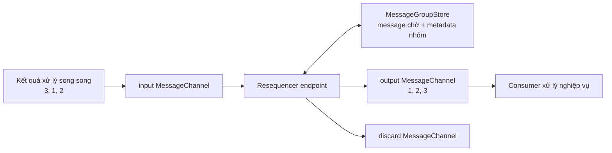

# MessageGroupStore cho resequencer

## 1. Vì sao resequencer cần một nơi giữ trạng thái?

Một luồng xử lý hóa đơn có thể chia công việc thành ba phần, xử lý song song rồi nhận kết quả theo thứ tự `3 → 1 → 2`. Consumer tiếp theo lại yêu cầu `1 → 2 → 3`. Resequencer phải giữ phần đến sớm, nhận diện các phần thuộc cùng đợt xử lý và quyết định thời điểm được phát chúng ra.

`MessageGroupStore` là nơi quản lý trạng thái nhóm phục vụ công việc đó. Nó giữ các message đang chờ và thông tin nhóm; resequencer sử dụng trạng thái này để tiếp tục ra quyết định khi message mới đến. Kho lưu trữ và thuật toán phát message là hai trách nhiệm khác nhau.

Trong phạm vi Spring Integration Core, bài học này kết nối `Message`, `MessageChannel`, endpoint resequencer và Java DSL để trả lời các câu hỏi:

- Nhóm message được định danh và lưu như thế nào?
- Cần giữ thêm trạng thái gì khi phát từng phần của sequence?
- Khi nào dùng store trong bộ nhớ hoặc JDBC?
- Làm sao xử lý restart, timeout và nhiều instance cùng nhận message?
- Cần kiểm thử điều gì để xác nhận trạng thái được bảo toàn?

Các ví dụ sử dụng API của **Spring Integration 6.5.x**, Java 17 trở lên. Phiên bản dependency cần đi theo BOM của dự án; bài không giả định đây là phiên bản mới nhất.

## 2. Vị trí của store trong luồng thông điệp



Theo mô hình resequencer, correlation xác định các message cùng nhóm; sequence number xác định thứ tự phát. Mặc định, framework dùng các header tương ứng `CORRELATION_ID`, `SEQUENCE_NUMBER` và `SEQUENCE_SIZE`. Store mặc định nằm trong bộ nhớ. [Tài liệu Resequencer](https://docs.spring.io/spring-integration/reference/6.5/resequencer.html)

| Thành phần | Trách nhiệm trong ví dụ |
|---|---|
| `Message<?>` | Mang kết quả một phần và header nhận diện sequence |
| `MessageChannel` đầu vào | Đưa từng kết quả đến endpoint |
| `CorrelationStrategy` | Tìm group ID từ message |
| `MessageGroupStore` | Lưu, truy xuất, cập nhật và dọn trạng thái nhóm |
| `ReleaseStrategy` | Quyết định nhóm đã có điều kiện để phát hay chưa |
| Resequencer | Phối hợp các thành phần để phát message theo sequence |
| Channel đầu ra | Chuyển các message đã được sắp thứ tự đến bước tiếp theo |
| Channel discard | Nhận message bị loại theo chính sách của endpoint |

**Store không tự sắp xếp message theo thứ tự nghiệp vụ.** Thứ tự nhận từ database, thứ tự chèn vào collection hoặc timestamp của bản ghi không thay thế `SEQUENCE_NUMBER`.

Một channel có queue giữ message chờ consumer lấy ra. Một group store giữ message chờ điều kiện tương quan và release của endpoint. Vì vậy, thay channel đầu vào bằng queue bền vững chưa thay thế được việc cấu hình store bền vững cho resequencer.

### 2.1. Header cần thống nhất trước khi lưu nhóm

Ví dụ một đợt xử lý có khóa `invoice:ACME:INV-042:run-01`:

| Header | Giá trị ví dụ | Điều cần thống nhất |
|---|---|---|
| `CORRELATION_ID` | `invoice:ACME:INV-042:run-01` | Cùng một sequence phải có cùng khóa |
| `SEQUENCE_NUMBER` | `1`, `2`, `3` | Số nguyên bắt đầu từ 1 theo hợp đồng của ví dụ |
| `SEQUENCE_SIZE` | `3` | Tổng số phần phải nhất quán trong nhóm |

Thiết kế khóa phải phân biệt tenant, đối tượng nghiệp vụ và **lần xử lý**. Chỉ dùng `INV-042` có thể trộn message của hai tenant hoặc của hai lần chạy lại cùng hóa đơn.

Transformer phía trước cần giữ các header này hoặc tạo lại một bộ header nhất quán. Nếu filter loại mất phần số 2 mà không có chính sách bù hoặc kết thúc phù hợp, resequencer có thể giữ phần số 3 đến timeout. Store lưu đúng dữ liệu vẫn không thể sửa một sequence đã bị phá vỡ.

## 3. MessageGroupStore lưu và cung cấp những gì?

### 3.1. Message và metadata nhóm

Nhìn ở mức hợp đồng, cần phân biệt:

1. **Message đang chờ:** payload và những header cần cho quá trình tiếp tục xử lý.
2. **Danh tính nhóm:** khóa được tạo bởi correlation strategy.
3. **Trạng thái vòng đời:** nhóm còn hoạt động hay đã đánh dấu complete.
4. **Thông tin thời gian:** thời điểm tạo và lần thay đổi gần nhất.
5. **Tiến độ sequence:** số thứ tự đã phát gần nhất khi endpoint phát từng phần.

`MessageGroup` cung cấp các phương thức như `getGroupId()`, `getMessages()`, `getTimestamp()`, `getLastModified()`, `isComplete()` và `getLastReleasedMessageSequenceNumber()`. Các phương thức này thể hiện mô hình trạng thái, không có nghĩa mỗi giá trị là một cột riêng trong mọi loại store. [API MessageGroup](https://docs.spring.io/spring-integration/api/org/springframework/integration/store/MessageGroup.html)

`SEQUENCE_SIZE` thường đi cùng message dưới dạng header. Không nên mặc định mọi store đều lưu nó thành một trường metadata độc lập. Khi payload đã được phát hết, trạng thái nhóm còn lại có thể vẫn cần thiết cho chính sách của endpoint.

### 3.2. Những thao tác thường gặp

Bảng sau là các thao tác chọn lọc, không phải toàn bộ khai báo interface:

| API | Ý nghĩa |
|---|---|
| `getMessageGroup(groupId)` | Đọc trạng thái một nhóm |
| `addMessageToGroup(groupId, message)` | Gắn một message vào nhóm |
| `getMessagesForGroup(groupId)` | Đọc các message còn trong nhóm |
| `messageGroupSize(groupId)` | Lấy số message được giữ trong nhóm |
| `setLastReleasedSequenceNumberForGroup(groupId, n)` | Lưu tiến độ đã phát của sequence |
| `removeMessagesFromGroup(groupId, messages)` | Xóa các message được chỉ định khỏi nhóm |
| `completeGroup(groupId)` | Đánh dấu nhóm complete |
| `removeMessageGroup(groupId)` | Xóa nhóm |
| `expireMessageGroups(timeout)` | Chọn nhóm hết hạn và gọi callback đã đăng ký |

Một số thao tác nền tảng được kế thừa từ `BasicMessageGroupStore`. Store cũng có API đếm số nhóm và tổng số message; hỗ trợ và chi phí cụ thể cần xem implementation. [API MessageGroupStore](https://docs.spring.io/spring-integration/api/org/springframework/integration/store/MessageGroupStore.html)

Trong luồng thông thường, **để resequencer gọi các thao tác cập nhật**. Tự xóa message hoặc sửa group trong lúc endpoint đang xử lý có thể làm lệch trạng thái release. Đặc biệt, `SimpleMessageStore` có thể trả về tham chiếu nhóm nội bộ khi không bật chế độ sao chép; việc sửa trực tiếp đối tượng đọc được không phải cách quản trị an toàn. [Lưu ý về SimpleMessageStore](https://docs.spring.io/spring-integration/reference/6.5/message-store.html)

## 4. Theo dõi trạng thái qua một sequence cụ thể

### 4.1. Chờ đủ toàn bộ sequence

Giả sử `releasePartialSequences(false)`, tổng số phần là 3 và không có message trùng:

| Sự kiện | Message còn chờ trong nhóm | Output tại sự kiện |
|---|---|---|
| Nhận phần 3 | `{3}` | Chưa có |
| Nhận phần 1 | `{1, 3}` | Chưa có |
| Nhận phần 2 | Đủ bộ `{1, 2, 3}` để release | `1, 2, 3` |

Các dấu ngoặc nhọn chỉ tập message đang chờ, không biểu thị thứ tự vật lý trong store.

Consumer nhận ba message riêng lẻ. Nó không nhận một message có payload là danh sách như hành vi gộp kết quả thường thấy ở aggregator.

### 4.2. Phát từng đoạn liên tiếp

Với `releasePartialSequences(true)`, resequencer có thể phát phần đầu đã liên tiếp mà không chờ toàn bộ nhóm. Chiến lược sequence mặc định hỗ trợ chế độ này và dựa vào tiến độ đã phát. [API SequenceSizeReleaseStrategy](https://docs.spring.io/spring-integration/api/org/springframework/integration/aggregator/SequenceSizeReleaseStrategy.html)

Một ví dụ do bài học đặt ra, tổng số phần là 4:

| Message đến | Message còn chờ sau xử lý | Phần mới phát | Số đã phát gần nhất |
|---|---|---|---|
| 2 | `{2}` | Không | 0 |
| 1 | Rỗng | `1, 2` | 2 |
| 4 | `{4}` | Không | 2 |
| 3 | Rỗng sau khi phát | `3, 4` | Đạt cuối sequence |

Ngay sau lần phát `1, 2`, nhóm có thể không giữ payload nào nhưng **sequence vẫn chưa kết thúc**. Tiến độ 2 giúp phần số 4 tiếp tục chờ phần số 3, thay vì đòi lại phần số 1.

Đây là lý do không được đồng nhất:

```text
Nhóm không còn message chờ
    với
Nhóm đã hoàn tất hoặc được phép xóa
```

Trong implementation resequencer 6.5.0, sau partial release, handler cập nhật số sequence đã phát và loại các message vừa phát khỏi store; có nhánh dọn nhóm khi sequence hoàn tất. Không nên sao chép nguyên các giả định về giữ nhóm sau completion của aggregator sang resequencer. [Mã nguồn ResequencingMessageHandler 6.5.0](https://raw.githubusercontent.com/spring-projects/spring-integration/v6.5.0/spring-integration-core/src/main/java/org/springframework/integration/aggregator/ResequencingMessageHandler.java)

Các bảng trên mô tả kết quả mong đợi ở mức sequence. Chi tiết bản ghi cuối cùng còn tồn tại hay đã xóa phải kiểm tra theo phiên bản và chế độ release đang dùng.

## 5. Chọn implementation phù hợp

| Lựa chọn | Đặc điểm | Phù hợp khi |
|---|---|---|
| `SimpleMessageStore` | Lưu trong bộ nhớ của process | Học tập, thử nghiệm, trạng thái có thể tái tạo |
| `JdbcMessageStore` | Lưu message và nhóm trong cơ sở dữ liệu quan hệ | Cần phục hồi trạng thái và đã vận hành RDBMS |
| Store hỗ trợ Redis hoặc MongoDB | Có integration tương ứng; cơ chế lưu và tuần tự hóa khác JDBC | Hạ tầng và yêu cầu dữ liệu phù hợp |

Đây là các lựa chọn, không phải cam kết mọi cấu hình Redis hoặc MongoDB đều có độ bền như nhau. Mất dữ liệu sau sự cố còn phụ thuộc cách cấu hình và vận hành hệ lưu trữ. [Các loại Message Store](https://docs.spring.io/spring-integration/reference/6.5/message-store.html)

### 5.1. SimpleMessageStore

`SimpleMessageStore` dùng cấu trúc dữ liệu trong bộ nhớ; constructor không tham số không đặt giới hạn dung lượng store. Nó không tạo khả năng phục hồi sau khi JVM bị dừng. [API SimpleMessageStore](https://docs.spring.io/spring-integration/docs/current/api/org/springframework/integration/store/SimpleMessageStore.html)

Hai instance ứng dụng, mỗi instance có một `SimpleMessageStore`, có thể lần lượt nhận phần 1 và phần 2. Mỗi bên chỉ thấy một nửa nhóm. Cùng một tên bean không làm hai vùng nhớ trở thành một store chung.

Khi đánh giá dung lượng, hãy tính cả nhóm bị thiếu phần, không chỉ nhóm hoàn tất nhanh. Store trong bộ nhớ không tự tạo một chính sách nghiệp vụ cho message thất lạc.

### 5.2. JdbcMessageStore và JdbcChannelMessageStore

Hai lớp này phục vụ nhu cầu khác nhau:

- `JdbcMessageStore` cung cấp khả năng lưu message và trạng thái nhóm cho các thành phần tương quan.
- `JdbcChannelMessageStore` được tối ưu cho message channel có queue.

Với `resequence(...messageStore(...))`, cần implementation đáp ứng hợp đồng `MessageGroupStore`; không chọn `JdbcChannelMessageStore` chỉ vì tên có chữ JDBC. Database cũng cần schema phù hợp trước khi store hoạt động. [JDBC Message Store](https://docs.spring.io/spring-integration/reference/6.5/jdbc/message-store.html)

## 6. Ví dụ Java DSL với store trong bộ nhớ

### 6.1. Cấu hình endpoint và channel

Ví dụ dùng `spring-integration-core`. Các channel output và discard là queue trong bộ nhớ để chương trình minh họa chủ động đọc kết quả.

```java
package example.integration;

import org.springframework.beans.factory.annotation.Qualifier;
import org.springframework.context.annotation.Bean;
import org.springframework.context.annotation.Configuration;
import org.springframework.integration.channel.DirectChannel;
import org.springframework.integration.channel.QueueChannel;
import org.springframework.integration.config.EnableIntegration;
import org.springframework.integration.dsl.IntegrationFlow;
import org.springframework.integration.store.MessageGroupStore;
import org.springframework.integration.store.SimpleMessageStore;

@Configuration
@EnableIntegration
public class InvoiceResequencerConfig {

    @Bean
    public MessageGroupStore invoiceSequenceStore() {
        return new SimpleMessageStore();
    }

    @Bean
    public DirectChannel invoiceSequenceInput() {
        return new DirectChannel();
    }

    @Bean
    public QueueChannel invoiceSequenceOutput() {
        return new QueueChannel();
    }

    @Bean
    public QueueChannel invoiceSequenceDiscard() {
        return new QueueChannel();
    }

    @Bean
    public IntegrationFlow invoiceSequenceFlow(
            @Qualifier("invoiceSequenceStore") MessageGroupStore store) {

        return IntegrationFlow.from("invoiceSequenceInput")
                .resequence(r -> r
                        .messageStore(store)
                        .releasePartialSequences(false)
                        .groupTimeout(30_000L)
                        .expireGroupsUponTimeout(false)
                        .sendPartialResultOnExpiry(false)
                        .discardChannel("invoiceSequenceDiscard"))
                .channel("invoiceSequenceOutput")
                .get();
    }
}
```

Java DSL cho phép cung cấp store, correlation strategy và release strategy khi cấu hình resequencer. Ở đây giữ correlation mặc định theo header và chờ đủ sequence. [Aggregators and Resequencers trong Java DSL](https://docs.spring.io/spring-integration/reference/6.5/dsl/java-aggregators.html)

Ý nghĩa các lựa chọn của ví dụ:

- `messageStore(store)`: sử dụng bean được chỉ định thay vì store mặc định của handler.
- `releasePartialSequences(false)`: không chủ động phát sớm từng đoạn.
- `groupTimeout(30_000L)`: đặt timeout theo thời gian không có message mới đối với nhóm cần chờ.
- `sendPartialResultOnExpiry(false)`: khi buộc kết thúc mà chưa release được bình thường, chuyển các message bị loại sang discard.
- `expireGroupsUponTimeout(false)`: giữ metadata nhóm sau timeout để nhận diện message đến muộn.
- `discardChannel(...)`: cung cấp nơi quan sát và xử lý các message bị loại.

Các tùy chọn store, timeout, discard và expiration thuộc cấu hình handler tương quan. [Mã nguồn CorrelationHandlerSpec 6.5.0](https://raw.githubusercontent.com/spring-projects/spring-integration/v6.5.0/spring-integration-core/src/main/java/org/springframework/integration/dsl/CorrelationHandlerSpec.java)

QueueChannel ở ví dụ chỉ phục vụ quan sát. Khi áp dụng thực tế, cần một consumer cho output và một luồng xử lý discard; để queue tích lũy vô hạn sẽ chuyển vấn đề giữ message sang vị trí khác.

### 6.2. Gửi message đến lệch thứ tự

Chương trình sau sử dụng lớp cấu hình ở trên:

```java
package example.integration;

import java.util.Objects;

import org.springframework.context.annotation.AnnotationConfigApplicationContext;
import org.springframework.integration.IntegrationMessageHeaderAccessor;
import org.springframework.integration.store.MessageGroupStore;
import org.springframework.messaging.Message;
import org.springframework.messaging.MessageChannel;
import org.springframework.messaging.PollableChannel;
import org.springframework.messaging.support.MessageBuilder;

public class InvoiceSequenceDemo {

    private static final String GROUP =
            "invoice:ACME:INV-042:run-01";

    public static void main(String[] args) {
        try (var context = new AnnotationConfigApplicationContext(
                InvoiceResequencerConfig.class)) {

            var input = context.getBean(
                    "invoiceSequenceInput", MessageChannel.class);
            var output = context.getBean(
                    "invoiceSequenceOutput", PollableChannel.class);
            var store = context.getBean(
                    "invoiceSequenceStore", MessageGroupStore.class);

            input.send(part(3, "C"));
            input.send(part(1, "A"));

            System.out.println(store.messageGroupSize(GROUP));
            System.out.println(output.receive(0));

            input.send(part(2, "B"));

            for (int i = 0; i < 3; i++) {
                Message<?> result =
                        Objects.requireNonNull(output.receive(1_000));
                System.out.println(result.getPayload());
            }
        }
    }

    private static Message<String> part(int number, String payload) {
        return MessageBuilder.withPayload(payload)
                .setHeader(
                        IntegrationMessageHeaderAccessor.CORRELATION_ID,
                        GROUP)
                .setHeader(
                        IntegrationMessageHeaderAccessor.SEQUENCE_NUMBER,
                        number)
                .setHeader(
                        IntegrationMessageHeaderAccessor.SEQUENCE_SIZE,
                        3)
                .build();
    }
}
```

Khi ba lần gửi diễn ra liên tiếp trong thời hạn đã cấu hình, output mong đợi là:

```text
2
null
A
B
C
```

Hai dòng đầu cho thấy store đang giữ hai message, còn channel đầu ra chưa có kết quả. Việc kiểm tra này không dựa vào thứ tự duyệt collection của store.

Với `DirectChannel`, xử lý trên đường gọi đồng bộ có thể ném exception về bên gửi. Message bị discard do chính sách nhóm và exception xử lý là hai kết quả khác nhau; cần quan sát cả discard channel lẫn cơ chế xử lý lỗi của luồng.

## 7. Chuyển sang JdbcMessageStore

### 7.1. Thay bean store, giữ hợp đồng của flow

Thêm dependency `org.springframework.integration:spring-integration-jdbc`, JDBC driver tương ứng và cấu hình `DataSource`. Trong lớp cấu hình trước, **thay** phương thức `invoiceSequenceStore()` bằng phương thức sau; không khai báo đồng thời hai bean cùng tên:

```java
@Bean
public MessageGroupStore invoiceSequenceStore(DataSource dataSource) {
    JdbcMessageStore store = new JdbcMessageStore(dataSource);
    store.setRegion("invoice-resequencer-v1");
    return store;
}
```

Các import bổ sung:

```java
import javax.sql.DataSource;

import org.springframework.integration.jdbc.store.JdbcMessageStore;
```

Flow tiếp tục nhận bean `MessageGroupStore` qua qualifier. Các phần khác không cần biết dữ liệu được giữ bằng map hay database.

`region` là không gian phân chia dữ liệu của `JdbcMessageStore`; nó không phải correlation ID. Nhiều region có thể dùng chung bảng nhưng phục vụ các mục đích riêng. [API JdbcMessageStore](https://docs.spring.io/spring-integration/api/org/springframework/integration/jdbc/store/JdbcMessageStore.html)

Một cách bố trí:

```text
Database tích hợp
├── region: invoice-resequencer-v1
│   ├── invoice:ACME:INV-042:run-01
│   └── invoice:ACME:INV-043:run-01
└── region: shipment-resequencer-v1
    └── shipment:ACME:SHP-090:run-02
```

Tên region cần ổn định qua restart nếu muốn tìm lại các nhóm đã lưu. Nếu tạo region ngẫu nhiên mỗi lần khởi động, dữ liệu cũ vẫn nằm trong database nhưng endpoint mới không nhìn thấy chúng.

### 7.2. Chuẩn bị schema theo đúng artifact

JAR JDBC có các script dạng:

```text
org/springframework/integration/jdbc/schema-<database>.sql
```

Ví dụ với PostgreSQL, tra script `schema-postgresql.sql` trong đúng phiên bản dependency. Dùng script làm cơ sở cho migration, đối chiếu database đích và table prefix đã cấu hình. Khai báo bean store không thay thế việc tạo bảng. [Khởi tạo JDBC Message Store](https://docs.spring.io/spring-integration/reference/6.5/jdbc/message-store.html)

Bài không cung cấp DDL tự rút gọn vì thiếu một bảng quan hệ nhóm–message hoặc một trường trạng thái có thể làm ví dụ trông đúng nhưng không chạy được với implementation thực tế.

### 7.3. Message phải đọc lại được sau khi lưu

Ở ví dụ, payload là `String`, còn correlation và sequence header có kiểu đơn giản. Với đối tượng nghiệp vụ riêng, cần kiểm tra cơ chế serializer/deserializer của store và khả năng đọc lại sau nâng cấp ứng dụng.

Các câu hỏi phải giải quyết trước khi bật persistence:

- Payload có được serializer hiện tại hỗ trợ không?
- Các header dùng cho correlation và release có còn nguyên sau một vòng ghi–đọc không?
- DTO phiên bản mới có đọc được dữ liệu nhóm đang chờ do phiên bản cũ ghi không?
- Các quy tắc cho phép deserialize có bao gồm DTO cần dùng không?

Header chứa channel object hoặc đối tượng gắn với process không tự trở thành một đích trả lời bền vững. Luồng minh họa dùng output channel có tên rõ ràng để không phụ thuộc vào reply channel tạm của một lần gọi gateway. Registry đổi channel thành tên cũng không làm một lời gọi đang chờ trong JVM sống lại sau khi JVM bị dừng. [Tuần tự hóa message và channel header](https://docs.spring.io/spring-integration/reference/6.5/message-store.html)

Nếu sử dụng gateway đồng bộ, phải tính cả thời gian chờ đủ sequence trong thời gian chờ phản hồi của gateway. Đối với công việc cần tiếp tục qua restart, một đầu ra nghiệp vụ được lưu bền vững và có khóa tương quan rõ ràng thường dễ quản lý hơn việc giữ một lời gọi đồng bộ mở.

## 8. Timeout, dọn nhóm và phục hồi sau restart

### 8.1. Ba khoảng thời gian khác nhau

| Cơ chế | Đang giới hạn điều gì? | Không nên hiểu thành |
|---|---|---|
| `groupTimeout` | Thời gian chờ không có message mới của một nhóm, theo cấu hình timeout tương ứng | Thời gian JDBC query |
| Chu kỳ và ngưỡng của reaper | Lúc chạy quét và tuổi nhóm đủ điều kiện xét hết hạn | Timer riêng được lưu cho từng nhóm |
| `sendTimeout` | Thời gian chờ gửi trên channel có cơ chế giới hạn gửi phù hợp | Thời gian chờ đủ sequence |

Với `groupTimeout(30_000L)`, nếu message mới liên tục đến nhưng thiếu một phần, thời điểm buộc kết thúc có thể tiếp tục được dời. Nếu nghiệp vụ yêu cầu thời hạn tuyệt đối từ lúc bắt đầu đợt xử lý, cần thiết kế biểu thức timeout theo mốc tạo nhóm hoặc deadline riêng. [Timeout và quản lý trạng thái nhóm](https://docs.spring.io/spring-integration/reference/6.5/aggregator.html)

Không dùng timeout của database hoặc của giao thức HTTP để thay cho thời hạn chờ sequence. Chúng xử lý các giai đoạn khác nhau của luồng.

### 8.2. Hết hạn không đồng nghĩa nhóm đã đủ dữ liệu

Trong ví dụ nghiêm ngặt, nhận `1, 3` nhưng thiếu `2` thì không được xem là hoàn tất nghiệp vụ:

```text
Thiếu phần 2
    → hết hạn chờ
    → thử quyết định release theo chính sách endpoint
    → nếu chưa đạt điều kiện và không cho partial-on-expiry
    → discard các message còn chờ
    → giữ hoặc xóa metadata theo chính sách timeout
```

`releasePartialSequences(true)` và `sendPartialResultOnExpiry(true)` giải quyết hai tình huống khác nhau:

- Partial sequence release: phát đoạn liên tiếp hợp lệ trong quá trình nhận message bình thường.
- Partial result on expiry: cho phép đi vào nhánh phát kết quả khi nhóm bị buộc kết thúc dù chưa đạt điều kiện bình thường.

Không bật partial-on-expiry cho một consumer yêu cầu bắt buộc đủ `1..N` nếu chưa xác định được ý nghĩa của dữ liệu thiếu. Processor resequencer mặc định xử lý các đoạn sequence và có logic dừng khi gặp khoảng trống; bật cờ này không phải cam kết mọi message còn trong store đều được phát. [Mã nguồn ResequencingMessageGroupProcessor 6.5.0](https://raw.githubusercontent.com/spring-projects/spring-integration/v6.5.0/spring-integration-core/src/main/java/org/springframework/integration/aggregator/ResequencingMessageGroupProcessor.java)

### 8.3. Metadata sau timeout và message đến muộn

Khi `expireGroupsUponTimeout(false)` được dùng cho resequencer, metadata nhóm đã bị buộc kết thúc được giữ lại để message đến muộn bị loại. Nếu xóa hẳn nhóm, message đến muộn có thể mở một nhóm mới cùng khóa. [Chính sách timeout của Resequencer](https://docs.spring.io/spring-integration/reference/6.5/resequencer.html)

Ví dụ:

1. Nhóm `run-01` nhận phần 1 và 3.
2. Nhóm hết hạn, các phần còn chờ đi sang discard.
3. Phần 2 của `run-01` đến muộn.
4. Nếu metadata complete còn tồn tại, endpoint có thể nhận diện và discard phần này.

Thời gian giữ metadata xác định cửa sổ nhận diện nhóm đã kết thúc do timeout. Khi metadata bị dọn, không còn dấu vết đó trong group store. Vì vậy, lần chạy lại nghiệp vụ nên có khóa thế hệ mới như `run-02`, kèm chính sách idempotency riêng nếu cần.

Ở cấu hình cơ bản, chưa có tác vụ dọn các metadata giữ lại sau timeout. Không nên để số nhóm này tăng không giới hạn. `minimumTimeoutForEmptyGroups` có thể phối hợp với cơ chế expiration để giữ nhóm rỗng lâu hơn; nó không phải thời gian chờ một phần message còn thiếu.

### 8.4. Store bền vững không tự lưu timer của process

Tình huống cần dự kiến:

1. Instance A lưu phần 1 và 3 vào JDBC store.
2. A bị dừng trước khi phần 2 đến.
3. Instance B khởi động với cùng database và region.
4. Nếu phần 2 được giao lại, B có thể sử dụng trạng thái đã lưu để tiếp tục.
5. Nếu phần 2 không bao giờ đến, cần cơ chế quét nhóm cũ để không giữ chúng mãi.

Các tác vụ timeout được lên lịch trong process không tự được phục hồi chỉ vì message nằm trong database. Ngoài reaper, handler có các tùy chọn `expireTimeout` và `expireDuration` để xử lý nhóm mồ côi. Cần chọn và cấu hình cơ chế phục hồi phù hợp thay vì giả định timer cũ vẫn hoạt động. [Quản lý nhóm mồ côi trong handler tương quan](https://raw.githubusercontent.com/spring-projects/spring-integration/v6.5.0/spring-integration-core/src/main/java/org/springframework/integration/aggregator/AbstractCorrelatingMessageHandler.java)

Một cơ chế quét phải hoạt động cả khi không có thêm message đến nhóm. Đây là điểm mà kiểm thử restart chỉ với trường hợp “phần còn thiếu xuất hiện ngay” dễ bỏ sót.

### 8.5. Ví dụ lên lịch MessageGroupStoreReaper

Có thể bổ sung lớp cấu hình sau vào ứng dụng. Nếu chạy bằng `AnnotationConfigApplicationContext` như phần trước, đăng ký thêm `InvoiceStoreCleanupConfig.class`.

```java
package example.integration;

import org.springframework.beans.factory.annotation.Qualifier;
import org.springframework.context.annotation.Bean;
import org.springframework.context.annotation.Configuration;
import org.springframework.integration.store.MessageGroupStore;
import org.springframework.integration.store.MessageGroupStoreReaper;
import org.springframework.scheduling.annotation.EnableScheduling;
import org.springframework.scheduling.annotation.Scheduled;

@Configuration
@EnableScheduling
public class InvoiceStoreCleanupConfig {

    @Bean
    public MessageGroupStoreReaper invoiceSequenceReaper(
            @Qualifier("invoiceSequenceStore") MessageGroupStore store) {

        MessageGroupStoreReaper reaper =
                new MessageGroupStoreReaper(store);
        reaper.setTimeout(120_000L);
        reaper.setExpireOnDestroy(false);
        return reaper;
    }

    @Bean
    public CleanupJob invoiceSequenceCleanupJob(
            @Qualifier("invoiceSequenceReaper")
            MessageGroupStoreReaper reaper) {

        return new CleanupJob(reaper);
    }

    public static class CleanupJob {

        private final MessageGroupStoreReaper reaper;

        public CleanupJob(MessageGroupStoreReaper reaper) {
            this.reaper = reaper;
        }

        @Scheduled(fixedDelay = 10_000L)
        public void expireOldGroups() {
            this.reaper.run();
        }
    }
}
```

Ở đây, scheduler gọi `run()` mỗi 10 giây sau khi lần chạy trước kết thúc; ngưỡng 120 giây được truyền vào reaper để xét nhóm cũ. Bean reaper tự nó không thay cho lịch gọi định kỳ. `setExpireOnDestroy(false)` tránh chủ động expire toàn bộ store khi đóng context. [API MessageGroupStoreReaper](https://docs.spring.io/spring-integration/api/org/springframework/integration/store/MessageGroupStoreReaper.html)

Ngưỡng của reaper dựa trên cách implementation xét thời gian nhóm; không đồng nhất nó với khoảng không hoạt động 30 giây ở `groupTimeout`. Thời điểm dọn thực tế còn phụ thuộc chu kỳ quét, thời gian thực thi và chính sách giữ nhóm rỗng.

Khi reaper gây release hoặc discard, lỗi cũng có thể xuất hiện trong luồng chạy nền. Cần cấu hình và kiểm thử đường nhận lỗi cho tác vụ theo lịch; không giả định exception sẽ quay về producer đã gửi message từ trước.

## 9. Chia sẻ store giữa các flow và giữa các instance

### 9.1. Tách quyền quản lý nhóm giữa các endpoint

Một endpoint resequencer và một aggregator không nên cùng quản lý một không gian nhóm chỉ vì chúng dùng chung database. Nếu cùng khóa và cùng vùng lưu, chúng có thể đọc, release hoặc expire trạng thái của nhau.

Nên tạo store dành cho từng endpoint logic; với JDBC, có thể dùng chung hạ tầng và bảng nhưng tách region. Đổi tiền tố correlation key giúp phân biệt nhóm, song chưa đủ cô lập việc quét hết hạn trên toàn một store.

Ví dụ:

| Endpoint logic | Store bean | Region |
|---|---|---|
| Sắp thứ tự phần hóa đơn | `invoiceSequenceStore` | `invoice-resequencer-v1` |
| Gộp báo cáo ngày | `dailyReportStore` | `daily-report-aggregator-v1` |
| Sắp thứ tự sự kiện giao hàng | `shipmentSequenceStore` | `shipment-resequencer-v1` |

Các instance triển khai **cùng một endpoint logic** có thể dùng cùng region để tiếp tục cùng tập nhóm; đây là trường hợp khác với hai endpoint có trách nhiệm độc lập. [Phân vùng store và expiration giữa các endpoint](https://docs.spring.io/spring-integration/reference/6.5/aggregator.html)

### 9.2. Store chung cần cơ chế khóa phù hợp

Giả sử hai replica nhận phần 1 và 2 của cùng nhóm đúng lúc nhau. Dù dữ liệu ở database chung, chúng vẫn có thể cạnh tranh trong chuỗi thao tác đọc nhóm, thêm message, xét release, gửi output và cập nhật trạng thái.

Các endpoint tương quan dùng `LockRegistry` để điều phối thao tác theo nhóm. Khóa mặc định trong process không bảo vệ toàn bộ replica. `JdbcLockRegistry` kết hợp với store dùng chung có thể cung cấp khóa qua nhiều instance. [JDBC Lock Registry](https://docs.spring.io/spring-integration/reference/6.5/jdbc/lock-registry.html)

Khi có bean registry phù hợp, bổ sung vào cùng cấu hình resequencer:

```java
.resequence(r -> r
        .messageStore(store)
        .lockRegistry(sharedLockRegistry)
        .releasePartialSequences(false)
        .groupTimeout(30_000L))
```

Đây là đoạn trích để chỉ vị trí `lockRegistry`, không thay thế các tùy chọn discard và expiry đã chọn trước đó. `sharedLockRegistry` phải được khai báo và truyền vào cấu hình, chẳng hạn một `JdbcLockRegistry` sử dụng `DefaultLockRepository`.

Các replica cần thống nhất namespace khóa, schema tương ứng và chính sách hết hạn/gia hạn khóa. Nếu hạ tầng đã đảm bảo mọi message cùng group chỉ đến một consumer, cần kiểm chứng cả hành vi khi consumer được phân công lại sau lỗi.

### 9.3. Khóa không bảo đảm thứ tự hoàn tất ở mọi downstream

Resequencer phát message theo sequence trong phạm vi nhóm. Sau đó, một `ExecutorChannel` hoặc consumer song song có thể khiến phần 2 hoàn tất trước phần 1.

Do đó, phải xác định rõ yêu cầu đang nói về:

- Thứ tự endpoint gửi message.
- Thứ tự consumer bắt đầu xử lý.
- Thứ tự side effect được commit.

Nếu cần commit đúng thứ tự cho từng hóa đơn, hãy giữ xử lý tuần tự theo khóa hoặc dùng cơ chế kiểm tra phiên bản nghiệp vụ ở nơi commit. Không suy ra thứ tự toàn cục giữa các nhóm độc lập.

## 10. Persistence, transaction và khả năng giao lại

Lưu nhóm trong JDBC giúp bảo toàn trạng thái đã ghi thành công. Nó không tự nối mọi thao tác sau thành một transaction:

```text
Đọc từ nguồn
    → lưu vào group store
    → phát message đã sắp thứ tự
    → cập nhật trạng thái sau release
    → consumer ghi kết quả nghiệp vụ
    → xác nhận với nguồn
```

Các điểm lỗi do bài học đặt ra:

| Điểm bị dừng | Điều phải kiểm chứng trong thiết kế |
|---|---|
| Nguồn được xác nhận trước khi trạng thái được lưu bền vững | Message có thể không còn được giao lại |
| Store đã lưu nhưng nguồn chưa được xác nhận | Message có thể được giao lại và xuất hiện trùng |
| Consumer đã tạo side effect nhưng quá trình release chưa hoàn tất | Retry có thể tạo lại side effect |
| Các thao tác cập nhật nhóm không cùng transaction cần thiết | Trạng thái sau lỗi có thể chưa phản ánh đầy đủ ý định xử lý |

Cần xác định ranh giới transaction từ cơ chế nhận message hoặc advice thích hợp. Trong Spring Integration, advice chỉ bao quanh xử lý nội bộ và advice bao quanh toàn bộ `handleMessage` có phạm vi khác nhau; việc chuyển sang thread khác cũng làm thay đổi phạm vi transaction của thread hiện tại. [Transaction Support](https://docs.spring.io/spring-integration/reference/6.5/handler-advice/tx-handle-message.html)

Nếu output đi tới dịch vụ HTTP ngoài transaction database, một JDBC transaction cục bộ không thể tự rollback side effect ở dịch vụ đó. Khi cần khả năng giao lại đáng tin cậy, có thể kết hợp outbox hoặc output bền vững với consumer có idempotency.

Resequencing cũng không thay cho chống trùng nghiệp vụ. Hai message có `MessageHeaders.ID` khác nhau vẫn có thể cùng biểu diễn một sự kiện hóa đơn. Một khóa như `tenant + invoiceId + processingRun + partNumber` có thể làm cơ sở kiểm soát trùng, nhưng cách xử lý xung đột payload và cửa sổ giữ khóa phải do nghiệp vụ quyết định.

## 11. Dung lượng, truy xuất và quan sát vận hành

### 11.1. Ước lượng lượng message phải chờ

Một mô hình dung lượng đơn giản:

```text
Dung lượng payload đang chờ
≈ số nhóm còn hoạt động
  × số message chờ trung bình mỗi nhóm
  × kích thước payload trung bình
```

Ví dụ tự tính: 1.000 nhóm × 20 message × 5 KiB xấp xỉ **97,7 MiB payload**. Con số này chưa gồm header, object overhead, metadata nhóm, index, bản sao khi serialize và dữ liệu tạm lúc sắp xếp.

Trong hệ thống thật, nhóm bị thiếu phần lâu thường quyết định lượng dữ liệu phải giữ. Cần giới hạn số nhóm đang mở, kích thước sequence và thời gian giữ; chỉ tăng heap hoặc tăng dung lượng database chưa giải quyết được message thất lạc.

### 11.2. Lazy loading không xóa chi phí sắp xếp

Persistent group store có hỗ trợ nạp message theo nhu cầu, giúp tránh đọc toàn bộ payload ở những thao tác chỉ cần metadata. Khi xử lý cần duyệt message, dữ liệu vẫn phải được truy xuất. [Persistent MessageGroupStore và lazy loading](https://docs.spring.io/spring-integration/reference/6.5/message-store.html)

Vì vậy:

- Không gọi `getMessages()` cho mọi nhóm trên mỗi lần thu thập metric nếu chỉ cần số lượng.
- Đo số query, thời gian deserialize và thời gian giữ khóa với kích thước nhóm thực tế.
- Không suy ra rằng chuyển sang JDBC sẽ giúp resequencer xử lý một sequence vô hạn với chi phí thấp.
- Cân nhắc chia sequence lớn thành các đợt hữu hạn có hợp đồng kết thúc rõ ràng.

Khuyến cáo của framework dành resequencer cho sequence tương đối ngắn và khoảng trống nhỏ phù hợp với đặc tính phải giữ và xét message chờ. [Giới hạn sử dụng Resequencer](https://docs.spring.io/spring-integration/reference/6.5/resequencer.html)

### 11.3. Theo dõi cả message và metadata

| Chỉ số hoặc dấu hiệu | Câu hỏi cần trả lời |
|---|---|
| Số nhóm đang chờ | Producer có đang mở nhóm nhanh hơn tốc độ hoàn tất không? |
| Tổng số message đang giữ | Backlog tăng ở store hay ở channel downstream? |
| Tuổi nhóm lâu nhất | Có sequence bị thiếu phần mãi không? |
| Số nhóm complete/rỗng còn giữ | Chính sách retention có đang dọn đúng không? |
| Số timeout, discard, message đến muộn | Có mất phần, giao chậm hoặc chọn deadline quá ngắn không? |
| Thời gian chờ khóa và thời gian truy vấn | Có một group quá nóng hoặc database quá tải không? |
| Lỗi deserialize sau triển khai | Dữ liệu nhóm cũ có tương thích mã mới không? |

Số group của store có thể bao gồm nhóm không còn giữ payload. Khi tổng số group tăng nhưng số message gần bằng 0, hãy kiểm tra metadata retention trước khi kết luận có backlog xử lý.

Khi truy vết một sequence, ghi nhận group key, sequence number, sequence size, instance xử lý và nhánh release/discard. Những trường này giúp phân biệt lỗi correlation với lỗi thiếu phần hoặc lỗi downstream.

## 12. Các kịch bản kiểm thử cần có

Bảng này là hướng dẫn kiểm thử cho flow và store, không yêu cầu chạy bằng thời gian chờ dài trong mỗi unit test.

| Kịch bản | Dữ liệu hoặc thao tác | Kết quả cần xác nhận |
|---|---|---|
| Đến lệch thứ tự | Gửi `3, 1, 2`, size = 3 | Output là `1, 2, 3`; chưa có output trước khi đủ |
| Hai nhóm xen kẽ | `A2, B1, A1, B2` | Mỗi nhóm đúng thứ tự; không trộn A với B |
| Partial release | Gửi `2, 1, 4, 3`, size = 4 | Phát `1, 2` rồi `3, 4`; tiến độ được giữ giữa hai đợt |
| Thiếu phần | Gửi `1, 3`, size = 3 | Timeout xử lý theo chính sách; không nhận là đủ bộ |
| Message đến muộn | Gửi phần 2 sau timeout | Đúng hành vi giữ/xóa metadata đã chọn |
| Khóa xử lý lại | Gửi `run-02` sau khi `run-01` kết thúc | Hai lần chạy không trộn trạng thái |
| Giao trùng | Gửi lại cùng phần với cùng/khác message ID | Đúng chính sách chống trùng, không tự suy rằng có exactly-once |
| Restart khi đang chờ | Lưu `3, 1`, đóng context, tạo context mới rồi gửi 2 | Đọc được nhóm cũ từ cùng database và region |
| Restart sau partial release | Lưu tiến độ đã phát `1, 2`, khởi động lại, nhận `4, 3` | Tiếp tục `3, 4`, không phát lại phần đầu chỉ vì mất tiến độ |
| Nhóm mồ côi sau restart | Không gửi thêm phần nào sau restart | Reaper hoặc purge xử lý được nhóm cũ |
| Serialization | Ghi–đọc payload và header thật | Correlation và sequence giữ đúng giá trị, kiểu dữ liệu |
| Hai replica | Đồng thời nhận các phần cùng nhóm | Khóa và transaction ngăn trạng thái nhóm bị cập nhật sai |
| Output gặp lỗi | Chủ động làm consumer thất bại | Xác định được retry, rollback và nguy cơ side effect trùng |
| Dọn metadata | Tạo nhiều nhóm timeout rồi chạy cơ chế dọn | Không còn giữ metadata vượt retention đã thiết kế |

Đối với kiểm thử restart, không dùng lại chính đối tượng `SimpleMessageStore` rồi gọi đó là persistence. Cần tạo lại application context hoặc process, nhưng giữ nguyên database thử nghiệm. Không chạy lại script xóa/tạo bảng giữa hai pha của bài kiểm thử phục hồi.

Đối với timeout, dùng scheduler kiểm soát được, chờ có giới hạn hoặc gọi cơ chế quét tại mốc phù hợp. Tránh test chỉ có `Thread.sleep(...)` rồi kiểm tra số lượng cuối cùng; cần kiểm tra cả nhánh output, discard và trạng thái nhóm.

Khi kiểm tra trạng thái sau release, phân biệt **không còn payload đang chờ** với **không còn metadata nhóm**. Kết quả mong đợi phải gắn với chính sách completion/expiration của resequencer đang dùng.

## 13. Những lỗi thiết kế thường gặp

| Giả định hoặc cách làm | Hệ quả | Cách điều chỉnh |
|---|---|---|
| Dùng FIFO của database để đại diện sequence | Đến lệch thứ tự thì xử lý sai thứ tự nghiệp vụ | Giữ và kiểm tra sequence header |
| Mỗi replica dùng store trong bộ nhớ riêng | Nhóm bị chia đôi, không bên nào đủ phần | Định tuyến nhất quán hoặc dùng store chung phù hợp |
| Store JDBC chung nhưng chỉ khóa trong JVM | Nhiều replica cạnh tranh cập nhật cùng nhóm | Thiết kế khóa phân tán hoặc quyền sở hữu nhóm rõ ràng |
| Dùng chung vùng store cho nhiều endpoint | Reaper hoặc handler tác động nhóm của flow khác | Tách region/store theo endpoint logic |
| Xóa mọi nhóm rỗng ngay | Có thể mất tiến độ partial release hoặc dấu complete | Dọn qua chính sách endpoint và retention |
| Tắt ứng dụng rồi trông chờ timer cũ tự chạy | Nhóm chờ bị bỏ lại trong persistent store | Cấu hình và kiểm thử reaper/purge sau restart |
| Bật partial-on-expiry cho kết quả cần đủ bộ | Consumer nhận dữ liệu không đạt hợp đồng | Giữ chính sách nghiêm ngặt hoặc định nghĩa kết quả thiếu |
| Chỉ thêm persistent store rồi tuyên bố exactly-once | Side effect vẫn có thể trùng khi retry | Xác định transaction và idempotency từ đầu đến cuối |
| Tạo region mới cho mỗi lần khởi động | Endpoint không nhìn thấy các nhóm cũ | Giữ namespace ổn định cho cùng endpoint logic |

Một cấu hình store phù hợp phải bảo toàn được cả **message đang chờ**, **tiến độ nhóm** và **quyền điều phối trạng thái** theo yêu cầu phục hồi của hệ thống. Với resequencer, chất lượng thiết kế thể hiện rõ nhất ở các trường hợp thiếu phần, đến muộn và restart giữa chừng.
