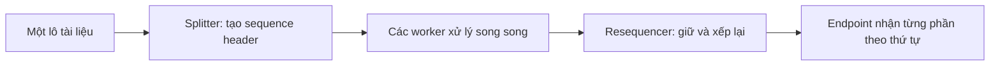

# Resequencer và sequence header

Trong module **SPRING_INTEGRATION_CORE**, resequencer giúp đưa những thông điệp xử lý lệch thứ tự về đúng trình tự trước khi chuyển sang endpoint tiếp theo. Chủ đề này nối kiến thức về `Message`, `MessageChannel` và Java DSL với một tình huống tích hợp phổ biến: xử lý song song để tăng tốc nhưng vẫn cần phát kết quả theo thứ tự đã xác định.

Ví dụ xuyên suốt là một lô tài liệu được chia thành nhiều phần. Các worker có thể hoàn thành phần 3 trước phần 1, nhưng bước ghi tài liệu yêu cầu nhận phần 1, rồi phần 2, rồi phần 3. Resequencer giữ trạng thái của từng lô và quyết định khi nào có thể chuyển tiếp các phần đã nhận.

Các ví dụ dùng Java 17 trở lên và API Spring Integration 6.5. Dự án thực hành cần `spring-integration-core`; phần kiểm thử dùng JUnit Jupiter. Nếu dự án dùng Spring Boot, quản lý phiên bản qua bộ dependency của dự án để các thư viện Spring tương thích với nhau.

## 1. Mục tiêu và mô hình luồng

Sau bài học, bạn cần giải thích được:

- Ba header `correlationId`, `sequenceNumber` và `sequenceSize` phối hợp như thế nào.
- Khi nào cần chờ đủ nhóm, khi nào có thể phát sớm một đoạn liên tiếp.
- Cách đặt resequencer sau đoạn xử lý bất đồng bộ bằng Java DSL.
- Vì sao một phần bị thiếu, header bị mất hoặc correlation key bị dùng lại có thể làm luồng hoạt động sai.
- Cách kiểm thử thứ tự đầu ra mà không phụ thuộc tốc độ chạy của các thread.



Thứ tự mong muốn phải được xác định **trước đoạn có thể gây đảo thứ tự**. Nếu đánh số theo thời điểm worker hoàn thành, số thứ tự chỉ phản ánh kết quả của cuộc đua giữa các worker.

Trong tình huống này, resequencer phục hồi thứ tự của các phần trong một lô. Nó không suy luận thứ tự nghiệp vụ từ nội dung tài liệu hoặc từ thời điểm message tới hệ thống.

## 2. Resequencer làm gì?

Resequencer nhận nhiều thông điệp liên quan, giữ chúng theo nhóm và chuyển tiếp từng thông điệp theo `sequenceNumber`. Một nhóm có ba message vẫn tạo ra ba message đầu ra. Payload không được ghép thành một danh sách chỉ vì chúng đi qua resequencer. Đây là khác biệt căn bản với aggregator. Xem [Spring Integration: Resequencer](https://docs.spring.io/spring-integration/reference/6.5/resequencer.html).

Với một lô hợp lệ có kích thước 3:

```text
Đầu vào theo thời gian:  phần 3 → phần 1 → phần 2
Đầu ra theo sequence:    phần 1 → phần 2 → phần 3
```

Ba khái niệm cần tách rõ:

| Khái niệm | Câu hỏi cần trả lời | Ví dụ |
|---|---|---|
| Correlation | Message thuộc lô nào? | `document-42:attempt-1` |
| Sequence | Message nằm ở vị trí nào trong lô? | Phần `2` |
| Release | Với trạng thái hiện tại, được phát message nào? | Đã đủ 3 phần hoặc đã có đoạn tiếp theo |

Resequencer không tự tải lại phần bị mất. Nếu phần 2 không bao giờ tới, hệ thống phải có chính sách chờ, hết hạn hoặc phục hồi.

## 3. Hợp đồng của ba sequence header

Các hằng số thuộc lớp `org.springframework.integration.IntegrationMessageHeaderAccessor`. Tên header thực tế và kiểu giá trị cần được thống nhất giữa các thành phần gửi, xử lý và nhận. Xem [mã nguồn IntegrationMessageHeaderAccessor 6.5.10](https://github.com/spring-projects/spring-integration/blob/v6.5.10/spring-integration-core/src/main/java/org/springframework/integration/IntegrationMessageHeaderAccessor.java).

| Hằng số | Tên header | Ý nghĩa | Giá trị của phần thứ hai |
|---|---|---|---|
| `CORRELATION_ID` | `correlationId` | Khóa nhóm dùng bởi correlation strategy mặc định | `"document-42:attempt-1"` |
| `SEQUENCE_NUMBER` | `sequenceNumber` | Vị trí trong sequence, thông thường bắt đầu từ 1 | `2` |
| `SEQUENCE_SIZE` | `sequenceSize` | Tổng số phần của sequence hữu hạn | `3` |

Với ví dụ lô hữu hạn trong bài, quy ước đầu vào là:

```text
correlationId khác null và xác định duy nhất một lần xử lý lô
sequenceSize = N, với N > 0
sequenceNumber thuộc 1..N
Mọi phần trong cùng lô có cùng sequenceSize
Mỗi vị trí biểu diễn đúng một phần nghiệp vụ
```

Trong Java, nên đặt `sequenceNumber` và `sequenceSize` bằng số nguyên, chẳng hạn `Integer`. Adapter nhận dữ liệu từ HTTP, JSON hoặc broker cần chuẩn hóa chuỗi `"2"` thành giá trị số phù hợp trước khi đưa message vào resequencer.

Không dùng `MessageHeaders.ID` làm correlation key cho từng phần. Mỗi message có định danh riêng; các phần của cùng lô cần **chung khóa nhóm**, đồng thời **khác vị trí**.

Correlation key cũng cần phân biệt các lần xử lý. Chẳng hạn:

```text
document-42:attempt-1
document-42:attempt-2
```

Việc dùng một khóa cố định như `"all-documents"` khiến các phần của nhiều tài liệu bị đưa vào cùng nhóm.

## 4. Thứ tự chỉ có ý nghĩa trong từng nhóm

Giả sử có hai lô A và B, mỗi lô hai phần:

```text
Nhận:    A2, B2, A1, B1
Có thể phát khi chờ đủ nhóm: A1, A2, B1, B2
```

A hoàn tất trước B nên A được phát trước trong lịch gửi này. Nếu B1 tới trước A1, B có thể được phát trước. Yêu cầu của hệ thống là `A1 < A2` và `B1 < B2`; nó chưa đặt ra quan hệ thứ tự giữa A và B.

Nếu nghiệp vụ yêu cầu mọi lô phải được ghi theo một thứ tự chung, cần một sequence chung hoặc một tầng điều phối khác. Không thể lấy thứ tự giữa các nhóm làm kết quả mặc định của resequencer.

Khóa nhóm nên được thiết kế từ phạm vi nghiệp vụ thực sự. Trong hệ thống nhiều tenant, khóa có thể cần chứa tenant, mã tài liệu và lần xử lý để tránh trùng giữa hai khách hàng.

## 5. Chờ đủ nhóm và phát từng đoạn liên tiếp

### 5.1. Chờ đủ nhóm

Với `releasePartialSequences(false)`, luồng thông thường chờ nhóm đủ số phần theo `sequenceSize` rồi chuyển tiếp chúng theo sequence. Đây cũng là giá trị mặc định được tài liệu resequencer mô tả. Bài học vẫn cấu hình tường minh để thể hiện ý định. Xem [cấu hình Resequencer](https://docs.spring.io/spring-integration/reference/6.5/resequencer.html).

Cách này phù hợp khi bên nhận cần bắt đầu xử lý sau khi lô đã có đủ phần. Đổi lại, phần đầu cũng phải chờ phần chậm nhất.

Điều kiện “đủ nhóm” chỉ có ý nghĩa khi hợp đồng header đúng. Không nên xem việc đếm đủ message như một bước xác thực rằng producer đã gửi đúng các vị trí `1..N`.

### 5.2. Phát từng đoạn liên tiếp

Với `releasePartialSequences(true)` và chiến lược mặc định, resequencer có thể phát đoạn tiếp theo ngay khi vị trí đầu đoạn khớp với số đang chờ. Nó ghi nhận vị trí đã phát để quyết định lần tiếp theo. Xem [SequenceSizeReleaseStrategy](https://docs.spring.io/spring-integration/api/org/springframework/integration/aggregator/SequenceSizeReleaseStrategy.html) và [mã nguồn bộ xử lý nhóm resequencer](https://github.com/spring-projects/spring-integration/blob/v6.5.10/spring-integration-core/src/main/java/org/springframework/integration/aggregator/ResequencingMessageGroupProcessor.java).

Với `sequenceSize = 4` và thứ tự nhận `3, 1, 4, 2`:

| Lần nhận | Chờ đủ nhóm: phát thêm | Phát từng đoạn: phát thêm | Trạng thái đang chờ ở chế độ từng đoạn |
|---|---|---|---|
| Nhận 3 | Chưa có | Chưa có | Chờ 1, đang giữ 3 |
| Nhận 1 | Chưa có | 1 | Chờ 2, đang giữ 3 |
| Nhận 4 | Chưa có | Chưa có | Chờ 2, đang giữ 3 và 4 |
| Nhận 2 | 1, 2, 3, 4 | 2, 3, 4 | Đã phát tới 4 |

Khi mới có 3 và 4, đoạn này tuy liên tiếp nhưng chưa thể phát trong luồng bình thường vì 1 và 2 chưa được phát. Với trạng thái ban đầu, số đang chờ là 1.

Đây là quy tắc cho cơ chế mặc định và đầu vào hợp lệ. Nếu tự thay `releaseStrategy`, bạn chịu trách nhiệm về điều kiện phát mới; không còn được giả định mọi bảo đảm của chiến lược mặc định vẫn giữ nguyên.

| Cân nhắc | Chờ đủ nhóm | Phát từng đoạn |
|---|---|---|
| Bắt đầu xử lý ở phía nhận | Sau khi đủ lô | Khi có đoạn đầu hợp lệ |
| Phần đầu gặp một phần cuối rất chậm | Tiếp tục chờ | Có thể đã được phát |
| Một vị trí ở giữa bị mất | Toàn nhóm chưa được phát | Các phần sau chỗ trống tiếp tục chờ |
| Bên nhận cần hỗ trợ lô chưa hoàn tất | Ít hơn trong đường đi bình thường | Có, vì một số phần đã tới trước |

Phát từng đoạn không cho phép quay lại sửa phần đã được chuyển tiếp. Nếu bên nhận đã ghi phần 1, timeout của phần 2 không tự hoàn tác thao tác ghi đó.

## 6. Sequence header được tạo và giữ ở đâu?

Splitter của Spring Integration điền các sequence header cho những phần nó tạo ra. Khi bật cơ chế áp dụng sequence, một lô được tách thành collection hữu hạn có thể mang đủ khóa nhóm, số thứ tự và tổng số phần. Trường hợp iterator không xác định được kích thước có thể có `sequenceSize = 0`; không được coi giá trị này là “lô đã đủ”. Xem [Spring Integration: Splitter](https://docs.spring.io/spring-integration/reference/6.5/splitter.html).

Hai cách đưa dữ liệu vào resequencer thường gặp:

1. Dùng splitter trong cùng hệ thống, giữ header qua các transformer và service activator.
2. Nhận các phần từ hệ thống bên ngoài, ánh xạ metadata bên ngoài sang ba header chuẩn tại biên nhận.

Mẫu Java DSL thường có dạng `split → ExecutorChannel → xử lý → resequence`. Tài liệu [Aggregators and Resequencers trong Java DSL](https://docs.spring.io/spring-integration/reference/6.5/dsl/java-aggregators.html) minh họa vị trí resequencer sau đoạn xử lý có executor.

Khi tự xây message mới trong code nghiệp vụ, cần chủ động giữ metadata. Ví dụ một phương thức chuyển payload sang chữ hoa:

```java
static Message<String> normalize(Message<String> input) {
    return MessageBuilder.withPayload(
                    input.getPayload().toUpperCase(java.util.Locale.ROOT))
            .copyHeaders(input.getHeaders())
            .build();
}
```

Đoạn này dùng `org.springframework.messaging.Message` và `org.springframework.messaging.support.MessageBuilder`. Không dựa vào việc giữ nguyên message ID khi tạo message mới; resequencer cần các header tương quan và sequence của lô.

Với transformer chuẩn, framework có cơ chế truyền tiếp header, nhưng các bước tự tạo message, ánh xạ qua giao thức hoặc lọc header vẫn cần được kiểm tra ở ranh giới tích hợp. Có thể log ba header trước và sau worker để xác định vị trí metadata bị mất.

Nếu split nhiều tầng, mỗi tầng có phạm vi sequence riêng. Không tự ghi đè header của tầng ngoài mà không thiết kế cách khôi phục phạm vi tương quan sau tầng trong.

## 7. Cấu hình Java DSL đầy đủ cho hai chế độ

Ví dụ dưới đây chủ động gửi message có header sẵn để quan sát riêng hành vi resequencer. Lưu lớp cấu hình thực hành với tên `ResequencerLessonConfig.java` trong package `example.integration`.

```java
package example.integration;

import org.springframework.context.annotation.Bean;
import org.springframework.context.annotation.Configuration;
import org.springframework.integration.channel.DirectChannel;
import org.springframework.integration.channel.QueueChannel;
import org.springframework.integration.config.EnableIntegration;
import org.springframework.integration.dsl.IntegrationFlow;

@Configuration
@EnableIntegration
public class ResequencerLessonConfig {

    @Bean
    public DirectChannel fullInput() {
        return new DirectChannel();
    }

    @Bean
    public QueueChannel fullOutput() {
        return new QueueChannel();
    }

    @Bean
    public DirectChannel partialInput() {
        return new DirectChannel();
    }

    @Bean
    public QueueChannel partialOutput() {
        return new QueueChannel();
    }

    @Bean
    public IntegrationFlow fullSequenceFlow() {
        return IntegrationFlow.from(fullInput())
                .resequence(spec -> spec.releasePartialSequences(false))
                .channel(fullOutput())
                .get();
    }

    @Bean
    public IntegrationFlow partialSequenceFlow() {
        return IntegrationFlow.from(partialInput())
                .resequence(spec -> spec.releasePartialSequences(true))
                .channel(partialOutput())
                .get();
    }
}
```

`@EnableIntegration` khởi tạo hạ tầng Spring Integration trong application context thuần Spring.

Cả hai input là `DirectChannel`, nên lời gọi gửi tới resequencer được thực hiện đồng bộ trên thread gửi. Các output là `QueueChannel`, cho phép kiểm thử lấy từng message ra bằng `receive`. Các đặc tính này được mô tả trong [Message Channel Implementations](https://docs.spring.io/spring-integration/reference/6.5/channel/implementations.html).

Hai flow có trạng thái riêng. Chúng không dùng chung một message store do người học cung cấp. Đầu vào của ví dụ phải tuân theo hợp đồng header hữu hạn ở mục 3.

Một ứng dụng nhận các phần riêng lẻ có thể dùng gateway với phương thức gửi một chiều. Không nên thiết kế mỗi phần gọi vào một gateway request-reply và mặc định chờ một phản hồi ngay: phần 3 có thể bị giữ cho tới khi phần 1 và phần 2 tới. Nếu cần một phản hồi cho cả lô, phải thiết kế rõ bước hoàn thành lô, chẳng hạn thêm aggregator phù hợp ở sau.

## 8. Kiểm thử đầu vào lệch thứ tự

Lớp kiểm thử bên dưới dùng cùng package với cấu hình. Mỗi test có một application context mới để trạng thái nhóm của test trước không ảnh hưởng test sau.

```java
package example.integration;

import org.junit.jupiter.api.AfterEach;
import org.junit.jupiter.api.BeforeEach;
import org.junit.jupiter.api.Test;
import org.springframework.context.annotation.AnnotationConfigApplicationContext;
import org.springframework.integration.IntegrationMessageHeaderAccessor;
import org.springframework.integration.channel.QueueChannel;
import org.springframework.messaging.Message;
import org.springframework.messaging.MessageChannel;
import org.springframework.messaging.support.MessageBuilder;

import static org.junit.jupiter.api.Assertions.assertEquals;
import static org.junit.jupiter.api.Assertions.assertNotNull;
import static org.junit.jupiter.api.Assertions.assertNull;
import static org.junit.jupiter.api.Assertions.assertTrue;

class ResequencerLessonTest {

    private AnnotationConfigApplicationContext context;

    @BeforeEach
    void openContext() {
        context = new AnnotationConfigApplicationContext(
                ResequencerLessonConfig.class);
    }

    @AfterEach
    void closeContext() {
        context.close();
    }

    @Test
    void waitsForAllPartsThenEmitsInSequence() {
        MessageChannel input = context.getBean(
                "fullInput", MessageChannel.class);
        QueueChannel output = context.getBean(
                "fullOutput", QueueChannel.class);

        assertTrue(input.send(part("doc-A", 3, 3)));
        assertNull(output.receive(0));

        assertTrue(input.send(part("doc-A", 1, 3)));
        assertNull(output.receive(0));

        assertTrue(input.send(part("doc-A", 2, 3)));

        assertNext(output, "doc-A", 1, 3);
        assertNext(output, "doc-A", 2, 3);
        assertNext(output, "doc-A", 3, 3);
        assertNull(output.receive(0));
    }

    @Test
    void emitsOnlyTheNextContiguousPartOfTheSequence() {
        MessageChannel input = context.getBean(
                "partialInput", MessageChannel.class);
        QueueChannel output = context.getBean(
                "partialOutput", QueueChannel.class);

        assertTrue(input.send(part("doc-B", 3, 4)));
        assertNull(output.receive(0));

        assertTrue(input.send(part("doc-B", 1, 4)));
        assertNext(output, "doc-B", 1, 4);
        assertNull(output.receive(0));

        assertTrue(input.send(part("doc-B", 4, 4)));
        assertNull(output.receive(0));

        assertTrue(input.send(part("doc-B", 2, 4)));
        assertNext(output, "doc-B", 2, 4);
        assertNext(output, "doc-B", 3, 4);
        assertNext(output, "doc-B", 4, 4);
        assertNull(output.receive(0));
    }

    @Test
    void keepsDifferentCorrelationGroupsIndependent() {
        MessageChannel input = context.getBean(
                "fullInput", MessageChannel.class);
        QueueChannel output = context.getBean(
                "fullOutput", QueueChannel.class);

        assertTrue(input.send(part("doc-C", 2, 2)));
        assertTrue(input.send(part("doc-D", 2, 2)));
        assertNull(output.receive(0));

        assertTrue(input.send(part("doc-C", 1, 2)));
        assertNext(output, "doc-C", 1, 2);
        assertNext(output, "doc-C", 2, 2);
        assertNull(output.receive(0));

        assertTrue(input.send(part("doc-D", 1, 2)));
        assertNext(output, "doc-D", 1, 2);
        assertNext(output, "doc-D", 2, 2);
        assertNull(output.receive(0));
    }

    private static Message<String> part(
            String batchId, int number, int total) {
        return MessageBuilder.withPayload("part-" + number)
                .setHeader(
                        IntegrationMessageHeaderAccessor.CORRELATION_ID,
                        batchId)
                .setHeader(
                        IntegrationMessageHeaderAccessor.SEQUENCE_NUMBER,
                        number)
                .setHeader(
                        IntegrationMessageHeaderAccessor.SEQUENCE_SIZE,
                        total)
                .build();
    }

    private static void assertNext(
            QueueChannel output, String batchId, int number, int total) {
        Message<?> message = output.receive(1_000);
        assertNotNull(message);
        assertEquals("part-" + number, message.getPayload());
        assertEquals(batchId, message.getHeaders().get(
                IntegrationMessageHeaderAccessor.CORRELATION_ID));
        assertEquals(Integer.valueOf(number), message.getHeaders().get(
                IntegrationMessageHeaderAccessor.SEQUENCE_NUMBER,
                Integer.class));
        assertEquals(Integer.valueOf(total), message.getHeaders().get(
                IntegrationMessageHeaderAccessor.SEQUENCE_SIZE,
                Integer.class));
    }
}
```

Các kiểm thử quan sát đồng thời payload, correlation key và hai header số. Nếu chỉ đếm số message nhận được, test có thể bỏ sót lỗi thứ tự hoặc việc trộn hai lô.

`receive(0)` là phép kiểm tra ngay hàng đợi hiện tại. Nó phù hợp ở đây vì đường đi từ input tới hàng đợi output là đồng bộ. Khi thay bằng `ExecutorChannel`, cần chờ có giới hạn hoặc đồng bộ hóa theo điều kiện phù hợp; kiểm tra ngay sau `send` không chứng minh worker đã xử lý xong.

Các đoạn code là ví dụ thực hành của bài. Để xác nhận trên dự án cụ thể, chạy chúng với dependency và phiên bản JUnit mà dự án đang sử dụng.

## 9. Kiểm soát header tại biên nhận

Nên xác thực từng message trước khi nó được giữ trong nhóm. Một predicate minh họa cho **hợp đồng số nguyên của bài học**:

```java
static boolean validFiniteSequence(Message<?> message) {
    Object correlation = message.getHeaders().get(
            IntegrationMessageHeaderAccessor.CORRELATION_ID);
    Object number = message.getHeaders().get(
            IntegrationMessageHeaderAccessor.SEQUENCE_NUMBER);
    Object total = message.getHeaders().get(
            IntegrationMessageHeaderAccessor.SEQUENCE_SIZE);

    return correlation instanceof String key
            && !key.isBlank()
            && number instanceof Integer position
            && total instanceof Integer size
            && size > 0
            && position >= 1
            && position <= size;
}
```

Predicate sử dụng cùng hai import `Message` và `IntegrationMessageHeaderAccessor` như lớp kiểm thử. Có thể gắn nó vào filter trước resequencer và đưa phần không hợp lệ sang channel xử lý riêng.

Điều kiện này chỉ kiểm tra một message. Nó chưa kiểm tra được:

- Các phần cùng correlation key có cùng `sequenceSize` hay không.
- Hai message cùng vị trí có payload mâu thuẫn hay không.
- Producer có gửi đủ mọi vị trí hay không.
- Correlation key có bị tái sử dụng cho lô khác hay không.

Ví dụ nhận `1/3`, `2/3` và `3/4` phải được xem là một hợp đồng lô không nhất quán. Không sửa riêng phần cuối thành `3/3` nếu chưa biết tổng số thật từ nguồn có thẩm quyền.

Nếu cần correlation strategy tùy chỉnh, chẳng hạn đọc từ một header nghiệp vụ, có thể cấu hình:

```java
.resequence(spec -> spec
        .correlationStrategy(
                message -> message.getHeaders().get("documentBatchKey"))
        .releasePartialSequences(false))
```

Đây là một đoạn thay thế trong chuỗi DSL. Giá trị `documentBatchKey` phải tồn tại và định danh đúng lô. Thay khóa tương quan không thay thế nhu cầu có sequence number và tiêu chí hoàn tất phù hợp.

Các phương thức cấu hình này thuộc `ResequencerSpec` và lớp cơ sở của nó; xem [ResequencerSpec 6.5.10](https://github.com/spring-projects/spring-integration/blob/v6.5.10/spring-integration-core/src/main/java/org/springframework/integration/dsl/ResequencerSpec.java) và [CorrelationHandlerSpec 6.5.10](https://github.com/spring-projects/spring-integration/blob/v6.5.10/spring-integration-core/src/main/java/org/springframework/integration/dsl/CorrelationHandlerSpec.java).

## 10. Phần bị thiếu, timeout và thông điệp đến muộn

### 10.1. Phân biệt hai tùy chọn “partial”

`releasePartialSequences` điều khiển phát sớm trong quá trình nhận bình thường. `sendPartialResultOnExpiry` điều khiển cách xử lý phần còn giữ khi nhóm bị buộc hoàn tất do hết hạn.

Bật phát sớm không tự tạo timeout. Một nhóm vẫn có thể giữ phần 3 và phần 4 mãi nếu thiếu phần 2 và không có cơ chế kết thúc.

Trong ví dụ ghi tài liệu, giả sử yêu cầu là giữ kết quả chưa đủ ở kênh xử lý sự cố để vận hành kiểm tra. Có thể bổ sung ba bean sau vào lớp cấu hình ở mục 7:

```java
@Bean
public QueueChannel expiredSequence() {
    return new QueueChannel();
}

@Bean
public QueueChannel expiringOutput() {
    return new QueueChannel();
}

@Bean
public IntegrationFlow expiringSequenceFlow() {
    return IntegrationFlow.from("expiringInput")
            .resequence(spec -> spec
                    .releasePartialSequences(false)
                    .groupTimeout(5_000)
                    .sendPartialResultOnExpiry(false)
                    .expireGroupsUponTimeout(false)
                    .discardChannel(expiredSequence()))
            .channel(expiringOutput())
            .get();
}
```

`expiringInput` là channel đầu vào của flow bổ sung. Với cấu hình này, một nhóm chưa đủ được lên lịch kết thúc sau khoảng chờ không có message mới. `groupTimeout(5_000)` tính bằng mili giây; nó không phải hạn chót cố định 5 giây kể từ message đầu. Xem [quy tắc group timeout của correlation endpoint](https://docs.spring.io/spring-integration/reference/6.5/aggregator.html#aggregator-config-xml).

Với đầu vào `1/3` rồi `3/3`:

1. Nhóm chưa đủ nên chưa có kết quả ở `expiringOutput`.
2. Khi tác vụ hết hạn chạy và nhóm vẫn chưa đủ, phần đang giữ được chuyển theo chính sách discard.
3. `expiredSequence` nhận các message để một luồng khác xử lý sự cố; queue tự nó không phải cơ chế lưu lỗi bền vững.
4. Metadata nhóm được giữ theo `expireGroupsUponTimeout(false)` để phát hiện phần tới muộn.

Tài liệu resequencer mô tả việc giữ metadata sau timeout và loại bỏ message đến muộn. Nếu xóa hoàn toàn nhóm, message cùng khóa tới sau có thể tạo một nhóm mới. Xem [chính sách timeout và empty group](https://docs.spring.io/spring-integration/reference/6.5/resequencer.html).

### 10.2. Không diễn giải timeout như một lô hoàn chỉnh

Nếu bật `sendPartialResultOnExpiry(true)`, kết quả được phát do hết hạn không chứng minh mọi vị trí đã tới. Đó là đường đi cần một hợp đồng nghiệp vụ riêng.

Chẳng hạn, endpoint ghi tài liệu đầy đủ phải biết lô đã thiếu phần để tránh chốt một tài liệu hỏng. Có thể dùng sự kiện hoàn thành lô riêng, bảng trạng thái hoặc metadata nghiệp vụ do ứng dụng quản lý. Không mặc định resequencer tự bổ sung một cờ “đủ tài liệu”.

Đặc biệt, khi đã phát từng đoạn, các phần phát trước timeout đã rời resequencer. Chính sách discard chỉ áp dụng với trạng thái còn giữ; phục hồi toàn bộ tài liệu cần thiết kế ở cấp nghiệp vụ.

## 11. Bộ nhớ, trạng thái và phạm vi bảo đảm

Resequencer có trạng thái. Khi một vị trí chậm hoặc mất, các phần phía sau phải nằm trong store. Ví dụ 2.000 lô cùng chờ, mỗi lô giữ 10 payload khoảng 100 KB, đã tương đương khoảng 2 GB dữ liệu payload, chưa tính overhead.

Cần theo dõi số nhóm đang chờ, số message giữ lại, tuổi nhóm lâu nhất và vị trí tiếp theo đang thiếu. Có nhiều nhóm sống lâu thường là dấu hiệu producer thiếu phần, correlation key sai hoặc chính sách kết thúc chưa phù hợp.

`SimpleMessageStore` mặc định dùng bộ nhớ tiến trình. Khi cần khôi phục sau restart, lựa chọn một `MessageGroupStore` bền vững phù hợp và kiểm tra khả năng lưu payload cùng header. Serialization có thể ảnh hưởng metadata qua quá trình lưu và đọc lại. Xem [Spring Integration: Message Store](https://docs.spring.io/spring-integration/reference/6.5/message-store.html).

Khi triển khai nhiều instance, thiết kế phải bảo đảm mọi message của cùng nhóm cùng đi tới một trạng thái logic. Có thể định tuyến cùng khóa tới một instance hoặc sử dụng store dùng chung cùng cơ chế khóa phù hợp. Chỉ thêm nhiều instance với store cục bộ sẽ làm các phần của một lô bị chia tách.

Trạng thái về vị trí đã phát và nhóm đã đóng có vòng đời riêng. Cleanup cần cân bằng giữa việc giải phóng dữ liệu với khoảng thời gian còn phải nhận diện message đến muộn. Tham khảo [ResequencingMessageHandler](https://github.com/spring-projects/spring-integration/blob/v6.5.10/spring-integration-core/src/main/java/org/springframework/integration/aggregator/ResequencingMessageHandler.java) khi cần hiểu vòng đời nhóm theo đúng phiên bản đang dùng.

Bảo đảm thứ tự còn phụ thuộc luồng sau resequencer. Nếu chuyển tiếp qua executor nhiều thread, thứ tự **hoàn thành** ở endpoint sau vẫn có thể đảo. Hãy xác định rõ điểm cần bảo đảm: thứ tự gửi vào channel, thứ tự bắt đầu xử lý hay thứ tự commit dữ liệu nghiệp vụ.

Resequencer cũng không thay thế idempotency. Khả năng nhận diện một số message trùng dựa trên sequence và trạng thái đang giữ không tương đương bảo đảm ghi nghiệp vụ đúng một lần qua retry, restart hoặc cleanup nhóm.

## 12. Phân biệt discard với xử lý exception

Hai sự kiện cần có hướng xử lý riêng:

| Tình huống | Nội dung cần quan sát | Hướng xử lý |
|---|---|---|
| Message bị loại theo chính sách | Message gốc, khóa lô, vị trí, lý do loại | Discard channel hoặc channel cách ly của ứng dụng |
| Endpoint ném exception | Exception và ngữ cảnh message thất bại | Bắt lỗi đồng bộ hoặc cơ chế error channel phù hợp |
| Lô chưa đủ nhưng vẫn còn hạn | Nhóm đang giữ và thời gian chờ | Theo dõi trạng thái; chưa coi là lỗi kết thúc |
| Phần nghiệp vụ đã được ghi rồi mới retry | Khóa nghiệp vụ đã xử lý | Kiểm soát idempotency ở bên nhận |

Với `DirectChannel`, exception trong lời gọi xử lý đồng bộ có thể truyền về bên gọi `send`. Khi chuyển sang executor hoặc tác vụ nền, phải cấu hình và quan sát đường xử lý lỗi bất đồng bộ phù hợp. Không mặc định mọi message bị discard trở thành `ErrorMessage` trên `errorChannel`. Xem [Spring Integration: Error Handling](https://docs.spring.io/spring-integration/reference/6.5/error-handling.html).

Khi log, bộ thông tin hữu ích gồm khóa lô, số thứ tự, tổng số phần, endpoint, thời điểm nhận và lý do kết thúc. Với payload lớn hoặc nhạy cảm, các định danh này thường đủ để điều tra mà không cần ghi toàn bộ dữ liệu.

## 13. Các lỗi thường gặp và cách suy luận

| Hiện tượng | Nguyên nhân cần kiểm tra trước | Cách xử lý theo hợp đồng |
|---|---|---|
| Từng phần nằm trong nhóm riêng | Correlation key được tạo mới cho mỗi message | Dùng chung khóa cho toàn bộ lô |
| Nhiều tài liệu bị trộn | Correlation key quá rộng hoặc thiếu tenant/lần xử lý | Thu hẹp khóa về đúng lô |
| Nhóm không phát dù có nhiều message | Thiếu một vị trí, size sai hoặc mất header | So sánh tập vị trí thực nhận với `1..N` |
| Partial mode chưa phát 3 và 4 | Chưa phát xong các vị trí trước đó | Kiểm tra vị trí kế tiếp đang chờ |
| Đầu vào bên ngoài báo sai kiểu header | Metadata số còn là chuỗi | Chuẩn hóa kiểu ở adapter hoặc transformer |
| Nhận lô từ iterator rồi chờ đủ mãi | Không xác định được tổng số phần | Thiết kế điều kiện kết thúc, kích thước hoặc chính sách hết hạn |
| Thứ tự ở database vẫn đảo | Sau resequencer có xử lý song song | Giữ tuần tự tới điểm commit cần bảo đảm |
| Phần tới muộn xuất hiện như lô mới | Metadata nhóm cũ đã bị xóa hoặc khóa bị dùng lại | Rà chính sách retention và cấp khóa cho lần xử lý mới |

Không sửa triệu chứng bằng cách đặt một `releaseStrategy` luôn trả về `true`. Cách đó có thể cho phép xử lý nhóm khi chưa có đủ thông tin về vị trí đang thiếu.

Cũng không thay resequencer bằng `PriorityChannel` với comparator số thứ tự rồi coi hai cơ chế tương đương. Một hàng đợi ưu tiên chỉ chọn trong các phần hiện có; nếu phần 3 đã được lấy trước khi phần 1 tới, nó không thể phục hồi thứ tự đã mất.

## 14. Bài thực hành áp dụng

Giả sử dịch vụ nhận bốn phần của một tài liệu. Hợp đồng yêu cầu ghi từng phần theo thứ tự và báo thất bại nếu một phần không tới trong khoảng chờ đã thỏa thuận.

Thực hiện lần lượt:

1. Gửi `3, 1, 4, 2` vào hai flow ở mục 7 và đối chiếu bảng trạng thái ở mục 5.
2. Gửi xen kẽ hai correlation key, xác nhận đầu ra giữ đúng thứ tự trong từng lô.
3. Bỏ phần 2 và quan sát sự khác nhau giữa phần đã phát, phần đang giữ và phần bị discard khi hết hạn.
4. Gửi lại phần 2 sau timeout, đối chiếu hành vi với cấu hình giữ metadata nhóm.
5. Cố tình xóa `sequenceNumber` trong một bước tự tạo message, kiểm tra khả năng phát hiện lỗi ở biên nhận.
6. Đặt một executor sau resequencer và cho các phần mất thời gian xử lý khác nhau để phân biệt thứ tự phát với thứ tự hoàn thành.

Tiêu chí hoàn thành là giải thích được từng message thuộc nhóm nào, vị trí kế tiếp cần chờ là gì, lúc nào nhóm được kết thúc và bên nhận phải làm gì khi lô chỉ hoàn thành một phần. Đó là cơ sở để dùng resequencer đúng trong luồng tích hợp doanh nghiệp.
