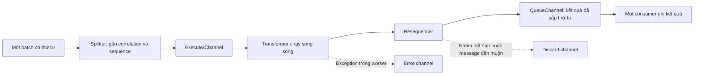

# Resequencer trong flow bất đồng bộ

Khi các message được xử lý trên nhiều luồng, thứ tự hoàn thành thường khác thứ tự ban đầu. Resequencer giữ tạm các message cùng một nhóm, rồi phát chúng theo số thứ tự đã được gắn trước khi xử lý song song. Đây là một endpoint có trạng thái: nó cần biết message thuộc nhóm nào, đứng ở vị trí nào và khi nào có thể phát kết quả.

Trong phạm vi **SPRING_INTEGRATION_CORE**, bài này kết nối `Message`, `MessageChannel`, splitter, transformer và Java DSL thành một flow bất đồng bộ có thể giải thích và kiểm thử. Các ví dụ dùng API Spring Integration 6.5.x, Java 17 trở lên; ví dụ kiểm thử dùng JUnit Jupiter 5. Phiên bản thư viện cụ thể nên do BOM của ứng dụng quản lý.

## 1. Mục tiêu và tình huống thực tế

Sau bài học, bạn có thể:

- Xác định ranh giới bất đồng bộ và vị trí đặt resequencer.
- Thiết kế các header correlation và sequence cho một batch hữu hạn.
- Chọn chờ đủ nhóm hoặc phát từng đoạn liên tiếp đã sẵn sàng.
- Phân biệt lỗi xử lý, nhóm thiếu message, timeout và message đến muộn.
- Kiểm thử thứ tự đầu ra bằng dữ liệu vào chủ động đảo thứ tự.
- Giải thích giới hạn của resequencer đối với side effect, restart và nhiều instance.

Giả sử ứng dụng nhận một tài liệu gồm năm phần. Mỗi phần cần được chuẩn hóa độc lập trước khi ghi vào tài liệu kết quả:

```text
Thứ tự trong tài liệu:       1, 2, 3, 4, 5
Thứ tự xử lý hoàn thành:     4, 1, 3, 2, 5
Thứ tự cần ghi kết quả:      1, 2, 3, 4, 5
```

Phần thứ tư có thể xử lý nhanh hơn phần thứ nhất. Thread pool hoạt động đúng nhưng consumer ghi tài liệu cần nhận kết quả theo vị trí ban đầu.

Resequencer phù hợp với bài toán này nếu các phần đã có số thứ tự đáng tin cậy. Nó không tự suy ra thứ tự nghiệp vụ từ thời điểm message đến.

**Ranh giới cần nhớ:** nếu worker đã ghi từng phần vào hệ thống đích trước resequencer, việc sắp lại các thông báo hoàn thành không sửa được thứ tự ghi đã xảy ra. Phần xử lý song song nên chuẩn bị kết quả; thao tác đòi hỏi thứ tự được đặt sau điểm khôi phục thứ tự.

## 2. Vì sao flow bất đồng bộ làm đảo thứ tự?

Một `DirectChannel` gọi handler trong luồng gửi. Một `ExecutorChannel` giao việc cho executor, tạo cơ hội xử lý đồng thời. Thứ tự submit tác vụ không quyết định thứ tự các tác vụ hoàn tất. Ngoài ra, transaction trên luồng gửi không tự bao phủ handler chạy ở luồng worker. Xem [các loại MessageChannel](https://docs.spring.io/spring-integration/reference/6.5/channel/implementations.html).

Những yếu tố thường làm thời gian xử lý lệch nhau gồm:

- Payload có kích thước khác nhau.
- Một tác vụ phải gọi dịch vụ ngoài hoặc chờ khóa.
- Một tác vụ được retry.
- Hàng đợi executor và lịch chạy của hệ điều hành thay đổi.
- Các kết quả đi qua nhiều nhánh hoặc nhiều consumer trước khi hội tụ.

Vì vậy, cần phân biệt bốn loại thứ tự:

| Loại thứ tự | Ví dụ | Resequencer tác động ở đâu? |
| --- | --- | --- |
| Thứ tự nghiệp vụ | Phần 1 phải đứng trước phần 2 | Đọc từ metadata được thiết kế trước |
| Thứ tự đến endpoint | Kết quả phần 4 đến trước phần 1 | Có thể đảo so với nghiệp vụ |
| Thứ tự phát đầu ra | Endpoint phát phần 1 rồi phần 2 | Đây là trách nhiệm chính |
| Thứ tự hoàn tất side effect | Ghi phần 2 xong trước phần 1 | Phụ thuộc consumer phía sau |

Một `QueueChannel` FIFO đặt sau worker chỉ lưu theo thứ tự enqueue. Nếu worker gửi `4, 1, 3`, queue vẫn nhận `4, 1, 3`. Queue không có hợp đồng chờ phần bị thiếu như resequencer.

## 3. Hợp đồng message: nhóm, vị trí và kích thước

Với cơ chế mặc định, resequencer sử dụng ba header:

| Hằng số | Tên header | Ý nghĩa trong ví dụ |
| --- | --- | --- |
| `IntegrationMessageHeaderAccessor.CORRELATION_ID` | `correlationId` | Định danh một lần xử lý tài liệu |
| `IntegrationMessageHeaderAccessor.SEQUENCE_NUMBER` | `sequenceNumber` | Vị trí của phần, bắt đầu từ 1 |
| `IntegrationMessageHeaderAccessor.SEQUENCE_SIZE` | `sequenceSize` | Tổng số phần của lần xử lý |

Correlation quyết định **tập message được xét cùng nhau**; sequence number quyết định **vị trí trong tập đó**. Resequencer phát các message riêng lẻ, còn aggregator kết hợp nhóm thành một kết quả tổng hợp. Xem [chức năng resequencer](https://docs.spring.io/spring-integration/reference/6.5/resequencer.html).

### 3.1. Chọn correlation theo một lần xử lý hữu hạn

Ví dụ:

```text
correlationId = document-42:revision-7:run-20261119-01
sequenceSize = 5
sequenceNumber = 1..5
```

Nếu cùng tài liệu được xử lý lại, một `runId` mới giúp phân biệt dữ liệu cũ với dữ liệu của lần chạy mới. Chỉ dùng `customerId` làm correlation có thể trộn nhiều batch của cùng khách hàng.

Mỗi nhóm cần một hợp đồng thống nhất:

1. Các message cùng nhóm có cùng correlation.
2. `sequenceNumber` là số nguyên dương, phản ánh vị trí cần khôi phục.
3. Với batch hữu hạn, `sequenceSize` là số phần kỳ vọng và nhất quán trong nhóm.
4. Không gán hai kết quả khác nhau cho cùng một vị trí mà chưa có quy tắc xử lý xung đột.
5. Giữ metadata này qua transformer, retry và transport.

Resequencer không thay thế bước xác thực hợp đồng đầu vào. Một nhóm có đủ số lượng phần tử vẫn có thể mang dữ liệu nghiệp vụ sai nếu producer đã đánh số sai.

### 3.2. Tạo message thủ công

Khi message đến từ một hệ thống đã chia phần sẵn, có thể gắn metadata tại adapter đầu vào:

```java
import org.springframework.integration.IntegrationMessageHeaderAccessor;
import org.springframework.messaging.Message;
import org.springframework.messaging.support.MessageBuilder;

Message<String> thirdPart = MessageBuilder.withPayload("normalized-part-3")
        .setHeader(IntegrationMessageHeaderAccessor.CORRELATION_ID, "batch-A")
        .setHeader(IntegrationMessageHeaderAccessor.SEQUENCE_NUMBER, 3)
        .setHeader(IntegrationMessageHeaderAccessor.SEQUENCE_SIZE, 5)
        .build();
```

Không dùng `MessageHeaders.ID` làm số thứ tự. ID nhận diện message; sequence number biểu diễn vị trí trong chuỗi.

### 3.3. Khi đầu vào là một collection

Splitter có thể tạo các header sequence cho các phần tử. Với payload `List`, kích thước nhóm được xác định trước khi gửi từng phần đi xử lý. Ngược lại, một iterator không biết trước kích thước có thể sinh `sequenceSize = 0`; không thể áp dụng nguyên xi chính sách chờ đủ một nhóm hữu hạn. Xem [hợp đồng header của splitter](https://docs.spring.io/spring-integration/reference/6.5/splitter.html).

Nếu transformer chỉ trả về payload mới, framework thường truyền tiếp header đầu vào. Khi tự tạo hoặc tuần tự hóa message, cần kiểm tra lại việc bảo toàn các header. Ví dụ sau làm mất metadata:

```java
// Chỉ giữ payload, mất correlation và sequence của message đầu vào.
Message<String> wrong = MessageBuilder.withPayload("converted").build();

// Giữ metadata khi cần tạo message mới từ một message hiện có.
Message<String> preserved = MessageBuilder
        .withPayload("converted")
        .copyHeaders(thirdPart.getHeaders())
        .build();
```

Một nested splitter tạo thêm một tầng sequence. Cần xác định rõ tầng nào được resequence tại từng điểm hội tụ, thay vì coi mọi correlation và sequence trong flow là cùng một cấp.

## 4. Đặt resequencer ở điểm hội tụ



Trong sơ đồ này:

- Điểm tách luồng nằm ở `ExecutorChannel`.
- Các worker có thể hoàn tất theo bất kỳ thứ tự nào.
- Resequencer nhận các kết quả và giữ lại những phần chưa thể phát.
- Queue đầu ra giúp quan sát thứ tự endpoint đã phát.
- Một consumer đọc và xử lý tuần tự giúp duy trì thứ tự đến bước ghi.

Nếu ứng dụng chỉ cần một kết quả tổng hợp cho mỗi batch, cần thêm aggregator hoặc cơ chế tổng hợp phù hợp. Resequencer vẫn phát nhiều message; nó không tự tạo một `List` kết quả cho lời gọi gateway. Java DSL hỗ trợ kết hợp các EIP này trong cùng flow, như mô tả ở [Aggregators and Resequencers](https://docs.spring.io/spring-integration/reference/6.5/dsl/java-aggregators.html).

## 5. Hai chính sách phát kết quả

### 5.1. Chờ đủ nhóm: `releasePartialSequences(false)`

Đây là lựa chọn mặc định. Với hợp đồng hợp lệ của một batch có kích thước `N`, endpoint chờ đủ các message rồi phát theo thứ tự.

Phù hợp khi consumer chỉ nên bắt đầu nhận batch sau khi mọi phần đã xử lý thành công.

**Chờ đủ không có nghĩa là transaction toàn batch.** Sau khi nhóm đủ, endpoint vẫn gửi từng message. Consumer có thể xử lý phần 1 thành công rồi lỗi ở phần 2. Nếu cần tính nguyên tử, phải thiết kế transaction hoặc giao thức commit riêng.

### 5.2. Phát đoạn liên tiếp: `releasePartialSequences(true)`

Endpoint có thể phát đoạn liên tiếp bắt đầu từ vị trí kế tiếp đang chờ. Trong một nhóm mới, vị trí bắt đầu là 1; sau khi đã phát đến 3, vị trí kế tiếp là 4.

Việc bật tùy chọn này không cho phép nhảy qua khoảng trống. Nếu đang chờ 2, các phần 3 và 4 vẫn phải nằm trong bộ đệm.

Với `sequenceSize = 5` và thứ tự đến `4 → 1 → 3 → 2 → 5`:

| Message vừa đến | Chờ đủ nhóm: phát thêm | Phát đoạn liên tiếp: phát thêm | Những phần còn chờ ở chế độ đoạn liên tiếp |
| --- | --- | --- | --- |
| 4 | Chưa phát | Chưa phát | 4 |
| 1 | Chưa phát | 1 | 4 |
| 3 | Chưa phát | Chưa phát | 3, 4 |
| 2 | Chưa phát | 2, 3, 4 | Không còn phần chờ |
| 5 | 1, 2, 3, 4, 5 | 5 | Nhóm hoàn tất |

Điều kiện phát đoạn liên tiếp dựa vào vị trí nhỏ nhất đang chờ và vị trí cuối đã phát; có thể đối chiếu [SequenceSizeReleaseStrategy](https://github.com/spring-projects/spring-integration/blob/v6.5.10/spring-integration-core/src/main/java/org/springframework/integration/aggregator/SequenceSizeReleaseStrategy.java).

| Tiêu chí | Chờ đủ nhóm | Phát đoạn liên tiếp |
| --- | --- | --- |
| Thời điểm consumer bắt đầu nhận | Sau khi đủ batch | Khi đoạn đầu tiên đã sẵn sàng |
| Độ trễ phần đầu | Phụ thuộc phần chậm nhất | Có thể thấp hơn |
| Khi thiếu phần đầu | Giữ cả nhóm | Cũng giữ các phần phía sau |
| Khi lỗi sau khi đã phát một đoạn | Chưa có đầu ra nếu chưa đủ nhóm | Một phần đầu ra đã tồn tại |
| Nhu cầu nghiệp vụ phù hợp | Chỉ xử lý batch đã đầy đủ | Có thể xử lý tăng dần |

## 6. Ví dụ Java DSL: splitter, worker và resequencer

Ví dụ dưới đây biến danh sách chuỗi thành các chuỗi viết hoa. Phép biến đổi được chọn vì không có side effect; trong thực tế có thể thay bằng chuẩn hóa dữ liệu hoặc tính toán độc lập.

Các lớp cần thiết thuộc `spring-integration-core`, Spring Context và các dependency tương thích do ứng dụng quản lý. Trong Spring Boot, có thể dùng starter Integration theo BOM của dự án. Cấu hình dùng `@EnableIntegration` để có hạ tầng endpoint và scheduler.

```java
import java.util.Locale;

import org.springframework.context.annotation.Bean;
import org.springframework.context.annotation.Configuration;
import org.springframework.integration.channel.DirectChannel;
import org.springframework.integration.channel.ExecutorChannel;
import org.springframework.integration.channel.QueueChannel;
import org.springframework.integration.config.EnableIntegration;
import org.springframework.integration.dsl.IntegrationFlow;
import org.springframework.integration.store.MessageGroupStore;
import org.springframework.integration.store.SimpleMessageStore;
import org.springframework.messaging.MessageHeaders;
import org.springframework.scheduling.concurrent.ThreadPoolTaskExecutor;

@Configuration
@EnableIntegration
public class AsyncResequencerConfig {

    @Bean
    public DirectChannel batchInput() {
        return new DirectChannel();
    }

    @Bean
    public DirectChannel resequencerInput() {
        return new DirectChannel();
    }

    @Bean
    public ThreadPoolTaskExecutor workerExecutor() {
        ThreadPoolTaskExecutor executor = new ThreadPoolTaskExecutor();
        executor.setCorePoolSize(4);
        executor.setMaxPoolSize(4);
        executor.setQueueCapacity(64);
        executor.setThreadNamePrefix("part-worker-");
        executor.setWaitForTasksToCompleteOnShutdown(true);
        executor.setAwaitTerminationSeconds(10);
        return executor;
    }

    @Bean
    public ExecutorChannel parallelWork(ThreadPoolTaskExecutor workerExecutor) {
        return new ExecutorChannel(workerExecutor);
    }

    @Bean
    public QueueChannel orderedResults() {
        return new QueueChannel();
    }

    @Bean
    public QueueChannel discardedResults() {
        return new QueueChannel();
    }

    @Bean
    public QueueChannel flowErrors() {
        return new QueueChannel();
    }

    @Bean
    public MessageGroupStore resequencerStore() {
        return new SimpleMessageStore();
    }

    @Bean
    public IntegrationFlow workFlow() {
        return IntegrationFlow.from("batchInput")
                .enrichHeaders(h -> h.header(MessageHeaders.ERROR_CHANNEL,
                        "flowErrors"))
                .split()
                .channel("parallelWork")
                .transform(String.class, text -> text.toUpperCase(Locale.ROOT))
                .channel("resequencerInput")
                .get();
    }

    @Bean
    public IntegrationFlow orderingFlow(MessageGroupStore resequencerStore) {
        return IntegrationFlow.from("resequencerInput")
                .resequence(r -> r
                        .messageStore(resequencerStore)
                        .releasePartialSequences(false)
                        .groupTimeout(5_000)
                        .sendPartialResultOnExpiry(false)
                        .expireGroupsUponTimeout(false)
                        .discardChannel("discardedResults"))
                .channel("orderedResults")
                .get();
    }
}
```

Tách thành `workFlow` và `orderingFlow` có hai lợi ích thực hành: nhìn rõ điểm hội tụ và có một channel để kiểm thử riêng quy tắc thứ tự.

### 6.1. Gửi một batch

Đoạn gọi sau chạy bên trong ứng dụng đã khởi tạo cấu hình trên; `context` là `ApplicationContext` của ứng dụng:

```java
import java.util.List;

import org.springframework.messaging.MessageChannel;
import org.springframework.messaging.support.MessageBuilder;

MessageChannel input = context.getBean("batchInput", MessageChannel.class);

boolean accepted = input.send(
        MessageBuilder.withPayload(List.of("part-1", "part-2", "part-3"))
                .build());

if (!accepted) {
    throw new IllegalStateException("Batch was not accepted");
}
```

Đầu ra kỳ vọng là ba message có payload lần lượt `PART-1`, `PART-2`, `PART-3`.

`send()` trả về thành công không chứng minh worker đã hoàn tất. Một messaging gateway một chiều có cùng giới hạn: lời gọi kết thúc và batch hoàn thành là hai sự kiện khác nhau. Ứng dụng nên dùng mã theo dõi batch và trạng thái hoàn thành nếu người gọi cần biết kết quả cuối.

### 6.2. Đọc đúng ý nghĩa cấu hình

- `.split()` chia `List` và tạo thông tin sequence.
- `parallelWork` chuyển việc sang thread pool; kết quả có thể về đảo thứ tự.
- `transform(...)` thay payload, giữ ngữ cảnh message cần cho bước sau.
- `resequencerStore` lưu các nhóm trong bộ nhớ.
- `releasePartialSequences(false)` chọn chờ đủ nhóm.
- `groupTimeout(5_000)` thiết lập thời gian chờ khi nhóm chưa thể phát.
- `sendPartialResultOnExpiry(false)` đưa phần đang chờ sang discard khi buộc kết thúc nhóm thiếu.
- `expireGroupsUponTimeout(false)` giữ dấu vết nhóm đã timeout để xử lý message đến muộn.

Các tùy chọn DSL tương ứng được định nghĩa trong [CorrelationHandlerSpec](https://github.com/spring-projects/spring-integration/blob/v6.5.10/spring-integration-core/src/main/java/org/springframework/integration/dsl/CorrelationHandlerSpec.java).

Các queue trong ví dụ phục vụ học tập và quan sát. Khi triển khai, cần consumer cho cả ba đầu ra, giới hạn tài nguyên và chính sách khi hàng đợi đầy. Thread pool có queue hữu hạn cũng cần chính sách từ chối tải: nếu một batch đã gửi được vài phần rồi phần tiếp theo bị từ chối, batch có thể trở thành nhóm thiếu.

## 7. Timeout, khoảng trống và kết quả không đầy đủ

### 7.1. Thiếu một message có thể giữ cả phần còn lại

Giả sử nhóm `batch-B` cần bốn phần nhưng resequencer chỉ nhận `1, 3, 4`.

- Ở chế độ chờ đủ, chưa có phần nào được phát.
- Ở chế độ đoạn liên tiếp, phần 1 có thể đã phát; phần 3 và 4 vẫn chờ phần 2.
- Nếu phần 2 bị filter loại bỏ, lỗi vĩnh viễn hoặc thất lạc, nhóm không thể hoàn tất bình thường.

Vì vậy, khi đưa filter hoặc router vào giữa splitter và resequencer, cần xét toàn bộ các vị trí của chuỗi. Những phần bị chuyển sang một nhánh không quay lại cũng tạo khoảng trống giống một phần bị mất.

Ba hướng thiết kế thường dùng:

1. **Lọc trước khi đánh số:** khi các phần bị loại không thuộc batch kết quả, lọc collection trước splitter.
2. **Gửi kết quả trạng thái:** khi mỗi vị trí đều phải có kết quả, chuyển lỗi hoặc bỏ qua thành một payload kết quả rõ nghĩa, vẫn giữ vị trí tương ứng.
3. **Kết thúc batch không đầy đủ:** khi thiếu một phần làm batch không còn hợp lệ, timeout và chuyển sang luồng xử lý thất bại.

Ví dụ kiểu dữ liệu cho hướng thứ hai:

```java
record PartResult(int position, boolean successful, String value, String errorCode) {
}
```

Một `PartResult` thất bại phải được consumer hiểu là thất bại. Việc lấp vị trí trong chuỗi không được biến lỗi thành kết quả thành công.

### 7.2. `groupTimeout` không phải deadline toàn bộ request

Với giá trị thời gian cố định, lịch timeout của nhóm chưa phát được có thể được đặt lại khi message mới đến. Do đó, `5_000` không nên được diễn giải thành “mọi batch chắc chắn kết thúc trong 5 giây kể từ lúc gửi”. Nếu chưa có kết quả nào tới resequencer, còn chưa có nhóm tại endpoint để áp dụng timeout này.

Nếu nghiệp vụ có deadline tính từ lúc tiếp nhận batch, cần lưu thời điểm tiếp nhận và theo dõi deadline ở cấp batch. Cơ chế group timeout và quản lý nhóm được mô tả trong [Aggregator: group timeout và vòng đời nhóm](https://docs.spring.io/spring-integration/reference/6.5/aggregator.html).

Ngoài thời gian chờ nhóm, cần phân biệt timeout gửi vào channel và timeout chờ reply của gateway. Các timeout này bảo vệ những giai đoạn khác nhau; timeout chờ reply không tự hủy mọi worker đang chạy.

### 7.3. Hai tùy chọn có chữ “partial” nhưng khác mục đích

| Tùy chọn | Khi nào tác động? | Ý nghĩa |
| --- | --- | --- |
| `releasePartialSequences(true)` | Khi xử lý bình thường | Phát đoạn liên tiếp hợp lệ, không bỏ qua chỗ thiếu |
| `sendPartialResultOnExpiry(true)` | Khi buộc kết thúc nhóm | Cho phép phát các phần còn có dù chuỗi chưa đủ |

Ví dụ phần 1 đã phát, phần 2 mất, phần 3 và 4 còn chờ. Nếu chính sách hết hạn cho phép đầu ra một phần, consumer có thể nhận thêm phần 3 và 4. Chuỗi quan sát được thiếu phần 2; nó không còn đáp ứng hợp đồng “đủ mọi vị trí”.

Nếu consumer không chấp nhận dữ liệu thiếu, giữ `sendPartialResultOnExpiry(false)`, đưa nhóm thiếu sang discard và báo trạng thái thất bại của batch. Nếu consumer chấp nhận một phần, cần có tín hiệu nghiệp vụ riêng để diễn đạt batch không đầy đủ.

### 7.4. Message đến muộn và vòng đời nhóm

Sau khi timeout, có hai cách xử lý trạng thái:

- Giữ metadata nhóm đã kết thúc: message đến muộn có thể bị nhận diện và đưa sang discard.
- Xóa hẳn nhóm: message đến muộn cùng correlation có thể tạo một nhóm mới.

Cấu hình mẫu chọn giữ metadata sau timeout. Việc dọn metadata về sau cần một chính sách retention; giữ mãi sẽ tăng số nhóm, còn dọn quá sớm làm mất khả năng nhận diện message cũ. Sau khi hết cửa sổ retention, việc tái sử dụng correlation vẫn phải tuân theo thiết kế nghiệp vụ.

Cơ chế của resequencer khi hết hạn có thể đối chiếu trong [ResequencingMessageHandler](https://github.com/spring-projects/spring-integration/blob/v6.5.10/spring-integration-core/src/main/java/org/springframework/integration/aggregator/ResequencingMessageHandler.java). Không suy ra rằng mọi nhóm hoàn tất bình thường và mọi nhóm timeout đều có cùng vòng đời.

## 8. Error channel, discard và retry

Hai nhánh này cần consumer khác nhau vì dữ liệu và ý nghĩa khác nhau:

| Tình huống | Nơi xử lý phù hợp | Điều cần làm ở cấp batch |
| --- | --- | --- |
| Transformer ném exception trong worker | Error channel nhận `ErrorMessage` | Retry hoặc tạo kết quả thất bại cho vị trí đó |
| Nhóm thiếu message quá thời gian chờ | Discard channel theo cấu hình | Đánh dấu batch thất bại hoặc không đầy đủ |
| Message đến sau khi nhóm timeout còn được ghi nhớ | Discard channel | Ghi nhận late arrival và quyết định phục hồi |
| Dữ liệu thiếu hoặc sai header | Bước xác thực trước resequencer | Cách ly đầu vào sai hợp đồng |
| Executor không nhận thêm tác vụ | Ranh giới gửi vào executor | Xử lý tải và các phần batch đã gửi trước đó |

Đối với lỗi xảy ra trong tác vụ bất đồng bộ do framework thực thi, error handler có thể gửi `ErrorMessage` tới channel trong header `errorChannel`, hoặc channel lỗi toàn cục. Lỗi chạy đồng bộ trong luồng gọi vẫn có thể được ném trực tiếp về người gửi. Xem [Error Handling](https://docs.spring.io/spring-integration/reference/6.5/error-handling.html).

Trong cấu hình mẫu, header `flowErrors` được gắn trước ranh giới executor. Tuy nhiên:

- Có `ErrorMessage` không làm resequencer tự biết vị trí nào đã được khắc phục.
- Nhận lỗi không tự phát sinh message thay thế cho vị trí bị thiếu.
- Exception từ tác vụ scheduler khi timeout cần được theo dõi qua cơ chế lỗi của scheduler.
- Không nên đưa nguyên `ErrorMessage` vào resequencer rồi coi đó là kết quả nghiệp vụ.

Nếu retry worker, nên giữ nguyên correlation, vị trí và kích thước của phần đang xử lý. Retry chỉ lỗi tạm thời, có giới hạn số lần và khoảng chờ phù hợp với deadline.

Nếu replay cả batch sau khi batch cũ đã kết thúc thất bại, nên dùng một lần xử lý mới và quy tắc idempotency rõ ràng. Resequencer có kiểm soát một số trường hợp trùng sequence trong nhóm, nhưng điều đó không bảo đảm side effect chỉ xảy ra một lần qua restart, hết hạn hoặc replay.

## 9. Bảo toàn thứ tự đến consumer cuối

### 9.1. Không đặt một bước song song tùy ý sau resequencer

Flow sau có thể lại làm đảo thứ tự hoàn tất:

```text
Resequencer -> ExecutorChannel nhiều worker -> Ghi hệ thống đích
```

Endpoint phát phần 1 rồi phần 2, nhưng worker ghi phần 2 có thể xong trước. Để duy trì thứ tự side effect trong một nhóm, có thể chọn:

- Handler đồng bộ thực hiện thao tác tuần tự ngay sau resequencer.
- Queue với một consumer xử lý tuần tự.
- Cơ chế phân vùng theo khóa, bảo đảm các phần cùng nhóm được xử lý tuần tự trong phân vùng đó.

Nếu consumer lại khởi chạy tác vụ bất đồng bộ rồi trả về ngay, một consumer duy nhất cũng chưa đủ bảo đảm thứ tự hoàn tất của các tác vụ.

### 9.2. Thứ tự trong nhóm khác với thứ tự giữa các nhóm

Hai nhóm `A` và `B` có thể được phát xen kẽ:

```text
A1, B1, B2, A2, A3
```

Kết quả này vẫn đúng nếu mỗi nhóm giữ thứ tự nội bộ. Nếu nghiệp vụ đòi mọi phần của batch A phải đứng trước mọi phần của batch B, cần thêm hợp đồng thứ tự giữa batch.

### 9.3. Khóa nhóm và điểm gửi đầu ra

Các worker có thể cùng gửi kết quả vào một nhóm, nên việc cập nhật trạng thái phải được đồng bộ theo correlation. Một thao tác downstream chậm khi còn giữ khóa nhóm có thể làm tăng thời gian chờ.

Tùy chọn `releaseLockBeforeSend` ảnh hưởng điểm nhả khóa so với việc gửi đầu ra. Khi thay đổi để giải quyết tranh chấp hoặc vòng phụ thuộc giữa endpoint, phải kiểm thử lại thứ tự phát, đặc biệt với nhiều lần phát từng đoạn của cùng nhóm. Không xem thay đổi khóa là một tối ưu độc lập với hợp đồng thứ tự.

Cấu hình mẫu giữ hành vi mặc định và đưa đầu ra vào queue để bước ghi không kéo dài thao tác phát của resequencer.

## 10. Kiểm thử có kiểm soát

Không nên chứng minh resequencing chỉ bằng một bài test chạy thread pool rồi “hy vọng” kết quả về đảo thứ tự. Cần tách hai câu hỏi:

1. Endpoint có khôi phục đúng thứ tự từ đầu vào đã biết là sai thứ tự không?
2. Flow hoàn chỉnh có giữ header và cho ra đúng kết quả khi chạy qua executor không?

### 10.1. Kiểm thử chờ đủ nhóm và flow bất đồng bộ

Lưu lớp cấu hình ở phần trước trong nguồn ứng dụng của bạn. Lớp test dưới đây cần JUnit Jupiter và các dependency của cấu hình:

```java
import java.util.List;
import java.util.UUID;

import org.junit.jupiter.api.Test;
import org.springframework.context.annotation.AnnotationConfigApplicationContext;
import org.springframework.integration.IntegrationMessageHeaderAccessor;
import org.springframework.integration.channel.QueueChannel;
import org.springframework.messaging.Message;
import org.springframework.messaging.MessageChannel;
import org.springframework.messaging.support.MessageBuilder;

import static org.junit.jupiter.api.Assertions.*;

class AsyncResequencerTest {

    @Test
    void waitsForCompleteGroupAndRestoresOrder() {
        try (var context =
                     new AnnotationConfigApplicationContext(AsyncResequencerConfig.class)) {
            MessageChannel input =
                    context.getBean("resequencerInput", MessageChannel.class);
            QueueChannel output =
                    context.getBean("orderedResults", QueueChannel.class);
            String group = UUID.randomUUID().toString();

            assertTrue(input.send(part(group, 3, 3)));
            assertNull(output.receive(0));

            assertTrue(input.send(part(group, 1, 3)));
            assertNull(output.receive(0));

            assertTrue(input.send(part(group, 2, 3)));

            for (int expected = 1; expected <= 3; expected++) {
                Message<?> result = output.receive(1_000);
                assertNotNull(result);
                assertEquals("part-" + expected, result.getPayload());
                assertEquals(expected, result.getHeaders().get(
                        IntegrationMessageHeaderAccessor.SEQUENCE_NUMBER));
                assertEquals(group, result.getHeaders().get(
                        IntegrationMessageHeaderAccessor.CORRELATION_ID));
            }

            assertNull(output.receive(0));
        }
    }

    @Test
    void fullAsyncFlowKeepsOriginalPositions() {
        try (var context =
                     new AnnotationConfigApplicationContext(AsyncResequencerConfig.class)) {
            MessageChannel input =
                    context.getBean("batchInput", MessageChannel.class);
            QueueChannel output =
                    context.getBean("orderedResults", QueueChannel.class);

            assertTrue(input.send(MessageBuilder.withPayload(
                    List.of("alpha", "beta", "gamma")).build()));

            List<String> expected = List.of("ALPHA", "BETA", "GAMMA");
            Object correlation = null;

            for (int index = 0; index < expected.size(); index++) {
                Message<?> result = output.receive(3_000);
                assertNotNull(result);
                assertEquals(expected.get(index), result.getPayload());
                assertEquals(index + 1, result.getHeaders().get(
                        IntegrationMessageHeaderAccessor.SEQUENCE_NUMBER));
                assertEquals(3, result.getHeaders().get(
                        IntegrationMessageHeaderAccessor.SEQUENCE_SIZE));

                Object current = result.getHeaders().get(
                        IntegrationMessageHeaderAccessor.CORRELATION_ID);
                assertNotNull(current);
                if (index == 0) {
                    correlation = current;
                }
                assertEquals(correlation, current);
            }

            assertNull(output.receive(0));
            assertNull(context.getBean("flowErrors", QueueChannel.class).receive(0));
        }
    }

    private static Message<String> part(String group, int number, int size) {
        return MessageBuilder.withPayload("part-" + number)
                .setHeader(IntegrationMessageHeaderAccessor.CORRELATION_ID, group)
                .setHeader(IntegrationMessageHeaderAccessor.SEQUENCE_NUMBER, number)
                .setHeader(IntegrationMessageHeaderAccessor.SEQUENCE_SIZE, size)
                .build();
    }
}
```

Test thứ nhất chủ động tạo đầu vào `3 → 1 → 2` và xác nhận chưa có đầu ra trước khi đủ nhóm. Đây là kiểm tra trực tiếp hành vi cần học.

Test thứ hai kiểm tra đường đi qua splitter, transformer và executor. Nó không khẳng định lần chạy nào cũng tạo đảo thứ tự ở worker; điều đó đã được kiểm tra có kiểm soát trong test thứ nhất.

Các lệnh `receive(timeout)` có giới hạn thời gian để test không treo. Với đầu vào trực tiếp đồng bộ, `receive(0)` kiểm tra ngay queue sau khi xử lý message đã hoàn tất.

### 10.2. Kiểm thử chế độ phát đoạn liên tiếp

Trong một cấu hình test độc lập, đổi đúng chính sách:

```java
.resequence(r -> r
        .releasePartialSequences(true)
        .groupTimeout(5_000)
        .sendPartialResultOnExpiry(false)
        .expireGroupsUponTimeout(false)
        .discardChannel("discardedResults"))
```

Sau đó gửi qua channel đầu vào của resequencer và kiểm tra lần lượt:

| Bước test | Thao tác | Assertion |
| --- | --- | --- |
| 1 | Gửi phần 3, tổng 4 phần | Queue đầu ra rỗng |
| 2 | Gửi phần 1 | Nhận đúng phần 1, rồi queue rỗng |
| 3 | Gửi phần 4 | Queue vẫn rỗng vì thiếu phần 2 |
| 4 | Gửi phần 2 | Nhận lần lượt phần 2, 3, 4 |

Kịch bản này kiểm tra cả khả năng phát sớm và điều kiện không nhảy qua khoảng trống.

### 10.3. Những tình huống cần kiểm thử thêm

| Tình huống | Dữ liệu hoặc thao tác | Kết quả cần chứng minh |
| --- | --- | --- |
| Hai nhóm xen kẽ | `A2, B1, A1, B2` | Không trộn dữ liệu; từng nhóm có thứ tự riêng |
| Mất một phần | Gửi phần 1 và 3 của nhóm ba phần | Hết thời gian chờ thì đi nhánh discard theo chính sách |
| Đến muộn | Sau timeout mới gửi phần 2 | Không hồi sinh batch đã thất bại khi metadata còn được giữ |
| Lỗi worker | Transformer ném exception ở một phần | Nhận lỗi và có trạng thái batch hợp lý |
| Mất header qua adapter | Bỏ correlation hoặc sequence | Phát hiện sai hợp đồng trước khi dữ liệu bị giữ không rõ nguyên nhân |
| Replay | Gửi lại batch sau sự cố | Idempotency và mã lần xử lý ngăn side effect ngoài dự kiến |
| Restart với store bền vững | Dừng khi nhóm chưa đủ, khởi động rồi gửi phần thiếu | Khôi phục trạng thái và chính sách hết hạn đúng thiết kế |

Test timeout nên dùng thời gian ngắn trong cấu hình dành riêng cho test, chờ theo điều kiện hoặc dùng `receive(timeout)`. Không dùng một khoảng `Thread.sleep` cố định làm bằng chứng duy nhất rằng nhóm đã được xử lý.

## 11. Tài nguyên, restart và nhiều instance

### 11.1. Đo lượng dữ liệu bị giữ

Thời gian giữ message càng lâu, bộ đệm càng lớn. Có thể ước lượng sơ bộ:

```text
Số message đang giữ ≈ tốc độ kết quả đến × thời gian phải giữ trung bình
```

Ví dụ, nếu trung bình có 1.200 kết quả/giây phải giữ khoảng 4 giây:

```text
Số message đang giữ ≈ 1.200 × 4 = 4.800
Payload trung bình 32 KiB → khoảng 150 MiB chỉ riêng payload
```

Đây là phép ước lượng dung lượng, chưa tính header, đối tượng Java, chỉ mục store, metadata nhóm và các hàng đợi khác. Khi có nhóm bị kẹt lâu, cần đo phân bố thời gian chờ và các nhóm lớn nhất; giá trị trung bình có thể che khuất vấn đề.

Nếu phần đầu của một nhóm luôn chậm, bật phát đoạn liên tiếp có thể không giảm đáng kể bộ đệm: mọi phần sau vẫn phải chờ khoảng trống đó được lấp.

### 11.2. Store trong bộ nhớ và store bền vững

`SimpleMessageStore` của ví dụ phù hợp để học và kiểm thử trong một process. Restart làm mất dữ liệu đang giữ trong bộ nhớ.

Nếu yêu cầu khôi phục nhóm sau restart, cần đánh giá một `MessageGroupStore` bền vững cùng:

- Khả năng serialize payload và header.
- Transaction giữa việc nhận message, cập nhật store và gửi kết quả.
- Cơ chế phát lại từ nguồn khi crash ở các thời điểm khác nhau.
- Thu hồi nhóm mồ côi và khôi phục tác vụ hết hạn sau restart.
- Retention cho nhóm hoàn tất hoặc timeout.
- Cơ chế chống ghi trùng ở consumer.

Store bền vững giải quyết việc lưu trạng thái; tính đúng đắn đầu cuối còn phụ thuộc giao nhận message và side effect.

### 11.3. Nhiều instance

Nếu các phần của cùng nhóm rơi vào hai instance dùng store riêng, mỗi instance có thể chỉ thấy một nửa nhóm. Không instance nào có đủ dữ liệu để phát.

Có hai hướng kiến trúc:

| Hướng | Điều kiện cần thiết |
| --- | --- |
| Định tuyến tất cả phần cùng nhóm về một instance | Khóa phân vùng ổn định, cách xử lý rebalance và sự cố instance |
| Nhiều instance chia sẻ trạng thái nhóm | Store hỗ trợ cách dùng đó, khóa phân tán tương thích và chiến lược xử lý đầu ra |

Một store dùng chung với khóa cục bộ chưa đủ để phối hợp mọi thao tác giữa process. Ngay cả khi trạng thái nhóm nhất quán, thứ tự quan sát qua broker hoặc consumer downstream vẫn cần được bảo đảm theo hợp đồng giao nhận của toàn tuyến.

## 12. Quan sát và chẩn đoán

Log của batch nên chứa `runId` hoặc correlation, sequence number, sequence size và trạng thái xử lý. Không chỉ log ID message vì một batch có nhiều message và retry có thể tạo message mới.

Các chỉ số nên gắn với câu hỏi vận hành:

| Chỉ số | Câu hỏi được trả lời |
| --- | --- |
| Số nhóm chưa hoàn tất | Có đang tích lũy batch chờ không? |
| Số message đang giữ | Bộ đệm có tăng vượt khả năng hệ thống không? |
| Tuổi nhóm lâu nhất | Có batch nào bị kẹt ngoài dự kiến không? |
| Thời gian từ nhận kết quả đến phát | Resequencing đang thêm bao nhiêu độ trễ? |
| Số nhóm timeout và message discard | Có nhiều khoảng trống hoặc late arrival không? |
| Lỗi worker theo vị trí và loại lỗi | Phần bị thiếu có liên quan đến một tác vụ cụ thể không? |
| Độ sâu queue executor và đầu ra | Nút thắt ở khâu tính toán hay khâu tiêu thụ kết quả? |

Khi nhóm không phát, kiểm tra theo dòng dữ liệu:

1. Các phần có thực sự tới cùng điểm hội tụ và cùng instance không?
2. Correlation có giống nhau cho đúng một lần xử lý không?
3. Tổng số phần kỳ vọng có đúng và nhất quán không?
4. Có vị trí bị mất do lỗi, filter hoặc router không?
5. Có bước nào xóa hoặc thay header không?
6. Nhóm đang chờ bình thường, đã timeout hay đã hoàn tất?
7. Đầu ra có bị chặn vì consumer chậm hoặc queue đầy không?

Nếu kết quả xuất hiện sai thứ tự ở hệ thống đích, quan sát thêm ngay đầu ra resequencer và ngay trước side effect. Hai điểm đo giúp xác định thứ tự bị phá ở khâu phát hay ở bước xử lý phía sau.

## 13. Bài thực hành

Dùng cấu hình và test trong bài làm điểm bắt đầu:

1. Giữ chế độ chờ đủ, gửi `4, 2, 1, 3` vào một nhóm bốn phần; xác nhận chỉ phát khi đủ và đầu ra là `1, 2, 3, 4`.
2. Bật phát đoạn liên tiếp, gửi cùng dữ liệu; ghi lại thời điểm phát phần 1 và phần 2.
3. Cho một worker thất bại ở phần 2; quan sát error channel và phần còn chờ tại resequencer.
4. Chuyển lỗi phần 2 thành `PartResult` thất bại, giữ sequence và yêu cầu consumer ghi nhận batch có lỗi.
5. Để nhóm timeout rồi gửi phần còn thiếu; kiểm tra discard khi metadata nhóm còn được giữ.
6. Cho consumer đầu ra thực hiện side effect song song; chứng minh thứ tự hoàn tất có thể khác thứ tự nhận, rồi sửa kiến trúc để đáp ứng yêu cầu nghiệp vụ.

Kết quả thực hành cần giải thích được ba điều: **message nào đang chờ**, **vì sao chưa được phát** và **consumer được phép làm gì khi batch không đầy đủ**. Đó là cơ sở để dùng resequencer có kiểm soát trong một flow bất đồng bộ.
