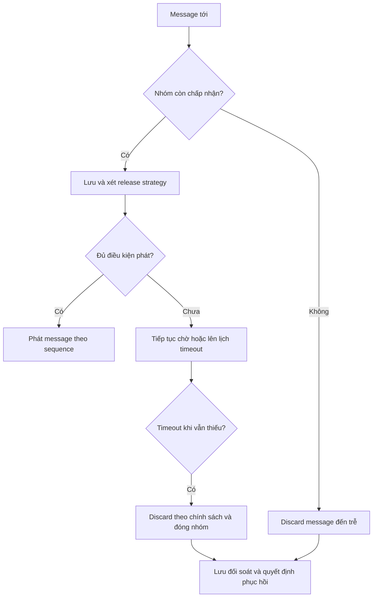

# Xử lý message đến trễ

Trong một luồng tích hợp, message mang `sequenceNumber = 2` có thể đến sau message số 3 vì thời gian xử lý khác nhau, retry hoặc gián đoạn mạng. Resequencer có thể giữ message và khôi phục thứ tự, nhưng chỉ khi nhóm vẫn còn chấp nhận dữ liệu. Nếu nhóm đã đóng do timeout, việc nhận lại message số 2 trở thành một quyết định nghiệp vụ: từ chối, lưu để đối soát hay chạy một lần xử lý mới.

Bài học thuộc chương **Resequencer** của **SPRING_INTEGRATION_CORE**, tập trung vào cách kết hợp `Message`, `MessageChannel`, endpoint resequencer và Java DSL để xử lý tình huống này. Ví dụ sử dụng một lô gồm ba phần dữ liệu; mục tiêu là thiết kế rõ đường đi chính, đường discard, xử lý lỗi và kiểm thử hành vi đến trễ.

Các ví dụ API lấy Spring Integration **6.5.10** làm mốc, dùng Java 17 trở lên. Đây là mốc đối chiếu cho bài học; khi áp dụng vào dự án, dùng phiên bản dependency đồng bộ với nền tảng Spring của dự án.

## 1. Message đến trễ so với điều gì?

Cần xác định mốc so sánh trước khi viết cấu hình:

| Tình huống | Ví dụ | Ý nghĩa xử lý |
| --- | --- | --- |
| Đến sai thứ tự khi nhóm còn mở | Nhận `1, 3, 2`, chưa timeout | Resequencer có cơ hội khôi phục `1, 2, 3` |
| Đến sau khi nhóm bị đóng | Nhận `1, 3`, timeout, rồi mới nhận `2` | Phải áp dụng chính sách sau khi đóng nhóm |
| Phát lại message đã xử lý | Message `2` được gửi lại sau khi cả lô đã thành công | Cần kiểm soát trùng lặp và trạng thái nghiệp vụ |
| Muộn theo thời gian sự kiện | Sự kiện phát sinh hôm qua nhưng đến hôm nay | Cần định nghĩa cửa sổ nghiệp vụ; sequence không tự biểu diễn cửa sổ đó |

Một message có thể đồng thời đến sai thứ tự và bị phát lại. Vì vậy, không nên dùng một cờ `late = true` để thay cho toàn bộ mô hình trạng thái.

Resequencer mặc định nhóm theo `correlationId`, xác định vị trí bằng `sequenceNumber` và dùng `sequenceSize` để nhận biết chuỗi hữu hạn. Nó phát các message theo thứ tự thay vì gộp payload thành một message tổng hợp như aggregator. Cơ chế này không tự tạo watermark theo thời gian sự kiện. Xem [tài liệu Resequencer](https://docs.spring.io/spring-integration/reference/6.5/resequencer.html).

### Hợp đồng đầu vào cho ví dụ

Với lô `import-2026-11-19:attempt-1`, ba phần dữ liệu phải có:

```text
correlationId = import-2026-11-19:attempt-1
sequenceSize = 3
sequenceNumber thuộc {1, 2, 3}
```

Các message cùng lô dùng cùng correlation key và cùng kích thước chuỗi. Mỗi vị trí có ý nghĩa ổn định trong lần xử lý đó. Producer phải phân biệt lần chạy mới với lần phát lại của lần chạy cũ.

Có thể dùng filter hoặc transformer trước resequencer để kiểm tra, chuẩn hóa header. Message thiếu vị trí, sai kiểu dữ liệu hoặc có kích thước chuỗi mâu thuẫn nên đi vào nhánh dữ liệu không hợp lệ. Chúng không phải là message đến trễ chỉ vì resequencer không thể xử lý được.

## 2. Xác định ranh giới đóng nhóm bằng một dòng thời gian

Giả sử cấu hình yêu cầu đủ cả ba phần mới phát, timeout là 5 giây không nhận thêm phần mới và không phát kết quả thiếu:

| Thời điểm | Đầu vào hoặc sự kiện | Trạng thái mong đợi |
| --- | --- | --- |
| `t = 0s` | Nhận phần 1 | Nhóm mở, giữ phần 1 |
| `t = 1s` | Nhận phần 3 | Nhóm mở, giữ phần 1 và 3, thiếu phần 2 |
| Khoảng `t = 6s` | Tác vụ timeout thực thi | Chuyển các phần đang giữ sang discard; đóng nhóm và giữ metadata |
| `t = 8s` | Nhận phần 2 | Nếu metadata đóng nhóm còn tồn tại, chuyển phần 2 sang discard |

Nếu phần 2 đến ở `t = 4s`, nhóm có thể hoàn tất bình thường và phát `1, 2, 3`. Không cần xử lý bù chỉ vì phần 2 đến sau phần 3.

Khoảng `t = 6s` là thời điểm đủ điều kiện chạy tác vụ, không phải cam kết thời gian thực tuyệt đối. Khi message và tác vụ timeout cạnh tranh ở ranh giới, kết quả còn phụ thuộc vào thao tác nào được thực hiện trước dưới cơ chế khóa nhóm. Thiết kế nghiệp vụ phải chấp nhận kết quả hợp lệ ở ranh giới này hoặc kiểm tra deadline nghiệp vụ bằng một cơ chế riêng.



Sơ đồ mô tả chính sách nghiêm ngặt trong bài. Sau khi nhóm hoàn tất thành công, việc lưu trạng thái chống phát lại cần được xét riêng ở mục 6.

## 3. Tách ba quyết định cấu hình

Ba câu hỏi sau độc lập với nhau:

1. **Trong lúc chờ, được phát những gì?** Có cần đủ cả lô, hay cho phép phát đoạn liên tiếp đã sẵn sàng?
2. **Khi hết thời gian chờ mà vẫn thiếu, dữ liệu đang giữ đi đâu?** Output hay discard?
3. **Sau khi đóng do timeout, còn nhớ nhóm cũ không?** Giữ metadata hay xóa hẳn để correlation key có thể tạo nhóm mới?

| Tùy chọn Java DSL | Vai trò trong bài |
| --- | --- |
| `releasePartialSequences(false)` | Chờ đủ chuỗi theo release strategy mặc định |
| `groupTimeout(5_000L)` | Lên lịch xử lý nhóm khi không có message mới trong khoảng chờ |
| `sendPartialResultOnExpiry(false)` | Khi nhóm hết hạn mà chưa đủ điều kiện release, chuyển dữ liệu đang giữ sang discard |
| `expireGroupsUponTimeout(false)` | Giữ metadata nhóm đóng do timeout để nhận diện message đến sau |
| `discardChannel(...)` | Chỉ định đường tiếp nhận message bị loại |

`expireGroupsUponTimeout(false)` là mặc định riêng của resequencer ở mốc phiên bản này; bài vẫn cấu hình tường minh. Không suy mặc định của nó từ aggregator. Các tên hàm trên được đối chiếu trong [CorrelationHandlerSpec 6.5.10](https://github.com/spring-projects/spring-integration/blob/v6.5.10/spring-integration-core/src/main/java/org/springframework/integration/dsl/CorrelationHandlerSpec.java).

### Phát đoạn liên tiếp và phát khi hết hạn khác nhau

`releasePartialSequences(true)` cho phép tiến thêm khi đoạn liên tiếp kế tiếp đã sẵn sàng. Ví dụ, với chuỗi `1..4`, sau khi phát `1`, message `3` vẫn phải đợi `2`; khi `2` đến, đoạn `2, 3` có thể được phát. Có thể tham khảo [SequenceSizeReleaseStrategy 6.5.10](https://github.com/spring-projects/spring-integration/blob/v6.5.10/spring-integration-core/src/main/java/org/springframework/integration/aggregator/SequenceSizeReleaseStrategy.java).

Ngược lại, `sendPartialResultOnExpiry(true)` tác động ở nhánh hết hạn. Không nên diễn giải thành “sắp xếp và gửi hết mọi message đang giữ”. Với processor mặc định của 6.5.10, kết quả chỉ gồm đoạn liên tiếp bắt đầu từ sequence nhỏ nhất đang có. Nhóm đang giữ `1, 3` có thể chỉ phát `1`; không được giả định `3` cũng đến output hoặc tự được chuyển sang discard. Hành vi này thể hiện trong [ResequencingMessageGroupProcessor](https://github.com/spring-projects/spring-integration/blob/v6.5.10/spring-integration-core/src/main/java/org/springframework/integration/aggregator/ResequencingMessageGroupProcessor.java).

Với dữ liệu mà mỗi phần đều cần được đối soát, hãy lưu đầu vào hoặc nhật ký tiếp nhận trước khi chọn chính sách phát thiếu. Cấu hình nghiêm ngặt bên dưới dùng nhánh discard để dễ quan sát các phần bị giữ lại.

## 4. Cấu hình Java DSL: chờ đủ, timeout thì chuyển đối soát

Ví dụ dưới đây là cấu hình Spring độc lập, cần dependency `spring-integration-core` và các dependency Spring tương ứng. Không cần HTTP adapter, broker hay cơ sở dữ liệu để quan sát hành vi cơ bản.

```java
import org.springframework.context.annotation.Bean;
import org.springframework.context.annotation.Configuration;
import org.springframework.integration.channel.DirectChannel;
import org.springframework.integration.channel.QueueChannel;
import org.springframework.integration.config.EnableIntegration;
import org.springframework.integration.dsl.IntegrationFlow;
import org.springframework.integration.store.MessageGroupStore;
import org.springframework.integration.store.SimpleMessageStore;
import org.springframework.messaging.MessageChannel;

@Configuration
@EnableIntegration
public class LateArrivalConfig {

    @Bean
    public MessageChannel resequenceInput() {
        return new DirectChannel();
    }

    @Bean
    public QueueChannel orderedOutput() {
        return new QueueChannel(100);
    }

    @Bean
    public QueueChannel resequenceDiscard() {
        return new QueueChannel(100);
    }

    @Bean
    public MessageGroupStore resequencerStore() {
        return new SimpleMessageStore();
    }

    @Bean
    public IntegrationFlow lateArrivalFlow() {
        return IntegrationFlow.from(resequenceInput())
                .resequence(r -> r
                        .messageStore(resequencerStore())
                        .releasePartialSequences(false)
                        .groupTimeout(5_000L)
                        .sendPartialResultOnExpiry(false)
                        .expireGroupsUponTimeout(false)
                        .discardIndividuallyOnExpiry(true)
                        .discardChannel(resequenceDiscard())
                        .sendTimeout(1_000L))
                .channel(orderedOutput())
                .get();
    }
}
```

`DirectChannel` đưa message vào endpoint trong luồng gọi hiện tại. Hai `QueueChannel` giúp đọc rõ kết quả trong thực hành: một hàng đợi cho output hợp lệ và một hàng đợi cho dữ liệu bị loại. Trong môi trường chạy lâu dài, cần consumer xử lý và lưu dữ liệu từ những hàng đợi này.

`discardIndividuallyOnExpiry(true)` được khai báo để mỗi phần bị timeout là một message riêng trên discard channel. Tùy chọn này có từ 6.5; nếu dùng phiên bản cũ hơn, cần đối chiếu API trước khi sao chép. `sendTimeout(1_000L)` giới hạn việc chờ gửi vào hàng đợi đầy; nó không kéo dài hay rút ngắn thời gian chờ phần còn thiếu.

### Tạo một phần dữ liệu có sequence header

Hàm sau được dùng trong các ví dụ và bài kiểm thử:

```java
import org.springframework.integration.IntegrationMessageHeaderAccessor;
import org.springframework.integration.support.MessageBuilder;
import org.springframework.messaging.Message;

static Message<String> part(String groupId, int number, int size) {
    return MessageBuilder.withPayload("part-" + number)
            .setHeader(IntegrationMessageHeaderAccessor.CORRELATION_ID,
                    groupId)
            .setHeader(IntegrationMessageHeaderAccessor.SEQUENCE_NUMBER,
                    number)
            .setHeader(IntegrationMessageHeaderAccessor.SEQUENCE_SIZE,
                    size)
            .build();
}
```

Khi producer gửi `part(groupId, 1, 3)`, `part(groupId, 3, 3)` rồi `part(groupId, 2, 3)` trước timeout, output là ba message riêng mang payload `part-1`, `part-2`, `part-3`. Việc sắp thứ tự diễn ra tại endpoint; consumer phía sau vẫn phải giữ kỷ luật xử lý nếu có yêu cầu thứ tự hoàn tất nghiệp vụ.

Nếu đưa output vào executor với nhiều worker, phần 3 có thể hoàn tất tác vụ trước phần 2 dù đã được gửi sau. Có thể xử lý tuần tự theo correlation key hoặc kiểm tra phiên bản trạng thái tại tầng nghiệp vụ khi yêu cầu thứ tự kéo dài đến bước ghi dữ liệu.

## 5. Timeout do im lặng và deadline tuyệt đối

Với `groupTimeout(5_000L)`, một message mới có thể khiến lịch chờ của nhóm được tính lại. Đây là cách chờ dựa trên khoảng im lặng của nhóm, không phải giới hạn tổng thời gian từ lúc nhận phần đầu tiên. Cơ chế lên lịch dùng chung được mô tả ở [Aggregator and Group Timeout](https://docs.spring.io/spring-integration/reference/6.5/aggregator.html#agg-group-timeout).

Ví dụ, phần 1 đến ở giây 0, phần 3 đến ở giây 4 và một phần hợp lệ khác đến ở giây 8. Trong một nhóm lớn, thời gian sống thực tế có thể vượt xa 5 giây nếu dữ liệu tiếp tục đến mà chưa đủ điều kiện release.

Nếu yêu cầu là “lô phải đóng trong vòng 30 giây từ lúc tạo nhóm”, có thể **thay** dòng `.groupTimeout(5_000L)` bằng:

```java
.groupTimeout(group ->
        new java.util.Date(group.getTimestamp() + 30_000L))
```

Hàm trả về một thời điểm tuyệt đối. Mỗi lần đánh giá vẫn nhắm đến mốc tạo nhóm cộng 30 giây. Không cấu hình đồng thời cả hai dạng timeout trong cùng ví dụ. Timestamp của nhóm cũng không phải mặc nhiên là thời điểm nghiệp vụ phát sinh ở hệ thống nguồn.

Ba khoảng thời gian nên được ghi thành ba yêu cầu riêng:

| Khoảng thời gian | Câu hỏi nghiệp vụ |
| --- | --- |
| Thời gian chờ bổ sung dữ liệu | Chờ bao lâu trước khi kết luận lô thiếu? |
| Thời gian giữ dấu nhóm đã đóng | Trong bao lâu cần nhận diện phát lại hoặc đến trễ? |
| Thời gian lưu dữ liệu đối soát | Trong bao lâu con người hoặc tác vụ phục hồi được xem lại dữ liệu? |

Ví dụ vận hành có thể chọn lần lượt 30 giây, 24 giờ và 30 ngày. Đây là một phương án thiết kế minh họa; cần chọn theo độ trễ, chính sách retry và yêu cầu lưu trữ thực tế.

## 6. Giữ metadata sau timeout và chống phát lại sau thành công

### Khi nhóm thiếu bị đóng do timeout

Trong ví dụ `1, 3` rồi timeout, `expireGroupsUponTimeout(false)` để lại metadata đánh dấu nhóm đã đóng. Trong thời gian dấu này còn tồn tại, phần 2 đến sau sẽ bị discard. Có thể gọi bản ghi nhẹ đó là *tombstone*: payload không cần nằm lại trong nhóm, nhưng hệ thống còn nhớ correlation key đã kết thúc.

Nếu đổi thành `expireGroupsUponTimeout(true)`, nhóm bị xóa hoàn toàn. Khi phần 2 đến sau, cùng correlation key có thể tạo một nhóm mới chỉ có phần 2. Đó không phải thao tác tự động phục hồi lô cũ. Nhóm mới lại thiếu phần 1 và 3, có thể chờ rồi tiếp tục timeout.

### Khi nhóm đã hoàn tất đầy đủ

Không được suy luận rằng cờ giữ metadata sau timeout sẽ chống phát lại sau mọi lần thành công. Trong `ResequencingMessageHandler` 6.5.10, nhánh release có `sequenceSize` bằng kích thước nhóm có thể xóa nhóm. Vì vậy, lô hoàn tất đầy đủ ở chế độ chờ cả lô của ví dụ không được bảo vệ khỏi phát lại chỉ nhờ `expireGroupsUponTimeout(false)`. Xem [mã xử lý afterRelease](https://github.com/spring-projects/spring-integration/blob/v6.5.10/spring-integration-core/src/main/java/org/springframework/integration/aggregator/ResequencingMessageHandler.java).

Nếu cả ba phần của lô thành công được phát lại, chúng có thể tạo nhóm khác và đi ra output lần nữa. Chống lặp nghiệp vụ cần một lớp riêng, chẳng hạn:

- Lưu trạng thái `COMPLETED` hoặc `TIMED_OUT` theo `batchId` và `attemptId`.
- Lưu khóa idempotency theo phần dữ liệu hoặc thao tác nghiệp vụ.
- Dùng ràng buộc duy nhất hoặc cập nhật có điều kiện trong nơi ghi kết quả.

Đây là đề xuất thiết kế bổ sung cho ví dụ, không phải khả năng tự sinh của resequencer. Nếu nhiều instance cùng xử lý một khóa, thao tác kiểm tra và ghi trạng thái phải có tính nguyên tử phù hợp. Một lần `get()` rồi `put()` độc lập không đủ để loại cuộc đua.

### Giữ dấu bao lâu và dọn thế nào?

Giữ metadata vô hạn làm tăng dung lượng store. Xóa quá sớm làm hệ thống mất khả năng phân biệt message cũ với nhóm mới. Cần phối hợp thời gian giữ dấu với toàn bộ khoảng retry và replay được hỗ trợ.

`minimumTimeoutForEmptyGroups(...)` và `MessageGroupStoreReaper` là các cơ chế liên quan đến việc giữ, dọn nhóm rỗng. Không coi một giá trị timeout là TTL tự động của mọi backend hoặc mọi đường hoàn tất. Phải cấu hình tác vụ dọn phù hợp và kiểm tra hành vi sau restart. Chi tiết cơ chế dọn và điều kiện giữ dấu được thể hiện trong [AbstractCorrelatingMessageHandler 6.5.10](https://github.com/spring-projects/spring-integration/blob/v6.5.10/spring-integration-core/src/main/java/org/springframework/integration/aggregator/AbstractCorrelatingMessageHandler.java).

Sau khi tombstone bị xóa, nếu vẫn cần chặn replay cũ thì quyết định phải dựa vào sổ trạng thái nghiệp vụ hoặc khóa idempotency bền vững.

## 7. Thiết kế nhánh discard để có thể phục hồi

Discard channel của cấu hình đang nhận ít nhất hai loại message:

1. Phần đã được giữ trong nhóm nhưng bị loại khi nhóm timeout.
2. Phần đến sau khi nhóm đã đóng và còn metadata.

Không đặt tên toàn bộ dữ liệu ở đây là “message đến trễ”. Phần 1 và 3 trong ví dụ đến trước timeout vẫn có thể nằm trên discard channel. Ngoài ra, tùy trạng thái nhóm, message không được phép thêm cũng có thể bị loại.

Một nhánh đối soát thực tế có thể lưu:

| Dữ liệu | Công dụng |
| --- | --- |
| Correlation key và attempt | Tìm đúng lô, đúng lần xử lý |
| Sequence number và sequence size | Xác định phần đã có và phần bị thiếu |
| Mã định danh nghiệp vụ của phần | Kiểm tra trùng lặp khi phục hồi |
| Thời điểm tiếp nhận và thời điểm đóng | Phân biệt chậm ở nguồn, transport hay consumer |
| Trạng thái lô và lý do phân loại | Quyết định retry, bù hoặc kết thúc |
| Payload hoặc tham chiếu đến payload | Tái dựng dữ liệu khi chạy lại |

Không giả định framework tự thêm một header giải thích đầy đủ lý do discard. Có thể phân loại bằng dữ liệu trạng thái do ứng dụng quản lý, nhật ký tiếp nhận và thông tin đóng nhóm. Nếu cần lý do chính xác ở mức từng quyết định, phải thiết kế điểm ghi nhận tương ứng.

### Quy trình phục hồi cho lô ba phần

Giả sử cả phần 1, 3 bị timeout và phần 2 đến muộn đều đã được lưu để đối soát:

1. Đọc trạng thái của `attempt-1` và xác nhận chưa ghi nhận thành công đầy đủ.
2. Thu thập ba phần, kiểm tra tính hợp lệ và khóa idempotency.
3. Tạo `attempt-2` với correlation key mới nhưng giữ nguyên batch ID nghiệp vụ.
4. Phát lại **đủ tập dữ liệu cần thiết**, với sequence header nhất quán.
5. Ghi kết quả phục hồi và liên kết hai lần xử lý để truy vết.

Chỉ gửi lại phần 2 dưới correlation key mới sẽ tạo một lô mới thiếu phần 1 và 3. Ngược lại, xóa tombstone rồi gửi lại phần 2 dưới key cũ cũng không tự phục hồi những phần đã rời khỏi store.

Nếu hệ thống đã áp dụng một số phần trước timeout, cần đối soát tác động đã ghi và thiết kế xử lý bù hoặc cập nhật idempotent. Không mặc định coi việc phát lại toàn lô là an toàn trong trường hợp đó.

## 8. Discard, exception và retry là ba đường khác nhau

Message bị loại theo chính sách đến trễ không nhất thiết gây exception. `discardChannel` nhận message được endpoint loại; nó không thay vai trò của `errorChannel`.

Nếu lời gọi qua `DirectChannel` gây lỗi, exception có thể trở lại bên gửi trong cùng thread. Lỗi phát sinh ở executor, poller hoặc tác vụ timeout cần cơ chế xử lý lỗi tương ứng; khi tự cấp `TaskScheduler`, phải cấu hình error handler nếu muốn đưa lỗi vào luồng `ErrorMessage`. Xem [Error Handling](https://docs.spring.io/spring-integration/reference/error-handling.html).

Ví dụ, việc hàng đợi discard đầy hoặc hệ thống lưu đối soát không khả dụng là lỗi hạ tầng của đường xử lý loại. Cần quan sát và phục hồi lỗi này; không được ghi nhận “đã lưu để đối soát” chỉ vì endpoint đã quyết định discard.

Retry cũng cần gắn với mục đích cụ thể:

- Retry việc ghi dữ liệu đối soát khi kho lưu trữ tạm thời lỗi.
- Retry việc xử lý nghiệp vụ có thể lặp lại an toàn.
- Không retry vô hạn một message vào nhóm đã đóng mà không thay đổi trạng thái hoặc chính sách.

Nếu gọi luồng qua messaging gateway, timeout chờ phản hồi của gateway và timeout chờ đủ nhóm là hai cấu hình riêng. Caller ngừng chờ không đồng nghĩa nhóm resequencer đã bị hủy hoặc toàn bộ dữ liệu đã được rollback.

## 9. Kiểm thử hai mốc đến trễ bằng JUnit

Đoạn kiểm thử dưới đây dùng JUnit Jupiter và cấu hình ở mục 4. Đây là mã thực hành cho người học, chưa được thực thi trong bước biên soạn tài liệu. Các lượt kiểm thử tạo application context riêng để không dùng chung nhóm hoặc hàng đợi.

```java
import java.util.Set;

import org.junit.jupiter.api.Test;
import org.springframework.context.annotation.AnnotationConfigApplicationContext;
import org.springframework.integration.IntegrationMessageHeaderAccessor;
import org.springframework.integration.channel.QueueChannel;
import org.springframework.integration.support.MessageBuilder;
import org.springframework.messaging.Message;
import org.springframework.messaging.MessageChannel;

import static org.junit.jupiter.api.Assertions.*;

class LateArrivalTest {

    @Test
    void outOfOrderMessageBeforeTimeoutCompletesTheSequence() {
        try (var context = new AnnotationConfigApplicationContext(
                LateArrivalConfig.class)) {
            MessageChannel input = context.getBean(
                    "resequenceInput", MessageChannel.class);
            QueueChannel output = context.getBean(
                    "orderedOutput", QueueChannel.class);
            QueueChannel discard = context.getBean(
                    "resequenceDiscard", QueueChannel.class);

            assertTrue(input.send(part("before-timeout", 1, 3)));
            assertTrue(input.send(part("before-timeout", 3, 3)));
            assertNull(output.receive(0));

            assertTrue(input.send(part("before-timeout", 2, 3)));

            assertEquals("part-1", payload(output.receive(0)));
            assertEquals("part-2", payload(output.receive(0)));
            assertEquals("part-3", payload(output.receive(0)));
            assertNull(output.receive(0));
            assertNull(discard.receive(0));
        }
    }

    @Test
    void messageAfterObservedTimeoutGoesToDiscard() {
        try (var context = new AnnotationConfigApplicationContext(
                LateArrivalConfig.class)) {
            MessageChannel input = context.getBean(
                    "resequenceInput", MessageChannel.class);
            QueueChannel output = context.getBean(
                    "orderedOutput", QueueChannel.class);
            QueueChannel discard = context.getBean(
                    "resequenceDiscard", QueueChannel.class);

            assertTrue(input.send(part("after-timeout", 1, 3)));
            assertTrue(input.send(part("after-timeout", 3, 3)));
            assertNull(output.receive(0));

            // Chờ bằng chứng timeout; không dùng sleep cố định.
            Object firstDiscard = payload(discard.receive(15_000));
            Object secondDiscard = payload(discard.receive(5_000));
            assertEquals(Set.of("part-1", "part-3"),
                    Set.of(firstDiscard, secondDiscard));

            // Callback timeout có thể còn hoàn tất phần cập nhật
            // metadata, nhưng cùng khóa nhóm sẽ tuần tự hóa thao tác.
            assertTrue(input.send(part("after-timeout", 2, 3)));
            assertEquals("part-2", payload(discard.receive(0)));
            assertNull(output.receive(0));
            assertNull(discard.receive(0));
        }
    }

    private static Object payload(Message<?> message) {
        assertNotNull(message);
        return message.getPayload();
    }

    private static Message<String> part(
            String groupId, int number, int size) {
        return MessageBuilder.withPayload("part-" + number)
                .setHeader(IntegrationMessageHeaderAccessor.CORRELATION_ID,
                        groupId)
                .setHeader(IntegrationMessageHeaderAccessor.SEQUENCE_NUMBER,
                        number)
                .setHeader(IntegrationMessageHeaderAccessor.SEQUENCE_SIZE,
                        size)
                .build();
    }
}
```

Bài kiểm thử thứ nhất dùng đường đồng bộ đến output queue nên có thể đọc kết quả ngay sau `send()`. Bài thứ hai đợi message timeout xuất hiện rồi mới gửi phần đến trễ. Không kiểm tra thứ tự của phần 1 và 3 trên discard channel vì đây không phải cam kết thứ tự của đường output đã resequence.

Giới hạn chờ 15 giây giúp bài kiểm thử kết thúc hữu hạn nếu timeout không hoạt động. Khi tích hợp vào một bộ kiểm thử lớn, có thể cấu hình thời gian chờ ngắn hơn hoặc điều khiển scheduler; cần tiếp tục kiểm tra kết quả quan sát được thay vì chỉ kiểm tra thời gian đã trôi qua.

### Các tình huống nên kiểm tra thêm khi áp dụng

| Kịch bản | Điều cần chứng minh |
| --- | --- |
| Phần cuối đến sát ranh giới timeout | Một kết quả nghiệp vụ hợp lệ, không ghi nhận thành công hai lần |
| Phát lại sau khi cả lô đã thành công | Lớp idempotency ngăn tác động nghiệp vụ lặp |
| Message đến sau khi tombstone bị dọn | Sổ trạng thái còn phân loại đúng replay cũ |
| Restart lúc nhóm đang thiếu | Payload, trạng thái và cơ chế xử lý nhóm cũ được phục hồi đúng |
| Hai instance cùng nhận một correlation key | Cơ chế phối hợp không tạo hai lần hoàn tất mâu thuẫn |
| Nơi lưu đối soát bị lỗi | Có dấu vết lỗi và đường retry dữ liệu chưa lưu thành công |

## 10. Giới hạn triển khai và quan sát vận hành

`SimpleMessageStore` trong ví dụ lưu trong bộ nhớ. Restart có thể làm mất các phần đang chờ và dấu nhóm đóng. Muốn giữ trạng thái qua restart cần store bền vững thích hợp, đồng thời xét khả năng tuần tự hóa payload, header và cách khôi phục công việc chờ. Xem [Message Store](https://docs.spring.io/spring-integration/reference/message-store.html).

Một persistent store không tự biến toàn bộ luồng thành xử lý đúng một lần. Khi việc nhận message, cập nhật nhóm, ghi kết quả và xác nhận với broker thuộc nhiều ranh giới giao dịch, vẫn cần thiết kế idempotency và khôi phục tương ứng. Nhóm bền vững cũng không có nghĩa các tác vụ scheduler trong JVM cũ được giữ nguyên sau restart.

Trong hệ thống nhiều instance, cần chọn cách phối hợp phù hợp cho cùng correlation key: phân vùng về một nơi xử lý hoặc dùng store và cơ chế khóa tương thích. Ví dụ cấu hình cục bộ ở trên chỉ minh họa một application context.

Các số đo hữu ích gồm số nhóm đang mở, tuổi nhóm, số lần timeout, số message đi vào discard, dung lượng metadata và số lần phục hồi thành công. Phân loại “đến sau khi nhóm đóng” phải dựa vào logic phân loại đã thiết kế; không đồng nhất nó với tổng số message trên discard channel. Correlation key nên xuất hiện trong log hoặc trace để tra cứu, còn nhãn metric nên có số lượng giá trị hữu hạn.

Với chuỗi hữu hạn, ba nguyên tắc cần được thể hiện trong thiết kế là: xác định lúc ngừng chờ, quy định dữ liệu đi đâu sau mốc đó và lưu đủ trạng thái để phục hồi hoặc từ chối phát lại một cách có chủ đích. Resequencer đảm nhiệm việc phối hợp thứ tự trong phạm vi nhóm; hợp đồng nghiệp vụ quyết định ý nghĩa của một message đến sau khi nhóm kết thúc.