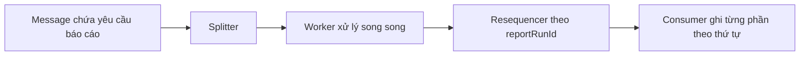
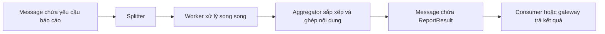

# So sánh resequencer và aggregator

## 1. Mục tiêu và tình huống mở đầu

Trong Spring Integration Core, resequencer và aggregator đều nhận các message có liên quan và giữ trạng thái trong lúc chờ. Điểm quyết định khi chọn endpoint là **hợp đồng đầu ra**: resequencer phát lại từng message theo thứ tự chuỗi; aggregator tạo kết quả tổng hợp từ một nhóm message.

Giả sử một yêu cầu xuất báo cáo được tách thành ba phần. Các worker xử lý song song nên kết quả về theo thứ tự `phần 3 → phần 1 → phần 2`.

- Nếu bên nhận cần ghi từng phần lần lượt vào một luồng đầu ra, dùng resequencer để nhận `phần 1 → phần 2 → phần 3` dưới dạng ba message riêng.
- Nếu bên nhận cần một đối tượng `ReportResult` chứa nội dung của cả báo cáo, dùng aggregator để tạo một message kết quả.
- Nếu mỗi phần phải được ghi theo thứ tự, rồi mới cần một thông báo hoàn tất, có thể phối hợp cả hai endpoint tại những vị trí phù hợp.

Sau bài này, bạn có thể đọc một luồng Message/MessageChannel, xác định nhu cầu giữ thứ tự hay tổng hợp, cấu hình Java DSL và thiết kế phép kiểm thử phân biệt hai hành vi. Ví dụ API trong bài lấy Spring Integration 6.5 làm mốc; các thư viện cần được quản lý phiên bản đồng bộ trong dự án.

## 2. Đầu ra: nhiều message có thứ tự và một kết quả tổng hợp

### 2.1. Resequencer khôi phục thứ tự của chuỗi

Với một nhóm có ba message, mô hình thông thường là:

```text
Đầu vào:  Message(part-3), Message(part-1), Message(part-2)
Đầu ra:   Message(part-1), Message(part-2), Message(part-3)
```

Resequencer sắp xếp theo header `sequenceNumber` và giữ từng message như một đơn vị chuyển tiếp. Nó không tự nối chuỗi, cộng số hay tạo DTO tổng hợp. Phạm vi thứ tự là từng nhóm có cùng khóa tương quan; hai báo cáo khác nhau có thể xen kẽ trên cùng output channel. Xem [tài liệu Resequencer](https://docs.spring.io/spring-integration/reference/6.5/resequencer.html).

“Phát cả nhóm khi đủ” vẫn có nghĩa là phát nhiều message liên tiếp. Nó không biến nhóm thành một message có payload là danh sách.

### 2.2. Aggregator tính kết quả từ nhóm

Với cùng dữ liệu, đầu ra mặc định của aggregator là một message có payload chứa các payload thành viên:

```text
Đầu vào:  Message(part-3), Message(part-1), Message(part-2)
Đầu ra:   Message(Collection(part-1, part-2, part-3))
```

Danh sách trên chỉ minh họa các thành viên. Không suy ra rằng aggregator mặc định tự bảo đảm thứ tự nghiệp vụ `1, 2, 3`. Trong triển khai 6.5, `DefaultAggregatingMessageGroupProcessor` duyệt collection của nhóm để lấy payload, không tự sắp xếp theo `sequenceNumber`. Khi thứ tự của kết quả quan trọng, hãy sắp xếp rõ ràng trong logic tổng hợp. Xem [mã nguồn processor mặc định](https://github.com/spring-projects/spring-integration/blob/v6.5.0/spring-integration-core/src/main/java/org/springframework/integration/aggregator/DefaultAggregatingMessageGroupProcessor.java).

Kết quả tổng hợp cũng có thể là tổng tiền, bản báo giá đã chọn hoặc một DTO báo cáo. Mô hình cơ bản là `n message → 1 message cho mỗi lần phát nhóm`; nếu chủ động thiết kế nhiều lần phát một phần, một khóa tương quan có thể tạo nhiều kết quả theo thời gian.

## 3. Những cơ chế giống nhau cần hiểu trước

Cả hai endpoint đều phải giải quyết ba câu hỏi:

| Câu hỏi | Cơ chế | Ví dụ |
|---|---|---|
| Message này thuộc nhóm nào? | `CorrelationStrategy` | Các phần cùng `reportRunId` |
| Khi nào được xử lý/phát nhóm? | `ReleaseStrategy` | Đã nhận đủ ba phần |
| Nhóm đang chờ được giữ ở đâu? | `MessageGroupStore` | Bộ nhớ trong tiến trình hoặc kho bền vững phù hợp |

Khóa tương quan và vị trí trong chuỗi là hai thông tin khác nhau. `reportRunId` xác định **báo cáo nào**; `sequenceNumber` xác định **phần thứ mấy của báo cáo đó**.

### 3.1. Ba header thường gặp

| Header | Hằng số trong `IntegrationMessageHeaderAccessor` | Vai trò trong ví dụ |
|---|---|---|
| `correlationId` | `CORRELATION_ID` | Cùng một lần xuất báo cáo |
| `sequenceNumber` | `SEQUENCE_NUMBER` | Vị trí bắt đầu từ 1: 1, 2, 3 |
| `sequenceSize` | `SEQUENCE_SIZE` | Tổng số phần dự kiến: 3 |

Trong ví dụ, mọi message của nhóm phải khai báo cùng `sequenceSize`, vị trí hợp lệ và một khóa tương quan đủ riêng biệt cho mỗi lần xử lý. Một `orderId` được tái sử dụng qua nhiều lần xuất báo cáo có thể cần kết hợp thêm `runId`.

Splitter chuẩn thường cung cấp sequence headers cho tập đầu ra hữu hạn khi bật cơ chế áp dụng sequence. Nếu bạn tự xây dựng message hoặc dùng loại splitter chưa biết trước số phần, hãy xác định rõ cách cung cấp thông tin hoàn tất. Không tự xem `sequenceSize = 0` là một nhóm hữu hạn đã đầy đủ.

### 3.2. Phát nhóm và tính kết quả là hai trách nhiệm

`ReleaseStrategy` chỉ quyết định nhóm đã sẵn sàng hay chưa. Nó không quyết định payload kết quả sẽ là gì.

- Với resequencer, khi được phép phát, processor chọn các message phù hợp theo thứ tự chuỗi.
- Với aggregator, khi được phép tổng hợp, processor tính đầu ra từ các thành viên của nhóm.

Vì vậy, thay `releaseStrategy` của aggregator thành `group -> group.size() == 3` không tự biến nó thành resequencer. Ngược lại, resequencer chờ đủ ba message cũng không tự tạo một bản báo cáo duy nhất.

## 4. Bảng so sánh để chọn endpoint

| Tiêu chí | Resequencer | Aggregator |
|---|---|---|
| Nhu cầu chính | Khôi phục thứ tự phát các thành viên | Tính kết quả chung của nhóm |
| Đầu ra điển hình | Nhiều message riêng | Một message tổng hợp cho mỗi lần phát |
| Payload thành viên | Được chuyển tiếp | Được đọc để tạo payload kết quả |
| Thứ tự | Dựa trên sequence headers trong từng nhóm | Phải quy định nếu kết quả phụ thuộc thứ tự |
| Hoàn tất mặc định với chuỗi hữu hạn | Dựa vào thông tin sequence | Dựa vào kích thước chuỗi |
| Phát trước khi đủ toàn bộ chuỗi | Có chế độ phát tiền tố liên tục | Có thể thiết kế điều kiện phát một phần |
| Logic nghiệp vụ thường viết | Hợp đồng sequence và chính sách chờ | Hàm tổng hợp, chọn, nối, cộng hoặc dựng DTO |
| Trạng thái cần quản lý | Message đang chờ và tiến độ phát | Message đang chờ và trạng thái nhóm |
| Giới hạn chung | Cần chính sách thiếu, trùng, muộn, hết hạn | Cần chính sách thiếu, trùng, muộn, hết hạn |

Bảng mô tả cách dùng thông thường. Spring Integration cho phép tùy biến processor; chẳng hạn aggregator có thể được cấu hình như một hàng rào phát từng message bằng `SimpleMessageGroupProcessor`. Khi đọc luồng có tùy biến này, cần xem cả processor thay vì chỉ suy luận từ tên endpoint. [Tài liệu Aggregator](https://docs.spring.io/spring-integration/reference/6.5/aggregator.html) mô tả ngoại lệ và hành vi theo phiên bản.

## 5. Quan sát cùng một chuỗi đến lệch thứ tự

Giả sử nhóm `R-42` có ba phần, tất cả đều có `sequenceSize = 3`, thứ tự đến là `3 → 1 → 2`.

| Thời điểm | Message đến | Resequencer chờ đủ nhóm | Resequencer phát một phần liên tục | Aggregator chờ đủ nhóm |
|---|---|---|---|---|
| T1 | Phần 3 | Giữ phần 3 | Giữ phần 3 vì thiếu phần 1 | Giữ phần 3 |
| T2 | Phần 1 | Giữ phần 1 và 3 | Phát phần 1; giữ phần 3 vì thiếu phần 2 | Giữ phần 1 và 3 |
| T3 | Phần 2 | Phát 1, rồi 2, rồi 3 | Phát 2, rồi 3 | Tạo một kết quả từ cả ba phần |

Đây là tình huống hữu hạn, không có message trùng, không hết hạn và không ghi đè release strategy mặc định.

Với resequencer, `releasePartialSequences(true)` cho phép phát **tiền tố liên tục tiếp theo**. Nếu mới có phần 2 và phần 3 nhưng chưa từng phát phần 1, nó phải chờ; việc sắp xếp riêng các phần hiện có thành `2, 3` chưa đủ điều kiện. Khi đã phát đến phần 1, phần 2 là vị trí tiếp theo hợp lệ. Có thể đối chiếu điều kiện này trong [SequenceSizeReleaseStrategy](https://github.com/spring-projects/spring-integration/blob/v6.5.0/spring-integration-core/src/main/java/org/springframework/integration/aggregator/SequenceSizeReleaseStrategy.java).

Lựa chọn này tạo đánh đổi thực tế:

- Chờ đủ nhóm: dễ quan sát tính đầy đủ, nhưng phần 1 cũng phải chờ phần chậm nhất.
- Phát tiền tố liên tục: giảm thời gian chờ của các phần đầu, nhưng downstream đã có thể thực hiện một phần công việc trước khi phát hiện phần sau bị mất.

Một khi downstream đã ghi phần 1 ra hệ thống bên ngoài, timeout ở phần 2 không tự hoàn tác thao tác đó.

## 6. Ví dụ Java DSL dùng chung một bộ dữ liệu

### 6.1. Cấu hình hai flow độc lập

Cấu hình dưới đây cần Spring Integration Core và Spring Context trong dự án. Đầu vào là `DirectChannel`; đầu ra là `QueueChannel` để chương trình kiểm tra có thể lấy message bằng `receive(timeout)`. Không cần broker cho ví dụ này.

```java
package example.integration;

import java.util.stream.Collectors;

import org.springframework.context.annotation.Bean;
import org.springframework.context.annotation.Configuration;
import org.springframework.integration.annotation.EnableIntegration;
import org.springframework.integration.channel.DirectChannel;
import org.springframework.integration.channel.QueueChannel;
import org.springframework.integration.dsl.IntegrationFlow;
import org.springframework.integration.support.MessageBuilder;
import org.springframework.messaging.Message;

import static org.springframework.integration.IntegrationMessageHeaderAccessor.CORRELATION_ID;
import static org.springframework.integration.IntegrationMessageHeaderAccessor.SEQUENCE_NUMBER;
import static org.springframework.integration.IntegrationMessageHeaderAccessor.SEQUENCE_SIZE;

@Configuration
@EnableIntegration
public class ReportFlows {

    public record ReportPart(int number, String text) {}

    public record ReportResult(String runId, String text) {}

    @Bean
    public DirectChannel resequenceInput() {
        return new DirectChannel();
    }

    @Bean
    public QueueChannel resequenceOutput() {
        return new QueueChannel();
    }

    @Bean
    public DirectChannel aggregateInput() {
        return new DirectChannel();
    }

    @Bean
    public QueueChannel aggregateOutput() {
        return new QueueChannel();
    }

    @Bean
    public IntegrationFlow orderedPartsFlow() {
        return IntegrationFlow.from(resequenceInput())
                .resequence(r -> r.releasePartialSequences(false))
                .channel(resequenceOutput())
                .get();
    }

    @Bean
    public IntegrationFlow completeReportFlow() {
        return IntegrationFlow.from(aggregateInput())
                .aggregate(a -> a.outputProcessor(group -> {
                    String runId = group.getMessages().iterator().next()
                            .getHeaders().get(CORRELATION_ID, String.class);

                    String text = group.getMessages().stream()
                            .sorted((left, right) -> Integer.compare(
                                    sequenceOf(left), sequenceOf(right)))
                            .map(message -> (ReportPart) message.getPayload())
                            .map(ReportPart::text)
                            .collect(Collectors.joining("|"));

                    return new ReportResult(runId, text);
                }))
                .channel(aggregateOutput())
                .get();
    }

    private static int sequenceOf(Message<?> message) {
        Integer number = message.getHeaders()
                .get(SEQUENCE_NUMBER, Integer.class);
        if (number == null) {
            throw new IllegalArgumentException("Missing sequenceNumber");
        }
        return number;
    }

    public static Message<ReportPart> part(
            String runId, int number, int total) {
        if (runId == null || runId.isBlank()
                || total < 1 || number < 1 || number > total) {
            throw new IllegalArgumentException("Invalid report sequence");
        }

        return MessageBuilder
                .withPayload(new ReportPart(number, "part-" + number))
                .setHeader(CORRELATION_ID, runId)
                .setHeader(SEQUENCE_NUMBER, number)
                .setHeader(SEQUENCE_SIZE, total)
                .build();
    }
}
```

Hai flow đều dùng correlation và release mặc định; riêng resequencer khai báo rõ chế độ chờ đủ nhóm. Mỗi flow giữ trạng thái riêng. Cùng giá trị khóa trong hai flow không có nghĩa hai endpoint đang dùng chung một nhóm.

`ReportPart.number` giúp quan sát payload; ví dụ cố ý sắp xếp aggregator theo header để làm rõ hợp đồng sequence. Trong ứng dụng thật, cần kiểm tra tính nhất quán nếu cùng một vị trí được biểu diễn cả trong payload lẫn header.

Hàm tổng hợp trả về một `ReportResult` mới, đã chứa `runId`. Cách này giúp downstream không phụ thuộc vào việc sequence headers còn được giữ sau khi tổng hợp. Nếu dùng DTO phức tạp, tránh trả ra collection nội bộ của nhóm vì vòng đời của collection đó do kho nhóm quản lý.

Mẫu `.resequence(...)` và `.aggregate(...)` được mô tả trong [hướng dẫn Java DSL](https://docs.spring.io/spring-integration/reference/6.5/dsl/java-aggregators.html); `outputProcessor` là điểm cấu hình kết quả của [AggregatorSpec](https://github.com/spring-projects/spring-integration/blob/v6.5.0/spring-integration-core/src/main/java/org/springframework/integration/dsl/AggregatorSpec.java).

### 6.2. Chạy thử và quan sát đầu ra

Đoạn chương trình sau đặt cùng package với lớp cấu hình:

```java
package example.integration;

import org.springframework.context.annotation.AnnotationConfigApplicationContext;
import org.springframework.integration.channel.QueueChannel;
import org.springframework.messaging.Message;
import org.springframework.messaging.MessageChannel;

public class ReportDemo {

    public static void main(String[] args) {
        try (var context =
                new AnnotationConfigApplicationContext(ReportFlows.class)) {
            MessageChannel resequenceIn = context.getBean(
                    "resequenceInput", MessageChannel.class);
            MessageChannel aggregateIn = context.getBean(
                    "aggregateInput", MessageChannel.class);
            QueueChannel resequenceOut = context.getBean(
                    "resequenceOutput", QueueChannel.class);
            QueueChannel aggregateOut = context.getBean(
                    "aggregateOutput", QueueChannel.class);

            for (int number : new int[] {3, 1, 2}) {
                Message<ReportFlows.ReportPart> message =
                        ReportFlows.part("R-42", number, 3);
                require(resequenceIn.send(message), "Resequencer send failed");
                require(aggregateIn.send(message), "Aggregator send failed");
            }

            for (int expected = 1; expected <= 3; expected++) {
                Message<?> message = resequenceOut.receive(1_000);
                require(message != null, "Missing resequenced output");
                require(message.getPayload()
                        instanceof ReportFlows.ReportPart,
                        "Unexpected resequenced payload");
                var part = (ReportFlows.ReportPart) message.getPayload();
                require(part.number() == expected, "Wrong sequence order");
                System.out.println("resequence: " + part.text());
            }
            require(resequenceOut.receive(0) == null,
                    "Unexpected extra resequenced output");

            Message<?> message = aggregateOut.receive(1_000);
            require(message != null, "Missing aggregate output");
            var expected = new ReportFlows.ReportResult(
                    "R-42", "part-1|part-2|part-3");
            require(expected.equals(message.getPayload()),
                    "Wrong aggregate result");
            require(aggregateOut.receive(0) == null,
                    "Unexpected extra aggregate output");
            System.out.println("aggregate: " + message.getPayload());
        }
    }

    private static void require(boolean condition, String message) {
        if (!condition) {
            throw new IllegalStateException(message);
        }
    }
}
```

Kết quả kỳ vọng:

```text
resequence: part-1
resequence: part-2
resequence: part-3
aggregate: ReportResult[runId=R-42, text=part-1|part-2|part-3]
```

Điểm cần quan sát là **ba message `ReportPart`** và **một message `ReportResult`**. Giá trị `true` từ `send()` chỉ xác nhận thao tác gửi được chấp nhận theo hợp đồng channel; nó không tự chứng minh rằng một nhóm đã đầy đủ. Ở ví dụ đồng bộ này, các phép lấy đầu ra mới xác nhận hành vi mong muốn.

## 7. Phân biệt hai loại “kết quả một phần”

### 7.1. Phát một phần trong xử lý bình thường

Để thử chế độ phát sớm, thay cấu hình của `orderedPartsFlow` bằng:

```java
.resequence(r -> r.releasePartialSequences(true))
```

Tạo context mới cho mỗi lần thử để không dùng lại trạng thái nhóm cũ. Trong chế độ này, nhóm chưa hoàn tất vẫn có thể phát phần 1 khi nó đến; phần 3 tiếp tục chờ phần 2. Một dãy đã sắp xếp nhưng còn lỗ hổng ở vị trí tiếp theo chưa phải một tiền tố hợp lệ để phát.

Aggregator cũng có thể có release strategy chủ động phát trước khi có đủ mọi thành viên, ví dụ phát theo một điều kiện nghiệp vụ. Kết quả khi đó vẫn do processor tổng hợp quyết định. Cần định nghĩa rõ phần nào đã được đưa vào kết quả, điều kiện đóng nhóm và cách xử lý các message đến tiếp.

### 7.2. Xử lý khi nhóm hết hạn

`sendPartialResultOnExpiry` liên quan đến xử lý nhóm **khi hết hạn**, khác với `releasePartialSequences` trong xử lý thông thường.

Ví dụ cấu hình chính sách chờ cho resequencer:

```java
.resequence(r -> r
        .releasePartialSequences(false)
        .groupTimeout(10_000)
        .sendPartialResultOnExpiry(false)
        .discardChannel("incompleteParts"))
```

Trong ứng dụng phải có channel `incompleteParts` và consumer lưu lại dữ liệu chưa hoàn tất để điều tra hoặc phục hồi. Có thể đặt một `QueueChannel` tại đó nếu có tác vụ đọc và xử lý queue phù hợp. Đừng khai báo tên một discard channel rồi để dữ liệu bị bỏ quên.

`groupTimeout` cấu hình thời gian cho cơ chế hết hạn của nhóm; nó không phải giới hạn thời gian chạy hàm nghiệp vụ downstream. Với giá trị timeout cố định trong cơ chế chuẩn, lịch chờ có thể được đặt lại khi nhóm nhận thêm message; nếu cần hạn chót tính từ message đầu tiên, phải thiết kế biểu thức thời gian hoặc chính sách phù hợp.

Nếu bật gửi kết quả khi hết hạn, phải xác định trước ý nghĩa nghiệp vụ của dữ liệu thiếu. Không diễn giải mọi kết quả hết hạn là “nhóm đã đầy đủ”. Đặc biệt, processor resequencing và trạng thái đã phát ảnh hưởng đến phần có thể chuyển tiếp; không mặc định rằng tùy chọn này sẽ tự lấp khoảng trống hoặc bảo đảm mọi vị trí đều tồn tại.

Cần tách riêng ba tuyến xử lý:

| Tình huống | Ý nghĩa | Hướng xử lý |
|---|---|---|
| Chưa đủ nhóm nhưng còn thời gian | Đang chờ bình thường | Tiếp tục giữ trạng thái |
| Hết hạn hoặc message bị loại theo chính sách nhóm | Không thỏa điều kiện hoàn tất | Discard channel, lưu dấu vết và phục hồi theo nghiệp vụ |
| Processor hoặc downstream ném exception | Lỗi thực thi | Xử lý exception, advice hoặc error flow theo mô hình channel |

`discardChannel` và `errorChannel` phục vụ những tình huống khác nhau. Với `DirectChannel` đồng bộ, exception thường trở lại luồng gọi; không tự được biến thành một `ErrorMessage` gửi vào `errorChannel` chỉ vì header này có mặt.

## 8. Đặt endpoint trong toàn bộ luồng

### 8.1. Khi cần từng tác động phụ đúng thứ tự



Ví dụ: đầu ra là các đoạn của một tệp mà consumer chỉ chấp nhận phần kế tiếp. Resequencer phải đứng trước thao tác ghi yêu cầu thứ tự. Đặt nó sau thao tác ghi sẽ không sửa được những tác động phụ đã xảy ra sai thứ tự.

Thứ tự phát từ endpoint cũng không tự bảo đảm thứ tự hoàn tất khi bước sau được chạy song song. Nếu ngay sau resequencer là `ExecutorChannel` với nhiều worker, phần 2 có thể hoàn tất trước phần 1. Hãy duy trì xử lý tuần tự cho cùng khóa ở đoạn yêu cầu thứ tự; có thể dùng consumer đồng bộ hoặc thiết kế phân vùng phù hợp. Hành vi gọi trực tiếp của `DirectChannel` và giao việc cho executor của `ExecutorChannel` được mô tả trong [tài liệu Message Channel](https://docs.spring.io/spring-integration/reference/6.5/channel/implementations.html).

### 8.2. Khi chỉ cần một bản kết quả cuối



Ở tình huống này, aggregator có thể tự sắp xếp dữ liệu trong processor như ví dụ ở mục 6. Không cần thêm resequencer chỉ để phục vụ việc nối các phần nếu không có consumer trung gian nào cần nhận từng phần đúng thứ tự.

Nếu vẫn ghép `resequence() → aggregate()`, hãy xác định trách nhiệm riêng của từng bước. Không dùng thứ tự message đi vào aggregator làm bằng chứng đủ mạnh cho thứ tự payload kết quả; hợp đồng tổng hợp nên thể hiện thứ tự một cách rõ ràng.

### 8.3. Quan hệ với gateway và các endpoint khác

Gateway trả về một `ReportResult` phù hợp với luồng có một kết quả tổng hợp. Đầu ra của resequencer là nhiều message; cần một giao thức nhận nhiều kết quả hoặc thêm bước tổng hợp trước khi trả về theo hợp đồng request/reply một kết quả. Một kiểu trả về Java là `List<ReportPart>` không tự biến các reply rời rạc thành một reply duy nhất.

Nếu dùng gateway đồng bộ để lần lượt gửi từng phần và đợi reply cho mỗi phần, các lần gọi đầu có thể phải chờ nhóm chưa đầy đủ. Cần thiết kế rõ nơi tạo các phần, cơ chế gửi và thời điểm nhận kết quả; tránh một vòng gọi tuần tự tự chặn việc gửi các phần còn thiếu.

Transformer có thể chuẩn hóa từng phần trước khi đưa vào nhóm. Router có thể chọn nhánh xử lý. Filter đặt trước resequencer hoặc aggregator cần được cân nhắc: nếu nó loại phần 2 nhưng nhóm vẫn khai báo `sequenceSize = 3`, điều kiện đủ nhóm sẽ không còn đạt được. Chính sách đúng phải xuất phát từ nghiệp vụ: giữ một kết quả đánh dấu thất bại, điều chỉnh hợp đồng hoàn tất, hoặc chuyển cả yêu cầu sang tuyến xử lý thiếu dữ liệu. Không chỉ giảm `sequenceSize` tùy tiện trên một vài message.

## 9. Các phép kiểm tra hành vi nên có

Ví dụ ở mục 6 có các kiểm tra trong chương trình minh họa. Khi đưa thành kiểm thử tự động, có thể dùng JUnit cùng Spring Context; mỗi phép kiểm tra tạo context hoặc khóa nhóm riêng để không bị trạng thái từ lần trước ảnh hưởng.

| Kịch bản | Kết quả cần xác nhận |
|---|---|
| Gửi 3, 1 rồi 2 ở chế độ chờ đủ | Trước phần 2 chưa có đầu ra; sau đó có ba phần 1, 2, 3 |
| Gửi 3 rồi 1 với `releasePartialSequences(true)` | Phần 1 được phát; phần 3 vẫn chờ |
| Gửi thêm phần 2 sau kịch bản trên | Phát phần 2 rồi phần 3; không phát lại phần 1 |
| Aggregator nhận 3, 1 rồi 2 | Có đúng một `ReportResult` với nội dung được ghép đúng thứ tự |
| Hai nhóm A và B xen kẽ | Thành viên hai nhóm không bị trộn |
| Thiếu phần 2 | Không báo hoàn tất chỉ vì đã nhận phần có số lớn nhất |
| Gửi lại một vị trí | Hành vi trùng phù hợp chính sách đã chọn; không nhầm trùng với đủ các vị trí |
| Hết hạn rồi message muộn tới | Quan sát đúng discard/phục hồi theo vòng đời nhóm |

Đối với flow minh họa dùng đầu vào đồng bộ và đầu ra queue, có thể xác nhận trạng thái trước khi đủ nhóm ngay sau khi gửi phần 3 và phần 1:

```java
require(resequenceOut.receive(0) == null,
        "Resequencer must wait for the complete sequence");
require(aggregateOut.receive(0) == null,
        "Aggregator must wait for the complete group");
```

Ở biến thể phát tiền tố, gửi phần 3 rồi phần 1 và kiểm tra nhận được phần 1. Tiếp tục lấy không chờ phải chưa có phần 3. Sau khi gửi phần 2, kiểm tra lần lượt 2 rồi 3.

Không dùng `Thread.sleep()` để suy ra nhóm đã hoàn tất. Với luồng bất đồng bộ, chờ đầu ra hoặc tín hiệu quan sát có thời hạn; một lần `receive(0)` ngay sau `send()` không đủ chứng minh rằng sẽ không có kết quả đến muộn. Kiểm thử timeout nên chờ một sự kiện hết hạn/discard có giới hạn thay vì phụ thuộc vào độ nhanh của máy.

## 10. Lỗi thiết kế thường gặp và cách khắc phục

### 10.1. Dùng số lượng để thay cho tính đầy đủ

Ba message đến không nhất thiết là đủ ba vị trí khác nhau. Ví dụ `1, 1, 3` có ba lượt giao nhưng vẫn thiếu vị trí 2.

Không coi aggregator mặc định là cơ chế loại trùng nghiệp vụ. `SimpleSequenceSizeReleaseStrategy` kiểm tra kích thước nhóm và không kiểm tra trùng số thứ tự như một cam kết riêng. Với nguồn có thể giao lại, hãy đặt chính sách idempotency rõ ràng, chẳng hạn nhận diện theo `(runId, partNumber)` và xác định cách xử lý hai bản có cùng khóa nhưng nội dung khác nhau. Xem [mã nguồn SimpleSequenceSizeReleaseStrategy](https://github.com/spring-projects/spring-integration/blob/v6.5.0/spring-integration-core/src/main/java/org/springframework/integration/aggregator/SimpleSequenceSizeReleaseStrategy.java).

Cũng không đồng nhất message ID do framework cấp với khóa nghiệp vụ của một phần. Hai lần giao cùng một phần có thể mang hai message ID khác nhau.

### 10.2. Xóa trạng thái ngay mà chưa tính message muộn

Sau khi kết thúc một lần tổng hợp, hệ thống có thể cần giữ metadata để nhận diện nhóm đã đóng. Nếu xóa mọi dấu vết quá sớm rồi nhận một bản giao lại, cùng khóa có thể bắt đầu một nhóm mới ngoài ý muốn.

Hãy quyết định khoảng thời gian chấp nhận message muộn, thời gian giữ trạng thái hoàn tất và thời điểm dọn dẹp. Những lựa chọn này liên hệ với khả năng giao lại của nguồn và yêu cầu phục hồi, không chỉ với nhu cầu tiết kiệm bộ nhớ.

### 10.3. Cho rằng kho bền vững tự bảo đảm xử lý đúng một lần

Cả resequencer và aggregator đều có trạng thái. Nếu nhóm chỉ nằm trong bộ nhớ tiến trình, khởi động lại có thể làm mất các phần đang chờ. Khi phải giữ qua restart, cần chọn `MessageGroupStore` bền vững tương thích và kiểm tra khả năng lưu payload/header.

Trong triển khai nhiều instance, cần thêm cơ chế định tuyến và đồng bộ khóa nhóm phù hợp. Nếu một instance giữ phần 1, instance khác giữ phần 2 trong hai kho cục bộ, chúng không tự nhìn thấy một nhóm đầy đủ.

Một kho chung cũng chưa tự tạo giao dịch nguyên tử giữa nhận message, cập nhật nhóm và tác động phụ ở hệ thống bên ngoài. Chính sách giao lại, idempotency và ranh giới giao dịch vẫn phải được thiết kế.

### 10.4. Giữ nhóm không giới hạn

Một cách ước lượng dung lượng ban đầu là:

```text
Dung lượng payload đang chờ xấp xỉ
    số nhóm đang mở
  × số phần trung bình còn giữ trong mỗi nhóm
  × kích thước payload trung bình
```

Ví dụ 1.000 nhóm, mỗi nhóm giữ 20 phần, mỗi phần 50 KiB đã tương đương khoảng 977 MiB chỉ tính payload. Chưa bao gồm header, cấu trúc nhóm, metadata kho và chi phí đối tượng. Cần đo với dữ liệu thực thay vì lấy phép tính này làm giới hạn heap chính xác.

Với resequencer, message có số thứ tự nhỏ bị chậm có thể giữ lại nhiều phần phía sau. Với aggregator, một kết quả thiếu ở cuối cũng có thể giữ toàn bộ nhóm. Theo dõi số nhóm đang mở, tuổi nhóm lâu nhất, số phần đang giữ, số nhóm hết hạn, số message bị discard và độ trễ từ phần đầu đến kết quả.

## 11. Quy trình lựa chọn trong một yêu cầu thực tế

1. **Mô tả thứ downstream thực sự nhận.** Nếu phải nhận từng phần để xử lý, xác định có cần đúng thứ tự không. Nếu phải nhận một kết quả chung, mô tả cấu trúc kết quả.
2. **Chọn phạm vi nhóm.** Dùng khóa đủ phân biệt mỗi lần xử lý; quy định rõ số phần dự kiến và vị trí nếu dùng sequence headers.
3. **Chọn điều kiện phát.** Chờ đủ nhóm, phát tiền tố liên tục hoặc tổng hợp theo điều kiện nghiệp vụ; mô tả chính xác điều gì còn thiếu khi phát.
4. **Đặt chính sách không hoàn tất.** Xác định timeout, dữ liệu thất bại, message muộn, giao lại và đường phục hồi.
5. **Kiểm tra ranh giới thứ tự và trạng thái.** Xem cả channel downstream, khả năng chạy song song, restart và nhiều instance.
6. **Xác nhận bằng quan sát đầu ra.** Kiểm tra số lượng message, kiểu payload, thứ tự cần thiết và hành vi khi thiếu hoặc trùng.

Với bài toán báo cáo trong bài, chọn resequencer khi cần chuyển tiếp từng `ReportPart` theo vị trí; chọn aggregator khi cần tạo `ReportResult`; phối hợp cả hai khi từng bước đảm nhiệm một yêu cầu riêng có thể quan sát và kiểm chứng.
