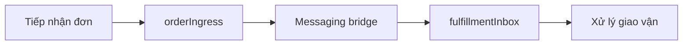
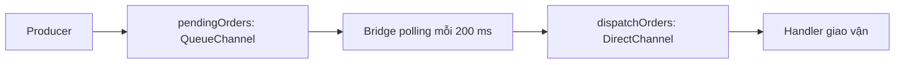

# Bridge giữa hai channel

Trong module **SPRING_INTEGRATION_CORE**, messaging bridge giúp ghép các đoạn luồng thông điệp khi hai phía đã thống nhất hợp đồng dữ liệu. Bài này thuộc chương **Messaging bridge**, tập trung vào cách nối hai `MessageChannel`, lựa chọn consumer theo channel đầu vào, cấu hình Java DSL, xử lý lỗi và kiểm thử hành vi chuyển tiếp.

## 1. Mục tiêu và tình huống sử dụng

Sau bài học, bạn có thể:

- Giải thích vai trò của bridge trong một integration flow.
- Nối `DirectChannel` với `QueueChannel`, hoặc nối `QueueChannel` với `DirectChannel`.
- Đặt poller đúng endpoint và dự đoán thread thực thi.
- Phân biệt chuyển tiếp message, chuyển đổi dữ liệu và định tuyến.
- Kiểm chứng payload, header, timeout và đường đi của lỗi.

Giả sử hệ thống tiếp nhận đơn hàng công bố channel `orderIngress`. Phân hệ giao vận nhận đơn từ `fulfillmentInbox`. Cả hai dùng cùng payload JSON và cùng header `orderId`. Nếu chỉ cần nối hai hợp đồng channel này, không cần viết lại một service để đọc payload rồi tạo message khác.

Luồng mong muốn:



Bridge là endpoint nối các channel hoặc channel adapter; một ứng dụng điển hình là lấy message từ channel có thể polling rồi chuyển sang channel nhận subscriber. Xem [Messaging Bridge](https://docs.spring.io/spring-integration/reference/bridge.html).

Để đọc các ví dụ, cần biết `Message` gồm payload và headers, `send()` gửi message vào channel, và `receive()` chỉ có trên channel hỗ trợ nhận theo kiểu polling. Các cấu hình dùng API `IntegrationFlow.from(...)`; hãy chọn JDK và bộ dependency tương thích với phiên bản Spring Integration của ứng dụng.

## 2. Channel, endpoint và BridgeHandler là ba vai trò khác nhau

Một bridge cấu hình hoàn chỉnh có thể hình dung như sau:

```text
inputChannel
    -> consumer endpoint
        -> BridgeHandler
            -> outputChannel
```

- **Channel** quy định cách message được trao cho phía nhận hoặc được lưu chờ.
- **Consumer endpoint** gắn handler với channel, quản lý đăng ký nhận hoặc lịch polling.
- **BridgeHandler** thực hiện chuyển tiếp.

Với input là `SubscribableChannel`, framework dùng consumer hướng sự kiện. Với input là `PollableChannel`, framework dùng `PollingConsumer`. Handler không cần tự tạo vòng lặp đọc queue. Đây là cơ chế endpoint chung, không chỉ riêng bridge. Xem [Message Endpoints](https://docs.spring.io/spring-integration/reference/endpoint.html).

Theo hợp đồng của `BridgeHandler`, request message được chuyển tới output mà không bị handler này sửa. Bridge chuẩn không chủ động đổi kiểu payload, bổ sung header nghiệp vụ, gom nhóm hay sao chép sâu payload. Những interceptor hoặc cơ chế theo dõi được cấu hình thêm trên luồng vẫn có thể ảnh hưởng message quan sát được. Xem [BridgeHandler API](https://docs.spring.io/spring-integration/api/org/springframework/integration/handler/BridgeHandler.html).

Ví dụ, nếu đầu vào là:

```text
payload = {"orderId":"O-1001","amount":420000}
headers.orderId = O-1001
headers.correlationId = checkout-81
```

thì yêu cầu của đoạn bridge là phía sau vẫn nhận được nội dung đó. Nếu giao vận đòi payload `ShipmentRequest` thay vì JSON, hãy đặt transformer trước channel giao vận.

| Nhu cầu trong luồng | Thành phần phù hợp |
| --- | --- |
| Chuyển tiếp tới một channel đích đã cấu hình | Bridge |
| Đổi JSON thành đối tượng Java | Transformer |
| Chọn đích theo loại đơn hàng | Router |
| Chấp nhận hoặc loại message theo điều kiện | Filter |
| Gọi một hàm xử lý nghiệp vụ | Service activator |
| Gộp nhiều message theo nhóm tương quan | Aggregator |
| Cung cấp giao diện gọi vào messaging từ mã ứng dụng | Messaging gateway |

Bảng trên là cách phân rã thiết kế cho tình huống đơn hàng: mỗi thành phần nên đảm nhận một trách nhiệm rõ ràng. Không cần thêm bridge sau mọi endpoint; transformer hoặc service activator đã có khả năng gửi kết quả tới channel tiếp theo.

## 3. Chọn cặp channel trước khi viết bridge

| Input → output | Bridge nhận message thế nào? | Ý nghĩa trong thiết kế |
| --- | --- | --- |
| `DirectChannel → DirectChannel` | Subscriber, không dùng poller | Nối hai hợp đồng channel; chuỗi direct thông thường chạy trên thread đang gửi |
| `DirectChannel → QueueChannel` | Subscriber, không dùng poller | Nhận trực tiếp rồi đặt message vào queue đích |
| `QueueChannel → DirectChannel` | Polling consumer | Lấy message chờ theo lịch, sau đó gọi chuỗi direct trên thread của tác vụ polling |
| `QueueChannel → QueueChannel` | Polling consumer | Chuyển message từ queue nguồn sang queue đích theo lịch |

Điểm cần xác định đầu tiên là **kiểu của input channel**. Output là queue không làm bridge cần poller; queue chỉ cần được polling khi một consumer muốn lấy message ra.

`DirectChannel` chuyển một message cho một subscriber và xử lý trên thread gửi. `QueueChannel` giữ message chờ nhận; queue có capacity hữu hạn có thể khiến thao tác gửi phải đợi hoặc hết timeout khi đầy. Nếu muốn phát cho nhiều subscriber, cần lựa chọn channel có semantics publish-subscribe. Xem [Message Channel Implementations](https://docs.spring.io/spring-integration/reference/channel/implementations.html).

Ví dụ thiết kế:

```text
HTTP thread
    -> DirectChannel
        -> bridge
            -> QueueChannel
                ... message chờ ...
                    -> consumer phía giao vận
```

Thread HTTP chỉ thực hiện phần trước điểm chờ. Điều này không có nghĩa bridge tự khởi tạo thread giao vận. Phải có một consumer phía sau queue thì message mới tiếp tục được xử lý.

## 4. Ví dụ Java DSL: DirectChannel sang QueueChannel

Đây là cấu hình độc lập cho ví dụ đầu tiên. Classpath cần `spring-integration-core` và Spring Context; nếu dùng Spring Boot, quản lý phiên bản dependency bằng bộ quản lý phiên bản của ứng dụng.

```java
import org.springframework.beans.factory.annotation.Qualifier;
import org.springframework.context.annotation.Bean;
import org.springframework.context.annotation.Configuration;
import org.springframework.integration.channel.DirectChannel;
import org.springframework.integration.channel.QueueChannel;
import org.springframework.integration.config.EnableIntegration;
import org.springframework.integration.dsl.IntegrationFlow;
import org.springframework.messaging.MessageChannel;

@Configuration(proxyBeanMethods = false)
@EnableIntegration
public class DirectBridgeConfig {

    @Bean
    public DirectChannel orderIngress() {
        return new DirectChannel();
    }

    @Bean
    public QueueChannel fulfillmentInbox() {
        return new QueueChannel(20);
    }

    @Bean
    public IntegrationFlow orderBridgeFlow(
            @Qualifier("orderIngress") MessageChannel source,
            @Qualifier("fulfillmentInbox") MessageChannel target) {

        return IntegrationFlow.from(source)
                .bridge(endpoint -> endpoint
                        .id("orderToFulfillmentBridge")
                        .sendTimeout(200))
                .channel(target)
                .get();
    }
}
```

Đọc cấu hình từ trên xuống:

1. `orderIngress` là đầu vào và hỗ trợ subscriber.
2. `.bridge(...)` khai báo bước chuyển tiếp, có tên endpoint để dễ nhận diện.
3. `sendTimeout(200)` giới hạn thời gian chờ khi gửi từ bridge tới channel hỗ trợ chờ có timeout.
4. `.channel(target)` xác định đích chuyển tiếp.
5. `get()` kết thúc khai báo flow; Spring quản lý endpoint khi context khởi động.

Tùy chọn `sendTimeout` thuộc cấu hình consumer endpoint. Nó không phải thời hạn tối đa cho toàn bộ xử lý nghiệp vụ phía sau một `DirectChannel`. Xem [ConsumerEndpointSpec API](https://docs.spring.io/spring-integration/api/org/springframework/integration/dsl/ConsumerEndpointSpec.html).

Ví dụ sử dụng sau khi context đã khởi động:

```java
Message<String> order = MessageBuilder
        .withPayload("{\"orderId\":\"O-1001\",\"amount\":420000}")
        .setHeader("orderId", "O-1001")
        .setHeader("correlationId", "checkout-81")
        .build();

boolean sent = orderIngress.send(order, 0);
Message<?> received = fulfillmentInbox.receive(0);
```

Đoạn này dùng `org.springframework.messaging.Message` và `org.springframework.messaging.support.MessageBuilder`; hai biến channel lấy từ context theo tên bean. Với queue còn chỗ và không có consumer khác, `received` là message vừa chuyển tiếp.

Cần phân biệt hai timeout:

- `orderIngress.send(order, 0)` là yêu cầu gửi tới input. Với `DirectChannel`, nó không cắt ngang chuỗi gọi handler đang chạy.
- `sendTimeout(200)` điều khiển lần gửi từ bridge vào queue đích. Khi queue đích đầy, việc chuyển tiếp có thể thất bại sau thời gian chờ này.

Trong ví dụ, `sent == true` xác nhận message đã được chấp nhận qua đoạn luồng đồng bộ tới queue đích. Nó chưa xác nhận giao vận đã tạo vận đơn.

## 5. Ví dụ Java DSL: QueueChannel sang DirectChannel

Lúc này hệ thống cần đệm đơn hàng trước khi đưa sang phần xử lý trực tiếp:



Cấu hình độc lập thứ hai:

```java
import java.time.Duration;

import org.springframework.beans.factory.annotation.Qualifier;
import org.springframework.context.annotation.Bean;
import org.springframework.context.annotation.Configuration;
import org.springframework.integration.channel.DirectChannel;
import org.springframework.integration.channel.QueueChannel;
import org.springframework.integration.config.EnableIntegration;
import org.springframework.integration.dsl.IntegrationFlow;
import org.springframework.integration.dsl.Pollers;
import org.springframework.messaging.MessageChannel;
import org.springframework.messaging.MessageHandler;

@Configuration(proxyBeanMethods = false)
@EnableIntegration
public class PolledBridgeConfig {

    @Bean
    public QueueChannel pendingOrders() {
        return new QueueChannel(100);
    }

    @Bean
    public DirectChannel dispatchOrders() {
        return new DirectChannel();
    }

    @Bean
    public QueueChannel dispatchedOrders() {
        return new QueueChannel(100);
    }

    @Bean
    public IntegrationFlow pendingToDispatchFlow(
            @Qualifier("pendingOrders") MessageChannel source,
            @Qualifier("dispatchOrders") MessageChannel target) {

        return IntegrationFlow.from(source)
                .bridge(endpoint -> endpoint
                        .id("pendingToDispatchBridge")
                        .poller(Pollers
                                .fixedDelay(Duration.ofMillis(200))
                                .maxMessagesPerPoll(5)
                                .receiveTimeout(0)))
                .channel(target)
                .get();
    }

    @Bean
    public IntegrationFlow dispatchConsumerFlow(
            @Qualifier("dispatchOrders") MessageChannel input,
            @Qualifier("dispatchedOrders") QueueChannel observed) {

        return IntegrationFlow.from(input)
                .handle((MessageHandler) message -> {
                    if (!observed.send(message, 0)) {
                        throw new IllegalStateException(
                                "Queue quan sat da day");
                    }
                })
                .get();
    }
}
```

`dispatchConsumerFlow` đóng vai consumer minh họa: ghi message vào queue quan sát để kiểm thử. Trong ứng dụng thực, thay handler này bằng thao tác nghiệp vụ giao vận. Không đăng ký thêm handler quan sát cạnh handler nghiệp vụ trên cùng `DirectChannel` rồi kỳ vọng cả hai nhận được mọi message.

Poller được đặt ngay tại `.bridge(...)` vì bridge là consumer trực tiếp của `pendingOrders`. `dispatchConsumerFlow` nhận từ `DirectChannel` nên không cần poller.

Các tùy chọn `maxMessagesPerPoll`, `receiveTimeout` và `errorChannel` được cung cấp bởi `PollerSpec`; `receiveTimeout` dùng đơn vị millisecond. Xem [PollerSpec API](https://docs.spring.io/spring-integration/api/org/springframework/integration/dsl/PollerSpec.html).

## 6. Hiểu đúng polling và giới hạn thông lượng

### 6.1. Một lần kích hoạt có thể chuyển nhiều message

Với cấu hình ở phần 5, mỗi tác vụ polling:

1. Thử lấy một message từ `pendingOrders`.
2. Nếu nhận được, gọi bridge và chuyển tới `dispatchOrders`.
3. Lặp lại cho tới giới hạn năm message, hoặc dừng sớm khi không nhận được message.
4. Sau khi tác vụ hoàn tất, chờ khoảng fixed delay rồi thực hiện tác vụ tiếp theo.

`maxMessagesPerPoll(5)` không gom năm đơn thành một payload. Năm message vẫn được chuyển từng message một. Nếu queue chỉ có hai đơn, bridge không đợi đủ năm đơn.

Khai báo giới hạn tường minh giúp tránh dựa vào mặc định của loại endpoint. Với polling consumer, mặc định `maxMessagesPerPoll` là `-1`, khác với mặc định `1` của `SourcePollingChannelAdapter`. Xem [Channel Adapter — Poller Configuration](https://docs.spring.io/spring-integration/reference/channel-adapter.html).

### 6.2. Fixed delay khác fixed rate

- `fixedDelay`: tính khoảng nghỉ từ khi tác vụ trước hoàn thành.
- `fixedRate`: tính nhịp theo thời điểm bắt đầu được lập lịch.

Hai cơ chế này là cấu hình trigger, không phải cam kết về thời điểm hoàn thành xử lý. Xem [Pollers API](https://docs.spring.io/spring-integration/api/org/springframework/integration/dsl/Pollers.html).

Ví dụ tính toán cho thiết kế của chúng ta, với các giả định:

- Một tác vụ polling tại một thời điểm, không thêm executor.
- Queue luôn có đủ đơn hàng.
- Mỗi đơn mất trung bình 50 ms trong chuỗi xử lý direct.
- Mỗi tác vụ lấy tối đa năm message.
- Fixed delay là 200 ms; bỏ qua chi phí điều phối nhỏ.

Thời gian xử lý một đợt xấp xỉ:

```text
T_xử_lý = 5 × 50 ms = 250 ms
T_chu_kỳ ≈ 250 ms + 200 ms = 450 ms
Thông_lượng ≈ 5 / 0,45 ≈ 11,1 message/giây
```

Nếu chỉ lấy `5 / 0,2 = 25` message/giây, bạn đã bỏ qua thời gian xử lý. Nếu có khoảng chờ nhận, khóa tài nguyên hoặc gọi dịch vụ ngoài, thông lượng thực tế còn thay đổi.

Poller có thể làm việc chuyển tiếp diễn ra theo đợt; riêng cấu hình này chưa bảo đảm quy tắc “không quá N request trong mọi cửa sổ một giây” của đối tác. Với hợp đồng hạn mức nghiêm ngặt, cần thiết kế cơ chế kiểm soát hạn mức tương ứng và đo lưu lượng tại điểm gọi đối tác.

### 6.3. Receive timeout là thời gian đợi message

`receiveTimeout(0)` trong ví dụ làm lần nhận trả về ngay nếu queue rỗng. Nó giúp tác vụ kết thúc sớm trong tình huống minh họa.

Đừng nhầm:

| Tùy chọn | Điểm áp dụng | Câu hỏi nó trả lời |
| --- | --- | --- |
| Trigger của poller | Lịch thực hiện tác vụ | Khi nào thử chạy tác vụ tiếp theo? |
| `maxMessagesPerPoll` | Vòng nhận trong một tác vụ | Tối đa bao nhiêu message trong đợt này? |
| `receiveTimeout` | Nhận từ input có thể polling | Đợi message sẵn có bao lâu? |
| `sendTimeout` | Gửi từ handler tới output | Đợi channel đích có thể tiếp nhận bao lâu? |

Việc rút ngắn `receiveTimeout` không rút ngắn thời gian xử lý của handler giao vận. Tương tự, tăng `maxMessagesPerPoll` không tự tạo thêm thread.

## 7. Thread thực thi và ý nghĩa của kết quả send()

### 7.1. Chuỗi direct

Nếu cả hai channel đều là `DirectChannel`, đường gọi thường có dạng:

```text
Thread gọi send()
    -> input.send(message)
        -> BridgeHandler
            -> output.send(message)
                -> handler nghiệp vụ
    <- send() kết thúc sau khi chuỗi đồng bộ kết thúc
```

Bridge không tạo ranh giới bất đồng bộ trong cấu hình này. Nếu handler nghiệp vụ mất hai giây, thread gọi vẫn có thể bận trong hai giây đó. Đặc tính gọi subscriber trên thread gửi được mô tả tại [DirectChannel API](https://docs.spring.io/spring-integration/api/org/springframework/integration/channel/DirectChannel.html).

### 7.2. Queue ở đầu vào

Với cấu hình `PolledBridgeConfig`:

```text
Thread producer:
    pendingOrders.send(message)
    -> đưa message vào queue
    -> tiếp tục công việc của producer

Thread thực hiện tác vụ polling, ở một thời điểm khác:
    pendingOrders.receive(...)
    -> BridgeHandler
        -> dispatchOrders.send(message)
            -> dispatchConsumerFlow
```

Không dự đoán lỗi ở thread polling bằng cách bọc riêng lời gọi `pendingOrders.send(...)` trong `try/catch`. Lời gọi gửi này có thể đã kết thúc từ trước.

Trong thiết kế có `ExecutorChannel`, điểm chuyển thread do executor của channel tạo ra. Khi phân tích một flow, hãy đánh dấu các điểm queue, executor và tác vụ nền trước khi quyết định nơi xử lý lỗi.

### 7.3. Send thành công xác nhận đến đâu?

Hãy diễn đạt kết quả theo điểm quan sát:

- “Đơn đã vào `pendingOrders`” khi producer gửi thành công vào queue nguồn.
- “Đơn đã qua bridge” khi quan sát thấy message ở channel đích.
- “Đã tạo vận đơn” khi handler giao vận hoàn tất thao tác nghiệp vụ.
- “Đã lưu bền vững” khi cơ chế lưu trữ liên quan đã xác nhận thành công theo cấu hình của nó.

Trong ví dụ queue nguồn, các mốc này xảy ra ở những thời điểm khác nhau. Gộp chúng thành một trạng thái “gửi thành công” sẽ làm khó việc theo dõi đơn bị treo.

## 8. Cấu hình bằng annotation hoặc BridgeHandler

Java DSL là một lựa chọn cấu hình. Nếu ứng dụng dùng các channel bean độc lập, có thể dùng annotation cho cùng mục đích.

Các đoạn sau là **phương án thay thế** cho bridge ở phần 5. Chỉ chọn một phương án cho cùng cặp channel; giữ consumer phía `dispatchOrders` để nhận message.

### 8.1. BridgeTo đặt trên channel nguồn

Đặt các method sau trong một class `@Configuration` có `@EnableIntegration`:

```java
@Bean
@BridgeTo(
        value = "dispatchOrders",
        poller = @Poller(fixedDelay = "200", maxMessagesPerPoll = "5",
                receiveTimeout = "0"))
public QueueChannel pendingOrders() {
    return new QueueChannel(100);
}

@Bean
public DirectChannel dispatchOrders() {
    return new DirectChannel();
}
```

Import `BridgeTo` và `Poller` từ package `org.springframework.integration.annotation`. Annotation nằm trên bean nguồn; `value` chỉ tên bean đích.

### 8.2. BridgeFrom đặt trên channel đích

Cũng cặp channel đó, có thể biểu diễn chiều nối từ phía đích:

```java
@Bean
public QueueChannel pendingOrders() {
    return new QueueChannel(100);
}

@Bean
@BridgeFrom(
        value = "pendingOrders",
        poller = @Poller(fixedDelay = "200", maxMessagesPerPoll = "5",
                receiveTimeout = "0"))
public DirectChannel dispatchOrders() {
    return new DirectChannel();
}
```

`BridgeFrom` nằm trong cùng package annotation. `value` chỉ tên bean nguồn.

Hai annotation này khai báo bridge khi xử lý cấu hình Spring; chúng không làm hai channel trở thành cùng một đối tượng. Xem các biến thể annotation tại [Messaging Bridge — Java Configuration](https://docs.spring.io/spring-integration/reference/bridge.html#bridge-java).

### 8.3. Khai báo BridgeHandler trực tiếp

Một biến thể khác, thay cho hai annotation hoặc DSL phía trên:

```java
@Bean
@ServiceActivator(
        inputChannel = "pendingOrders",
        poller = @Poller(fixedDelay = "200", maxMessagesPerPoll = "5",
                receiveTimeout = "0"))
public BridgeHandler pendingOrdersBridgeHandler() {
    BridgeHandler handler = new BridgeHandler();
    handler.setOutputChannelName("dispatchOrders");
    handler.setSendTimeout(200);
    return handler;
}
```

Import `ServiceActivator` từ `org.springframework.integration.annotation` và `BridgeHandler` từ `org.springframework.integration.handler`. Cách này làm rõ handler thực hiện chuyển tiếp; annotation tạo consumer phù hợp cho input.

Nếu vô tình bật đồng thời DSL và một biến thể annotation, bạn có thể tạo nhiều consumer cùng lấy từ queue nguồn. Khi đó message có thể được chia giữa các consumer, khiến việc quan sát và xử lý lỗi khác với thiết kế chỉ có một bridge.

## 9. Bridge không có output và replyChannel

Một terminal bridge có thể sử dụng `replyChannel` của message nếu không cấu hình output. Nếu cả output lẫn reply channel đều vắng mặt, xử lý sẽ thất bại. Xem [BridgeHandler API](https://docs.spring.io/spring-integration/api/org/springframework/integration/handler/BridgeHandler.html).

Ví dụ method flow, đặt trong một cấu hình Spring Integration độc lập:

```java
@Bean
public IntegrationFlow echoBridgeFlow() {
    return IntegrationFlow.from("echoInput")
            .bridge()
            .get();
}
```

Sau khi lấy `echoInput` từ context, bên gửi cung cấp nơi nhận phản hồi:

```java
QueueChannel replies = new QueueChannel(1);

Message<String> request = MessageBuilder
        .withPayload("kiem-tra-bridge")
        .setReplyChannel(replies)
        .build();

echoInput.send(request);
Message<?> reply = replies.receive(1_000);
```

Ở đây bridge chuyển message đến nơi nhận phản hồi. Nó không tự sinh kết quả nghiệp vụ mới. Nếu lời gọi đi qua messaging gateway, gateway có thể thiết lập kênh phản hồi cho mô hình request-reply; việc gateway nhận được message vẫn phải được hiểu theo hợp đồng xử lý của flow.

Trong thiết kế một chiều như gửi đơn sang giao vận, cấu hình output channel tường minh giúp thể hiện mục đích rõ hơn.

## 10. Xử lý lỗi ở bridge

### 10.1. Lỗi trong chuỗi đồng bộ

Nếu input và phần downstream chạy trên cùng thread, lỗi có thể truyền về phía gọi `send()`. Ví dụ:

- Output là `DirectChannel` nhưng không có subscriber.
- Queue đích đầy và hết thời gian gửi.
- Handler phía sau ném exception.

Lỗi từ handler có thể được bọc trong exception messaging; không nên giả định luôn bắt được chính xác kiểu exception nghiệp vụ ban đầu.

### 10.2. Lỗi trong tác vụ polling

Khi producer đã đặt message vào queue và bridge xử lý sau đó, lỗi không thể ném ngược qua một lời gọi gửi đã hoàn tất. Cơ chế xử lý lỗi mặc định cho tác vụ polling của Spring Integration có thể công bố `ErrorMessage`; error channel trong header của request được xem xét trước kênh mặc định toàn cục. Xem [Error Handling](https://docs.spring.io/spring-integration/reference/error-handling.html).

Để minh họa một đích nhận lỗi riêng, thêm bean sau vào `PolledBridgeConfig`:

```java
@Bean
public QueueChannel bridgeErrors() {
    return new QueueChannel(50);
}
```

Sau đó sửa poller của bridge hiện có thành:

```java
.poller(Pollers
        .fixedDelay(Duration.ofMillis(200))
        .maxMessagesPerPoll(5)
        .receiveTimeout(0)
        .errorChannel("bridgeErrors"))
```

Đây là thay đổi trên flow đã có, không phải đăng ký thêm một bridge thứ hai. Ví dụ này không gắn header `errorChannel` riêng lên request.

Queue `bridgeErrors` là điểm thu lỗi cho bài thực hành. Khi vận hành lâu dài, phải có consumer xử lý hoặc chuyển lỗi sang cơ chế lưu trữ, cảnh báo và khôi phục đã thiết kế; queue hữu hạn không thể chứa lỗi mãi.

Khi quan sát một `ErrorMessage`, cần đọc:

- Throwable trong payload.
- Chuỗi nguyên nhân nếu lỗi đã được bọc.
- Failed message nếu exception là `MessagingException` có cung cấp thông tin đó.
- Mã đơn hàng hoặc mã tương quan để nối lại với yêu cầu ban đầu.

### 10.3. Chuyển lỗi không đồng nghĩa thử lại

Trong ví dụ queue bộ nhớ, poller đã lấy message khỏi queue nguồn trước khi gọi handler. Nếu downstream thất bại, chỉ gửi lỗi sang `bridgeErrors` không tự đưa đơn hàng trở lại queue nguồn.

Giả sử handler đã gọi thành công API tạo vận đơn, rồi thất bại khi ghi nhận kết quả. Nếu triển khai retry cho cả thao tác, API có thể được gọi lại. Với nghiệp vụ này, một thiết kế có thể dùng `orderId` làm khóa chống lặp và lưu trạng thái xử lý trước khi cho phép gửi lại.

Đây là quyết định về tính đúng đắn của nghiệp vụ. Bridge không tự cung cấp retry, loại bỏ xử lý trùng hoặc cam kết exactly-once.

## 11. Backpressure, lưu trữ và transaction

### 11.1. Queue chỉ hấp thụ được một lượng tồn đọng hữu hạn

Xét một kịch bản đo thực tế:

```text
Producer đưa vào:       20 đơn/giây
Bridge và downstream:  11 đơn/giây
Tốc độ tăng tồn đọng:    9 đơn/giây
Capacity queue nguồn:  100 đơn
```

Nếu queue ban đầu rỗng và các tốc độ giữ nguyên, thời gian lấp đầy xấp xỉ `100 / 9 = 11,1 giây`. Đây là ước lượng cho kịch bản này, chưa tính các biến động và message đang được xử lý.

Khi queue nguồn đầy, producer phải có chính sách: chờ trong thời gian cho phép, từ chối yêu cầu, hoặc chuyển sang một nơi lưu đệm phù hợp. Tăng capacity chỉ kéo dài thời gian tới lúc đầy nếu chênh lệch tốc độ vẫn tồn tại.

Dùng queue hữu hạn và timeout tường minh giúp việc quá tải trở thành hành vi có thể xử lý. Constructor không truyền capacity của `QueueChannel` sử dụng giới hạn `Integer.MAX_VALUE`; đó không phải một phương án kiểm soát bộ nhớ theo tải nghiệp vụ. Xem [QueueChannel API](https://docs.spring.io/spring-integration/api/org/springframework/integration/channel/QueueChannel.html).

Trong ví dụ đầu tiên, nếu `fulfillmentInbox` đầy, bridge phải đợi ở bước gửi tới đích. Thêm bridge không tạo thêm năng lực xử lý của phân hệ giao vận.

### 11.2. Bridge không biến queue bộ nhớ thành message broker

Các queue trong ví dụ được tạo bằng `new QueueChannel(...)`, dùng lưu trữ bộ nhớ mặc định. Nếu cần tồn tại qua lần khởi động lại, phải lựa chọn message store bền vững hoặc giải pháp channel/adapter có hạ tầng lưu trữ tương ứng. Xem [Message Channel Implementations — QueueChannel](https://docs.spring.io/spring-integration/reference/channel/implementations.html#channel-implementations-queuechannel).

Với một đơn hàng quan trọng, cần xác định riêng:

- Đơn được lưu ở đâu trước khi trả lời producer?
- Sau khi lấy khỏi nguồn nhưng chưa gửi xong tới đích, cơ chế nào hỗ trợ khôi phục?
- Nếu xử lý lại, điều gì ngăn tạo hai vận đơn?
- Những bước nào thực sự thuộc cùng transaction?

Một bridge nối hai channel trong ứng dụng không tự kết nối hai JVM. Muốn đi qua ranh giới tiến trình hoặc hệ thống, phải có channel implementation hoặc adapter xử lý giao thức liên quan.

### 11.3. Transaction phụ thuộc ranh giới thực thi và tài nguyên

Chuỗi direct có thể tham gia transaction của thread đang gọi nếu các thao tác phía sau được cấu hình phù hợp. Poller có thể khởi tạo transaction riêng cho tác vụ nhận và xử lý; khả năng rollback việc nhận phụ thuộc tài nguyên được dùng có tham gia transaction hay không. Xem [Transaction Support](https://docs.spring.io/spring-integration/reference/transactions.html).

Vì vậy, không suy luận rằng chỉ thêm cấu hình transactional sẽ làm một queue bộ nhớ thông thường tự phục hồi message như một hàng đợi có tài nguyên giao dịch. Tương tự, transaction cơ sở dữ liệu không tự rollback một HTTP request đã được dịch vụ đối tác thực hiện.

Với bridge từ queue sang direct, hãy vẽ ranh giới transaction quanh tác vụ polling dự kiến, rồi liệt kê tài nguyên thực sự được quản lý trong ranh giới đó.

## 12. Kiểm thử hợp đồng chuyển tiếp

Đoạn mã dưới đây là ví dụ kiểm thử để đưa vào dự án thực hành. Cần JUnit Jupiter và hai class cấu hình độc lập ở phần 4, phần 5. Không cần khởi động web server để kiểm chứng đoạn flow này.

### 12.1. Kiểm thử hai chiều kết nối và queue đích đầy

```java
import org.junit.jupiter.api.Test;
import org.springframework.context.annotation.AnnotationConfigApplicationContext;
import org.springframework.integration.channel.QueueChannel;
import org.springframework.messaging.Message;
import org.springframework.messaging.MessageChannel;
import org.springframework.messaging.MessagingException;
import org.springframework.messaging.support.MessageBuilder;

import static org.junit.jupiter.api.Assertions.*;

class BridgeFlowTest {

    @Test
    void forwardsMessageFromDirectToQueue() {
        try (var context =
                     new AnnotationConfigApplicationContext(
                             DirectBridgeConfig.class)) {

            MessageChannel input = context.getBean(
                    "orderIngress", MessageChannel.class);
            QueueChannel output = context.getBean(
                    "fulfillmentInbox", QueueChannel.class);

            Message<String> original = MessageBuilder
                    .withPayload("order-O-1001")
                    .setHeader("orderId", "O-1001")
                    .setHeader("correlationId", "checkout-81")
                    .build();

            assertTrue(input.send(original, 0));

            Message<?> actual = output.receive(0);
            assertNotNull(actual);
            assertSame(original, actual);
            assertEquals("order-O-1001", actual.getPayload());
            assertEquals("O-1001",
                    actual.getHeaders().get("orderId"));
            assertEquals("checkout-81",
                    actual.getHeaders().get("correlationId"));
            assertNull(output.receive(0));
        }
    }

    @Test
    void pollsQueuedMessageAndDispatchesIt() {
        try (var context =
                     new AnnotationConfigApplicationContext(
                             PolledBridgeConfig.class)) {

            MessageChannel input = context.getBean(
                    "pendingOrders", MessageChannel.class);
            QueueChannel observed = context.getBean(
                    "dispatchedOrders", QueueChannel.class);

            Message<String> original = MessageBuilder
                    .withPayload("order-O-1002")
                    .setHeader("orderId", "O-1002")
                    .build();

            assertTrue(input.send(original, 0));

            Message<?> actual = observed.receive(2_000);
            assertNotNull(actual);
            assertEquals(original.getPayload(), actual.getPayload());
            assertEquals(original.getHeaders().getId(),
                    actual.getHeaders().getId());
            assertEquals("O-1002",
                    actual.getHeaders().get("orderId"));
        }
    }

    @Test
    void reportsFailureWhenTargetQueueRemainsFull() {
        try (var context =
                     new AnnotationConfigApplicationContext(
                             DirectBridgeConfig.class)) {

            MessageChannel input = context.getBean(
                    "orderIngress", MessageChannel.class);
            QueueChannel output = context.getBean(
                    "fulfillmentInbox", QueueChannel.class);

            for (int i = 0; i < 20; i++) {
                Message<String> filler = MessageBuilder
                        .withPayload("filler-" + i)
                        .build();
                assertTrue(output.send(filler, 0));
            }

            Message<String> next = MessageBuilder
                    .withPayload("order-O-1003")
                    .build();

            assertThrows(MessagingException.class,
                    () -> input.send(next, 0));
            assertEquals(20, output.getQueueSize());
        }
    }
}
```

Kiểm thử thứ nhất xác nhận giữ nguyên đối tượng message trong cấu hình tối giản này, đồng thời kiểm tra hợp đồng payload và header. Nếu bật tracking hoặc interceptor thay message, hãy điều chỉnh phần kiểm tra identity theo cấu hình đó; mục tiêu nghiệp vụ là những dữ liệu cần giữ vẫn được chuyển đúng.

Kiểm thử thứ hai chờ ở điểm quan sát với timeout hữu hạn. Không dùng `Thread.sleep(200)` rồi giả định scheduler chắc chắn đã chạy. Timeout 2.000 ms là ngân sách chờ của bài thực hành, có thể cần điều chỉnh theo môi trường kiểm thử.

Kiểm thử thứ ba tạo queue đích đầy một cách xác định và xác nhận lỗi của đoạn direct. Nó không đo timeout bằng một ngưỡng thời gian tuyệt đối dễ bị ảnh hưởng bởi scheduler hoặc máy chạy kiểm thử.

### 12.2. Kiểm thử đường lỗi polling trong cấu hình riêng

Tạo một biến thể cấu hình dành riêng cho kịch bản lỗi:

1. Giữ queue nguồn và bridge có poller như phần 5.
2. Thêm `bridgeErrors` và đặt `.errorChannel("bridgeErrors")` như phần 10.
3. Thay handler quan sát bằng handler luôn ném `IllegalStateException`.
4. Gửi một message có `orderId` vào queue nguồn.
5. Nhận từ `bridgeErrors` với timeout hữu hạn.
6. Xác nhận nhận được `ErrorMessage`, tìm được nguyên nhân lỗi và failed message mang mã đơn dự kiến.

Handler cố ý thất bại có thể viết:

```java
.handle((MessageHandler) message -> {
    throw new IllegalStateException("Gia lap loi giao van");
})
```

Không đăng ký handler lỗi cạnh handler thành công trên cùng `DirectChannel` rồi dùng đó làm kiểm thử lỗi xác định. Hãy để kịch bản lỗi có consumer riêng trong context riêng.

Ví dụ kiểm tra thông tin lỗi sau khi đã lấy các bean của cấu hình lỗi:

```java
Message<String> original = MessageBuilder
        .withPayload("order-O-FAIL")
        .setHeader("orderId", "O-FAIL")
        .build();

assertTrue(pendingOrders.send(original, 0));

Message<?> error = bridgeErrors.receive(2_000);
assertNotNull(error);
assertInstanceOf(
        org.springframework.messaging.support.ErrorMessage.class,
        error);

Throwable cause = (Throwable) error.getPayload();
MessagingException failed = null;
boolean foundBusinessFailure = false;

while (cause != null) {
    if (cause instanceof MessagingException messaging
            && messaging.getFailedMessage() != null) {
        failed = messaging;
    }
    if (cause instanceof IllegalStateException
            && "Gia lap loi giao van".equals(cause.getMessage())) {
        foundBusinessFailure = true;
    }
    cause = cause.getCause();
}

assertTrue(foundBusinessFailure);
assertNotNull(failed);
assertEquals("O-FAIL",
        failed.getFailedMessage().getHeaders().get("orderId"));
```

Ở đây `pendingOrders` và `bridgeErrors` là các channel bean lấy từ context lỗi. Việc gửi vào `pendingOrders` được kiểm tra riêng với việc nhận thông tin lỗi, thể hiện đúng ranh giới bất đồng bộ.

## 13. Chẩn đoán các cấu hình thường sai

| Hiện tượng | Giả thuyết cần kiểm tra | Hướng kiểm tra trong ví dụ đơn hàng |
| --- | --- | --- |
| Context không tạo được consumer từ queue | Bridge thiếu poller và cũng không có default poller | Kiểm tra endpoint đọc `pendingOrders` |
| Khai báo poller nhưng input là direct | Poller đặt vào consumer nhận từ channel không hỗ trợ polling | Xem lại kiểu bean input và bỏ poller ở đoạn direct |
| Gửi vào queue thành công nhưng không thấy xử lý | Chưa có consumer, endpoint chưa chạy hoặc queue đang tồn đọng | Kiểm tra kích thước queue, trạng thái endpoint và đường lỗi |
| Báo không có subscriber ở channel đích | Chưa khai báo hoặc chưa khởi động consumer downstream | Kiểm tra `dispatchConsumerFlow` đã được đăng ký |
| Bridge không có nơi gửi tiếp | Thiếu cả output channel và `replyChannel` | Kiểm tra mục đích một chiều hay request-reply |
| Chỉ một trong hai handler nhận đơn | Hai handler cùng đăng ký trên `DirectChannel` | Xác định có cần broadcast và chọn channel phù hợp |
| Producer bị chậm khi gửi | Queue đích đầy hoặc chuỗi direct xử lý lâu | Đo thời gian handler và theo dõi capacity |
| Lỗi polling không xuất hiện trong catch của producer | Xử lý diễn ra sau khi send đã kết thúc | Quan sát error flow của poller |
| Flow lặp lại cùng message liên tục | Có đường bridge nối ngược về nguồn | Vẽ đồ thị channel và loại bỏ chu trình ngoài ý muốn |

Trường hợp thiếu poller hoặc cấu hình poller trên input không phù hợp thuộc quy tắc tạo consumer của framework. Xem [Message Endpoints — Configuration](https://docs.spring.io/spring-integration/reference/endpoint.html).

Ví dụ suy luận từ đồ thị: nối `A → bridge → B` rồi thêm `B → bridge → A` tạo chu trình. Với chuỗi direct, lời gọi có thể lặp trên stack; với queue, message có thể quay vòng và chiếm tài nguyên. Vì vậy, khi tách flow thành nhiều module, vẫn cần kiểm tra toàn bộ đường nối.

## 14. Thực hành mở rộng

Dùng cấu hình của bài để thực hiện các thay đổi nhỏ sau:

1. Gửi 12 đơn vào `pendingOrders`, gắn `orderId` khác nhau và thu đủ 12 kết quả. Quan sát chúng đi qua nhiều tác vụ khi giới hạn là năm message mỗi tác vụ.
2. Thêm một transformer trước channel giao vận để đổi payload. Giải thích tại sao thao tác đó thuộc transformer.
3. Làm chậm handler minh họa, theo dõi kích thước queue nguồn và so sánh thông lượng đo được với ước lượng fixed delay.
4. Chạy riêng kịch bản lỗi polling, đọc nguyên nhân lỗi và mã đơn từ failed message.
5. Ghi rõ hành vi ứng dụng cần có khi queue nguồn hoặc queue lỗi đầy.

Khi thực hiện, giữ các context thành công và lỗi độc lập để kết quả quan sát không phụ thuộc vào consumer vô tình dùng chung.

## 15. Các nguyên tắc cần giữ khi thiết kế

Bridge phù hợp khi hai phía đã tương thích về message và bạn cần một điểm nối rõ ràng. Trước khi thêm nó vào flow, xác định input là subscribable hay pollable, thread nào đi qua đoạn xử lý, đích chuyển tiếp và cách quan sát lỗi.

Đối với pipeline đơn hàng trong bài, các quyết định quan trọng là capacity của queue, nhịp polling, thời gian xử lý downstream và điểm xác nhận thành công. Retry, lưu bền vững, transaction và chống xử lý lặp cần được thiết kế cùng các tài nguyên thực tế của ứng dụng.
