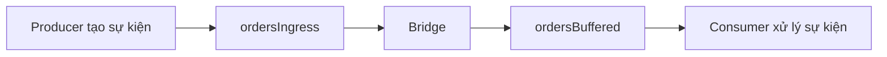
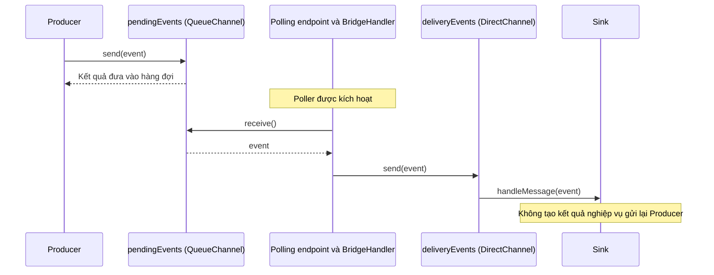

# Bridge one-way

## 1. Mục tiêu của bài học

Trong chương **Messaging bridge** của module **SPRING_INTEGRATION_CORE**, bài này tập trung vào cách nối hai `MessageChannel` để chuyển tiếp thông điệp theo một hướng. Tình huống xuyên suốt là tiếp nhận sự kiện đơn hàng, đưa sự kiện sang kênh dành cho bộ phận xử lý tiếp theo và không yêu cầu trả về một kết quả nghiệp vụ cho bên gửi.

Sau bài học, bạn có thể:

- Thiết kế luồng `input channel → bridge → output channel` bằng Java DSL.
- Xác định khi nào bridge cần poller dựa trên loại kênh đầu vào.
- Phân biệt hợp đồng một chiều, cơ chế thực thi đồng bộ và phản hồi nghiệp vụ.
- Kiểm tra việc chuyển tiếp payload, header, đích nhận và hành vi khi có lỗi.

Bạn nên biết cách tạo `Message<?>`, sự khác nhau giữa `SubscribableChannel` và `PollableChannel`, cùng vai trò của một endpoint trong Spring Integration. Các ví dụ dùng `spring-integration-core`; ví dụ kiểm thử cần thêm JUnit Jupiter và `spring-test`. Hãy quản lý phiên bản thư viện bằng bộ dependency/BOM tương thích của dự án.

## 2. Bridge one-way có nghĩa là gì?

Messaging bridge là endpoint nối các kênh thông điệp. Với bridge một chiều, ứng dụng định nghĩa đường đi từ kênh A sang kênh B, còn bên gửi không yêu cầu một thông điệp kết quả nghiệp vụ quay lại qua cùng thao tác gửi. Cách nối kênh này được mô tả trong [Messaging Bridge của Spring Integration](https://docs.spring.io/spring-integration/reference/bridge.html).



Hợp đồng của ví dụ là: producer gửi sự kiện `OrderAccepted`; consumer tiếp nhận sự kiện để thực hiện công việc của nó. Producer không nhận một đối tượng `OrderProcessingResult` từ bridge.

`BridgeHandler` chuyển tiếp message đầu vào, không chủ động biến đổi payload hoặc header. Vì vậy, hãy đặt việc chuẩn hóa dữ liệu ở transformer và việc chọn đích theo nội dung ở router nếu nghiệp vụ cần những bước đó. Đây là đặc tính của [API `BridgeHandler`](https://docs.spring.io/spring-integration/api/org/springframework/integration/handler/BridgeHandler.html).

Ví dụ, nếu producer gửi payload chuỗi `"order:42"`, bridge không tự chuyển chuỗi này thành JSON hoặc đối tượng đơn hàng. Consumer phải hiểu hợp đồng dữ liệu đã được hai bên thống nhất.

### Một chiều và bất đồng bộ là hai quyết định riêng

Một chiều mô tả việc bên gửi có đòi hỏi kết quả nghiệp vụ hay không. Bất đồng bộ mô tả việc xử lý có tách khỏi luồng thực thi của bên gửi hay không. Bạn có thể thiết kế một luồng một chiều nhưng các handler vẫn chạy ngay trên thread gọi `send()`.

Chẳng hạn, thông báo ghi nhật ký có thể không cần kết quả trả về nhưng thao tác ghi vẫn mất thời gian. Đổi kiểu trả về thành `void` không tự làm thao tác đó chạy nền.

## 3. Đọc topology trước khi cấu hình bridge

Bridge gồm logic chuyển tiếp và một endpoint chịu trách nhiệm nhận message. Với kênh hỗ trợ đăng ký, endpoint được gọi khi message đến. Với kênh phải lấy message bằng `receive()`, endpoint cần một poller. Đây là hai cách tiếp nhận được giải thích trong [Message Endpoints](https://docs.spring.io/spring-integration/reference/endpoint.html).

| Đầu vào → đầu ra | Cách bridge nhận message | Câu hỏi cần giải quyết tiếp |
| --- | --- | --- |
| `DirectChannel → DirectChannel` | Nhận qua subscription | Ai là subscriber ở kênh đích? |
| `DirectChannel → QueueChannel` | Nhận qua subscription | Ai sẽ đọc hàng đợi đầu ra? |
| `QueueChannel → DirectChannel` | Poller lấy message từ đầu vào | Nhịp polling và lỗi downstream được xử lý thế nào? |
| `QueueChannel → QueueChannel` | Poller lấy message từ đầu vào | Hàng đợi đích được tiêu thụ với tốc độ nào? |

Quy tắc thực hành là nhìn vào **đầu vào của endpoint** để quyết định có cấu hình poller cho bridge hay không. Đầu ra là hàng đợi không có nghĩa bridge phải polling hàng đợi đó; lấy message khỏi đầu ra là công việc của consumer kế tiếp.

Trong cấu hình thông thường, `DirectChannel` gọi subscriber trên thread bên gửi, còn `QueueChannel` lưu message cho đến khi có consumer lấy ra. `QueueChannel` mặc định lưu trong bộ nhớ. Các đặc điểm này được trình bày trong [Message Channel Implementations](https://docs.spring.io/spring-integration/reference/channel/implementations.html).

## 4. Ví dụ Java DSL: chuyển sự kiện vào hàng đợi

Giả sử ứng dụng tiếp nhận sự kiện đơn hàng tại `ordersIngress`. Thành phần xử lý tiếp theo chỉ biết `ordersBuffered`; chúng ta dùng bridge để nối hai hợp đồng kênh này.

```java
import org.springframework.beans.factory.annotation.Qualifier;
import org.springframework.context.annotation.Bean;
import org.springframework.context.annotation.Configuration;
import org.springframework.integration.channel.DirectChannel;
import org.springframework.integration.channel.QueueChannel;
import org.springframework.integration.config.EnableIntegration;
import org.springframework.integration.dsl.IntegrationFlow;
import org.springframework.messaging.MessageChannel;
import org.springframework.messaging.PollableChannel;

@Configuration
@EnableIntegration
public class OneWayBridgeConfig {

    @Bean
    public MessageChannel ordersIngress() {
        return new DirectChannel();
    }

    @Bean
    public PollableChannel ordersBuffered() {
        return new QueueChannel(100);
    }

    @Bean
    public IntegrationFlow ordersBridgeFlow(
            @Qualifier("ordersIngress") MessageChannel input,
            @Qualifier("ordersBuffered") PollableChannel output) {

        return IntegrationFlow.from(input)
                .bridge(endpoint -> endpoint.id("ordersOneWayBridge"))
                .channel(output)
                .get();
    }
}
```

Ý nghĩa từng phần:

- `ordersIngress` là cửa vào mà producer sử dụng.
- `.bridge(...)` khai báo bước chuyển tiếp và đặt tên endpoint để dễ xác định khi vận hành.
- `.channel(output)` chỉ định đích chuyển tiếp là `ordersBuffered`.
- Hàng đợi có sức chứa 100 message trong ví dụ; đây là lựa chọn minh họa, không phải thông số mặc định nên áp dụng cho mọi hệ thống.

DSL biểu diễn mối nối dưới dạng các bean endpoint và channel do Spring quản lý. Cú pháp khai báo bridge có thể đối chiếu với [phần Java DSL trong tài liệu Messaging Bridge](https://docs.spring.io/spring-integration/reference/bridge.html).

Cấu hình này kết thúc tại hàng đợi để thuận tiện quan sát và kiểm thử. Trong ứng dụng, bạn cần bổ sung consumer đọc `ordersBuffered`. Khi chưa có consumer, bridge vẫn có thể đưa message vào hàng đợi còn chỗ; công việc nghiệp vụ phía sau chưa được thực hiện.

### Gửi và quan sát một message

Đoạn sau chạy khi `ApplicationContext` chứa `OneWayBridgeConfig` đã được khởi tạo. Hai biến `input` và `output` là bean tương ứng được inject vào thành phần gọi.

```java
import org.springframework.messaging.Message;
import org.springframework.messaging.support.MessageBuilder;

Message<String> event = MessageBuilder.withPayload("order:42")
        .setHeader("eventType", "OrderAccepted")
        .setHeader("orderId", "42")
        .build();

boolean accepted = input.send(event);
Message<?> forwarded = output.receive(0);
```

Trong ví dụ ít tải này, `accepted` là `true`, và `forwarded` chứa payload `"order:42"` cùng các header nghiệp vụ đã đặt. `receive(0)` là cách quan sát hàng đợi, không phải lời gọi chờ phản hồi từ bridge.

`send()` trả về boolean của thao tác gửi, không trả về kết quả xử lý đơn hàng. Nếu cần biết đơn hàng đã hoàn tất hay thất bại sau khi consumer xử lý, hãy thiết kế thêm một sự kiện trạng thái có định danh đơn hàng hoặc một giao thức request–reply phù hợp.

## 5. Cấu hình bằng `BridgeHandler` khi cần chỉ rõ timeout đầu ra

Bạn có thể thay bean `ordersBridgeFlow` ở trên bằng cấu hình Java sau. Các bean `ordersIngress` và `ordersBuffered` vẫn giữ nguyên.

```java
import org.springframework.context.annotation.Bean;
import org.springframework.integration.annotation.ServiceActivator;
import org.springframework.integration.handler.BridgeHandler;

@Bean
@ServiceActivator(inputChannel = "ordersIngress")
public BridgeHandler ordersBridgeHandler() {
    BridgeHandler bridge = new BridgeHandler();
    bridge.setOutputChannelName("ordersBuffered");
    bridge.setSendTimeout(1_000L);
    return bridge;
}
```

Đây là **phương án thay thế** cho bean DSL, không phải endpoint thứ hai cần thêm vào cùng đầu vào. Nếu cả hai cùng đăng ký vào `ordersIngress`, bạn đã tạo nhiều consumer thay vì một bridge duy nhất như thiết kế ban đầu.

`setSendTimeout(1_000L)` cấu hình thời gian chờ cho thao tác gửi từ handler tới kênh đầu ra có hỗ trợ timeout. Nó hữu ích khi hàng đợi đích có thể đầy; nó không đặt thời hạn hoàn thành toàn bộ công việc nghiệp vụ phía sau. Xem hợp đồng `setSendTimeout` trong [API handler tạo message đầu ra](https://docs.spring.io/spring-integration/api/org/springframework/integration/handler/AbstractMessageProducingHandler.html).

Tương tự, không nên suy diễn rằng `input.send(event, 1_000L)` sẽ dừng mọi handler sau đúng một giây. Trong topology này, giới hạn chờ khi đưa vào hàng đợi đích cần được cấu hình tại thao tác gửi của bridge.

## 6. Ví dụ có poller: lấy sự kiện từ hàng đợi rồi chuyển tiếp

Ở topology thứ hai, producer ghi vào `pendingEvents`. Bridge chịu trách nhiệm lấy sự kiện ra và gửi tới `deliveryEvents`; một sink tại kênh đích chỉ tiếp nhận message.



Cấu hình dưới đây độc lập với `OneWayBridgeConfig` ở mục trước:

```java
import java.time.Duration;

import org.springframework.beans.factory.annotation.Qualifier;
import org.springframework.context.annotation.Bean;
import org.springframework.context.annotation.Configuration;
import org.springframework.integration.channel.DirectChannel;
import org.springframework.integration.channel.QueueChannel;
import org.springframework.integration.config.EnableIntegration;
import org.springframework.integration.dsl.IntegrationFlow;
import org.springframework.integration.dsl.Pollers;
import org.springframework.messaging.MessageChannel;
import org.springframework.messaging.MessageHandler;
import org.springframework.messaging.PollableChannel;

@Configuration
@EnableIntegration
public class PollingOneWayBridgeConfig {

    @Bean
    public PollableChannel pendingEvents() {
        return new QueueChannel(100);
    }

    @Bean
    public MessageChannel deliveryEvents() {
        return new DirectChannel();
    }

    @Bean
    public PollableChannel bridgeErrors() {
        return new QueueChannel(100);
    }

    @Bean
    public IntegrationFlow pendingToDelivery(
            @Qualifier("pendingEvents") PollableChannel input,
            @Qualifier("deliveryEvents") MessageChannel output) {

        return IntegrationFlow.from(input)
                .bridge(endpoint -> endpoint
                        .id("pendingEventsBridge")
                        .poller(Pollers.fixedDelay(Duration.ofMillis(500))
                                .maxMessagesPerPoll(10)
                                .receiveTimeout(0)
                                .errorChannel("bridgeErrors")))
                .channel(output)
                .get();
    }

    @Bean
    public IntegrationFlow deliverySink(
            @Qualifier("deliveryEvents") MessageChannel input) {

        MessageHandler sink = message ->
                System.out.println("RECEIVED: " + message.getPayload());

        return IntegrationFlow.from(input)
                .handle(sink)
                .get();
    }
}
```

Sink dùng `MessageHandler` chỉ để minh họa điểm kết thúc của luồng. Ứng dụng thực tế có thể thay nó bằng thành phần ghi dữ liệu hoặc outbound channel adapter.

### Hiểu đúng các tham số poller

| Tham số | Vai trò trong ví dụ |
| --- | --- |
| `fixedDelay(500 ms)` | Chờ 500 ms từ khi lượt polling trước hoàn tất đến khi bắt đầu lượt kế tiếp |
| `maxMessagesPerPoll(10)` | Cho phép lấy và xử lý tối đa 10 message trong một lượt polling |
| `receiveTimeout(0)` | Không chờ message mới nếu lần nhận hiện tại gặp hàng đợi rỗng |
| `errorChannel("bridgeErrors")` | Đặt kênh mặc định cho lỗi của poller trong cấu hình này |

`Pollers` là builder cấu hình poller; `receiveTimeout` và `errorChannel` có hợp đồng riêng trong [API `PollerSpec`](https://docs.spring.io/spring-integration/api/org/springframework/integration/dsl/PollerSpec.html). Cách gắn poller bằng DSL được giới thiệu trong [Pollers](https://docs.spring.io/spring-integration/reference/dsl/java-pollers.html).

Các message được chuyển tiếp riêng lẻ. `maxMessagesPerPoll(10)` không gộp chúng thành một payload danh sách và không thay thế aggregator.

Với đúng cấu hình minh họa này, giả sử hàng đợi luôn đủ message, không có lỗi, không thêm task executor và mỗi lần xử lý ở sink mất 100 ms. Một lượt xử lý 10 message mất khoảng 1 giây, sau đó mới chờ thêm 500 ms. Tốc độ ước lượng là `10 / 1,5 ≈ 6,7 message/giây`, chưa tính overhead. Vì vậy, không thể lấy `10 / 0,5` rồi khẳng định hệ thống luôn đạt 20 message/giây.

`bridgeErrors` trong ví dụ là hàng đợi để có thể quan sát lỗi. Khi đưa vào vận hành, cần một consumer lấy lỗi ra và xử lý; chỉ khai báo hàng đợi lỗi không tạo ra chính sách phục hồi.

## 7. Đích chuyển tiếp và header `replyChannel`

Một cấu hình one-way dễ đọc nên chỉ rõ kênh đầu ra. Tuy nhiên, cơ chế nội bộ của bridge vẫn hỗ trợ tìm đích từ message:

1. Có output channel được cấu hình: chuyển tiếp tới đích đó.
2. Không có output channel: tìm `replyChannel` trong header đầu vào.
3. Không có cả hai: phát sinh lỗi khi xử lý message.

Quy tắc fallback này được nêu rõ trong [Messaging Bridge](https://docs.spring.io/spring-integration/reference/bridge.html). Do đó, bỏ `.channel(output)` không phải cách tuyên bố rằng bridge không cần đích nhận.

Ví dụ sau phụ thuộc vào header của từng message:

```java
@Bean
public IntegrationFlow headerDirectedBridge() {
    return IntegrationFlow.from("headerDirectedInput")
            .bridge()
            .get();
}
```

Đoạn này chỉ minh họa trường hợp không có output channel; không thuộc hai cấu hình hoàn chỉnh phía trên. Nếu gửi một message thông thường không có `replyChannel` vào đây, bridge không có nơi để chuyển tiếp.

Một hệ quả khác là bridge không tự xóa `replyChannel` đang tồn tại. Với output channel tường minh, header đó không thay thế đích của bridge, nhưng thành phần tạo phản hồi ở phía sau vẫn có thể sử dụng nó. Khi thiết kế luồng một chiều, hãy kiểm tra cả điểm kết thúc của luồng thay vì chỉ nhìn tên endpoint.

### Khi producer gọi qua một gateway `void`

Gateway là ranh giới chuyển lời gọi phương thức sang messaging. Một interface có phương thức `void publish(...)` có thể biểu đạt rằng phía gọi không cần kết quả nghiệp vụ. Trong Spring Integration từ phiên bản 5.4, gateway `void` đặt `replyChannel` về `nullChannel` khi không có header phản hồi được cung cấp tường minh. Hành vi này được mô tả trong [Messaging Gateways](https://docs.spring.io/spring-integration/reference/gateway.html).

Đây là hợp đồng của gateway; bridge vẫn đảm nhiệm bước chuyển tiếp giữa các kênh. Với ví dụ có `ordersBuffered` tường minh, sự kiện vẫn phải tới `ordersBuffered`, kể cả khi đầu vào có header phản hồi khác.

## 8. Một chiều vẫn cần hợp đồng lỗi

### Lỗi khi bridge chạy trên thread bên gửi

Giả sử topology là `DirectChannel → bridge → DirectChannel → handler`. Nếu handler ném exception và không có thành phần nào xử lý trước đó, bên gọi `send()` có thể nhận exception trên cùng call stack. Luồng không trả một message kết quả nghiệp vụ nhưng lời gọi Java vẫn có thể thất bại.

### Lỗi sau khi đã đưa message vào hàng đợi

Trong topology `QueueChannel → poller → bridge → DirectChannel → sink`, producer có thể đã hoàn tất việc đưa message vào queue trước khi sink chạy. Exception phát sinh sau đó không thể được ném ngược vào lời gọi `send()` đã kết thúc.

Với hạ tầng lỗi tiêu chuẩn của Spring Integration, lỗi từ scheduled poller được xuất bản dưới dạng `ErrorMessage`. Header `errorChannel` của message được ưu tiên khi có; nếu không, cấu hình kênh lỗi mặc định của cơ chế xử lý lỗi sẽ được sử dụng. Trong ví dụ, poller chỉ định `bridgeErrors`. Xem [Error Handling](https://docs.spring.io/spring-integration/reference/error-handling.html).

Vì vậy, hai điểm cần quan sát trong ví dụ polling là `pendingEvents` để biết lượng message chờ xử lý và `bridgeErrors` để biết những lần xử lý thất bại.

### Không suy ra retry từ sự tồn tại của bridge

Giả sử sink ghi báo cáo nhưng cơ sở dữ liệu tạm ngừng hoạt động. Bridge không tự biết lần ghi đó đã thực hiện một phần, cần thử lại hay cần chuyển cho người vận hành. Bạn cần quyết định riêng:

- Lỗi nào được thử lại và thử lại bao nhiêu lần.
- Message thất bại được lưu ở đâu để phục hồi.
- Khóa nghiệp vụ nào giúp consumer nhận biết một sự kiện đã xử lý.

Ví dụ `orderId` phù hợp để theo dõi đơn hàng, nhưng nếu một đơn có nhiều sự kiện thì cần thêm `eventId` hoặc khóa đủ phân biệt từng sự kiện. Đừng dùng riêng `orderId` để loại mọi lần xuất hiện tiếp theo của đơn hàng.

Với `QueueChannel` bộ nhớ thông thường, hãy giả định message đã được lấy khỏi queue khi poller bắt đầu xử lý nó. Nếu cần khả năng phục hồi sau sự cố, phải chọn cơ chế lưu trữ và giao dịch phù hợp; không coi thao tác bridge là bảo đảm không mất message hoặc xử lý đúng một lần.

## 9. Kiểm thử hợp đồng một chiều

Kiểm thử hữu ích cần chứng minh message tới đúng đích và các dữ liệu cần thiết còn nguyên. Với cấu hình `DirectChannel → QueueChannel`, thao tác chuyển tiếp vào queue diễn ra ngay trên đường gọi gửi, nên có thể đọc bằng `receive(0)` sau khi `send()` thành công.

Ví dụ sau chỉ nạp `OneWayBridgeConfig` ở mục 4. Không thêm consumer nào khác vào `ordersBuffered` trong test này.

```java
import org.junit.jupiter.api.Test;
import org.springframework.beans.factory.annotation.Autowired;
import org.springframework.beans.factory.annotation.Qualifier;
import org.springframework.integration.channel.QueueChannel;
import org.springframework.messaging.Message;
import org.springframework.messaging.MessageChannel;
import org.springframework.messaging.PollableChannel;
import org.springframework.messaging.support.MessageBuilder;
import org.springframework.test.context.junit.jupiter.SpringJUnitConfig;

import static org.junit.jupiter.api.Assertions.assertEquals;
import static org.junit.jupiter.api.Assertions.assertNotNull;
import static org.junit.jupiter.api.Assertions.assertNull;
import static org.junit.jupiter.api.Assertions.assertTrue;

@SpringJUnitConfig(OneWayBridgeConfig.class)
class OneWayBridgeTest {

    @Autowired
    @Qualifier("ordersIngress")
    MessageChannel input;

    @Autowired
    @Qualifier("ordersBuffered")
    PollableChannel output;

    @Test
    void forwardsPayloadAndBusinessHeadersWithoutReplyHeader() {
        Message<String> event = MessageBuilder.withPayload("order:42")
                .setHeader("eventType", "OrderAccepted")
                .setHeader("orderId", "42")
                .build();

        assertTrue(input.send(event));

        Message<?> forwarded = output.receive(0);
        assertNotNull(forwarded);
        assertEquals(event.getPayload(), forwarded.getPayload());
        assertEquals("OrderAccepted",
                forwarded.getHeaders().get("eventType"));
        assertEquals("42", forwarded.getHeaders().get("orderId"));
        assertNull(output.receive(0));
    }

    @Test
    void usesExplicitOutputInsteadOfReplyChannelHeader() {
        QueueChannel replies = new QueueChannel(1);
        Message<String> event = MessageBuilder.withPayload("order:43")
                .setHeader("orderId", "43")
                .setReplyChannel(replies)
                .build();

        assertTrue(input.send(event));

        Message<?> forwarded = output.receive(0);
        assertNotNull(forwarded);
        assertEquals("order:43", forwarded.getPayload());
        assertNull(replies.receive(0));
    }
}
```

Test thứ nhất gửi message không có header phản hồi, kiểm tra payload cùng hai header nghiệp vụ và không có message dư trong hàng đợi. Test thứ hai cố ý đưa vào một `replyChannel`, rồi kiểm tra đích tường minh của bridge vẫn được sử dụng. Nó không khẳng định rằng mọi endpoint có thể được thêm trong tương lai đều sẽ bỏ qua header đó.

Hai test kiểm tra hợp đồng dữ liệu thay vì buộc toàn bộ message phải có cùng object identity. Cách này vẫn tập trung vào yêu cầu nghiệp vụ khi hệ thống bổ sung interceptor hoặc thông tin theo dõi.

Với cấu hình polling, phải chờ có giới hạn tại điểm quan sát vì poller chưa chắc chạy ngay sau `send()`. Có thể dùng một `QueueChannel` làm đích test và `receive(timeout)` hoặc cơ chế đồng bộ tương ứng. Tránh `Thread.sleep()` với thời lượng đoán trước. Spring Integration cũng cung cấp công cụ điều khiển và thay thế thành phần khi test luồng trong [Testing support](https://docs.spring.io/spring-integration/reference/testing.html).

Các tình huống nên bổ sung khi áp dụng vào dự án là đầu ra đầy, downstream ném exception và message thiếu đích khi bridge dựa vào `replyChannel`. Đối với từng tình huống, xác định trước bạn quan sát exception ở bên gửi hay quan sát `ErrorMessage` tại kênh lỗi.

## 10. Nhận diện cấu hình sai qua triệu chứng

| Triệu chứng | Khả năng cần kiểm tra | Cách xử lý theo hợp đồng luồng |
| --- | --- | --- |
| Message tồn đọng ở đầu vào dạng queue | Bridge chưa chạy hoặc chưa có poller hiệu lực | Kiểm tra lifecycle của endpoint và cấu hình polling |
| Gửi vào đầu ra dạng direct bị lỗi không có subscriber | Không có consumer phù hợp tại kênh đích | Khai báo hoặc khởi động sink cần nhận message |
| Bridge ở cuối flow báo không tìm được đích | Thiếu output channel và header phản hồi | Chỉ rõ đích chuyển tiếp hoặc thiết kế rõ việc trả lời qua header |
| Producer chậm dù phương thức nghiệp vụ là `void` | Đường xử lý vẫn chạy đồng bộ hoặc đang chờ hàng đợi đích | Quan sát topology, thời gian xử lý và timeout gửi của bridge |
| Có log lỗi nhưng không thấy thử lại | Chưa có cơ chế retry/recovery | Bổ sung chính sách phục hồi theo yêu cầu nghiệp vụ |
| Một sự kiện bị xử lý lặp | Nguồn hoặc quy trình phục hồi có thể gửi lại | Theo dõi định danh sự kiện và thiết kế consumer idempotent |

Trong quá trình chẩn đoán, tên endpoint như `ordersOneWayBridge` và `pendingEventsBridge` giúp liên hệ cấu hình với thông điệp lỗi. Hãy theo dõi thêm số message vào/ra, lượng message chờ và tuổi của sự kiện cũ nhất để phân biệt trường hợp luồng ngừng hoạt động với trường hợp consumer xử lý chậm.

## 11. Bài thực hành

### Bài 1: Chứng minh đích tường minh

Từ `OneWayBridgeConfig`, gửi hai sự kiện có `orderId` khác nhau. Một sự kiện không có `replyChannel`, một sự kiện có header trỏ tới hàng đợi phản hồi riêng. Cả hai phải xuất hiện tại `ordersBuffered`; hàng đợi phản hồi riêng phải rỗng.

Giải thích vì sao kiểm tra một mình giá trị boolean của `send()` chưa đủ để chứng minh payload và header đúng.

### Bài 2: Quan sát hợp đồng lỗi

Từ `PollingOneWayBridgeConfig`, thay sink bằng handler ném exception với một payload được chọn. Gửi message không có header `errorChannel`, rồi chờ có giới hạn tại `bridgeErrors` để quan sát `ErrorMessage`. Đối chiếu thời điểm producer đưa được message vào `pendingEvents` với thời điểm lỗi xuất hiện.

Kết quả cần giải thích được là producer có thể đã kết thúc thao tác gửi trước khi lỗi downstream xảy ra. Việc có message ở kênh lỗi chưa chứng minh đã có thử lại.

### Bài 3: Thiết kế khả năng chịu tải

Giả sử producer nhận trung bình 30 sự kiện mỗi giây, trong khi một consumer chỉ xử lý được 15 sự kiện mỗi giây và mỗi đơn hàng cần được ghi nhận lâu dài. Mô tả diễn biến của hàng đợi nếu độ lệch này kéo dài. Đề xuất sức chứa, phản ứng khi đầy, cách giám sát và cơ chế lưu bền cần có.

Khi trình bày phương án, chỉ rõ bridge nối những kênh nào, consumer nằm ở đâu, nguồn lỗi được quan sát tại đâu và bước nào chịu trách nhiệm chống xử lý trùng.
