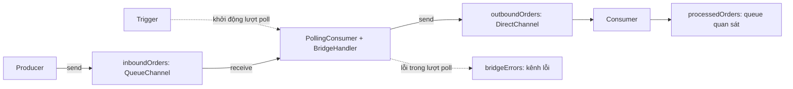

# Bridge với poller

## 1. Mục tiêu và tình huống sử dụng

Trong chương **Messaging bridge** của module **SPRING_INTEGRATION_CORE**, bài này trình bày cách nối một kênh có hàng đợi với luồng xử lý thông điệp bằng bridge có poller. Trọng tâm là quan hệ giữa `Message`, `MessageChannel`, endpoint và Java DSL, cùng cách quan sát lỗi và kiểm thử luồng bất đồng bộ.

Sau bài học, bạn có thể:

- Giải thích vì sao bridge nhận từ `QueueChannel` cần cơ chế polling.
- Cấu hình trigger, `maxMessagesPerPoll` và `receiveTimeout` theo nhu cầu xử lý.
- Xác định thread nào đang chạy producer, bridge và consumer.
- Phân biệt việc đưa message vào queue với việc xử lý nghiệp vụ thành công.
- Kiểm thử đường chuyển tiếp và đường lỗi mà không dựa vào thời gian ngủ cố định.

Giả sử hệ thống tiếp nhận đơn hàng theo từng đợt. Producer cần bàn giao nhanh, còn dịch vụ xử lý đơn chỉ có năng lực hữu hạn. Ta dùng một queue có dung lượng giới hạn làm vùng đệm, rồi để bridge rút message theo lịch và chuyển sang kênh xử lý.

Bridge nối các kênh khi payload đã phù hợp với phía nhận. Nếu cần đổi định dạng, chọn transformer; nếu cần chọn tuyến, dùng router; nếu cần loại bỏ message theo điều kiện, dùng filter. Aggregator phù hợp khi cần gom nhiều message thành một kết quả. Bridge không thay thế các trách nhiệm đó. [Tài liệu Messaging Bridge](https://docs.spring.io/spring-integration/reference/bridge.html).

## 2. Mô hình thực thi



Các vai trò cần tách rõ:

| Thành phần | Trách nhiệm trong ví dụ |
|---|---|
| `Message<?>` | Mang payload đơn hàng và các header nghiệp vụ |
| `QueueChannel` đầu vào | Giữ message đến khi có consumer nhận |
| Trigger | Xác định thời điểm thực hiện lượt poll |
| `PollingConsumer` | Nhận message từ kênh đầu vào rồi gọi handler |
| `BridgeHandler` | Chuyển tiếp message sang kênh đầu ra |
| `DirectChannel` đầu ra | Gọi consumer đã đăng ký trong thread đang gửi |

Với đầu vào triển khai `PollableChannel`, Spring Integration tạo `PollingConsumer`. Với đầu vào triển khai `SubscribableChannel`, endpoint dùng cơ chế event-driven. Vì vậy poller được cấu hình ở endpoint tiêu thụ queue. `QueueChannel` không tự tạo lịch chuyển message đi. [Tài liệu Poller](https://docs.spring.io/spring-integration/reference/polling-consumer.html).

Trong cấu hình thông thường của bài, producer chạy trên thread A. Khi `send()` đưa message vào queue thành công, thread A có thể tiếp tục. Đến lượt poll, thread B của scheduler nhận message, gọi bridge rồi gọi consumer thông qua `DirectChannel`. Consumer vẫn chạy trên thread B cho đến khi gặp một ranh giới bất đồng bộ khác.

## 3. Một lượt poll làm gì?

Có thể hình dung thuật toán bằng mã giả sau. Đây là mô hình giải thích, không phải mã nguồn sao chép từ framework:

```text
khi trigger cho phép chạy:
    lặp tối đa M lần:
        message = input.receive(receiveTimeout)
        nếu message là null:
            kết thúc lượt poll
        bridge chuyển message sang output
        chờ phần downstream đồng bộ của lần chuyển này hoàn tất
```

Nếu `M = 4` nhưng queue chỉ có hai message, lượt poll có thể chuyển hai message rồi nhận `null`. Nếu queue liên tục được bổ sung, giới hạn dương giúp lượt poll kết thúc sau một số lần nhận hữu hạn. Khi một lần xử lý ném exception chưa được xử lý, không nên suy luận rằng các lần nhận còn lại trong lượt vẫn sẽ thực hiện như bình thường.

Điều đáng chú ý là `maxMessagesPerPoll(4)` vẫn chuyển từng message riêng. Consumer không nhận một `List` gồm bốn phần tử. Muốn xử lý một batch dưới dạng một message, bạn phải thiết kế thêm thành phần gom nhóm thích hợp.

## 4. Cấu hình hoàn chỉnh bằng Java DSL

Ví dụ dùng Java 17 trở lên, Spring Integration Core và Spring Context tương thích với nhau. Java DSL được cung cấp trong `spring-integration-core`. Trong dự án Spring Boot, có thể dùng `spring-boot-starter-integration` và để cơ chế quản lý dependency của dự án chọn phiên bản tương thích.

Cấu hình sau có thể được nạp trực tiếp bằng `AnnotationConfigApplicationContext`. Consumer cuối chỉ đóng vai trò quan sát kết quả; chuỗi `FAIL` được dành làm đầu vào gây lỗi cho bài thực hành.

```java
package example.bridge;

import java.time.Duration;

import org.springframework.beans.factory.annotation.Qualifier;
import org.springframework.context.annotation.Bean;
import org.springframework.context.annotation.Configuration;
import org.springframework.integration.channel.DirectChannel;
import org.springframework.integration.channel.QueueChannel;
import org.springframework.integration.config.EnableIntegration;
import org.springframework.integration.dsl.IntegrationFlow;
import org.springframework.integration.dsl.Pollers;
import org.springframework.messaging.MessageDeliveryException;
import org.springframework.messaging.MessageHandler;

@Configuration(proxyBeanMethods = false)
@EnableIntegration
public class PolledBridgeConfig {

    @Bean
    public QueueChannel inboundOrders() {
        return new QueueChannel(200);
    }

    @Bean
    public DirectChannel outboundOrders() {
        return new DirectChannel();
    }

    @Bean
    public QueueChannel processedOrders() {
        return new QueueChannel(200);
    }

    @Bean
    public QueueChannel bridgeErrors() {
        return new QueueChannel(100);
    }

    @Bean
    public IntegrationFlow ordersBridgeFlow() {
        return IntegrationFlow.from("inboundOrders")
                .bridge(endpoint -> endpoint
                        .id("ordersBridge")
                        .poller(Pollers
                                .fixedDelay(Duration.ofMillis(250))
                                .maxMessagesPerPoll(4)
                                .receiveTimeout(0)
                                .errorChannel("bridgeErrors")))
                .channel("outboundOrders")
                .get();
    }

    @Bean
    public IntegrationFlow orderConsumerFlow(
            @Qualifier("processedOrders") QueueChannel processedOrders) {

        return IntegrationFlow.from("outboundOrders")
                .handle((MessageHandler) message -> {
                    if ("FAIL".equals(message.getPayload())) {
                        throw new IllegalStateException(
                                "Không xử lý được đơn hàng mô phỏng");
                    }

                    if (!processedOrders.send(message, 0)) {
                        throw new MessageDeliveryException(
                                message, "Queue kết quả đã đầy");
                    }
                })
                .get();
    }
}
```

Đọc cấu hình theo đường đi của message:

1. `IntegrationFlow.from("inboundOrders")` chọn kênh có sẵn làm đầu vào. Bước này không tự lấy message khỏi queue.
2. `.bridge(...)` khai báo endpoint chuyển tiếp và gắn poller cho endpoint đó.
3. Trigger dùng khoảng nghỉ 250 ms sau khi lượt poll trước hoàn tất; `maxMessagesPerPoll(4)` giới hạn mỗi lượt nhận tối đa bốn message.
4. `receiveTimeout(0)` làm thao tác nhận trả về ngay khi queue rỗng.
5. `.channel("outboundOrders")` chọn đầu ra cho bridge. Consumer flow đăng ký vào kênh này.
6. `bridgeErrors` nhận lỗi polling theo cấu hình; trong ví dụ nó là queue để bài kiểm thử chủ động lấy lỗi ra.

`processedOrders` là điểm quan sát cho bài thực hành. Trong ứng dụng thật, consumer có thể gọi dịch vụ lưu đơn, gửi thông báo hoặc bàn giao cho luồng tiếp theo. Khi đó cần xác định rõ kết quả nào được tính là xử lý thành công.

Queue lỗi cũng cần consumer hoặc cơ chế thu thập lỗi khi đưa vào vận hành. Chỉ khai báo một queue lỗi rồi để message nằm mãi trong đó chưa tạo thành quy trình xử lý sự cố.

## 5. Gửi message và hiểu ý nghĩa kết quả

Đoạn mã sau có thể đặt trong một phương thức của chương trình demo. Các import cần thêm là `AnnotationConfigApplicationContext`, `Message` và `MessageBuilder`.

```java
try (var context = new AnnotationConfigApplicationContext(
        PolledBridgeConfig.class)) {

    QueueChannel input = context.getBean(
            "inboundOrders", QueueChannel.class);
    QueueChannel results = context.getBean(
            "processedOrders", QueueChannel.class);

    Message<String> order = MessageBuilder
            .withPayload("ORDER-1042")
            .setHeader("orderId", "1042")
            .setHeader("source", "checkout")
            .build();

    boolean accepted = input.send(order, 1000);
    if (!accepted) {
        throw new IllegalStateException("Chưa bàn giao được đơn vào queue");
    }

    Message<?> result = results.receive(3000);
    if (result == null) {
        throw new IllegalStateException("Hết thời gian chờ kết quả");
    }

    System.out.println(result.getPayload());
    System.out.println(result.getHeaders().get("orderId"));
}
```

Kết quả mong đợi ở đường thành công là payload `ORDER-1042` và header `orderId` bằng `1042`. Bridge không chủ đích biến đổi nội dung nghiệp vụ; bài kiểm thử nên xác nhận payload và những header có ý nghĩa với ứng dụng, thay vì mặc định mọi chi tiết định danh kỹ thuật của message đều là hợp đồng nghiệp vụ.

`input.send(order, 1000)` thành công cho biết queue đã tiếp nhận message. Nó không chứng minh dịch vụ xử lý đã chạy thành công. Nếu một gateway cần trả kết quả nghiệp vụ cho caller, thiết kế request-reply và timeout tương ứng; thời gian chờ còn bao gồm thời gian nằm trong queue và chờ lượt poll.

Với queue có giới hạn, `send(message, timeout)` có thể chờ khi đầy và trả `false` khi hết thời gian chờ. `receive(0)` trả ngay khi không có message. Queue trong bộ nhớ mặc định không cung cấp khả năng khôi phục message sau khi tiến trình chết. [Tài liệu QueueChannel và DirectChannel](https://docs.spring.io/spring-integration/reference/6.5/channel/implementations.html).

## 6. Các tham số cần hiểu trước khi điều chỉnh

| Cấu hình | Câu hỏi mà nó trả lời | Ảnh hưởng trong bài |
|---|---|---|
| `fixedDelay(Duration)` | Sau khi xong một lượt, nghỉ bao lâu? | Consumer chậm làm thời điểm lượt sau lùi lại |
| `fixedRate(Duration)` | Các thời điểm bắt đầu theo lịch cách nhau bao lâu? | Thời điểm chạy thực tế còn phụ thuộc scheduler và tải |
| `maxMessagesPerPoll(M)` | Một lượt được nhận tối đa bao nhiêu message? | Tạo giới hạn công việc của một lượt |
| `receiveTimeout(t)` | Một lần nhận chờ message bao lâu? | Queue rỗng có thể giữ thread trong khoảng chờ |
| Dung lượng queue | Có thể tích lũy bao nhiêu message? | Quyết định khi nào producer gặp áp lực ngược |

Các overload dùng `Duration` biểu diễn đơn vị rõ ràng. `receiveTimeout` trong Java DSL nhận số mili giây. [API Pollers](https://docs.spring.io/spring-integration/api/org/springframework/integration/dsl/Pollers.html), [API PollerSpec](https://docs.spring.io/spring-integration/api/org/springframework/integration/dsl/PollerSpec.html).

Với `PollingConsumer`, mặc định `maxMessagesPerPoll` là `-1`, tức không đặt giới hạn số lần nhận dương cho lượt poll. `SourcePollingChannelAdapter` có mặc định khác là `1`. Cấu hình hữu hạn tường minh giúp tránh nhầm hai loại endpoint này. [Tài liệu Message Endpoints](https://docs.spring.io/spring-integration/reference/endpoint.html).

### 6.1. Vì sao đặt `receiveTimeout(0)`?

Giả sử lượt poll được phép nhận bốn lần nhưng chỉ có một message. Sau khi xử lý message đó, lần nhận tiếp theo gặp queue rỗng:

- Với timeout bằng `0`, lần nhận trả về ngay và lượt poll kết thúc.
- Với timeout bằng `1000`, lần nhận có thể chờ tới một giây trước khi trả về `null`.

Nếu trong lúc chờ có message mới, poller có thể tiếp tục xử lý nó trong lượt hiện tại. Vì thế timeout ảnh hưởng cả độ trễ, mức sử dụng thread và thời lượng lượt poll.

Trong bài, trigger đã quyết định nhịp kiểm tra nên timeout bằng `0` làm hành vi dễ quan sát. Hệ thống khác có thể chọn chờ có giới hạn để giảm độ trễ cho message đến ngay sau một lần kiểm tra. Hãy cân nhắc scheduler còn phục vụ những endpoint nào.

### 6.2. Poller mặc định toàn ứng dụng

Có thể khai báo một poller mặc định để các polling endpoint dùng chung chính sách. Khi áp dụng cho bridge, cần biết bridge đang dùng poller cục bộ hay poller mặc định, và các tham số thực tế đến từ đâu.

Ví dụ này cấu hình cục bộ nhằm làm rõ chính sách chuyển tiếp. Nếu bỏ `.poller(...)`, không nên suy luận rằng bridge luôn chạy được: phải có cấu hình mặc định phù hợp. Poller trên một endpoint có đầu vào chỉ hỗ trợ subscribe cũng không phù hợp với mô hình polling. [Tài liệu cấu hình endpoint](https://docs.spring.io/spring-integration/reference/endpoint.html).

## 7. Nhịp phát message và thông lượng

### 7.1. Trace của một hàng đợi có sẵn

Giả sử queue chứa chín message, mỗi message mất 40 ms cho toàn bộ phần downstream đồng bộ, `M = 4`, fixed delay bằng 250 ms và không có lỗi. Bỏ qua chi phí framework, một diễn tiến minh họa là:

| Lượt | Thời điểm bắt đầu tương đối | Số message xử lý | Thời điểm hoàn tất | Còn trong queue |
|---|---:|---:|---:|---:|
| 1 | 0 ms | 4 | 160 ms | 5 |
| 2 | 410 ms | 4 | 570 ms | 1 |
| 3 | 820 ms | 1 | 860 ms | 0 |

Mốc `0 ms` là thời điểm lượt đầu thực sự bắt đầu, không phải cam kết về thời điểm khởi động ứng dụng. Ví dụ cho thấy khoảng nghỉ được cộng sau thời gian xử lý của lượt trước.

### 7.2. Ước lượng khi backlog luôn đủ lớn

Trong điều kiện một polling task xử lý tuần tự, queue luôn có ít nhất `M` message, mỗi message mất trung bình `h` giây và fixed delay bằng `d` giây:

```text
thời gian một chu kỳ ≈ M × h + d
thông lượng trung bình ≈ M / (M × h + d)
```

Với `M = 4`, `h = 0,04` và `d = 0,25`, ước lượng là:

```text
4 / (4 × 0,04 + 0,25) ≈ 9,76 message/giây
```

Đây là phép tính mô hình cho ví dụ, không phải kết quả benchmark. Nếu đầu vào trung bình là 15 message/giây trong thời gian dài, vùng đệm sẽ tích lũy thêm khoảng `15 - 9,76 = 5,24` message/giây theo các giả định này. Một queue lớn hơn chỉ kéo dài thời gian trước khi đầy.

`maxMessagesPerPoll` cho phép nhiều message đi sát nhau trong cùng một lượt. Nếu đối tác giới hạn số request trong mọi cửa sổ một giây, cần thêm cơ chế kiểm soát phù hợp với hợp đồng đó. Nhiều instance ứng dụng còn có thể cùng gửi đến một đối tác; giới hạn riêng của mỗi instance không tự tạo giới hạn tổng cho cả cụm.

### 7.3. Chọn fixed delay hay fixed rate?

Fixed delay phù hợp khi muốn dành khoảng nghỉ sau mỗi lượt làm việc. Fixed rate phù hợp khi muốn đặt các mốc bắt đầu theo lịch. Một lượt chậm hoặc thiếu thread có thể làm lịch thực tế trễ; đổi sang fixed rate không làm consumer xử lý nhanh hơn.

Khi bổ sung `taskExecutor` cho poller hoặc dùng `ExecutorChannel` phía sau bridge, cần đánh giá lại số tác vụ đang chờ, khả năng chạy đồng thời và thứ tự hoàn thành. Đừng áp dụng nguyên công thức tuần tự ở trên cho một cấu hình đã thay đổi mô hình thực thi.

## 8. Cách khai báo tương đương

Các cấu hình dưới đây là phương án thay thế cho bridge Java DSL, không đăng ký đồng thời với `ordersBridgeFlow()` trên cùng queue nếu mục tiêu chỉ là một bridge.

### 8.1. Annotation `@BridgeFrom`

Đặt annotation trên bean kênh đầu ra, trỏ về kênh đầu vào:

```java
import org.springframework.integration.annotation.BridgeFrom;
import org.springframework.integration.annotation.Poller;

@Bean
@BridgeFrom(
        value = "inboundOrders",
        poller = @Poller(
                fixedDelay = "250",
                maxMessagesPerPoll = "4",
                receiveTimeout = "0"))
public DirectChannel outboundOrders() {
    return new DirectChannel();
}
```

Đoạn này giả định bean `inboundOrders` và consumer đầu ra đã tồn tại. Nếu chuyển từ cấu hình chính sang annotation, bỏ định nghĩa cũ trùng tên `outboundOrders` và bridge DSL. Đường xử lý lỗi của cấu hình annotation cũng cần được chọn tương ứng nếu muốn giữ hành vi kênh lỗi riêng của ví dụ chính.

### 8.2. XML

Nếu dự án dùng namespace `int` của Spring Integration, có thể biểu diễn đường chuyển tiếp như sau:

```xml
<int:channel id="inboundOrders">
    <int:queue capacity="200"/>
</int:channel>

<int:channel id="outboundOrders"/>

<int:bridge id="ordersBridge"
            input-channel="inboundOrders"
            output-channel="outboundOrders">
    <int:poller fixed-delay="250"
                max-messages-per-poll="4"
                receive-timeout="0"
                error-channel="bridgeErrors"/>
</int:bridge>
```

Đây là phần cấu hình luồng, cần đặt trong tài liệu Spring XML có namespace tương ứng. Kênh `bridgeErrors` và consumer đầu ra phải được khai báo thêm. Các dạng DSL, annotation và XML đều phục vụ mô hình bridge được mô tả trong [tài liệu chính thức](https://docs.spring.io/spring-integration/reference/bridge.html).

## 9. Lỗi xảy ra ở đâu và ai nhận lỗi?

Với cấu hình chính, producer đã bàn giao message vào queue trước khi poller gọi downstream. Nếu consumer ném exception qua `DirectChannel`, exception quay về tác vụ polling, rồi được xuất bản thành `ErrorMessage`. Producer không nhận lại exception đó qua lần gọi `send()` đã hoàn tất.

Trong cơ chế xuất bản lỗi thông thường, header `errorChannel` của message có thể quyết định đích nhận lỗi. Cấu hình `.errorChannel("bridgeErrors")` cung cấp kênh lỗi mặc định riêng cho poller khi không có header điều hướng khác. Nếu không cấu hình riêng, framework dùng cơ chế kênh lỗi toàn cục. [Tài liệu Error Handling](https://docs.spring.io/spring-integration/reference/error-handling.html).

Thử gửi payload `FAIL` trong ví dụ:

```text
producer gửi FAIL vào inboundOrders thành công
    -> poller nhận message khỏi queue
    -> bridge chuyển sang outboundOrders
    -> consumer ném IllegalStateException
    -> tác vụ polling chuyển lỗi sang bridgeErrors
```

Payload của `ErrorMessage` là exception, thường chứa ngữ cảnh của thất bại qua `MessagingException` và `failedMessage`. Khi ghi nhận lỗi, nên lưu mã đơn, bước xử lý và nguyên nhân để điều tra hoặc tái xử lý.

Việc message lỗi xuất hiện trong `bridgeErrors` không có nghĩa message gốc đã được đưa lại vào `inboundOrders`. Ví dụ không cài chính sách retry hay requeue. Cần thiết kế riêng việc thử lại có giới hạn, cách ly message lỗi và chống xử lý trùng khi replay.

Nếu thêm ranh giới bất đồng bộ sau bridge, lỗi của phần chạy sau ranh giới đó cần được xử lý ở cơ chế thực thi tương ứng. Khi ấy, bridge có thể đã hoàn tất việc bàn giao trước khi lỗi nghiệp vụ xảy ra.

## 10. Thread, transaction và độ tin cậy

Một `QueueChannel` trong bộ nhớ là vùng đệm giữa các thread. Khi poller nhận message ra, lỗi downstream không tự hoàn tác thao tác nhận đó. Restart tiến trình cũng không khôi phục những message chỉ nằm trong bộ nhớ.

Poller hỗ trợ transaction để việc nhận từ tài nguyên có khả năng tham gia transaction và phần xử lý liên quan nằm trong ranh giới thích hợp. Khả năng rollback phụ thuộc tài nguyên, transaction manager và điểm chuyển thread; chỉ thêm `.transactional(...)` không tự biến queue trong bộ nhớ thành hàng đợi bền vững. [Tài liệu Transaction Support](https://docs.spring.io/spring-integration/reference/transactions.html).

Khi thiết kế cho đơn hàng quan trọng, hãy xác định:

- **Điểm tiếp nhận bền vững:** nơi nào xác nhận message đã được lưu đủ an toàn để phục hồi?
- **Điểm hoàn tất nghiệp vụ:** khi nào được đánh dấu đơn đã xử lý?
- **Khóa chống trùng:** nếu cùng `orderId` được gửi lại, consumer xử lý ra sao?
- **Chính sách lỗi:** message nào thử lại, message nào chuyển sang nơi cách ly?
- **Ranh giới transaction:** tài nguyên nào tham gia, đoạn nào vẫn ở cùng thread?

Bridge giúp kết nối luồng và điều tiết việc rút message. Bảo đảm giao nhận của toàn hệ thống cần được xây dựng từ các quyết định trên.

## 11. Kiểm thử đường chuyển tiếp và đường lỗi

Lớp kiểm thử dưới đây dùng lại `PolledBridgeConfig`. Cần JUnit Jupiter; trong dự án Spring Boot thường lấy từ `spring-boot-starter-test`. Mỗi test mở context riêng để không chia sẻ message còn sót giữa các lần chạy.

```java
package example.bridge;

import org.junit.jupiter.api.Test;
import org.springframework.context.annotation.AnnotationConfigApplicationContext;
import org.springframework.integration.channel.QueueChannel;
import org.springframework.messaging.Message;
import org.springframework.messaging.MessagingException;
import org.springframework.messaging.support.ErrorMessage;
import org.springframework.messaging.support.MessageBuilder;

import static org.junit.jupiter.api.Assertions.*;

class PolledBridgeTest {

    @Test
    void forwardsPayloadAndBusinessHeaders() {
        try (var context = new AnnotationConfigApplicationContext(
                PolledBridgeConfig.class)) {

            QueueChannel input = context.getBean(
                    "inboundOrders", QueueChannel.class);
            QueueChannel results = context.getBean(
                    "processedOrders", QueueChannel.class);
            QueueChannel errors = context.getBean(
                    "bridgeErrors", QueueChannel.class);

            Message<String> request = MessageBuilder
                    .withPayload("ORDER-1042")
                    .setHeader("orderId", "1042")
                    .setHeader("source", "checkout")
                    .build();

            assertTrue(input.send(request, 1000));

            Message<?> result = results.receive(3000);
            assertNotNull(result);
            assertEquals("ORDER-1042", result.getPayload());
            assertEquals("1042", result.getHeaders().get("orderId"));
            assertEquals("checkout", result.getHeaders().get("source"));
            assertNull(errors.receive(0));
        }
    }

    @Test
    void publishesDownstreamFailureAsErrorMessage() {
        try (var context = new AnnotationConfigApplicationContext(
                PolledBridgeConfig.class)) {

            QueueChannel input = context.getBean(
                    "inboundOrders", QueueChannel.class);
            QueueChannel results = context.getBean(
                    "processedOrders", QueueChannel.class);
            QueueChannel errors = context.getBean(
                    "bridgeErrors", QueueChannel.class);

            Message<String> request = MessageBuilder
                    .withPayload("FAIL")
                    .setHeader("orderId", "broken-1043")
                    .build();

            assertTrue(input.send(request, 1000));

            Message<?> error = errors.receive(3000);
            assertNotNull(error);
            assertTrue(error instanceof ErrorMessage);
            assertTrue(error.getPayload() instanceof MessagingException);

            MessagingException failure =
                    (MessagingException) error.getPayload();
            Message<?> failedMessage = failure.getFailedMessage();
            assertNotNull(failedMessage);
            assertEquals("FAIL", failedMessage.getPayload());
            assertEquals("broken-1043",
                    failedMessage.getHeaders().get("orderId"));
            assertNull(results.receive(0));
        }
    }
}
```

Điểm quan trọng của thiết kế test:

- `receive(3000)` đợi có điều kiện và kết thúc ngay khi có kết quả; không ngủ cố định rồi đoán rằng scheduler đã chạy.
- Timeout là giới hạn chờ cho môi trường kiểm thử, không phải lời hứa về độ trễ production.
- Test thành công kiểm tra nội dung nghiệp vụ sau ranh giới queue.
- Test thất bại xác nhận đường lỗi, đồng thời chứng minh enqueue thành công không đồng nghĩa downstream thành công.

Hai test này không kiểm chứng chính xác bốn message trong từng lượt poll. Muốn kiểm tra giới hạn mỗi lượt, cần điều khiển trigger hoặc lịch chạy trong test, nạp backlog trước khi cho phép lượt chạy và ghi nhận các lần gọi consumer của lượt đó. Đếm kết quả sau một `Thread.sleep(250)` dễ sai do thời điểm khởi động và lịch phân phối thread.

Các đoạn test là tài liệu thực hành để chạy trong môi trường dự án có dependency tương thích; chúng không phải báo cáo kết quả thực thi của bài viết.

## 12. Chẩn đoán các vấn đề thường gặp

| Hiện tượng | Điều cần kiểm tra | Hướng xử lý |
|---|---|---|
| Queue có message nhưng đầu ra im lặng | Endpoint đã start chưa? Có poller phù hợp không? Có đang nhận từ đúng bean không? | Kiểm tra cấu hình và lifecycle của bridge |
| Ứng dụng lỗi khi tạo polling endpoint | Poller cục bộ hoặc mặc định có tồn tại và hợp lệ không? | Khai báo chính sách polling tường minh |
| Gắn poller vào đầu vào `DirectChannel` gây lỗi cấu hình | Kênh có hỗ trợ `receive()` không? | Dùng subscribe cho `SubscribableChannel`, polling cho `PollableChannel` |
| Đầu ra báo không có subscriber | Consumer đã được đăng ký và start chưa? | Kiểm tra bean consumer và đích đầu ra |
| Producer chờ lâu hoặc `send()` trả `false` | Queue đã đầy? Tốc độ xử lý có thấp hơn tốc độ vào lâu dài? | Đặt timeout phù hợp, đo backlog và xử lý năng lực thiếu hụt |
| Lượt poll kéo dài dù queue gần rỗng | `receiveTimeout` có đang giữ thread? | Điều chỉnh thời gian chờ theo mục tiêu độ trễ |
| Thêm bridge thứ hai nhưng mỗi bên chỉ thấy một phần message | Hai consumer có đang cạnh tranh trên cùng queue không? | Dùng cơ chế publish-subscribe nếu cần phát cho nhiều bên |
| Message lỗi biến mất khỏi queue đầu vào | Đã bị nhận ra trước khi downstream lỗi? | Đọc kênh lỗi; thiết kế retry hoặc phục hồi rõ ràng |
| Test thành công khi chạy riêng nhưng chập chờn khi chạy cả bộ | Context, queue hoặc scheduler có bị dùng chung? | Cô lập dữ liệu và đợi theo điều kiện |

Không chẩn đoán dựa duy nhất vào việc input queue rỗng: message có thể đang xử lý, đã bàn giao sang nơi khác hoặc đã thất bại. Cần kết hợp trạng thái endpoint, số message hoàn tất và kênh lỗi.

## 13. Bài thực hành mở rộng

### Bài 1: Quan sát giới hạn mỗi lượt

Tạo 12 message có `orderId` khác nhau. Đặt `maxMessagesPerPoll(3)`, fixed delay một giây và `receiveTimeout(0)`. Ghi thời điểm cùng thread trong consumer, rồi quan sát các nhóm xử lý theo lượt. Chạy trong môi trường kiểm soát được lịch; không biến một khoảng thời gian ngủ tùy ý thành khẳng định chính xác về số lượt đã chạy.

### Bài 2: Consumer xử lý chậm

Trong bản demo riêng, mô phỏng mỗi lần xử lý mất 100 ms. Dự đoán thời gian một lượt ba message và khoảng cách đến lượt sau. Đối chiếu log với dự đoán, giải thích phần thời gian nào thuộc xử lý và phần nào thuộc fixed delay. Tránh đưa thao tác chặn mô phỏng vào luồng production.

### Bài 3: Tạo áp lực ngược

Giảm dung lượng queue đầu vào xuống hai, dừng bridge trước khi gửi và dùng `send(message, 0)` cho ba message. Giải thích vì sao lần gửi thứ ba thất bại. Start bridge lại, xác nhận hai message đã nhận được tiếp tục đi xuống luồng. Đây là kiểm tra backpressure của queue và lifecycle, không phải kiểm tra khả năng phục hồi sau crash.

### Bài 4: Xử lý message gây lỗi

Gửi một đơn hợp lệ, một payload `FAIL` và một đơn hợp lệ khác. Xác nhận các đơn hợp lệ có thể hoàn tất qua những lượt polling tiếp theo và đơn lỗi được ghi nhận ở kênh lỗi. Đề xuất chính sách replay theo `orderId` sao cho việc gửi lại không tạo tác dụng phụ trùng lặp.

## 14. Các điểm cần ghi nhớ

Bridge có poller là một điểm nối hữu ích khi cần rút message từ queue rồi bàn giao sang luồng subscribe. Trigger quyết định nhịp lượt poll, số message tối đa quyết định lượng công việc của lượt, còn receive timeout quyết định việc chờ trong từng lần nhận.

Muốn vận hành ổn định, hãy thiết kế cùng lúc dung lượng queue, năng lực downstream, đường lỗi và điểm xác nhận hoàn tất. Khi kiểm thử, quan sát cả kết quả và lỗi ở phía sau ranh giới bất đồng bộ, đồng thời đợi theo điều kiện có timeout.