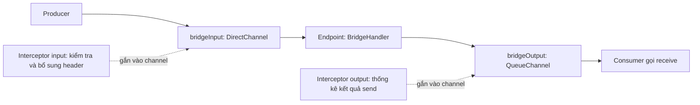

# Bridge với channel interceptor

Trong chương **Messaging bridge** của module **SPRING_INTEGRATION_CORE**, bài này hướng dẫn bổ sung kiểm tra header, mã theo dõi và quan sát kết quả gửi tại hai phía của một bridge. Trọng tâm là quan hệ giữa `Message`, `MessageChannel`, endpoint bridge và Java DSL khi áp dụng hành vi dùng chung cho luồng tích hợp.

Sau bài học, bạn có thể chọn đúng channel để gắn interceptor, đọc được thứ tự callback, phân biệt chặn gửi với lỗi xử lý và viết kiểm thử xác nhận thông điệp thực sự đi qua bridge.

## 1. Interceptor đứng ở đâu quanh một bridge?

Messaging bridge là endpoint nối hai channel. Nếu không cần đổi định dạng dữ liệu, bridge có thể chuyển tiếp thông điệp sang phía còn lại; nếu input là channel cần polling, endpoint bridge cần cấu hình poller. Xem [Messaging Bridge](https://docs.spring.io/spring-integration/reference/bridge.html).

Trong ví dụ đơn hàng, ta muốn:

- Mỗi thông điệp đến cửa vào phải có `tenantId` hợp lệ về cấu trúc.
- Thông điệp thiếu mã theo dõi sẽ được bổ sung `bridgeTraceId`.
- Phía đích thống kê kết quả gửi vào hàng đợi.
- Payload đơn hàng giữ nguyên trong bước nối channel.



Interceptor gắn vào **channel**, không gắn trực tiếp vào đối tượng bridge. Vì vậy, một producer khác gửi thẳng vào `bridgeOutput` cũng kích hoạt interceptor của channel đích. Nếu cần đo riêng đường đi qua bridge này, hãy dành channel riêng hoặc phân loại bằng metadata do luồng đáng tin cậy tạo.

Trong thiết kế trên, input là điểm kiểm tra hợp đồng thông điệp; output là điểm quan sát khả năng tiếp nhận vào bộ đệm. Hai điểm trả lời hai câu hỏi khác nhau.

## 2. Các callback cần nắm

`ChannelInterceptor` thuộc package `org.springframework.messaging.support`. Bạn chỉ cần override callback phục vụ yêu cầu của mình.

| Callback | Công dụng chính |
| --- | --- |
| `preSend(message, channel)` | Đọc, thay thế hoặc chặn thông điệp trước khi gửi |
| `postSend(message, channel, sent)` | Quan sát giá trị trả về của thao tác gửi |
| `afterSendCompletion(message, channel, sent, ex)` | Dọn dẹp hoặc ghi nhận kết quả hoàn tất gửi |
| `preReceive(channel)` | Cho phép hoặc ngăn thao tác lấy từ channel |
| `postReceive(message, channel)` | Xử lý thông điệp vừa lấy ra |
| `afterReceiveCompletion(message, channel, ex)` | Dọn dẹp sau thao tác nhận |

`preSend` trả `null` ngăn thao tác gửi. `preReceive` trả `false` ngăn lấy thông điệp. Callback hoàn tất của một interceptor chỉ áp dụng khi callback trước tương ứng của chính interceptor đó đã thành công và cho phép tiếp tục. Đây là điều kiện quan trọng khi quản lý tài nguyên. Xem [ChannelInterceptor API](https://docs.spring.io/spring-framework/docs/6.1.14/javadoc-api/org/springframework/messaging/support/ChannelInterceptor.html).

Trong sơ đồ:

- `bridgeInput` dùng callback gửi; nó không có thao tác polling.
- `bridgeOutput` dùng callback gửi khi bridge đưa thông điệp vào hàng đợi.
- Callback nhận của output chạy khi consumer thực hiện `receive()`, ở một thời điểm khác.

Callback nhận chỉ có ý nghĩa với `PollableChannel`. Không suy diễn thứ tự giữa send và receive của các luồng khác nhau từ một log đơn lẻ. Xem [Channel Interceptors](https://docs.spring.io/spring-integration/reference/6.3/channel/interceptors.html).

## 3. Ví dụ hoàn chỉnh: kiểm tra đầu vào, quan sát đầu ra

### 3.1. Giả định để đọc và chạy ví dụ

Ví dụ dùng Java 17 và API Spring Integration 6.3.x. Ứng dụng cần dependency `org.springframework.integration:spring-integration-core`; phần kiểm thử cần JUnit Jupiter. Hãy dùng bộ phiên bản tương thích do BOM của ứng dụng quản lý.

Các lớp cấu hình và kiểm thử bên dưới cùng package `example.bridge`. Đây là ví dụ Java configuration độc lập, không yêu cầu Spring Boot.

Ta dùng một `QueueChannel` dung lượng 10 để quan sát được thông điệp đầu ra trong kiểm thử. Ví dụ chỉ gửi ít thông điệp rồi lấy ra ngay; khi vận hành liên tục phải có consumer và chính sách chờ phù hợp.

### 3.2. Cấu hình và hai interceptor

```java
package example.bridge;

import java.util.UUID;
import java.util.concurrent.atomic.LongAdder;

import org.springframework.context.annotation.Bean;
import org.springframework.context.annotation.Configuration;
import org.springframework.integration.channel.DirectChannel;
import org.springframework.integration.channel.QueueChannel;
import org.springframework.integration.config.EnableIntegration;
import org.springframework.integration.dsl.IntegrationFlow;
import org.springframework.messaging.Message;
import org.springframework.messaging.MessageChannel;
import org.springframework.messaging.MessageDeliveryException;
import org.springframework.messaging.support.ChannelInterceptor;
import org.springframework.messaging.support.MessageBuilder;

@Configuration
@EnableIntegration
public class BridgeInterceptorConfig {

    @Bean
    public BoundaryHeaderInterceptor boundaryHeaderInterceptor() {
        return new BoundaryHeaderInterceptor();
    }

    @Bean
    public SendOutcomeInterceptor outputSendOutcome() {
        return new SendOutcomeInterceptor();
    }

    @Bean
    public DirectChannel bridgeInput(
            BoundaryHeaderInterceptor boundaryHeaderInterceptor) {
        DirectChannel channel = new DirectChannel();
        channel.addInterceptor(boundaryHeaderInterceptor);
        return channel;
    }

    @Bean
    public QueueChannel bridgeOutput(
            SendOutcomeInterceptor outputSendOutcome) {
        QueueChannel channel = new QueueChannel(10);
        channel.addInterceptor(outputSendOutcome);
        return channel;
    }

    @Bean
    public IntegrationFlow orderBridge(
            DirectChannel bridgeInput,
            QueueChannel bridgeOutput) {
        return IntegrationFlow.from(bridgeInput)
                .bridge(endpoint -> endpoint.id("orderBridgeEndpoint"))
                .channel(bridgeOutput)
                .get();
    }

    public static final class BoundaryHeaderInterceptor
            implements ChannelInterceptor {

        @Override
        public Message<?> preSend(Message<?> message,
                MessageChannel channel) {
            Object tenant = message.getHeaders().get("tenantId");
            if (!(tenant instanceof String tenantId)
                    || tenantId.isBlank()) {
                throw new MessageDeliveryException(
                        message, "tenantId phải là chuỗi không rỗng");
            }

            Object trace = message.getHeaders().get("bridgeTraceId");
            if (trace == null) {
                return MessageBuilder.fromMessage(message)
                        .setHeader(
                                "bridgeTraceId",
                                UUID.randomUUID().toString())
                        .build();
            }

            if (!(trace instanceof String traceId)
                    || traceId.isBlank()) {
                throw new MessageDeliveryException(
                        message, "bridgeTraceId phải là chuỗi không rỗng");
            }
            return message;
        }
    }

    public static final class SendOutcomeInterceptor
            implements ChannelInterceptor {

        private final LongAdder accepted = new LongAdder();
        private final LongAdder unsuccessful = new LongAdder();

        @Override
        public void afterSendCompletion(
                Message<?> message,
                MessageChannel channel,
                boolean sent,
                Exception ex) {
            if (sent && ex == null) {
                accepted.increment();
            }
            else {
                unsuccessful.increment();
            }
        }

        public long acceptedCount() {
            return accepted.sum();
        }

        public long unsuccessfulCount() {
            return unsuccessful.sum();
        }
    }
}
```

DSL `.bridge()` khai báo endpoint chuyển tiếp; các interceptor được đăng ký tại hai bean channel. Với input là `DirectChannel`, ví dụ không cần poller. Phương thức `.bridge(...)` và `.intercept(...)` được mô tả trong [BaseIntegrationFlowDefinition API](https://docs.spring.io/spring-integration/docs/6.3.2/api/org/springframework/integration/dsl/BaseIntegrationFlowDefinition.html).

### 3.3. Tại sao thiết kế như vậy?

`BoundaryHeaderInterceptor` xác nhận cấu trúc metadata trước khi endpoint nhận thông điệp. Điều kiện `tenantId` ở đây là hợp đồng dữ liệu của ví dụ; xác thực tenant và quyền truy cập phải dựa vào danh tính được hệ thống tin cậy.

Khi thiếu `bridgeTraceId`, interceptor tạo message bằng `MessageBuilder.fromMessage(message)`. Cách này giúp giữ payload và các header ứng dụng đang có, bao gồm đường trả lời hoặc đường lỗi nếu đã được thiết lập.

Không gọi `message.getHeaders().put(...)`. Header của message thông thường không cho sửa trực tiếp. Việc tạo message mới có thể tạo `id` và `timestamp` mới, nên dùng mã theo dõi riêng nếu cần nối các sự kiện qua nhiều bước. Không cố ghi đè hai header hệ thống đó. Xem [Message và header](https://docs.spring.io/spring-integration/reference/6.3/message.html).

`bridgeTraceId` là header tùy chỉnh của bài học. Nó không tự trở thành distributed tracing context, cũng không tự thay thế correlation strategy của aggregator.

`SendOutcomeInterceptor` dùng bộ đếm an toàn khi được nhiều luồng gọi. Nó không giữ `currentMessage` hay trạng thái của một lần gửi trong field dùng chung.

Tên `acceptedCount` được chọn theo điểm đo: thông điệp đã được channel đích nhận. Đó chưa phải số đơn hàng đã ghi cơ sở dữ liệu, đã chuyển phát hay đã hoàn thành nghiệp vụ.

## 4. Gắn interceptor bằng Java DSL hoặc cấu hình global

### 4.1. Đăng ký bằng DSL

Nếu muốn biểu diễn điểm gắn ngay trong flow, có thể dùng biến thể sau. Hãy bỏ `addInterceptor(...)` khỏi hai bean channel của mục 3 khi chuyển sang cách này để tránh đăng ký lặp.

```java
@Bean
public IntegrationFlow orderBridge(
        DirectChannel bridgeInput,
        QueueChannel bridgeOutput,
        BoundaryHeaderInterceptor boundaryHeaderInterceptor,
        SendOutcomeInterceptor outputSendOutcome) {
    return IntegrationFlow.from(bridgeInput)
            .intercept(boundaryHeaderInterceptor)
            .bridge(endpoint -> endpoint.id("orderBridgeEndpoint"))
            .channel(bridgeOutput)
            .intercept(outputSendOutcome)
            .get();
}
```

`.intercept(...)` thêm interceptor vào channel hiện tại của DSL. Hãy khai báo channel rõ ràng trước vị trí gắn để người đọc nhận ra điểm tác động. Cách đăng ký này vẫn có phạm vi channel: nếu channel được chia sẻ giữa nhiều flow thì các lần gửi khác vào channel đó cũng chịu tác động.

Một bean triển khai `ChannelInterceptor` đơn thuần chưa đủ để áp dụng lên mọi channel; bạn vẫn cần đăng ký local, DSL hoặc global.

### 4.2. Dùng global interceptor khi nhiều channel có cùng hợp đồng

Đoạn dưới là một phương án thay thế cho đăng ký local của interceptor kiểm tra header. Đặt phương thức này trong cấu hình có `@EnableIntegration` và import annotation `org.springframework.integration.config.GlobalChannelInterceptor`.

```java
@Bean
@GlobalChannelInterceptor(
        patterns = {"bridgeInput"},
        order = -100)
public BridgeInterceptorConfig.BoundaryHeaderInterceptor
        boundaryHeaderInterceptor() {
    return new BridgeInterceptorConfig.BoundaryHeaderInterceptor();
}
```

`patterns` chọn tên bean channel. `order` âm đặt global interceptor trước các interceptor khai báo trực tiếp trên channel; giá trị dương đặt sau. Xem [GlobalChannelInterceptor API](https://docs.spring.io/spring-integration/docs/6.3.2/api/org/springframework/integration/config/GlobalChannelInterceptor.html).

Trong ví dụ, chỉ chọn `bridgeInput` vì hợp đồng hiện tại yêu cầu kiểm tra tại cửa vào. Không tự mở rộng thành `*`: một luồng lỗi có thể mang `ErrorMessage` mà không có metadata đơn hàng, và một luồng audit có thể cần hợp đồng khác.

Nếu thay phương thức bean của mục 3 bằng phương thức global này, hãy bỏ đăng ký local tương ứng ở `bridgeInput`. Áp dụng cùng một interceptor theo hai đường có thể khiến kiểm tra hoặc thống kê chạy hai lần.

Khi cần prefix như `orders*`, hãy kiểm tra danh sách channel thực tế mà nó khớp. Tên endpoint `orderBridgeEndpoint` không phải tên channel để pattern lựa chọn.

## 5. Đọc thứ tự callback qua hai channel

Giả sử input có hai interceptor A, B theo thứ tự đăng ký; output có interceptor C. Input là `DirectChannel`, output là `QueueChannel` còn chỗ, không có lỗi và chưa có consumer gọi nhận.

```text
Producer gọi input.send(message)
  A.preSend
  B.preSend
  BridgeHandler chuyển tiếp
    C.preSend
    Output đưa message vào queue
    C.postSend(sent=true)
    C.afterSendCompletion(sent=true, ex=null)
  A.postSend(sent=true)
  B.postSend(sent=true)
  B.afterSendCompletion(sent=true, ex=null)
  A.afterSendCompletion(sent=true, ex=null)
Producer nhận true
```

Hai lời gọi gửi lồng nhau giải thích vì sao callback phía output xuất hiện trước callback kết thúc phía input. Callback hoàn tất chạy ngược thứ tự các interceptor đã đi qua bước trước thành công.

Các tình huống dừng sớm cần đọc khác:

| Tình huống tại input | Kết quả tại bridge | Callback của interceptor đang chặn |
| --- | --- | --- |
| A trả `null` trong `preSend` | Không được gọi | Không có completion của A |
| A cho qua, B trả `null` | Không được gọi | Không có completion của B; A được hoàn tất |
| A cho qua, B ném exception | Không được gọi | Không có completion của B; A được hoàn tất với lỗi |
| A và B cho qua, output gửi lỗi | Đã được gọi | A và B được hoàn tất với lỗi |

Thứ tự trên áp dụng cho đường gửi của ví dụ và có thể đối chiếu với [AbstractMessageChannel ở Spring Integration 6.3.2](https://github.com/spring-projects/spring-integration/blob/v6.3.2/spring-integration-core/src/main/java/org/springframework/integration/channel/AbstractMessageChannel.java).

Hệ quả khi viết code quản lý tài nguyên: nếu chính `preSend` đã mở một scope rồi gặp lỗi trước khi trả message, nó phải tự dọn scope đó. Đừng để tài nguyên phụ thuộc vào một callback chưa đủ điều kiện được gọi.

Đối với interceptor thống kê, cần quyết định điểm đo trước:

- Đặt đầu danh sách nếu muốn quan sát những lần gửi bị interceptor phía sau từ chối.
- Đặt sau kiểm tra nếu chỉ muốn tính các lần đã vượt qua hợp đồng đầu vào.
- Đặt riêng trên output nếu muốn thống kê khả năng nhận vào channel đích như ví dụ.

Không cộng số đếm ở input và output rồi diễn giải là tổng đơn hàng duy nhất. Một lần qua bridge tạo hai thao tác gửi ở hai channel.

## 6. Thay loại channel làm thay đổi ý nghĩa quan sát

| Cấu hình quanh bridge | Điểm cần hiểu khi đọc kết quả |
| --- | --- |
| `DirectChannel → bridge → DirectChannel` | Xử lý đồng bộ có thể kéo dài đến handler phía sau |
| `DirectChannel → bridge → QueueChannel` | Gửi thành công ở output phản ánh việc đưa vào queue |
| `QueueChannel → bridge → DirectChannel` | Cần poller; việc gửi vào input và việc bridge đọc input là hai thao tác riêng |
| `DirectChannel → bridge → ExecutorChannel` | Không coi completion của send là completion của handler chạy trong executor |

`QueueChannel` giữ thông điệp để lấy sau và hỗ trợ chờ khi đầy. Không có timeout có thể dẫn đến chờ vô hạn; giá trị 0 yêu cầu thao tác trả về ngay. Xem [Message Channel Implementations](https://docs.spring.io/spring-integration/reference/channel/implementations.html).

Nếu biến input của ví dụ thành queue, có thể minh họa cấu hình endpoint bằng đoạn sau; hai channel được cung cấp dưới dạng tham số:

```java
@Bean
public IntegrationFlow pollingBridge(
        QueueChannel polledInput,
        DirectChannel downstream) {
    return IntegrationFlow.from(polledInput)
            .bridge(endpoint -> endpoint
                    .poller(Pollers.fixedDelay(200)
                            .maxMessagesPerPoll(5)))
            .channel(downstream)
            .get();
}
```

Đoạn này cần import `org.springframework.integration.dsl.Pollers`. Đây là cấu hình thay thế, không khai báo cùng flow ở mục 3 trên cùng input.

Trong phương án polling, hãy tách hai số đo: thời gian producer gửi vào input queue và thời gian từ lúc poller lấy message đến khi chuyển tiếp xong. Một thời gian gửi ngắn không giải thích được độ trễ chờ trong hàng đợi.

Nếu cần quan sát việc handler thực sự chạy trên luồng executor, dùng cơ chế phù hợp như `ExecutorChannelInterceptor.beforeHandle` và `afterMessageHandled` trên channel hỗ trợ. Hai callback này bao quanh lời gọi subscriber trên tác vụ executor. Xem [ExecutorChannelInterceptor API](https://docs.spring.io/spring-framework/docs/6.1.14/javadoc-api/org/springframework/messaging/support/ExecutorChannelInterceptor.html).

Không dùng một biến `ThreadLocal` đặt ở producer để giả định consumer khác luồng sẽ nhận được ngữ cảnh đó. Với ngữ cảnh logging hoặc tracing, cần cơ chế truyền qua ranh giới luồng và dọn dẹp tương ứng; header chỉ là dữ liệu để cơ chế đó sử dụng.

## 7. Chặn, lỗi và retry quanh bridge

### 7.1. Trả null và ném exception phục vụ hai hợp đồng khác nhau

Trả `null` trong `preSend` phù hợp khi người gọi đã hiểu đây là một quyết định từ chối có kiểm soát và xử lý được kết quả gửi không thành công. Trong bài này, thiếu `tenantId` là vi phạm hợp đồng nên ví dụ ném exception để lỗi hiện rõ.

Nếu muốn từ chối đơn hàng theo điều kiện nghiệp vụ và chuyển chúng sang luồng khác, một filter có discard channel thường biểu đạt ý định rõ hơn. Tránh giấu quy tắc nghiệp vụ có nhiều nhánh trong interceptor của channel dùng chung.

Cũng cần phân biệt nơi chặn. Nếu interceptor ở output trả `null`, thao tác gửi output không thành công nhưng bridge đã được gọi. Không dùng kết quả mong đợi của bài kiểm thử chặn tại input để suy ra kết quả trả về của mọi cấu hình bridge.

### 7.2. Lỗi được quan sát ở đâu?

Với đường gửi đồng bộ, exception có thể truyền về caller. Với tác vụ xử lý bất đồng bộ hoặc poller, cơ chế xử lý lỗi của Spring Integration có thể xuất bản `ErrorMessage` đến channel lỗi được cấu hình. Chỉ thêm header `errorChannel` không tự chuyển mọi exception của một lời gọi channel trực tiếp thành thông điệp lỗi. Xem [Error Handling](https://docs.spring.io/spring-integration/reference/error-handling.html).

Trong ví dụ mục 3:

1. Producer gọi `bridgeInput.send(...)`.
2. Header sai bị từ chối ngay ở input.
3. Bridge và output chưa được gọi.
4. Producer nhận exception; bộ đếm output vẫn bằng 0.

Nếu lỗi phát sinh ở consumer sau khi message đã vào output queue, `afterSendCompletion` của lần gửi trước đó đã kết thúc. Hãy quan sát lỗi tại consumer hoặc luồng lỗi của consumer.

### 7.3. Không retry tùy tiện trong interceptor

Gọi lại `channel.send(message)` ngay trong `preSend` của chính channel có thể tạo đệ quy. Gọi gửi bù từ callback hoàn tất cũng khó xác định đâu là lần gửi gốc và đâu là lần lặp.

Trước khi đặt retry, hãy xác định phần việc cần thực hiện lại: thao tác chuyển tiếp, một handler nghiệp vụ hay toàn bộ flow. Advice ở endpoint cần được đánh giá theo đúng phạm vi nó bao quanh; không mặc định advice của bridge sẽ xử lý lỗi từ interceptor input chạy trước endpoint.

Nếu dùng lại message gốc cho từng lần thử, mã được sinh trong interceptor có thể thay đổi giữa các lần gửi độc lập. Muốn theo dõi một công việc xuyên retry, hãy tạo mã ổn định tại cửa vào đáng tin cậy hoặc bảo đảm sử dụng lại message đã được bổ sung metadata.

### 7.4. Timeout thuộc từng thao tác gửi

Bridge gọi gửi vào output như một bước riêng. Timeout truyền cho `input.send(message, timeout)` không phải một ngân sách thời gian tự động truyền xuyên toàn bộ flow.

Với queue hữu hạn, hãy cấu hình thời gian chờ gửi của bridge hoặc handler gửi ra phù hợp. Khi kiểm thử queue đầy, dùng timeout hữu hạn hoặc không chờ; không để bài kiểm thử treo vì chờ có chỗ trống.

## 8. Kiểm thử hành vi qua bridge

Bộ kiểm thử dưới đây sử dụng cấu hình mục 3. Mỗi test tạo context riêng để bộ đếm và hàng đợi không ảnh hưởng lẫn nhau. Các test xác nhận tác dụng quan sát được: message đến đích, header được giữ, thông điệp lỗi không vượt biên và thứ tự callback đồng bộ.

Đây là mã kiểm thử minh họa để chạy trong dự án Java tương thích; việc biên soạn tài liệu không đồng nghĩa các test này đã được thực thi.

```java
package example.bridge;

import java.util.ArrayList;
import java.util.List;

import org.junit.jupiter.api.AfterEach;
import org.junit.jupiter.api.BeforeEach;
import org.junit.jupiter.api.Test;
import org.springframework.context.annotation.AnnotationConfigApplicationContext;
import org.springframework.integration.channel.DirectChannel;
import org.springframework.integration.channel.QueueChannel;
import org.springframework.messaging.Message;
import org.springframework.messaging.MessageChannel;
import org.springframework.messaging.MessageDeliveryException;
import org.springframework.messaging.support.ChannelInterceptor;
import org.springframework.messaging.support.MessageBuilder;

import static org.junit.jupiter.api.Assertions.*;

class BridgeInterceptorTest {

    private AnnotationConfigApplicationContext context;
    private DirectChannel input;
    private QueueChannel output;
    private BridgeInterceptorConfig.SendOutcomeInterceptor outcome;

    @BeforeEach
    void setUp() {
        context = new AnnotationConfigApplicationContext(
                BridgeInterceptorConfig.class);
        input = context.getBean("bridgeInput", DirectChannel.class);
        output = context.getBean("bridgeOutput", QueueChannel.class);
        outcome = context.getBean(
                BridgeInterceptorConfig.SendOutcomeInterceptor.class);
    }

    @AfterEach
    void tearDown() {
        context.close();
    }

    @Test
    void addsTraceAndPreservesPayloadAndRoutingHeaders() {
        QueueChannel replies = new QueueChannel();
        QueueChannel errors = new QueueChannel();
        Message<String> source = MessageBuilder
                .withPayload("ORDER-42")
                .setHeader("tenantId", "tenant-a")
                .setReplyChannel(replies)
                .setErrorChannel(errors)
                .build();

        assertTrue(input.send(source));

        Message<?> result = output.receive(0);
        assertNotNull(result);
        assertEquals("ORDER-42", result.getPayload());
        assertEquals("tenant-a", result.getHeaders().get("tenantId"));
        String trace = result.getHeaders()
                .get("bridgeTraceId", String.class);
        assertNotNull(trace);
        assertFalse(trace.isBlank());
        assertSame(replies, result.getHeaders().getReplyChannel());
        assertSame(errors, result.getHeaders().getErrorChannel());
        assertEquals(1L, outcome.acceptedCount());
        assertEquals(0L, outcome.unsuccessfulCount());
        assertNull(output.receive(0));
    }

    @Test
    void preservesAnExistingTrace() {
        Message<String> source = MessageBuilder
                .withPayload("ORDER-43")
                .setHeader("tenantId", "tenant-a")
                .setHeader("bridgeTraceId", "flow-43")
                .build();

        assertTrue(input.send(source));

        Message<?> result = output.receive(0);
        assertNotNull(result);
        assertEquals("flow-43",
                result.getHeaders().get("bridgeTraceId"));
    }

    @Test
    void rejectsMissingTenantBeforeCallingTheBridge() {
        Message<String> source = MessageBuilder
                .withPayload("ORDER-44")
                .build();

        assertThrows(MessageDeliveryException.class,
                () -> input.send(source));

        assertNull(output.receive(0));
        assertEquals(0L, outcome.acceptedCount());
        assertEquals(0L, outcome.unsuccessfulCount());
    }

    @Test
    void aNullPreSendAtInputStopsTheFlow() {
        input.addInterceptor(0, new ChannelInterceptor() {
            @Override
            public Message<?> preSend(
                    Message<?> message, MessageChannel channel) {
                return null;
            }
        });
        Message<String> source = MessageBuilder
                .withPayload("ORDER-45")
                .setHeader("tenantId", "tenant-a")
                .build();

        assertFalse(input.send(source));

        assertNull(output.receive(0));
        assertEquals(0L, outcome.acceptedCount());
    }

    @Test
    void completesOutputSendBeforeCompletingInputSend() {
        List<String> events = new ArrayList<>();
        input.addInterceptor(new RecordingInterceptor("A", events));
        input.addInterceptor(new RecordingInterceptor("B", events));
        output.addInterceptor(new RecordingInterceptor("C", events));
        Message<String> source = MessageBuilder
                .withPayload("ORDER-46")
                .setHeader("tenantId", "tenant-a")
                .build();

        assertTrue(input.send(source));

        assertEquals(List.of(
                "A.pre", "B.pre", "C.pre",
                "C.post:true", "C.done:true:true",
                "A.post:true", "B.post:true",
                "B.done:true:true", "A.done:true:true"), events);
        assertNotNull(output.receive(0));
    }

    private static final class RecordingInterceptor
            implements ChannelInterceptor {

        private final String name;
        private final List<String> events;

        private RecordingInterceptor(
                String name, List<String> events) {
            this.name = name;
            this.events = events;
        }

        @Override
        public Message<?> preSend(
                Message<?> message, MessageChannel channel) {
            events.add(name + ".pre");
            return message;
        }

        @Override
        public void postSend(
                Message<?> message,
                MessageChannel channel,
                boolean sent) {
            events.add(name + ".post:" + sent);
        }

        @Override
        public void afterSendCompletion(
                Message<?> message,
                MessageChannel channel,
                boolean sent,
                Exception ex) {
            events.add(name + ".done:" + sent + ":" + (ex == null));
        }
    }
}
```

Danh sách `ArrayList` trong test cuối chỉ phục vụ đường gọi đồng bộ đã nêu. Nếu đổi sang executor, phải dùng cấu trúc an toàn với nhiều luồng và cơ chế chờ có giới hạn thay vì giả định các callback đã chạy ngay khi `send()` trả về.

Các kiểm thử mở rộng nên bám vào rủi ro của cấu hình thực tế:

| Rủi ro cần kiểm tra | Hành vi nên xác nhận |
| --- | --- |
| Header có sai kiểu hoặc chỉ chứa khoảng trắng | Từ chối trước khi message đến output |
| Global interceptor khớp nhầm channel | Chỉ các channel có hợp đồng tương ứng bị tác động |
| Output không nhận được message | Caller hoặc luồng lỗi nhận tín hiệu thất bại phù hợp |
| Input là queue, poller đang dừng | Gửi input có thể thành công dù chưa có chuyển tiếp |
| Consumer lỗi sau khi lấy khỏi output | Lỗi được quan sát ở giai đoạn consumer |
| Đăng ký interceptor hai lần | Bộ đếm và dấu vết không bị nhân đôi ngoài dự kiến |

Không kiểm tra `assertSame(source, result)` để thay cho hợp đồng dữ liệu. Interceptor tạo header mới có thể tạo message mới trong khi payload và các header cần thiết vẫn được bảo toàn.

## 9. Chọn đúng thành phần cho từng trách nhiệm

| Nhu cầu | Lựa chọn phù hợp trong thiết kế bài học |
| --- | --- |
| Nối hai channel cùng hợp đồng dữ liệu | Bridge |
| Kiểm tra metadata dùng chung ở biên channel | Channel interceptor |
| Bổ sung header thành một bước rõ ràng trong flow | Header enricher |
| Đổi cấu trúc payload | Transformer |
| Loại bỏ hoặc chuyển thông điệp bị từ chối | Filter và discard channel |
| Chọn đích theo nội dung hoặc header | Router |
| Gom nhiều message theo tương quan | Aggregator |
| Cung cấp API Java cho bên gọi | Messaging gateway |
| Quan sát bản sao thông điệp qua channel phụ | Wire tap |

Một bridge kèm interceptor nên dễ đọc theo hai lớp trách nhiệm: endpoint thực hiện nối luồng; channel áp dụng hợp đồng và hành vi dùng chung tại biên.

Ví dụ khi cần chuyển đơn hàng thành bản ghi kế toán, hãy đặt transformer thành bước rõ ràng. Nếu cần chọn khu vực xử lý theo địa chỉ, hãy dùng router. Nếu cần gom các phần của đơn hàng, hãy để aggregator quản lý tương quan thay vì tích lũy message trong field của interceptor.

Với gateway, hãy giữ các header phục vụ đường trả lời khi xây dựng message mới. Quyết định chặn ở interceptor cũng phải phù hợp với hợp đồng của API gọi vào: một thao tác request-reply bị chặn âm thầm có thể không tạo ra phản hồi mà caller mong chờ.

Với quan sát vận hành, nên ghi các trường hữu ích như tên channel, điểm đo, mã theo dõi, kết quả gửi và loại lỗi. Tránh ghi toàn bộ payload hoặc dùng mã theo dõi duy nhất làm nhãn metric vì mỗi giá trị tạo một nhóm thống kê mới.

## 10. Áp dụng vào một luồng thực tế

Khi bổ sung interceptor quanh bridge, hãy thực hiện theo trình tự:

1. Vẽ rõ input channel, endpoint bridge, output channel và ranh giới luồng.
2. Viết hợp đồng header tại từng biên, gồm cả ý nghĩa của thiếu hoặc sai giá trị.
3. Chọn điểm đo tương ứng với câu hỏi vận hành cần trả lời.
4. Chỉ tạo message mới khi cần đổi dữ liệu; giữ metadata phục vụ các bước tiếp theo.
5. Xác định cách caller nhận biết từ chối, exception, timeout hoặc lỗi bất đồng bộ.
6. Kiểm thử thông điệp đến đích và thông điệp bị chặn bằng các kết quả quan sát được.

Với cấu hình của bài, một lần gửi hợp lệ đi qua kiểm tra input, được bridge chuyển tiếp và được output queue tiếp nhận. Các chỉ số gửi phản ánh đúng những điểm đó; kết quả nghiệp vụ cuối cùng cần được xác nhận ở endpoint thực hiện nghiệp vụ.
