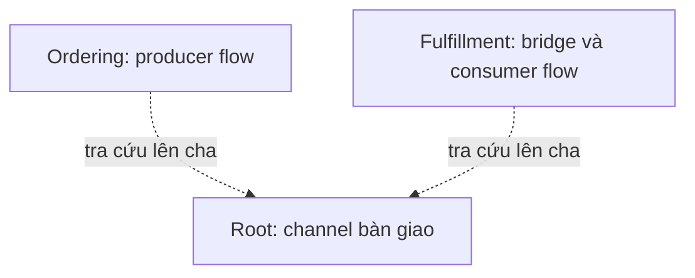
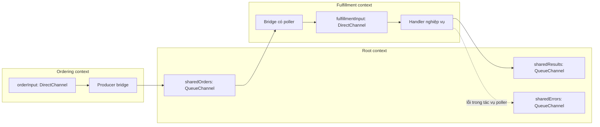

# Bridge giữa flow khác context

## 1. Bài toán và mục tiêu

Trong Spring Integration Core, một flow nhận `Message<?>` từ `MessageChannel`, đi qua các endpoint rồi bàn giao cho flow khác. Khi chia ứng dụng thành nhiều `ApplicationContext`, mỗi context có thể quản lý một nhóm flow và vòng đời riêng. Lúc này, tên channel trong Java DSL chưa đủ để chứng minh hai flow đã nối được với nhau: cần xác định context nào sở hữu channel và bên nào có thể truy cập nó.

Ví dụ, hệ thống đơn hàng có hai phần cùng chạy trong một JVM:

- Context `ordering` nhận yêu cầu và phát thông điệp đơn hàng.
- Context `fulfillment` lấy thông điệp và thực hiện nghiệp vụ giao hàng.
- Context cha giữ channel bàn giao để hai phần cùng truy cập.

Messaging bridge tạo endpoint chuyển tiếp giữa các channel, phù hợp khi cần nối hai đoạn flow mà chưa cần chuyển đổi dữ liệu. Trong tình huống nhiều context, bridge hoạt động khi đã có đường truy cập đến đúng channel nguồn và đích. Xem định nghĩa chính thức tại [Messaging Bridge](https://docs.spring.io/spring-integration/reference/bridge.html).

Sau bài này, bạn có thể thiết kế điểm bàn giao giữa các context, cấu hình bridge bằng Java DSL, xác định thread và đường lỗi, rồi kiểm thử topology bằng các context thực sự tách biệt.

## 2. Phân biệt ranh giới flow, context và tiến trình

### Khác flow, cùng context

Hai bean `IntegrationFlow` cùng context có thể dùng chung một bean channel. Tách cấu hình thành hai phương thức `@Bean` giúp tổ chức chương trình; thao tác đó không tự tạo một ranh giới thread hay kết nối mạng.

```text
producerFlow -> channel chung -> consumerFlow
              cùng ApplicationContext
```

### Khác context, cùng JVM

Hai context quản lý các bean riêng. Hai bean cùng tên không mặc nhiên là cùng đối tượng Java.

```java
// Hai context độc lập đều định nghĩa bean "orders" của riêng mình.
MessageChannel left = leftContext.getBean("orders", MessageChannel.class);
MessageChannel right = rightContext.getBean("orders", MessageChannel.class);

// Với hai instance được tạo riêng, kết quả là false.
System.out.println(left == right);
```

Bridge không có cơ chế toàn cục để tìm mọi context rồi ghép các bean trùng tên. Cần quan hệ cha–con, một điểm bàn giao chung hoặc một tham chiếu channel được truyền tường minh.

### Khác JVM hoặc khác máy

`DirectChannel` và `QueueChannel` mặc định là các đối tượng trong bộ nhớ của một tiến trình. Chúng không tự tạo kết nối mạng.

```text
JVM A: flow -> outbound adapter -> transport
                                      |
JVM B: flow <- inbound adapter  <-------+
```

Khi hai flow thuộc hai ứng dụng triển khai riêng, cần transport cùng adapter/gateway tương ứng. Ví dụ, Spring Integration có JMS channel adapter cho giao tiếp một chiều và JMS gateway cho request/reply. Bridge có thể xuất hiện bên trong mỗi ứng dụng; transport vẫn đảm nhiệm việc truyền qua tiến trình. Xem [JMS Support](https://docs.spring.io/spring-integration/reference/jms.html).

| Vị trí hai flow | Điểm kết nối | Điều cần thiết kế |
| --- | --- | --- |
| Cùng context | Bean channel chung | Kiểu channel, endpoint tiêu thụ |
| Parent và child | Channel nhìn thấy qua parent | Quyền sở hữu, tránh che khuất bean |
| Hai child chung parent | Channel chung tại parent | Vòng đời từng child, chính sách chia tải |
| Hai context độc lập trong JVM | Truyền tham chiếu channel | Thứ tự khởi động, nơi đóng tài nguyên |
| Khác JVM | Destination hoặc địa chỉ transport | Hợp đồng dữ liệu, retry, xác nhận giao nhận |

## 3. Quy tắc tra cứu bean trong cây context

Với quan hệ `parent -> child`, child có thể tra cứu lên parent khi không có bean tương ứng tại chỗ. Bean cùng tên tại child có thể che khuất bean ở parent. Parent không tự tra cứu xuống child; một child cũng không tự tra cứu sang sibling. Quy tắc tra cứu theo cấp bậc được mô tả trong [BeanFactory](https://docs.spring.io/spring-framework/docs/current/javadoc-api/org/springframework/beans/factory/BeanFactory.html).



Mũi tên trên biểu diễn hướng tra cứu bean. Hướng thông điệp là một cấu hình khác: channel ở parent vẫn có thể chuyển message từ child thứ nhất sang child thứ hai.

Thiết kế thường dùng là đặt channel giao tiếp chung ở parent, còn endpoint nghiệp vụ và bridge ở child chịu trách nhiệm vận hành chúng. Hai child không cần biết bean flow nội bộ của nhau.

Một lỗi dễ gặp là khai báo lại `sharedOrders` tại fulfillment. Producer gửi vào queue của root, nhưng bridge lại đọc queue riêng của fulfillment. Tên giống nhau khiến cấu hình trông hợp lý, trong khi hai bên đang giữ hai hàng đợi khác nhau.

Kiểm tra đồng thời khả năng nhìn thấy, quyền sở hữu tại chỗ và identity:

```java
boolean visible = child.containsBean("sharedOrders");
boolean local = child.containsLocalBean("sharedOrders");
boolean sameInstance = root.getBean("sharedOrders")
        == child.getBean("sharedOrders");
```

Nếu channel chỉ thuộc root, mong đợi `visible == true`, `local == false`, `sameInstance == true`. Các API phân biệt bean cục bộ và bean của ancestor được nêu trong [AbstractApplicationContext](https://docs.spring.io/spring-framework/docs/6.2.x/javadoc-api/org/springframework/context/support/AbstractApplicationContext.html).

## 4. Trách nhiệm của bridge tại điểm nối

`BridgeHandler` chuyển tiếp request message sang output channel mà không chủ động biến đổi nó. Trong cấu hình đơn giản, payload và header ứng dụng được giữ lại. Nếu không cấu hình output channel, bridge có thể dùng `replyChannel` của message; thiếu cả hai sẽ gây lỗi. Đây là hợp đồng của [BridgeHandler](https://docs.spring.io/spring-integration/docs/6.5.1/api/org/springframework/integration/handler/BridgeHandler.html).

```text
Input channel -> endpoint chứa BridgeHandler -> output channel
```

Bridge không thay thế semantics của channel:

- Input là `QueueChannel`: endpoint đọc bằng polling consumer và cần poller.
- Input là `DirectChannel`: endpoint subscribe vào channel, không cần poller.
- Output là `DirectChannel`: thông thường handler phía sau chạy tiếp trên thread đang gửi vào nó.
- Output là queue: bridge bàn giao message vào queue, consumer của queue quyết định khi nào xử lý tiếp.

Đổi `ApplicationContext` không tự đổi thread. Trong ví dụ bên dưới, ranh giới bất đồng bộ xuất hiện ở queue cùng poller.

Nếu hai flow yêu cầu cấu trúc dữ liệu khác nhau, đặt transformer tại điểm chuyển đổi. Nếu cần chọn nhánh, loại message hoặc gom nhiều message, sử dụng router, filter hoặc aggregator. Bridge giữ vai trò nối các đoạn flow có hợp đồng dữ liệu tương thích.

## 5. Ví dụ Java DSL: hai child qua channel của root

### 5.1. Môi trường và hợp đồng

Ví dụ dùng Java 17+ và API Java DSL của Spring Integration 6.x. Dự án thực hành cần `org.springframework.integration:spring-integration-core` cùng các dependency Spring tương thích. Với Spring Boot, có thể sử dụng `spring-boot-starter-integration` và BOM của dự án để quản lý phiên bản.

Đây là chương trình độc lập dùng `AnnotationConfigApplicationContext`, đăng ký cấu hình tường minh. Mỗi child khai báo `@EnableIntegration` cho các flow do nó quản lý. Java DSL thu thập các thành phần của flow để đăng ký thành bean trong context chứa flow; xem [Java DSL](https://docs.spring.io/spring-integration/reference/dsl.html).



| Thành phần | Quy ước trong bài |
| --- | --- |
| Payload | Chuỗi mã đơn hàng, ví dụ `ORD-1001` |
| `businessCorrelationId` | Header đối chiếu yêu cầu với kết quả |
| `errorChannel` | Tham chiếu đến channel lỗi của root |
| Kết quả | Chuỗi `ACCEPTED:<mã đơn hàng>` |
| Dữ liệu sai | Mã đơn rỗng hoặc chỉ có khoảng trắng |
| Queue chung | Dung lượng 100, lưu trong bộ nhớ |

`sharedResults` là nơi thu kết quả của bài thực hành. Khi có nhiều lời gọi đồng thời, ứng dụng phải đối chiếu header nghiệp vụ; nhận message kế tiếp từ queue không bảo đảm đó là phản hồi của lời gọi hiện tại. Với API request/reply, có thể thiết kế messaging gateway và cơ chế correlation phù hợp.

### 5.2. Chương trình hoàn chỉnh

Đặt mã sau trong `CrossContextBridgeDemo.java` của dự án thực hành. Không cần component scan để dựng cây context này.

```java
import java.time.Duration;

import org.springframework.context.annotation.AnnotationConfigApplicationContext;
import org.springframework.context.annotation.Bean;
import org.springframework.context.annotation.Configuration;
import org.springframework.integration.channel.DirectChannel;
import org.springframework.integration.channel.QueueChannel;
import org.springframework.integration.config.EnableIntegration;
import org.springframework.integration.dsl.IntegrationFlow;
import org.springframework.integration.dsl.Pollers;
import org.springframework.messaging.Message;
import org.springframework.messaging.MessageChannel;
import org.springframework.messaging.support.MessageBuilder;

public class CrossContextBridgeDemo {

    @Configuration(proxyBeanMethods = false)
    public static class RootChannels {

        @Bean
        public QueueChannel sharedOrders() {
            return new QueueChannel(100);
        }

        @Bean
        public QueueChannel sharedResults() {
            return new QueueChannel(100);
        }

        @Bean
        public QueueChannel sharedErrors() {
            return new QueueChannel(100);
        }
    }

    @Configuration(proxyBeanMethods = false)
    @EnableIntegration
    public static class OrderingFlows {

        @Bean
        public DirectChannel orderInput() {
            return new DirectChannel();
        }

        @Bean
        public IntegrationFlow orderingFlow() {
            return IntegrationFlow.from("orderInput")
                    .bridge(endpoint -> endpoint
                            .id("orderingHandoffBridge")
                            .sendTimeout(1000))
                    .channel("sharedOrders")
                    .get();
        }
    }

    @Configuration(proxyBeanMethods = false)
    @EnableIntegration
    public static class FulfillmentFlows {

        @Bean
        public DirectChannel fulfillmentInput() {
            return new DirectChannel();
        }

        @Bean
        public IntegrationFlow contextBridgeFlow() {
            return IntegrationFlow.from("sharedOrders")
                    .bridge(endpoint -> endpoint
                            .id("ordersContextBridge")
                            .poller(Pollers
                                    .fixedDelay(Duration.ofMillis(100))
                                    .maxMessagesPerPoll(10)))
                    .channel("fulfillmentInput")
                    .get();
        }

        @Bean
        public IntegrationFlow fulfillmentFlow() {
            return IntegrationFlow.from("fulfillmentInput")
                    .handle(String.class, (orderId, headers) -> {
                        if (orderId.isBlank()) {
                            throw new IllegalArgumentException(
                                    "orderId must not be blank");
                        }
                        return "ACCEPTED:" + orderId;
                    }, endpoint -> endpoint.sendTimeout(1000))
                    .channel("sharedResults")
                    .get();
        }
    }

    static AnnotationConfigApplicationContext newChild(
            AnnotationConfigApplicationContext parent,
            String id,
            Class<?> configuration) {

        AnnotationConfigApplicationContext child =
                new AnnotationConfigApplicationContext();
        child.setId(id);
        child.setParent(parent);
        child.register(configuration);
        try {
            child.refresh();
            return child;
        }
        catch (RuntimeException | Error failure) {
            child.close();
            throw failure;
        }
    }

    public static void main(String[] args) {
        try (AnnotationConfigApplicationContext root =
                     new AnnotationConfigApplicationContext(RootChannels.class)) {
            try (AnnotationConfigApplicationContext fulfillment =
                         newChild(root, "fulfillment", FulfillmentFlows.class);
                 AnnotationConfigApplicationContext ordering =
                         newChild(root, "ordering", OrderingFlows.class)) {

                MessageChannel input = ordering.getBean(
                        "orderInput", MessageChannel.class);
                QueueChannel results = root.getBean(
                        "sharedResults", QueueChannel.class);
                MessageChannel errors = root.getBean(
                        "sharedErrors", MessageChannel.class);

                Message<String> request = MessageBuilder
                        .withPayload("ORD-1001")
                        .setHeader("businessCorrelationId", "corr-1001")
                        .setErrorChannel(errors)
                        .build();

                if (!input.send(request, 1000)) {
                    throw new IllegalStateException("Request was not accepted");
                }

                Message<?> result = results.receive(5000);
                if (result == null) {
                    throw new IllegalStateException("No result within 5 seconds");
                }

                System.out.println(result.getPayload());
                System.out.println(
                        result.getHeaders().get("businessCorrelationId"));
            }
        }
    }
}
```

Kết quả nghiệp vụ dự kiến, ngoài log khởi động:

```text
ACCEPTED:ORD-1001
corr-1001
```

Producer bridge nhận đồng bộ từ `orderInput`, rồi bàn giao vào queue chung. Bridge trong fulfillment là polling consumer: nó lấy message khỏi queue và đưa vào đầu vào riêng của flow nghiệp vụ. Hai bridge thể hiện rõ hai lần bàn giao, dù ở nhiều cấu hình Java DSL, việc ghép các channel liền nhau cũng có thể tạo bridge ngầm.

### 5.3. Vì sao các tham chiếu tìm đúng channel?

Root được refresh trước các child. Các tên `sharedOrders`, `sharedResults`, `sharedErrors` đã tồn tại ở cha khi flow của child được đăng ký. Child có thể tra cứu các bean này qua parent mà không biết cấu trúc nội bộ của sibling.

Một tên channel chưa tồn tại có thể được Java DSL đăng ký thành `DirectChannel`. Bởi vậy, lỗi chính tả `sharedOrder` có thể tạo ra channel cục bộ ngoài ý muốn thay vì kết nối queue chung. Cơ chế xử lý tham chiếu tên có thể kiểm tra trong [IntegrationFlowBeanPostProcessor của Spring Integration 6.5.1](https://github.com/spring-projects/spring-integration/blob/v6.5.1/spring-integration-core/src/main/java/org/springframework/integration/dsl/context/IntegrationFlowBeanPostProcessor.java).

Với điểm nối bắt buộc tồn tại, một lựa chọn khác là inject channel theo qualifier rồi truyền tham chiếu vào DSL, để thiếu bean gây lỗi ngay khi lắp ghép dependency. Dù chọn cách nào, vẫn cần kiểm thử identity và quyền sở hữu của channel.

### 5.4. Quyền sở hữu và vòng đời

| Context | Bean do nó sở hữu | Trách nhiệm |
| --- | --- | --- |
| Root | Ba queue chung | Giữ điểm bàn giao, nơi thu kết quả và lỗi |
| Ordering | `orderInput`, producer flow và endpoint bridge | Nhận và bàn giao yêu cầu |
| Fulfillment | `fulfillmentInput`, hai flow, bridge có poller và handler | Lấy message và xử lý nghiệp vụ |

Root không cần `@EnableIntegration` trong ví dụ vì chỉ khai báo queue. Hai child khai báo hạ tầng cho các flow của mình. Không nên giả định bean post-processor ở parent tự xử lý mọi bean được tạo trong child.

Đóng fulfillment sẽ dừng endpoint polling của nó. Queue chung vẫn thuộc root nếu root còn hoạt động. Nếu producer tiếp tục gửi, queue có thể đầy. Việc đóng context vì thế phải gắn với kế hoạch xử lý message đang chờ.

Trình tự dừng phù hợp cho một lần xử lý có kiểm soát là ngừng nhận yêu cầu mới, dừng producer, chờ hoặc xử lý lượng tồn theo chính sách, rồi dừng consumer và cuối cùng đóng tài nguyên chung. `close()` một child không đồng nghĩa mọi message liên quan đến child đã được xử lý hết.

## 6. Thread, poller và giới hạn tải

Đường thành công trong ví dụ gồm các bước:

1. Thread gọi chương trình gửi message vào `orderInput`.
2. Producer bridge trên cùng thread enqueue vào `sharedOrders`.
3. Lời gọi gửi có thể kết thúc dù fulfillment chưa xử lý nghiệp vụ.
4. Thread poller lấy message khỏi queue.
5. Bridge gửi vào `fulfillmentInput`; handler chạy tiếp trên thread poller.
6. Handler gửi kết quả vào `sharedResults` để phía quan sát nhận sau.

Semantics lưu đệm, point-to-point và hành vi chờ của `QueueChannel` được mô tả tại [Message Channel Implementations](https://docs.spring.io/spring-integration/reference/channel/implementations.html).

`maxMessagesPerPoll(10)` giới hạn số message trong một lần chạy poll, không cam kết 10 message mỗi 100 ms. `fixedDelay` đo khoảng nghỉ từ khi tác vụ trước hoàn thành. Thời gian nghiệp vụ, thời gian chờ nhận và scheduler đều ảnh hưởng nhịp thực tế. Xem [Pollers API](https://docs.spring.io/spring-integration/docs/6.5.0/api/org/springframework/integration/dsl/Pollers.html).

Một ước lượng phục vụ thảo luận cấu hình, với polling tuần tự và queue luôn đủ message:

```text
B: số message mỗi lần poll
S: thời gian xử lý trung bình một message
D: fixed delay

Thời gian một chu kỳ xấp xỉ B × S + D
Thông lượng xấp xỉ B / (B × S + D)
```

Ví dụ `B = 10`, `S = 20 ms`, `D = 100 ms` cho khoảng 33 message/giây theo mô hình này. Đây là suy luận thiết kế đã bỏ qua nhiều chi phí thực tế; cần đo workload thật trước khi đặt mục tiêu năng lực.

Dung lượng queue cũng không thay thế chính sách xử lý quá tải. Nếu producer đến 80 message/giây và consumer xử lý 30 message/giây, lượng tồn tăng khoảng 50 message/giây trong khoảng thời gian đó. Queue 100 chỉ tạo một khoảng đệm ngắn.

`.sendTimeout(1000)` trên producer bridge giới hạn thời gian chờ gửi vào queue chung khi đầy. Timeout truyền cho `input.send(...)` trên `DirectChannel` không tự áp dụng cho mọi lần gửi sâu hơn trong flow. Handler nghiệp vụ cũng đặt timeout khi gửi vào queue kết quả. API cấu hình này được nêu tại [ConsumerEndpointSpec](https://docs.spring.io/spring-integration/docs/6.5.2/api/org/springframework/integration/dsl/ConsumerEndpointSpec.html).

Nếu đổi điểm bàn giao sang `DirectChannel`, cần bỏ poller ở bridge nhận và xem lại phụ thuộc vòng đời: gửi khi chưa có subscriber có thể thất bại. Direct channel cũng không mặc định phát một bản sao đến tất cả consumer; cần chọn topology phù hợp nếu muốn fan-out. Xem [Configuring Message Channels](https://docs.spring.io/spring-integration/reference/channel/configuration.html).

## 7. Header, phản hồi và xử lý lỗi

### 7.1. Payload thay đổi ở endpoint nghiệp vụ

Trong ví dụ, hai bridge chuyển tiếp mã đơn hàng. Chuỗi `ACCEPTED:ORD-1001` do handler nghiệp vụ tạo ra. Khi quan sát đầu và cuối flow, cần phân biệt tác dụng của từng endpoint.

`businessCorrelationId` theo dõi cùng một yêu cầu qua các bước xử lý. Không nên dùng `MessageHeaders.ID` như mã nghiệp vụ bất biến xuyên mọi bước: endpoint tạo message mới có thể tạo ID mới. Khi có interceptor, message history hoặc bước làm giàu header, cũng không nên mặc định mọi điểm quan sát đều nhận cùng một đối tượng `Message`.

### 7.2. Tên channel phụ thuộc phạm vi tra cứu

`setErrorChannel(errors)` đặt đối tượng channel chung vào header. Hạ tầng xử lý lỗi trong cùng JVM có thể dùng trực tiếp điểm nhận này.

Nếu header chứa chuỗi tên channel, resolver của thành phần xử lý cần tìm được tên đó trong phạm vi context của nó. Một channel lỗi chỉ tồn tại tại ordering không tự truy cập được từ fulfillment. Các channel phản hồi và lỗi đi qua nhiều context cũng cần hợp đồng về vị trí đặt bean hoặc cách truyền tham chiếu.

Tham chiếu Java đến channel phù hợp cho lắp ghép trong cùng JVM. Khi chuyển sang transport ngoài tiến trình, cần biểu diễn đường phản hồi/lỗi theo hợp đồng transport thay vì truyền nguyên đối tượng channel sang JVM khác.

### 7.3. Lỗi trước và sau ranh giới queue

Lỗi xảy ra trước khi enqueue vẫn có thể nằm trong call stack của producer. Lỗi nghiệp vụ sau khi poller lấy message xảy ra trên thread khác; lời gọi gửi ban đầu có thể đã hoàn tất.

Trong cấu hình hạ tầng mặc định, tác vụ poller công bố lỗi bằng `ErrorMessage`, ưu tiên channel trong header `errorChannel`, sau đó dùng channel lỗi mặc định theo cấu hình. Do đó, chỉ đặt `try/catch` quanh `input.send(...)` không thu được mọi lỗi nghiệp vụ. Xem cơ chế theo thread và scheduled poller tại [Error Handling](https://docs.spring.io/spring-integration/reference/error-handling.html).

Đổi payload thành `"   "` sẽ khiến handler từ chối mã đơn. Message được enqueue trước, rồi fulfillment phát lỗi vào `sharedErrors`. Chương trình chỉ chờ queue thành công sẽ hết thời gian chờ. Client thực tế cần cách đối chiếu thành công/lỗi cho từng yêu cầu.

Queue lỗi của bài thực hành phải được đọc trong kiểm thử hoặc được tiêu thụ bởi một error flow. Chỉ khai báo queue chưa tạo cảnh báo, lưu bền hay retry; nếu không có consumer, queue lỗi cũng có thể đầy.

### 7.4. Bridge và bảo đảm giao nhận

Với queue bộ nhớ trong ví dụ, message đã được poller lấy ra không tự quay lại queue nếu handler phía sau lỗi. Phát `ErrorMessage` cũng không tự retry nghiệp vụ.

Từ đặc tính đó, khi áp dụng thực tế cần xác định retry đặt ở endpoint nào, message thất bại được giữ ở đâu, handler có chịu được xử lý lặp hay không và điều gì xảy ra khi tiến trình dừng. Cần message store/transport cùng transaction và cơ chế chống lặp phù hợp nếu muốn khả năng phục hồi bền vững. Việc thêm bridge không tự tạo các bảo đảm này.

## 8. Kiểm thử đúng cây context

Kiểm thử gom tất cả cấu hình vào một context không phát hiện đầy đủ lỗi tra cứu giữa các context. Cần dựng đúng parent và hai child, kiểm tra identity của điểm nối rồi mới kiểm tra kết quả message.

Đoạn mã sau dùng JUnit Jupiter, đặt cùng package với lớp ví dụ. Đây là mã kiểm thử gợi ý cho dự án thực hành; việc trình bày không có nghĩa đã chạy build trong repository.

```java
import org.junit.jupiter.api.Test;
import org.springframework.context.annotation.AnnotationConfigApplicationContext;
import org.springframework.integration.channel.QueueChannel;
import org.springframework.messaging.Message;
import org.springframework.messaging.MessageChannel;
import org.springframework.messaging.MessagingException;
import org.springframework.messaging.support.ErrorMessage;
import org.springframework.messaging.support.MessageBuilder;

import static org.junit.jupiter.api.Assertions.*;

class CrossContextBridgeDemoTest {

    @Test
    void connectsSiblingFlowsThroughTheParentChannel() {
        try (var root = new AnnotationConfigApplicationContext(
                     CrossContextBridgeDemo.RootChannels.class);
             var fulfillment = CrossContextBridgeDemo.newChild(
                     root, "fulfillment-test",
                     CrossContextBridgeDemo.FulfillmentFlows.class);
             var ordering = CrossContextBridgeDemo.newChild(
                     root, "ordering-test",
                     CrossContextBridgeDemo.OrderingFlows.class)) {

            assertSame(root.getBean("sharedOrders"),
                    ordering.getBean("sharedOrders"));
            assertSame(root.getBean("sharedOrders"),
                    fulfillment.getBean("sharedOrders"));
            assertFalse(fulfillment.containsLocalBean("sharedOrders"));
            assertFalse(root.containsBean("fulfillmentInput"));

            Message<String> request = MessageBuilder
                    .withPayload("ORD-1001")
                    .setHeader("businessCorrelationId", "corr-1001")
                    .setErrorChannel(root.getBean(
                            "sharedErrors", MessageChannel.class))
                    .build();

            assertTrue(ordering.getBean("orderInput", MessageChannel.class)
                    .send(request, 1000));

            Message<?> result = root.getBean(
                    "sharedResults", QueueChannel.class).receive(5000);
            assertNotNull(result);
            assertEquals("ACCEPTED:ORD-1001", result.getPayload());
            assertEquals("corr-1001",
                    result.getHeaders().get("businessCorrelationId"));
        }
    }

    @Test
    void reportsTheAsynchronousBusinessFailure() {
        try (var root = new AnnotationConfigApplicationContext(
                     CrossContextBridgeDemo.RootChannels.class);
             var fulfillment = CrossContextBridgeDemo.newChild(
                     root, "fulfillment-error-test",
                     CrossContextBridgeDemo.FulfillmentFlows.class);
             var ordering = CrossContextBridgeDemo.newChild(
                     root, "ordering-error-test",
                     CrossContextBridgeDemo.OrderingFlows.class)) {

            Message<String> request = MessageBuilder
                    .withPayload("   ")
                    .setErrorChannel(root.getBean(
                            "sharedErrors", MessageChannel.class))
                    .build();

            assertTrue(ordering.getBean("orderInput", MessageChannel.class)
                    .send(request, 1000));

            Message<?> received = root.getBean(
                    "sharedErrors", QueueChannel.class).receive(5000);
            ErrorMessage error = assertInstanceOf(ErrorMessage.class, received);
            MessagingException failure = assertInstanceOf(
                    MessagingException.class, error.getPayload());
            assertNotNull(failure.getFailedMessage());
            assertEquals("   ", failure.getFailedMessage().getPayload());
            assertInstanceOf(IllegalArgumentException.class, failure.getCause());
            assertNull(root.getBean(
                    "sharedResults", QueueChannel.class).receive(0));
        }
    }
}
```

`receive(timeout)` đồng bộ hóa kiểm thử với message thực nhận và giới hạn thời gian chờ. Không cần chèn `Thread.sleep(...)` rồi đoán rằng poller đã xử lý xong. Timeout có thể điều chỉnh theo môi trường, nhưng điều kiện thành công phải dựa vào dữ liệu quan sát được.

Các tình huống nên mở rộng:

| Tình huống | Cách dựng | Kết quả cần chứng minh |
| --- | --- | --- |
| Child che khuất queue | Khai báo thêm `sharedOrders` ở child | Kiểm tra identity phát hiện sai điểm nối |
| Bridge dừng | Dừng `ordersContextBridge` khi không có xử lý đang diễn ra | Message mới nằm chờ, start lại thì được xử lý |
| Queue đầy | Dừng consumer, lấp đầy queue chung | Producer gặp giới hạn chờ gửi đã cấu hình |
| Hai consumer cùng queue | Tạo hai fulfillment child chung root | Các consumer cạnh tranh, không mặc định nhận bản sao |
| Header qua bridge | Quan sát ngay trước và sau điểm nối | Payload/header nghiệp vụ phù hợp hợp đồng |
| Đóng một child | Đóng fulfillment, giữ root | Điểm nối còn thuộc root, consumer đã dừng |

Kiểm thử stop/start cần kiểm soát lần polling đang chạy để tránh đua giữa thao tác dừng và message mới. Một kết quả queue rỗng tại một thời điểm chưa đủ chứng minh không còn message đang xử lý.

## 9. Khi hai context không có quan hệ cha–con

Hai context độc lập trong cùng JVM vẫn có thể dùng chung channel nếu tầng bootstrap truyền tham chiếu tường minh. Hãy xem đây là dependency liên context với quyền sở hữu và thứ tự khởi động cụ thể.

```java
// Tầng lắp ghép lấy điểm vào do context đích công bố.
MessageChannel exportedInput = destinationContext.getBean(
        "exportedInput", MessageChannel.class);

org.springframework.integration.handler.BridgeHandler bridge =
        new org.springframework.integration.handler.BridgeHandler();
bridge.setOutputChannel(exportedInput);

// Tiếp theo, đăng ký bridge và endpoint nguồn qua cấu hình Spring.
// Đoạn trích chỉ minh họa thao tác truyền tham chiếu channel.
```

Trích đoạn trên chưa bao gồm việc đăng ký endpoint và quản lý lifecycle. Không chỉ khởi tạo `BridgeHandler` rồi xem như đã có consumer đọc input channel.

Context đích cần sẵn sàng trước khi nguồn gửi; nguồn cần dừng trước khi đích bị hủy. Chỉ một nơi chịu trách nhiệm đóng tài nguyên dùng chung. Khi có thể chủ động thiết kế cây context, đưa channel bàn giao lên parent thường làm các dependency này dễ quan sát hơn.

Nếu các module phải triển khai độc lập ở mức tiến trình, cần thiết kế hợp đồng transport. Việc cùng chạy trong JVM ở phiên bản hiện tại không nên che khuất yêu cầu triển khai của hệ thống về sau.

## 10. Chẩn đoán các lỗi thường gặp

| Hiện tượng | Khả năng cần kiểm tra | Cách kiểm chứng |
| --- | --- | --- |
| Queue có message nhưng flow nhận im lặng | Bridge dừng, đọc nhầm queue hoặc thiếu poller | Kiểm tra endpoint, kiểu channel và identity với root |
| `Dispatcher has no subscribers` | Direct channel chưa có endpoint nhận | Kiểm tra tên channel, context của subscriber và vòng đời |
| Root không tìm được bean nội bộ của child | Tra cứu sai hướng | Dùng hợp đồng channel chung thay vì tra cứu xuống child |
| Gửi thành công nhưng không có kết quả | Mới enqueue thành công hoặc consumer đã lỗi | Quan sát queue vào, queue kết quả và error flow |
| `try/catch` producer không bắt được lỗi | Nghiệp vụ chạy trên thread poller | Thu `ErrorMessage`, đối chiếu failed message |
| Thêm consumer nhưng mỗi nơi không nhận đủ message | Các consumer chia tải trên một queue | Xác định cần cạnh tranh hay fan-out |
| Đóng module làm ngừng điểm nối | Tài nguyên chung đặt sai context | Đối chiếu quyền sở hữu và trình tự dừng |
| Retry tạo tác dụng nghiệp vụ hai lần | Handler thiếu cơ chế chống lặp | Kiểm tra khóa nghiệp vụ và nơi ghi nhận đã xử lý |

Một trình tự điều tra hữu ích là chọn một message, ghi nhận `businessCorrelationId`, xác nhận đúng channel tại từng điểm bàn giao rồi tìm endpoint đang tiêu thụ channel đó. Cách này giúp phân biệt lỗi context với lỗi dữ liệu hoặc thiếu năng lực xử lý.

## 11. Bài tập thực hành

1. Chạy ví dụ, xác nhận hai child dùng `sharedOrders` của root. Giải thích vì sao root không tìm được `fulfillmentInput`.
2. Thêm bean `sharedOrders` tại fulfillment, quan sát kiểm thử identity và đường message, sau đó bỏ khai báo gây che khuất.
3. Thay queue bằng `DirectChannel`, bỏ poller của bridge nhận, xác định thread chạy handler và cách exception về producer.
4. Dừng bridge có poller, gửi một số đơn rồi start lại. Kiểm tra message chờ và kết quả thực nhận.
5. Thêm transformer chuyển mã đơn thành DTO trước handler. Chỉ rõ endpoint đổi payload và điều chỉnh kiểu dữ liệu đầu vào tương ứng.
6. Đề xuất điểm nối JMS khi ordering và fulfillment chạy ở hai JVM: destination, dữ liệu trao đổi, mã đối chiếu và chính sách xử lý lại.

Khi giải thích thiết kế, hãy xác định channel bàn giao thuộc context nào, flow nào tiêu thụ nó, ranh giới bất đồng bộ nằm ở đâu và lỗi đi tới điểm nào. Đây là những quyết định giúp bridge giữa các flow khác context hoạt động có thể dự đoán và kiểm chứng.
