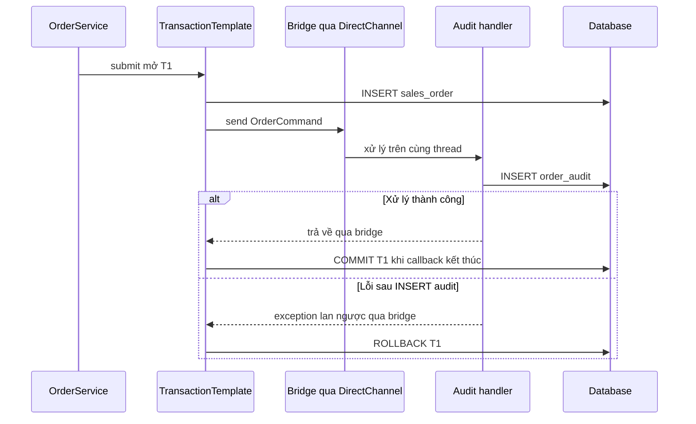

# Bridge và transaction boundary

## 1. Mục tiêu và tình huống sử dụng

Trong chương **Messaging bridge** của module **SPRING_INTEGRATION_CORE**, bài này giải thích cách ranh giới giao dịch thay đổi khi bridge nối các loại channel khác nhau. Nội dung gắn việc thiết kế luồng Message, MessageChannel và endpoint bằng Java DSL với giao dịch JDBC, xử lý lỗi và kiểm thử.

Sau bài học, bạn có thể:

- Xác định thành phần mở giao dịch và các thao tác tham gia giao dịch đó.
- Phân biệt chuyển message thành công với xử lý nghiệp vụ đã commit.
- Thiết kế bridge đồng bộ hoặc bridge có transactional poller.
- Nhận diện điều kiện để rollback cả thao tác lấy message và cập nhật dữ liệu.
- Kiểm chứng kết quả của lỗi đồng bộ, lỗi bất đồng bộ và việc phát lại message.

Xét ứng dụng ghi đơn hàng, chuyển message qua bridge, rồi ghi một bản ghi kiểm toán. Yêu cầu ban đầu là **cả hai bản ghi cùng tồn tại hoặc cùng không tồn tại**. Khi chuyển bước kiểm toán sang thread chạy nền, hệ thống cũng thay đổi mô hình nhất quán dữ liệu.

Các ví dụ dùng giao dịch imperative với `PlatformTransactionManager`. Giao dịch reactive dựa trên Reactor Context cần cách phân tích riêng.

## 2. Bridge có phải ranh giới giao dịch không?

Bridge chuyển tiếp message giữa các channel. Nó không mặc nhiên mở giao dịch, commit giao dịch hay làm cho hai tài nguyên trở thành một tài nguyên giao dịch. `.bridge()` mô tả việc nối luồng; channel và cấu hình endpoint quyết định cách thực thi. Xem [Messaging Bridge](https://docs.spring.io/spring-integration/reference/bridge.html).

Có bốn câu hỏi cần trả lời:

| Câu hỏi | Ví dụ |
|---|---|
| Ai mở giao dịch? | Service dùng `TransactionTemplate`, phương thức qua proxy `@Transactional`, hoặc transactional poller |
| Tài nguyên nào tham gia? | Một `DataSource` được `DataSourceTransactionManager` quản lý |
| Code chạy trong ngữ cảnh nào? | Thread của sender hay thread của executor/poller |
| Ai quan sát lỗi trước khi giao dịch kết thúc? | Service gọi đồng bộ hoặc transaction advice của poller |

Trong giao dịch imperative thông thường, Spring gắn tài nguyên giao dịch với thread hiện tại. Luồng qua nhiều endpoint vẫn có thể giữ ngữ cảnh nếu tiếp tục đồng bộ. Chuyển công việc sang thread khác không tự chuyển transaction context theo. Xem [Transaction Support](https://docs.spring.io/spring-integration/reference/transactions.html).

Cần phân biệt **không lan truyền giao dịch qua điểm chuyển giao** với **commit ngay tại channel**. Sau khi gửi tới executor, service vẫn có thể chạy tiếp rồi ném lỗi khiến giao dịch của service rollback. Điều không được bảo đảm là công việc trên thread nhận rollback theo.

Cùng thread cũng chưa đủ để kết luận toàn bộ luồng nguyên tử:

- `REQUIRED` có thể tham gia giao dịch đang có với transaction manager phù hợp.
- `REQUIRES_NEW` tạo giao dịch độc lập dù lời gọi vẫn cùng thread.
- Hai local transaction manager quản lý hai cơ sở dữ liệu riêng không tự tạo atomic commit chung.
- Gọi HTTP hoặc gửi email trong giao dịch JDBC không làm tác động đó rollback được.

Propagation và phạm vi tài nguyên phải phù hợp với yêu cầu nghiệp vụ. Xem [Transaction Propagation](https://docs.spring.io/spring-framework/reference/data-access/transaction/declarative/tx-propagation.html).

## 3. So sánh channel ở hai phía bridge

| Đường đi | Cách thực thi điển hình | Giao dịch sender tự tiếp tục tới handler cuối? | Ý nghĩa của gửi thành công |
|---|---|---|---|
| `DirectChannel → bridge → DirectChannel` | Gọi lồng nhau trên thread gửi | Có thể, khi đã có giao dịch phù hợp | Handler trả về; commit còn phụ thuộc phạm vi ngoài |
| `DirectChannel → bridge → ExecutorChannel` | Handoff cho executor | Không bảo đảm | Công việc được chấp nhận để thực thi |
| `DirectChannel → bridge → QueueChannel` | Ghi queue, nhận ở thời điểm khác | Không tự tiếp tục tới consumer sau này | Queue nhận message |
| `QueueChannel → polling bridge → DirectChannel` | Poller nhận rồi xử lý đồng bộ | Không nhận giao dịch producer; poller có thể mở giao dịch mới | Kết quả gửi của producer không đại diện kết quả poller |

`DirectChannel` gọi handler trong lời gọi gửi. `QueueChannel` tách thao tác gửi và nhận; consumer có poller thường chạy trên thread khác. `ExecutorChannel` giao việc cho executor và không bảo đảm giao dịch xuyên từ sender tới receiver. Xem [Message Channel Implementations](https://docs.spring.io/spring-integration/reference/channel/implementations.html) và [Configuring Message Channels](https://docs.spring.io/spring-integration/reference/channel/configuration.html).

Không dựa vào việc executor đôi khi chạy tác vụ trên thread gửi khi quá tải, chẳng hạn với `CallerRunsPolicy`. Tính nguyên tử không được phụ thuộc trạng thái tải của thread pool.

`send()` trả về `true` cũng không phải tín hiệu commit. Handler có thể trả về thành công, nhưng service ném lỗi sau đó trước khi kết thúc giao dịch, làm dữ liệu rollback.

## 4. Ví dụ: hai cập nhật JDBC qua bridge đồng bộ

### 4.1. Chuẩn bị

Ví dụ cần Java hỗ trợ `record`, Spring Integration Core, Spring JDBC, Spring Transaction và JDBC driver. Dùng các phiên bản tương thích theo BOM của ứng dụng.

Ứng dụng cung cấp một bean `DataSource`. Cấu hình bên dưới định nghĩa `JdbcTemplate` và transaction manager cho cùng nguồn dữ liệu. Nếu ứng dụng đã có những bean tương đương, tái sử dụng chúng thay vì khai báo thêm.

Tạo bảng trước khi chạy:

```sql
create table sales_order (
    order_id bigint primary key
);

create table order_audit (
    order_id bigint primary key,
    note varchar(100) not null
);
```

### 4.2. Cấu hình Java

```java
package example.bridge;

import javax.sql.DataSource;

import org.springframework.beans.factory.annotation.Qualifier;
import org.springframework.context.annotation.Bean;
import org.springframework.context.annotation.Configuration;
import org.springframework.integration.channel.DirectChannel;
import org.springframework.integration.config.EnableIntegration;
import org.springframework.integration.dsl.IntegrationFlow;
import org.springframework.jdbc.core.JdbcTemplate;
import org.springframework.jdbc.datasource.DataSourceTransactionManager;
import org.springframework.messaging.MessageChannel;
import org.springframework.messaging.support.MessageBuilder;
import org.springframework.transaction.PlatformTransactionManager;
import org.springframework.transaction.support.TransactionTemplate;

@Configuration(proxyBeanMethods = false)
@EnableIntegration
public class SynchronousBridgeConfig {

    @Bean
    JdbcTemplate jdbcTemplate(DataSource dataSource) {
        return new JdbcTemplate(dataSource);
    }

    @Bean
    PlatformTransactionManager transactionManager(DataSource dataSource) {
        return new DataSourceTransactionManager(dataSource);
    }

    @Bean
    MessageChannel orderInput() {
        return new DirectChannel();
    }

    @Bean
    MessageChannel auditInput() {
        return new DirectChannel();
    }

    @Bean
    IntegrationFlow orderBridge() {
        return IntegrationFlow.from("orderInput")
                .bridge()
                .channel("auditInput")
                .get();
    }

    @Bean
    IntegrationFlow auditFlow(JdbcTemplate jdbc) {
        return IntegrationFlow.from("auditInput")
                .handle(OrderCommand.class, (command, headers) -> {
                    jdbc.update(
                            "insert into order_audit(order_id, note) values (?, ?)",
                            command.orderId(), "AUDITED");

                    if (command.rejectAfterAudit()) {
                        throw new IllegalStateException("Lỗi sau khi ghi audit");
                    }
                    return null; // Handler kết thúc, không tạo reply.
                })
                .get();
    }

    @Bean
    OrderService orderService(
            JdbcTemplate jdbc,
            PlatformTransactionManager transactionManager,
            @Qualifier("orderInput") MessageChannel input) {
        return new OrderService(jdbc, transactionManager, input);
    }

    public record OrderCommand(long orderId, boolean rejectAfterAudit) {
    }

    public static final class OrderService {

        private final JdbcTemplate jdbc;
        private final TransactionTemplate tx;
        private final MessageChannel input;

        public OrderService(
                JdbcTemplate jdbc,
                PlatformTransactionManager transactionManager,
                MessageChannel input) {
            this.jdbc = jdbc;
            this.tx = new TransactionTemplate(transactionManager);
            this.input = input;
        }

        public void submit(long orderId, boolean rejectAfterAudit) {
            tx.executeWithoutResult(status -> {
                jdbc.update(
                        "insert into sales_order(order_id) values (?)",
                        orderId);

                boolean sent = input.send(
                        MessageBuilder.withPayload(
                                new OrderCommand(orderId, rejectAfterAudit))
                                .build(),
                        1_000);

                if (!sent) {
                    throw new IllegalStateException("Không chuyển được message");
                }
            });
        }
    }
}
```

`TransactionTemplate` làm rõ phạm vi giao dịch: callback chứa cả thao tác ghi đơn hàng và lời gọi gửi message. Spring cung cấp API này để quản lý giao dịch imperative bằng code. Xem [Programmatic Transaction Management](https://docs.spring.io/spring-framework/reference/data-access/transaction/programmatic.html).

### 4.3. Thành công và thất bại



Với mã đơn hàng mới và không có giao dịch bên ngoài:

| Lời gọi | Kết quả sau khi lời gọi kết thúc |
|---|---|
| `submit(1001L, false)` | Có cả đơn hàng và audit |
| `submit(1002L, true)` | Caller nhận exception; cả hai bản ghi của `1002` không tồn tại |

Lỗi nghiệp vụ có thể được bọc trong exception messaging. Khi kiểm tra, xem nguyên nhân gốc thay vì yêu cầu exception ngoài cùng luôn là `IllegalStateException`.

Bridge không cần tự mở thêm giao dịch. Hai lệnh JDBC tham gia T1 thông qua `JdbcTemplate` và tài nguyên mà transaction manager gắn với thread.

Có thể thay bằng phương thức service có `@Transactional`. Khi đó cần bật hỗ trợ annotation, gọi qua Spring proxy và kiểm tra quy tắc rollback. Với cấu hình mặc định thông thường, unchecked exception và `Error` gây rollback; checked exception cần quy tắc tương ứng. Self-invocation trong chế độ proxy không kích hoạt transaction advice. Xem [Using @Transactional](https://docs.spring.io/spring-framework/reference/data-access/transaction/declarative/annotations.html).

## 5. Đổi sang ExecutorChannel làm thay đổi hợp đồng dữ liệu

Thay bean `auditInput` trong phần 4 bằng cấu hình sau:

```java
@Bean
MessageChannel auditInput(
        @Qualifier("auditExecutor") java.util.concurrent.Executor executor) {
    return new org.springframework.integration.channel.ExecutorChannel(executor);
}

@Bean
org.springframework.scheduling.concurrent.ThreadPoolTaskExecutor auditExecutor() {
    var executor =
            new org.springframework.scheduling.concurrent.ThreadPoolTaskExecutor();
    executor.setCorePoolSize(2);
    executor.setMaxPoolSize(2);
    executor.setQueueCapacity(100);
    executor.setThreadNamePrefix("audit-");
    return executor;
}
```

Đây là đoạn thay thế bean cũ, không đăng ký hai bean cùng tên.

Một diễn tiến có thể xảy ra:

1. Service mở T1 và ghi `sales_order`.
2. Bridge gửi message tới `ExecutorChannel`.
3. Executor chấp nhận tác vụ; lời gọi gửi trở về.
4. Service hoàn tất callback và commit T1.
5. Worker ghi audit rồi gặp lỗi.

Worker cũng có thể bắt đầu trước commit T1. Cấu hình này không bảo đảm thứ tự hoàn tất giữa hai thread.

Trong mã gốc, audit handler không tự mở giao dịch trên worker. Câu lệnh JDBC ở đó có thể đã commit theo auto-commit trước khi lỗi xuất hiện. Thêm giao dịch T2 quanh handler bảo vệ các cập nhật của worker nhưng không gộp T2 với T1.

Vì vậy, worker không được giả định luôn đọc được dữ liệu producer chưa commit. Lỗi sau handoff cũng không tự quay lại làm T1 rollback.

Nếu cần xử lý nền, có thể đổi hợp đồng thành: **đơn hàng và công việc chờ xử lý được lưu nguyên tử; worker hoàn tất công việc sau**. Queue có tính giao dịch hoặc transactional outbox là các hướng thiết kế cho yêu cầu đó.

Gateway chờ reply không tự nối lại giao dịch đã tách qua executor/queue. Khi gateway timeout, worker có thể vẫn chạy. Timeout không phải cơ chế hủy tác vụ hay bằng chứng mọi tác động đã rollback.

## 6. Polling bridge: giao dịch phải bao gồm thao tác nhận

Với input là `QueueChannel`, bridge cần poller. Chỉ đặt giao dịch ở service xử lý sau bridge thường không bao gồm thao tác `receive()` đã xảy ra trước đó.

Transactional poller đặt transaction advice quanh thao tác nhận và đoạn xử lý đồng bộ tiếp theo:

```java
@Bean
org.springframework.integration.channel.QueueChannel staging() {
    return new org.springframework.integration.channel.QueueChannel(100);
}

@Bean
IntegrationFlow stagingBridge(PlatformTransactionManager transactionManager) {
    return IntegrationFlow.from("staging")
            .bridge(endpoint -> endpoint.poller(
                    org.springframework.integration.dsl.Pollers.fixedDelay(500)
                            .maxMessagesPerPoll(1)
                            .receiveTimeout(0)
                            .transactional(transactionManager)))
            .channel("auditInput")
            .get();
}
```

Ví dụ giả định `auditInput` là `DirectChannel` ban đầu và message trong `staging` mang payload `OrderCommand`.

| Cấu hình | Vai trò |
|---|---|
| `fixedDelay(500)` | Lập lịch đợt tiếp theo sau khi đợt trước hoàn tất |
| `maxMessagesPerPoll(1)` | Giới hạn một message mỗi đợt để dễ quan sát |
| `receiveTimeout(0)` | Không chờ khi queue rỗng |
| `transactional(transactionManager)` | Áp dụng transaction advice cho polling task |
| Output đồng bộ | Cho phép handler chạy trong ngữ cảnh polling task |

Không suy luận `maxMessagesPerPoll(10)` đồng nghĩa mười message luôn nằm trong một giao dịch batch. Thuộc tính này giới hạn polling; phạm vi giao dịch phụ thuộc nơi áp dụng advice.

Java DSL có overload nhận transaction manager cho `transactional(...)`. Xem [PollerSpec](https://docs.spring.io/spring-integration/api/org/springframework/integration/dsl/PollerSpec.html).

### Queue trong RAM không tự khôi phục khi JDBC rollback

`staging` dùng queue trong bộ nhớ. Nếu bridge đã nhận message rồi handler ném lỗi:

- Cập nhật JDBC tham gia giao dịch poller có thể rollback.
- Message không tự được đưa trở lại queue trong RAM.
- Restart không giữ được message chỉ lưu trong bộ nhớ.

Transaction advice không biến mọi input thành tài nguyên giao dịch. Để rollback cả thao tác nhận, queue/store phải hỗ trợ và tham gia đúng giao dịch. Để giữ message khi tiến trình chết, store còn phải bền vững. Xem [MessageGroupQueue](https://docs.spring.io/spring-integration/api/org/springframework/integration/store/MessageGroupQueue.html).

## 7. Queue JDBC: rollback việc lấy message cùng cập nhật nghiệp vụ

### 7.1. Điều kiện triển khai

Ví dụ tiếp theo dùng PostgreSQL và bổ sung các channel riêng. Nó tái sử dụng `DataSource`, `JdbcTemplate`, transaction manager và bảng nghiệp vụ của phần 4.

Cần chuẩn bị:

- `spring-integration-jdbc` và PostgreSQL JDBC driver tương thích.
- Schema cho store, lấy từ `schema-postgresql.sql` đi kèm đúng phiên bản thư viện.
- Cùng `DataSource` cho store và cập nhật nghiệp vụ muốn commit/rollback chung.
- Khóa nhóm queue ổn định qua các lần khởi động.
- Payload và header phù hợp với cơ chế serialization đang dùng.

`JdbcChannelMessageStore` dành cho channel, với query provider theo loại cơ sở dữ liệu. Xem [JDBC Message Store](https://docs.spring.io/spring-integration/reference/jdbc/message-store.html).

### 7.2. Cấu hình store và bridge

```java
package example.bridge;

import javax.sql.DataSource;

import org.springframework.context.annotation.Bean;
import org.springframework.context.annotation.Configuration;
import org.springframework.integration.channel.DirectChannel;
import org.springframework.integration.channel.QueueChannel;
import org.springframework.integration.dsl.IntegrationFlow;
import org.springframework.integration.dsl.Pollers;
import org.springframework.integration.jdbc.store.JdbcChannelMessageStore;
import org.springframework.integration.jdbc.store.channel
        .PostgresChannelMessageStoreQueryProvider;
import org.springframework.integration.store.MessageGroupQueue;
import org.springframework.jdbc.core.JdbcTemplate;
import org.springframework.messaging.MessageChannel;
import org.springframework.transaction.PlatformTransactionManager;

@Configuration(proxyBeanMethods = false)
public class PersistentBridgeConfig {

    @Bean
    JdbcChannelMessageStore orderStore(DataSource dataSource) {
        var store = new JdbcChannelMessageStore(dataSource);
        store.setChannelMessageStoreQueryProvider(
                new PostgresChannelMessageStoreQueryProvider());
        store.setRegion("orders-v1");
        return store;
    }

    @Bean
    QueueChannel orderJobs(JdbcChannelMessageStore orderStore) {
        return new QueueChannel(
                new MessageGroupQueue(orderStore, "order-jobs"));
    }

    @Bean
    MessageChannel orderWorker() {
        return new DirectChannel();
    }

    @Bean
    IntegrationFlow durableOrderBridge(
            PlatformTransactionManager transactionManager) {
        return IntegrationFlow.from("orderJobs")
                .bridge(endpoint -> endpoint
                        .id("durableOrderBridgeEndpoint")
                        .poller(Pollers.fixedDelay(500)
                                .maxMessagesPerPoll(1)
                                .receiveTimeout(0)
                                .transactional(transactionManager)))
                .channel("orderWorker")
                .get();
    }

    @Bean
    IntegrationFlow orderWorkerFlow(JdbcTemplate jdbc) {
        return IntegrationFlow.from("orderWorker")
                .handle(Long.class, (orderId, headers) -> {
                    jdbc.update(
                            "insert into order_audit(order_id, note) values (?, ?)",
                            orderId, "ASYNC_AUDITED");

                    if (Boolean.TRUE.equals(headers.get("simulateFailure"))) {
                        throw new IllegalStateException("Lỗi worker để thực hành");
                    }
                    return null;
                })
                .get();
    }
}
```

Payload `Long` và header thử lỗi `Boolean` phù hợp với serialization mặc định. Không đưa connection, servlet request hoặc channel cục bộ vào message cần lưu bền vững.

Đổi cơ sở dữ liệu cần đổi provider và schema tương ứng. Xem [PostgresChannelMessageStoreQueryProvider](https://docs.spring.io/spring-integration/api/org/springframework/integration/jdbc/store/channel/PostgresChannelMessageStoreQueryProvider.html).

### 7.3. Producer và consumer có hai giao dịch

Đoạn sau minh họa thân phương thức producer. `jdbc`, `tx` và `orderJobs` là `JdbcTemplate`, `TransactionTemplate` và bean queue đã inject:

```java
tx.executeWithoutResult(status -> {
    jdbc.update(
            "insert into sales_order(order_id) values (?)",
            4001L);

    boolean sent = orderJobs.send(
            org.springframework.messaging.support.MessageBuilder
                    .withPayload(4001L)
                    .build(),
            1_000);

    if (!sent) {
        throw new IllegalStateException("Không lưu được công việc chờ xử lý");
    }
});
```

Với cùng nguồn dữ liệu và transaction manager, producer có thể commit đơn hàng cùng message trong **T1**. Poller sau đó mở **T2** để lấy công việc và ghi audit:

```text
T1 - producer:
    INSERT sales_order
    INSERT message vào JDBC store
    COMMIT

T2 - polling bridge và worker đồng bộ:
    RECEIVE/REMOVE message trong JDBC store
    INSERT order_audit
    COMMIT hoặc ROLLBACK
```

Đây là hai giao dịch. T2 rollback không xóa đơn hàng đã commit ở T1.

Nếu lỗi thoát khỏi worker tới transaction advice của poller, T2 có thể rollback cả việc loại message khỏi store và ghi audit. Message lại sẵn sàng cho lần nhận tiếp theo. Khi T2 commit, việc lấy message và audit được chốt cùng nhau.

Không đổi `orderWorker` sang `ExecutorChannel` mà vẫn kỳ vọng bảo đảm trên: polling task có thể hoàn tất sau handoff trong khi worker chưa xử lý xong.

Queue JDBC là một lựa chọn khi cần kết hợp dữ liệu nghiệp vụ và công việc chờ trong cùng cơ sở dữ liệu. Với message broker, phải phân tích riêng resource manager, acknowledgement và giao dịch của broker; không mặc nhiên có atomic commit giữa broker và JDBC.

## 8. Exception, error channel và retry

### 8.1. Lỗi phải đi tới đúng phạm vi giao dịch

Trong luồng đồng bộ, exception có thể lan về sender. Với tác vụ chạy nền, Spring Integration hỗ trợ phát `ErrorMessage` tới error channel. Xem [Error Handling](https://docs.spring.io/spring-integration/reference/error-handling.html).

Có `ErrorMessage` không chứng minh giao dịch đã commit hoặc rollback. Phải xét vị trí xử lý:

| Vị trí | Điều cần kiểm tra |
|---|---|
| Bắt lỗi trong handler hoặc recovery trước khi transaction advice nhận lỗi | Có biến thất bại thành hoàn tất bình thường không? |
| Error handler nhận lỗi sau khi lỗi đã thoát qua transaction advice | Giao dịch trước kết thúc thế nào; thao tác lưu lỗi có giao dịch riêng không? |

Ví dụ có thể che lỗi khỏi tầng giao dịch:

```java
try {
    updateBusinessData();
} catch (RuntimeException ex) {
    logFailure(ex);
    // Không ném lại và không chủ động đánh dấu rollback.
}
```

Với queue JDBC, điều này có thể khiến việc lấy message được commit dù nghiệp vụ chưa hoàn tất. Nếu tầng dưới đã đánh dấu rollback-only, bắt lỗi cũng không xóa được cờ đó; giao dịch vẫn không thể commit thành công.

Muốn rollback, để lỗi thích hợp tới transaction advice hoặc đánh dấu rollback-only ở tầng quản lý giao dịch. Muốn hoàn tất message bằng cách chuyển sang nơi cách ly, thiết kế rõ tính nguyên tử giữa lưu message lỗi và hoàn tất message nguồn.

### 8.2. Retry cần điểm kết thúc

Retry trong một lời gọi handler khác với redelivery do rollback việc nhận message. Chúng không có cùng phạm vi giao dịch.

Message có `simulateFailure=true` trong ví dụ sẽ lỗi mỗi lần được nhận. Đây là cách thực hành lỗi lặp lại, không phải chính sách retry có giới hạn.

Luồng thực tế cần quy định loại lỗi được thử lại, thời gian chờ, giới hạn thử, cách cách ly lỗi vĩnh viễn và khóa idempotency. Bộ đếm retry cần tồn tại qua rollback/restart theo yêu cầu: nếu cập nhật nó trong chính giao dịch bị rollback, số lần thử cũng có thể bị hoàn tác.

## 9. Transaction synchronization và giới hạn tài nguyên

Worker gọi cổng thanh toán rồi cập nhật JDBC: lỗi cơ sở dữ liệu không tự hoàn tiền. Commit dữ liệu rồi gọi hệ thống ngoài cũng có khoảng trống nếu tiến trình chết trước lời gọi.

Transaction synchronization cho phép gắn hành động vào thời điểm trước commit, sau commit hoặc sau rollback. Nó không biến tài nguyên không có giao dịch thành tài nguyên rollback được. `PseudoTransactionManager` cũng không cung cấp atomic commit cho JDBC và HTTP. Xem [Transaction Synchronization và Pseudo Transactions](https://docs.spring.io/spring-integration/reference/transactions.html#transaction-synchronization).

Gửi email sau commit tránh gửi cho giao dịch đã rollback nhưng không bảo đảm email được gửi nếu tiến trình chết ngay sau commit. Khi ý định gửi phải được giữ lại, có thể ghi nó trong cùng giao dịch cơ sở dữ liệu, rồi dùng tiến trình riêng chuyển tiếp và thử lại. Bên nhận vẫn cần xử lý khả năng trùng lặp.

Header `transactionId` chỉ phục vụ tương quan và đối soát khi ứng dụng định nghĩa như vậy; nó không mang theo JDBC transaction context.

## 10. Thực hành xác minh ranh giới giao dịch

Đây là các kịch bản để thực hiện trong môi trường đã chuẩn bị. Mã minh họa chưa được chạy thay cho kiểm thử tích hợp.

Quan sát thread, giao dịch đang hoạt động và trạng thái dữ liệu sau khi giao dịch kết thúc. Có thể đặt đoạn chẩn đoán sau tại đầu handler:

```java
boolean active = org.springframework.transaction.support
        .TransactionSynchronizationManager.isActualTransactionActive();

System.out.printf("thread=%s, txActive=%s%n",
        Thread.currentThread().getName(), active);
```

Hai thread cùng báo `txActive=true` không có nghĩa chúng cùng giao dịch. Log hỗ trợ chẩn đoán; trạng thái dữ liệu giúp kiểm chứng hợp đồng nghiệp vụ.

| Kịch bản | Kết quả cần kiểm tra |
|---|---|
| Hai DirectChannel, service thành công | Có cả đơn hàng và audit |
| Hai DirectChannel, lỗi sau ghi audit | Cả hai bản ghi mới không tồn tại |
| ExecutorChannel, worker lỗi sau khi sender hoàn tất | Không kỳ vọng lỗi worker tự rollback giao dịch sender |
| Queue RAM, poller có giao dịch, lỗi sau ghi JDBC | JDBC rollback; message đã nhận không tự trở lại queue |
| Queue JDBC, poller có giao dịch, worker đồng bộ lỗi | Audit rollback; message có thể được nhận lại |
| Queue JDBC, worker thành công | Audit tồn tại; message được tiêu thụ |
| Producer lưu đơn hàng cùng message JDBC rồi ném lỗi | Cả đơn hàng và message mới rollback |
| JDBC store trên database bền vững, còn message chờ rồi restart | Message vẫn có thể được tìm bằng cùng region và group key |

Để quan sát queue sau một lần lỗi, điều khiển lifecycle của polling endpoint, tránh để nó nhận lại liên tục trong lúc đọc trạng thái. Ví dụ dùng id `durableOrderBridgeEndpoint`. Dừng endpoint sau khi quan sát lần lỗi và chờ tác vụ đang chạy kết thúc trước khi kiểm tra queue.

Với bất đồng bộ, chờ điều kiện có giới hạn hoặc dùng latch; không dựa vào một khoảng `sleep` cố định. Truy vấn dữ liệu sau khi giao dịch kết thúc. Tránh để giao dịch của test che khuất commit thật hoặc khiến worker không thấy dữ liệu chưa commit.

Trước khi đổi channel của bridge, xác định lại thao tác phải nguyên tử, nơi mở giao dịch, tài nguyên tham gia, đường đi của lỗi và cách phục hồi message. Những câu trả lời đó xác định hợp đồng dữ liệu sau thay đổi.
