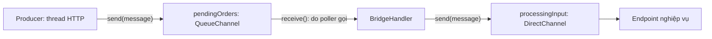

# Đổi channel type bằng bridge

## Mục tiêu và bối cảnh

Trong chương **Messaging bridge** của module **SPRING_INTEGRATION_CORE**, “đổi channel type” có nghĩa là nối hai channel có cơ chế giao nhận khác nhau để message đi qua được. Hai channel vẫn là hai bean riêng; bridge không biến đối tượng `QueueChannel` thành đối tượng `DirectChannel`.

Tình huống điển hình: bộ tiếp nhận đơn hàng cần đưa message vào hàng đợi để hấp thụ một đợt tăng tải, còn các endpoint nghiệp vụ đang nhận message qua một `DirectChannel`. Một bridge lấy message khỏi queue rồi gửi sang channel nghiệp vụ giúp giữ nguyên cách kết nối của các endpoint phía sau.

Sau bài này, bạn có thể:

- Chọn bridge khi cần thay đổi cách chuyển giao message giữa các đoạn flow.
- Xác định bridge cần poller dựa trên **channel đầu vào**.
- Cấu hình hai chiều `QueueChannel → DirectChannel` và `DirectChannel → QueueChannel` bằng Java DSL hoặc annotation.
- Giải thích tác động đến thread, tốc độ xử lý, lỗi và transaction.
- Viết kiểm thử quan sát payload, header và thời điểm message có thể được nhận.

Các ví dụ dùng `spring-integration-core`; phần kiểm thử dùng JUnit Jupiter. Hãy dùng bộ phiên bản Spring và JDK tương thích do dự án quản lý. Mã Java DSL nằm trong thư viện core, không cần thêm một thư viện Java DSL riêng. Bài tập trung vào channel cục bộ trong một ứng dụng Spring.

## 1. Bridge chuyển tiếp điều gì?

Một `Message<?>` chứa payload cùng các header như `correlationId`, `replyChannel` và `errorChannel`. Channel cung cấp đường vận chuyển; endpoint nhận message từ channel và thực hiện một hành vi.

Với bridge thuần túy, hành vi đó là **gửi tiếp message sang channel đầu ra**. `BridgeHandler` mặc định trả lại message nhận được để cơ chế output của endpoint chuyển tiếp. Nó không tự phân tích JSON, gọi dịch vụ nghiệp vụ hay gom các message thành một nhóm. Xem [mã nguồn BridgeHandler](https://github.com/spring-projects/spring-integration/blob/main/spring-integration-core/src/main/java/org/springframework/integration/handler/BridgeHandler.java).

Ví dụ:

```text
Trước bridge:
  payload = Order(id="O-009")
  headers = { traceId="trace-009", ... }

Sau bridge thuần túy:
  payload = Order(id="O-009")
  headers nghiệp vụ vẫn được chuyển tiếp
```

Điều thay đổi là **đường đi và cách bàn giao**. Nếu source là queue thì một consumer phải gọi `receive()`; nếu destination là `DirectChannel` thì `send()` gọi subscriber trong thread đang gửi.

Trong một flow thực tế, interceptor, message history hoặc các endpoint bổ sung có thể tác động đến message. Vì vậy, cần phân biệt hành vi của bridge với hành vi của toàn bộ flow. Bridge cũng không sao chép sâu payload: nếu payload là đối tượng có thể thay đổi, việc chuyển tiếp không tạo ra một bản dữ liệu độc lập.

Khi nhu cầu là đổi `String` JSON thành `Order`, hãy đặt transformer ở vị trí thích hợp. Khi nhu cầu là chọn nhánh theo trạng thái đơn, dùng router; loại bỏ message theo điều kiện dùng filter; kết hợp nhiều message theo correlation dùng aggregator. Bridge giải quyết việc kết nối các đoạn đường vận chuyển.

## 2. Hợp đồng channel quyết định cách tiêu thụ

`MessageChannel` có thao tác gửi. Hai hợp đồng thường gặp khi cấu hình bridge là:

| Hợp đồng | Cách phía nhận tham gia | Ví dụ |
| --- | --- | --- |
| `PollableChannel` | Consumer chủ động gọi `receive(...)` | `QueueChannel` |
| `SubscribableChannel` | Handler đăng ký bằng `subscribe(...)` | `DirectChannel`, `ExecutorChannel`, `PublishSubscribeChannel` |

Một biến có kiểu khai báo `MessageChannel` vẫn trỏ đến một implementation cụ thể. Đổi kiểu biến hay ép kiểu không bổ sung hành vi `receive()` hoặc `subscribe()`. Tham khảo [hợp đồng MessageChannel](https://docs.spring.io/spring-integration/reference/channel/interfaces.html).

Bridge được chứa trong endpoint phù hợp với source:

```text
Source PollableChannel
    → PollingConsumer
    → BridgeHandler
    → Destination MessageChannel

Source SubscribableChannel
    → EventDrivenConsumer
    → BridgeHandler
    → Destination MessageChannel
```

Chọn endpoint theo channel đầu vào là trách nhiệm của hạ tầng Spring Integration. Với cấu hình thông thường, bạn khai báo flow hoặc annotation và cấu hình poller khi source cần polling. Cơ chế này được mô tả trong [Message Endpoints](https://docs.spring.io/spring-integration/reference/endpoint.html).

### Bảng lựa chọn nhanh

| Nối từ → đến | Bridge có cần poller? | Ý nghĩa trong thiết kế |
| --- | --- | --- |
| `QueueChannel → DirectChannel` | Có, ở bridge đọc queue | Đưa message đã đệm sang đoạn xử lý trực tiếp |
| `DirectChannel → QueueChannel` | Không, ở bridge này | Đặt message vào queue để consumer phía sau nhận sau |
| `QueueChannel → QueueChannel` | Có, để đọc queue nguồn | Chuyển từ một bộ đệm sang bộ đệm khác |
| `QueueChannel → PublishSubscribeChannel` | Có | Lấy một message từ queue rồi đưa vào đoạn phát tới các subscriber |
| `DirectChannel → ExecutorChannel` | Không | Chuyển việc dispatch phía sau sang executor |

Bảng giả định các channel thông thường và endpoint được hạ tầng quản lý. Với source pollable, poller có thể được khai báo trực tiếp hoặc lấy từ cấu hình mặc định hợp lệ. Ví dụ trong bài luôn khai báo trực tiếp để người đọc thấy rõ ai tiêu thụ queue.

## 3. Chiều QueueChannel → DirectChannel

### Bài toán

Producer tiếp nhận đơn từ HTTP rồi gửi vào `pendingOrders`. Bạn muốn điều tiết số message được chuyển sang `processingInput` trong mỗi lượt polling.



Diễn tiến của một message:

1. Thread producer gửi message vào queue.
2. Khi queue nhận thành công, producer có thể tiếp tục công việc của mình.
3. Đến lịch polling, endpoint của bridge lấy message từ queue.
4. Bridge gửi message vào `processingInput`.
5. `DirectChannel` gọi handler đã đăng ký bằng chính thread đang thực hiện lượt poll, nếu không có một ranh giới bất đồng bộ khác.

Một `DirectChannel` phía sau queue không làm flow quay lại thread HTTP. Nó chỉ tiếp tục đồng bộ từ **thread đang gửi vào nó**.

Nếu subscriber xử lý mất 300 ms, thời gian đó nằm trong thời gian thực hiện lượt poll. Đặt delay ngắn hơn không tự tạo thêm nhiều consumer chạy song song.

### Vì sao chỉ khai báo hai channel chưa đủ?

```java
@Bean
public QueueChannel pendingOrders() {
    return new QueueChannel(100);
}

@Bean
public DirectChannel processingInput() {
    return new DirectChannel();
}
```

Hai bean này chưa tạo đường truyền nào giữa chúng. `QueueChannel` không tự rút message để gửi sang một channel khác. Cần một consumer, trong trường hợp này là endpoint chứa bridge cùng cấu hình poller.

## 4. Ví dụ Java DSL hoàn chỉnh

Cấu hình dưới đây ghép hai bridge để quan sát cả hai chiều:

```text
pendingOrders        processingInput          handoffQueue
 QueueChannel  ──→    DirectChannel     ──→     QueueChannel
               B1                      B2
          polling consumer       event-driven consumer
```

`handoffQueue` là điểm thu nhận để kiểm thử bằng `receive()`. Việc message có mặt ở đây chỉ có nghĩa đã chuyển giao đến queue, chưa chứng minh đơn hàng đã được xử lý nghiệp vụ.

```java
package example.bridge;

import java.time.Duration;

import org.springframework.context.annotation.Bean;
import org.springframework.context.annotation.Configuration;
import org.springframework.integration.channel.DirectChannel;
import org.springframework.integration.channel.QueueChannel;
import org.springframework.integration.config.EnableIntegration;
import org.springframework.integration.dsl.IntegrationFlow;
import org.springframework.integration.dsl.Pollers;

@Configuration
@EnableIntegration
public class ChannelBridgeConfig {

    @Bean
    public QueueChannel pendingOrders() {
        return new QueueChannel(100);
    }

    @Bean
    public DirectChannel processingInput() {
        return new DirectChannel();
    }

    @Bean
    public QueueChannel handoffQueue() {
        return new QueueChannel(100);
    }

    @Bean
    public IntegrationFlow bufferedToDirect() {
        return IntegrationFlow.from(pendingOrders())
                .bridge(endpoint -> endpoint
                        .id("pendingToProcessingBridge")
                        .poller(Pollers
                                .fixedDelay(Duration.ofMillis(200))
                                .maxMessagesPerPoll(5)
                                .receiveTimeout(0)))
                .channel(processingInput())
                .get();
    }

    @Bean
    public IntegrationFlow directToBuffered() {
        return IntegrationFlow.from(processingInput())
                .bridge(endpoint -> endpoint
                        .id("processingToHandoffBridge"))
                .channel(handoffQueue())
                .get();
    }
}
```

Trong `bufferedToDirect()`, poller thuộc endpoint của bridge đọc `pendingOrders`. Trong `directToBuffered()`, bridge được gọi khi có message gửi đến `processingInput`, nên không đặt poller ở đây.

`@Configuration` trong ví dụ giữ chế độ proxy mặc định: các lần gọi phương thức `@Bean` trong cấu hình tham chiếu lại bean do Spring quản lý. Nếu chuyển sang `proxyBeanMethods = false`, hãy đổi cách wiring sang inject bean thay vì gọi trực tiếp các phương thức tạo channel.

Ở ứng dụng thật, bạn có thể thay bridge thứ hai bằng endpoint nghiệp vụ đã có. Nếu chỉ cần chuyển queue nguồn sang queue đích và không có endpoint nào cần channel trung gian, hãy cân nhắc nối trực tiếp để tránh một bước vận chuyển dư thừa.

Cú pháp bridge bằng Java DSL và các cách cấu hình tương đương được trình bày trong [Messaging Bridge](https://docs.spring.io/spring-integration/reference/bridge.html).

## 5. Chiều DirectChannel → QueueChannel

Trong ví dụ trên, gọi:

```java
processingInput.send(message, 1000);
```

sẽ kích hoạt bridge thứ hai trong thread của caller. Bridge gửi message vào `handoffQueue`. Khi queue còn chỗ, thao tác đưa vào queue hoàn tất mà không cần có consumer đang chờ.

Điều này giải thích hai điểm:

- Bridge này không tạo ra một thread riêng; một consumer nhận từ `handoffQueue` về sau mới tạo ra cách bàn giao sang đoạn xử lý khác.
- Destination là queue không làm source trở thành pollable. Poller vẫn được quyết định bởi source của từng endpoint.

`1000` trong `send(message, 1000)` không phải thời hạn hoàn tất toàn bộ flow trong 1 giây. Nó là tham số timeout của thao tác gửi tại channel được gọi và không tự truyền thành deadline cho các lần gửi nằm sâu bên trong handler.

Nếu `handoffQueue` đầy, bridge có thể chờ theo send timeout của chính handler. Trong ví dụ học tập, mỗi kiểm thử chỉ gửi một message vào queue có dung lượng 100 để tập trung quan sát việc chuyển giao.

Trong production, hãy đặt dung lượng và chính sách chờ phù hợp. Chẳng hạn, khi cấu hình `BridgeHandler` trực tiếp, `setSendTimeout(500)` giới hạn thời gian handler chờ gửi đến một channel đích có hỗ trợ timeout. Đây vẫn không phải timeout cho một tác vụ nghiệp vụ tùy ý.

## 6. Điều tiết bằng poller: đọc đúng ba tham số

Cấu hình:

```java
Pollers.fixedDelay(Duration.ofMillis(200))
        .maxMessagesPerPoll(5)
        .receiveTimeout(0)
```

có ba ý nghĩa độc lập:

| Tham số | Ý nghĩa trong ví dụ | Điều không nên suy ra |
| --- | --- | --- |
| `fixedDelay(200 ms)` | Chờ 200 ms sau khi lượt poll trước hoàn tất rồi lên lượt tiếp theo | Không đảm bảo mọi message chỉ chờ tối đa 200 ms |
| `maxMessagesPerPoll(5)` | Mỗi lượt lấy tối đa 5 message | Không phải số thread hoặc số message được xử lý đồng thời |
| `receiveTimeout(0)` | Mỗi lần nhận từ queue không chờ khi queue rỗng | Không giới hạn thời gian chạy subscriber |

`receiveTimeout` tính theo mili giây. Khi `receive()` trả về `null`, lượt poll dừng dù chưa đạt số message tối đa. Xem [cấu hình PollerSpec](https://docs.spring.io/spring-integration/api/org/springframework/integration/dsl/PollerSpec.html).

### Ước lượng để chọn thông số ban đầu

Giả sử queue luôn có dữ liệu, chỉ có một lượt poll hoạt động tại một thời điểm và mỗi message mất khoảng 40 ms để đi hết đoạn xử lý đồng bộ phía sau bridge.

```text
Một lượt chuyển tối đa:       5 message
Thời gian xử lý một lượt:     5 × 40 ms = 200 ms
Delay sau lượt:               200 ms
Chu kỳ xấp xỉ:                400 ms
Thông lượng xấp xỉ:           5 / 0,4 = 12,5 message/giây
```

Đây là phép ước lượng cho các giả định trên, bỏ qua overhead, lỗi và biến động thời gian xử lý. Chia `5 / 0,2 = 25` chỉ cho con số khi thời gian xử lý rất nhỏ so với delay.

`fixedRate` đo khoảng cách theo lịch bắt đầu, trong khi `fixedDelay` dựa vào thời điểm hoàn tất. Không dùng hai cách đặt lịch này thay cho một cam kết giới hạn lưu lượng chính xác trong mọi cửa sổ thời gian. Tham khảo [Pollers](https://docs.spring.io/spring-integration/api/org/springframework/integration/dsl/Pollers.html).

Nếu producer đưa vào 30 message/giây nhưng nhánh xử lý chỉ tiêu thụ trung bình 12,5 message/giây, backlog tăng khoảng 17,5 message/giây trong mô hình đơn giản này. Tăng capacity chỉ kéo dài thời gian trước khi queue đầy. Cần điều chỉnh năng lực xử lý hoặc kiểm soát tốc độ tiếp nhận để giải quyết sự chênh lệch bền vững.

## 7. Cấu hình tương đương bằng annotation

Đây là **phương án thay thế** cho `ChannelBridgeConfig`. Chỉ nạp một trong hai cấu hình trong cùng ví dụ để tránh tạo các endpoint trùng hoặc consumer cạnh tranh ngoài ý muốn.

```java
package example.bridge;

import org.springframework.context.annotation.Bean;
import org.springframework.context.annotation.Configuration;
import org.springframework.integration.annotation.BridgeTo;
import org.springframework.integration.annotation.Poller;
import org.springframework.integration.channel.DirectChannel;
import org.springframework.integration.channel.QueueChannel;
import org.springframework.integration.config.EnableIntegration;

@Configuration
@EnableIntegration
public class AnnotatedChannelBridgeConfig {

    @Bean
    @BridgeTo(
            value = "processingInput",
            poller = @Poller(
                    fixedDelay = "200",
                    maxMessagesPerPoll = "5",
                    receiveTimeout = "0"))
    public QueueChannel pendingOrders() {
        return new QueueChannel(100);
    }

    @Bean
    @BridgeTo("handoffQueue")
    public DirectChannel processingInput() {
        return new DirectChannel();
    }

    @Bean
    public QueueChannel handoffQueue() {
        return new QueueChannel(100);
    }
}
```

`@BridgeTo` đặt trên bean channel nguồn, còn giá trị annotation chỉ channel đích.

Nếu muốn khai báo theo góc nhìn ngược lại, `@BridgeFrom` đặt trên bean channel đích và trỏ đến channel nguồn. Chọn một cách cho cùng một kết nối; khai báo cả hai không làm đường truyền “chắc chắn hơn” mà có thể tạo thêm endpoint.

## 8. Kiểm thử việc chuyển giao

Hai kiểm thử sau dùng cấu hình Java DSL ở mục 4. Chúng quan sát đầu ra, không cần dựa vào thời gian ngủ cố định hoặc khẳng định message luôn được xử lý trong đúng 200 ms.

```java
package example.bridge;

import org.junit.jupiter.api.Test;
import org.springframework.context.annotation.AnnotationConfigApplicationContext;
import org.springframework.integration.channel.DirectChannel;
import org.springframework.integration.channel.QueueChannel;
import org.springframework.messaging.Message;
import org.springframework.messaging.support.MessageBuilder;

import static org.junit.jupiter.api.Assertions.assertEquals;
import static org.junit.jupiter.api.Assertions.assertNotNull;
import static org.junit.jupiter.api.Assertions.assertSame;
import static org.junit.jupiter.api.Assertions.assertTrue;

class ChannelBridgeConfigTest {

    record Order(String id) {
    }

    @Test
    void queueToDirectPreservesPayloadAndBusinessHeader() {
        try (var context =
                     new AnnotationConfigApplicationContext(
                             ChannelBridgeConfig.class)) {

            QueueChannel input =
                    context.getBean("pendingOrders", QueueChannel.class);
            QueueChannel output =
                    context.getBean("handoffQueue", QueueChannel.class);

            Order order = new Order("O-009");
            Message<Order> sent = MessageBuilder
                    .withPayload(order)
                    .setHeader("traceId", "trace-009")
                    .build();

            assertTrue(input.send(sent, 1000));

            Message<?> received = output.receive(3000);
            assertNotNull(received);
            assertSame(order, received.getPayload());
            assertEquals(
                    "trace-009",
                    received.getHeaders().get("traceId"));
        }
    }

    @Test
    void directToQueueEnqueuesBeforeSendReturns() {
        try (var context =
                     new AnnotationConfigApplicationContext(
                             ChannelBridgeConfig.class)) {

            DirectChannel input =
                    context.getBean("processingInput", DirectChannel.class);
            QueueChannel output =
                    context.getBean("handoffQueue", QueueChannel.class);

            Message<String> sent = MessageBuilder
                    .withPayload("O-010")
                    .build();

            assertTrue(input.send(sent, 1000));

            Message<?> received = output.receive(0);
            assertNotNull(received);
            assertEquals("O-010", received.getPayload());
        }
    }
}
```

Kiểm thử đầu gửi qua queue nguồn rồi chờ có giới hạn ở queue đích. `assertSame` kiểm tra bridge không tạo bản sao payload trong cấu hình cụ thể này; kiểm tra header bảo đảm thông tin nghiệp vụ vẫn đi qua.

Kiểm thử thứ hai bỏ qua queue nguồn để đi thẳng vào bridge có source là `DirectChannel`. Vì nhánh này chạy đồng bộ và queue đích còn chỗ, message đã được enqueue khi `send()` trả về. `receive(0)` kiểm tra ngay điều đó.

Khoảng chờ 3 giây của kiểm thử đầu là ngân sách chờ trong môi trường kiểm thử, không phải SLA của hệ thống. Nếu kiểm thử thất bại, cần xem endpoint có khởi động, poller có chạy và có lỗi downstream hay không. Không kết luận ngay rằng phải tăng timeout.

Các kiểm thử này chứng minh việc chuyển giao trong một context cục bộ. Chúng không chứng minh khả năng khôi phục sau khi process chết, throughput hoặc tính nguyên tử với cơ sở dữ liệu.

## 9. Ranh giới thread, lỗi và transaction

### 9.1. Đối chiếu theo vị trí gửi

| Đường đi | Ai chạy bridge? | Caller ban đầu quan sát điều gì? |
| --- | --- | --- |
| Caller → Direct → bridge → Direct → handler | Thường là thread của caller | Handler hoàn tất hoặc lỗi truyền ngược trong call stack |
| Caller → Queue → poller → bridge → Direct → handler | Thread polling ở đoạn sau queue | Kết quả gửi vào queue; lỗi xử lý xảy ra về sau |
| Caller → Direct → bridge → Queue → consumer | Thread caller chạy đến bước enqueue | Việc chuyển giao vào queue; consumer xử lý sau |
| Caller → Direct → bridge → ExecutorChannel → handler | Bridge chạy trong thread caller; dispatch tiếp theo do executor | Cần hiểu cả cấu hình executor và chính sách từ chối task |

`ExecutorChannel` không luôn đồng nghĩa với một thread khác: một số chính sách executor có thể chạy task trên caller khi quá tải. Khi xác định ranh giới thực thi, phải xem cấu hình executor cụ thể.

### 9.2. Lỗi đồng bộ và lỗi từ poller

Nếu đoạn `DirectChannel → bridge → DirectChannel` chạy trong thread caller và handler đích ném exception, caller có thể bắt lỗi khi gọi `send()`. Chỉ thêm header `errorChannel` không làm mọi exception đồng bộ tự biến thành một message lỗi.

Ở chiều `QueueChannel → bridge → DirectChannel`, producer đã gửi message vào queue trước khi poller xử lý. Lỗi xảy ra trong task polling không thể ném ngược về một lời gọi `send()` đã kết thúc.

Với cơ chế xử lý lỗi mặc định của Spring Integration cho task polling, exception được công bố dưới dạng `ErrorMessage`. Header `errorChannel` của message được ưu tiên; khi không có, cơ chế dùng error channel mặc định tương ứng. Xem [Error Handling](https://docs.spring.io/spring-integration/reference/error-handling.html).

Có thể thay cấu hình poller của bridge thứ nhất bằng đoạn sau để chọn một error channel mặc định riêng:

```java
.poller(Pollers
        .fixedDelay(Duration.ofMillis(200))
        .maxMessagesPerPoll(5)
        .receiveTimeout(0)
        .errorChannel("bridgeErrors"))
```

Khi đó, cần khai báo bean `bridgeErrors` và consumer xử lý lỗi phù hợp. Nếu chọn một queue làm error channel, phải có consumer hoặc một cơ chế đọc queue đó; việc tạo queue riêng chưa hoàn tất thiết kế xử lý lỗi.

### 9.3. Nhận khỏi queue không đồng nghĩa có thể tự phục hồi

Xét `QueueChannel` trong bộ nhớ như ví dụ:

```text
poller lấy message khỏi pendingOrders
    → bridge gửi vào processingInput
    → downstream thất bại
```

Bridge không tự đưa message trở lại queue nguồn. Cơ chế công bố lỗi cũng không đồng nghĩa đã retry hoặc rollback thao tác nhận message.

Nếu cần thử lại, hãy thiết kế retry ở đúng phạm vi xử lý, đường phục hồi hoặc dead-letter flow. Nếu downstream có side effect, cần xét tính idempotent trước khi phát lại message.

### 9.4. Transaction cần tài nguyên tham gia

Một giao dịch gắn với thread producer không tự đi theo message sang thread polling. Đoạn đồng bộ sau bridge có thể chạy trong một transaction của poller nếu được cấu hình, nhưng điều đó không tự làm mọi tài nguyên trở thành transactional.

Đặc biệt, thêm `.transactional(...)` không tự làm `new QueueChannel(100)` trong bộ nhớ có khả năng rollback việc nhận message. Muốn dựa vào rollback và phục hồi, phải dùng channel/store hoặc broker có ngữ nghĩa giao dịch phù hợp cùng transaction manager thích hợp. Tham khảo [Transaction Support](https://docs.spring.io/spring-integration/reference/transactions.html).

## 10. Khi đổi sang publish-subscribe hoặc executor

### Queue → publish-subscribe

Giả sử một sự kiện `OrderAccepted` cần thông báo cho các nhánh gửi email và ghi nhận chỉ số:

```text
eventBuffer: QueueChannel
    → bridge có poller
    → orderEvents: PublishSubscribeChannel
          → emailHandler
          → metricsHandler
```

Message được lấy khỏi queue nguồn một lần rồi được đưa đến channel phát sự kiện. Hành vi gửi tới subscriber do `PublishSubscribeChannel` quyết định.

Với channel publish-subscribe đồng bộ, subscriber chậm có thể làm chậm lượt poll; lỗi từ subscriber cũng có thể ảnh hưởng đến việc dispatch tiếp. Nếu dùng executor, cần xét khả năng xử lý lỗi và thứ tự của từng nhánh.

Nếu có nhiều consumer trực tiếp đọc cùng một `QueueChannel`, chúng cạnh tranh lấy message. Đó không phải cách thay thế cho một channel broadcast. Tương tự, gắn thêm một handler vào `DirectChannel` vốn có một bridge không khiến cả hai luôn nhận được mọi message.

### Direct → executor

```text
requestInput: DirectChannel
    → bridge
    → workerInput: ExecutorChannel
    → service activator
```

Bridge vẫn chỉ chuyển tiếp. Executor của channel đích quyết định việc dispatch. Tăng thread pool cần đi cùng việc đánh giá thứ tự hoàn tất, giới hạn tài nguyên, transaction và xử lý khi executor từ chối task.

Các khác biệt point-to-point, broadcast và executor được mô tả trong [Message Channel Implementations](https://docs.spring.io/spring-integration/reference/channel/implementations.html).

Đối với mọi nhánh song song, payload bất biến giúp tránh việc một nhánh sửa dữ liệu mà nhánh khác đang sử dụng. Bridge không cung cấp sự cô lập đối tượng cho các nhánh.

## 11. Dung lượng, thứ tự và độ bền

### Dung lượng

Chọn queue có capacity hữu hạn giúp biểu lộ tình trạng downstream không theo kịp. Khi đầy, cần biết producer sẽ chờ, nhận kết quả `false` do timeout, hay gặp exception từ hạ tầng gửi tiếp.

Một message payload lớn và một message nhỏ đều chiếm một vị trí trong queue. Capacity theo số message không trực tiếp biểu thị ngân sách bộ nhớ. Hãy ước lượng thêm kích thước payload, header và thời gian giữ dữ liệu.

### Thứ tự

Một queue FIFO với một consumer và một đoạn xử lý đồng bộ đơn giản giúp giữ thứ tự xử lý theo thứ tự lấy message. Khi thêm nhiều poller, executor hoặc nhánh có thời gian xử lý khác nhau, thứ tự hoàn tất có thể khác thứ tự nhận.

Nếu nghiệp vụ yêu cầu thứ tự theo `orderId`, hãy thiết kế cơ chế phân vùng hoặc tuần tự hóa phù hợp. Không coi việc có một bridge là bằng chứng rằng toàn bộ pipeline bảo toàn thứ tự.

### Độ bền

Các queue trong ví dụ chỉ ở bộ nhớ. Một lần gửi thành công không có nghĩa dữ liệu đã được lưu bền vững. Với yêu cầu chịu được sự cố process, cần thiết kế store hoặc broker phù hợp cùng chính sách acknowledgment, retry và idempotency.

Cũng cần phân biệt:

```text
Message vào queue thành công
    ≠ downstream xử lý thành công
    ≠ side effect đã commit
    ≠ sender đã nhận được phản hồi nghiệp vụ
```

Đây là các mốc khác nhau để đặt log, metric và tiêu chí thành công.

## 12. Những lỗi cấu hình thường gặp

| Biểu hiện | Nguyên nhân cần kiểm tra | Cách xử lý |
| --- | --- | --- |
| Queue có message nhưng không đi tiếp | Không có consumer, endpoint chưa chạy hoặc thiếu poller hợp lệ | Xác định endpoint nào chịu trách nhiệm đọc queue và kiểm tra lifecycle |
| Khởi động lỗi khi bridge đọc queue | Không khai báo poller và không có default poller phù hợp | Đặt poller tại endpoint có source pollable |
| Gắn poller vào bridge có source `DirectChannel` | Nhầm nhu cầu polling của destination với source | Bỏ poller ở bridge này; cấu hình consumer đọc queue đích nếu cần |
| Gửi tới `DirectChannel` nhưng không có subscriber | Channel đích chưa có endpoint nhận | Kết nối handler hoặc flow và kiểm tra thứ tự khởi động |
| Header còn nguyên nhưng payload không đổi kiểu | Mong bridge làm nhiệm vụ transformer | Thêm transformer để chuyển định dạng |
| Producer gửi thành công nhưng không thấy kết quả | Mới hoàn tất enqueue hoặc downstream có lỗi về sau | Theo dõi đầu ra, error flow và endpoint xử lý |
| Một vài message “mất” khỏi consumer đang quan sát | Có consumer khác cạnh tranh trên queue hoặc direct channel | Kiểm tra topology và subscriber; dùng publish-subscribe khi cần broadcast |
| Flow treo khi tải tăng | Queue đích đầy và bước gửi tiếp đang chờ | Xác định queue đầy, send timeout và tốc độ tiêu thụ |
| Message chạy vòng lặp | Bridge A → B rồi lại B → A mà không có điều kiện kết thúc | Sửa topology và kiểm tra chiều kết nối |
| Bridge không khai báo output nhưng mong tự tìm đích | Thiếu cả output channel lẫn `replyChannel` hợp lệ | Khai báo đích rõ ràng hoặc thiết kế request-reply phù hợp |

Một bridge không khai báo output có thể dùng `replyChannel` của message. Tuy nhiên, giữ header phản hồi không đồng nghĩa gateway sẽ nhận được kết quả đúng hạn. Nếu flow đi qua queue, vẫn cần endpoint tạo hoặc chuyển tiếp phản hồi và timeout phù hợp.

## 13. Áp dụng vào một flow nghiệp vụ

Giả sử hệ thống tiếp nhận lệnh nhập kho theo từng đợt. Consumer nghiệp vụ đã dùng `inventoryInput` là một `DirectChannel`.

Thiết kế ban đầu có thể là:

```text
Inbound adapter
    → inventoryBuffer: QueueChannel có giới hạn
    → bridge có poller
    → inventoryInput: DirectChannel
    → transformer chuẩn hóa dữ liệu
    → filter kiểm tra điều kiện
    → service activator cập nhật kho
```

Bridge giữ vai trò chuyển từ đoạn đệm sang đoạn xử lý trực tiếp. Transformer và filter tiếp tục đảm nhận các bước nghiệp vụ riêng của chúng. Nếu sau này xuất hiện nhu cầu gom nhiều dòng nhập theo một phiếu, aggregator sẽ có correlation và release policy riêng; bridge không thay thế được những quyết định đó.

Trước khi áp dụng, xác định rõ:

1. Message được coi là tiếp nhận thành công tại bước nào.
2. Endpoint nào đọc từng queue và poller nằm ở đâu.
3. Tốc độ đến có thể vượt tốc độ xử lý trong bao lâu.
4. Lỗi xử lý có được ghi nhận, thử lại hoặc đưa sang đường phục hồi như thế nào.
5. Yêu cầu lưu bền vững, transaction và thứ tự có được tài nguyên thực tế hỗ trợ hay không.
6. Kiểm thử nào chứng minh việc chuyển giao và kiểm thử nào cần thêm cho side effect nghiệp vụ.

Một bridge phù hợp khi hai đoạn flow đã có hợp đồng payload tương thích và điều cần điều chỉnh là cách bàn giao message giữa các channel.
