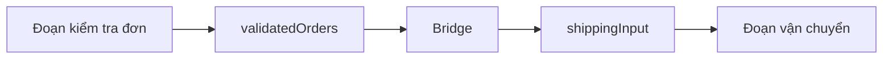
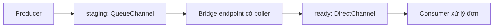

# Khi dùng bridge thay cho handler

## 1. Mục tiêu và phạm vi

Trong chương **Messaging bridge** của module `SPRING_INTEGRATION_CORE`, câu hỏi thiết kế là: một bước trong luồng chỉ cần nối hai kênh, hay phải thực hiện công việc trên thông điệp?

**Dùng bridge khi trách nhiệm của bước đó là chuyển tiếp thông điệp sang một đích đã xác định, không có logic nghiệp vụ hay chuyển đổi dữ liệu.** Dùng service activator hoặc endpoint chuyên biệt khi bước đó phải gọi dịch vụ, biến đổi, chọn đích, loại bỏ hoặc gom thông điệp.

Sau bài này, bạn có thể:

- Phân biệt vai trò nối kênh của bridge với vai trò xử lý của handler tùy chỉnh.
- Chọn bridge cho ranh giới giữa các đoạn luồng hoặc giữa queue và consumer đăng ký nhận.
- Cấu hình bridge bằng Java DSL và hiểu cách poller ảnh hưởng đến tốc độ chuyển tiếp.
- Dự đoán đường đi của thông điệp, luồng thực thi, phản hồi và lỗi.
- Thiết kế kiểm thử cho hợp đồng chuyển tiếp, không nhầm việc gửi thành công với hoàn tất nghiệp vụ.

Ví dụ dùng Java 17 trở lên và API Spring Integration 6.5. Dự án cần `spring-integration-core`; mẫu kiểm thử dùng thêm JUnit Jupiter. Với Spring Boot, có thể dùng starter Integration và starter Test, để dependency management của dự án quản lý các phiên bản tương thích. Bài tập trung vào các thành phần core; adapter cho JMS, HTTP hoặc hệ thống tệp là những thành phần riêng.

## 2. Bridge cũng là một handler

Từ “handler” có hai cách dùng cần phân biệt:

| Cách dùng | Ý nghĩa trong bài |
|---|---|
| `MessageHandler` | Giao diện kỹ thuật nhận một `Message<?>` để xử lý |
| Handler nghiệp vụ | Mã của ứng dụng được gọi qua service activator, thường biểu diễn bằng `.handle(...)` trong DSL |
| `BridgeHandler` | Handler có sẵn của framework, dùng để chuyển tiếp message |
| Endpoint | Thành phần nối handler với input channel, quản lý cách nhận message và lifecycle |

`BridgeHandler` kế thừa `AbstractReplyProducingMessageHandler`. Phương thức xử lý của nó trả lại message đầu vào. Vì vậy, “thay handler bằng bridge” ở đây có nghĩa là thay phần mã chuyển tiếp tự viết bằng thành phần chuyên dụng có sẵn. Bản thân bridge vẫn dùng cơ chế handler của framework. Xem [mã nguồn BridgeHandler 6.5.10](https://github.com/spring-projects/spring-integration/blob/v6.5.10/spring-integration-core/src/main/java/org/springframework/integration/handler/BridgeHandler.java).

Endpoint quyết định cách nhận message: input thuộc `SubscribableChannel` dẫn tới consumer đăng ký nhận; input thuộc `PollableChannel` dẫn tới consumer polling. Bridge không thay thế vai trò của endpoint trong việc tiếp nhận message. Cơ chế này được trình bày trong [Polling Consumer](https://docs.spring.io/spring-integration/reference/6.5/polling-consumer.html).

Mô hình cần nhớ:

```text
Input channel → Endpoint nhận message → BridgeHandler → Output channel
```

Không nên đánh giá một bước chỉ từ tên phương thức Java. Một hàm `forward()` có thể chứa nghiệp vụ hoặc chỉ gửi lại message; hai trường hợp đó cần quyết định thiết kế khác nhau.

## 3. Tiêu chí chọn bridge hay endpoint xử lý

Bảng dưới là tiêu chí thiết kế áp dụng cho các tình huống giả định trong bài:

| Yêu cầu của bước hiện tại | Lựa chọn phù hợp | Lý do |
|---|---|---|
| Nối `validatedOrders` với `shippingInput`, giữ nguyên hợp đồng message | Bridge | Chỉ cần khai báo đường nối |
| Đọc từ queue theo nhịp rồi đưa sang đoạn xử lý đăng ký nhận | Bridge có poller | Cần một consumer đọc queue và chuyển tiếp |
| Gọi `shippingService.createShipment(...)` | Service activator, thường dùng `.handle(...)` | Có hành động nghiệp vụ |
| Chuyển JSON thành `Order` | Transformer | Có hợp đồng chuyển đổi dữ liệu |
| Chọn kênh theo quốc gia hoặc loại đơn | Router | Đích phụ thuộc nội dung message |
| Chặn đơn không đủ điều kiện | Filter | Có quyết định chấp nhận hoặc loại bỏ |
| Gom các dòng đơn thành một kết quả | Aggregator | Có trạng thái nhóm và điều kiện phát hành |
| Thêm một header phục vụ đoạn tiếp theo | Header enricher | Có thay đổi metadata |
| Cho mã gọi Java tương tác qua giao diện request/reply | Messaging gateway | Cần một giao diện gọi vào luồng |
| Ghi message ra broker hoặc gọi API bên ngoài | Adapter hoặc outbound gateway phù hợp | Cần giao tiếp giao thức bên ngoài |

Có thể đưa ra quyết định theo ba bước:

1. Mô tả công việc bằng một câu. Nếu câu chỉ là “đưa message từ A sang B”, bridge là ứng viên phù hợp.
2. Tìm các động từ bổ sung như kiểm tra, chuyển đổi, chọn, lưu, gọi, gom. Chúng biểu thị trách nhiệm xử lý cần được thể hiện trong luồng.
3. Xác định có cần giữ cả hai channel A và B hay không. Nếu chúng không đại diện cho ranh giới hữu ích, có thể nối trực tiếp endpoint trước với input của đoạn sau, thay vì thêm một bridge trung gian.

Ví dụ, `validatedOrders` là hợp đồng đầu ra của module kiểm tra, còn `shippingInput` là hợp đồng đầu vào của module vận chuyển. Giữ hai tên giúp hai module cấu hình độc lập; bridge ở lớp lắp ghép ứng dụng công bố cách nối chúng.

Nếu hai bên đã dùng chung một channel đúng nghĩa và đúng mô hình phân phối, thêm bridge chỉ để tạo thêm một bước sẽ làm đồ thị khó đọc hơn.

## 4. Các tình huống bridge có giá trị

### 4.1. Nối hai đoạn luồng có cùng hợp đồng dữ liệu

Giả sử nhóm A phát `Message<Order>` sau kiểm tra, nhóm B nhận chính `Message<Order>` để vận chuyển. Không có thay đổi schema, không gọi dịch vụ ở giữa và không cần lựa chọn đích.



Giá trị của bridge nằm ở cấu trúc: vị trí nối được thể hiện rõ, có thể đặt tên endpoint để quản lý. Logic xử lý đơn vẫn nằm trong các endpoint tương ứng.

Nếu sau này bên vận chuyển nhận một schema khác, cần thêm transformer tại ranh giới đó. Việc có bridge trước đây không phải lý do để giấu chuyển đổi dữ liệu trong mã gửi message.

### 4.2. Nối `QueueChannel` với `DirectChannel`

Giả sử producer đưa đơn vào `staging`. Đoạn sau chỉ muốn nhận message từ `ready`, không muốn tự khai báo việc polling.



Queue tạo nơi chờ; endpoint bridge đảm nhận lịch đọc queue; consumer sau nhận qua `DirectChannel`.

Một bridge có thể nối các channel hoặc các đoạn adapter khi không cần dịch định dạng dữ liệu. Nếu hai hệ thống dùng giao thức khác nhau, adapter vẫn phải thực hiện giao tiếp tương ứng. Xem [Messaging Bridge](https://docs.spring.io/spring-integration/reference/6.5/bridge.html).

### 4.3. Kết thúc một đoạn luồng bằng đường phản hồi

Bridge cũng phù hợp khi đoạn luồng cần chuyển message hiện tại về kênh phản hồi đã có trong header. Đây là thao tác chuyển tiếp ở cấp messaging. Nếu cần tạo kết quả nghiệp vụ mới trước khi trả lời, kết quả đó phải do endpoint xử lý thích hợp tạo ra.

## 5. Ví dụ Java DSL: bỏ handler chỉ trả lại payload

Giả sử `validatedOrders` và `shippingInput` là hai bean `DirectChannel` đã có. Cấu hình dưới dùng một service activator chỉ trả lại payload:

```java
@Bean
IntegrationFlow forwardingFlow() {
    return IntegrationFlow.from("validatedOrders")
            .handle(Object.class, (payload, headers) -> payload)
            .channel("shippingInput")
            .get();
}
```

Lambda không làm công việc nghiệp vụ nào. Có thể diễn đạt trách nhiệm rõ hơn:

```java
@Bean
IntegrationFlow forwardingFlow() {
    return IntegrationFlow.from("validatedOrders")
            .bridge(endpoint -> endpoint.id("ordersToShippingBridge"))
            .channel("shippingInput")
            .get();
}
```

Chọn một định nghĩa `forwardingFlow` khi áp dụng. Tên endpoint giúp người vận hành tìm đúng điểm nối trong đồ thị và lifecycle.

Trong Java DSL, `.handle(...)` biểu diễn service activator, còn `.bridge(...)` biểu diễn bridge. Xem bảng ánh xạ trong [DSL Basics](https://docs.spring.io/spring-integration/reference/6.5/dsl/java-basics.html).

Việc thay thế cần dựa trên hành vi thực tế của mã cũ. Nếu lambda còn cập nhật trạng thái, ghi audit bắt buộc hoặc gọi hệ thống ngoài, xóa nó sẽ thay đổi nghiệp vụ. Khi đó cần giữ công việc đó ở một endpoint có trách nhiệm rõ ràng.

### Bẫy về giá trị trả về

Service activator gọi một phương thức có thể sinh output từ kết quả khác `null`. Phương thức trả `void` hoặc trả `null` thường kết thúc xử lý tại đó, trừ các cấu hình yêu cầu phải có reply. Không thể suy ra một handler sẽ tự chuyển tiếp message chỉ vì nó đã được gọi. Xem [Service Activator](https://docs.spring.io/spring-integration/reference/6.5/service-activator.html).

Đặc biệt, `MessageHandler.handleMessage(...)` có kiểu trả về `void`. Lambda nhận cả message theo giao diện này không mang cùng hợp đồng với lambda `GenericHandler` trả payload. Nếu chỉ cần chuyển tiếp, dùng bridge giúp tránh phải tự viết hành vi gửi và kiểm tra kết quả gửi.

## 6. Ví dụ đầy đủ: queue sang kênh đăng ký nhận

Cấu hình sau tạo hai channel và một bridge. Consumer của `ready` sẽ do đoạn nghiệp vụ hoặc bài kiểm thử đăng ký; bridge không tự tạo consumer nghiệp vụ.

```java
package example.integration;

import java.time.Duration;

import org.springframework.beans.factory.annotation.Qualifier;
import org.springframework.context.annotation.Bean;
import org.springframework.context.annotation.Configuration;
import org.springframework.integration.channel.DirectChannel;
import org.springframework.integration.channel.QueueChannel;
import org.springframework.integration.config.EnableIntegration;
import org.springframework.integration.dsl.IntegrationFlow;
import org.springframework.integration.dsl.Pollers;

@Configuration
@EnableIntegration
public class BridgeConfiguration {

    @Bean
    public QueueChannel staging() {
        return new QueueChannel(100);
    }

    @Bean
    public DirectChannel ready() {
        return new DirectChannel();
    }

    @Bean
    public IntegrationFlow stagingBridgeFlow(
            @Qualifier("staging") QueueChannel staging,
            @Qualifier("ready") DirectChannel ready) {

        return IntegrationFlow.from(staging)
                .bridge(endpoint -> endpoint
                        .id("stagingToReadyBridge")
                        .poller(Pollers.fixedDelay(Duration.ofMillis(200))
                                .receiveTimeout(0)
                                .maxMessagesPerPoll(5)))
                .channel(ready)
                .get();
    }
}
```

Đọc cấu hình theo hướng message đi qua:

| Thành phần | Ý nghĩa trong ví dụ |
|---|---|
| `staging` | Queue có sức chứa 100 message |
| `IntegrationFlow.from(staging)` | Chọn channel đầu vào cho luồng |
| `.bridge(...)` | Tạo bước chuyển tiếp |
| `.id("stagingToReadyBridge")` | Đặt tên endpoint để nhận diện |
| `fixedDelay(200 ms)` | Đặt khoảng nghỉ giữa các chu kỳ poll đã hoàn tất |
| `receiveTimeout(0)` | Không chờ message mới khi một lần đọc gặp queue rỗng |
| `maxMessagesPerPoll(5)` | Giới hạn số message đọc trong một chu kỳ |
| `.channel(ready)` | Đặt đích cho bước bridge phía trước |

Với queue luôn có sẵn message, mỗi message mất khoảng 20 ms để đi hết đoạn xử lý đồng bộ, một chu kỳ xử lý đủ năm message mất khoảng 100 ms. Sau đó nghỉ 200 ms, nên ước lượng thông lượng là:

```text
5 message / (100 ms xử lý + 200 ms nghỉ) ≈ 16,7 message/giây
```

Đây là phép tính minh họa với giả định đơn giản, chưa tính overhead và cạnh tranh tài nguyên. Nếu chỉ lấy `5 / 0,2 = 25`, bạn đã bỏ qua thời gian xử lý của cấu hình fixed delay.

`maxMessagesPerPoll` giới hạn số lần lấy message trong mỗi chu kỳ, không tạo một message chứa danh sách năm phần tử. Bridge vẫn chuyển từng message riêng. Cách đọc nhiều lần và ý nghĩa của `receiveTimeout` được mô tả trong [Message Endpoints](https://docs.spring.io/spring-integration/reference/6.5/endpoint.html).

Đừng suy ra cấu hình này đáp ứng một quota API như “không quá N request trong mọi cửa sổ một giây”. Muốn có cam kết như vậy phải thiết kế cơ chế giới hạn phù hợp, đồng thời tính cả retry và số instance ứng dụng. Một message cũng có thể dẫn đến nhiều request ở đoạn sau.

### 6.1. Khi nào cần poller?

Với input là `PollableChannel`, endpoint cần poller khai báo riêng hoặc poller mặc định đã được cấu hình. Với input là `DirectChannel`, endpoint nhận theo cơ chế đăng ký, không gắn poller để biến nó thành queue. Quy tắc phụ thuộc loại input channel, không phụ thuộc việc bước xử lý là bridge hay handler nghiệp vụ. Xem [cấu hình endpoint và default poller](https://docs.spring.io/spring-integration/reference/6.5/endpoint.html#endpoint-namespace).

Chỉ có bean `BridgeHandler` chưa tạo ra một consumer đọc queue. Nó cần được framework nối vào input thông qua một endpoint.

### 6.2. Biểu diễn cùng ý tưởng bằng Java annotation

Một cách khác là khai báo `BridgeHandler` với `@ServiceActivator`. Ví dụ sau là phương án thay cho bean `stagingBridgeFlow`, dùng lại hai channel của cấu hình trên:

```java
import org.springframework.integration.annotation.Poller;
import org.springframework.integration.annotation.ServiceActivator;
import org.springframework.integration.handler.BridgeHandler;

@Bean
@ServiceActivator(
        inputChannel = "staging",
        poller = @Poller(fixedDelay = "200", maxMessagesPerPoll = "5"))
public BridgeHandler stagingToReadyHandler() {
    BridgeHandler bridge = new BridgeHandler();
    bridge.setOutputChannelName("ready");
    return bridge;
}
```

Ví dụ annotation không đặt `receiveTimeout(0)` như bản DSL; hãy tính đến cấu hình timeout khi so sánh thời gian polling. Tài liệu cũng cung cấp `@BridgeFrom` và `@BridgeTo` để nối channel bean. Xem [cấu hình bridge bằng Java](https://docs.spring.io/spring-integration/reference/6.5/bridge.html#bridge-java).

Chỉ đăng ký một phương án cho cùng nhiệm vụ. Nếu giữ cả hai bridge đọc `staging`, chúng trở thành các consumer cạnh tranh trên queue; mỗi message sẽ do một consumer lấy, không tự biến thành phát bản sao cho cả hai.

## 7. Bảo toàn message và đường phản hồi

### 7.1. Hợp đồng chuyển tiếp

Bridge không chủ động đổi payload hoặc header nghiệp vụ. Điều này phù hợp với các header như `orderId`, `correlationId` và các giá trị phục vụ đoạn sau. Mã nguồn bridge trả lại request message thay vì lấy payload để dựng một kết quả nghiệp vụ mới. Xem [BridgeHandler](https://docs.spring.io/spring-integration/api/org/springframework/integration/handler/BridgeHandler.html).

Tuy vậy, hợp đồng của cả luồng còn phụ thuộc interceptor, message history, transformer và các adapter xung quanh. Không nên mở rộng kết luận “bridge không sửa message” thành “mọi bước trước và sau bridge đều không sửa message”. Kiểm thử ứng dụng nên kiểm tra payload cùng những header mà hợp đồng tích hợp thực sự yêu cầu.

Ví dụ, nếu `correlationId` phục vụ aggregator phía sau bị mất bởi một bước tùy chỉnh, bridge không tự khôi phục giá trị đó.

### 7.2. `outputChannel` và `replyChannel`

Bridge có đích output tường minh sẽ chuyển tới đích đó. Nếu không cấu hình output, bridge có thể dùng `replyChannel` của message. Nếu không có cả hai, việc chuyển tiếp thất bại. Xem [quy tắc đích của Messaging Bridge](https://docs.spring.io/spring-integration/reference/6.5/bridge.html).

Ví dụ một bridge ở cuối đoạn echo:

```java
@Bean
public DirectChannel echoRequests() {
    return new DirectChannel();
}

@Bean
public IntegrationFlow echoFlow() {
    return IntegrationFlow.from("echoRequests")
            .bridge()
            .get();
}
```

Trong đoạn gọi đã có tham chiếu tới bean `echoRequests`:

```java
import org.springframework.messaging.Message;
import org.springframework.messaging.support.MessageBuilder;

QueueChannel replies = new QueueChannel(1);

Message<String> request = MessageBuilder.withPayload("ping")
        .setReplyChannel(replies)
        .setHeader("requestId", "REQ-17")
        .build();

echoRequests.send(request);
Message<?> response = replies.receive(1000);
```

Ở đây, response mang payload `ping`; bridge không tạo một kết quả tra cứu hay xác nhận nghiệp vụ. `replyChannel` là địa chỉ phản hồi của message, không phải quy tắc chọn nhánh theo nội dung đơn hàng.

Nếu bridge cần gửi cố định vào `shippingInput`, hãy cấu hình output rõ ràng. Chỉ dựa vào `replyChannel` khi đó là hợp đồng của đoạn request/reply. Điều này giúp tránh thay đổi đường đi do caller cung cấp header khác nhau.

## 8. Luồng thực thi, phân phối và lỗi

### 8.1. Bridge không quyết định toàn bộ mô hình thực thi

Các đặc tính cơ bản sau đến từ channel:

| Đoạn kết nối | Hệ quả cần hiểu |
|---|---|
| `DirectChannel → bridge → DirectChannel` | Thông thường tiếp tục trên thread đang gửi |
| `QueueChannel → bridge có poller → DirectChannel` | Consumer sau chạy trên thread polling trong cấu hình không thêm executor |
| `DirectChannel → bridge → QueueChannel` | Message được đưa vào queue; consumer của queue quyết định thời điểm đọc |
| Bridge gửi vào `ExecutorChannel` | Executor quyết định việc thực thi của đoạn sau |
| Bridge gửi vào `PublishSubscribeChannel` | Mô hình phát tới nhiều subscriber do channel này cung cấp |

`DirectChannel` có mô hình point-to-point; gửi qua channel này gọi handler được chọn trong thread gửi. `QueueChannel` cũng có mô hình point-to-point và lưu message trong queue. `ExecutorChannel` giao việc dispatch cho executor. Xem [Message Channel Implementations](https://docs.spring.io/spring-integration/reference/6.5/channel/implementations.html).

Trong ví dụ `staging`, producer kết thúc việc gửi sau khi queue nhận message. Việc consumer sau bridge chạy đồng bộ trên thread poller không làm nó chạy trên thread producer ban đầu.

Nếu có nhiều subscriber trên `DirectChannel`, không nên kỳ vọng mỗi subscriber đều nhận cùng một message. Nếu yêu cầu là phát cho cả audit và shipping, cần thiết kế phân phối tương ứng, chẳng hạn dùng `PublishSubscribeChannel` và xác định rõ xử lý lỗi từng nhánh.

### 8.2. Lỗi xuất hiện ở đâu?

Với chuỗi đồng bộ dùng `DirectChannel`, lỗi từ downstream có thể truyền ngược về lời gọi gửi. Với scheduled poller, lỗi xảy ra khi tác vụ poll xử lý message; cơ chế xử lý lỗi của framework có thể phát `ErrorMessage` đến error channel. Bridge không tự nuốt lỗi. Xem [Error Handling](https://docs.spring.io/spring-integration/reference/6.5/error-handling.html).

Hai tình huống cần phân biệt:

```text
Producer → DirectChannel → Bridge → Consumer ném exception
          lỗi có thể quay về producer trong cùng call stack

Producer → QueueChannel
                    Poller → Bridge → Consumer ném exception
                    lỗi thuộc tác vụ poll; producer đã gửi vào queue trước đó
```

Chỉ đặt header `errorChannel` không biến mọi lỗi đồng bộ thành message lỗi. Cần xem cơ chế gọi, gateway nếu có, error handler của poller hoặc executor và cấu hình xử lý lỗi thực tế.

Ví dụ chẩn đoán:

| Hiện tượng | Hướng kiểm tra |
|---|---|
| Producer gửi vào queue thành công nhưng đơn chưa được xử lý | Endpoint bridge có đang chạy, poller có hoạt động, queue còn backlog hay không |
| Bridge gửi vào `DirectChannel` rồi lỗi vì không có subscriber | Consumer nghiệp vụ có được đăng ký và khởi động hay không |
| Bridge ở cuối flow báo không tìm được đích | Có output tường minh hoặc `replyChannel` hợp lệ hay không |
| Consumer sau báo lỗi nhưng producer không bắt được | Có ranh giới queue, executor hoặc tác vụ polling giữa hai bên hay không |
| Message sang đúng channel nhưng sai kiểu payload | Hợp đồng hai đoạn có thật sự tương thích, có cần transformer hay không |

### 8.3. Gửi thành công chưa phải hoàn tất nghiệp vụ

Trong ví dụ, `staging.send(message, timeout)` thành công chỉ xác nhận queue đã nhận message. Nó chưa xác nhận consumer sau bridge hoàn tất việc gọi dịch vụ vận chuyển.

Queue mặc định lưu trong bộ nhớ. Bridge tự nó không cung cấp persistence, retry, khôi phục sau restart, idempotency hay bảo đảm exactly-once. Không nên suy ra message đã lấy khỏi queue bộ nhớ sẽ tự được đưa lại vào queue nếu downstream thất bại. Lưu bền và phục hồi cần được thiết kế bằng message store, broker hoặc cơ chế phù hợp. Xem phần lưu trữ của [QueueChannel](https://docs.spring.io/spring-integration/reference/6.5/channel/implementations.html#channel-implementations-queuechannel).

Với nghiệp vụ quan trọng, cần xác định riêng tín hiệu hoàn tất: phản hồi từ gateway, sự kiện kết quả, trạng thái nghiệp vụ trong kho dữ liệu hoặc giao thức xác nhận của hệ thống ngoài. Bridge chỉ là một phần đường đi của message.

## 9. Kiểm thử hợp đồng chuyển tiếp

Bài kiểm thử dưới khởi tạo cấu hình ở mục 6, đăng ký một consumer quan sát trên `ready`, rồi gửi message vào `staging`. Consumer quan sát đẩy message vào một queue riêng để test có thể nhận bằng timeout.

```java
package example.integration;

import org.junit.jupiter.api.Test;
import org.springframework.context.annotation.AnnotationConfigApplicationContext;
import org.springframework.integration.channel.DirectChannel;
import org.springframework.integration.channel.QueueChannel;
import org.springframework.messaging.Message;
import org.springframework.messaging.MessageHandler;
import org.springframework.messaging.support.MessageBuilder;

import static org.junit.jupiter.api.Assertions.assertEquals;
import static org.junit.jupiter.api.Assertions.assertNotNull;
import static org.junit.jupiter.api.Assertions.assertTrue;

class BridgeConfigurationTest {

    @Test
    void forwardsPayloadAndBusinessHeaders() {
        try (AnnotationConfigApplicationContext context =
                     new AnnotationConfigApplicationContext(BridgeConfiguration.class)) {

            QueueChannel staging = context.getBean("staging", QueueChannel.class);
            DirectChannel ready = context.getBean("ready", DirectChannel.class);
            QueueChannel observed = new QueueChannel(10);

            MessageHandler collector = message -> {
                if (!observed.send(message, 0)) {
                    throw new IllegalStateException("Observation queue is full");
                }
            };
            assertTrue(ready.subscribe(collector));

            try {
                Message<String> input = MessageBuilder
                        .withPayload("ORDER-42")
                        .setHeader("orderId", "42")
                        .setHeader("correlationId", "BATCH-9")
                        .build();

                assertTrue(staging.send(input, 1000));

                Message<?> output = observed.receive(3000);
                assertNotNull(output);
                assertEquals(input.getPayload(), output.getPayload());
                assertEquals("42", output.getHeaders().get("orderId"));
                assertEquals("BATCH-9", output.getHeaders().get("correlationId"));
            }
            finally {
                ready.unsubscribe(collector);
            }
        }
    }
}
```

Test có timeout để không treo vô hạn và không cần `Thread.sleep`. Nó kiểm tra đường nối qua poller cùng dữ liệu cần bảo toàn. Nó chưa kiểm tra quota, phục hồi sau lỗi hoặc nghiệp vụ shipping.

Các trường hợp bổ sung nên xuất phát từ hợp đồng ứng dụng:

| Hợp đồng cần bảo vệ | Kịch bản kiểm thử |
|---|---|
| Bridge dùng `replyChannel` khi không có output | Gửi message có queue phản hồi; nhận lại payload và header cần thiết |
| Output cố định được ưu tiên | Cấu hình output A, message có `replyChannel` B; xác nhận chỉ A nhận |
| Thiếu địa chỉ là lỗi | Không có output và `replyChannel`; xác nhận lỗi được báo qua đúng cơ chế gọi |
| Lỗi downstream được quan sát | Cho consumer ném lỗi; kiểm tra caller hoặc error channel tùy ranh giới thực thi |
| Giới hạn số message trong một chu kỳ poll | Dùng trigger điều khiển được, nạp nhiều hơn giới hạn rồi quan sát một chu kỳ |
| Lifecycle của điểm nối | Dừng endpoint, gửi vào queue, xác nhận backlog; khởi động lại và xác nhận chuyển tiếp |

Đối với kiểm thử số chu kỳ hoặc lifecycle, có thể dùng công cụ trong `spring-integration-test` và trigger điều khiển được. Không nên kiểm tra bằng giả định scheduler sẽ luôn chạy chính xác trong một khoảng thời gian rất ngắn. Xem [Testing support](https://docs.spring.io/spring-integration/reference/6.5/testing.html).

## 10. Những thay thế sai cần nhận diện

### 10.1. Dùng bridge thay cho transformer

Giả sử bên A phát chuỗi JSON, bên B nhận `Order`. Hai channel có thể nối được về mặt cấu hình, nhưng hợp đồng dữ liệu chưa được đáp ứng. Bridge không phân tích JSON. Cần transformer, sau đó kiểm thử schema và dữ liệu lỗi.

### 10.2. Dùng bridge thay cho router

Nếu đơn quốc tế đi vào `internationalShipping`, đơn nội địa đi vào `localShipping`, việc chọn đích là một quyết định dựa trên nội dung. Một bridge có output cố định không thể thay thế quyết định này.

### 10.3. Thêm handler chỉ để tự gửi lại message

Một handler tự viết có thể làm như sau: nhận message, gọi `target.send(...)`, rồi bỏ qua giá trị trả về hoặc bắt mọi exception và chỉ ghi log. Mã đó phải tự chịu trách nhiệm về gửi thất bại và đường lỗi. Nếu không có công việc bổ sung, bridge thể hiện mục đích rõ hơn và tận dụng cơ chế có sẵn.

### 10.4. Nối thành vòng lặp

Cấu hình `A → bridge → B → bridge → A` không có điều kiện kết thúc có thể gây đệ quy sâu trong chuỗi đồng bộ hoặc khiến message quay vòng với queue. Khi đánh giá một bridge mới, hãy xem cả đồ thị luồng, không chỉ hai channel liền kề.

### 10.5. Dùng poller như một aggregator

Đặt `maxMessagesPerPoll(5)` không tạo nhóm năm đơn cùng `correlationId`, không chờ đủ nhóm và không sinh kết quả tổng hợp. Nếu mục đích là gom đơn theo batch nghiệp vụ, phải thiết kế correlation, release strategy và aggregator tương ứng.

## 11. Bài tập áp dụng

Cho thiết kế giả định:

```text
Nhận đơn → Kiểm tra → validatedOrders
                         ↓
                    forwardOrder()
                         ↓
                    shippingInput → Tạo vận đơn
```

`forwardOrder()` hiện chỉ trả lại payload và không có tác dụng phụ. Hãy thay bước đó bằng bridge, đặt tên endpoint và viết kiểm thử cho `orderId` cùng `correlationId`.

Sau đó xét lần lượt các thay đổi sau:

1. `validatedOrders` chuyển thành `QueueChannel` để hấp thụ lưu lượng tăng đột biến. Bổ sung poller, chọn sức chứa queue và timeout gửi; mô tả điều gì xảy ra khi đầy.
2. Dịch vụ vận chuyển yêu cầu một DTO khác. Thêm bước chuyển đổi ở vị trí phù hợp và xác định bridge còn đại diện cho ranh giới hữu ích hay không.
3. Đơn quốc tế cần đi vào một nhánh khác. Xác định router và các hợp đồng đầu vào từng nhánh.
4. Consumer shipping lỗi sau khi message đã được lấy khỏi queue. Thiết kế đường lỗi và phục hồi; không coi bridge là cơ chế retry.
5. Cần gom nhiều kết quả vận chuyển theo lô. Xác định aggregator, khóa correlation và điều kiện hoàn tất, thay vì tăng `maxMessagesPerPoll`.

Một phương án thiết kế đạt yêu cầu khi bạn chỉ ra được trách nhiệm của từng endpoint, đích chuyển tiếp, nơi message chờ, thread xử lý và cách quan sát lỗi. Chỉ chọn bridge khi hợp đồng của bước đó thực sự là chuyển tiếp message.
