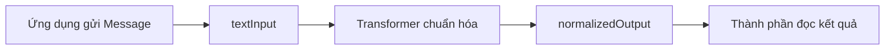
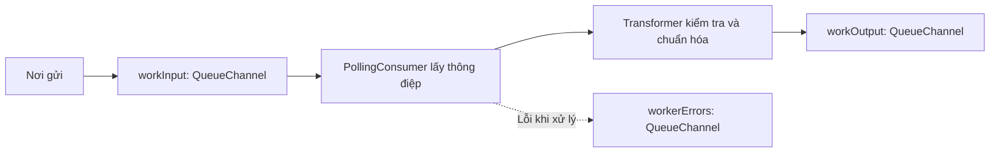

# from message channel — Khởi tạo luồng Java DSL từ kênh thông điệp

## 1. Mục tiêu và phạm vi

Trong chương **Java DSL** của module **SPRING_INTEGRATION_CORE**, bài này tập trung vào việc dùng `IntegrationFlow.from(...)` để nhận thông điệp từ một `MessageChannel`. Đây là điểm nối giữa nơi tạo thông điệp và các endpoint xử lý như transformer, filter, router hoặc aggregator.

Sau bài học, bạn có thể:

- Chọn cách bắt đầu flow bằng tên bean, đối tượng channel hoặc channel spec.
- Phân biệt việc gửi một `Message` với việc khai báo một `IntegrationFlow`.
- Xác định endpoint đầu tiên hoạt động theo cơ chế subscribe hay polling.
- Cấu hình poller khi flow đọc từ `QueueChannel`.
- Nối hai flow qua một channel dùng chung và kiểm thử kết quả bằng timeout hữu hạn.

Ví dụ sử dụng Java 17 trở lên và API Spring Integration 6.4.x. Thư viện chính là `org.springframework.integration:spring-integration-core`; phần kiểm thử cần JUnit Jupiter. Với dự án Spring Boot, có thể dùng `spring-boot-starter-integration` và `spring-boot-starter-test`, để parent/BOM tương thích quản lý phiên bản. Các lớp cấu hình bên dưới chủ động dùng `@EnableIntegration`, nên cũng có thể tạo context bằng Spring thuần.

## 2. `from(channel)` khai báo đầu vào của flow

Giả sử ứng dụng tiếp nhận một chuỗi, chuẩn hóa rồi chuyển kết quả sang kênh đầu ra:



Khai báo tương ứng có hình dạng:

```java
IntegrationFlow.from("textInput")
        .<String, String>transform(value -> value.strip())
        .channel("normalizedOutput")
        .get();
```

Đoạn DSL mô tả cấu trúc xử lý. Một flow được đăng ký làm bean để hạ tầng Spring Integration tạo và kết nối các channel, handler và endpoint. Lệnh `.get()` hoàn tất việc dựng định nghĩa flow; nó không chờ thông điệp hay trả về kết quả nghiệp vụ. Vai trò cấu hình của flow được giải thích trong [DSL Basics](https://docs.spring.io/spring-integration/reference/6.4/dsl/java-basics.html).

Dữ liệu đi vào khi một thành phần khác gọi `send(...)` trên channel đầu vào. Có thể đó là service Java, một messaging gateway, adapter giao thức hoặc một flow phía trước. Không có nguồn gửi thì chỉ riêng `from("textInput")` không tự sinh ra thông điệp.

### 2.1. Ba đối tượng cần phân biệt

| Đối tượng | Trách nhiệm trong bài |
| --- | --- |
| `Message<T>` | Mang payload và headers của một lần gửi |
| `MessageChannel` | Cung cấp điểm gửi và chuyển giao thông điệp |
| `IntegrationFlow` | Khai báo các thành phần xử lý được nối với channel |

Ví dụ một thông điệp đầu vào:

```java
Message<String> request = MessageBuilder
        .withPayload("  order-204  ")
        .setHeader("requestId", "req-204")
        .build();
```

`requestId` là header nghiệp vụ do ứng dụng quy ước. Không cần dùng `MessageHeaders.ID` làm mã tương quan nghiệp vụ vì transformer có thể tạo một message mới. Khi transformer chỉ trả về payload, các header đầu vào thường được truyền sang thông điệp kết quả. Xem [Message và cơ chế truyền headers](https://docs.spring.io/spring-integration/reference/6.4/message.html).

### 2.2. `from(...)` khác `.channel(...)`

Trong ví dụ trên:

- `from("textInput")` xác định điểm nhận của flow.
- `.transform(...)` xử lý payload.
- `.channel("normalizedOutput")` xác định nơi chuyển thông điệp sau bước biến đổi.

Đầu vào và đầu ra có thể cùng được viết dưới dạng tên channel, nhưng vị trí của chúng trong chuỗi DSL quyết định vai trò. Một `.channel(...)` đặt giữa flow cũng có thể tạo ranh giới giữa hai bước xử lý.

## 3. Các cách truyền channel cho `from(...)`

### 3.1. Truyền tên bean

```java
@Bean
public IntegrationFlow normalizeFlow() {
    return IntegrationFlow.from("textInput")
            .<String, String>transform(String::strip)
            .channel("normalizedOutput")
            .get();
}
```

Nếu có bean channel tên `textInput`, DSL dùng channel đó. Nếu chưa có bean cùng tên, DSL có thể đăng ký một `DirectChannel` với tên này khi context khởi tạo. Đây là hành vi được mô tả trong [Java DSL: Message Channels](https://docs.spring.io/spring-integration/reference/6.4/dsl/java-channels.html).

Hệ quả thực tế: `from("textInpt")` có thể tạo ra một channel mới vì viết sai tên. Nếu nơi gửi vẫn dùng `textInput`, flow không nhận được dữ liệu như mong đợi. Vì vậy, với đầu vào quan trọng hoặc nhiều channel có vai trò gần nhau, nên khai báo bean rõ ràng và inject bằng `@Qualifier`.

Tên chuỗi không xác định channel phải là queue hay publish-subscribe. Muốn có `QueueChannel`, hãy định nghĩa đúng loại bean đó; đặt tên `jobQueue` không tự biến channel mặc định thành hàng đợi.

### 3.2. Truyền đối tượng channel đã được inject

```java
@Bean
public DirectChannel textInput() {
    return new DirectChannel();
}

@Bean
public IntegrationFlow normalizeFlow(
        @Qualifier("textInput") MessageChannel input) {

    return IntegrationFlow.from(input)
            .<String, String>transform(String::strip)
            .channel("normalizedOutput")
            .get();
}
```

Ở đây `from(input)` dùng chính đối tượng được Spring cung cấp. `@Qualifier` làm rõ channel cần lấy khi context có nhiều bean cùng triển khai `MessageChannel`. Tham số kiểu `MessageChannel` không làm mất đặc tính của đối tượng thực tế: nếu bean thực tế là `QueueChannel`, endpoint nhận vẫn phải dùng polling.

Cách inject qua tham số cũng phù hợp với `@Configuration(proxyBeanMethods = false)`, vì không cần gọi trực tiếp một phương thức `@Bean` để lấy channel.

### 3.3. Truyền channel spec do DSL tạo

```java
@Bean
public IntegrationFlow inlineInputFlow() {
    return IntegrationFlow.from(MessageChannels.direct("inlineInput"))
            .<String, String>transform(String::strip)
            .channel("inlineOutput")
            .get();
}
```

`MessageChannels.direct(...)` tạo một spec mô tả channel để hạ tầng DSL xử lý. Không cần tự gọi `getObject()` trên spec trong định nghĩa bean. API `IntegrationFlow` hỗ trợ các overload nhận `String`, `MessageChannel` và `MessageChannelSpec`; xem [Javadoc của IntegrationFlow](https://docs.spring.io/spring-integration/api/org/springframework/integration/dsl/IntegrationFlow.html).

Nên chọn channel spec inline khi channel được khai báo tại một nơi rõ ràng. Nếu nhiều flow cần dùng chung, khai báo channel thành bean độc lập rồi inject cùng bean đó sẽ dễ theo dõi hơn.

Các đoạn trong mục 3 minh họa những lựa chọn thay thế; không đăng ký đồng thời nhiều bean flow trùng tên trong một context.

## 4. Kiểu channel quyết định cách endpoint nhận thông điệp

`MessageChannel` là giao diện gửi thông điệp. `SubscribableChannel` cho phép handler đăng ký nhận, còn `PollableChannel` cung cấp `receive(...)` để phía nhận chủ động lấy dữ liệu. Xem [The MessageChannel Interface](https://docs.spring.io/spring-integration/reference/6.4/channel/interfaces.html).

| Channel đầu vào | Cách endpoint nhận | Luồng thực thi thông thường | Cần poller cho đầu vào này? |
| --- | --- | --- | --- |
| `DirectChannel` | Subscribe | Thread gọi `send(...)` | Không |
| `QueueChannel` | Polling | Thread chạy tác vụ poller | Có |
| `PublishSubscribeChannel` không có executor | Subscribe | Thread gửi, lần lượt gọi subscriber | Không |
| `ExecutorChannel` | Subscribe | Chuyển việc xử lý cho executor | Không |

Với endpoint tiêu thụ channel thông thường, Spring Integration tạo `EventDrivenConsumer` cho đầu vào subscribable và `PollingConsumer` cho đầu vào pollable. Vì vậy, cùng một hình dạng `from(input).transform(...)`, nhưng thay loại channel có thể thay cả mô hình thực thi. Xem [Polling Consumer](https://docs.spring.io/spring-integration/reference/6.4/polling-consumer.html).

### 4.1. Nhiều flow dùng chung đầu vào

Cần phân biệt “hai flow cùng nhận từ một channel” với “mỗi thông điệp phải được xử lý ở cả hai flow”:

- `DirectChannel` có ngữ nghĩa point-to-point; không phát bản sao cho mọi subscriber. Khi bật failover, một lần xử lý thất bại còn có thể dẫn tới việc thử subscriber khác.
- `QueueChannel` có nhiều consumer thì các consumer cạnh tranh lấy thông điệp.
- `PublishSubscribeChannel` dùng để phát thông điệp tới các subscriber đã đăng ký.

Nếu yêu cầu là mỗi sự kiện được cả flow kiểm toán và flow thông báo tiếp nhận, hãy thiết kế đầu vào publish-subscribe hoặc một nhánh phân phối rõ ràng. Nếu dùng channel phát đồng bộ, một subscriber chậm hoặc phát sinh lỗi có thể ảnh hưởng lần gửi; cần cấu hình chính sách xử lý phù hợp. Các đặc tính channel được trình bày trong [Message Channel Implementations](https://docs.spring.io/spring-integration/reference/6.4/channel/implementations.html).

## 5. Ví dụ hoàn chỉnh với `DirectChannel`

Tình huống: ứng dụng gửi một chuỗi, transformer bỏ khoảng trắng ở hai đầu và chuyển thành chữ hoa; kết quả được đưa vào một queue riêng để quan sát.

```java
package example.integration;

import java.util.Locale;

import org.springframework.beans.factory.annotation.Qualifier;
import org.springframework.context.annotation.Bean;
import org.springframework.context.annotation.Configuration;
import org.springframework.integration.channel.DirectChannel;
import org.springframework.integration.channel.QueueChannel;
import org.springframework.integration.config.EnableIntegration;
import org.springframework.integration.dsl.IntegrationFlow;
import org.springframework.messaging.MessageChannel;

@Configuration(proxyBeanMethods = false)
@EnableIntegration
public class DirectChannelFlowConfig {

    @Bean
    public DirectChannel textInput() {
        return new DirectChannel();
    }

    @Bean
    public QueueChannel normalizedOutput() {
        return new QueueChannel(100);
    }

    @Bean
    public IntegrationFlow normalizeFlow(
            @Qualifier("textInput") MessageChannel input) {

        return IntegrationFlow.from(input)
                .<String, String>transform(value ->
                        value.strip().toUpperCase(Locale.ROOT))
                .channel("normalizedOutput")
                .get();
    }
}
```

Đoạn gọi dưới đây dùng Spring thuần và đóng context khi hoàn tất:

```java
package example.integration;

import org.springframework.context.annotation.AnnotationConfigApplicationContext;
import org.springframework.integration.channel.QueueChannel;
import org.springframework.messaging.Message;
import org.springframework.messaging.MessageChannel;
import org.springframework.messaging.support.MessageBuilder;

public class DirectChannelDemo {

    public static void main(String[] args) {
        try (var context = new AnnotationConfigApplicationContext(
                DirectChannelFlowConfig.class)) {

            MessageChannel input = context.getBean(
                    "textInput", MessageChannel.class);
            QueueChannel output = context.getBean(
                    "normalizedOutput", QueueChannel.class);

            Message<String> request = MessageBuilder
                    .withPayload("  order-204  ")
                    .setHeader("requestId", "req-204")
                    .build();

            boolean sent = input.send(request, 1_000);
            if (!sent) {
                throw new IllegalStateException("Không gửi được thông điệp");
            }

            Message<?> result = output.receive(1_000);
            if (result == null) {
                throw new IllegalStateException("Không nhận được kết quả");
            }

            System.out.println(result.getPayload());
            System.out.println(result.getHeaders().get("requestId"));
        }
    }
}
```

Kết quả mong đợi:

```text
ORDER-204
req-204
```

Đầu ra là queue nhưng bước transformer vẫn chạy trên thread gửi do đầu vào là `DirectChannel`. Queue đầu ra chỉ giữ kết quả cho lần `receive(...)` sau đó. Không cần poller cho queue đầu ra trong ví dụ vì chính mã demo trực tiếp lấy dữ liệu; nếu nối một endpoint tự động đọc queue này thì endpoint đó cần poller.

`send(message, 1_000)` không đặt thời hạn một giây cho toàn bộ nghiệp vụ. Tham số timeout áp dụng cho thao tác gửi theo khả năng hỗ trợ của channel; nó không cưỡng bức dừng transformer đồng bộ đang chạy lâu. Do đầu ra có sức chứa hữu hạn, ứng dụng thực tế cũng cần chính sách khi nơi đọc kết quả chậm.

### 5.1. Đầu vào channel không tự tạo request-reply

`MessageChannel.send(...)` trả về `boolean`, không trả payload đã biến đổi. Trong ví dụ, kết quả nằm ở `normalizedOutput` nên mã gọi phải nhận từ đó.

Nếu muốn gọi một phương thức Java trả về kết quả nghiệp vụ, có thể dùng messaging gateway và thiết kế đường reply tương ứng. Bản thân `from(channel)` không tự tạo gateway. Overload `from(ServiceInterface.class)` là lựa chọn khác, được trình bày trong [IntegrationFlow as a Gateway](https://docs.spring.io/spring-integration/reference/6.4/dsl/integration-flow-as-gateway.html).

Queue đầu ra dùng chung thích hợp để minh họa hoặc xử lý kết quả như một luồng sự kiện. Với nhiều request đồng thời cần trả kết quả cho đúng người gọi, hãy dùng gateway hoặc cơ chế reply và correlation phù hợp; mỗi caller tự lấy phần tử kế tiếp của một queue chung có thể nhận nhầm kết quả.

## 6. Ví dụ hoàn chỉnh với `QueueChannel`

Tình huống mới: nơi gửi cần đưa chuỗi vào hàng đợi; một polling consumer định kỳ lấy dữ liệu để chuẩn hóa. Chuỗi chỉ có khoảng trắng bị coi là dữ liệu không hợp lệ.



```java
package example.integration;

import java.util.Locale;

import org.springframework.beans.factory.annotation.Qualifier;
import org.springframework.context.annotation.Bean;
import org.springframework.context.annotation.Configuration;
import org.springframework.integration.channel.QueueChannel;
import org.springframework.integration.config.EnableIntegration;
import org.springframework.integration.dsl.IntegrationFlow;
import org.springframework.integration.dsl.Pollers;

@Configuration(proxyBeanMethods = false)
@EnableIntegration
public class QueueChannelFlowConfig {

    @Bean
    public QueueChannel workInput() {
        return new QueueChannel(100);
    }

    @Bean
    public QueueChannel workOutput() {
        return new QueueChannel(100);
    }

    @Bean
    public QueueChannel workerErrors() {
        return new QueueChannel(100);
    }

    @Bean
    public IntegrationFlow queuedNormalizeFlow(
            @Qualifier("workInput") QueueChannel input) {

        return IntegrationFlow.from(input)
                .<String, String>transform(value -> {
                    String normalized = value.strip();
                    if (normalized.isEmpty()) {
                        throw new IllegalArgumentException(
                                "Chuỗi đầu vào phải có nội dung");
                    }
                    return normalized.toUpperCase(Locale.ROOT);
                }, endpoint -> endpoint
                        .id("queuedNormalizer")
                        .poller(Pollers.fixedDelay(100)
                                .maxMessagesPerPoll(10)
                                .receiveTimeout(0)
                                .errorChannel("workerErrors")))
                .channel("workOutput")
                .get();
    }
}
```

### 6.1. Poller thuộc endpoint đọc queue

Trong cấu hình này, transformer là endpoint đầu tiên đọc `workInput`, nên cấu hình poller được truyền vào lambda thứ hai của `.transform(...)`.

Không dùng cú pháp sau để gắn poller cho channel:

```java
// Không phải overload cấu hình poller cho MessageChannel.
IntegrationFlow.from(input, endpoint -> endpoint.poller(...));
```

Overload `from(MessageSource, endpointConfigurer)` phục vụ inbound polling adapter. `MessageSource` và `MessageChannel` là hai kiểu đầu vào khác nhau. Với `from(channel)`, hãy cấu hình poller tại endpoint tiêu thụ channel. Xem [DSL and Endpoint Configuration](https://docs.spring.io/spring-integration/reference/6.4/dsl/java-endpoints.html) và [Inbound Channel Adapters](https://docs.spring.io/spring-integration/reference/6.4/dsl/java-inbound-adapters.html).

### 6.2. Ý nghĩa cấu hình trong ví dụ

| Cấu hình | Ý nghĩa khi thực hành |
| --- | --- |
| `fixedDelay(100)` | Lên lịch lần poll tiếp theo sau độ trễ 100 ms tính từ khi tác vụ trước hoàn thành, trong cấu hình không giao tác vụ cho executor riêng |
| `maxMessagesPerPoll(10)` | Mỗi lượt poll xử lý tối đa 10 message; có thể kết thúc sớm khi không còn dữ liệu |
| `receiveTimeout(0)` | Lần lấy dữ liệu không chờ nếu queue đang rỗng |
| `errorChannel("workerErrors")` | Chọn kênh nhận thông điệp lỗi từ tác vụ poller này |
| `id("queuedNormalizer")` | Đặt tên endpoint để thuận tiện nhận diện khi vận hành |

Tối đa 10 message mỗi lượt không có nghĩa là 10 thread xử lý song song. Thời gian chạy handler cũng ảnh hưởng tốc độ tiêu thụ. Ví dụ, nếu mỗi message mất 200 ms, một lượt đủ 10 message có thể mất khoảng hai giây trước khi tính thêm độ trễ của lần tiếp theo.

Có thể khai báo poller mặc định để nhiều polling endpoint dùng chung chính sách:

```java
@Bean(name = PollerMetadata.DEFAULT_POLLER)
public PollerSpec defaultPoller() {
    return Pollers.fixedDelay(100)
            .maxMessagesPerPoll(10)
            .receiveTimeout(0);
}
```

Đoạn trên cần thêm import `org.springframework.integration.scheduling.PollerMetadata` và `org.springframework.integration.dsl.PollerSpec`. Nó minh họa lựa chọn thay cho poller cục bộ, không cần thêm vào ví dụ hiện tại. Trả về `PollerSpec` để Spring quản lý; không tự gọi phương thức lấy sản phẩm của `FactoryBean` trong `@Bean`. Xem [Java DSL: Pollers](https://docs.spring.io/spring-integration/reference/6.4/dsl/java-pollers.html).

### 6.3. Thành công khi gửi khác với hoàn tất xử lý

Với `workInput`, `send(...)` thành công thể hiện thông điệp đã được nhận vào queue. Transformer có thể chưa chạy tại thời điểm đó; cũng có thể poller đã lấy và xử lý rất nhanh. Mã gọi phải chờ hoặc quan sát đầu ra nếu cần biết kết quả.

Với queue hữu hạn, nên truyền timeout gửi và xử lý cả trường hợp `false`. Ví dụ độc lập sau minh họa queue đã đầy mà không cần chạy flow:

```java
QueueChannel queue = new QueueChannel(1);

boolean first = queue.send(
        MessageBuilder.withPayload("first").build(), 0);
boolean second = queue.send(
        MessageBuilder.withPayload("second").build(), 0);

// first == true; second == false vì chưa có ai lấy phần tử đầu.
```

`QueueChannel` trong bài dùng bộ nhớ của JVM. Nếu cần giữ dữ liệu qua lần khởi động lại, phải thiết kế thêm kho lưu trữ hoặc hạ tầng nhắn tin phù hợp. Hàng đợi cục bộ cũng không tự tạo bảo đảm xử lý nghiệp vụ đúng một lần.

## 7. Nối hai flow qua một channel dùng chung

Giả sử muốn tách kiểm tra đầu vào khỏi bước chuẩn hóa nhưng vẫn giữ một điểm nối rõ ràng. Khai báo bean trung gian một lần và inject cùng bean đó vào cả hai flow:

```java
@Bean
public DirectChannel validatedText() {
    return new DirectChannel();
}

@Bean
public IntegrationFlow validationFlow(
        @Qualifier("textInput") MessageChannel input,
        @Qualifier("validatedText") MessageChannel validated) {

    return IntegrationFlow.from(input)
            .<String>filter(value -> !value.isBlank())
            .channel(validated)
            .get();
}

@Bean
public IntegrationFlow acceptedTextFlow(
        @Qualifier("validatedText") MessageChannel validated) {

    return IntegrationFlow.from(validated)
            .<String, String>transform(value ->
                    value.strip().toUpperCase(Locale.ROOT))
            .channel("normalizedOutput")
            .get();
}
```

Đây là phương án thay thế `normalizeFlow` ở mục 5; giữ các bean `textInput`, `normalizedOutput` và các import liên quan, rồi thay flow cũ bằng hai flow trên. Không giữ flow cũ cùng lúc, vì nó sẽ trở thành subscriber khác của cùng `DirectChannel` đầu vào.

Trong phương án này, chuỗi trắng dừng ở filter theo hành vi loại bỏ mặc định; không có kết quả ở output cho thông điệp đó. Với một giao thức request-reply, cần thiết kế phản hồi từ chối hoặc chính sách lỗi thay vì để caller chờ một reply sẽ không xuất hiện.

Không khai báo hai đối tượng channel mới cùng tên trong hai flow khác nhau, chẳng hạn tạo `MessageChannels.queue("sharedWork")` ở cả đầu ra flow A và đầu vào flow B. Trùng tên không có nghĩa là hai spec là cùng đối tượng; có thể xảy ra xung đột đăng ký bean. Dùng một bean channel chung giúp biểu diễn đúng ý định kết nối.

### 7.1. Khi chỉ cần nối hai channel

Nếu đầu vào là queue và đầu ra là channel có subscriber, một bridge có thể đảm nhận việc lấy và chuyển tiếp:

```java
@Bean
public IntegrationFlow queueToDirectBridge(
        @Qualifier("workInput") QueueChannel queued,
        @Qualifier("validatedText") MessageChannel direct) {

    return IntegrationFlow.from(queued)
            .bridge(endpoint -> endpoint.poller(
                    Pollers.fixedDelay(200)
                            .maxMessagesPerPoll(5)
                            .receiveTimeout(0)))
            .channel(direct)
            .get();
}
```

Đây là ví dụ riêng về bridge, cần các bean tương ứng và subscriber xử lý `validatedText`. Nếu dùng thay cho flow đọc `workInput` ở mục 6, hãy bỏ polling consumer cũ để tránh hai flow cạnh tranh cùng queue.

Poller nằm trên bridge vì bridge là endpoint trực tiếp đọc queue. Transformer phía sau channel đích không cần poller cho một đầu vào `DirectChannel`. Xem [Messaging Bridge](https://docs.spring.io/spring-integration/reference/6.4/bridge.html).

## 8. Đường lỗi thay đổi theo ranh giới thực thi

Hai ví dụ cùng biến đổi chuỗi nhưng nơi quan sát lỗi khác nhau:

| Đầu vào và cách gọi | Khi handler lỗi | Nơi mã gọi quan sát |
| --- | --- | --- |
| Gửi trực tiếp vào `DirectChannel`, xử lý trên cùng thread | Ngoại lệ truyền ngược qua lời gọi gửi | `try/catch` quanh `send(...)` |
| Gửi vào `QueueChannel`, poller xử lý sau đó | Tác vụ poller có thể phát `ErrorMessage` | Error channel hoặc cơ chế theo dõi kết quả |

Trong cấu hình queue, `workerErrors` nhận lỗi của tác vụ poller đã được trỏ tới kênh đó. Không nên cho rằng thêm một `errorChannel` sẽ tự chuyển mọi lỗi đồng bộ thành thông điệp lỗi. Gateway, advice và cơ chế bắt lỗi khác có chính sách riêng; xem [Error Handling](https://docs.spring.io/spring-integration/reference/6.4/error-handling.html).

Với ví dụ mục 6, cần kiểm tra riêng payload hợp lệ và chuỗi trắng:

- Chuỗi hợp lệ xuất hiện ở `workOutput` sau khi poller xử lý.
- Chuỗi trắng làm transformer ném lỗi, được quan sát ở `workerErrors`.
- Một lần `send(...)` đã thành công không phải bằng chứng rằng dữ liệu hợp lệ.

`workerErrors` cũng là queue có sức chứa hữu hạn. Trong ứng dụng thật phải có nơi đọc, lưu hoặc xử lý lỗi; nếu để queue lỗi đầy thì việc phát lỗi cũng có thể bị cản trở. Việc xuất hiện `ErrorMessage` không tự bật retry hay đưa thông điệp gốc trở lại queue. Muốn phục hồi cần thêm chính sách phù hợp, đồng thời cân nhắc tính idempotent của nghiệp vụ trước khi gửi lại.

## 9. Kiểm thử đầu vào channel và kết quả flow

Các kiểm thử dưới đây dùng hai lớp cấu hình ở mục 5 và mục 6, không cần Spring Boot hay broker ngoài. Đặt chúng trong cùng package `example.integration` và chuẩn bị JUnit Jupiter trong test classpath.

```java
package example.integration;

import org.junit.jupiter.api.Test;
import org.springframework.context.annotation.AnnotationConfigApplicationContext;
import org.springframework.integration.channel.QueueChannel;
import org.springframework.messaging.Message;
import org.springframework.messaging.MessageChannel;
import org.springframework.messaging.MessagingException;
import org.springframework.messaging.support.ErrorMessage;
import org.springframework.messaging.support.MessageBuilder;

import static org.junit.jupiter.api.Assertions.*;

class FromMessageChannelTest {

    @Test
    void directInputProducesNormalizedPayloadAndKeepsBusinessHeader() {
        try (var context = new AnnotationConfigApplicationContext(
                DirectChannelFlowConfig.class)) {

            MessageChannel input = context.getBean(
                    "textInput", MessageChannel.class);
            QueueChannel output = context.getBean(
                    "normalizedOutput", QueueChannel.class);

            Message<String> request = MessageBuilder
                    .withPayload("  order-204  ")
                    .setHeader("requestId", "direct-204")
                    .build();

            assertTrue(input.send(request, 1_000));

            // Transformer đã chạy trên thread gửi trước khi send trả về.
            Message<?> result = output.receive(0);
            assertNotNull(result);
            assertEquals("ORDER-204", result.getPayload());
            assertEquals("direct-204",
                    result.getHeaders().get("requestId"));
        }
    }

    @Test
    void queuedInputEventuallyProducesNormalizedPayload() {
        try (var context = new AnnotationConfigApplicationContext(
                QueueChannelFlowConfig.class)) {

            QueueChannel input = context.getBean(
                    "workInput", QueueChannel.class);
            QueueChannel output = context.getBean(
                    "workOutput", QueueChannel.class);

            assertTrue(input.send(MessageBuilder
                    .withPayload("  job-319  ")
                    .setHeader("requestId", "queued-319")
                    .build(), 1_000));

            Message<?> result = output.receive(5_000);
            assertNotNull(result);
            assertEquals("JOB-319", result.getPayload());
            assertEquals("queued-319",
                    result.getHeaders().get("requestId"));
        }
    }

    @Test
    void invalidQueuedInputIsObservedOnTheConfiguredErrorChannel() {
        try (var context = new AnnotationConfigApplicationContext(
                QueueChannelFlowConfig.class)) {

            QueueChannel input = context.getBean(
                    "workInput", QueueChannel.class);
            QueueChannel errors = context.getBean(
                    "workerErrors", QueueChannel.class);

            assertTrue(input.send(MessageBuilder
                    .withPayload("   ")
                    .setHeader("requestId", "invalid-1")
                    .build(), 1_000));

            Message<?> received = errors.receive(5_000);
            ErrorMessage error = assertInstanceOf(
                    ErrorMessage.class, received);
            MessagingException failure = assertInstanceOf(
                    MessagingException.class, error.getPayload());

            Message<?> failedMessage = failure.getFailedMessage();
            assertNotNull(failedMessage);
            assertEquals("invalid-1",
                    failedMessage.getHeaders().get("requestId"));

            Throwable rootCause = failure;
            while (rootCause.getCause() != null) {
                rootCause = rootCause.getCause();
            }
            assertInstanceOf(IllegalArgumentException.class, rootCause);
        }
    }
}
```

`receive(5_000)` chờ điều kiện có dữ liệu và kết thúc ngay khi nhận được. Nó khác việc ngủ cố định rồi hy vọng poller đã chạy xong. Mỗi test tạo context riêng để không dùng lại dữ liệu hoặc trạng thái endpoint của test khác.

Không dùng `receive(...)` trên `workInput` để kiểm tra “message đã vào queue” khi polling consumer đang chạy. Test sẽ cạnh tranh lấy dữ liệu với endpoint thật. Hãy kiểm tra tác động quan sát được ở đầu ra hoặc error channel.

Đây là mã kiểm thử minh họa cho bài học; việc chạy chúng thuộc môi trường thực hành có dependency tương ứng.

## 10. Lỗi thường gặp và cách kiểm tra

| Hiện tượng | Điểm cần kiểm tra | Hướng xử lý |
| --- | --- | --- |
| Flow không khởi tạo vì thiếu poller | Endpoint đầu tiên có đọc `PollableChannel` không? | Gắn poller cục bộ hoặc cung cấp poller mặc định |
| Đã gửi nhưng flow mong muốn không nhận | Nơi gửi và `from(...)` có dùng đúng cùng channel không? | Đối chiếu tên bean; inject bằng qualifier nếu có thể |
| Channel phát sinh lỗi không có subscriber | Context/endpoint đã chạy chưa, hoặc gửi nhầm `DirectChannel`? | Kiểm tra tên channel, việc đăng ký flow và lifecycle |
| Một trong hai flow nhận mỗi thông điệp | Có dùng channel point-to-point cho yêu cầu phát tới nhiều nơi? | Chọn publish-subscribe hoặc nhánh phân phối phù hợp |
| Lỗi đăng ký bean trùng tên channel | Có tạo nhiều spec/đối tượng với cùng tên? | Khai báo một bean dùng chung |
| `send(...)` không trả về đúng lúc mong đợi | Có handler đồng bộ chạy lâu hoặc queue nào đang đầy? | Kiểm tra từng ranh giới channel và chính sách timeout |
| Handler trả giá trị nhưng không tìm được đích gửi | Có output channel hoặc đường reply hợp lệ không? | Chỉ định đích đầu ra hoặc thiết kế request-reply đầy đủ |
| Test queue lúc qua lúc trượt | Có assertion quá sớm hoặc tự đọc mất message đầu vào? | Chờ đầu ra bằng timeout hữu hạn, tách context giữa test |

Một channel là một điểm kết nối trong ứng dụng, không tự đồng nghĩa với queue của RabbitMQ, Kafka topic hay một nguồn polling ngoài JVM. Muốn tiếp nhận từ hệ thống ngoài cần adapter/gateway phù hợp rồi nối vào luồng xử lý.

## 11. Thực hành mở rộng

1. Giữ ví dụ `DirectChannel`, thêm header `tenantId` vào request và kiểm tra nó ở kết quả. Không dùng ID của message đầu ra để suy ra request gốc.
2. Thay đổi `maxMessagesPerPoll` trong ví dụ queue, gửi một nhóm chuỗi và quan sát thời gian có đủ kết quả. Phân biệt số message mỗi lượt poll với mức độ song song.
3. Thêm filter trước transformer trong flow queue. Chuyển cấu hình poller sang filter vì filter lúc này là endpoint đọc queue đầu tiên; thiết kế nơi tiếp nhận dữ liệu bị từ chối.
4. Tách một flow thành hai flow qua channel bean dùng chung. Kiểm tra rằng không có subscriber/consumer cũ vô tình tiếp tục dùng cùng đầu vào.

Những bài thực hành này tạo nền tảng để đặt router, splitter hoặc aggregator phía sau cùng một đầu vào. Chính sách routing hay gom nhóm thuộc endpoint tương ứng; lựa chọn `from(channel)` chủ yếu xác định điểm nối và cách endpoint đầu tiên tiếp nhận thông điệp.

## 12. Tài liệu tham khảo

- [DSL Basics](https://docs.spring.io/spring-integration/reference/6.4/dsl/java-basics.html): vai trò định nghĩa flow và các endpoint EIP.
- [Message Channels trong Java DSL](https://docs.spring.io/spring-integration/reference/6.4/dsl/java-channels.html): tham chiếu channel, tạo channel và lưu ý khi dùng chung.
- [IntegrationFlow API](https://docs.spring.io/spring-integration/api/org/springframework/integration/dsl/IntegrationFlow.html): các overload của `from(...)`; trang API không ghim phiên bản, cần chọn đúng tài liệu khi đối chiếu một dự án cụ thể.
- [Polling Consumer](https://docs.spring.io/spring-integration/reference/6.4/polling-consumer.html) và [Java DSL: Pollers](https://docs.spring.io/spring-integration/reference/6.4/dsl/java-pollers.html): cơ chế lấy thông điệp và cấu hình lịch poll.
- [Error Handling](https://docs.spring.io/spring-integration/reference/6.4/error-handling.html): ranh giới thread và thông điệp lỗi.
