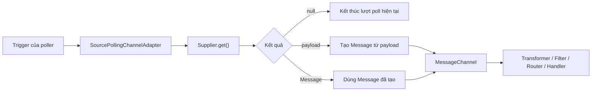

# from Supplier

## 1. Mục tiêu và bối cảnh

Trong module **SPRING_INTEGRATION_CORE**, chương **Java DSL**, bài này trình bày cách khởi tạo luồng thông điệp từ một `java.util.function.Supplier<T>`. Đây là cách nối một thao tác Java lấy dữ liệu theo lịch với các thành phần cốt lõi: `Message`, `MessageChannel`, endpoint và các bước xử lý trong Java DSL.

Sau bài học, bạn có thể:

- Khai báo nguồn bằng `IntegrationFlow.fromSupplier(...)` và xác định thời điểm `Supplier.get()` được gọi.
- Chọn lịch polling, giới hạn công việc trong mỗi lượt và biểu diễn trạng thái chưa có dữ liệu bằng `null`.
- Tạo thông điệp có header, kết nối transformer và đưa lỗi sang kênh riêng.
- Viết kiểm thử kiểm soát được thời điểm nguồn bắt đầu chạy.

Các ví dụ dùng **Java 17 và Spring Integration 6.5.x** làm mốc API. Khi dùng Spring Boot, chọn bộ dependency được BOM của phiên bản Boot tương ứng quản lý. Bài không giả định có broker, cơ sở dữ liệu hoặc dịch vụ bên ngoài.

## 2. “from Supplier” nghĩa là gì?

### 2.1. Supplier cung cấp giá trị, poller quyết định lúc gọi

`Supplier<T>` là functional interface có phương thức không nhận tham số, trả về một giá trị kiểu `T`:

```java
Supplier<String> source = () -> "inventory-refresh";
```

Một khai báo flow điển hình:

```java
IntegrationFlow.fromSupplier(
        source,
        endpoint -> endpoint.poller(
                Pollers.fixedDelay(Duration.ofSeconds(1))
                        .maxMessagesPerPoll(1)))
        .channel("refreshRequests")
        .get();
```

Ở đây, `source` chưa được gọi khi bạn chỉ viết lambda. DSL cấu hình một polling inbound endpoint. Sau khi endpoint khởi động, poller gọi nguồn theo lịch; giá trị thu được đi vào flow. Kênh `refreshRequests` trong đoạn minh họa cần có cấu hình và nơi nhận tương ứng.

Với API 6.x, tên phương thức nhận `Supplier` là **`IntegrationFlow.fromSupplier(...)`**. Tài liệu cũ có thể dùng `IntegrationFlows.from(...)` cho một `Supplier`; không chuyển nguyên cách viết đó sang `IntegrationFlow.from(...)` rồi kỳ vọng cùng overload. Ví dụ cũ được trình bày trong [Java DSL của Spring Integration 5.2](https://docs.spring.io/spring-integration/docs/5.2.0.RELEASE/reference/html/dsl.html).

### 2.2. Ba thao tác `get` dễ nhầm

| Cách viết | Ý nghĩa |
| --- | --- |
| `supplier.get()` | Thực thi thao tác cung cấp dữ liệu của ứng dụng |
| `IntegrationFlow.fromSupplier(supplier, ...)` | Khai báo nguồn polling cho flow |
| `...get()` ở cuối chuỗi DSL | Hoàn tất việc dựng đối tượng flow |

Lệnh `.get()` cuối chuỗi không có nghĩa là lấy một bản ghi từ nguồn. Polling xảy ra trong vòng đời endpoint, sau khi các thành phần của flow được đăng ký vào application context.

Trong mã nguồn 6.5.x, `fromSupplier` bọc supplier bằng một `AbstractMessageSource` và gọi `messageSource.get()` trong `doReceive()`. Biến thể không cấu hình endpoint cần một default poller đã khai báo trong context. Xem [mã nguồn `IntegrationFlow` nhánh 6.5.x](https://raw.githubusercontent.com/spring-projects/spring-integration/6.5.x/spring-integration-core/src/main/java/org/springframework/integration/dsl/IntegrationFlow.java).

## 3. Đường đi của dữ liệu và hợp đồng trả về



Kết quả supplier được xử lý như sau:

| Kết quả của `Supplier.get()` | Ý nghĩa trong flow |
| --- | --- |
| Một POJO, chuỗi hoặc giá trị khác `null` | Trở thành payload của thông điệp |
| Một `Message<?>` | Được dùng như thông điệp, không bọc thêm thành payload kiểu `Message` |
| `null` | Chưa có dữ liệu; không phát thông điệp trong lần gọi này |
| Một `List<WorkItem>` | Là một payload dạng danh sách; muốn xử lý từng phần tử thì thêm splitter |
| Một `Optional<WorkItem>` | Là một giá trị khác `null`, kể cả `Optional.empty()`; cần tự chuyển trạng thái rỗng thành `null` nếu muốn không phát message |
| Ném exception | Poll thất bại và đi theo cơ chế xử lý lỗi đã cấu hình |

Việc tự bọc payload và giữ nguyên trường hợp kết quả đã là `Message` được mô tả trong [Inbound Channel Adapters của Java DSL](https://docs.spring.io/spring-integration/reference/6.5/dsl/java-inbound-adapters.html).

`null` không trở thành payload. Khi nguồn trả `null`, endpoint vẫn có thể được gọi ở lần kích hoạt tiếp theo. Hãy tách trạng thái “hiện chưa có công việc” khỏi lỗi đọc dữ liệu: nguồn rỗng trả `null`; lỗi truy cập cần được biểu diễn bằng exception hoặc một mô hình kết quả nghiệp vụ có chủ đích.

Ví dụ repository trả về `Optional` có thể được nối như sau:

```java
// repository.findNextPending() trả về Optional<WorkItem>.
Supplier<WorkItem> source =
        () -> repository.findNextPending().orElse(null);
```

Đoạn trên chỉ minh họa cách chuyển kiểu trả về. Repository thực tế còn phải giải quyết việc giữ chỗ bản ghi để tránh nhiều worker cùng lấy một công việc.

## 4. Cấu hình poller: lịch gọi và khối lượng công việc

### 4.1. `fixedDelay`, `fixedRate` và cron

```java
// Chờ 2 giây sau khi tác vụ poll trước hoàn tất.
Pollers.fixedDelay(Duration.ofSeconds(2));

// Tính khoảng cách theo các thời điểm bắt đầu được lên lịch.
Pollers.fixedRate(Duration.ofSeconds(2));

// Mỗi 30 giây; Spring cron có trường giây ở đầu.
Pollers.cron("*/30 * * * * *");
```

Hai dạng đầu dùng `PeriodicTrigger`. `fixedDelay` tính từ lúc tác vụ hoàn tất, còn `fixedRate` tính theo thời điểm bắt đầu được lên lịch. Xem [Javadoc `PeriodicTrigger`](https://docs.spring.io/spring-framework/docs/6.2.x/javadoc-api/org/springframework/scheduling/support/PeriodicTrigger.html).

Giả sử một poll mất 700 ms và cấu hình `fixedDelay(2 giây)`, không có executor tách riêng tác vụ poll: khoảng cách giữa hai lần bắt đầu xấp xỉ 2,7 giây. Đây là phép ước lượng để thiết kế tải; thời gian scheduler chờ tài nguyên còn có thể làm lịch chạy muộn hơn.

`fixedRate` không tự tạo nhiều thread xử lý. Muốn thay đổi mức đồng thời, bạn phải xem cả scheduler, executor, channel và tính an toàn của nguồn dữ liệu. API `Pollers` có overload nhận `Duration` và overload số `long` tính bằng mili giây; dùng `Duration` giúp đọc rõ đơn vị. Xem [mã nguồn `Pollers` 6.5.x](https://raw.githubusercontent.com/spring-projects/spring-integration/6.5.x/spring-integration-core/src/main/java/org/springframework/integration/dsl/Pollers.java).

### 4.2. `maxMessagesPerPoll` giới hạn một lượt poll

Một **lượt poll** là một lần tác vụ polling được kích hoạt. Trong lượt đó, nguồn có thể được gọi nhiều lần:

```java
Pollers.fixedDelay(Duration.ofSeconds(1))
        .maxMessagesPerPoll(3);
```

Nếu nguồn lần lượt trả `A`, `B`, `null`, lượt này phát hai message rồi dừng. Nếu trả `A`, `B`, `C`, lượt này phát ba message và chờ lần kích hoạt sau.

| Giá trị | Hành vi với `SourcePollingChannelAdapter` |
| --- | --- |
| Số dương `N` | Tối đa `N` lần lấy dữ liệu trong lượt; có thể dừng sớm khi nguồn trả `null` |
| `1` | Mỗi lượt lấy tối đa một phần tử; cũng là mặc định của adapter nguồn |
| `0` | Bỏ qua việc gọi nguồn |
| Số âm, thường `-1` | Không đặt giới hạn số lượng; tiếp tục lấy đến khi nguồn trả `null` |

Mặc định này khác với `PollingConsumer`, vốn dùng mặc định `-1`. Quy tắc và ý nghĩa đặc biệt của `0` được nêu trong [Channel Adapter](https://docs.spring.io/spring-integration/reference/6.5/channel-adapter.html).

Với nguồn `() -> "heartbeat"`, cấu hình `-1` khiến nguồn luôn có thêm dữ liệu trong cùng lượt. Hãy chọn giới hạn hữu hạn cho loại nguồn phát vô hạn này. Với nguồn trả về cả danh sách, `maxMessagesPerPoll(1)` giới hạn số lần lấy danh sách, không giới hạn số phần tử mà splitter tạo ra sau đó.

### 4.3. Default poller

Nếu nhiều nguồn dùng cùng lịch, có thể khai báo một default poller:

```java
import java.time.Duration;

import org.springframework.context.annotation.Bean;
import org.springframework.integration.dsl.Pollers;
import org.springframework.integration.scheduling.PollerMetadata;

@Bean(name = PollerMetadata.DEFAULT_POLLER)
public PollerMetadata defaultPoller() {
    return Pollers.fixedDelay(Duration.ofSeconds(1))
            .maxMessagesPerPoll(1)
            .getObject();
}
```

Khi default poller tồn tại, có thể bỏ tham số cấu hình endpoint nếu không cần tùy chỉnh khác:

```java
IntegrationFlow.fromSupplier(source)
        .channel("refreshRequests")
        .get();
```

Đối với một flow cần quan sát riêng lịch polling và kênh lỗi, khai báo poller ngay tại nguồn giúp người đọc thấy cấu hình liên quan tại cùng vị trí.

## 5. Ví dụ hoàn chỉnh: lấy công việc đang chờ rồi chuẩn hóa dữ liệu

### 5.1. Chuẩn bị dependency

Trong dự án Spring Boot đã quản lý phiên bản dependency phù hợp, cần starter sau:

```xml
<dependency>
    <groupId>org.springframework.boot</groupId>
    <artifactId>spring-boot-starter-integration</artifactId>
</dependency>
```

Ví dụ chạy bằng `AnnotationConfigApplicationContext` nên không cần web server. Nếu không dùng Boot, khai báo `org.springframework.integration:spring-integration-core` cùng các dependency Spring tương thích. Phần kiểm thử bên dưới cần JUnit Jupiter, `spring-test` và `spring-integration-test`; Boot starter test cung cấp JUnit và Spring Test khi được dùng.

### 5.2. Nguồn dữ liệu và cấu hình flow

Đặt toàn bộ mã sau trong `SupplierLessonConfiguration.java`, package `example.integration`:

```java
package example.integration;

import java.time.Duration;
import java.util.Locale;
import java.util.Objects;
import java.util.Queue;
import java.util.concurrent.ConcurrentLinkedQueue;
import java.util.function.Supplier;

import org.springframework.context.annotation.AnnotationConfigApplicationContext;
import org.springframework.context.annotation.Bean;
import org.springframework.context.annotation.Configuration;
import org.springframework.integration.channel.QueueChannel;
import org.springframework.integration.config.EnableIntegration;
import org.springframework.integration.dsl.IntegrationFlow;
import org.springframework.integration.dsl.Pollers;
import org.springframework.messaging.Message;

@Configuration(proxyBeanMethods = false)
@EnableIntegration
public class SupplierLessonConfiguration {

    public record WorkItem(String id, String customer) {
    }

    public static final class PendingWorkSupplier
            implements Supplier<WorkItem> {

        private final Queue<WorkItem> pending =
                new ConcurrentLinkedQueue<>();

        public void submit(WorkItem item) {
            pending.add(Objects.requireNonNull(item));
        }

        @Override
        public WorkItem get() {
            return pending.poll();
        }
    }

    @Bean
    public PendingWorkSupplier pendingWorkSupplier() {
        return new PendingWorkSupplier();
    }

    @Bean
    public QueueChannel workResults() {
        return new QueueChannel(100);
    }

    @Bean
    public QueueChannel supplierErrors() {
        return new QueueChannel(20);
    }

    @Bean
    public IntegrationFlow pendingWorkFlow(PendingWorkSupplier source) {
        return IntegrationFlow
                .fromSupplier(source, endpoint -> endpoint
                        .id("pendingWorkSource")
                        .poller(Pollers
                                .fixedDelay(Duration.ofMillis(200))
                                .maxMessagesPerPoll(1)
                                .errorChannel("supplierErrors")))
                .<WorkItem, String>transform(item -> {
                    if (item.id() == null || item.id().isBlank()) {
                        throw new IllegalArgumentException(
                                "Thiếu id công việc");
                    }
                    return item.id() + ":"
                            + item.customer().strip()
                                    .toUpperCase(Locale.ROOT);
                })
                .channel("workResults")
                .get();
    }

    public static void main(String[] args) {
        try (var context = new AnnotationConfigApplicationContext(
                SupplierLessonConfiguration.class)) {

            var source = context.getBean(PendingWorkSupplier.class);
            var results = context.getBean(
                    "workResults", QueueChannel.class);

            source.submit(new WorkItem("JOB-01", "  lan  "));

            Message<?> result = results.receive(2_000);
            if (result == null) {
                throw new IllegalStateException(
                        "Không nhận được kết quả trong thời gian chờ");
            }

            System.out.println(result.getPayload());
        }
    }
}
```

Kết quả mong đợi:

```text
JOB-01:LAN
```

`@EnableIntegration` đăng ký hạ tầng Spring Integration trong context Java thuần của ví dụ. `@Bean` làm cho flow được đăng ký và quản lý vòng đời; riêng việc tạo một đối tượng flow bên ngoài context chưa đủ để nguồn tự chạy.

### 5.3. Đọc ví dụ theo vai trò

| Thành phần | Trách nhiệm trong ví dụ |
| --- | --- |
| `PendingWorkSupplier` | Cất công việc được nộp và lấy ra một phần tử bằng `poll()` |
| `fromSupplier(source, ...)` | Nối nguồn Java vào cơ chế messaging |
| Endpoint `pendingWorkSource` | Điều khiển vòng đời polling của nguồn |
| Poller 200 ms, tối đa một message | Hạn chế lượng công việc mỗi lượt |
| Transformer | Kiểm tra id và chuẩn hóa tên khách hàng |
| `workResults` | Giữ kết quả để chương trình hoặc kiểm thử nhận bằng `receive(timeout)` |
| `supplierErrors` | Giữ thông điệp lỗi để quan sát trong bài thực hành |

Khi hàng đợi `pending` trống, `ConcurrentLinkedQueue.poll()` trả `null`. Sau khi `submit(...)` thêm dữ liệu, lần polling tiếp theo có thể lấy công việc đó. Vì thế trạng thái rỗng lúc ứng dụng vừa khởi động là bình thường.

`pending` là hàng đợi Java lưu đối tượng nghiệp vụ, chưa phải `MessageChannel`. `workResults` là `QueueChannel` lưu `Message<?>`. Phân biệt hai lớp này giúp xác định vị trí dữ liệu được chuyển thành thông điệp.

Ví dụ dùng hàng đợi trong bộ nhớ để dễ quan sát. Nó chưa cung cấp lưu bền, phục hồi khi tiến trình dừng hoặc tự đưa công việc trở lại nguồn khi transformer thất bại.

## 6. Khi cần tự tạo Message và header

Nếu muốn gắn nguồn gốc hoặc khóa nghiệp vụ ngay khi lấy dữ liệu, có thể thay phần khởi tạo nguồn bằng đoạn sau. Các biến `source` và các bean channel dùng lại từ cấu hình ở mục 5:

```java
import org.springframework.integration.support.MessageBuilder;
import org.springframework.messaging.Message;

Supplier<Message<WorkItem>> messageSupplier = () -> {
    WorkItem item = source.get();
    if (item == null) {
        return null;
    }

    return MessageBuilder.withPayload(item)
            .setHeader("sourceSystem", "pending-work")
            .setHeader("businessKey", item.id())
            .build();
};

IntegrationFlow flow = IntegrationFlow
        .fromSupplier(messageSupplier, endpoint -> endpoint
                .poller(Pollers.fixedDelay(Duration.ofMillis(200))
                        .maxMessagesPerPoll(1)
                        .errorChannel("supplierErrors")))
        .channel("workResults")
        .get();
```

Đây là một biến thể flow để khai báo thành bean nếu áp dụng vào ứng dụng, không đăng ký song song với flow cũ cùng đọc `source` nếu bạn chỉ muốn một nơi tiêu thụ. Payload đầu ra của biến thể này là `WorkItem`, vì đoạn minh họa chưa thêm transformer.

Header `businessKey` giúp liên hệ nhiều lần xử lý cùng một công việc. Khi thêm cơ chế chống xử lý trùng, hãy dùng một khóa nghiệp vụ ổn định như `WorkItem.id()`, thay vì phụ thuộc vào id kỹ thuật được tạo cho một lần phát message.

`Supplier.get()` không nhận request message, nên không có payload hay header đầu vào để truy cập. Nếu dữ liệu cần tham số từ một lời gọi nghiệp vụ, hãy cân nhắc gateway hoặc flow bắt đầu từ input channel.

## 7. Supplier khác MessageSource, input channel và gateway như thế nào?

| Điểm bắt đầu | Cách dữ liệu đi vào flow | Phù hợp khi |
| --- | --- | --- |
| `fromSupplier(supplier, ...)` | Poller chủ động gọi một hàm không tham số | Có thao tác Java ngắn để lấy phần tử tiếp theo hoặc tạo một tín hiệu định kỳ |
| `from(messageSource, ...)` | Poller gọi `MessageSource.receive()` | Đã có nguồn theo abstraction của Spring Integration |
| `from("inputChannel")` | Một producer gửi message vào channel | Ứng dụng hoặc thành phần khác quyết định thời điểm gửi |
| Messaging gateway | Mã ứng dụng gọi phương thức có hợp đồng messaging | Cần API Java nhận tham số, có thể có request và reply |

Ví dụ `MessageSource` tương ứng với nguồn ở mục 5:

```java
import org.springframework.integration.core.MessageSource;
import org.springframework.messaging.support.GenericMessage;

MessageSource<WorkItem> messageSource = () -> {
    WorkItem item = source.get();
    return item == null ? null : new GenericMessage<>(item);
};

IntegrationFlow flow = IntegrationFlow
        .from(messageSource, endpoint -> endpoint
                .poller(Pollers.fixedDelay(Duration.ofMillis(200))
                        .maxMessagesPerPoll(1)))
        .channel("workResults")
        .get();
```

Hai cách đều tạo nguồn polling. Khác biệt chính ở đây là hợp đồng kiểu: supplier có thể trả POJO, còn `MessageSource.receive()` trả message hoặc `null`.

Đừng nhầm poller của nguồn với poller của một endpoint đọc `QueueChannel`. Trường hợp đầu dùng `SourcePollingChannelAdapter`; trường hợp sau dùng `PollingConsumer`. Tài liệu [Poller](https://docs.spring.io/spring-integration/reference/6.5/polling-consumer.html) giải thích hai vị trí polling này.

Với file, JDBC hoặc các giao thức có adapter chuyên dụng, hãy kiểm tra khả năng của adapter trước khi tự viết supplier. Ví dụ, xử lý danh sách file, quản lý tài nguyên và trạng thái đã đọc thường cần nhiều hơn một lời gọi hàm đơn giản.

## 8. Thread, tốc độ xử lý và hàng đợi

Trong ví dụ chính, poller lấy công việc rồi chạy transformer qua các liên kết đồng bộ mặc định trước khi gửi vào `workResults`. `DirectChannel` gọi handler trên thread của bên gửi. `QueueChannel` giữ message để bên nhận lấy sau; một endpoint xử lý tiếp từ queue cần cơ chế polling riêng. Xem [Message Channel Implementations](https://docs.spring.io/spring-integration/reference/6.5/channel/implementations.html).

Hệ quả trong bài thực hành:

- Transformer chậm làm kéo dài tác vụ poll khi chưa có ranh giới bất đồng bộ.
- `workResults` đầy có thể làm thao tác gửi phải chờ; cần có bên nhận nếu chạy nguồn liên tục.
- Dừng nguồn ngăn các lần lấy mới theo vòng đời endpoint; không đồng nghĩa xóa message đang nằm trong các queue.
- Thêm executor hoặc cho nhiều flow đọc chung nguồn đòi hỏi kiểm tra lại tính an toàn luồng và thứ tự xử lý.

Với một nguồn đang có nhiều dữ liệu, có thể ước lượng năng lực trước khi chọn lịch:

```text
N = maxMessagesPerPoll, N > 0
t = thời gian lấy và xử lý đồng bộ trung bình một message
d = fixedDelay

Thời gian một vòng xấp xỉ N × t + d
Thông lượng xấp xỉ N / (N × t + d)
```

Nếu `N = 5`, `t = 40 ms`, `d = 1 giây`, thông lượng xấp xỉ `5 / 1,2`, tức khoảng 4,17 message/giây. Công thức giả định nguồn luôn đủ dữ liệu, một tác vụ chạy tuần tự và không bị chặn ở đầu ra; nó không phải cam kết về tốc độ thực tế.

`ConcurrentLinkedQueue` trong ví dụ giúp các thao tác thêm/lấy cơ bản an toàn khi được gọi từ các thread khác nhau. Điều này chưa làm cho toàn bộ nghiệp vụ nhiều bước trở thành nguyên tử. Chẳng hạn chuỗi “đọc bản ghi, đánh dấu đang xử lý, ghi kết quả” vẫn cần thiết kế đồng thời riêng.

## 9. Xử lý lỗi ở nguồn và ở downstream

### 9.1. Hai vị trí có thể thất bại

**Trước khi có message:** supplier gọi hệ thống ngoài và ném exception. Khi đó có thể chưa có payload nghiệp vụ để lưu trong thuộc tính `failedMessage`.

**Sau khi có message:** transformer hoặc handler thất bại. Lỗi thường được bọc bằng một `MessagingException` có thông tin message đã xử lý; cần kiểm tra kiểu và giá trị trước khi truy cập.

Exception từ tác vụ poll được hạ tầng Spring Integration đưa thành `ErrorMessage` theo cơ chế error handler. Cơ chế tổng quát được giải thích tại [Error Handling](https://docs.spring.io/spring-integration/reference/6.5/error-handling.html).

### 9.2. Kênh lỗi riêng của poller

Ví dụ chính đã cấu hình:

```java
Pollers.fixedDelay(Duration.ofMillis(200))
        .maxMessagesPerPoll(1)
        .errorChannel("supplierErrors");
```

`PollerSpec.errorChannel(...)` cấu hình kênh mặc định cho error handler của poller. Có thể dùng tên bean hoặc đối tượng channel. Xem [mã nguồn `PollerSpec` 6.5.x](https://raw.githubusercontent.com/spring-projects/spring-integration/6.5.x/spring-integration-core/src/main/java/org/springframework/integration/dsl/PollerSpec.java).

Mã quan sát lỗi, chạy từ thread của chương trình hoặc kiểm thử:

```java
import org.springframework.messaging.Message;
import org.springframework.messaging.MessagingException;
import org.springframework.messaging.support.ErrorMessage;

Message<?> received = errors.receive(2_000);

if (received instanceof ErrorMessage error) {
    Throwable problem = error.getPayload();
    System.err.println("Lỗi polling: " + problem.getMessage());

    if (problem instanceof MessagingException messagingException) {
        Message<?> failed = messagingException.getFailedMessage();
        if (failed != null) {
            System.err.println("Payload lỗi: " + failed.getPayload());
        }
    }
}
```

Biến `errors` ở đây là bean `supplierErrors` lấy từ context. Trong hệ thống thực tế, cần một consumer xử lý kênh lỗi để queue không tích lũy mãi.

Nếu message có header `errorChannel`, cách giải quyết kênh lỗi có thể ưu tiên header đó. Khi thêm `ExecutorChannel` hoặc endpoint bất đồng bộ phía sau, lỗi phát sinh sau khi bàn giao không còn nằm trong cùng call stack của poller nguồn; cần cấu hình và kiểm tra đường lỗi tại ranh giới đó.

### 9.3. Có lỗi không có nghĩa là công việc được trả lại nguồn

Trong ví dụ, `source.get()` đã lấy phần tử khỏi `pending` trước khi transformer chạy. Nếu transformer ném exception, công việc đó không tự trở lại `ConcurrentLinkedQueue`. `ErrorMessage` giúp quan sát và điều phối lỗi; nó không phải cơ chế khôi phục dữ liệu nguồn.

Một thiết kế triển khai thực tế nên quyết định rõ:

- Khi nào công việc được xem là đã nhận và khi nào hoàn tất.
- Lỗi nào được thử lại, số lần thử và khoảng chờ giữa các lần.
- Nơi lưu công việc thất bại để có thể xử lý lại.
- Khóa nghiệp vụ nào ngăn tác dụng phụ bị thực hiện nhiều lần.

Nếu nguồn là cơ sở dữ liệu, transaction cần bao phủ đúng thao tác nhận dữ liệu và phần xử lý dự định. Transaction theo thread không tự vượt qua ranh giới bất đồng bộ; cũng không khiến một Java queue thông thường có rollback. Tham khảo [Transaction Support](https://docs.spring.io/spring-integration/reference/6.5/transactions.html).

## 10. Kiểm thử mà không phụ thuộc vào Thread.sleep

### 10.1. Kiểm thử hợp đồng của supplier

Nguồn ở mục 5 có thể được kiểm thử độc lập với scheduler:

```java
package example.integration;

import org.junit.jupiter.api.Test;

import example.integration.SupplierLessonConfiguration.PendingWorkSupplier;
import example.integration.SupplierLessonConfiguration.WorkItem;

import static org.junit.jupiter.api.Assertions.assertEquals;
import static org.junit.jupiter.api.Assertions.assertNull;

class PendingWorkSupplierTest {

    @Test
    void returnsNullWhenEmptyAndConsumesAnItemOnce() {
        var source = new PendingWorkSupplier();
        var item = new WorkItem("JOB-01", "lan");

        assertNull(source.get());

        source.submit(item);

        assertEquals(item, source.get());
        assertNull(source.get());
    }
}
```

Test này xác nhận ý nghĩa trạng thái rỗng và việc lấy phần tử ra khỏi hàng đợi. Nó chưa xác nhận wiring của flow hoặc cơ chế polling.

### 10.2. Kiểm thử flow với endpoint ban đầu chưa khởi động

Thêm dependency kiểm thử nếu chưa có:

```xml
<dependency>
    <groupId>org.springframework.integration</groupId>
    <artifactId>spring-integration-test</artifactId>
    <scope>test</scope>
</dependency>
```

`@SpringIntegrationTest(noAutoStartup = ...)` cho phép ngăn endpoint nguồn chạy ngay lúc context được tạo. Tên dùng ở đây là id của endpoint `pendingWorkSource`, không phải tên flow `pendingWorkFlow`. Xem [Testing support](https://docs.spring.io/spring-integration/reference/6.5/testing.html).

```java
package example.integration;

import org.junit.jupiter.api.AfterEach;
import org.junit.jupiter.api.Test;
import org.springframework.beans.factory.annotation.Autowired;
import org.springframework.beans.factory.annotation.Qualifier;
import org.springframework.integration.channel.QueueChannel;
import org.springframework.integration.endpoint.SourcePollingChannelAdapter;
import org.springframework.integration.test.context.SpringIntegrationTest;
import org.springframework.messaging.Message;
import org.springframework.messaging.support.ErrorMessage;
import org.springframework.test.annotation.DirtiesContext;
import org.springframework.test.context.junit.jupiter.SpringJUnitConfig;

import example.integration.SupplierLessonConfiguration.PendingWorkSupplier;
import example.integration.SupplierLessonConfiguration.WorkItem;

import static org.junit.jupiter.api.Assertions.assertEquals;
import static org.junit.jupiter.api.Assertions.assertInstanceOf;
import static org.junit.jupiter.api.Assertions.assertNotNull;
import static org.junit.jupiter.api.Assertions.assertNull;

@SpringJUnitConfig(SupplierLessonConfiguration.class)
@SpringIntegrationTest(noAutoStartup = "pendingWorkSource")
@DirtiesContext(classMode = DirtiesContext.ClassMode.AFTER_EACH_TEST_METHOD)
class SupplierFlowTest {

    @Autowired
    PendingWorkSupplier source;

    @Autowired
    @Qualifier("pendingWorkSource")
    SourcePollingChannelAdapter sourceEndpoint;

    @Autowired
    @Qualifier("workResults")
    QueueChannel results;

    @Autowired
    @Qualifier("supplierErrors")
    QueueChannel errors;

    @AfterEach
    void stopSource() {
        sourceEndpoint.stop();
    }

    @Test
    void pollsAndTransformsPendingWork() {
        source.submit(new WorkItem("JOB-01", "  lan  "));

        sourceEndpoint.start();

        Message<?> result = results.receive(2_000);
        assertNotNull(result);
        assertEquals("JOB-01:LAN", result.getPayload());
        assertNull(errors.receive(0));
    }

    @Test
    void publishesDownstreamFailureToThePollerErrorChannel() {
        source.submit(new WorkItem("", "lan"));

        sourceEndpoint.start();

        ErrorMessage failure = assertInstanceOf(
                ErrorMessage.class, errors.receive(2_000));

        Throwable cause = failure.getPayload();
        while (cause.getCause() != null) {
            cause = cause.getCause();
        }

        assertInstanceOf(IllegalArgumentException.class, cause);
        assertEquals("Thiếu id công việc", cause.getMessage());
        assertNull(results.receive(0));
    }
}
```

`receive(2_000)` đợi tối đa hai giây và trả về sớm khi có message. Mốc này là giới hạn chờ của bài thực hành, không phải giả định rằng flow luôn cần hai giây. `receive(0)` chỉ kiểm tra ngay trạng thái queue; nó không chứng minh rằng mọi tác vụ tương lai đều sẽ không phát message.

`@DirtiesContext` tạo sự cô lập giữa hai test có trạng thái nguồn khác nhau. Khi bộ kiểm thử lớn hơn, có thể thiết kế fixture và cơ chế làm sạch trạng thái phù hợp để giảm chi phí tạo lại context.

Hai test tích hợp trên xác nhận đường thành công và lỗi downstream trong mô hình đồng bộ của ví dụ. Nếu cần kiểm tra exception ngay trong `Supplier.get()`, dùng một supplier thử nghiệm chủ động ném lỗi rồi xác nhận `ErrorMessage`, đồng thời không giả định luôn có `failedMessage`.

## 11. Lỗi thường gặp và cách chẩn đoán

| Hiện tượng | Điểm cần kiểm tra | Hướng điều chỉnh |
| --- | --- | --- |
| Không tìm thấy overload khi truyền supplier vào `from(...)` | Có dùng nhầm cú pháp của DSL cũ không? | Với ví dụ 6.x, dùng `IntegrationFlow.fromSupplier(...)` |
| Context báo thiếu poller | Nguồn không có poller riêng và chưa có default poller | Khai báo lịch tại endpoint hoặc bean default poller |
| Endpoint tồn tại nhưng nguồn chưa được gọi | `autoStartup`, trạng thái endpoint, lịch kích hoạt và `maxMessagesPerPoll` | Kiểm tra endpoint id; xem giá trị có đang là `0` không |
| Poll liên tục trong một lượt | Giới hạn âm kết hợp nguồn luôn trả dữ liệu | Chọn giới hạn dương phù hợp |
| Nhận payload là `Optional.empty()` | Supplier trả `Optional` thay vì trạng thái rỗng của nguồn | Chuyển bằng `orElse(null)` khi đúng ngữ nghĩa |
| Chỉ có một message chứa nhiều phần tử | Supplier trả collection | Thêm `.split()` nếu downstream cần từng phần tử |
| Ứng dụng chậm dù lịch polling ngắn | Nguồn, transformer, handler hoặc queue đầu ra bị chặn | Đo thời gian từng bước và kiểm tra bên tiêu thụ |
| Thấy lỗi nhưng công việc không được chạy lại | Nguồn đã lấy công việc ra trước khi bước sau thất bại | Thiết kế retry, lưu lỗi hoặc cơ chế xác nhận nhận việc |
| Kiểm thử lấy mất dữ liệu trước khi chuẩn bị assertion | Nguồn đã tự khởi động lúc tạo context | Dùng `noAutoStartup` và chủ động `start()` sau khi nạp dữ liệu |

Khi điều tra một nguồn không phát dữ liệu, có thể đi theo thứ tự: endpoint đã chạy chưa, poller có gọi nguồn không, supplier trả gì, message đi đến channel nào, rồi mới xem handler phía sau. Ghi nhận số lần gọi, số lần trả `null`, số công việc và số lỗi thường hữu ích hơn việc chỉ đếm message đầu ra.

## 12. Áp dụng vào một luồng tích hợp lớn hơn

Sau nguồn supplier, bạn có thể nối các mẫu tích hợp doanh nghiệp đã học:

- **Transformer:** chuyển dữ liệu nguồn về mô hình nội bộ, như chuẩn hóa tên trong ví dụ.
- **Filter:** bỏ qua công việc không đạt điều kiện nghiệp vụ, có thể đưa sang discard channel để theo dõi.
- **Router:** chọn nhánh xử lý theo loại công việc hoặc header nguồn gốc.
- **Aggregator:** ghép những message cùng nhóm khi đã thiết kế correlation, điều kiện hoàn tất và thời hạn chờ.

Supplier chỉ là điểm tạo dữ liệu đầu vào. Nó không tự tạo quan hệ nhóm cho aggregator, không tự chia collection và không cung cấp hợp đồng request–reply của gateway.

Ví dụ thiết kế: một supplier lấy các yêu cầu đồng bộ tồn kho đã được giữ chỗ, transformer đổi sang lệnh nội bộ, router chọn hệ thống kho, handler gửi lệnh, sau đó bước hoàn tất cập nhật trạng thái. Trước khi hiện thực hóa, cần xác định khóa công việc, cơ chế nhận việc nguyên tử và điều gì xảy ra khi gửi lệnh thành công nhưng cập nhật trạng thái thất bại.

## 13. Ghi nhớ

`IntegrationFlow.fromSupplier(...)` nối một hàm Java không tham số với một nguồn polling của Spring Integration. Poller quyết định lịch gọi và lượng công việc mỗi lượt; supplier quyết định có dữ liệu hay chưa; các endpoint phía sau quyết định cách xử lý message.

Một cấu hình dễ vận hành cần làm rõ bốn điểm: nguồn trả `null` khi nào, mỗi lượt được lấy bao nhiêu, lỗi đi đâu và công việc được phục hồi thế nào khi xử lý thất bại.
