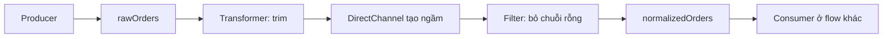
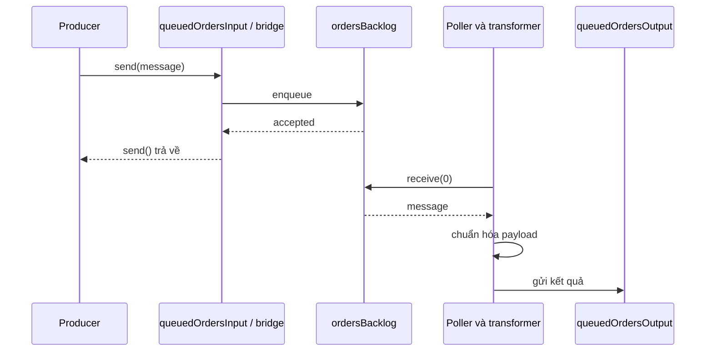

# Channel trong DSL

## 1. Channel quyết định cách các endpoint giao tiếp

Trong module `SPRING_INTEGRATION_CORE`, Java DSL giúp mô tả luồng thông điệp bằng các thành phần như `Message`, `MessageChannel`, transformer, filter, router và service activator. Bài này tập trung vào channel: điểm nối giữa các endpoint và cũng là nơi quyết định message được giao trực tiếp, chờ trong hàng đợi hay phát đến nhiều subscriber.

Sau bài học, bạn có thể:

- Phân biệt channel do DSL tạo ngầm với channel khai báo tường minh.
- Tham chiếu cùng một channel từ nhiều flow mà không tạo trùng bean.
- Chọn `DirectChannel`, `QueueChannel`, `ExecutorChannel` hoặc `PublishSubscribeChannel` theo yêu cầu xử lý.
- Đặt poller đúng chỗ và giải thích ý nghĩa của việc gửi message thành công.
- Quan sát kết quả và lỗi bằng các channel có tên rõ ràng.

Các ví dụ dùng API Java DSL của Spring Integration 6.5, Java 17 trở lên và dependency `org.springframework.integration:spring-integration-core`. Phiên bản các dependency Spring cần được quản lý nhất quán bằng BOM của dự án. Ví dụ kiểm thử dùng JUnit Jupiter. Những lớp cấu hình đầy đủ bên dưới được chạy trong các application context riêng; các đoạn cấu hình ngắn là những phương án minh họa độc lập.

### 1.1. Endpoint xử lý; channel vận chuyển

Xét flow sau:

```java
@Bean
IntegrationFlow normalizeFlow() {
    return IntegrationFlow.from("rawOrders")
            .transform(String.class, String::trim)
            .filter(String.class, text -> !text.isEmpty())
            .channel("normalizedOrders")
            .get();
}
```

`transform` và `filter` tạo các endpoint thực hiện logic xử lý. Lệnh `.channel("normalizedOrders")` chỉ định đầu ra của bước trước đó; nó không tự bổ sung một phép biến đổi payload. Consumer của `normalizedOrders` có thể nằm trong flow khác.

DSL tự nối các endpoint liền nhau bằng `DirectChannel` khi bạn không chỉ định channel khác. Vì vậy, không viết `.channel(...)` giữa hai bước vẫn có channel kết nối chúng; mặc định đó không phải một hàng đợi bất đồng bộ. Xem [DSL Basics](https://docs.spring.io/spring-integration/reference/6.5/dsl/java-basics.html).



### 1.2. Không đồng nhất tên flow với tên channel

Trong ví dụ trên:

- `normalizeFlow` là tên bean của cấu hình flow.
- `rawOrders` là tên channel đầu vào.
- `normalizedOrders` là tên channel đầu ra.

Tên được đặt bằng `.id(...)` trong endpoint configurer thường là định danh endpoint tương ứng. Nó không thay thế tên channel và không khiến endpoint trở thành địa chỉ nhận message.

Khi giao tiếp giữa các flow, hãy dùng tên channel nghiệp vụ như `validatedOrders`, `billingRequests` hoặc `orderFailures`. Không dựa vào tên channel được sinh tự động vì vị trí endpoint có thể thay đổi khi chỉnh sửa flow.

## 2. Các cách khai báo channel trong Java DSL

### 2.1. Tham chiếu bằng tên

```java
IntegrationFlow.from("orderRequests")
        .transform(String.class, String::trim)
        .channel("validatedOrders")
        .get();
```

Với các overload nhận tên này, DSL dùng channel đã có hoặc tạo một `DirectChannel` nếu chưa có bean cùng tên. Bởi vậy, tên `validatedOrders` không hàm ý channel là hàng đợi. Một lỗi chính tả trong tên cũng có thể tạo một đường đi khác với dự định. Quy tắc này được mô tả trong [Message Channels của Java DSL](https://docs.spring.io/spring-integration/reference/6.5/dsl/java-channels.html).

Khi yêu cầu bắt buộc là hàng đợi có sức chứa 100 message, hãy khai báo loại và sức chứa cụ thể:

```java
@Bean
QueueChannel validatedOrders() {
    return new QueueChannel(100);
}
```

Sau đó dùng `.channel("validatedOrders")` và `IntegrationFlow.from("validatedOrders")` để hai flow giao tiếp qua cùng channel đó.

### 2.2. Dùng channel bean qua tham số phương thức

Khi có nhiều bean cùng kiểu, kết hợp dependency injection với `@Qualifier` để tránh mơ hồ:

```java
@Bean
IntegrationFlow trimFlow(
        @Qualifier("orderRequests") MessageChannel input,
        @Qualifier("validatedOrders") QueueChannel output) {

    return IntegrationFlow.from(input)
            .transform(String.class, String::trim)
            .channel(output)
            .get();
}
```

Đoạn này giả định hai bean đã tồn tại. Cách truyền bean tường minh làm rõ hợp đồng: đầu ra phải là `QueueChannel`, không chỉ là một chuỗi tên tùy ý.

### 2.3. Khai báo inline bằng channel builder

```java
@Bean
IntegrationFlow ingestFlow() {
    return IntegrationFlow.from("incomingOrders")
            .transform(String.class, String::trim)
            .channel(channels -> channels.queue("orderBuffer", 100))
            .get();
}
```

DSL tạo và đăng ký `orderBuffer` tại vị trí này. Một flow khác có thể nhận bằng `IntegrationFlow.from("orderBuffer")`; nếu flow đó dùng endpoint tiêu thụ hàng đợi thì phải có poller.

`MessageChannels` cũng cung cấp factory tĩnh cho cùng mục đích:

```java
import org.springframework.integration.dsl.MessageChannels;

@Bean
IntegrationFlow alternativeIngestFlow() {
    return IntegrationFlow.from("alternativeInput")
            .transform(String.class, String::trim)
            .channel(MessageChannels.queue("alternativeBuffer", 100))
            .get();
}
```

Các biểu thức builder thường gặp là `channels.direct("name")`, `channels.queue("name", capacity)`, `channels.executor("name", executor)` và `channels.publishSubscribe("name")`. Các overload nhận tên và sức chứa được liệt kê tại [Channels API](https://docs.spring.io/spring-integration/api/org/springframework/integration/dsl/Channels.html).

### 2.4. Một tên dùng chung phải chỉ đến một channel instance

Không khai báo hai builder độc lập cùng tạo một channel có chung tên:

```java
// Sai: hai flow cùng yêu cầu đăng ký hai đối tượng dưới một bean name.
@Bean
IntegrationFlow producerFlow() {
    return IntegrationFlow.from("sourceInput")
            .channel(MessageChannels.queue("sharedBuffer", 100))
            .get();
}

@Bean
IntegrationFlow consumerFlow() {
    return IntegrationFlow.from(MessageChannels.queue("sharedBuffer", 100))
            .handle(String.class, (payload, headers) -> null,
                    endpoint -> endpoint.poller(Pollers.fixedDelay(100)))
            .get();
}
```

Hai builder không được hợp nhất chỉ vì chúng có cùng tên. Cách tổ chức rõ ràng hơn là khai báo một bean `sharedBuffer`, rồi để các flow tham chiếu bằng tên hoặc inject bean đó. Trường hợp tạo trùng inline cũng được cảnh báo trong [tài liệu Java DSL về channel](https://docs.spring.io/spring-integration/reference/6.5/dsl/java-channels.html).

## 3. Chọn channel theo mô hình giao nhận

| Loại channel | Cách nhận message | Phân phối | Có bộ đệm message riêng mặc định? | Consumer endpoint có cần poller? |
| --- | --- | --- | --- | --- |
| `DirectChannel` | Subscriber được gọi trên thread gửi | Point-to-point | Không | Không |
| `ExecutorChannel` | Dispatcher giao việc qua executor | Point-to-point | Không có message queue riêng; executor có thể có task queue | Không |
| `QueueChannel` | Consumer gọi `receive(...)` | Point-to-point | Có, thường trong bộ nhớ | Có, nếu để endpoint của framework đọc queue |
| `PublishSubscribeChannel` | Gọi các subscriber | Broadcast | Không | Không |

Point-to-point nghĩa là một message được giao đến một consumer theo cơ chế của channel, không phải mỗi consumer đều nhận một bản. Broadcast hướng message đến các subscriber đã đăng ký; việc thực thi còn chịu tác động của lỗi và cấu hình executor.

Các lựa chọn chuyên biệt gồm `PriorityChannel` để lấy message theo ưu tiên, `RendezvousChannel` để bàn giao mà không có bộ đệm chờ, và các channel dành cho partition hoặc reactive stream. Chúng cần yêu cầu cụ thể về thứ tự, bàn giao hay backpressure. Xem [Message Channel Implementations](https://docs.spring.io/spring-integration/reference/channel/implementations.html).

## 4. Ví dụ đầy đủ với DirectChannel

Yêu cầu: nhận mã đơn hàng dạng chuỗi, bỏ khoảng trắng và chuyển sang chữ hoa. Producer cần việc chuẩn hóa hoàn thành ngay trong lần gửi. Kết quả được đưa vào queue để chương trình gọi có thể lấy ra quan sát.

```java
import java.util.Locale;

import org.springframework.beans.factory.annotation.Qualifier;
import org.springframework.context.annotation.Bean;
import org.springframework.context.annotation.Configuration;
import org.springframework.integration.channel.DirectChannel;
import org.springframework.integration.channel.QueueChannel;
import org.springframework.integration.config.EnableIntegration;
import org.springframework.integration.dsl.IntegrationFlow;
import org.springframework.messaging.MessageChannel;

@Configuration(proxyBeanMethods = false)
@EnableIntegration
public class DirectChannelDslConfig {

    @Bean
    MessageChannel directOrdersInput() {
        return new DirectChannel();
    }

    @Bean
    QueueChannel directOrdersOutput() {
        return new QueueChannel(10);
    }

    @Bean
    IntegrationFlow directOrdersFlow(
            @Qualifier("directOrdersInput") MessageChannel input,
            @Qualifier("directOrdersOutput") QueueChannel output) {

        return IntegrationFlow.from(input)
                .transform(String.class,
                        value -> value.trim().toUpperCase(Locale.ROOT))
                .channel(output)
                .get();
    }
}
```

Đường thực thi là:

```text
thread gọi send()
  -> directOrdersInput
  -> transformer
  -> directOrdersOutput: đưa kết quả vào queue
  -> send() trả về
```

`DirectChannel` gọi subscriber trên thread của sender. Với cấu hình này, khi gửi thành công trở về thì transformer đã chạy và kết quả đã được đưa vào output queue. Nếu một endpoint đồng bộ phía sau chậm, sender cũng chờ theo. Xem [DirectChannel API](https://docs.spring.io/spring-integration/api/org/springframework/integration/channel/DirectChannel.html).

Queue đầu ra không cần poller trong ví dụ vì chương trình gọi sẽ tự lấy message bằng `receive(...)`. Nếu thay việc nhận thủ công bằng một flow tiêu thụ queue, flow đó cần poller.

Nếu thêm hai flow tiêu thụ cùng `directOrdersInput`, bạn tạo các consumer cạnh tranh nhận message. Đây không phải cách cho cả xử lý đơn hàng và audit cùng nhận mọi message. Ngoài ra, dispatcher có thể thử subscriber khác khi xử lý thất bại và failover được bật; không nên suy ra bảo đảm xử lý nghiệp vụ đúng một lần chỉ từ loại channel.

## 5. QueueChannel: tách thời điểm gửi khỏi thời điểm xử lý

Yêu cầu mới: producer chỉ cần đưa yêu cầu vào vùng đệm. Một worker định kỳ lấy yêu cầu để chuẩn hóa. Các channel được khai báo riêng để hai flow dùng chung một hàng đợi.

```java
import java.util.Locale;

import org.springframework.context.annotation.Bean;
import org.springframework.context.annotation.Configuration;
import org.springframework.integration.channel.DirectChannel;
import org.springframework.integration.channel.QueueChannel;
import org.springframework.integration.config.EnableIntegration;
import org.springframework.integration.dsl.IntegrationFlow;
import org.springframework.integration.dsl.Pollers;
import org.springframework.messaging.MessageChannel;

@Configuration(proxyBeanMethods = false)
@EnableIntegration
public class QueuedChannelDslConfig {

    @Bean
    MessageChannel queuedOrdersInput() {
        return new DirectChannel();
    }

    @Bean
    QueueChannel ordersBacklog() {
        return new QueueChannel(100);
    }

    @Bean
    QueueChannel queuedOrdersOutput() {
        return new QueueChannel(100);
    }

    @Bean
    QueueChannel orderErrors() {
        return new QueueChannel(20);
    }

    @Bean
    IntegrationFlow enqueueOrdersFlow() {
        return IntegrationFlow.from("queuedOrdersInput")
                .channel("ordersBacklog")
                .get();
    }

    @Bean
    IntegrationFlow processQueuedOrdersFlow() {
        return IntegrationFlow.from("ordersBacklog")
                .transform(String.class, value -> {
                    String normalized = value.trim();
                    if (normalized.isEmpty()) {
                        throw new IllegalArgumentException("Order code is blank");
                    }
                    return normalized.toUpperCase(Locale.ROOT);
                }, endpoint -> endpoint.poller(
                        Pollers.fixedDelay(100)
                                .maxMessagesPerPoll(10)
                                .receiveTimeout(0)
                                .errorChannel("orderErrors")))
                .channel("queuedOrdersOutput")
                .get();
    }
}
```

Đoạn từ `queuedOrdersInput` sang `ordersBacklog` chỉ chuyển tiếp message; DSL bổ sung bridge cần thiết giữa hai channel. Producer không trực tiếp thực thi transformer của flow tiêu thụ queue.



### 5.1. Poller thuộc consumer endpoint

`ordersBacklog` chỉ lưu message và cung cấp thao tác nhận; nó không tự chạy một thread đọc queue. Poller được gắn vào endpoint `transform`, vì đó là endpoint đầu tiên đọc từ channel này.

Trong cấu hình trên:

- `fixedDelay(100)` đặt khoảng nghỉ 100 ms giữa khi một lần chạy kết thúc và lần kế tiếp bắt đầu.
- `maxMessagesPerPoll(10)` giới hạn tối đa 10 message mỗi lần chạy polling task; không tạo 10 thread.
- `receiveTimeout(0)` khiến một lần nhận trả về ngay khi queue không có message.
- `errorChannel("orderErrors")` chỉ định nơi nhận lỗi của polling task.

Có thể khai báo default poller dùng chung, nhưng poller cục bộ giúp thấy ngay cách một endpoint tiêu thụ hàng đợi. API cấu hình poller được giới thiệu trong [Pollers của Java DSL](https://docs.spring.io/spring-integration/reference/dsl/java-pollers.html).

Hai queue `queuedOrdersOutput` và `orderErrors` là điểm quan sát dành cho ví dụ và kiểm thử. Ứng dụng chạy lâu dài cần có consumer lấy kết quả và lỗi; nếu không, các queue có giới hạn này sẽ đầy.

### 5.2. Queue không tự bảo đảm lưu bền hoặc xử lý lại

`new QueueChannel(100)` dùng bộ đệm trong bộ nhớ. Việc chuyển sang queue không tự cung cấp lưu bền qua restart, xác nhận nghiệp vụ hay retry. Khi message được lấy khỏi queue thông thường rồi handler lỗi, không có cơ chế tự đưa message trở lại chỉ nhờ khai báo queue.

Nếu yêu cầu là khôi phục sau crash, phải thiết kế message store bền vững cùng ranh giới transaction phù hợp, hoặc dùng broker với cơ chế xác nhận tương ứng. Đây là lựa chọn bổ sung ngoài ví dụ in-memory. Xem [cấu hình QueueChannel và persistent store](https://docs.spring.io/spring-integration/reference/channel/configuration.html#queuechannel-configuration).

## 6. ExecutorChannel: chuyển việc qua executor

Khi không cần consumer chủ động poll queue, có thể để channel giao tác vụ cho executor. Đặt các bean sau trong một lớp `@Configuration` có bật Spring Integration:

```java
import org.springframework.beans.factory.annotation.Qualifier;
import org.springframework.context.annotation.Bean;
import org.springframework.integration.dsl.IntegrationFlow;
import org.springframework.scheduling.concurrent.ThreadPoolTaskExecutor;

@Bean
ThreadPoolTaskExecutor billingExecutor() {
    ThreadPoolTaskExecutor executor = new ThreadPoolTaskExecutor();
    executor.setCorePoolSize(2);
    executor.setMaxPoolSize(4);
    executor.setQueueCapacity(50);
    executor.setThreadNamePrefix("billing-");
    return executor;
}

@Bean
IntegrationFlow billingFlow(
        @Qualifier("billingExecutor") ThreadPoolTaskExecutor executor) {

    return IntegrationFlow.from("billingRequests")
            .channel(channels -> channels.executor("billingWork", executor))
            .handle(String.class, (payload, headers) -> {
                System.out.println(Thread.currentThread().getName()
                        + " handles " + payload);
                return null;
            })
            .get();
}
```

Spring quản lý khởi tạo và kết thúc `ThreadPoolTaskExecutor` bean. `return null` ở handler diễn đạt việc kết thúc xử lý một chiều, không tạo reply tiếp theo.

Với executor trên, phần xử lý sau `billingWork` thường chạy trên thread `billing-*`. `ExecutorChannel` vẫn là point-to-point; tăng số thread không biến nó thành broadcast. Transaction gắn với thread của sender không tự truyền sang handler. Xem [ExecutorChannel API](https://docs.spring.io/spring-integration/api/org/springframework/integration/channel/ExecutorChannel.html).

Sức chứa 50 là hàng đợi tác vụ của executor. Khi pool và task queue đều đầy, chính sách từ chối tác vụ quyết định điều xảy ra. Chính sách mặc định có thể làm thao tác gửi thất bại; chính sách chạy việc trên caller có thể khiến sender phải xử lý ngay. Do đó, không nên cam kết rằng thêm executor sẽ luôn khiến `send()` trở về tức thì.

Nếu cần quan sát backlog dưới dạng message channel và chủ động điều khiển nhịp lấy, lựa chọn queue cùng poller thường diễn đạt yêu cầu rõ hơn. Nếu cần xử lý song song theo pool mà không dùng polling endpoint, executor phù hợp với mô hình đó.

## 7. PublishSubscribeChannel: nhiều nhánh nhận cùng sự kiện

Khi đơn hàng được chấp nhận, audit và thông báo đều cần nhận sự kiện. DSL có phương thức chuyên biệt để khai báo channel broadcast cùng các subscriber subflow:

```java
@Bean
IntegrationFlow acceptedOrderEventsFlow() {
    return IntegrationFlow.from("acceptedOrderEvents")
            .publishSubscribeChannel(subscribers -> subscribers
                    .subscribe(audit -> audit
                            .handle(String.class, (payload, headers) -> {
                                System.out.println("AUDIT: " + payload);
                                return null;
                            }))
                    .subscribe(notification -> notification
                            .handle(String.class, (payload, headers) -> {
                                System.out.println("NOTIFY: " + payload);
                                return null;
                            })))
            .get();
}
```

`acceptedOrderEvents` là channel đầu vào. Lệnh `publishSubscribeChannel(...)` tạo một channel khác ở bên trong flow để phát đến hai nhánh. Trong trường hợp không lỗi, mỗi sự kiện đi đến cả audit và notification.

Không cấu hình executor thì hai subscriber được gọi trên thread gửi; publish-subscribe không mặc nhiên có nghĩa là chạy song song. Nếu nhánh đồng bộ trước ném exception, việc dispatch có thể bị ngắt trước khi gọi nhánh sau. Muốn các nhánh có cơ chế xử lý lỗi độc lập cần thiết kế thêm ranh giới và error handling phù hợp.

Nếu các nhánh sẽ được gom bằng aggregator, cân nhắc cấu hình `applySequence(true)` cùng correlation và release strategy tương ứng. Broadcast riêng lẻ chưa phải một luồng scatter-gather hoàn chỉnh. Các thuộc tính executor và sequence của channel được giải thích tại [PublishSubscribeChannel Configuration](https://docs.spring.io/spring-integration/reference/channel/configuration.html#publishsubscribechannel-configuration).

Payload có thể vẫn là cùng một đối tượng được tham chiếu từ nhiều nhánh. Hãy ưu tiên payload bất biến; không để audit sửa một `List` dùng chung trong khi nhánh khác đang đọc nó.

## 8. Capacity, timeout và ý nghĩa của send thành công

### 8.1. Hợp đồng gửi và nhận

```java
boolean accepted = channel.send(message, 200);
Message<?> result = outputQueue.receive(1_000);
```

Các timeout trên dùng đơn vị millisecond:

- Với queue đầy, `send(message, 200)` có thể chờ chỗ trống tối đa khoảng 200 ms rồi trả `false` nếu vẫn không gửi được.
- Với queue rỗng, `receive(1_000)` chờ message và trả `null` nếu hết thời gian.
- `send(message, 0)` và `receive(0)` không chờ trạng thái queue thay đổi.

Các overload không có timeout có thể chặn vô thời hạn với queue. Phải xử lý cả giá trị `false`, `null` và exception theo đúng thao tác đang gọi. Xem [hành vi QueueChannel](https://docs.spring.io/spring-integration/reference/channel/implementations.html#queuechannel).

Timeout truyền vào `send()` không phải deadline thực thi toàn bộ nghiệp vụ. Chẳng hạn, `DirectChannel` không ngắt một handler chạy chậm chỉ vì caller dùng `send(message, 200)`. Timeout gửi vào channel đầu flow cũng không tự trở thành timeout cho mọi lần gửi ở các endpoint phía sau.

| Điểm gửi thành công | Điều có thể kết luận | Điều cần quan sát thêm |
| --- | --- | --- |
| Queue đầu vào | Message đã được chấp nhận vào queue | Worker đã xử lý và ghi kết quả hay chưa |
| Executor channel | Tác vụ đã được chấp nhận để dispatch | Handler hoàn thành hoặc phát lỗi hay chưa |
| Chuỗi endpoint đồng bộ | Các bước đồng bộ của lần gửi đã trở về bình thường | Có side effect bất đồng bộ hoặc commit bên ngoài sau đó không |

### 8.2. Sức chứa là giới hạn backlog, không phải năng lực xử lý

Giả sử một worker xử lý trung bình 200 message/giây, còn đầu vào giữ ở mức 300 message/giây. Backlog tăng xấp xỉ 100 message/giây. Nếu queue ban đầu rỗng và có sức chứa 1.000 message, nó sẽ đầy sau khoảng 10 giây, bỏ qua dao động thực tế.

Đây là phép ước lượng để đặt câu hỏi thiết kế: producer sẽ chờ, nhận lỗi, giảm tốc hay chuyển yêu cầu sang nơi khác khi hết chỗ? Tăng capacity chỉ kéo dài thời gian trước khi đầy; cần thay đổi thông lượng xử lý hoặc chính sách tiếp nhận nếu chênh lệch kéo dài.

`QueueChannel` FIFO giúp xác định thứ tự lấy message. Nếu nhiều worker xử lý đồng thời với thời gian khác nhau, thứ tự hoàn tất vẫn có thể khác thứ tự vào. Hãy phân biệt yêu cầu giữ thứ tự nhận với yêu cầu giữ thứ tự hoàn thành theo từng đơn hàng hoặc khách hàng.

## 9. Đổi channel cũng đổi ranh giới lỗi và transaction

### 9.1. Lỗi trong chuỗi đồng bộ

Khi gửi trực tiếp qua `DirectChannel`, exception từ handler đồng bộ thường đi ngược về caller; framework có thể bọc nó trong messaging exception. Chỉ đặt header `errorChannel` không tự chuyển mọi lỗi đồng bộ thành message lỗi.

### 9.2. Lỗi sau ranh giới bất đồng bộ

Trong ví dụ queue, lỗi chuẩn hóa xảy ra ở polling task sau khi sender đã gửi xong. Poller được cấu hình đưa lỗi vào `orderErrors`; thông điệp nhận được là `ErrorMessage` có payload là `Throwable`. Error handling mặc định ở các tác vụ do framework quản lý có thể dùng header `errorChannel` hoặc channel toàn cục, tùy cấu hình. Xem [Error Handling](https://docs.spring.io/spring-integration/reference/error-handling.html).

Flow nhận lỗi cần quyết định ghi nhận, retry, chuyển xử lý thủ công hay phát kết quả thất bại. Có `errorChannel` chưa có nghĩa là message gốc sẽ được xử lý lại.

### 9.3. Transaction không được tạo ra chỉ bằng channel

`DirectChannel` giữ nguyên thread nên có thể nối tiếp transaction đang có, nếu các tài nguyên và propagation được cấu hình phù hợp. Nó không tự mở một transaction.

Khi thêm queue hoặc executor, hãy xác định transaction ở consumer thay vì giả định transaction của producer tự đi qua ranh giới đó. Ví dụ, lưu bản ghi “đã tiếp nhận” ở producer và cập nhật trạng thái “đã xử lý” ở worker là hai thao tác cần được thiết kế tính nhất quán riêng. Chọn channel phải đi cùng quyết định ứng dụng sẽ khôi phục như thế nào nếu dừng ở giữa hai thao tác.

## 10. Quan sát channel bằng interceptor

Channel có tên giúp đo lượng message, theo dõi lỗi gửi và gắn quan sát tại một ranh giới ổn định. Ví dụ dưới đây in định danh đơn hàng trước khi gửi qua `observedOrders`:

```java
import org.springframework.messaging.Message;
import org.springframework.messaging.MessageChannel;
import org.springframework.messaging.support.ChannelInterceptor;

@Bean
IntegrationFlow observedOrdersFlow() {
    return IntegrationFlow.from("observedInput")
            .channel(channels -> channels.direct("observedOrders")
                    .interceptor(new ChannelInterceptor() {
                        @Override
                        public Message<?> preSend(
                                Message<?> message, MessageChannel channel) {
                            System.out.println("orderId="
                                    + message.getHeaders().get("orderId"));
                            return message;
                        }
                    }))
            .handle(String.class, (payload, headers) -> null)
            .get();
}
```

`preSend` trả lại message để tiếp tục gửi. Nếu interceptor trả `null`, thao tác gửi bị chặn. Các callback nhận như `preReceive` và `postReceive` áp dụng cho pollable channel, không áp dụng cho `DirectChannel`. Xem [Channel Interceptors](https://docs.spring.io/spring-integration/reference/channel/interceptors.html).

Đo thời gian ở channel bất đồng bộ cần phân biệt thời gian chấp nhận gửi và thời gian xử lý nghiệp vụ. Để đo toàn bộ quá trình, có thể mang `orderId` hoặc correlation ID qua các message rồi ghi nhận tại điểm bắt đầu và điểm hoàn thành. Logic chuẩn hóa, định tuyến và lọc nghiệp vụ nên tiếp tục được thể hiện bằng endpoint tương ứng để flow dễ đọc.

## 11. Kiểm thử hành vi channel

Các kiểm thử sau minh họa ba hợp đồng quan trọng: xử lý đồng bộ tạo kết quả đúng, poller đưa lỗi sang error channel, và queue hữu hạn từ chối gửi ngay khi đầy. Đặt hai lớp cấu hình ở mục 4 và 5 cùng package với lớp kiểm thử, hoặc import chúng theo package của dự án.

```java
import org.junit.jupiter.api.Test;
import org.springframework.context.annotation.AnnotationConfigApplicationContext;
import org.springframework.integration.channel.QueueChannel;
import org.springframework.messaging.Message;
import org.springframework.messaging.MessageChannel;
import org.springframework.messaging.support.ErrorMessage;
import org.springframework.messaging.support.MessageBuilder;

import static org.junit.jupiter.api.Assertions.assertEquals;
import static org.junit.jupiter.api.Assertions.assertFalse;
import static org.junit.jupiter.api.Assertions.assertInstanceOf;
import static org.junit.jupiter.api.Assertions.assertNotNull;
import static org.junit.jupiter.api.Assertions.assertNull;
import static org.junit.jupiter.api.Assertions.assertTrue;

class ChannelDslTest {

    @Test
    void directFlowNormalizesPayloadAndKeepsBusinessHeader() {
        try (var context = new AnnotationConfigApplicationContext(
                DirectChannelDslConfig.class)) {

            MessageChannel input = context.getBean(
                    "directOrdersInput", MessageChannel.class);
            QueueChannel output = context.getBean(
                    "directOrdersOutput", QueueChannel.class);

            Message<String> request = MessageBuilder
                    .withPayload("  order-007  ")
                    .setHeader("orderId", "007")
                    .build();

            assertTrue(input.send(request, 200));

            // Chuỗi xử lý đồng bộ đã đưa kết quả vào queue.
            Message<?> result = output.receive(0);
            assertNotNull(result);
            assertEquals("ORDER-007", result.getPayload());
            assertEquals("007", result.getHeaders().get("orderId"));
            assertNull(output.receive(0));
        }
    }

    @Test
    void pollingFlowProducesResultAndRoutesInvalidInputToErrors() {
        try (var context = new AnnotationConfigApplicationContext(
                QueuedChannelDslConfig.class)) {

            MessageChannel input = context.getBean(
                    "queuedOrdersInput", MessageChannel.class);
            QueueChannel output = context.getBean(
                    "queuedOrdersOutput", QueueChannel.class);
            QueueChannel errors = context.getBean(
                    "orderErrors", QueueChannel.class);

            assertTrue(input.send(MessageBuilder
                    .withPayload(" order-008 ").build(), 200));

            Message<?> result = output.receive(2_000);
            assertNotNull(result);
            assertEquals("ORDER-008", result.getPayload());

            assertTrue(input.send(MessageBuilder
                    .withPayload("   ").build(), 200));

            Message<?> failure = errors.receive(2_000);
            assertInstanceOf(ErrorMessage.class, failure);
            assertInstanceOf(Throwable.class, failure.getPayload());
            assertEquals("Order code is blank",
                    rootCause((Throwable) failure.getPayload()).getMessage());
        }
    }

    @Test
    void boundedQueueRejectsImmediateSendWhenFull() {
        QueueChannel queue = new QueueChannel(1);
        Message<String> first = MessageBuilder.withPayload("A").build();
        Message<String> second = MessageBuilder.withPayload("B").build();

        assertTrue(queue.send(first, 0));
        assertFalse(queue.send(second, 0));

        Message<?> received = queue.receive(0);
        assertNotNull(received);
        assertEquals("A", received.getPayload());
        assertTrue(queue.send(second, 0));
    }

    private static Throwable rootCause(Throwable error) {
        Throwable current = error;
        while (current.getCause() != null) {
            current = current.getCause();
        }
        return current;
    }
}
```

Kiểm thử bất đồng bộ chờ trên output hoặc error channel bằng timeout hữu hạn. Cách này quan sát sự kiện cần kiểm tra mà không phải đoán thời gian bằng `Thread.sleep(...)`. Giới hạn 2 giây là ngân sách chờ của ví dụ kiểm thử, không phải cam kết độ trễ cho hệ thống thực tế.

## 12. Các lỗi thường gặp khi nối flow

| Hiện tượng | Điều cần kiểm tra | Hướng xử lý |
| --- | --- | --- |
| `Dispatcher has no subscribers` | Direct/executor channel chưa có endpoint đăng ký hoặc endpoint chưa chạy | Kiểm tra tên channel, trạng thái context và lifecycle của consumer |
| Queue tăng kích thước nhưng không có kết quả | Chưa có consumer, thiếu poller hoặc worker lỗi | Kiểm tra endpoint đầu tiên đọc queue và error channel |
| Muốn mọi nhánh đều chạy nhưng mỗi message chỉ xuất hiện ở một nhánh | Dùng point-to-point channel với nhiều consumer | Chọn publish-subscribe nếu yêu cầu là broadcast |
| `send()` đã xong nhưng dữ liệu chưa được cập nhật | Có ranh giới queue hoặc executor | Quan sát kết quả hoàn thành hoặc lỗi ở consumer |
| Lỗi đăng ký bean trùng tên channel | Hai flow cùng tạo channel inline với cùng tên | Khai báo channel một lần rồi tham chiếu lại |
| Producer bị chặn lâu | Queue đầy, handler đồng bộ chậm hoặc executor có chính sách chạy trên caller | Xác định điểm chờ và đặt chính sách tiếp nhận phù hợp |
| `receive(...)` không dùng được trên channel | Channel không triển khai `PollableChannel` | Dùng subscriber endpoint hoặc chọn queue nếu cần nhận chủ động |
| Message biến mất sau restart | Dùng queue trong bộ nhớ | Thiết kế lưu bền và cơ chế phục hồi theo yêu cầu |

## 13. Áp dụng vào một luồng đơn hàng

Một thiết kế có thể bắt đầu bằng các ranh giới sau:

```text
Gateway hoặc producer
  -> orderRequests: DirectChannel
  -> filter / transformer: kiểm tra và chuẩn hóa
  -> ordersBacklog: QueueChannel có giới hạn
  -> poller + worker: thực thi nghiệp vụ
  -> publish-subscribe: phát sự kiện kết quả
       -> audit
       -> notification
```

Gateway cung cấp cách gọi phù hợp cho producer; nó không thay thế việc chọn channel. Filter, router và transformer thể hiện quyết định nghiệp vụ; channel quy định cách message đến các endpoint đó. Nếu đưa aggregator vào các nhánh, cần xác định thêm correlation, số kết quả mong đợi và điều kiện giải phóng nhóm.

Trước khi thay một channel trong flow, hãy xác định những điều quan sát được sau thay đổi:

1. Một message cần đến một consumer hay mọi subscriber?
2. Sender phải chờ hoàn tất bước nào trước khi trở về?
3. Nếu có backlog, giới hạn của nó và hành vi khi đầy là gì?
4. Lỗi sẽ được caller nhận trực tiếp hay đi qua error channel?
5. Transaction bắt đầu ở đâu, và dữ liệu nào còn tồn tại sau restart?

Trả lời các câu này giúp tên và loại channel trong Java DSL phản ánh đúng hợp đồng giao tiếp của hệ thống, đồng thời cho biết phải kiểm thử điều gì ở mỗi ranh giới.
