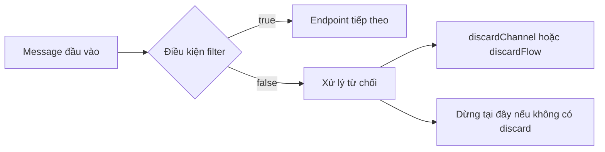
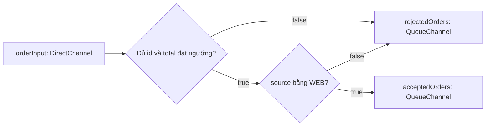

# filter trong DSL

Trong chương **Java DSL** của module **SPRING_INTEGRATION_CORE**, thao tác `filter(...)` biểu diễn mẫu **Message Filter**: kiểm tra một thông điệp và quyết định có cho thông điệp đó đi tiếp hay không. Điều kiện có thể dựa trên payload, header hoặc một quy tắc nghiệp vụ được đóng gói thành đối tượng Java.

Bài học sử dụng tình huống tiếp nhận đơn hàng. Chỉ đơn đủ điều kiện mới được chuyển tới bước xử lý chính; đơn không đạt được đưa vào nhánh từ chối để kiểm tra. Qua đó, bạn sẽ thấy quan hệ giữa `Message`, `MessageChannel`, endpoint và `IntegrationFlow`, đồng thời biết cách kiểm thử và xử lý lỗi của filter.

## 1. Mục tiêu và điều kiện thực hành

Sau bài học, bạn có thể:

- Viết filter bằng lambda đọc payload hoặc toàn bộ message.
- Tách điều kiện lựa chọn khỏi cấu hình endpoint.
- Cấu hình `discardChannel`, `discardFlow` và `throwExceptionOnRejection`.
- Phân biệt trường hợp không đạt điều kiện với lỗi khi thực thi điều kiện.
- Kiểm thử cả nhánh đi tiếp và nhánh từ chối.
- Đặt filter đúng vị trí khi kết hợp transformer, router, splitter, aggregator và gateway.

Các ví dụ dùng Java 17 và API Spring Integration 6.5. Nếu dùng Spring Boot, hãy để cơ chế quản lý dependency của phiên bản Boot trong dự án chọn bộ thư viện tương thích. Không cần ghim riêng một phiên bản Spring Integration khác chỉ để chạy ví dụ này.

Với dự án Maven đã có Spring Boot parent hoặc BOM phù hợp, hai dependency phục vụ phần thực hành là:

```xml
<dependency>
    <groupId>org.springframework.boot</groupId>
    <artifactId>spring-boot-starter-integration</artifactId>
</dependency>

<dependency>
    <groupId>org.springframework.boot</groupId>
    <artifactId>spring-boot-starter-test</artifactId>
    <scope>test</scope>
</dependency>
```

`spring-boot-starter-test` cung cấp môi trường kiểm thử dùng JUnit Jupiter và AssertJ trong bài. Ví dụ không cần broker, cơ sở dữ liệu hoặc một dịch vụ bên ngoài.

## 2. Ngữ nghĩa: filter đưa ra quyết định boolean

Về mặt khái niệm, một filter nhận một `Message<?>`, đánh giá điều kiện và có hai kết quả:

| Kết quả điều kiện | Luồng chính | Nhánh từ chối |
| --- | --- | --- |
| `true` | Message đi tiếp tới endpoint hoặc channel phía sau | Không nhận message từ lần đánh giá này |
| `false` | Không nhận message đó | Phụ thuộc cấu hình discard và exception |

Filter không dùng giá trị boolean làm payload đầu ra. Nếu điều kiện trả về `true`, thông điệp được cho đi tiếp với nội dung của nó; nếu trả về `false`, luồng chính không có đầu ra cho thông điệp đó. Đây là điểm khác với một transformer tạo payload boolean. Xem [tài liệu Message Filter](https://docs.spring.io/spring-integration/reference/filter.html).



Sơ đồ mô tả hai hướng của một lần kiểm tra. Khi bật chế độ ném lỗi, nhánh từ chối còn có thể phát sinh exception.

Có thể đọc một đoạn DSL như sau:

```java
return IntegrationFlow.from("input")
        .filter(String.class, text -> !text.isBlank())
        .transform(String.class, String::trim)
        .channel("output")
        .get();
```

Mỗi message đến `input` được kiểm tra trước. Chuỗi toàn dấu cách bị loại; chuỗi `"  Java DSL  "` đi tiếp rồi được transformer đổi thành `"Java DSL"`.

Dù DSL được viết dưới dạng chuỗi lời gọi phương thức, đây là cấu hình các thành phần messaging do Spring quản lý. `filter` tương ứng với endpoint Message Filter; `transform`, `handle`, `route` và `aggregate` tương ứng với những vai trò khác trong luồng. Xem [DSL Basics](https://docs.spring.io/spring-integration/reference/dsl/java-basics.html).

### Filter khác các thao tác gần nó như thế nào?

| Thao tác | Câu hỏi mà thao tác trả lời | Ví dụ trong luồng đơn hàng |
| --- | --- | --- |
| `filter` | Message này có được tiếp tục không? | Chỉ tiếp nhận đơn có tổng tiền đạt ngưỡng |
| `transform` | Dữ liệu cần đổi thành dạng nào? | Chuyển JSON thành đối tượng `Order` |
| `route` | Message cần tới nhánh xử lý nào? | Đơn nội địa và quốc tế tới hai luồng vận chuyển |
| `handle` | Cần thực hiện tác vụ nào? | Gọi dịch vụ giữ hàng |
| `aggregate` | Khi nào đủ dữ liệu để tạo kết quả nhóm? | Gom kết quả kiểm tra từng dòng hàng |

Một filter có nhánh discard vẫn có thể thể hiện quyết định hai hướng đơn giản. Khi bài toán chủ yếu là chọn nhiều đích nghiệp vụ, router thường diễn đạt ý định rõ hơn.

## 3. Viết điều kiện dựa trên payload

### 3.1. Khai báo rõ kiểu payload

Dạng dễ đọc cho người mới bắt đầu là:

```java
.filter(String.class, text -> text.length() <= 200)
```

Tham số thứ nhất là kiểu dữ liệu mong đợi khi gọi selector; tham số thứ hai là điều kiện trả về boolean. Trong ví dụ, biến `text` là payload kiểu `String`, không phải `Message<String>`.

Với một kiểu nghiệp vụ:

```java
.filter(Order.class, order ->
        order.total() != null
        && order.total().compareTo(new BigDecimal("100000")) >= 0)
```

Ví dụ chọn cả trường hợp bằng ngưỡng. Nếu nghiệp vụ chỉ chấp nhận giá trị lớn hơn ngưỡng, cần đổi `>= 0` thành `> 0`.

Với `BigDecimal`, dùng `compareTo` khi so sánh giá trị số. Dùng `equals` để kiểm tra ngưỡng có thể gây hiểu nhầm vì `100000` và `100000.00` có scale khác nhau.

### 3.2. Chỉ định generic trực tiếp

Bạn cũng có thể gặp dạng:

```java
.<String>filter(text -> !text.isBlank())
```

Chỉ định generic giúp trình biên dịch xác định kiểu tham số lambda. Khi cấu hình dài hoặc có nhiều overload, dạng `.filter(String.class, ...)` thường dễ theo dõi hơn.

Các overload nhận `expectedType` có thể thử chuyển đổi dữ liệu để gọi selector. Vì vậy, `.filter(Order.class, ...)` không phải lời cam kết rằng mọi payload khác `Order` sẽ được xem là `false`; chuyển đổi hoặc lời gọi phương thức có thể thất bại và tạo exception. Hãy thống nhất hợp đồng payload ở đầu vào, hoặc chuyển đổi dữ liệu bằng transformer trước. Xem [API filter trong Java DSL 6.5](https://docs.spring.io/spring-integration/docs/6.5.0/api/org/springframework/integration/dsl/BaseIntegrationFlowDefinition.html).

### 3.3. Điều kiện nên tập trung vào việc đánh giá

Một selector tốt thường có các đặc điểm:

- Kết quả dễ giải thích từ dữ liệu đầu vào.
- Không sửa payload trong quá trình kiểm tra.
- Không gửi email, ghi đơn hàng hoặc thực hiện tác vụ khó hoàn tác.
- Có cách xử lý rõ ràng với trường nullable trong đối tượng nghiệp vụ.
- Có thể kiểm thử bằng các giá trị biên.

Payload của một message có thể là một đối tượng mutable. Việc message có hợp đồng header bất biến không làm đối tượng payload tự trở nên bất biến. Nếu selector vừa kiểm tra vừa sửa đối tượng đó, nhánh discard có thể nhận dữ liệu đã bị thay đổi.

## 4. Đọc header và tái sử dụng quy tắc

### 4.1. Dùng toàn bộ Message

Giả sử chỉ cho phép đơn phát sinh từ nguồn `WEB`:

```java
import org.springframework.messaging.Message;

// Đoạn cấu hình bên trong IntegrationFlow:
.filter(Message.class, message ->
        "WEB".equals(message.getHeaders().get("source")))
```

Ở đây, `Message.class` cho biết lambda cần toàn bộ message. Cách viết `"WEB".equals(...)` trả về `false` khi thiếu header hoặc khi giá trị không bằng chuỗi `"WEB"`.

Điều kiện này cũng từ chối `"web"`, `"MOBILE"` và một giá trị có kiểu khác `String`. Nếu cần chuẩn hóa chữ hoa/thường, hãy quyết định quy tắc chuẩn hóa trước khi so sánh.

Ví dụ kết hợp payload và header:

```java
.filter(Message.class, message ->
        message.getPayload() instanceof Order order
        && order.total() != null
        && order.total().signum() > 0
        && "WEB".equals(message.getHeaders().get("source")))
```

Điều kiện đầu tiên bảo vệ thao tác đọc payload trong chính lambda này. Nó có vai trò khác với việc truyền `Order.class` để adapter gọi selector.

### 4.2. Dùng MessageSelector

Khi một quy tắc phụ thuộc nhiều header hoặc được dùng lại ở nhiều luồng, có thể đóng gói bằng `MessageSelector`:

```java
import org.springframework.integration.core.MessageSelector;
import org.springframework.messaging.Message;

public final class WebOrderSelector implements MessageSelector {

    @Override
    public boolean accept(Message<?> message) {
        return message.getPayload() instanceof Order
                && "WEB".equals(message.getHeaders().get("source"));
    }
}
```

Đưa đối tượng này vào DSL bằng phương thức `accept`:

```java
@Bean
public WebOrderSelector webOrderSelector() {
    return new WebOrderSelector();
}

// Trong một phương thức @Bean có tham số WebOrderSelector selector:
return IntegrationFlow.from("webInput")
        .filter(selector, "accept",
                endpoint -> endpoint.discardChannel("webRejected"))
        .channel("webAccepted")
        .get();
```

Đoạn này là một cấu hình thay thế độc lập; các channel cần được khai báo hoặc nối tới consumer phù hợp trong ứng dụng sử dụng nó.

### 4.3. Dùng đối tượng nghiệp vụ thông thường

Không bắt buộc mọi quy tắc phải triển khai interface của Spring:

```java
public final class OrderRules {

    private static final BigDecimal MINIMUM = new BigDecimal("100000");

    public boolean isEligible(Order order) {
        return order.id() != null
                && !order.id().isBlank()
                && order.total() != null
                && order.total().compareTo(MINIMUM) >= 0;
    }
}
```

Với một bean `OrderRules orderRules` được inject vào phương thức cấu hình:

```java
.filter(orderRules, "isEligible",
        endpoint -> endpoint.discardChannel("rejectedOrders"))
```

Phương thức `isEligible` chỉ phụ thuộc mô hình nghiệp vụ nên có thể kiểm thử riêng. Khi đổi tên phương thức, lưu ý tên `"isEligible"` trong cấu hình là chuỗi và không có cùng mức bảo vệ kiểu như method reference.

### 4.4. Dùng SpEL cho điều kiện ngắn

Ví dụ kiểm tra header:

```java
.filter("headers['source'] == 'WEB'")
```

SpEL thuận tiện khi biểu thức ngắn. Với quy tắc nhiều nhánh, Java thường dễ đổi tên, kiểm thử và theo dõi lỗi hơn. Không lấy trực tiếp biểu thức từ dữ liệu người dùng rồi thực thi như cấu hình tin cậy.

## 5. Quyết định cách xử lý message bị loại

`false` là kết quả bình thường của một selector. Ứng dụng cần quyết định kết quả đó có nghĩa là bỏ qua, lưu lại hay báo lỗi.

### 5.1. Bảng hành vi từ chối

| Có discard channel/flow | `throwExceptionOnRejection` | Hành vi khi selector trả về `false` |
| --- | --- | --- |
| Không | `false`, mặc định | Dừng message tại filter, không có đầu ra ở luồng chính |
| Có | `false` | Chuyển message sang nhánh discard |
| Không | `true` | Ném `MessageRejectedException` |
| Có | `true` | Gửi sang discard trước, rồi ném lỗi nếu bước gửi đó hoàn tất bình thường |

Hai tùy chọn discard và ném lỗi có thể cùng được bật. Cần cân nhắc kỹ vì một message có thể vừa được ghi nhận ở nhánh discard vừa khiến bên gọi thấy thất bại. Xem [FilterEndpointSpec](https://docs.spring.io/spring-integration/api/org/springframework/integration/dsl/FilterEndpointSpec.html).

### 5.2. Bỏ qua có chủ đích

Ví dụ lọc heartbeat trước khi xử lý dữ liệu nghiệp vụ:

```java
.filter(Message.class,
        message -> !"HEARTBEAT".equals(
                message.getHeaders().get("eventType")),
        endpoint -> endpoint.discardChannel("nullChannel"))
```

`nullChannel` là đích tiêu thụ và bỏ message. Trong ứng dụng đã bật hạ tầng Spring Integration, framework cung cấp bean này.

Từ Spring Integration 6.1, filter phát cảnh báo khi loại message mà không cấu hình discard channel và không bật ném lỗi. Cấu hình `nullChannel` giúp thể hiện rõ ý định bỏ qua và tránh cảnh báo mặc định đó. Việc bỏ qua vẫn cần phù hợp với yêu cầu lưu vết của ứng dụng. Xem [ghi chú về message bị discard](https://docs.spring.io/spring-integration/reference/filter.html).

### 5.3. Đưa vào nhánh kiểm tra

```java
.filter(Order.class, order -> order.total() != null,
        endpoint -> endpoint
                .id("nonNullOrderTotalFilter")
                .discardChannel("rejectedOrders"))
```

Nhánh discard nhận message bị từ chối; framework không tự tạo một đối tượng mô tả nguyên nhân nghiệp vụ. Nếu cần lý do như `MISSING_TOTAL`, bạn phải thiết kế bước đánh giá để tạo lý do đó.

`discardChannel` cũng không tự cung cấp tính bền vững. Một `QueueChannel` thông thường giữ message trong bộ nhớ; muốn giữ qua lần khởi động lại phải có thiết kế lưu trữ thích hợp.

### 5.4. Coi việc không đạt điều kiện là lỗi

```java
.filter(Order.class, order -> order.total() != null,
        endpoint -> endpoint
                .id("requiredOrderTotalFilter")
                .throwExceptionOnRejection(true))
```

Cấu hình này phù hợp khi hợp đồng gọi yêu cầu một đơn thiếu tổng tiền phải bị báo lỗi. Nó không biến mọi lỗi trong selector thành `MessageRejectedException`: nếu selector tự ném `NullPointerException` hoặc lỗi gọi dịch vụ, đó là lỗi thực thi selector.

## 6. Ví dụ hoàn chỉnh: lọc đơn hàng từ WEB

Ví dụ gồm một record dữ liệu và một lớp cấu hình. Mỗi lớp public nằm trong tệp Java riêng, cùng package `example.integration`.

Quy tắc chấp nhận:

1. `id` có nội dung.
2. `total` khác `null` và lớn hơn hoặc bằng `100000`.
3. Header `source` bằng `"WEB"`.

Hai filter dùng chung một hàng đợi từ chối. Cách tách này làm rõ từng điều kiện, nhưng chưa phân biệt nguyên nhân từ chối trong dữ liệu đầu ra.

### 6.1. Mô hình dữ liệu

```java
package example.integration;

import java.math.BigDecimal;

public record Order(String id, BigDecimal total) {
}
```

Record này cố ý cho phép giá trị trường `null` để minh họa điều kiện loại bỏ. Đối với hệ thống thật, vị trí đặt ràng buộc dữ liệu cần thống nhất với hợp đồng đầu vào và mô hình miền.

### 6.2. Cấu hình IntegrationFlow

```java
package example.integration;

import java.math.BigDecimal;

import org.springframework.beans.factory.annotation.Qualifier;
import org.springframework.context.annotation.Bean;
import org.springframework.context.annotation.Configuration;
import org.springframework.integration.channel.DirectChannel;
import org.springframework.integration.channel.QueueChannel;
import org.springframework.integration.config.EnableIntegration;
import org.springframework.integration.dsl.IntegrationFlow;
import org.springframework.messaging.Message;
import org.springframework.messaging.MessageChannel;

@Configuration(proxyBeanMethods = false)
@EnableIntegration
public class OrderFilterConfiguration {

    private static final BigDecimal MINIMUM_TOTAL =
            new BigDecimal("100000");

    @Bean
    public MessageChannel orderInput() {
        return new DirectChannel();
    }

    @Bean
    public QueueChannel acceptedOrders() {
        return new QueueChannel();
    }

    @Bean
    public QueueChannel rejectedOrders() {
        return new QueueChannel();
    }

    @Bean
    public IntegrationFlow eligibleOrderFlow(
            @Qualifier("orderInput") MessageChannel input,
            @Qualifier("acceptedOrders") QueueChannel accepted,
            @Qualifier("rejectedOrders") QueueChannel rejected) {

        return IntegrationFlow.from(input)
                .filter(Order.class, order ->
                                order.id() != null
                                && !order.id().isBlank()
                                && order.total() != null
                                && order.total()
                                        .compareTo(MINIMUM_TOTAL) >= 0,
                        endpoint -> endpoint
                                .id("orderEligibilityFilter")
                                .discardChannel(rejected))
                .filter(Message.class,
                        message -> "WEB".equals(
                                message.getHeaders().get("source")),
                        endpoint -> endpoint
                                .id("webSourceFilter")
                                .discardChannel(rejected))
                .channel(accepted)
                .get();
    }
}
```

Đường đi của message:



Các điểm cần hiểu trong cấu hình:

- `@EnableIntegration` bật hạ tầng cần thiết cho ví dụ Spring context độc lập này.
- `IntegrationFlow` là bean để Spring đăng ký và quản lý các thành phần của luồng.
- `orderInput` dùng `DirectChannel`: xử lý filter diễn ra trên luồng gửi trong ví dụ.
- Hai channel kết quả là `QueueChannel`, thuận tiện để nhận và quan sát kết quả.
- Filter đầu tiên trả về `false` thì filter thứ hai không chạy cho message đó.
- Các ID endpoint có ý nghĩa nghiệp vụ, thuận tiện khi đọc log hoặc xem topology.
- `@Qualifier` xác định đúng channel trong một context có nhiều bean cùng kiểu.

Không cần poller cho hai hàng đợi kết quả chỉ để gọi `receive(...)` từ code thử nghiệm. Nếu nối một consumer tự động đọc từ `QueueChannel`, consumer đó cần cơ chế polling phù hợp.

### 6.3. Gửi message và đọc kết quả

Đoạn dưới nằm trong một phương thức thực hành; cần import các kiểu tương ứng:

```java
try (var context = new AnnotationConfigApplicationContext(
        OrderFilterConfiguration.class)) {

    MessageChannel input =
            context.getBean("orderInput", MessageChannel.class);
    QueueChannel accepted =
            context.getBean("acceptedOrders", QueueChannel.class);
    QueueChannel rejected =
            context.getBean("rejectedOrders", QueueChannel.class);

    input.send(MessageBuilder
            .withPayload(new Order(
                    "ORD-001", new BigDecimal("150000")))
            .setHeader("source", "WEB")
            .build());

    input.send(MessageBuilder
            .withPayload(new Order(
                    "ORD-002", new BigDecimal("50000")))
            .setHeader("source", "WEB")
            .build());

    Message<?> passed = accepted.receive(1000);
    Message<?> declined = rejected.receive(1000);

    System.out.println(passed == null ? "Không có đơn đạt" : passed);
    System.out.println(declined == null ? "Không có đơn bị loại" : declined);
}
```

Các import bổ sung:

```java
import org.springframework.context.annotation.AnnotationConfigApplicationContext;
import org.springframework.integration.channel.QueueChannel;
import org.springframework.messaging.Message;
import org.springframework.messaging.MessageChannel;
import org.springframework.messaging.support.MessageBuilder;
```

Ngoài ra cần import `java.math.BigDecimal` và hai lớp ví dụ nếu phương thức thực hành nằm ở package khác.

Kết quả mong đợi là `ORD-001` xuất hiện trong `acceptedOrders`, còn `ORD-002` xuất hiện trong `rejectedOrders`.

Đừng diễn giải `input.send(message)` trả về `true` là đơn hàng đã được chấp nhận về nghiệp vụ. Trong luồng này, message bị filter loại vẫn có thể được gửi thành công tới nhánh discard mà không có exception.

## 7. Kiểm thử hai nhánh và giá trị biên

Kiểm thử filter nên xác minh cả đích nhận message lẫn đích không được nhận message. Chỉ kiểm tra việc gọi `send(...)` không đủ để phát hiện đảo điều kiện.

Lớp dưới đặt trong cùng package với ví dụ. Mỗi test tạo context mới để các hàng đợi không giữ dữ liệu của test trước.

```java
package example.integration;

import java.math.BigDecimal;

import org.junit.jupiter.api.AfterEach;
import org.junit.jupiter.api.BeforeEach;
import org.junit.jupiter.api.Test;
import org.springframework.context.annotation.AnnotationConfigApplicationContext;
import org.springframework.integration.channel.QueueChannel;
import org.springframework.messaging.Message;
import org.springframework.messaging.MessageChannel;
import org.springframework.messaging.support.MessageBuilder;

import static org.assertj.core.api.Assertions.assertThat;

class OrderFilterFlowTest {

    private AnnotationConfigApplicationContext context;
    private MessageChannel input;
    private QueueChannel accepted;
    private QueueChannel rejected;

    @BeforeEach
    void setUp() {
        context = new AnnotationConfigApplicationContext(
                OrderFilterConfiguration.class);
        input = context.getBean("orderInput", MessageChannel.class);
        accepted = context.getBean("acceptedOrders", QueueChannel.class);
        rejected = context.getBean("rejectedOrders", QueueChannel.class);
    }

    @AfterEach
    void tearDown() {
        if (context != null) {
            context.close();
        }
    }

    @Test
    void acceptsWebOrderExactlyAtMinimum() {
        Order order = new Order(
                "ORD-100", new BigDecimal("100000.00"));

        input.send(MessageBuilder.withPayload(order)
                .setHeader("source", "WEB")
                .setHeader("traceId", "trace-100")
                .build());

        Message<?> result = accepted.receive(1000);

        assertThat(result).isNotNull();
        assertThat(result.getPayload()).isEqualTo(order);
        assertThat(result.getHeaders().get("traceId"))
                .isEqualTo("trace-100");
        assertThat(rejected.receive(0)).isNull();
        assertThat(accepted.receive(0)).isNull();
    }

    @Test
    void rejectsOrderBelowMinimum() {
        Order order = new Order(
                "ORD-101", new BigDecimal("99999.99"));

        input.send(MessageBuilder.withPayload(order)
                .setHeader("source", "WEB")
                .build());

        assertRejected(order);
    }

    @Test
    void rejectsOtherwiseValidOrderWithoutSource() {
        Order order = new Order(
                "ORD-102", new BigDecimal("150000"));

        input.send(MessageBuilder.withPayload(order).build());

        assertRejected(order);
    }

    @Test
    void rejectsOrderWithMissingTotalWithoutDereferencingNull() {
        Order order = new Order("ORD-103", null);

        input.send(MessageBuilder.withPayload(order)
                .setHeader("source", "WEB")
                .build());

        assertRejected(order);
    }

    @Test
    void rejectsOrderWithBlankId() {
        Order order = new Order(
                "   ", new BigDecimal("150000"));

        input.send(MessageBuilder.withPayload(order)
                .setHeader("source", "WEB")
                .build());

        assertRejected(order);
    }

    private void assertRejected(Order expected) {
        Message<?> result = rejected.receive(1000);

        assertThat(result).isNotNull();
        assertThat(result.getPayload()).isEqualTo(expected);
        assertThat(accepted.receive(0)).isNull();
        assertThat(rejected.receive(0)).isNull();
    }
}
```

Những điều các test thực sự xác minh:

| Tình huống | Điều cần bảo vệ |
| --- | --- |
| Đúng ngưỡng với scale khác | Không vô tình dùng `>` hoặc `BigDecimal.equals` |
| Nhỏ hơn ngưỡng | Không cho đơn không đạt đi tiếp |
| Thiếu header nguồn | Điều kiện header từ chối một cách có kiểm soát |
| `total == null` | Không đọc giá trị tiền trước khi kiểm tra nullable |
| ID toàn dấu cách | Điều kiện kiểm tra nội dung ID có tác dụng |
| Header `traceId` | Header nghiệp vụ cần thiết vẫn đi cùng message |

Ở cấu hình đang dùng, đường xử lý tới hàng đợi kết quả là đồng bộ. Sau khi `send(...)` trả về, `receive(0)` đủ để kiểm tra ngay hàng đợi còn lại. Nếu thay bằng `ExecutorChannel` hoặc một luồng polling, việc quan sát “chưa có message” tại một thời điểm không chứng minh nhánh sai sẽ không nhận message muộn; khi đó cần cách đồng bộ và thời hạn chờ phù hợp.

Với một flow riêng bật `throwExceptionOnRejection(true)`, hãy bổ sung kiểm thử xác minh exception và không có message tới luồng chính. Không áp kỳ vọng ném lỗi đó lên cấu hình discard mặc định của ví dụ trên.

## 8. Dùng discardFlow khi nhánh từ chối có nhiều bước

`discardChannel` phù hợp khi đã có một channel và consumer xử lý từ chối. `discardFlow` thuận tiện khi muốn khai báo ngay một subflow ngắn.

Ví dụ dưới là phương án thay thế cho flow chính, dùng các channel `orderInput`, `acceptedOrders` và `rejectedOrders` đã có:

```java
@Bean
public IntegrationFlow missingTotalWithReasonFlow() {
    return IntegrationFlow.from("orderInput")
            .filter(Order.class, order -> order.total() != null,
                    endpoint -> endpoint
                            .id("missingTotalFilter")
                            .discardFlow(discard -> discard
                                    .enrichHeaders(headers -> headers
                                            .header(
                                                    "rejectionReason",
                                                    "MISSING_TOTAL"))
                                    .channel("rejectedOrders")))
            .channel("acceptedOrders")
            .get();
}
```

Chỉ dùng flow thay thế này khi đã bỏ đăng ký flow chính khỏi cùng đầu vào. Hai flow độc lập cùng subscribe một `DirectChannel` không tạo thành một chuỗi hai lần lọc; điều đó thay đổi cách phân phối message.

Nhánh chính của ví dụ thay thế chỉ kiểm tra `total != null`. Nhánh discard bổ sung header lý do rồi đưa message vào hàng đợi từ chối. Nó không tự quay về bước nằm sau filter.

Lưu ý rằng một header cố định như `MISSING_TOTAL` chỉ chính xác khi điều kiện bị từ chối có đúng ý nghĩa đó. Nếu một filter gộp cả thiếu ID, thiếu tiền và sai nguồn, không thể gắn cùng lý do này cho mọi message bị loại.

Khi cần nhiều lý do và phản hồi nghiệp vụ rõ ràng, có thể tạo một đối tượng kết quả đánh giá, chẳng hạn:

```java
public record OrderDecision(
        Order order,
        boolean accepted,
        String reasonCode) {
}
```

Một transformer hoặc dịch vụ đánh giá tạo `OrderDecision`; router chọn nhánh dựa trên kết quả. Cách thiết kế này hữu ích khi cả nhánh chấp nhận lẫn từ chối đều là kết quả nghiệp vụ cần trả lại.

## 9. Filter trong luồng có gateway

Giả sử một messaging gateway có phương thức trả về kết quả:

```java
@MessagingGateway(
        defaultRequestChannel = "orderRequests",
        defaultReplyTimeout = "2000")
public interface OrderGateway {

    String submit(Order order);
}
```

Đây là đoạn minh họa hợp đồng. Để đăng ký gateway interface trong ứng dụng, cần cơ chế quét gateway, chẳng hạn `@IntegrationComponentScan` ở cấu hình phù hợp; `@EnableIntegration` không thay thế việc quét đó.

Flow của gateway có thể chứa filter:

```java
@Bean
public IntegrationFlow strictOrderFlow() {
    return IntegrationFlow.from("orderRequests")
            .filter(Order.class,
                    order -> order.total() != null
                            && order.total().signum() > 0,
                    endpoint -> endpoint
                            .id("positiveTotalGatewayFilter")
                            .throwExceptionOnRejection(true))
            .<Order, String>transform(
                    order -> "ACCEPTED:" + order.id())
            .get();
}
```

Transformer cuối tạo phản hồi để gửi qua `replyChannel` của request. Với đơn không đạt, filter báo lỗi thay vì để một request cần phản hồi biến mất khỏi luồng.

Nếu bỏ `throwExceptionOnRejection(true)` mà không có nhánh tạo phản hồi thay thế, request bị loại sẽ không tới transformer cuối. Gateway có thể chờ đến hết thời gian chờ phản hồi; chế độ bỏ message của filter không tự tạo giá trị trả về như `"REJECTED"`. Tùy cấu hình và kiểu trả về, việc không có phản hồi có thể biểu hiện thành kết quả `null` hoặc lỗi timeout. Xem [Messaging Gateways](https://docs.spring.io/spring-integration/reference/gateway.html).

Có ba hướng thiết kế thường gặp:

| Hợp đồng gọi | Cách xử lý từ chối |
| --- | --- |
| Phát sự kiện, không cần kết quả trả về | Bỏ qua hoặc lưu vào nhánh discard theo yêu cầu |
| Gọi lệnh yêu cầu dữ liệu hợp lệ | Bật ném lỗi và xử lý exception theo hợp đồng |
| Luôn phải có quyết định nghiệp vụ | Tạo kết quả đánh giá rồi trả phản hồi từ cả hai nhánh |

Gateway có phương thức `void` không đợi phản hồi, nhưng điều đó không tự làm toàn bộ luồng trở thành bất đồng bộ. Nếu đường xử lý dùng `DirectChannel`, bên gọi vẫn có thể thực hiện công việc trên chính luồng của mình và nhận exception đồng bộ.

`defaultReplyTimeout` cũng không phải thời hạn cưỡng chế dừng toàn bộ xử lý đồng bộ. Nó không tự hủy một lời gọi HTTP chậm đang chạy bên trong selector. Timeout của tác vụ bên ngoài phải được cấu hình ở đúng thành phần gọi tác vụ đó.

## 10. Phân biệt discard, exception và errorChannel

Ba tình huống sau có ý nghĩa khác nhau:

| Tình huống | Ý nghĩa | Hướng xử lý |
| --- | --- | --- |
| Selector trả về `false` | Dữ liệu được đánh giá nhưng không đạt điều kiện | Chính sách discard hoặc ném lỗi của filter |
| Selector ném exception | Không thể hoàn tất đánh giá | Cơ chế xử lý lỗi của endpoint và luồng |
| Gửi sang discard thất bại | Nhánh từ chối không tiếp nhận hoặc xử lý được | Xử lý như một lỗi gửi/xử lý message |

### 10.1. discardChannel không thay cho errorChannel

`discardChannel` nhận message bị từ chối theo điều kiện. `errorChannel` thường nhận `ErrorMessage` do cơ chế xử lý lỗi tạo ra, với exception làm payload.

Trong đường gọi dùng `DirectChannel`, exception thường truyền về bên gửi. Việc đặt header `errorChannel` trên message không tự biến mọi exception đồng bộ thành message gửi tới channel đó. Với đường xử lý bất đồng bộ hoặc poller, cơ chế error handler của thành phần thực thi có thể phát `ErrorMessage`. Xem [Error Handling](https://docs.spring.io/spring-integration/reference/error-handling.html).

### 10.2. Không dùng retry để lặp lại một từ chối cố định

Một đơn thiếu ID sẽ không tự có ID chỉ vì selector chạy lại ba lần. Retry phù hợp hơn với lỗi tạm thời, chẳng hạn một dịch vụ tra cứu có lúc không kết nối được.

Nếu bật cả discard và ném lỗi rồi áp dụng retry, một request có thể được gửi vào discard nhiều lần. Với retry advice quanh filter, phạm vi xử lý discard cũng có liên quan đến tùy chọn `discardWithinAdvice`; giá trị mặc định là `true`. Chỉ thay đổi tùy chọn này sau khi đã xác định phần nào cần được bao bởi advice. Xem [cấu hình advice cho filter](https://docs.spring.io/spring-integration/api/org/springframework/integration/dsl/FilterEndpointSpec.html).

Việc gửi vào một hàng đợi hoặc ghi audit cũng không tự được hoàn tác vì sau đó filter ném exception. Tính nguyên tử phụ thuộc transaction và tài nguyên thực tế; không suy ra từ việc các bước nằm trong cùng một DSL chain.

## 11. Chọn vị trí filter trong luồng tích hợp

### 11.1. Trước hay sau transformer?

Nếu điều kiện chỉ cần header đã có, lọc sớm có thể tiết kiệm chi phí parse hoặc gọi dịch vụ:

```text
Nhận message
  -> filter theo nguồn
  -> transform JSON thành Order
  -> xử lý đơn
```

Nếu điều kiện cần trường `total` trong đối tượng `Order`, nên chuyển đổi payload trước:

```text
Nhận JSON
  -> transform thành Order
  -> filter theo total
  -> xử lý đơn
```

JSON sai cú pháp trong trường hợp thứ hai là lỗi chuyển đổi, không phải kết quả `false` của filter kiểm tra tổng tiền.

### 11.2. Trước hay sau splitter?

Đơn hàng chứa nhiều dòng hàng tạo ra hai cách hiểu khác nhau:

- Filter trước splitter có thể loại cả đơn.
- Filter sau splitter có thể loại từng dòng hàng riêng lẻ.

Cần chọn theo nghiệp vụ. Nếu đơn có một dòng không hợp lệ phải bị từ chối toàn bộ, lọc từng dòng rồi bỏ dòng sai có thể vô tình tạo một đơn thiếu hàng.

### 11.3. Filter có thể ảnh hưởng điều kiện hoàn tất của aggregator

Giả sử splitter phát ba message với cùng correlation ID và thông tin sequence thể hiện nhóm có ba phần tử. Một filter phía sau loại một message. Nếu aggregator vẫn yêu cầu đủ ba phần tử, nhóm chỉ nhận hai phần tử và có thể không được giải phóng theo điều kiện đó.

Những cách thiết kế cần cân nhắc:

- Lọc danh sách dòng hàng trước khi split nếu chỉ các dòng còn lại mới thuộc nhóm.
- Phát một kết quả đánh giá cho mỗi dòng thay vì làm biến mất các message bị từ chối.
- Xác định release strategy, timeout và chính sách kết quả thiếu phần tử phù hợp với nghiệp vụ.

Không sửa `sequenceSize` riêng lẻ trên từng message mà thiếu hiểu biết về toàn bộ nhóm. Điều kiện tổng hợp phải thống nhất với những message thực sự được tạo ra và giữ lại.

### 11.4. Filter không làm nhiệm vụ bảo mật hoặc chống trùng đầy đủ

Header `source = WEB` trong bài là dữ liệu phục vụ ví dụ, không phải bằng chứng xác thực. Nếu nguồn bên ngoài có thể tự gửi header này, filter không chứng minh người gửi đã được cấp quyền.

Tương tự, một lambda kiểm tra ID trong một `HashSet` cục bộ không đủ để đảm bảo chống trùng khi chạy nhiều instance hoặc khởi động lại. Chống trùng cần được thiết kế theo phạm vi lưu trữ, concurrency và thời gian giữ khóa phù hợp.

## 12. Những lỗi thường gặp khi triển khai

| Biểu hiện | Nguyên nhân có thể gặp | Cách kiểm tra hoặc điều chỉnh |
| --- | --- | --- |
| Đơn hợp lệ đi vào discard | Đảo dấu so sánh hoặc đảo kết quả boolean | Kiểm thử giá trị dưới, bằng và trên ngưỡng |
| Lambda không gọi được `getHeaders()` | Tham số đang được hiểu là payload | Dùng `Message.class` hoặc một selector nhận `Message<?>` |
| Sai kiểu payload gây exception | Hiểu `expectedType` như phép kiểm tra `instanceof` tự trả `false` | Chuẩn hóa payload hoặc kiểm tra kiểu trong selector đọc message |
| Gateway chậm dù filter rất nhanh | Message bị loại không tạo phản hồi | Xác định hợp đồng từ chối và thời gian chờ phản hồi |
| Discard cũng phát sinh lỗi gửi | Channel từ chối không có consumer hoặc không tiếp nhận được | Kiểm tra kiểu channel, consumer và giới hạn tài nguyên |
| Message xuất hiện nhiều lần ở nhánh từ chối | Retry chạy lại phần xử lý discard | Xem phạm vi advice và yêu cầu idempotency |
| Không biết vì sao message bị loại | Gộp nhiều điều kiện nhưng chỉ có một đầu ra discard | Tạo lý do đánh giá hoặc tách các điểm đánh giá có ý nghĩa |
| Aggregator không hoàn tất | Filter loại bớt phần tử mà điều kiện nhóm không đổi | Kiểm tra correlation, sequence và release strategy |

Trong vận hành, nên đặt tên endpoint theo quy tắc nghiệp vụ và quan sát tỷ lệ từ chối theo thời gian. Một đợt tăng mạnh có thể do nguồn gửi đổi schema, thiếu header hoặc quy tắc mới cấu hình sai.

Khi ghi log hoặc metric, ưu tiên mã lý do có số lượng giá trị hữu hạn, tên endpoint và correlation ID cần thiết. Tránh ghi toàn bộ payload chứa dữ liệu nhạy cảm; cũng tránh dùng ID từng đơn làm nhãn metric vì số lượng nhãn có thể tăng không kiểm soát.

Đối với ví dụ trong bài, cách thực hành tiếp theo là thêm một quy tắc như loại nguồn `MOBILE`, chỉ rõ đích nhận message và kiểm thử để chứng minh đơn WEB đạt ngưỡng vẫn đi đúng luồng. Khi thêm điều kiện, luôn xác định đó là từ chối nghiệp vụ hay lỗi không thể đánh giá.

## 13. Tài liệu tham khảo

- [Message Filter](https://docs.spring.io/spring-integration/reference/filter.html): ngữ nghĩa nhận, loại và hành vi discard.
- [Java DSL Basics](https://docs.spring.io/spring-integration/reference/dsl/java-basics.html): ánh xạ thao tác DSL sang các endpoint tích hợp.
- [API Java DSL 6.5 — BaseIntegrationFlowDefinition](https://docs.spring.io/spring-integration/docs/6.5.0/api/org/springframework/integration/dsl/BaseIntegrationFlowDefinition.html): các dạng `filter(...)` và kiểu đầu vào selector.
- [FilterEndpointSpec](https://docs.spring.io/spring-integration/api/org/springframework/integration/dsl/FilterEndpointSpec.html): cấu hình discard, exception và advice.
- [Messaging Gateways](https://docs.spring.io/spring-integration/reference/gateway.html): phản hồi và hành vi khi không có kết quả trả về.
- [Error Handling](https://docs.spring.io/spring-integration/reference/error-handling.html): khác biệt giữa lỗi đồng bộ và cơ chế phát `ErrorMessage`.
