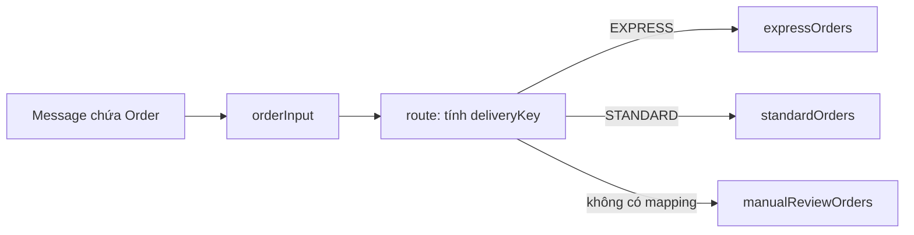

# route trong DSL

## 1. Mục tiêu và phạm vi

Trong chương **Java DSL** của module **SPRING_INTEGRATION_CORE**, bài này hướng dẫn dùng `route()` để chọn đường đi cho thông điệp. Đây là bước nối kiến thức về `Message`, `MessageChannel` và endpoint thành một luồng tích hợp có nhiều nhánh nghiệp vụ.

Sau bài học, bạn có thể:

- Tạo khóa định tuyến từ payload hoặc header.
- Ánh xạ khóa sang channel bằng `channelMapping()`.
- Định nghĩa nhánh xử lý bằng `subFlowMapping()`.
- Chọn hành vi khi không tìm thấy đích.
- Phân biệt định tuyến, phản hồi qua gateway và gom kết quả bằng aggregator.
- Kiểm thử thông điệp đến đúng nhánh và giữ được dữ liệu cần thiết.

Ví dụ dùng **Java 17 trở lên và API Spring Integration 6.5.x**, với cú pháp `IntegrationFlow.from(...)`. Đây là mốc API của bài học; khi áp dụng vào ứng dụng, dùng bộ dependency tương thích với phiên bản Spring của ứng dụng đó.

## 2. Router đưa ra quyết định gì?

Giả sử hệ thống tiếp nhận đơn hàng có ba cách xử lý:

| Giá trị nghiệp vụ | Đích xử lý |
| --- | --- |
| `EXPRESS` | Đơn giao nhanh |
| `STANDARD` | Đơn giao thông thường |
| Giá trị khác hoặc thiếu | Đơn cần kiểm tra thủ công |

Luồng cần đọc phương thức giao hàng rồi chuyển nguyên thông điệp đến nơi phù hợp:



Có hai bước khác nhau:

1. **Tính khóa nghiệp vụ:** chẳng hạn `EXPRESS`.
2. **Tìm đích tương ứng:** chẳng hạn channel `expressOrders`.

Khóa không nhất thiết là tên channel. Tách hai khái niệm giúp tên nghiệp vụ ổn định ngay cả khi cấu trúc luồng thay đổi.

`route()` hỗ trợ lambda, biểu thức SpEL, phương thức của đối tượng hoặc một router có sẵn. Các kiểu router chuyên biệt còn có thể đọc header, loại payload hoặc danh sách người nhận. [Tài liệu Message Routers](https://docs.spring.io/spring-integration/reference/6.5/dsl/java-routers.html).

### Router có thay đổi payload không?

Trong ví dụ này, lambda trả về `"EXPRESS"` để chọn đích. Payload gửi đến đích vẫn là đối tượng `Order`; chuỗi khóa không trở thành payload mới.

Nếu cần chuyển `Order` thành dữ liệu khác, dùng `transform()` trước router hoặc trong nhánh xử lý. Ví dụ: transformer chuẩn hóa đơn từ hệ thống đối tác, router chọn kho tiếp nhận, rồi service activator thực hiện nghiệp vụ tại kho đó.

## 3. Đọc cú pháp route theo từng phần

Đoạn sau là phần cấu hình router nằm trong một flow:

```java
.route(Order.class,
        OrderRoutingConfiguration::deliveryKey,
        router -> router
                .channelKeyFallback(false)
                .channelMapping("EXPRESS", "expressOrders")
                .channelMapping("STANDARD", "standardOrders")
                .defaultOutputChannel("manualReviewOrders"))
```

| Thành phần | Ý nghĩa trong ví dụ |
| --- | --- |
| `Order.class` | Kiểu đầu vào của hàm chọn khóa |
| `deliveryKey` | Hàm nhận đơn hàng và trả về khóa |
| `channelMapping("EXPRESS", "expressOrders")` | Ánh xạ giá trị nghiệp vụ sang tên channel |
| `channelKeyFallback(false)` | Không lấy khóa chưa có mapping làm tên channel |
| `defaultOutputChannel(...)` | Đích cho trường hợp không xác định được channel |

Có thể viết lambda ngắn hơn bằng generic:

```java
.<Order, String>route(
        order -> OrderRoutingConfiguration.deliveryKey(order),
        router -> router
                .channelKeyFallback(false)
                .channelMapping("EXPRESS", "expressOrders")
                .defaultOutputChannel("manualReviewOrders"))
```

Khi muốn đọc toàn bộ thông điệp, overload nhận `Message.class` cho phép lambda truy cập cả payload và header. Overload có đối số kiểu cũng có thể thực hiện chuyển đổi kiểu khi cần; nó không thay thế bước kiểm tra hợp lệ dữ liệu nghiệp vụ. [API BaseIntegrationFlowDefinition](https://docs.spring.io/spring-integration/docs/6.5.0/api/org/springframework/integration/dsl/BaseIntegrationFlowDefinition.html).

## 4. Ví dụ đầy đủ: phân luồng đơn hàng

### 4.1. Điều kiện thực hành

Ví dụ dùng:

- `org.springframework.integration:spring-integration-core`.
- `org.junit.jupiter:junit-jupiter` để chạy các kiểm thử ở phần sau.

Nếu dùng Spring Boot, có thể lấy các thư viện tương ứng qua `spring-boot-starter-integration` và `spring-boot-starter-test`, để dependency management của dự án quản lý phiên bản. Không cần broker, cơ sở dữ liệu hay dịch vụ mạng cho ví dụ này.

### 4.2. Cấu hình

Lưu lớp sau vào `OrderRoutingConfiguration.java` khi thực hành. Trong bài, `Order` là record lồng trong lớp cấu hình để ví dụ tự chứa.

```java
import java.util.Locale;

import org.springframework.context.annotation.Bean;
import org.springframework.context.annotation.Configuration;
import org.springframework.integration.channel.DirectChannel;
import org.springframework.integration.channel.QueueChannel;
import org.springframework.integration.config.EnableIntegration;
import org.springframework.integration.dsl.IntegrationFlow;

@Configuration
@EnableIntegration
public class OrderRoutingConfiguration {

    public record Order(String id, String deliveryMode) {
    }

    public static String deliveryKey(Order order) {
        String mode = order.deliveryMode();
        return mode == null
                ? "UNKNOWN"
                : mode.strip().toUpperCase(Locale.ROOT);
    }

    @Bean
    public DirectChannel orderInput() {
        return new DirectChannel();
    }

    @Bean
    public QueueChannel expressOrders() {
        return new QueueChannel(100);
    }

    @Bean
    public QueueChannel standardOrders() {
        return new QueueChannel(100);
    }

    @Bean
    public QueueChannel manualReviewOrders() {
        return new QueueChannel(100);
    }

    @Bean
    public IntegrationFlow orderRoutingFlow() {
        return IntegrationFlow.from("orderInput")
                .route(Order.class,
                        OrderRoutingConfiguration::deliveryKey,
                        router -> router
                                .id("deliveryModeRouter")
                                .channelKeyFallback(false)
                                .channelMapping("EXPRESS", "expressOrders")
                                .channelMapping("STANDARD", "standardOrders")
                                .defaultOutputChannel("manualReviewOrders")
                                .sendTimeout(1_000))
                .get();
    }
}
```

Hàm `deliveryKey()` chỉ đọc dữ liệu rồi trả khóa. Nó không gọi dịch vụ vận chuyển hoặc cập nhật đơn hàng. Nhờ đó, quyết định phân luồng có thể được kiểm tra bằng các đầu vào nhỏ và không phát sinh tác dụng phụ.

Ví dụ cố ý đưa trường hợp thiếu phương thức giao hàng vào nhánh thủ công. Quy tắc này thuộc nghiệp vụ của ví dụ; ứng dụng khác có thể từ chối dữ liệu thiếu bằng filter trước khi định tuyến.

### 4.3. Theo dõi một thông điệp

Với payload `new Order("O-101", " express ")`:

1. Bên gửi gọi `send()` trên `orderInput`.
2. Router nhận thông điệp và gọi `deliveryKey()`.
3. Hàm chuẩn hóa khoảng trắng và chữ hoa thành `EXPRESS`.
4. Router tìm mapping đến `expressOrders`.
5. Queue chứa thông điệp với payload `Order` ban đầu.

Việc chuẩn hóa khóa không sửa trường `deliveryMode` của record. Nếu cần payload chứa giá trị đã chuẩn hóa, tạo một `Order` mới ở transformer.

Các đầu ra là `QueueChannel` để có thể lấy thông điệp bằng `receive()` trong kiểm thử. Queue mặc định lưu trong bộ nhớ. Nếu nối endpoint tự động vào queue, endpoint đó cần poller; bài này lấy dữ liệu trực tiếp nên không cấu hình poller. `DirectChannel` đầu vào gọi router trên luồng của bên gửi. [Các triển khai MessageChannel](https://docs.spring.io/spring-integration/reference/6.5/channel/implementations.html).

`sendTimeout(1_000)` giới hạn thời gian chờ gửi vào queue đích khi đầy; nó không phải thời gian tối đa hoàn thành toàn bộ xử lý đơn hàng. Trong vận hành thực tế, cần có consumer cho từng queue.

## 5. Định tuyến theo header

Có trường hợp payload chỉ chứa nội dung đơn hàng, còn header chứa thông tin đã được xác định ở biên hệ thống, chẳng hạn phương thức giao hàng hoặc khu vực.

Thêm phương thức cấu hình sau vào lớp ở phần 4 để tạo một đầu vào khác:

```java
@Bean
public IntegrationFlow headerRoutingFlow() {
    return IntegrationFlow.from("headerOrderInput")
            .route(org.springframework.messaging.Message.class,
                    message -> {
                        String mode = message.getHeaders()
                                .get("deliveryMode", String.class);
                        return mode == null
                                ? "UNKNOWN"
                                : mode.strip().toUpperCase(Locale.ROOT);
                    },
                    router -> router
                            .channelKeyFallback(false)
                            .channelMapping("EXPRESS", "expressOrders")
                            .channelMapping("STANDARD", "standardOrders")
                            .defaultOutputChannel("manualReviewOrders")
                            .sendTimeout(1_000))
            .get();
}
```

Có thể tạo thông điệp gửi vào `headerOrderInput` như sau:

```java
var message = org.springframework.messaging.support.MessageBuilder
        .withPayload(new OrderRoutingConfiguration.Order("O-201", "STANDARD"))
        .setHeader("deliveryMode", "EXPRESS")
        .setHeader("traceId", "trace-201")
        .build();
```

Theo quy tắc của flow này, đơn đi vào `expressOrders`. Giá trị `STANDARD` trong payload không tham gia quyết định. Nếu hai nguồn cùng tồn tại, cần xác định rõ nguồn nào có thẩm quyền để tránh các nhánh xử lý hiểu khác nhau về cùng một đơn.

Khi header đã được chuẩn hóa trước đó, có thể dùng SpEL:

```java
.route("headers['deliveryMode']",
        router -> router
                .channelKeyFallback(false)
                .channelMapping("EXPRESS", "expressOrders")
                .channelMapping("STANDARD", "standardOrders")
                .defaultOutputChannel("manualReviewOrders"))
```

Biểu thức trên không có bước `strip()` hay chuyển chữ hoa. Vì vậy, `" express "` không khớp mapping `EXPRESS`. Định tuyến theo giá trị header là một trường hợp được hỗ trợ trực tiếp trong Spring Integration. [Router Implementations](https://docs.spring.io/spring-integration/reference/6.5/router/implementations.html).

## 6. Khi không tìm thấy đích: ba tình huống khác nhau

### 6.1. Khóa chưa có mapping

Trong cấu hình chính, khóa `SAME_DAY` chưa được khai báo. Do `channelKeyFallback(false)`, router không cố tìm bean có tên `SAME_DAY`. Nó dùng `manualReviewOrders`.

Điều này cũng áp dụng nếu dữ liệu bên ngoài tình cờ chứa một tên channel nội bộ. Ứng dụng chỉ chấp nhận các đích trong bảng mapping đã khai báo.

### 6.2. Khóa bị dùng như tên channel

Với `channelKeyFallback(true)`, khóa chưa có mapping có thể được dùng để tìm channel theo tên. Cơ chế này hữu ích khi thiết kế chủ động cho phép định tuyến động.

Ví dụ, một hệ thống nội bộ có thể đặt header `destination` bằng tên channel đã được kiểm soát. Khi đó, nhóm phát triển phải quản lý tập đích được phép và tránh tạo đường đi quay lại đầu vào của chính router. [API AbstractMappingMessageRouter](https://docs.spring.io/spring-integration/docs/6.5.0/api/org/springframework/integration/router/AbstractMappingMessageRouter.html).

Trong bài thực hành, mapping tường minh phù hợp hơn vì các giá trị `EXPRESS` và `STANDARD` là tên nghiệp vụ.

### 6.3. Mapping có tồn tại nhưng tên channel sai

Giả sử viết nhầm:

```java
.channelMapping("EXPRESS", "expressOderz")
```

Khóa đã có mapping nhưng bean đích không tồn tại. Với `resolutionRequired(true)`, mặc định, lỗi phân giải channel được báo ra. Có default channel không đồng nghĩa mọi lỗi cấu hình đều được chuyển sang nhánh thủ công.

Nếu chủ động đặt `resolutionRequired(false)`, các tên không phân giải được bị bỏ qua; khi không còn đích và có default channel, thông điệp có thể đến default. Nếu không có default, tùy chọn này không bảo đảm thông điệp sẽ được bỏ qua thành công. [Common Router Parameters](https://docs.spring.io/spring-integration/reference/6.5/router/common-parameters.html).

| Tình huống | Cấu hình liên quan | Kết quả cần hiểu |
| --- | --- | --- |
| Khóa lạ, có default | Tắt channel key fallback | Đi đến default |
| Khóa lạ, không có default | Tắt channel key fallback | Không có đích; phát sinh lỗi |
| Khóa lạ được coi là tên channel | Bật channel key fallback | Thử phân giải tên đó |
| Mapping chỉ đến channel không tồn tại | `resolutionRequired(true)` | Báo lỗi phân giải |
| Không phân giải được đích nào | `resolutionRequired(false)`, có default | Đi đến default |
| Đã tìm được channel nhưng gửi hoặc xử lý thất bại | Default channel đã cấu hình | Không tự chuyển sang default để thử lại |

Từ Spring Integration 6.0, thiết lập default channel cũng tắt channel key fallback nếu không bật lại một cách tường minh. Cấu hình đồng thời có default, `channelKeyFallback(true)` và `resolutionRequired(true)` bị từ chối khi khởi tạo. Viết rõ `channelKeyFallback(false)` trong bài giúp thể hiện chủ đích. [API AbstractMappingMessageRouter: default output](https://docs.spring.io/spring-integration/docs/6.5.0/api/org/springframework/integration/router/AbstractMappingMessageRouter.html#setDefaultOutputChannel(org.springframework.messaging.MessageChannel)).

## 7. Rẽ nhánh bằng subFlowMapping

`channelMapping()` phù hợp khi muốn chuyển trách nhiệm sang một channel có tên. Nếu mỗi nhánh chỉ có vài bước và cần nối tiếp xử lý chung, có thể khai báo subflow.

Ví dụ dưới đây cũng là một phương thức có thể thêm vào lớp cấu hình ở phần 4:

```java
@Bean
public IntegrationFlow subflowRoutingFlow() {
    return IntegrationFlow.from("subflowOrderInput")
            .route(Order.class,
                    OrderRoutingConfiguration::deliveryKey,
                    router -> router
                            .channelKeyFallback(false)
                            .subFlowMapping("EXPRESS", branch -> branch
                                    .transform(Order.class,
                                            order -> "FAST:" + order.id()))
                            .subFlowMapping("STANDARD", branch -> branch
                                    .transform(Order.class,
                                            order -> "REGULAR:" + order.id()))
                            .defaultSubFlowMapping(branch -> branch
                                    .transform(Order.class,
                                            order -> "MANUAL:" + order.id())))
            .transform(String.class, result -> result + "|AUDITED")
            .channel(channels -> channels.queue("dispatchResults"))
            .get();
}
```

Các nhánh đều trả về chuỗi để bước chung sau router xử lý thống nhất:

| Payload đầu vào | Payload lấy từ `dispatchResults` |
| --- | --- |
| `Order("O-301", "EXPRESS")` | `FAST:O-301|AUDITED` |
| `Order("O-302", "STANDARD")` | `REGULAR:O-302|AUDITED` |
| `Order("O-303", "SAME_DAY")` | `MANUAL:O-303|AUDITED` |

`defaultSubFlowMapping()` cung cấp nhánh mặc định ngay trong DSL. Trong ví dụ, cả nhánh khớp và nhánh mặc định đều có transformer tạo đầu ra. [API AbstractRouterSpec](https://docs.spring.io/spring-integration/docs/6.5.0/api/org/springframework/integration/dsl/AbstractRouterSpec.html).

### 7.1. Phần sau route chạy cho nhánh nào?

Với subflow lambda ở trên, kết quả của nhánh nối tiếp bước `transform(String.class, ...)` sau router. DSL hỗ trợ nối subflow vào phần còn lại của flow. [Sub-flows support](https://docs.spring.io/spring-integration/reference/6.5/dsl/java-subflows.html).

Đối với `channelMapping("EXPRESS", "expressOrders")` ở ví dụ chính, thông điệp được chuyển đến queue `expressOrders`; không có bước tự động nhận kết quả từ queue rồi chạy tiếp một transformer sau router.

Do đó, không thể suy luận rằng các lệnh viết sau `.route(...)` luôn chạy cho mọi mapping. Đường nối thực tế và khả năng tạo đầu ra của nhánh quyết định điều đó.

### 7.2. Điểm nối chung có phải aggregator không?

Trong ví dụ, mỗi đơn chỉ chọn một nhánh. Đơn giao nhanh đến bước chung sau khi có chuỗi `FAST:...`; nó không chờ một kết quả từ nhánh `STANDARD`.

Nếu nghiệp vụ yêu cầu gửi cùng một đơn cho nhiều dịch vụ rồi chờ đủ kết quả, cần thiết kế fan-out và aggregator với correlation, release condition và timeout. Đặt một transformer sau router không tạo ra cơ chế chờ đó.

## 8. Gọi flow riêng bằng gateway

Khi nhánh giao nhanh phát triển thành một quy trình riêng, có thể tách nó thành flow có đầu vào mang tên rõ ràng:

```java
@Bean
public IntegrationFlow expressProcessingFlow() {
    return IntegrationFlow.from("expressProcessingInput")
            .transform(Order.class, order -> "FAST:" + order.id())
            .get();
}

@Bean
public IntegrationFlow externalBranchRoutingFlow() {
    return IntegrationFlow.from("externalBranchOrderInput")
            .route(Order.class,
                    OrderRoutingConfiguration::deliveryKey,
                    router -> router
                            .channelKeyFallback(false)
                            .subFlowMapping("EXPRESS", branch -> branch
                                    .gateway("expressProcessingInput"))
                            .defaultSubFlowMapping(branch -> branch
                                    .transform(Order.class,
                                            order -> "MANUAL:" + order.id())))
            .transform(String.class, result -> result + "|AUDITED")
            .channel(channels -> channels.queue("externalBranchResults"))
            .get();
}
```

`gateway("expressProcessingInput")` tạo tương tác request-reply với flow riêng: gửi `Order`, nhận chuỗi kết quả, rồi tiếp tục bước chung.

Nếu dùng tham chiếu trực tiếp đến một `IntegrationFlow` riêng trong `subFlowMapping()` và cần phản hồi để tiếp tục flow cha, phải bọc lời gọi bằng `gateway()`. Với subflow lambda thông thường, DSL xử lý việc nối nhánh; không cần thêm gateway chỉ để viết một transformer nội tuyến. [API RouterSpec: subFlowMapping](https://docs.spring.io/spring-integration/docs/6.5.0/api/org/springframework/integration/dsl/RouterSpec.html#subFlowMapping(K,org.springframework.integration.dsl.IntegrationFlow)).

Ở biên ứng dụng, `@MessagingGateway` có thể cung cấp một interface Java để bên gọi không thao tác trực tiếp với `MessageChannel`. Dù dùng interface hay DSL gateway, hợp đồng phản hồi vẫn phải phù hợp: nhánh chỉ đưa đơn vào queue mà chưa có consumer tạo reply sẽ không tự sinh kết quả cho lời gọi đang chờ. [Messaging Gateways](https://docs.spring.io/spring-integration/reference/6.5/gateway.html).

## 9. Cho trường hợp mặc định đi tiếp flow cha

Có tình huống chỉ tách một nhóm đặc biệt sang channel riêng; các thông điệp còn lại đi tiếp ngay sau router. Dùng `defaultOutputToParentFlow()`:

```java
@Bean
public IntegrationFlow defaultToParentRoutingFlow() {
    return IntegrationFlow.from("defaultToParentOrderInput")
            .route(Order.class,
                    OrderRoutingConfiguration::deliveryKey,
                    router -> router
                            .channelKeyFallback(false)
                            .channelMapping("EXPRESS", "expressOrders")
                            .defaultOutputToParentFlow())
            .transform(Order.class, order -> "REVIEW:" + order.id())
            .channel(channels -> channels.queue("defaultRouteResults"))
            .get();
}
```

Với ví dụ này:

- `EXPRESS` đi vào `expressOrders`.
- `STANDARD` và các khóa khác đi vào phần sau router, tạo chuỗi `REVIEW:...`.
- Đơn đã chuyển sang `expressOrders` không đồng thời đi qua transformer tạo chuỗi `REVIEW:...`.

Tên phương thức nói đến **đầu ra mặc định** về flow cha. Nó không bổ sung đường quay về cho mọi channel mapping. [API RouterSpec: defaultOutputToParentFlow](https://docs.spring.io/spring-integration/docs/6.5.0/api/org/springframework/integration/dsl/RouterSpec.html#defaultOutputToParentFlow()).

## 10. Kiểm thử đường đi và tính nguyên vẹn của thông điệp

Với cấu hình chính ở phần 4, có thể kiểm thử bằng Spring context nhỏ và các queue đầu ra. Lưu lớp sau vào `OrderRoutingTest.java`, cùng package với lớp cấu hình nếu bạn thêm package declaration.

```java
import org.junit.jupiter.api.AfterEach;
import org.junit.jupiter.api.BeforeEach;
import org.junit.jupiter.api.Test;

import org.springframework.context.annotation.AnnotationConfigApplicationContext;
import org.springframework.integration.channel.QueueChannel;
import org.springframework.messaging.Message;
import org.springframework.messaging.MessageChannel;
import org.springframework.messaging.support.MessageBuilder;

import static org.junit.jupiter.api.Assertions.assertEquals;
import static org.junit.jupiter.api.Assertions.assertNotNull;
import static org.junit.jupiter.api.Assertions.assertNull;
import static org.junit.jupiter.api.Assertions.assertSame;
import static org.junit.jupiter.api.Assertions.assertTrue;

class OrderRoutingTest {

    private AnnotationConfigApplicationContext context;
    private MessageChannel input;

    @BeforeEach
    void openContext() {
        context = new AnnotationConfigApplicationContext(
                OrderRoutingConfiguration.class);
        input = context.getBean("orderInput", MessageChannel.class);
    }

    @AfterEach
    void closeContext() {
        if (context != null) {
            context.close();
        }
    }

    @Test
    void expressOrderKeepsPayloadAndTraceHeader() {
        var order = new OrderRoutingConfiguration.Order("O-101", " express ");
        Message<?> request = MessageBuilder.withPayload(order)
                .setHeader("traceId", "trace-101")
                .build();

        assertTrue(input.send(request, 1_000));

        Message<?> received = queue("expressOrders").receive(1_000);
        assertNotNull(received);
        assertSame(order, received.getPayload());
        assertEquals("trace-101", received.getHeaders().get("traceId"));

        assertAllQueuesEmpty();
    }

    @Test
    void standardOrderGoesOnlyToStandardQueue() {
        var order = new OrderRoutingConfiguration.Order("O-102", "STANDARD");

        assertTrue(input.send(
                MessageBuilder.withPayload(order).build(), 1_000));

        Message<?> received = queue("standardOrders").receive(1_000);
        assertNotNull(received);
        assertEquals(order, received.getPayload());

        assertAllQueuesEmpty();
    }

    @Test
    void unknownModeUsesManualReviewInsteadOfAChannelName() {
        // Giá trị trùng tên channel đầu vào vẫn là dữ liệu nghiệp vụ.
        var order = new OrderRoutingConfiguration.Order("O-103", "orderInput");

        assertTrue(input.send(
                MessageBuilder.withPayload(order).build(), 1_000));

        Message<?> received = queue("manualReviewOrders").receive(1_000);
        assertNotNull(received);
        assertEquals(order, received.getPayload());

        assertAllQueuesEmpty();
    }

    @Test
    void missingModeUsesManualReview() {
        var order = new OrderRoutingConfiguration.Order("O-104", null);

        assertTrue(input.send(
                MessageBuilder.withPayload(order).build(), 1_000));

        Message<?> received = queue("manualReviewOrders").receive(1_000);
        assertNotNull(received);
        assertEquals(order, received.getPayload());

        assertAllQueuesEmpty();
    }

    private QueueChannel queue(String name) {
        return context.getBean(name, QueueChannel.class);
    }

    private void assertAllQueuesEmpty() {
        assertNull(queue("expressOrders").receive(0));
        assertNull(queue("standardOrders").receive(0));
        assertNull(queue("manualReviewOrders").receive(0));
    }
}
```

Mỗi test tạo context riêng để tránh dữ liệu từ test trước còn trong queue. Sau khi lấy thông điệp kỳ vọng, kiểm tra cả ba queue rỗng giúp phát hiện gửi thừa hoặc gửi nhầm.

`receive(0)` phù hợp cho kiểm tra không có bản sao trong cấu hình này vì từ đầu vào đến thao tác đưa vào queue đều chạy đồng bộ. Nếu thay bằng executor hoặc xử lý bất đồng bộ, cần đồng bộ hóa theo điều kiện hoàn thành trước khi kết luận không có thông điệp ở nhánh khác.

Các ca bổ sung nên kiểm tra khi mở rộng flow:

| Thay đổi | Hành vi cần chứng minh |
| --- | --- |
| Thêm chế độ `SAME_DAY` | Đến nhánh mới và không còn vào nhánh thủ công |
| Đổi sang định tuyến theo header | Header được ưu tiên theo đúng hợp đồng |
| Thêm nhánh nội tuyến | Kết quả nhánh có đi qua bước chung |
| Tách nhánh thành flow riêng | Gateway nhận được reply đúng kiểu |
| Sửa một tên channel | Context và lần gửi thực tế phát hiện cấu hình sai |
| Thêm queue hoặc executor ở giữa | Cách chờ hoàn thành trong test vẫn đúng |

## 11. Định tuyến không phải xử lý lỗi dự phòng

Hãy tách hai quyết định:

- **Quyết định nghiệp vụ:** phương thức giao hàng chưa hỗ trợ, đưa vào nhánh thủ công.
- **Sự cố xử lý:** đã chọn nhánh giao nhanh nhưng dịch vụ vận chuyển lỗi.

Default output giải quyết tình huống không có đích phù hợp. Nó không tự động gọi nhánh khác khi endpoint phía sau đã nhận thông điệp rồi ném exception.

Khi xử lý cùng luồng qua `DirectChannel`, lỗi có thể truyền về bên gửi. Khi đã chuyển sang xử lý bất đồng bộ, không thể dựa vào `try/catch` quanh lần gửi ban đầu để bắt lỗi xảy ra sau đó; cần cơ chế error flow phù hợp. Spring Integration dùng `ErrorMessage` cho cơ chế này. [Error Handling](https://docs.spring.io/spring-integration/reference/6.5/error-handling.html).

Trong hệ thống đơn hàng, retry lời gọi dịch vụ giao nhanh phải xem xét liệu lần gọi trước đã tạo vận đơn hay chưa. Một khóa idempotency theo mã đơn hoặc mã yêu cầu giúp tránh tạo nhiều vận đơn khi thử lại. Đây là trách nhiệm của bước nghiệp vụ và chiến lược lỗi, không phải của hàm tính `deliveryKey()`.

## 12. Chọn đúng thành phần cho yêu cầu tích hợp

| Yêu cầu | Thành phần phù hợp |
| --- | --- |
| Chuẩn hóa dữ liệu đơn từ hệ thống bên ngoài | Transformer |
| Loại thông điệp không đạt điều kiện | Filter |
| Chọn nhánh theo phương thức giao hàng | Router qua `route()` |
| Gửi đến nhiều nhóm người nhận theo các điều kiện độc lập | `routeToRecipients()` |
| Phát cùng sự kiện đến các subscriber | Publish-subscribe channel |
| Gọi một luồng và nhận kết quả | Gateway |
| Chờ và gom các kết quả có cùng tương quan | Aggregator |

Một router tổng quát có thể trả về nhiều đích; bản thân từ `route` không bảo đảm chỉ có một người nhận. Trong ví dụ của bài, hàm trả về đúng một khóa và mỗi khóa trỏ đến một nhánh, nên việc kiểm tra “chỉ một queue nhận” là hợp lý. Khi cần nhiều người nhận theo các điều kiện riêng, `routeToRecipients()` diễn đạt cấu hình trực tiếp hơn. [Message Routers và Recipient List](https://docs.spring.io/spring-integration/reference/6.5/dsl/java-routers.html).

## 13. Các lỗi thường gặp khi viết flow

| Biểu hiện | Nguyên nhân cần kiểm tra | Cách xử lý |
| --- | --- | --- |
| Đơn giao nhanh vào nhánh thủ công | Khác hoa/thường, khoảng trắng hoặc đọc nhầm nguồn | Chuẩn hóa khóa, xác định payload hay header là nguồn quyết định |
| Không tìm thấy channel | Sai tên bean hoặc fallback đang dùng khóa làm tên channel | Kiểm tra mapping và cấu hình fallback |
| Bước sau router không chạy | Mapping chuyển sang channel riêng, hoặc nhánh không tạo đầu ra | Dùng subflow trả kết quả, gateway hoặc default về flow cha theo yêu cầu |
| Gateway chờ mà không nhận kết quả | Nhánh kết thúc một chiều hoặc chưa có consumer trả reply | Hoàn thiện hợp đồng request-reply và cấu hình timeout phù hợp |
| Aggregator chờ mãi | Giả định mọi nhánh router đều tạo kết quả cho cùng một đơn | Kiểm tra số nhánh thực sự chạy và điều kiện release |
| Tên endpoint khó nhận diện trong log | Chưa đặt định danh có ý nghĩa | Đặt `id` cho router quan trọng và giữ header truy vết |
| Luồng khó sửa khi thêm phương thức giao hàng | Nhánh lồng sâu, trộn phân loại với gọi dịch vụ | Giữ hàm tính khóa gọn và tách quy trình lớn thành flow riêng |

Đối với luồng đơn hàng, nên quan sát số lượng đơn theo từng nhánh và tỷ lệ vào nhánh thủ công. Nếu tỷ lệ này tăng sau khi đối tác triển khai phiên bản mới, các giá trị khóa chưa hỗ trợ sẽ giúp phát hiện thay đổi hợp đồng dữ liệu.

Khi cần thêm phương thức giao hàng, một thay đổi hoàn chỉnh gồm quy tắc tạo khóa, mapping, nhánh xử lý và kiểm thử đường đi tương ứng. Cách tổ chức đó giúp luồng Java DSL thể hiện rõ quyết định nghiệp vụ và điểm chuyển giao giữa các thành phần Spring Integration.
