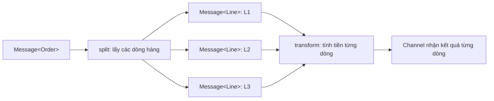

# split trong DSL

Trong module `SPRING_INTEGRATION_CORE`, chương **Java DSL**, `split` giúp chuyển một thông điệp chứa nhiều phần tử thành một luồng thông điệp để xử lý từng phần tử. Bài này nối kiến thức về `Message`, `MessageChannel` và endpoint với một quy trình thực tế: nhận đơn hàng, tách các dòng hàng, tính tiền từng dòng và, khi cần, ghép kết quả về một phản hồi.

Sau bài học, bạn có thể chọn cách khai báo splitter, đọc các header của chuỗi thông điệp, kết hợp splitter với transformer và aggregator, đồng thời giải thích được các tình huống thiếu kết quả, sai thứ tự hoặc phát sinh lỗi giữa chừng.

## 1. Một thông điệp vào, nhiều thông điệp ra

Giả sử hệ thống nhận một đơn hàng có ba dòng:

```text
Order ORD-100
  L1: BOOK,  quantity = 2
  L2: PEN,   quantity = 5
  L3: PAPER, quantity = 1
```

Nếu xử lý cả đơn trong một handler, handler phải tự lặp qua các dòng và tự điều phối mọi thao tác. Khi dùng splitter, mỗi dòng trở thành một đơn vị đi qua các endpoint tiếp theo:



Các mũi tên trong sơ đồ thể hiện nhiều thông điệp, không mặc nhiên thể hiện nhiều luồng thực thi. Có chạy song song hay không còn phụ thuộc channel và executor.

So sánh các thao tác thường gặp trong ví dụ đơn hàng:

| Thao tác | Đơn vị được xử lý | Kết quả mong muốn |
| --- | --- | --- |
| `transform` | Một thông điệp | Đổi `Order` thành `OrderSummary` hoặc thành một payload khác |
| `split` | Một thông điệp chứa nhiều phần | Phát từng `Line` thành thông điệp riêng |
| `route` | Thông điệp hiện tại | Chọn nơi xử lý, chẳng hạn chuyển dòng hàng theo kho |
| `filter` | Thông điệp hiện tại | Cho qua hoặc loại bỏ theo điều kiện |
| `aggregate` | Một nhóm thông điệp | Tạo kết quả chung từ các dòng đã xử lý |

Một transformer trả về `List<Line>` vẫn có thể tạo ra **một** thông điệp mang cả danh sách. Muốn những phần tử trong danh sách tiếp tục đi riêng qua flow, phải có bước splitter.

Không phải trường hợp nào cũng cần tách. Nếu một phép kiểm tra cần toàn bộ đơn hàng hoặc dịch vụ đích hỗ trợ xử lý theo lô hiệu quả hơn, giữ nguyên payload có thể phù hợp hơn. Hãy tách khi từng phần tử cần một vòng xử lý riêng, như chọn kho, gọi dịch vụ, ghi nhận kết quả hoặc thử lại.

## 2. Chọn cú pháp Java DSL

Các ví dụ dùng Java 17 và API Spring Integration **6.2.x**, với `IntegrationFlow.from(...)`. Phiên bản thư viện phải theo dependency management của dự án. Với ứng dụng Spring Boot đã dùng dependency management tương thích, phần dependency chính có thể là:

```xml
<dependency>
    <groupId>org.springframework.boot</groupId>
    <artifactId>spring-boot-starter-integration</artifactId>
</dependency>
```

### 2.1. Payload đã là danh sách: dùng `split()`

```java
@Bean
IntegrationFlow itemFlow() {
    return IntegrationFlow.from("items.input")
            .split()
            .channel("items.output")
            .get();
}
```

Với payload `List.of("BOOK", "PEN", "PAPER")`, đầu ra có ba thông điệp mang ba chuỗi tương ứng. `items.output` trong ví dụ cần được khai báo hoặc nối với consumer phù hợp.

`split()` không tham số tạo `DefaultMessageSplitter`. Splitter hỗ trợ các nguồn như collection, mảng, `Iterable`, `Iterator`, `Stream` và reactive `Publisher`; cách phát thông điệp còn phụ thuộc kiểu nguồn và channel phía sau. Xem [Splitters trong Java DSL](https://docs.spring.io/spring-integration/reference/6.2/dsl/java-splitters.html).

### 2.2. Payload là đối tượng nghiệp vụ: chỉ ra hàm lấy phần tử

Nếu payload là `Order`, splitter cần biết lấy danh sách nào:

```java
.split(Order.class, Order::lines)
```

`Order.class` mô tả kiểu payload mà hàm nhận. `Order::lines` trả về danh sách để splitter phát từng phần tử. Hàm này nên tập trung vào việc xác định các phần; việc tính tiền hoặc gọi kho đặt ở endpoint phía sau.

### 2.3. Cần cấu hình: dùng `splitWith(...)`

```java
.splitWith(spec -> spec
        .expectedType(Order.class)
        .function((Order order) -> order.lines())
        .applySequence(true)
        .discardChannel("orders.empty"))
```

`expectedType(...)` chỉ rõ kiểu đầu vào cho hàm; `function(...)` khai báo cách lấy các phần tử. Hai tùy chọn còn lại phục vụ việc theo dõi chuỗi và xử lý kết quả tách rỗng.

Từ Spring Integration 6.2, overload cấu hình dạng `.split(spec -> ...)` được đánh dấu deprecated, với hướng thay thế là `splitWith(...)`. Điều này không có nghĩa mọi overload mang tên `split` đều deprecated; `split()` và `split(Order.class, Order::lines)` vẫn là các cách khai báo riêng. Xem [API BaseIntegrationFlowDefinition 6.2.11](https://docs.spring.io/spring-integration/docs/6.2.11/api/org/springframework/integration/dsl/BaseIntegrationFlowDefinition.html).

### 2.4. Tách chuỗi theo delimiter

```java
.splitWith(spec -> spec.delimiters(","))
.transform(String.class, String::trim)
```

Ví dụ payload `"BOOK,PEN,PAPER"` tạo các phần tử chuỗi. `delimiters` là các ký tự phân cách, không phải biểu thức chính quy và cũng không thay thế một bộ phân tích CSV có quy tắc dấu nháy. Khi chưa cấu hình delimiter, đừng mong `split()` tự hiểu chuỗi CSV. Xem [DefaultMessageSplitter.setDelimiters](https://docs.spring.io/spring-integration/docs/6.2.11/api/org/springframework/integration/splitter/DefaultMessageSplitter.html#setDelimiters(java.lang.String)).

## 3. Ví dụ đầy đủ: tách đơn hàng và tính tiền từng dòng

Đặt cấu hình sau trong `example.OrderSplitConfiguration`. Cấu hình tự khai báo các channel và có thể được nạp bằng `AnnotationConfigApplicationContext`; không cần web server hoặc hệ thống nhắn tin bên ngoài.

```java
package example;

import java.math.BigDecimal;
import java.util.List;
import java.util.Objects;

import org.springframework.context.annotation.Bean;
import org.springframework.context.annotation.Configuration;
import org.springframework.integration.channel.DirectChannel;
import org.springframework.integration.channel.QueueChannel;
import org.springframework.integration.config.EnableIntegration;
import org.springframework.integration.dsl.IntegrationFlow;

@Configuration
@EnableIntegration
public class OrderSplitConfiguration {

    public record Line(
            String lineId,
            String sku,
            int quantity,
            BigDecimal unitPrice) {
    }

    public record Order(String orderId, List<Line> lines) {
        public Order {
            Objects.requireNonNull(orderId, "orderId");
            lines = List.copyOf(lines);
        }
    }

    public record LineTotal(
            String lineId,
            String sku,
            BigDecimal amount) {
    }

    @Bean("orders.input")
    public DirectChannel ordersInput() {
        return new DirectChannel();
    }

    @Bean("orders.lines")
    public QueueChannel lineResults() {
        return new QueueChannel(100);
    }

    @Bean("orders.empty")
    public QueueChannel emptyOrders() {
        return new QueueChannel(10);
    }

    @Bean
    public IntegrationFlow orderLineFlow() {
        return IntegrationFlow.from("orders.input")
                .enrichHeaders(headers -> headers.headerFunction(
                        "orderId",
                        message -> ((Order) message.getPayload()).orderId()))
                .splitWith(spec -> spec
                        .expectedType(Order.class)
                        .function((Order order) -> order.lines())
                        .applySequence(true)
                        .discardChannel("orders.empty"))
                .transform(Line.class, OrderSplitConfiguration::price)
                .channel("orders.lines")
                .get();
    }

    public static LineTotal price(Line line) {
        BigDecimal amount = line.unitPrice()
                .multiply(BigDecimal.valueOf(line.quantity()));
        return new LineTotal(line.lineId(), line.sku(), amount);
    }
}
```

Các kiểu nghiệp vụ là record; `Order` tạo bản sao danh sách để tránh việc danh sách nguồn bị sửa trong lúc xử lý. `List.copyOf(...)` cũng từ chối danh sách `null` hoặc phần tử `null`. Trong ví dụ, dữ liệu giá và số lượng được giả định đã hợp lệ; quy tắc kiểm tra nghiệp vụ nên được xác định tại nơi tiếp nhận đơn.

Diễn biến của flow:

1. `orders.input` nhận `Message<Order>`.
2. Header enricher đưa mã đơn vào header `orderId`, vì payload sau tách chỉ còn một dòng hàng.
3. Splitter lấy `order.lines()` và phát từng `Message<Line>`.
4. Transformer nhận **một dòng**, trả về **một** `LineTotal`.
5. `orders.lines` giữ các kết quả để consumer hoặc mã kiểm thử nhận bằng `receive(...)`.
6. Nếu đơn không có dòng, splitter chuyển thông điệp yêu cầu tới `orders.empty`.

Với hai dòng `BOOK: 2 × 10.00` và `PEN: 3 × 2.50`, đầu ra là hai payload `LineTotal` có số tiền `20.00` và `7.50`. Đây là hai thông điệp riêng; flow này chưa tạo phản hồi tổng của đơn hàng.

`QueueChannel` cuối flow được dùng làm nơi quan sát kết quả. Trong ứng dụng thực tế cần có consumer để lấy thông điệp ra. Hàng đợi có giới hạn giúp bộc lộ tình trạng consumer chậm, nhưng khi đầy có thể làm phía gửi chờ; phải xác định capacity và thời gian chờ gửi phù hợp.

## 4. Hiểu header sau khi tách

Với `applySequence(true)`, splitter thông thường tạo metadata cho cùng một lần tách:

| Header | Ví dụ với ba dòng | Vai trò |
| --- | --- | --- |
| `correlationId` | `P` cho cả ba dòng | Liên kết các phần thuộc cùng lần tách |
| `sequenceNumber` | `1`, `2`, `3` | Vị trí phần tử trong nguồn tách |
| `sequenceSize` | `3` | Số phần tử khi xác định được kích thước |
| `orderId` | `ORD-100` | Mã nghiệp vụ do ứng dụng bổ sung |

Các hằng tương ứng nằm trong `IntegrationMessageHeaderAccessor`. Có thể đọc chúng theo kiểu rõ ràng:

```java
var accessor = new IntegrationMessageHeaderAccessor(message);
Object correlationId = accessor.getCorrelationId();
int sequenceNumber = accessor.getSequenceNumber();
int sequenceSize = accessor.getSequenceSize();
```

Các header thứ tự mô tả chuỗi, còn `orderId` mô tả nghiệp vụ. Khi tách lồng nhau, `sequenceDetails` lưu thông tin correlation của các tầng. Xem [mô hình Message và các header tích hợp](https://docs.spring.io/spring-integration/reference/6.3/message.html).

Trong trường hợp thông thường, `correlationId` của chuỗi mới lấy từ ID của thông điệp **đi vào splitter**. Ví dụ ở trên có header enricher trước splitter; bước này có thể tạo thông điệp mới. Vì vậy, không nên viết kiểm thử mặc định rằng correlation phải bằng ID của thông điệp mà client ban đầu đã gửi.

Hai lần gửi có cùng `orderId` cũng không mặc nhiên thuộc cùng một nhóm tách. Chẳng hạn, người dùng gửi lại đơn `ORD-100` sau khi sửa giá: mã nghiệp vụ vẫn vậy nhưng đây là hai lần xử lý khác nhau. Nếu chủ động đổi correlation strategy sang `orderId`, cần xác định thêm cách phân biệt lần xử lý để tránh ghép kết quả cũ với kết quả mới.

Nếu trả về các đối tượng payload thông thường, splitter tạo message cho chúng và truyền tiếp các header phù hợp. Khi cần header riêng từng dòng, có thể trả về danh sách `Message<?>` thay vì danh sách payload. Cách này hữu ích cho thông tin như mã kho được chọn cho từng dòng; không cần tự tạo lại các header sequence của framework.

`applySequence(false)` tắt việc splitter bổ sung metadata chuỗi. Chỉ dùng khi hợp đồng phía sau không cần chúng hoặc đã có cơ chế nhóm khác. Tắt tùy chọn này không có nghĩa mọi header sequence tồn tại từ trước đều bị xóa, và cũng không làm flow chạy nhanh hơn theo một mức cố định. Xem [SplitterSpec](https://docs.spring.io/spring-integration/docs/6.2.11/api/org/springframework/integration/dsl/SplitterSpec.html).

## 5. Kết hợp với aggregator để trả một kết quả chung

Một flow kết thúc bằng kết quả từng dòng phù hợp với xử lý từng việc độc lập. Nếu client cần toàn bộ kết quả của đơn, thêm aggregator sau bước xử lý từng dòng.

Aggregator mặc định nhóm theo `correlationId` và dựa vào kích thước chuỗi để quyết định đủ phần tử. Điều đó yêu cầu mỗi dòng của chuỗi tạo được kết quả và giữ metadata cần thiết. Xem [mô hình lập trình Aggregator](https://docs.spring.io/spring-integration/docs/6.1.3/reference/html/aggregator.html).

Để thử riêng luồng tổng hợp, thêm các import sau vào cấu hình ở mục 3:

```java
import java.util.Comparator;

import org.springframework.integration.IntegrationMessageHeaderAccessor;
import org.springframework.messaging.Message;
```

Sau đó thêm hai bean dưới đây. Chúng dùng các tên channel khác với flow nhận kết quả từng dòng:

```java
@Bean("orders.aggregated")
public QueueChannel aggregatedOrders() {
    return new QueueChannel(100);
}

@Bean
public IntegrationFlow orderAggregationFlow() {
    return IntegrationFlow.from("orders.aggregate.input")
            .enrichHeaders(headers -> headers.headerFunction(
                    "orderId",
                    message -> ((Order) message.getPayload()).orderId()))
            .split(Order.class, Order::lines)
            .transform(Line.class, OrderSplitConfiguration::price)
            .aggregate(spec -> spec.outputProcessor(group ->
                    group.getMessages().stream()
                            .sorted(Comparator.comparingInt(
                                    (Message<?> message) ->
                                            new IntegrationMessageHeaderAccessor(message)
                                                    .getSequenceNumber()))
                            .map(Message::getPayload)
                            .map(LineTotal.class::cast)
                            .toList()))
            .channel("orders.aggregated")
            .get();
}
```

DSL tạo channel đầu vào có tên `orders.aggregate.input` khi cần. Gửi một đơn có hai dòng vào channel này sẽ tạo một thông điệp kết quả có payload là danh sách hai `LineTotal`, nhận tại `orders.aggregated`.

Trong output processor, ta chủ động sắp theo `sequenceNumber` để thể hiện hợp đồng trả kết quả theo thứ tự dòng gốc. Nhờ vậy, khi về sau thêm xử lý song song, quy tắc thứ tự vẫn được diễn đạt ngay trong mã tổng hợp.

Có thể tính tổng tiền của đơn ở một transformer phía sau aggregator. Bước tính tổng chỉ được thực hiện khi đã có tập kết quả mà hệ thống chấp nhận là hoàn chỉnh.

Với messaging gateway dạng yêu cầu/phản hồi, nên xác định rõ phương thức trả về một kết quả tổng hợp, chẳng hạn `List<LineTotal>`. Khi muốn trả qua `replyChannel` của gateway, bỏ `.channel("orders.aggregated")` ở cuối ví dụ để kết quả đi theo tuyến phản hồi. Không nên kỳ vọng một phương thức gateway trả về một giá trị sẽ tự gom mọi phản hồi do splitter tạo ra. Đơn rỗng cũng phải có chính sách phản hồi riêng để tránh chỉ chờ hết timeout.

## 6. Khi nào aggregator có thể chờ mãi?

### 6.1. Filter làm mất phần tử sau splitter

Xét chuỗi:

```text
3 dòng -> split -> filter bỏ 1 dòng -> 2 kết quả -> aggregate
```

Nếu metadata vẫn khai báo `sequenceSize = 3`, nhóm chỉ nhận hai kết quả. Về nghiệp vụ có thể đã xử lý xong những dòng cần thiết, nhưng điều kiện đủ nhóm chưa đạt.

Có ba hướng thiết kế, tùy ý nghĩa của việc loại bỏ:

| Ý nghĩa nghiệp vụ | Cách tổ chức |
| --- | --- |
| Dòng không hợp lệ không thuộc yêu cầu xử lý | Lọc danh sách trước khi split để chuỗi phản ánh tập thực sự cần xử lý |
| Client cần biết mọi dòng đã được xét | Mỗi dòng luôn tạo một kết quả như `SUCCESS`, `SKIPPED` hoặc `FAILED` |
| Cho phép kết quả thiếu theo một chính sách đã định | Dùng release strategy và chính sách timeout phù hợp, kèm thông tin kết quả chưa đầy đủ |

Ví dụ một đầu ra nghiệp vụ có thể là:

```java
record LineOutcome(String lineId, String status, String detail) {
}
```

Với đơn ba dòng, aggregator nhận ba `LineOutcome` sẽ dễ thể hiện đầy đủ cả hai dòng thành công lẫn dòng bị từ chối. Việc ghi dòng bị loại vào log không tự bổ sung phần tử còn thiếu cho nhóm.

### 6.2. Nguồn tách không biết trước kích thước

`Collection` thường cho biết số phần tử, còn một `Iterator` thông thường không cung cấp sẵn con số này. Khi không xác định được, `sequenceSize` có thể là `0`; giá trị đó biểu thị kích thước chưa biết. Đừng đọc nó như một nhóm đã hoàn tất mà không có phần tử. Framework có hook `obtainSizeIfPossible(...)` cho các trường hợp xác định được kích thước. Xem [API AbstractMessageSplitter](https://docs.spring.io/spring-integration/docs/6.2.11/api/org/springframework/integration/splitter/AbstractMessageSplitter.html).

Ví dụ cần cân nhắc khi đổi:

```java
.split(Order.class, order -> order.lines().iterator())
```

Trong trường hợp này, dữ liệu vốn đã nằm trong `List`. Đổi thành iterator không giúp giải phóng danh sách ban đầu, nhưng có thể làm mất thông tin kích thước mà splitter lấy được trực tiếp từ collection.

Với nguồn thực sự lớn, có thể cần đọc tuần tự thay vì nạp hết vào bộ nhớ. Khi đó hãy định nghĩa cách nhận biết hoàn tất: tổng số phần tử từ nguồn, thông điệp kết thúc hoặc một release strategy có ý nghĩa nghiệp vụ. Timeout phù hợp để xử lý việc chờ quá lâu; nó không chứng minh rằng tất cả phần tử đã đến.

Nếu nguồn dữ liệu dùng stream gắn với tệp hoặc kết nối, phải xác định vòng đời và cách đóng tài nguyên. Không trả về một stream đã bị đóng trong `try-with-resources` trước khi splitter bắt đầu duyệt nó.

## 7. Danh sách rỗng và kết quả `null`

Hai tình huống này cần được phân biệt:

| Hàm tách trả về | Hành vi cần tính đến |
| --- | --- |
| Danh sách có phần tử | Phát thông điệp cho từng phần tử |
| Container rỗng | Không có thông điệp con; có thể chuyển yêu cầu tới `discardChannel` |
| `null` | Theo mặc định, kết thúc nhánh xử lý; không phải kết quả rỗng để tự chuyển vào discard |

Trong flow ở mục 3, `Order.lines` không thể là `null` vì đã được sao chép bằng `List.copyOf`. Nếu danh sách rỗng, `orders.empty` nhận thông điệp đi vào splitter, có payload `Order`, để hệ thống xử lý riêng. Đây không phải một `Message<Line>` và cũng không phải thông điệp exception.

Khác biệt giữa container rỗng và `null` được mô tả trong [phần Stream and Flux của Splitter](https://docs.spring.io/spring-integration/reference/6.2/splitter.html#_stream_and_flux).

Với bài toán tính tiền, có thể chọn một trong các quy tắc:

- Đơn không có dòng bị từ chối trước khi split.
- Đơn không có dòng được trả về kết quả tổng bằng không qua một nhánh riêng.
- Đơn rỗng được lưu làm trạng thái nháp và không chạy quy trình tính tiền.

Quy tắc phải thể hiện trong hợp đồng của luồng. Không thể chỉ thêm aggregator rồi kỳ vọng nó tự tạo phản hồi cho một nhóm chưa nhận bất kỳ thông điệp con nào.

## 8. Tách phần tử và chạy song song là hai quyết định

Với các channel trực tiếp, việc xử lý thường tiếp tục trên luồng gọi. Splitter phát phần tử đầu, downstream xử lý phần tử đó, rồi quá trình tiếp tục với phần tử sau. `ExecutorChannel` tạo ranh giới thực thi khác; `QueueChannel` cung cấp nơi đệm và cần consumer nhận thông điệp. Xem [các triển khai MessageChannel](https://docs.spring.io/spring-integration/reference/6.2/channel/implementations.html).

Nếu từng dòng phải gọi dịch vụ kho độc lập và có thể thực hiện đồng thời, khai báo executor được Spring quản lý:

```java
@Bean
public ThreadPoolTaskExecutor lineExecutor() {
    var executor = new ThreadPoolTaskExecutor();
    executor.setCorePoolSize(4);
    executor.setMaxPoolSize(4);
    executor.setQueueCapacity(100);
    executor.setThreadNamePrefix("order-line-");
    return executor;
}
```

Import cần thêm là `org.springframework.scheduling.concurrent.ThreadPoolTaskExecutor`. Sau đó, cho phương thức khai báo flow nhận bean này qua tham số và đặt executor channel **sau splitter**:

```java
// lineExecutor là tham số ThreadPoolTaskExecutor của phương thức @Bean.
.split(Order.class, Order::lines)
.channel(channels -> channels.executor(lineExecutor))
.transform(Line.class, OrderSplitConfiguration::price)
```

Nếu đặt executor channel trước splitter, bạn chủ yếu chuyển việc xử lý cả đơn sang luồng khác; điều đó chưa tạo ranh giới song song cho từng dòng phía sau.

Khi thêm concurrency, cần kiểm tra các điểm cụ thể của bài toán:

- Dòng `L3` có thể hoàn tất trước `L1`. Nếu cần trả đúng thứ tự, sắp kết quả theo vị trí gốc.
- Handler phải dùng an toàn khi được gọi đồng thời. Tránh một biến tổng tiền dùng chung cho nhiều đơn.
- Số lời gọi đồng thời phải phù hợp với giới hạn của dịch vụ kho và connection pool.
- Hàng đợi task có giới hạn có thể đầy; cần quyết định xử lý việc từ chối task và tốc độ nhận đơn.
- Giao dịch trên luồng gửi không tự trải rộng qua công việc thực thi trên các luồng khác.

Thêm executor vào một flow không tự tạo cơ chế backpressure hoàn chỉnh cho toàn hệ thống. Hãy xét cả nguồn vào, hàng đợi, mức xử lý và chính sách khi quá tải.

## 9. Xử lý lỗi ở mức từng phần tử

Giả sử gọi kho cho `L1` thành công, `L2` thất bại. Có hai câu hỏi nghiệp vụ riêng: `L1` có cần bù trừ không, và `L3` có được tiếp tục không?

Trong flow đồng bộ qua `DirectChannel`, exception có thể truyền về bên gửi và làm vòng phát các phần tử còn lại dừng lại. Trong xử lý bất đồng bộ do framework điều phối, lỗi thường được đưa vào `ErrorMessage`; nơi nhận lỗi xét header `errorChannel` và cấu hình mặc định. Chỉ thêm header này vào một flow đồng bộ không tự chuyển mọi exception thành xử lý bất đồng bộ. Xem [Error Handling](https://docs.spring.io/spring-integration/docs/6.1.x/reference/html/error-handling.html).

Với đơn hàng, thiết kế tiếp theo có thể là:

1. Retry lời gọi kho tại endpoint xử lý **một dòng**.
2. Sau khi hết số lần thử, tạo `LineOutcome` thất bại nếu yêu cầu là luôn trả đủ kết quả các dòng.
3. Nếu nghiệp vụ bắt buộc toàn bộ đơn thành công, điều phối bù trừ các thao tác đã thực hiện theo hợp đồng của dịch vụ đích.

Retry cả thông điệp `Order` sau splitter có thể làm các dòng đã thành công bị xử lý lần nữa. Ví dụ lần đầu đã trừ tồn cho `L1`, nhưng toàn đơn được gửi lại do `L2` lỗi. Vì vậy, thao tác kho nên có khóa chống trùng phù hợp như `orderId + lineId + operationId`, trong đó `operationId` được giữ ổn định qua các lần thử lại của cùng một thao tác.

Không dùng `sequenceNumber` một mình làm khóa chống trùng: nhiều đơn đều có dòng số 1. Cũng không mặc nhiên dùng `correlationId` do splitter sinh cho mục đích chống trùng nghiệp vụ, vì một lần gửi mới có thể tạo một chuỗi mới.

Việc ghi lỗi vào channel giám sát không tự tạo kết quả cho aggregator. Nếu chọn trả đủ kết quả, nhánh phục hồi phải tạo đầu ra nghiệp vụ và giữ các header nhóm tương ứng.

## 10. Kiểm thử hợp đồng tách thông điệp

Các kiểm thử dưới đây minh họa cách kiểm tra đầu ra thực sự của splitter cùng transformer. Chúng dùng cấu hình nguyên bản ở mục 3, JUnit Jupiter và có thể chạy trong dự án đã cấu hình dependency kiểm thử tương ứng. Đặt lớp kiểm thử trong package `example`.

```java
package example;

import java.math.BigDecimal;
import java.util.List;

import example.OrderSplitConfiguration.Line;
import example.OrderSplitConfiguration.LineTotal;
import example.OrderSplitConfiguration.Order;

import org.junit.jupiter.api.Test;
import org.springframework.context.annotation.AnnotationConfigApplicationContext;
import org.springframework.integration.IntegrationMessageHeaderAccessor;
import org.springframework.messaging.Message;
import org.springframework.messaging.MessageChannel;
import org.springframework.messaging.PollableChannel;
import org.springframework.messaging.support.MessageBuilder;

import static org.junit.jupiter.api.Assertions.*;

class OrderSplitFlowTest {

    @Test
    void emitsOneResultPerLineAndKeepsSequenceHeaders() {
        try (var context = new AnnotationConfigApplicationContext(
                OrderSplitConfiguration.class)) {
            var input = context.getBean("orders.input", MessageChannel.class);
            var output = context.getBean("orders.lines", PollableChannel.class);

            var order = new Order("ORD-100", List.of(
                    new Line("L1", "BOOK", 2, new BigDecimal("10.00")),
                    new Line("L2", "PEN", 3, new BigDecimal("2.50"))));

            assertTrue(input.send(MessageBuilder.withPayload(order).build()));

            Message<?> first = output.receive(1_000);
            Message<?> second = output.receive(1_000);
            assertNotNull(first);
            assertNotNull(second);
            assertNull(output.receive(0));

            assertEquals(new LineTotal("L1", "BOOK", new BigDecimal("20.00")),
                    first.getPayload());
            assertEquals(new LineTotal("L2", "PEN", new BigDecimal("7.50")),
                    second.getPayload());

            var firstHeaders = new IntegrationMessageHeaderAccessor(first);
            var secondHeaders = new IntegrationMessageHeaderAccessor(second);
            assertNotNull(firstHeaders.getCorrelationId());
            assertEquals(firstHeaders.getCorrelationId(),
                    secondHeaders.getCorrelationId());
            assertEquals(1, firstHeaders.getSequenceNumber());
            assertEquals(2, secondHeaders.getSequenceNumber());
            assertEquals(2, firstHeaders.getSequenceSize());
            assertEquals(2, secondHeaders.getSequenceSize());
            assertEquals("ORD-100", first.getHeaders().get("orderId"));
            assertEquals("ORD-100", second.getHeaders().get("orderId"));
        }
    }

    @Test
    void sendsAnEmptyOrderToTheDiscardChannel() {
        try (var context = new AnnotationConfigApplicationContext(
                OrderSplitConfiguration.class)) {
            var input = context.getBean("orders.input", MessageChannel.class);
            var output = context.getBean("orders.lines", PollableChannel.class);
            var empty = context.getBean("orders.empty", PollableChannel.class);
            var order = new Order("ORD-EMPTY", List.of());

            assertTrue(input.send(MessageBuilder.withPayload(order).build()));

            assertNull(output.receive(0));
            Message<?> discarded = empty.receive(1_000);
            assertNotNull(discarded);
            assertEquals(order, discarded.getPayload());
            assertEquals("ORD-EMPTY", discarded.getHeaders().get("orderId"));
            assertNull(empty.receive(0));
        }
    }
}
```

Kiểm thử đầu xác minh số thông điệp, số tiền và metadata đã đi qua transformer. Kiểm thử thứ hai xác minh đơn rỗng đi đúng nhánh, với payload vẫn là `Order`.

Khi mở rộng sang aggregator hoặc executor, bổ sung các tình huống có ý nghĩa cho hợp đồng mới:

| Tình huống | Kết quả cần kiểm tra |
| --- | --- |
| Hai lần gửi có cùng mã đơn | Không ghép lẫn hai lần xử lý khi dùng correlation mặc định |
| Các dòng hoàn tất lệch thứ tự | Kết quả chung vẫn theo thứ tự đã cam kết |
| Một dòng không hợp lệ | Có đầu ra từ chối hoặc chính sách kết thúc nhóm rõ ràng |
| Một dòng lỗi sau retry | Không để nhóm treo ngoài chính sách; không lặp tác động đã thành công |
| Nguồn có kích thước chưa biết | Điều kiện hoàn tất thực sự hoạt động, thay vì chỉ dựa vào size mặc định |

Với flow bất đồng bộ, dùng cơ chế chờ có thời hạn để nhận kết quả. Tránh kiểm tra rằng phần tử đầu tiên đến phải là phần tử đầu trong đơn khi đã cho phép các tác vụ hoàn tất khác thứ tự.

## 11. Theo dõi và chẩn đoán một flow có splitter

Trong ví dụ đơn hàng, một bản ghi chẩn đoán hữu ích nên có `orderId`, `lineId`, `correlationId`, `sequenceNumber`, `sequenceSize`, tên endpoint và kết quả xử lý. Không nhất thiết ghi toàn bộ payload để xác định một dòng đang bị kẹt ở đâu.

| Hiện tượng | Điều cần kiểm tra trước |
| --- | --- |
| Downstream vẫn nhận cả danh sách | Có đang dùng transformer thay cho splitter hoặc lấy sai thuộc tính không? |
| Không thấy kết quả của đơn rỗng | Đã xác định nhánh discard hoặc nhánh trả kết quả rỗng chưa? |
| Aggregator không trả kết quả | Thiếu dòng, mất header, size chưa biết hay correlation bị thay đổi? |
| Kết quả thay đổi thứ tự | Có executor, poller hoặc dịch vụ ngoài hoàn tất lệch thứ tự không? |
| Một dòng bị xử lý nhiều lần | Retry hoặc gửi lại đang áp dụng ở cấp dòng hay cấp toàn đơn? |
| Luồng gửi bị chậm hoặc đứng chờ | Consumer có lấy dữ liệu khỏi queue không, queue và executor có đầy không? |
| Bộ nhớ tăng khi tách lô lớn | Đang giữ danh sách nguồn, hàng đợi kết quả hay nhóm aggregator chưa hoàn tất? |

Khi một đơn có hàng trăm nghìn dòng, chi phí không chỉ nằm ở hàm tách. Mỗi dòng tạo thêm message, công việc và dữ liệu theo dõi; một aggregator còn có thể giữ mọi kết quả tới khi đủ nhóm. Có thể cân nhắc chia thành các lô nhỏ trước, rồi xử lý từng lô theo hợp đồng riêng. Khi tách theo lô, `sequenceSize` của tầng đó là số lô, không phải tổng số dòng bên trong tất cả các lô.

Một flow dễ vận hành cần trả lời được bốn câu hỏi cụ thể: đơn này tạo những phần nào, mỗi phần kết thúc ra sao, điều kiện nào cho biết đơn đã xong, và khi gửi lại thì thao tác nào được phép lặp. Các câu trả lời đó quyết định vị trí của splitter, loại channel, đầu ra lỗi và cách tổng hợp kết quả.
