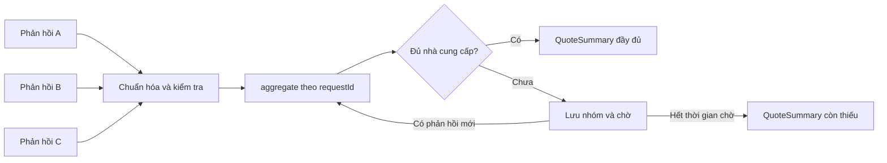

# aggregate trong DSL

Trong module `SPRING_INTEGRATION_CORE`, `aggregate` là bước giúp ghép nhiều thông điệp liên quan thành một kết quả chung. Đây là thành phần quan trọng khi thiết kế luồng xử lý đơn hàng, gom báo giá, hợp nhất kết quả của nhiều dịch vụ hoặc kết thúc một chuỗi `split → xử lý từng phần → aggregate`.

Bài học thuộc chương **Java DSL**, tập trung vào cách khai báo aggregator bằng `IntegrationFlow` và cách xác định ba quy tắc: **gom theo khóa nào, khi nào phát kết quả, kết quả có cấu trúc gì**. Ví dụ sử dụng Java 17 và API Spring Integration 6.5. Dự án cần có `spring-integration-core`; phần kiểm thử dùng JUnit Jupiter. Phiên bản thư viện nên được quản lý thống nhất theo cấu hình phụ thuộc của dự án.

## 1. Aggregator nhận nhiều message nhưng tạo một kết quả

Giả sử một yêu cầu lấy báo giá có mã `REQ-101` được gửi đến ba nhà cung cấp A, B và C. Mỗi nhà cung cấp trả về một message riêng:

| Lần nhận | Mã yêu cầu | Nhà cung cấp | Giá |
| --- | --- | --- | --- |
| 1 | REQ-101 | B | 125000 |
| 2 | REQ-202 | A | 118000 |
| 3 | REQ-101 | A | 120000 |
| 4 | REQ-101 | C | 123000 |

Sau lần nhận thứ tư, nhóm `REQ-101` có đủ A, B và C để tạo kết quả. Nhóm `REQ-202` vẫn chờ các phản hồi còn lại. Việc thông điệp của các yêu cầu đến xen kẽ không làm thay đổi tiêu chí gom nhóm.

`aggregate` tạo một endpoint có trạng thái, được xử lý bởi `AggregatingMessageHandler`. Nó giữ các message trong `MessageGroupStore` và hỏi `ReleaseStrategy` xem nhóm đã có thể phát kết quả hay chưa. Vì có bước lưu trạng thái, aggregator cần được thiết kế cả vòng đời nhóm, thay vì chỉ có hàm tính kết quả. [Tài liệu Aggregator](https://docs.spring.io/spring-integration/reference/6.5/aggregator.html).

`transform` phù hợp để đổi một phản hồi từ định dạng bên ngoài sang `QuoteReply`. `filter` kiểm tra phản hồi có hợp lệ. `router` có thể phân loại kết quả đủ hoặc thiếu. `aggregate` đứng ở vị trí kết hợp các phản hồi đã chuẩn hóa này.



## 2. Ba quy tắc cần tách rõ trong Java DSL

Có thể đọc một cấu hình aggregator theo ba câu hỏi:

| Câu hỏi | API thường dùng | Đầu vào của logic |
| --- | --- | --- |
| Message thuộc nhóm nào? | `correlationStrategy(...)` hoặc `correlationExpression(...)` | Một `Message<?>` |
| Nhóm đã đủ điều kiện phát chưa? | `releaseStrategy(...)` hoặc `releaseExpression(...)` | Một `MessageGroup` |
| Kết quả của nhóm là gì? | `outputProcessor(...)` hoặc `outputExpression(...)` | Một `MessageGroup` |

Ví dụ cấu hình dưới đây minh họa hình dạng API; `input` và `output` là tên channel cần có trong ứng dụng:

```java
@Bean
IntegrationFlow batches() {
    return IntegrationFlow.from("input")
            .aggregate(a -> a
                    .correlationExpression("headers['batchId']")
                    .releaseExpression("size() >= 3")
                    .outputExpression("messages.![payload]"))
            .channel("output")
            .get();
}
```

`correlationExpression` được đánh giá trên từng message, vì vậy có thể truy cập `headers` hoặc `payload`. `releaseExpression` và `outputExpression` làm việc trên nhóm; `size()` là số message trong nhóm, còn `messages` là tập message của nhóm.

Biểu thức `messages.![payload]` là phép chiếu SpEL để lấy payload của từng message. Nó không sắp xếp kết quả theo thứ tự nghiệp vụ.

`releaseExpression("size() >= 3")` chỉ đúng với hợp đồng “mỗi nhóm kết thúc sau ít nhất ba message”. Nếu hai message cùng đến từ A và một message đến từ B, điều kiện này vẫn đạt. Khi yêu cầu là đủ **ba nhà cung cấp khác nhau**, cần kiểm tra danh tính nhà cung cấp.

Lambda phù hợp cho quy tắc có kiểu dữ liệu, nhiều điều kiện và cần kiểm thử độc lập. SpEL thuận tiện cho biểu thức ngắn. Các phương thức cấu hình tương ứng được cung cấp bởi `AggregatorSpec` và `CorrelationHandlerSpec`. [API AggregatorSpec](https://docs.spring.io/spring-integration/docs/6.5.0/api/org/springframework/integration/dsl/AggregatorSpec.html), [API CorrelationHandlerSpec](https://docs.spring.io/spring-integration/docs/6.5.0/api/org/springframework/integration/dsl/CorrelationHandlerSpec.html).

## 3. Khi nào có thể dùng aggregate() mặc định?

Khi đầu vào được tách từ một danh sách hữu hạn, cấu hình thường bắt đầu rất ngắn. Đặt các bean sau trong một lớp `@Configuration` đã bật `@EnableIntegration`:

```java
@Bean
QueueChannel doubledBatches() {
    return new QueueChannel();
}

@Bean
IntegrationFlow doubleEachNumber() {
    return IntegrationFlow.from("numbersInput")
            .split()
            .<Integer, Integer>transform(number -> number * 2)
            .aggregate()
            .channel("doubledBatches")
            .get();
}
```

Gửi một message có payload `List.of(1, 2, 3)` vào `numbersInput` sẽ tạo ba message con. Sau khi từng số được nhân đôi, aggregator tạo một message có payload chứa các giá trị `2`, `4` và `6`.

Splitter thường bổ sung các header:

| Header | Ý nghĩa |
| --- | --- |
| `correlationId` | Liên kết các message thuộc cùng lần tách |
| `sequenceNumber` | Vị trí của phần trong chuỗi |
| `sequenceSize` | Số phần dự kiến |

Các endpoint xử lý giữa splitter và aggregator cần giữ thông tin liên kết này. Với splitter dựa trên `Iterator` không xác định được số phần, `sequenceSize` có thể bằng `0`; khi đó phải có quy tắc release hoặc timeout phù hợp. Một danh sách rỗng cũng không tự tạo nhóm để aggregator phát kết quả rỗng. [Tài liệu Splitter](https://docs.spring.io/spring-integration/reference/6.5/splitter.html).

Với cấu hình thông thường, aggregator mặc định gom theo `correlationId` và tạo kết quả chứa tập payload. `aggregate()` không thay thế resequencer. Nếu thứ tự phần tử có ý nghĩa, hãy sắp xếp bằng khóa nghiệp vụ trong output processor, hoặc dùng `resequence()` trước khi gom. [Aggregators and Resequencers trong Java DSL](https://docs.spring.io/spring-integration/reference/6.5/dsl/java-aggregators.html).

Đặc biệt, `SimpleSequenceSizeReleaseStrategy` so sánh số message với `sequenceSize` và không kiểm tra trùng `sequenceNumber`. Không dùng nó như cơ chế khử trùng nghiệp vụ. [API SimpleSequenceSizeReleaseStrategy](https://docs.spring.io/spring-integration/docs/6.5.0/api/org/springframework/integration/aggregator/SimpleSequenceSizeReleaseStrategy.html).

Nếu một filter loại mất một phần sau khi splitter đã xác định kích thước, aggregator có thể chờ mãi phần đó. Có ba cách thiết kế thường gặp:

- Lọc danh sách trước khi tách, nếu đã biết phần nào không cần xử lý.
- Giữ một phản hồi thể hiện thất bại hoặc không có dữ liệu cho từng phần.
- Chấp nhận kết quả thiếu sau timeout, đồng thời thể hiện rõ phần còn thiếu.

Lựa chọn phụ thuộc hợp đồng kết quả của luồng, không nên chỉ sửa số đếm để làm nhóm được giải phóng.

## 4. Thiết kế khóa nhóm và điều kiện release

### 4.1. Khóa nhóm phải đại diện cho một lần tổng hợp

Trong bài toán báo giá, `requestId` định danh một lần yêu cầu báo giá. Hai lần yêu cầu cho cùng đơn hàng cần hai `requestId` khác nhau nếu kết quả của chúng độc lập.

Ví dụ:

```text
orderId = ORDER-10, requestId = REQ-101
orderId = ORDER-10, requestId = REQ-102
```

Nếu gom bằng `orderId` trong trường hợp này, phản hồi của hai lần gọi có thể vào cùng nhóm. Khi có nhiều khách hàng hoặc tenant, khóa có thể cần thêm phạm vi như `tenantId + ":" + requestId`.

Khóa cần ổn định, không rỗng, và có hành vi `equals`/`hashCode` phù hợp. Hãy kiểm tra dữ liệu trước aggregator; đừng thay khóa thiếu bằng một hằng như `"unknown"` vì sẽ trộn các yêu cầu không liên quan.

Một message có header `businessRequestId` không có nghĩa aggregator mặc định sẽ tự dùng header đó. Cần khai báo rõ:

```java
.correlationExpression("headers['businessRequestId']")
```

Hoặc đọc từ payload đã chuẩn hóa:

```java
.correlationStrategy(message ->
        ((QuoteReply) message.getPayload()).requestId())
```

### 4.2. Release cần biểu diễn “đủ” theo nghiệp vụ

Trong ví dụ này, tập cần chờ là `{A, B, C}`. Điều kiện thích hợp là tập provider đã nhận chứa cả ba giá trị.

Với dữ liệu `A, A, B`:

```text
Số message:             3
Số provider khác nhau:  2
Provider còn thiếu:     C
Có được release không: Không
```

Việc đếm provider khác nhau ngăn nhóm được phát quá sớm, nhưng không loại các bản sao khỏi store. Nếu một provider gửi lại liên tục, dữ liệu lưu vẫn tăng cho đến khi nhóm hoàn tất hoặc được xử lý hết hạn. Hệ thống có lượng bản sao lớn nên khử trùng trước aggregator bằng khóa sự kiện phù hợp.

Release strategy nên chỉ đọc trạng thái để ra quyết định. Tránh gọi HTTP, cập nhật cơ sở dữ liệu nghiệp vụ hoặc thay đổi nhóm ngay trong điều kiện release. Những tác vụ đó làm quyết định khó lặp lại và kéo dài thời gian xử lý của nhóm.

## 5. Ví dụ đầy đủ: gom báo giá theo requestId

Ví dụ có các quy tắc:

1. Chỉ chấp nhận payload `QuoteReply` với mã yêu cầu hợp lệ, provider A/B/C và giá không âm.
2. Gom theo `requestId`.
3. Phát ngay khi đã có đủ A, B và C.
4. Nếu không có phản hồi mới trong một giây, phát những báo giá đã có và liệt kê provider còn thiếu.
5. Giữ dấu nhóm đã hoàn tất trong 60 giây để loại thông điệp đến muộn trong khoảng này.

Để đơn giản, giá của một provider cho một `requestId` là bất biến. Bản sao lặp được phép có cùng giá; phản hồi đổi giá cho cùng khóa được xem là dữ liệu mâu thuẫn.

Lưu lớp sau trong package của ứng dụng:

```java
package sample.integration;

import java.math.BigDecimal;
import java.util.List;
import java.util.Map;
import java.util.Set;
import java.util.TreeMap;
import java.util.TreeSet;
import java.util.stream.Collectors;

import org.springframework.beans.factory.annotation.Qualifier;
import org.springframework.context.annotation.Bean;
import org.springframework.context.annotation.Configuration;
import org.springframework.integration.channel.DirectChannel;
import org.springframework.integration.channel.QueueChannel;
import org.springframework.integration.config.EnableIntegration;
import org.springframework.integration.dsl.IntegrationFlow;
import org.springframework.integration.store.MessageGroup;
import org.springframework.integration.store.MessageGroupStore;
import org.springframework.integration.store.SimpleMessageStore;

@Configuration
@EnableIntegration
public class QuoteAggregationConfig {

    private static final Set<String> EXPECTED_PROVIDERS =
            Set.of("A", "B", "C");

    public record QuoteReply(
            String requestId,
            String provider,
            BigDecimal amount) {
    }

    public record QuoteSummary(
            String requestId,
            List<QuoteReply> quotes,
            Set<String> missingProviders) {

        public boolean complete() {
            return missingProviders.isEmpty();
        }
    }

    @Bean
    public DirectChannel quoteReplies() {
        return new DirectChannel();
    }

    @Bean
    public QueueChannel quoteSummaries() {
        return new QueueChannel();
    }

    @Bean
    public QueueChannel quoteDiscards() {
        return new QueueChannel();
    }

    @Bean
    public MessageGroupStore quoteGroupStore() {
        return new SimpleMessageStore();
    }

    @Bean
    public IntegrationFlow quoteAggregationFlow(
            @Qualifier("quoteGroupStore") MessageGroupStore store) {

        return IntegrationFlow.from("quoteReplies")
                .<QuoteReply>filter(
                        QuoteAggregationConfig::validReply,
                        filter -> filter.discardChannel("quoteDiscards"))
                .aggregate(aggregator -> aggregator
                        .id("quoteAggregator")
                        .messageStore(store)
                        .correlationStrategy(message ->
                                ((QuoteReply) message.getPayload()).requestId())
                        .releaseStrategy(group ->
                                providers(group).containsAll(EXPECTED_PROVIDERS))
                        .outputProcessor(QuoteAggregationConfig::summarize)
                        .groupTimeout(1_000)
                        .sendPartialResultOnExpiry(true)
                        .expireGroupsUponCompletion(false)
                        .expireGroupsUponTimeout(false)
                        .minimumTimeoutForEmptyGroups(60_000)
                        .discardChannel("quoteDiscards"))
                .channel("quoteSummaries")
                .get();
    }

    private static boolean validReply(QuoteReply reply) {
        return reply.requestId() != null
                && !reply.requestId().isBlank()
                && reply.provider() != null
                && EXPECTED_PROVIDERS.contains(reply.provider())
                && reply.amount() != null
                && reply.amount().signum() >= 0;
    }

    private static Set<String> providers(MessageGroup group) {
        return group.getMessages().stream()
                .map(message -> (QuoteReply) message.getPayload())
                .map(QuoteReply::provider)
                .collect(Collectors.toSet());
    }

    private static QuoteSummary summarize(MessageGroup group) {
        Map<String, QuoteReply> byProvider = new TreeMap<>();

        for (var message : group.getMessages()) {
            QuoteReply reply = (QuoteReply) message.getPayload();

            byProvider.merge(reply.provider(), reply, (previous, current) -> {
                if (previous.amount().compareTo(current.amount()) != 0) {
                    throw new IllegalArgumentException(
                            "Conflicting quotes for request "
                                    + current.requestId()
                                    + ", provider " + current.provider());
                }
                return previous;
            });
        }

        List<QuoteReply> quotes = List.copyOf(byProvider.values());
        Set<String> missing = new TreeSet<>(EXPECTED_PROVIDERS);
        missing.removeAll(byProvider.keySet());

        return new QuoteSummary(
                quotes.get(0).requestId(),
                quotes,
                Set.copyOf(missing));
    }
}
```

### 5.1. Vai trò của từng thành phần

`quoteReplies` là `DirectChannel` nhận phản hồi đã chuyển thành `QuoteReply`. Cấu hình này giả định kiểu payload đã được xác thực tại biên; nếu payload mang kiểu khác, việc xử lý có thể phát sinh lỗi thay vì đi vào nhánh filter loại bỏ.

Filter loại các giá trị sai hợp đồng trước khi chúng được đưa vào nhóm. Ví dụ này dùng chung `quoteDiscards` cho dữ liệu bị filter loại và message đến muộn; khi cần thống kê nguyên nhân riêng, có thể tách hai kênh.

`quoteGroupStore` được tiêm trực tiếp vào aggregator để làm rõ nơi lưu trạng thái. `SimpleMessageStore` lưu trong bộ nhớ, thích hợp cho ví dụ; dữ liệu chưa hoàn tất không tồn tại qua lần khởi động lại ứng dụng. [API SimpleMessageStore](https://docs.spring.io/spring-integration/docs/6.5.0/api/org/springframework/integration/store/SimpleMessageStore.html).

`providers(group)` kiểm tra các provider khác nhau để quyết định release. `summarize(group)` tạo kết quả mới, sắp các báo giá theo tên provider và không giữ tham chiếu đến collection nội bộ của nhóm.

Bản sao của cùng provider không được nhân đôi trong `quotes`. Nếu hai bản sao có giá khác nhau, output processor ném lỗi. Đây là phát hiện vi phạm hợp đồng, chưa phải cơ chế khôi phục nhóm; hệ thống thực tế cần chính sách xử lý dữ liệu mâu thuẫn trước khi ghi trạng thái hoặc một quy trình khôi phục rõ ràng.

### 5.2. Kết quả đầy đủ và kết quả còn thiếu

Với dữ liệu:

```text
REQ-101 / B / 125000
REQ-101 / A / 120000
REQ-101 / C / 123000
```

Kết quả có dạng:

```text
QuoteSummary(
    requestId = REQ-101,
    quotes = [A:120000, B:125000, C:123000],
    missingProviders = []
)
complete() = true
```

Nếu chỉ có A rồi hết thời gian chờ:

```text
QuoteSummary(
    requestId = REQ-101,
    quotes = [A:120000],
    missingProviders = [B, C]
)
complete() = false
```

`missingProviders` là một tập nên không có hợp đồng thứ tự khi hiển thị. Hãy sắp xếp riêng nếu cần trình bày giao diện hoặc ghi log ổn định.

Nếu không có nhà cung cấp nào phản hồi, aggregator chưa từng nhận message cho yêu cầu đó nên không có nhóm để timeout. Trường hợp “không có phản hồi nào” cần được theo dõi ở nơi khởi tạo yêu cầu hoặc bằng một cơ chế quản lý yêu cầu riêng.

## 6. Timeout: tính từ lúc nào và phát gì?

### 6.1. groupTimeout(long) là khoảng chờ không có message mới

`groupTimeout(1_000)` đặt thời gian chờ một giây cho từng nhóm. Với nhóm chưa được release, lịch chờ được tính lại khi có message mới vào nhóm. Nó không biểu diễn một deadline cố định kể từ khi gửi yêu cầu ra ngoài.

Khi timeout chạy, release strategy được hỏi lại. Nếu vẫn chưa đủ điều kiện, `sendPartialResultOnExpiry(true)` cho phép output processor tạo kết quả từ phần đã nhận; đặt `false` thì phần này bị loại và có thể chuyển đến discard channel. [Aggregator and Group Timeout](https://docs.spring.io/spring-integration/reference/6.5/aggregator.html#agg-and-group-to).

Ví dụ nhóm chưa có C:

| Thời điểm | Sự kiện | Hành vi |
| --- | --- | --- |
| 0 ms | Nhận A | Chờ thêm, dự kiến timeout sau 1000 ms |
| 600 ms | Nhận B | Chưa đủ; lịch chờ chuyển sang khoảng 1600 ms |
| 1200 ms | Nhận bản sao A | Vẫn thiếu C; lịch chờ chuyển sang khoảng 2200 ms |
| Khoảng 2200 ms | Không có message mới | Phát kết quả thiếu C |

Thời điểm thực thi còn phụ thuộc scheduler và tải hệ thống. Bản sao liên tục có thể kéo dài thời gian chờ, nên chính sách khử trùng và deadline cần được xem cùng nhau.

Chỉ bật `sendPartialResultOnExpiry(true)` không tự tạo một bộ đếm thời gian. Phải có `groupTimeout` hoặc cơ chế làm hết hạn nhóm khác.

### 6.2. Nếu cần deadline theo thời điểm tạo nhóm

Có thể thay dòng `groupTimeout(1_000)` bằng một hàm trả về thời điểm tuyệt đối:

```java
.groupTimeout(group ->
        new java.util.Date(group.getTimestamp() + 5_000))
```

Dòng này đặt mốc dự kiến bằng thời điểm nhóm được tạo cộng năm giây. Message mới không tiếp tục đẩy deadline thêm năm giây. API cho phép kết quả timeout là `Date` để mô tả mốc tuyệt đối. [Group timeout với thời điểm tuyệt đối](https://docs.spring.io/spring-integration/reference/7.0/aggregator.html).

Thời điểm tạo nhóm vẫn là khi aggregator thấy phản hồi đầu tiên. Nếu SLA bắt đầu ngay từ lúc tiếp nhận yêu cầu, cần mang theo deadline được xác định ở đầu luồng, kiểm tra tính nhất quán của nó giữa các phản hồi, rồi dùng deadline đó để quyết định thời gian chờ.

Một lựa chọn khác là `MessageGroupStoreReaper`: chạy định kỳ để yêu cầu store xử lý các nhóm quá hạn. Reaper cần được lập lịch gọi `run()`; việc tạo bean đơn thuần không đồng nghĩa đã có lịch chạy định kỳ. [API MessageGroupStoreReaper](https://docs.spring.io/spring-integration/docs/6.5.0/api/org/springframework/integration/store/MessageGroupStoreReaper.html).

## 7. Nhóm hoàn tất, nhóm bị xóa và message đến muộn

Phát kết quả không nhất thiết đồng nghĩa xóa mọi dấu vết của nhóm. Giữ một nhóm rỗng đã hoàn tất giúp nhận biết message đến muộn có cùng khóa.

| Tùy chọn trong ví dụ | Mục đích |
| --- | --- |
| `expireGroupsUponCompletion(false)` | Giữ dấu nhóm sau khi release bình thường |
| `expireGroupsUponTimeout(false)` | Giữ dấu nhóm sau khi kết thúc do timeout |
| `minimumTimeoutForEmptyGroups(60_000)` | Đặt khoảng giữ nhóm rỗng trước khi dọn |
| `discardChannel("quoteDiscards")` | Nhận message bị loại bởi aggregator |

`expireGroupsUponCompletion` mặc định là `false`, còn `expireGroupsUponTimeout` mặc định là `true`. Vì vậy, chỉ đặt tùy chọn thứ nhất chưa đủ để giữ dấu nhóm kết thúc bằng timeout. [Vòng đời nhóm trong Aggregator](https://docs.spring.io/spring-integration/reference/6.3/aggregator.html).

`minimumTimeoutForEmptyGroups` làm việc với cơ chế dọn nhóm rỗng; trong cấu hình có `groupTimeout`, framework có thể lập lịch dọn sau khi nhóm được release. Khi trạng thái này đã bị xóa, message mang lại cùng correlation key có thể tạo nhóm mới. [API AbstractCorrelatingMessageHandler](https://docs.spring.io/spring-integration/docs/6.5.0/api/org/springframework/integration/aggregator/AbstractCorrelatingMessageHandler.html).

Trong ví dụ, khoảng giữ dấu là một phút. Đây là lựa chọn minh họa, không phải bảo đảm “mỗi yêu cầu chỉ tạo đúng một kết quả mãi mãi”. Sau khoảng dọn nhóm, bản sao rất muộn có thể tạo nhóm và kết quả mới.

Khi triển khai, cần thống nhất:

- Khoảng trễ tối đa còn chấp nhận của phản hồi.
- Thời gian giữ dấu nhóm và chi phí lưu trạng thái.
- Quy tắc có được tái sử dụng `requestId` hay không.
- Cách consumer nhận kết quả xử lý bản sao hoặc kết quả phát lại.

Giữ dấu nhóm và xử lý idempotency ở đầu ra giải quyết những phạm vi khác nhau. Một endpoint có thể phát lại kết quả nếu lỗi xảy ra giữa các bước lưu, gửi và xác nhận; cần đánh giá toàn bộ đường đi của dữ liệu trước khi đưa ra bảo đảm giao nhận.

## 8. Payload và header sau khi aggregate

Output processor mặc định tạo một kết quả chứa collection payload. Với ví dụ báo giá, `outputProcessor` được thay bằng hàm tạo `QuoteSummary` để consumer không phải tự hiểu tập message nội bộ. [API DefaultAggregatingMessageGroupProcessor](https://docs.spring.io/spring-integration/api/org/springframework/integration/aggregator/DefaultAggregatingMessageGroupProcessor.html).

Header đầu ra cũng cần được thiết kế. Cơ chế hợp nhất mặc định giữ các header không mâu thuẫn và bỏ các header có giá trị khác nhau giữa các message. Vì vậy, không nên giả định header `provider` của một phản hồi sẽ đại diện cho cả nhóm. [API DefaultAggregateHeadersFunction](https://docs.spring.io/spring-integration/docs/6.5.0/api/org/springframework/integration/aggregator/DefaultAggregateHeadersFunction.html).

Có thể cấu hình `headersFunction(...)` khi cần header tổng hợp riêng, hoặc trả về một `Message<?>` có các header được xây dựng có chủ đích. Khi tự xây dựng message, phải quyết định rõ những header nào cần giữ cho luồng tiếp theo.

Những dữ liệu có ý nghĩa đối với consumer như `requestId`, danh sách báo giá và provider còn thiếu được đưa vào payload trong ví dụ. Cách này giúp kết quả tự mô tả và không phụ thuộc vào việc một header kỹ thuật còn tồn tại hay không.

Với các luồng splitter lồng nhau, `popSequence` hỗ trợ tháo lớp thông tin sequence tương ứng khi tổng hợp. Không nên tự tắt tùy chọn này chỉ để giữ một header correlation cho mục đích nghiệp vụ. Hãy dùng header riêng hoặc trường trong payload để theo dõi yêu cầu. [API CorrelationHandlerSpec: popSequence](https://docs.spring.io/spring-integration/docs/6.5.0/api/org/springframework/integration/dsl/CorrelationHandlerSpec.html#popSequence(boolean)).

## 9. Xử lý lỗi ở đâu?

Cần phân biệt các tình huống:

| Tình huống | Hành vi mong muốn trong ví dụ |
| --- | --- |
| Giá âm, requestId rỗng, provider ngoài danh sách | Filter gửi message đến `quoteDiscards` |
| Message đến cho nhóm đã hoàn tất còn được giữ | Aggregator gửi đến `quoteDiscards` |
| Nhóm thiếu provider sau timeout | Phát `QuoteSummary` có `missingProviders` |
| Hai giá khác nhau cho cùng request/provider | Output processor phát sinh exception |

`discardChannel` không tự trở thành nơi nhận mọi exception.

Trong cấu hình dùng `DirectChannel`, lỗi trên nhánh xử lý đồng bộ có thể truyền về lời gọi `send(...)`. Lỗi khi release do timeout xuất hiện trên luồng scheduler; nếu dùng scheduler tùy chỉnh và muốn đưa lỗi thành `ErrorMessage`, cần cấu hình `MessagePublishingErrorHandler` phù hợp. [Tài liệu Error Handling](https://docs.spring.io/spring-integration/reference/6.5/error-handling.html).

Một router sau aggregator có thể phân loại kết quả theo `QuoteSummary.complete()` để đưa vào hai nhánh nghiệp vụ. Đây là quyết định khác với xử lý exception: kết quả còn thiếu đã được mô hình hóa thành dữ liệu hợp lệ, còn dữ liệu báo giá mâu thuẫn là lỗi hợp đồng.

Nếu consumer phía sau thực hiện gọi API hoặc ghi dữ liệu, hãy xác định rõ bước nào được retry. Output processor nên tập trung tạo kết quả, giúp phần tác động bên ngoài có thể được xử lý và kiểm soát riêng.

## 10. Kiểm thử luồng bằng JUnit Jupiter

Các kiểm thử dưới đây dùng trực tiếp application context và các channel trong `QuoteAggregationConfig`. Không cần HTTP server hoặc broker. Đặt lớp kiểm thử trong cùng package `sample.integration` và chạy với JUnit Jupiter.

Điểm cần chứng minh là nhóm được tách đúng, message lặp không làm release sớm, kết quả timeout có biểu diễn phần còn thiếu, và message đến muộn được chuyển đúng kênh.

```java
package sample.integration;

import java.math.BigDecimal;
import java.util.Set;

import org.junit.jupiter.api.Test;
import org.springframework.context.annotation.AnnotationConfigApplicationContext;
import org.springframework.integration.channel.QueueChannel;
import org.springframework.messaging.Message;
import org.springframework.messaging.MessageChannel;
import org.springframework.messaging.support.MessageBuilder;

import sample.integration.QuoteAggregationConfig.QuoteReply;
import sample.integration.QuoteAggregationConfig.QuoteSummary;

import static org.junit.jupiter.api.Assertions.*;

class QuoteAggregationTest {

    @Test
    void separatesInterleavedRequestsAndDiscardsLateReplies() {
        try (var context = new AnnotationConfigApplicationContext(
                QuoteAggregationConfig.class)) {

            QueueChannel output = context.getBean(
                    "quoteSummaries", QueueChannel.class);
            QueueChannel discarded = context.getBean(
                    "quoteDiscards", QueueChannel.class);

            send(context, "R-1", "A", "120000");
            send(context, "R-2", "A", "110000");
            send(context, "R-1", "B", "125000");
            send(context, "R-2", "B", "115000");

            assertNull(output.receive(0));

            send(context, "R-1", "C", "123000");
            QuoteSummary first = receiveSummary(output);
            assertEquals("R-1", first.requestId());
            assertTrue(first.complete());
            assertEquals(3, first.quotes().size());

            send(context, "R-2", "C", "113000");
            QuoteSummary second = receiveSummary(output);
            assertEquals("R-2", second.requestId());
            assertTrue(second.complete());

            send(context, "R-1", "C", "123000");
            Message<?> late = discarded.receive(1_000);
            assertNotNull(late);
            QuoteReply reply = assertInstanceOf(
                    QuoteReply.class, late.getPayload());
            assertEquals("R-1", reply.requestId());
            assertNull(output.receive(0));
        }
    }

    @Test
    void duplicateProviderDoesNotCompleteTheGroupEarly() {
        try (var context = new AnnotationConfigApplicationContext(
                QuoteAggregationConfig.class)) {

            QueueChannel output = context.getBean(
                    "quoteSummaries", QueueChannel.class);

            send(context, "R-3", "A", "120000");
            send(context, "R-3", "A", "120000");
            send(context, "R-3", "B", "125000");

            assertNull(output.receive(0));

            send(context, "R-3", "C", "123000");
            QuoteSummary summary = receiveSummary(output);

            assertTrue(summary.complete());
            assertEquals(3, summary.quotes().size());
            assertEquals(Set.of("A", "B", "C"),
                    summary.quotes().stream()
                            .map(QuoteReply::provider)
                            .collect(java.util.stream.Collectors.toSet()));
        }
    }

    @Test
    void timeoutProducesPartialSummaryAndKeepsCompletionState() {
        try (var context = new AnnotationConfigApplicationContext(
                QuoteAggregationConfig.class)) {

            QueueChannel output = context.getBean(
                    "quoteSummaries", QueueChannel.class);
            QueueChannel discarded = context.getBean(
                    "quoteDiscards", QueueChannel.class);

            send(context, "R-4", "A", "120000");

            QuoteSummary summary = receiveSummary(output);
            assertEquals("R-4", summary.requestId());
            assertFalse(summary.complete());
            assertEquals(Set.of("B", "C"), summary.missingProviders());
            assertEquals(1, summary.quotes().size());

            send(context, "R-4", "B", "125000");
            assertNotNull(discarded.receive(1_000));
            assertNull(output.receive(0));
        }
    }

    private static void send(
            AnnotationConfigApplicationContext context,
            String requestId,
            String provider,
            String amount) {

        MessageChannel input = context.getBean(
                "quoteReplies", MessageChannel.class);

        boolean accepted = input.send(MessageBuilder.withPayload(
                new QuoteReply(
                        requestId,
                        provider,
                        new BigDecimal(amount)))
                .build());

        assertTrue(accepted);
    }

    private static QuoteSummary receiveSummary(QueueChannel output) {
        Message<?> message = output.receive(3_000);
        assertNotNull(message);
        return assertInstanceOf(QuoteSummary.class, message.getPayload());
    }
}
```

`receive(0)` kiểm tra ngay trạng thái queue. Vì các lần gửi trước đó chạy qua `DirectChannel`, nó phù hợp để kiểm tra chưa có release đồng bộ.

Ở kiểm thử timeout, `receive(3_000)` chờ có giới hạn để scheduler thực hiện công việc. Không cần dùng `Thread.sleep(...)`. Khi môi trường CI có tải cao, nên điều chỉnh khoảng chờ với biên hợp lý; không kiểm tra timeout bằng điều kiện đúng tuyệt đối tại một mili giây cụ thể.

Có thể bổ sung các tình huống sau khi mở rộng ứng dụng:

| Tình huống | Điều cần xác nhận |
| --- | --- |
| Provider không hợp lệ | Không được đưa vào store |
| Hai bản sao có giá mâu thuẫn | Lỗi được nhận diện và có cách khôi phục |
| Message đến sau khi dấu nhóm đã bị dọn | Hành vi tạo nhóm mới đúng với hợp đồng |
| Không có phản hồi nào | Cơ chế theo dõi yêu cầu bên ngoài aggregator báo hết hạn |
| Khởi động lại giữa chừng | Store và chính sách dọn nhóm còn dang dở hoạt động đúng |

## 11. Lưu trạng thái và vận hành khi tải tăng

### 11.1. Chọn store theo yêu cầu phục hồi

`SimpleMessageStore` không bền vững. Nếu cần phục hồi nhóm qua lần khởi động lại, có thể dùng store dựa trên JDBC, Redis hoặc MongoDB với dependency và cấu hình tương ứng.

Khi chuyển sang store bền vững, phải kiểm tra khả năng serialize của payload và header. Không mặc định rằng một `replyChannel` tạm thời của gateway có thể sống qua lần khởi động lại. Kênh kết quả có tên cố định hoặc cơ chế phản hồi bất đồng bộ thường cần được thiết kế có chủ đích. [Tài liệu Message Store](https://docs.spring.io/spring-integration/reference/6.5/message-store.html).

Các record của ví dụ là mô hình dữ liệu phục vụ luồng trong bộ nhớ. Chúng chưa phải cấu hình serialization hoàn chỉnh cho mọi loại persistent store.

### 11.2. Nhiều instance cần thống nhất lưu trữ và khóa

Khi nhiều instance xử lý cùng correlation key, chỉ dùng chung database chưa đủ để thay thế khóa trong bộ nhớ. Cần phối hợp `MessageGroupStore` với `LockRegistry` phù hợp giữa các instance. Những thay đổi của cùng nhóm cần được đồng bộ. [Aggregator: Lock Registry](https://docs.spring.io/spring-integration/reference/aggregator.html).

Một suy luận thiết kế từ cơ chế này là: khóa nhóm quá rộng sẽ dồn nhiều công việc vào cùng một điểm tranh chấp. Dùng một correlation key duy nhất cho toàn bộ khách hàng có thể làm giảm song song và gom sai dữ liệu cùng lúc.

Nếu nhiều aggregator dùng chung tài nguyên vật lý, cần tách vùng dữ liệu và quyền sở hữu nhóm. Đặc biệt, cơ chế expiry callback và tác vụ dọn nhóm phải được giới hạn đúng endpoint; tránh để một aggregator dọn hoặc phát nhóm do endpoint khác tạo. [Aggregator: quản lý MessageGroupStore](https://docs.spring.io/spring-integration/reference/aggregator.html).

### 11.3. Theo dõi nguyên nhân nhóm chưa kết thúc

Các tín hiệu vận hành hữu ích cho bài toán báo giá gồm:

- Số nhóm đang chờ và tuổi của nhóm cũ nhất.
- Số message đang lưu, bao gồm cả bản sao.
- Tỷ lệ kết quả đầy đủ so với kết quả thiếu.
- Provider thường xuyên không xuất hiện trong kết quả.
- Số message bị filter loại và số message đến muộn.
- Số nhóm rỗng còn được giữ để nhận diện message muộn.
- Lỗi output processor, lỗi gửi kết quả và lỗi scheduler.

Đây là các chỉ số nên thu thập từ luồng và hạ tầng giám sát; chúng không được tự động cung cấp đầy đủ chỉ bằng việc gọi `aggregate(...)`.

Với `providers(group)` trong ví dụ, mỗi lần kiểm tra lại phải duyệt nhóm. Cách này dễ đọc cho nhóm nhỏ có ba provider. Với nhóm rất lớn, cần đánh giá chi phí đọc store và duyệt lại toàn bộ dữ liệu trước khi giữ nguyên cách làm này.

## 12. Bài thực hành mở rộng

Thay đổi tập provider dự kiến thành dữ liệu riêng của từng yêu cầu. Trước khi sửa code, hãy xác định hợp đồng:

1. Tập provider dự kiến được truyền ở đâu và phải nhất quán ra sao giữa các phản hồi?
2. Khi một provider trả về “không có báo giá”, phản hồi đó có được tính là đã trả lời không?
3. Nếu lần yêu cầu mới dùng lại cùng đơn hàng, khóa nào giúp tách hai lần tổng hợp?
4. Kết quả còn thiếu có được dùng để chọn nhà cung cấp hay chỉ để hiển thị trạng thái?
5. Message đến sau khi kết quả đã phát sẽ bị loại, được lưu để đối soát hay tạo một phiên tổng hợp mới?

Sau đó triển khai một router dựa trên trạng thái kết quả và bổ sung kiểm thử cho hợp đồng đã chọn. Tiêu chí hoàn thành là có thể giải thích được **khóa nhóm, điều kiện đủ, mốc hết hạn, cấu trúc kết quả và vòng đời nhóm** của chính luồng đang xây dựng.
