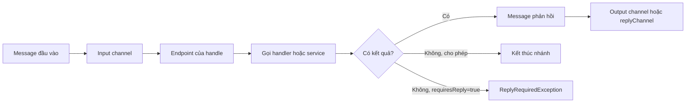

# handle trong DSL

Trong chương **Java DSL** của module **SPRING_INTEGRATION_CORE**, `handle()` là điểm nối giữa luồng thông điệp và hành động xử lý: gọi nghiệp vụ, ghi dữ liệu hoặc sử dụng một `MessageHandler` có sẵn. Hiểu bước này giúp thiết kế đúng quan hệ giữa `Message`, `MessageChannel`, endpoint và bên gọi đang chờ phản hồi.

Bài học tập trung vào hợp đồng đầu vào, đầu ra của `handle()`, cách truyền payload và header vào service, cùng cách kiểm thử luồng thành công và luồng lỗi. Ví dụ sử dụng **Java 17 và API Spring Integration 6.5**; đây là mốc minh họa, không phải kết luận về phiên bản của dự án hiện tại.

Sau bài học, bạn có thể:

- Chọn cách dùng `handle()` phù hợp với lambda, bean nghiệp vụ và `MessageHandler`.
- Xác định bước nào sinh reply, bước nào kết thúc nhánh xử lý.
- Dùng header, `requiresReply`, cấu hình endpoint và channel đúng mục đích.
- Kiểm thử kết quả, tác dụng phụ và ngoại lệ của một luồng Java DSL.

## 1. `handle()` đưa hành động xử lý vào luồng như thế nào?

Với một POJO hoặc lambda nghiệp vụ, `handle()` cấu hình một **Service Activator**. Endpoint nhận thông điệp từ channel, giao việc cho handler và chuyển kết quả sang bước tiếp theo nếu có reply. Với handler do framework cung cấp, hành vi cụ thể còn phụ thuộc chính handler đó. [Tham chiếu Service Activator](https://docs.spring.io/spring-integration/reference/6.5/service-activator.html).



Cần phân biệt hai thời điểm:

- **Khởi tạo ứng dụng:** chuỗi DSL mô tả các thành phần và cách nối chúng.
- **Chạy ứng dụng:** thông điệp đi vào channel mới kích hoạt việc gọi service.

Ví dụ đơn giản:

```java
@Bean
IntegrationFlow feeFlow() {
    return IntegrationFlow.from("fees.in")
            .handle(Integer.class, (amount, headers) -> amount + 15)
            .get();
}
```

Gửi payload `120` với một `replyChannel` hợp lệ sẽ nhận payload `135`. Giá trị `135` là kết quả nghiệp vụ; nó được đặt trong thông điệp phản hồi.

Tên channel `fees.in` là điểm vào của luồng. `.get()` hoàn tất định nghĩa; nó không gửi thông điệp hay lấy kết quả nghiệp vụ.

## 2. Các dạng `handle()` thường gặp

| Dạng viết trong DSL | Đối tượng được gọi | Trường hợp phù hợp |
|---|---|---|
| `.handle(Integer.class, (p, h) -> ...)` | Lambda nhận payload và header | Logic ngắn, muốn chỉ rõ kiểu đầu vào |
| `.<Integer>handle((p, h) -> ...)` | Lambda `GenericHandler<Integer>` | Payload đã có đúng kiểu, không cần chỉ dẫn chuyển đổi lúc chạy |
| `.handle(pricingService, "quote")` | Method của bean đã được inject | Nghiệp vụ có tên và có thể kiểm thử độc lập |
| `.handle("pricingService", "quote")` | Method của bean tra theo tên | Cấu hình cần tham chiếu bean bằng chuỗi |
| `.handle(messageHandler)` | Một `MessageHandler` | Tái sử dụng handler hoặc kết thúc bằng một consumer |
| `.handle(handlerSpec)` | Handler được tạo qua DSL chuyên biệt | Tích hợp adapter hoặc gateway của một giao thức |

Các dạng này có thêm overload nhận callback cấu hình endpoint. Bảng là các lựa chọn thường dùng, không liệt kê toàn bộ API. [Javadoc các overload `handle()`](https://docs.spring.io/spring-integration/docs/6.5.0/api/org/springframework/integration/dsl/BaseIntegrationFlowDefinition.html).

### 2.1. Lambda nhận payload và header

Hợp đồng cốt lõi của `GenericHandler<P>` có dạng:

```java
Object handle(P payload, MessageHeaders headers);
```

Kiểu `P` là đầu vào; đầu ra có thể mang kiểu khác. Đối số thứ hai là `MessageHeaders`. [Javadoc `GenericHandler`](https://docs.spring.io/spring-integration/docs/6.5.0/api/org/springframework/integration/core/GenericHandler.html).

Ví dụ đọc header để tính phụ phí:

```java
.handle(Integer.class, (amount, headers) -> {
    Boolean express = headers.get("express", Boolean.class);
    return amount + (Boolean.TRUE.equals(express) ? 30 : 10);
})
```

Với payload `200`, header `express=true` cho kết quả `230`; không có header này cho kết quả `210`. `Boolean.TRUE.equals(...)` xử lý được trường hợp header vắng mặt.

Khi bỏ kiểu tường minh trong một biểu thức dài, biến `p` có thể bị suy luận thành `Object`. Chỉ rõ `Integer.class` hoặc type witness `<Integer>` làm hợp đồng đầu vào dễ đọc hơn.

### 2.2. Kiểu Java và chuyển đổi lúc chạy là hai việc khác nhau

```java
// Cung cấp kiểu đích cho việc xử lý/chuyển đổi lúc chạy.
.handle(Integer.class, (quantity, headers) -> quantity + 1)

// Cung cấp thông tin generic cho trình biên dịch Java.
.<Integer>handle((quantity, headers) -> quantity + 1)
```

Tham số `Class` giúp framework biết kiểu đích và thử chuyển đổi bằng `ConversionService` khi cần. Generic của lambda không cung cấp cùng bảo đảm lúc chạy. [Giải thích về kiểu payload của lambda](https://docs.spring.io/spring-integration/reference/6.5/dsl/java-handle.html).

Ví dụ payload chuỗi `"41"` có thể được chuyển thành `Integer` nếu có converter phù hợp. Điều này không có nghĩa chuỗi JSON bất kỳ tự biến thành đối tượng nghiệp vụ. Nếu đầu vào là JSON đơn hàng, hãy đặt bước giải mã rõ ràng trước khi gọi service.

### 2.3. Gọi một bean nghiệp vụ

```java
@Bean
IntegrationFlow paymentFlow(PaymentService paymentService) {
    return IntegrationFlow.from("payments.in")
            .handle(paymentService, "charge")
            .get();
}
```

Ở đây `paymentService` là bean được inject; `charge` là method cần gọi. Method đã được chỉ rõ trong DSL nên không cần gắn thêm `@ServiceActivator(inputChannel=...)` để nối cùng method vào channel lần nữa.

Ưu tiên method có tên rõ và chữ ký ít mơ hồ. Nếu có nhiều overload cùng tên nhưng payload có thể chuyển đổi sang nhiều kiểu, việc xác định method phù hợp khó theo dõi hơn. Có thể tách thành các tên nghiệp vụ riêng hoặc viết lambda gọi method trực tiếp.

## 3. Hợp đồng reply: giá trị trả về quyết định luồng tiếp tục

Với service activator thông thường, quy tắc là:

| Kết quả của method/lambda | Hành vi khi xử lý |
|---|---|
| Một object khác `null` | Tạo reply với object đó làm payload |
| Một `Message<?>` | Sử dụng nội dung reply do method cung cấp, áp dụng quy tắc header của handler |
| `null`, cho phép không có reply | Không gửi reply, kết thúc nhánh hiện tại |
| Method POJO trả `void` | Không có giá trị để tạo reply |
| `null` khi `requiresReply(true)` | Ném `ReplyRequiredException` |

Khi có kết quả, output channel được ưu tiên; nếu không có, handler tìm `replyChannel` trên request. Trường hợp request thiếu header này nhưng kết quả là `Message`, framework còn xét `replyChannel` của kết quả. [Quy tắc trả lời của Service Activator](https://docs.spring.io/spring-integration/reference/6.5/service-activator.html).

### 3.1. Trả `null` không có nghĩa là chuyển tiếp payload cũ

Đoạn sau ghi nhận sự kiện rồi dừng nhánh:

```java
.handle(String.class, (event, headers) -> {
    System.out.println("Đã nhận: " + event);
    return null;
})
```

Nếu mục đích là ghi nhận rồi tiếp tục xử lý, phải trả lại dữ liệu:

```java
.handle(String.class, (event, headers) -> {
    System.out.println("Đã nhận: " + event);
    return event;
})
.transform(String.class, String::toUpperCase)
```

Ví dụ thứ nhất phù hợp với bên gửi chỉ cần phát thông báo. Nếu bên gọi chờ phản hồi, hãy thiết kế rõ kết quả hoặc thời gian chờ hữu hạn để tránh chờ vô hạn.

### 3.2. Bắt buộc bước nghiệp vụ trả kết quả

```java
.handle(orderService, "place", endpoint -> endpoint
        .id("placeOrderEndpoint")
        .requiresReply(true))
```

`requiresReply(true)` phát hiện trường hợp service vi phạm hợp đồng “phải trả kết quả”. Nó không tạo reply thay service và không cấu hình thời gian chờ của bên gọi. [API `ConsumerEndpointSpec.requiresReply`](https://docs.spring.io/spring-integration/docs/6.5.0/api/org/springframework/integration/dsl/ConsumerEndpointSpec.html#requiresReply(boolean)).

Ví dụ, nghiệp vụ đặt hàng cần trả `OrderResult`. Nếu đơn bị từ chối theo quy tắc bình thường, nên trả kết quả có trạng thái từ chối. Nếu gặp lỗi kỹ thuật, hãy ném ngoại lệ phù hợp. Dùng `null` cho cả hai trường hợp sẽ làm mất ý nghĩa của kết quả.

### 3.3. `MessageHandler` một chiều

Một `MessageHandler` có hợp đồng:

```java
void handleMessage(Message<?> message);
```

Lambda triển khai trực tiếp interface này không có giá trị trả về. [Javadoc `MessageHandler`](https://docs.spring.io/spring-framework/docs/current/javadoc-api/org/springframework/messaging/MessageHandler.html).

```java
@Bean
IntegrationFlow notificationFlow() {
    MessageHandler printer = message ->
            System.out.println(message.getPayload());

    return IntegrationFlow.from("notifications.in")
            .handle(printer)
            .get();
}
```

Ví dụ trên kết thúc bằng consumer in thông báo. Không nên nối bước xử lý tiếp sau một handler chỉ tiêu thụ như vậy. Một số implementation của framework tự phát message qua output channel; phải đọc hợp đồng của implementation đó, không suy luận mọi `MessageHandler` đều có hành vi giống lambda `printer`.

## 4. Header và toàn bộ `Message`

### 4.1. Ánh xạ header vào tham số service

```java
public Receipt quote(Order order,
                     @Header("tenantId") String tenantId) {
    // Tính kết quả cho tenant này.
}
```

Payload được ánh xạ vào `order`; header được ánh xạ vào `tenantId`. Import `@Header` từ `org.springframework.messaging.handler.annotation.Header`.

Header được yêu cầu mặc định. Với header tùy chọn, khai báo rõ:

```java
public String label(String payload,
                    @Header(name = "locale", required = false)
                    String locale) {
    String selectedLocale = locale == null ? "vi" : locale;
    return selectedLocale + ":" + payload;
}
```

Cũng có thể nhận toàn bộ map header bằng `@Headers`. [Ánh xạ tham số và header](https://docs.spring.io/spring-integration/reference/6.5/configuration/annotations.html).

Trong một hệ thống nhiều tenant, giá trị header phải được kiểm tra tại điểm vào phù hợp; việc một header tồn tại không tự chứng minh người gửi có quyền dùng tenant đó.

### 4.2. Khi lambda cần cả thông điệp

Với lambda hai đối số, mặc định đối số thứ nhất là payload. Nếu cần cả `Message`, truyền `Message.class`:

```java
.handle(Message.class, (message, headers) ->
        MessageBuilder.withPayload(message.getPayload())
                .copyHeaders(message.getHeaders())
                .setHeader("processedBy", "order-handler")
                .build())
```

Import `Message` từ `org.springframework.messaging.Message`, và `MessageBuilder` từ `org.springframework.integration.support.MessageBuilder`.

Chỉ viết `.<Message<?>>handle(...)` không đủ để yêu cầu framework giao toàn bộ message cho lambda; có thể gây `ClassCastException` khi payload được đưa vào vị trí đó. [Lưu ý lambda và `Message<?>`](https://docs.spring.io/spring-integration/reference/6.5/dsl/java-basics.html).

### 4.3. Tạo header mới và loại bỏ header

`MessageHeaders` không hỗ trợ sửa trực tiếp bằng `put()` hoặc `remove()`. Hãy tạo thông điệp qua builder hoặc dùng bước DSL dành cho header.

Với service activator, header request chưa có trong reply có thể được bổ sung lại. Vì vậy, chỉ tạo một reply thiếu header `internalToken` không bảo đảm đã xóa được nó. Khi cần loại header khỏi thông điệp đi tiếp, có thể dùng:

```java
.handle(orderService, "place")
.headerFilter("internalToken")
```

Ở cấp handler, `notPropagatedHeaders(...)` cấu hình các tên hoặc mẫu header không được sao chép từ input. Không loại `replyChannel` hoặc `errorChannel` khi thiết kế vẫn cần chúng. [API kiểm soát header được truyền tiếp](https://docs.spring.io/spring-integration/docs/6.5.0/api/org/springframework/integration/handler/AbstractMessageProducingHandler.html#setNotPropagatedHeaders(java.lang.String...)).

## 5. Thực hành: tính tiền đơn hàng rồi ghi nhận kết quả

Giả sử một yêu cầu tính tiền gồm mã đơn, số lượng và đơn giá. Header `tenantId` xác định ngữ cảnh nghiệp vụ; `traceId` phục vụ đối chiếu. Luồng thực hiện:

```text
orders.in
  -> PricingService.quote(Order, tenantId)
  -> ghi nhận Receipt rồi trả lại Receipt
  -> replyChannel của người gửi
```

Luồng phụ `audit.in` chỉ ghi nhận một `Receipt`, không trả lời. Luồng `required.in` cố ý trả `null` để minh họa hợp đồng `requiresReply`.

### 5.1. Chuẩn bị môi trường

Để chạy ví dụ trong một dự án Maven Java 17, cần Spring Integration Core và JUnit Jupiter. Hai dependency minh họa:

```xml
<dependencies>
    <dependency>
        <groupId>org.springframework.integration</groupId>
        <artifactId>spring-integration-core</artifactId>
        <version>6.5.0</version>
    </dependency>
    <dependency>
        <groupId>org.junit.jupiter</groupId>
        <artifactId>junit-jupiter</artifactId>
        <version>5.12.2</version>
        <scope>test</scope>
    </dependency>
</dependencies>
```

Đặt compiler release bằng `17`, dùng Maven Surefire hỗ trợ JUnit 5, chẳng hạn `3.5.3`. Nếu dự án đã dùng Spring Boot/BOM tương thích, hãy để BOM quản lý version Spring thay vì ghép các version Spring thủ công.

Các đoạn ngắn ở mục trước là những lựa chọn độc lập. Cấu hình dưới đây mới là tập luồng dùng chung cho bộ kiểm thử ở mục 6.

### 5.2. Cấu hình và service

Đặt mã sau trong `src/main/java/example/handledsl/HandleDslConfig.java`:

```java
package example.handledsl;

import java.math.BigDecimal;
import java.util.List;
import java.util.concurrent.CopyOnWriteArrayList;

import org.springframework.context.annotation.Bean;
import org.springframework.context.annotation.Configuration;
import org.springframework.integration.config.EnableIntegration;
import org.springframework.integration.dsl.IntegrationFlow;
import org.springframework.messaging.handler.annotation.Header;

@Configuration(proxyBeanMethods = false)
@EnableIntegration
public class HandleDslConfig {

    public record Order(String id, int quantity, BigDecimal unitPrice) {
    }

    public record Receipt(String orderId, BigDecimal total, String tenantId) {
    }

    @Bean
    PricingService pricingService() {
        return new PricingService();
    }

    @Bean
    AuditService auditService() {
        return new AuditService();
    }

    @Bean
    IntegrationFlow orderFlow(PricingService pricingService,
                              AuditService auditService) {
        return IntegrationFlow.from("orders.in")
                .handle(pricingService, "quote", endpoint -> endpoint
                        .id("quoteOrderEndpoint")
                        .requiresReply(true))
                .handle(Receipt.class, (receipt, headers) -> {
                    auditService.record(receipt);
                    return receipt;
                }, endpoint -> endpoint.id("recordReceiptEndpoint"))
                .get();
    }

    @Bean
    IntegrationFlow auditOnlyFlow(AuditService auditService) {
        return IntegrationFlow.from("audit.in")
                .handle(auditService, "record")
                .get();
    }

    @Bean
    IntegrationFlow requiredReplyFlow() {
        return IntegrationFlow.from("required.in")
                .handle(String.class, (payload, headers) -> null,
                        endpoint -> endpoint.requiresReply(true))
                .get();
    }

    public static class PricingService {

        public Receipt quote(Order order,
                             @Header("tenantId") String tenantId) {
            if (order.quantity() <= 0) {
                throw new IllegalArgumentException(
                        "Số lượng phải lớn hơn 0");
            }
            if (order.unitPrice() == null
                    || order.unitPrice().signum() < 0) {
                throw new IllegalArgumentException(
                        "Đơn giá phải có và không được âm");
            }
            if (tenantId.isBlank()) {
                throw new IllegalArgumentException(
                        "tenantId không được rỗng");
            }

            BigDecimal total = order.unitPrice()
                    .multiply(BigDecimal.valueOf(order.quantity()));
            return new Receipt(order.id(), total, tenantId);
        }
    }

    public static class AuditService {

        private final List<Receipt> recorded = new CopyOnWriteArrayList<>();

        public void record(Receipt receipt) {
            recorded.add(receipt);
        }

        public List<Receipt> entries() {
            return List.copyOf(recorded);
        }
    }
}
```

Ở `orderFlow`, lambda ghi nhận kết quả rồi `return receipt`, nên bên gọi vẫn nhận được phản hồi. Ở `auditOnlyFlow`, method `record()` trả `void`, phù hợp với thông báo một chiều.

Danh sách trong `AuditService` chỉ là nơi quan sát tác dụng phụ cho bài thực hành; dữ liệu mất khi context đóng. Ví dụ không mô phỏng lưu trữ bền vững hoặc giao dịch ghi đơn hàng và ghi audit.

## 6. Kiểm thử hợp đồng của `handle()`

Đặt mã dưới đây trong `src/test/java/example/handledsl/HandleDslTest.java`. Mỗi test tạo context riêng để dữ liệu ghi nhận không ảnh hưởng test khác.

```java
package example.handledsl;

import java.math.BigDecimal;
import java.util.List;

import org.junit.jupiter.api.AfterEach;
import org.junit.jupiter.api.BeforeEach;
import org.junit.jupiter.api.Test;
import org.springframework.context.annotation.AnnotationConfigApplicationContext;
import org.springframework.integration.channel.QueueChannel;
import org.springframework.integration.handler.ReplyRequiredException;
import org.springframework.integration.support.MessageBuilder;
import org.springframework.messaging.Message;
import org.springframework.messaging.MessageChannel;
import org.springframework.messaging.MessageHandlingException;

import example.handledsl.HandleDslConfig.AuditService;
import example.handledsl.HandleDslConfig.Order;
import example.handledsl.HandleDslConfig.Receipt;

import static org.junit.jupiter.api.Assertions.*;

class HandleDslTest {

    private AnnotationConfigApplicationContext context;

    @BeforeEach
    void start() {
        context = new AnnotationConfigApplicationContext(HandleDslConfig.class);
    }

    @AfterEach
    void close() {
        context.close();
    }

    @Test
    void returnsReceiptPreservesTraceAndRecordsSideEffect() {
        QueueChannel replies = new QueueChannel();
        Order order = new Order("ORDER-101", 3, new BigDecimal("125000"));
        Message<Order> request = MessageBuilder.withPayload(order)
                .setHeader("tenantId", "tenant-vn")
                .setHeader("traceId", "trace-101")
                .setReplyChannel(replies)
                .build();

        assertTrue(channel("orders.in").send(request));
        Message<?> reply = replies.receive(1000);

        assertNotNull(reply);
        Receipt receipt = assertInstanceOf(Receipt.class, reply.getPayload());
        assertEquals("ORDER-101", receipt.orderId());
        assertEquals(0, new BigDecimal("375000").compareTo(receipt.total()));
        assertEquals("tenant-vn", receipt.tenantId());
        assertEquals("trace-101", reply.getHeaders().get("traceId"));
        assertEquals(List.of(receipt), audit().entries());
    }

    @Test
    void voidServiceRecordsReceiptWithoutReply() {
        QueueChannel replies = new QueueChannel();
        Receipt receipt = new Receipt("ORDER-102", BigDecimal.TEN, "tenant-vn");

        assertTrue(channel("audit.in").send(MessageBuilder.withPayload(receipt)
                .setReplyChannel(replies)
                .build()));

        assertEquals(List.of(receipt), audit().entries());
        assertNull(replies.receive(0));
    }

    @Test
    void nullResultViolatesRequiredReplyContract() {
        assertThrows(ReplyRequiredException.class, () ->
                channel("required.in").send(
                        MessageBuilder.withPayload("probe").build()));
    }

    @Test
    void invalidOrderPropagatesFailureAndDoesNotRecordReceipt() {
        Order invalid = new Order("ORDER-103", 0, BigDecimal.TEN);
        Message<Order> request = MessageBuilder.withPayload(invalid)
                .setHeader("tenantId", "tenant-vn")
                .build();

        MessageHandlingException error = assertThrows(
                MessageHandlingException.class,
                () -> channel("orders.in").send(request));

        assertInstanceOf(IllegalArgumentException.class,
                error.getMostSpecificCause());
        assertTrue(audit().entries().isEmpty());
    }

    private MessageChannel channel(String name) {
        return context.getBean(name, MessageChannel.class);
    }

    private AuditService audit() {
        return context.getBean(AuditService.class);
    }
}
```

Bốn test kiểm tra bốn cam kết khác nhau:

| Test | Cam kết được kiểm tra |
|---|---|
| Tính tiền thành công | Đúng payload, còn `traceId`, tác dụng phụ đã xảy ra |
| Service `void` | Xử lý xong nhưng không tạo reply, kể cả request có `replyChannel` |
| Bắt buộc có reply | `null` gây lỗi rõ ràng |
| Đơn không hợp lệ | Ngoại lệ đến bên gửi, bước ghi nhận chưa chạy |

Trong ví dụ, các bước xử lý nối bằng `DirectChannel` mặc định, nên tác dụng phụ hoàn tất trước khi `send()` trả về. `QueueChannel replies` chỉ giữ phản hồi để test lấy ra; nó không làm `orderFlow` tự chuyển sang một luồng thực thi khác. [Đặc điểm `DirectChannel` và `QueueChannel`](https://docs.spring.io/spring-integration/reference/6.5/channel/implementations.html).

`receive(1000)` đặt thời gian chờ tối đa một giây để test không treo. Riêng test `void`, có thể kiểm tra ngay bằng `receive(0)` vì việc gọi service đang đồng bộ. Nếu chuyển điểm vào sang channel dùng executor hoặc poller, cần thay đổi cách đợi kết quả/tác dụng phụ tương ứng.

## 7. Cấu hình endpoint: tên, poller và advice

Callback cuối của overload `handle()` là nơi cấu hình endpoint, tách khỏi lambda nghiệp vụ:

```java
.handle(Receipt.class, (receipt, headers) -> receipt,
        endpoint -> endpoint
                .id("receiptHandlerEndpoint")
                .requiresReply(true))
```

`id()` đặt tên endpoint để theo dõi hoặc điều khiển vòng đời. Tên endpoint khác với tên input channel và tên bean service. [Cấu hình endpoint trong Java DSL](https://docs.spring.io/spring-integration/reference/6.5/dsl/java-endpoints.html).

### 7.1. Khi đầu vào cần polling

Đoạn cấu hình thay thế dưới đây dùng một `QueueChannel` ở đầu vào:

```java
@Bean
QueueChannel queuedOrders() {
    return new QueueChannel(100);
}

@Bean
IntegrationFlow queuedOrderFlow(QueueChannel queuedOrders,
                                HandleDslConfig.PricingService pricingService) {
    return IntegrationFlow.from(queuedOrders)
            .handle(pricingService, "quote", endpoint -> endpoint
                    .poller(Pollers.fixedDelay(100))
                    .requiresReply(true))
            .get();
}
```

Import `QueueChannel` từ `org.springframework.integration.channel.QueueChannel`, `Pollers` từ `org.springframework.integration.dsl.Pollers`.

Poller lấy đơn từ hàng đợi mỗi chu kỳ. Request vẫn cần `tenantId` và nơi nhận reply. Đây là ví dụ bổ sung độc lập, không thuộc cấu hình kiểm thử ở mục 5–6. Với `DirectChannel`, handler được gọi khi gửi nên không đặt poller cho endpoint đó.

### 7.2. Retry phải đi cùng hợp đồng nghiệp vụ

Có thể gắn advice vào riêng bước gọi service:

```java
.handle(remoteService, "reserve", endpoint -> endpoint
        .id("reserveInventoryEndpoint")
        .requiresReply(true)
        .advice(retryAdvice))
```

`remoteService` là bean nghiệp vụ và `retryAdvice` là bean advice đã cấu hình. Đây là dạng nối advice, không phải đoạn cấu hình retry hoàn chỉnh. `RequestHandlerRetryAdvice` hỗ trợ chính sách thử lại và xử lý khi hết lượt thử. [Tài liệu Retry Advice](https://docs.spring.io/spring-integration/reference/6.5/handler-advice/classes.html).

Ví dụ, gọi giữ hàng có thể thành công ở kho nhưng phía gọi bị mất kết nối trước khi nhận kết quả. Lần thử lại cần một khóa nghiệp vụ như `reservationRequestId` để kho nhận biết yêu cầu cũ. Chỉ thêm retry vào DSL không giải quyết việc giữ trùng hàng.

Không thử lại một đơn hàng có số lượng bằng `0` chỉ vì handler ném ngoại lệ: dữ liệu đó không tự trở nên hợp lệ sau vài lần gọi.

## 8. Ngoại lệ từ `handle()` đi đâu?

Với xử lý cùng thread qua `DirectChannel`, lỗi truyền về bên gửi, thường kèm `MessagingException` chứa nguyên nhân và thông điệp lỗi. Chỉ đặt header `errorChannel` không làm lời gọi trực tiếp tự chuyển mọi lỗi sang channel đó.

Khi handler chạy qua cơ chế bất đồng bộ do Spring Integration quản lý, lỗi có thể được biểu diễn bằng `ErrorMessage`. Cơ chế xử lý lỗi dùng `errorChannel` trong request nếu có, nếu không dùng channel lỗi toàn cục. Gateway có thể cấu hình cách chuyển lỗi riêng. [Cơ chế xử lý lỗi Spring Integration](https://docs.spring.io/spring-integration/reference/6.5/error-handling.html).

Trong bài thực hành:

```text
Order quantity = 0
  -> PricingService.quote ném IllegalArgumentException
  -> không tạo Receipt
  -> không gọi bước ghi nhận
  -> bên gọi send() nhận lỗi xử lý thông điệp
```

Tránh che lỗi bằng cách trả `null` một cách tùy tiện:

```java
// Dễ biến lỗi kỹ thuật thành việc không có phản hồi.
.handle(String.class, (payload, headers) -> {
    try {
        return remoteService.lookup(payload);
    }
    catch (RuntimeException ex) {
        return null;
    }
})
```

Nếu hợp đồng cho phép “không tìm thấy”, hãy trả kiểu kết quả thể hiện điều đó. Nếu đây là lỗi kết nối hoặc xử lý, hãy để cơ chế lỗi/recovery đã thiết kế tiếp nhận thay vì xóa dấu hiệu lỗi.

## 9. Chọn `handle()` trong quan hệ với các bước DSL khác

| Ý định chính | Bước nên thể hiện ý định |
|---|---|
| Chuyển JSON sang đối tượng hoặc đổi cấu trúc dữ liệu | `transform()` |
| Quyết định một message có được đi tiếp hay không | `filter()` |
| Chọn nhánh nhận message | `route()` |
| Gộp các message thuộc một nhóm | `aggregate()` |
| Gọi hành động hoặc dịch vụ nghiệp vụ | `handle()` |
| Gọi luồng khác và lấy reply qua channel | `gateway()` |

Đây là cách đọc ý định thiết kế. Một phép tính có thể viết bằng lambda trong nhiều operator, nhưng operator chuyên biệt giúp người đọc hiểu mục đích của bước đó.

Ví dụ, chuẩn hóa mã sản phẩm có thể viết:

```java
.transform(String.class, code -> code.trim().toUpperCase(Locale.ROOT))
```

Sau khi dữ liệu đúng dạng, gọi dịch vụ giữ hàng bằng `handle()`. Nếu muốn bỏ message không đạt điều kiện, dùng `filter()` để thể hiện rõ điều kiện và cấu hình xử lý message bị loại.

Transformer được kỳ vọng sinh kết quả hợp lệ; trả `null` gây lỗi. Service activator cho phép không có reply theo cấu hình. Vì vậy, thay một `.transform(...)` bằng `.handle(...)` có thể làm thay đổi hợp đồng của luồng. [Hợp đồng của Transformer](https://docs.spring.io/spring-integration/reference/6.5/transformer.html).

## 10. Chẩn đoán các lỗi thường gặp

| Hiện tượng | Điểm cần kiểm tra | Cách điều chỉnh |
|---|---|---|
| Service đã chạy nhưng bước sau không chạy | Method trả `void` hoặc lambda trả `null` | Trả lại payload/kết quả nếu muốn đi tiếp |
| Bên gọi chờ nhưng không có phản hồi | Có nhánh không reply hoặc output được nối sang nơi khác | Vẽ lại đường reply và cấu hình timeout hữu hạn |
| Handler có kết quả nhưng báo không tìm được nơi gửi | Không có output channel và thiếu `replyChannel` | Cung cấp channel đích hoặc dùng cơ chế request–reply |
| Lambda bị `ClassCastException` với `Message` | Chỉ khai báo generic mà không truyền `Message.class` | Chọn overload nhận `Class` |
| Chuỗi không chuyển được sang kiểu mong muốn | Không có converter hoặc dữ liệu sai dạng | Thêm bước chuyển đổi rõ và kiểm tra đầu vào |
| Thiếu header khiến gọi service thất bại | Tham số `@Header` đang bắt buộc | Bổ sung header hoặc khai báo tùy chọn đúng nghiệp vụ |
| Header tưởng đã xóa lại xuất hiện | Header input được truyền tiếp vào reply | Dùng `headerFilter()` hoặc cấu hình không truyền header |
| Endpoint không lấy message trong hàng đợi | Thiếu poller cho channel cần polling | Cấu hình poller tại endpoint thích hợp |
| Một hành động ghi dữ liệu xảy ra nhiều lần | Retry/redelivery gọi lại thao tác có tác dụng phụ | Kiểm tra khóa chống trùng và hợp đồng idempotency |

Khi điều tra, ghi lại tên channel, tên endpoint, kiểu payload, các header liên quan và nguyên nhân sâu nhất của ngoại lệ. Với lỗi “mất reply”, bắt đầu từ giá trị method trả về rồi lần theo đường output; với lỗi gọi method, bắt đầu từ kiểu payload và chữ ký service.

## 11. Bài tập thực hành tiếp nối

1. Thêm header `discountPercent` tùy chọn vào service tính tiền, mặc định bằng `0`. Xác định rõ giới hạn hợp lệ và quy tắc làm tròn tiền.
2. Viết test thiếu `tenantId`, xác minh service không tạo kết quả và không ghi nhận `Receipt`.
3. Tạo một flow chỉ ghi audit nhưng trả `AuditAcknowledgement` cho bên gọi. So sánh hợp đồng của nó với `auditOnlyFlow` trả `void`.
4. Chuyển một đầu vào sang `QueueChannel` có poller; điều chỉnh test để đợi hoàn tất và quan sát cơ chế nhận lỗi.
5. Dùng `headerFilter("internalToken")` sau bước nghiệp vụ, rồi xác minh header nhạy cảm đã bị loại trong khi `traceId` và đường reply vẫn hoạt động.

Tiêu chí hoàn thành: giải thích được ở mỗi `handle()` dữ liệu nào đi vào, method nào được gọi, có tạo reply hay không, reply đi đâu và bên nào quan sát lỗi.