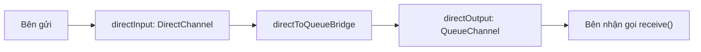
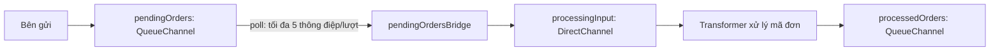

# bridge trong DSL

## Mục tiêu và bối cảnh

Trong chương **Java DSL** của module **SPRING_INTEGRATION_CORE**, `bridge()` giúp nối các đoạn của luồng thông điệp bằng một endpoint chuyển tiếp. Khi cần đưa thông điệp từ channel này sang channel khác mà không thay đổi dữ liệu nghiệp vụ, bridge là một thành phần phù hợp.

Bài này tập trung vào cách dùng bridge với `Message`, `MessageChannel` và endpoint trong Java DSL. Bạn sẽ thực hành nối channel đẩy với queue, lấy thông điệp từ queue bằng poller, sử dụng đường trả lời và kiểm thử hành vi chuyển tiếp.

Sau bài học, bạn có thể:

- Giải thích vai trò của `BridgeHandler` trong một `IntegrationFlow`.
- Đặt `bridge()` đúng vị trí và cấu hình endpoint qua lambda.
- Xác định khi nào bridge cần poller dựa trên **channel đầu vào**.
- Phân biệt đích output tường minh với header `replyChannel`.
- Hiểu ảnh hưởng của channel đến thread, tốc độ xử lý và đường xử lý lỗi.
- Kiểm tra payload, header và kết quả chuyển tiếp bằng mã kiểm thử.

Ví dụ chọn **Java 17+ và Spring Integration 6.5.x** làm mốc API, không giả định phiên bản thực tế của dự án. Java DSL nằm trong `spring-integration-core`; mã cấu hình dùng Spring Context, còn mã kiểm thử dùng JUnit Jupiter.

## 1. Bridge là một endpoint chuyển tiếp thông điệp

### 1.1. Hình dung đường đi

```text
input channel -> bridge endpoint -> output channel
```

Channel là nơi nhận và phân phối thông điệp. Bridge là handler được một consumer endpoint gọi để chuyển tiếp thông điệp đến đích tiếp theo. Đây là hai vai trò riêng trong đồ thị tích hợp.

`BridgeHandler` chuyển tiếp request message mà không thực hiện phép biến đổi nghiệp vụ. Một ứng dụng thường gặp là nối `PollableChannel` với `SubscribableChannel`, để việc polling nằm ở bridge thay vì ở endpoint nghiệp vụ phía sau. Xem [Messaging Bridge](https://docs.spring.io/spring-integration/reference/6.5/bridge.html) và [BridgeHandler](https://docs.spring.io/spring-integration/docs/6.5.1/api/org/springframework/integration/handler/BridgeHandler.html).

Ví dụ thực tế: hệ thống tiếp nhận nhiều yêu cầu vào một queue nội bộ, sau đó lấy từng nhóm nhỏ để đưa sang tuyến xử lý hiện có. Tuyến xử lý chỉ cần nhận thông điệp từ một direct channel; nó không cần biết lịch lấy dữ liệu khỏi queue.

### 1.2. Hai dạng cú pháp

```java
.bridge()
```

Dạng trên thêm bridge với cấu hình endpoint mặc định.

```java
.bridge(endpoint -> endpoint
        .id("handoffBridge")
        .autoStartup(true))
```

Lambda cấu hình **endpoint**, không phải lambda xử lý payload. Trong ví dụ, `endpoint` cung cấp các tùy chọn vòng đời và vận hành cho bridge.

Các overload được công bố trong [BaseIntegrationFlowDefinition — bridge](https://docs.spring.io/spring-integration/docs/6.5.0/api/org/springframework/integration/dsl/BaseIntegrationFlowDefinition.html).

### 1.3. Chọn bridge theo nhu cầu

| Nhu cầu của bước xử lý | Thành phần thường phù hợp |
| --- | --- |
| Chuyển nguyên thông điệp sang channel khác | `bridge()` |
| Đổi `Order` thành `Invoice` | `transform()` |
| Cho đi tiếp hoặc từ chối thông điệp | `filter()` |
| Chọn tuyến theo loại đơn hàng | `route()` |
| Gọi dịch vụ nghiệp vụ | `handle()` |
| Gọi một flow và chờ phản hồi để tiếp tục | `gateway()` |

Bridge có ích khi yêu cầu chính là kết nối hoặc kiểm soát việc chuyển tiếp. Nếu đã có transformer nối đúng input và output cần thiết, không nhất thiết thêm bridge ở giữa chỉ để làm dài chuỗi DSL.

## 2. Ví dụ đầy đủ: DirectChannel sang QueueChannel

### 2.1. Bài toán

Tuyến tiếp nhận gửi thông điệp đến `directInput`. Cần chuyển thông điệp đó sang `directOutput`, là một queue được bên nhận đọc sau.



Trong cấu hình này, không có bước đổi payload, không có bộ chọn nhánh và không có consumer tự động đọc queue đầu ra.

### 2.2. Lớp cấu hình

```java
import org.springframework.context.annotation.Bean;
import org.springframework.context.annotation.Configuration;
import org.springframework.integration.channel.DirectChannel;
import org.springframework.integration.channel.QueueChannel;
import org.springframework.integration.config.EnableIntegration;
import org.springframework.integration.dsl.IntegrationFlow;

@Configuration(proxyBeanMethods = false)
@EnableIntegration
public class DirectBridgeConfig {

    @Bean
    public DirectChannel directInput() {
        return new DirectChannel();
    }

    @Bean
    public QueueChannel directOutput() {
        return new QueueChannel(20);
    }

    @Bean
    public IntegrationFlow directBridgeFlow(
            DirectChannel directInput,
            QueueChannel directOutput) {

        return IntegrationFlow.from(directInput)
                .bridge(endpoint -> endpoint
                        .id("directToQueueBridge")
                        .sendTimeout(500L))
                .channel(directOutput)
                .get();
    }
}
```

Có ba đối tượng cần phân biệt:

| Tên | Vai trò |
| --- | --- |
| `directBridgeFlow` | Bean định nghĩa flow |
| `directToQueueBridge` | ID của consumer endpoint tại bước bridge |
| `directOutput` | Channel đầu ra của bridge |

`sendTimeout(500L)` cấu hình thời gian chờ gửi của handler, tính bằng mili giây. Nó hữu ích nếu queue đầu ra đầy và thao tác gửi phải chờ; nó không phải thời hạn xử lý toàn bộ nghiệp vụ phía sau. Cấu hình cụ thể được cung cấp qua endpoint spec của DSL.

### 2.3. Vì sao không có poller?

**Channel đầu vào của bridge là `DirectChannel`.** Endpoint được gọi khi có thông điệp được gửi đến channel này. Việc đầu ra là queue không khiến bridge cần polling.

Thứ tự thực thi trong ví dụ:

1. Bên gửi gọi `directInput.send(message)`.
2. Direct channel gọi consumer của bridge trên thread gửi.
3. Bridge gửi thông điệp vào `directOutput`.
4. Sau khi thao tác gửi hoàn tất, lời gọi `send()` có thể trở về.
5. Bên nhận đọc queue đầu ra bằng `receive()` vào thời điểm khác.

Khi `send()` thành công, kết luận phù hợp ở đây là thông điệp đã được đưa đến queue đầu ra. Chưa có bằng chứng rằng một tác vụ nghiệp vụ khác đã đọc và xử lý xong thông điệp đó. Cơ chế của direct channel và queue channel được mô tả trong [Message Channel Implementations](https://docs.spring.io/spring-integration/reference/6.5/channel/implementations.html).

## 3. QueueChannel sang DirectChannel: đặt poller tại bridge

### 3.1. Bài toán

Tuyến tiếp nhận đưa các mã đơn hàng vào `pendingOrders`. Bridge cần lấy thông điệp theo lịch và chuyển sang `processingInput`. Một flow khác xử lý mã đơn rồi ghi kết quả vào `processedOrders`.



Lớp dưới đây là ví dụ độc lập thứ hai; không cần ghép nó với `DirectBridgeConfig`.

### 3.2. Cấu hình đầy đủ

```java
import java.time.Duration;
import java.util.Locale;

import org.springframework.beans.factory.annotation.Qualifier;
import org.springframework.context.annotation.Bean;
import org.springframework.context.annotation.Configuration;
import org.springframework.integration.channel.DirectChannel;
import org.springframework.integration.channel.QueueChannel;
import org.springframework.integration.config.EnableIntegration;
import org.springframework.integration.dsl.IntegrationFlow;
import org.springframework.integration.dsl.Pollers;

@Configuration(proxyBeanMethods = false)
@EnableIntegration
public class QueuedBridgeConfig {

    @Bean
    public QueueChannel pendingOrders() {
        return new QueueChannel(50);
    }

    @Bean
    public DirectChannel processingInput() {
        return new DirectChannel();
    }

    @Bean
    public QueueChannel processedOrders() {
        return new QueueChannel(50);
    }

    @Bean
    public IntegrationFlow queuedBridgeFlow(
            @Qualifier("pendingOrders") QueueChannel pending,
            DirectChannel processingInput) {

        return IntegrationFlow.from(pending)
                .bridge(endpoint -> endpoint
                        .id("pendingOrdersBridge")
                        .poller(Pollers
                                .fixedDelay(Duration.ofMillis(100))
                                .maxMessagesPerPoll(5)
                                .receiveTimeout(0)))
                .channel(processingInput)
                .get();
    }

    @Bean
    public IntegrationFlow processingFlow(
            DirectChannel processingInput,
            @Qualifier("processedOrders") QueueChannel results) {

        return IntegrationFlow.from(processingInput)
                .<String, String>transform(orderCode ->
                        "PROCESSED:"
                                + orderCode.strip()
                                        .toUpperCase(Locale.ROOT))
                .channel(results)
                .get();
    }
}
```

`@Qualifier` làm rõ queue được tiêm khi có nhiều bean cùng kiểu. `proxyBeanMethods = false` đi cùng việc tiêm các bean cần dùng qua tham số, thay vì gọi trực tiếp phương thức `@Bean` khác.

### 3.3. Đọc cấu hình poller

| Cấu hình | Ý nghĩa trong ví dụ |
| --- | --- |
| `fixedDelay(Duration.ofMillis(100))` | Lập lịch lần polling kế tiếp sau khi lần trước kết thúc và qua khoảng trễ |
| `maxMessagesPerPoll(5)` | Một lần chạy polling xử lý tối đa năm thông điệp |
| `receiveTimeout(0)` | Khi queue không có thông điệp, không chờ thêm trong lần nhận đó |

Nếu có bảy thông điệp sẵn trong queue, một lượt bình thường lấy tối đa năm; số còn lại được lấy ở lượt sau. Một lượt có thể lấy ít hơn năm nếu queue hết dữ liệu.

Các API tương ứng có trong [Pollers](https://docs.spring.io/spring-integration/docs/6.5.0/api/org/springframework/integration/dsl/Pollers.html) và [PollerSpec](https://docs.spring.io/spring-integration/docs/6.5.0/api/org/springframework/integration/dsl/PollerSpec.html).

`maxMessagesPerPoll(5)` không tạo năm worker song song. Trong cấu hình trên, không có task executor được thêm cho poller; mỗi lần nhận sẽ chuyển tiếp sang downstream trước khi vòng polling xử lý thông điệp tiếp theo.

### 3.4. Chọn consumer theo input

| Channel đầu vào | Cách nhận thông điệp | Poller cho bridge |
| --- | --- | --- |
| `DirectChannel` | Nhận qua subscription | Không cấu hình poller |
| `PublishSubscribeChannel` | Bridge là một subscriber | Không cấu hình poller |
| `ExecutorChannel` | Nhận qua dispatch của channel | Không cấu hình poller |
| `QueueChannel` | Consumer gọi `receive()` | Cần cấu hình poller cục bộ hoặc poller mặc định phù hợp |

Loại input quyết định consumer endpoint là dạng nhận theo sự kiện hay dạng polling. Đích output không quyết định điều này. Xem [Polling Consumer](https://docs.spring.io/spring-integration/reference/6.5/polling-consumer.html).

## 4. Thread, tốc độ và giới hạn của queue

### 4.1. Lần theo thread

Với ví dụ queue ở phần 3:

```text
Thread tiếp nhận:
    pendingOrders.send(message)
    -> đưa thông điệp vào queue
    -> trở về

Thread thực hiện poll:
    pendingOrders.receive(...)
    -> bridge
    -> processingInput.send(...)
    -> transformer
    -> processedOrders.send(...)
```

Transformer phía sau direct channel chạy tiếp trên thread đang chuyển tiếp thông điệp, nếu không có ranh giới thực thi khác. Việc thêm một bridge giữa hai direct channel không tự tạo thread mới.

### 4.2. Ước lượng nhịp lấy thông điệp

Giả sử queue luôn có dữ liệu, mỗi thông điệp mất 20 ms để xử lý qua toàn bộ phần downstream đồng bộ, và poller lấy tối đa năm thông điệp mỗi lượt.

```text
Thời gian xử lý một lượt xấp xỉ: 5 × 20 ms = 100 ms
Khoảng trễ sau lượt:                         100 ms
Một chu kỳ xấp xỉ:                           200 ms
Thông lượng ước lượng:            5 / 0,2 = 25 thông điệp/giây
```

Đây là phép tính minh họa cho cấu hình và giả định trên. Nó bỏ qua chi phí lập lịch, dao động thời gian xử lý, chờ gửi và các tác vụ khác. Vì vậy, không suy ra “100 ms, năm thông điệp” luôn có nghĩa đạt 50 thông điệp/giây.

Nếu cần kiểm soát tải, theo dõi cả độ dài queue và thời gian xử lý downstream. Poller điều chỉnh nhịp chuyển tiếp, nhưng một bước downstream chậm vẫn làm lần polling kéo dài.

### 4.3. Queue đầy và độ bền thông điệp

Các queue trong bài đều có dung lượng giới hạn. Nếu bên gửi nhanh hơn bên xử lý trong thời gian dài, queue sẽ đầy. Lúc đó cần một chính sách rõ ràng: chờ có giới hạn, báo thất bại, giảm tốc đầu vào hoặc dùng một hạ tầng lưu trữ thích hợp.

Một lời gọi gửi có timeout:

```java
boolean accepted = pending.send(message, 200);
if (!accepted) {
    // Ví dụ: báo tuyến tiếp nhận chưa thể chấp nhận thêm yêu cầu.
}
```

Đoạn trên dùng biến `pending` là queue đầu vào của ví dụ. Nếu chuyển tiếp qua bridge sang queue đầy, cần kiểm tra cả send timeout của bridge.

`QueueChannel` mặc định lưu trong bộ nhớ. Không xem việc thêm bridge và queue như bảo đảm tự lưu bền, tự thử lại hoặc xử lý đúng một lần khi ứng dụng lỗi. Những yêu cầu đó cần thiết kế tài nguyên và chính sách riêng. Xem [QueueChannel và lưu trữ thông điệp](https://docs.spring.io/spring-integration/reference/6.5/channel/implementations.html).

## 5. Bridge không có output tường minh: sử dụng replyChannel

### 5.1. Quy tắc chọn đích chuyển tiếp

Với bridge, cần xác định được nơi nhận tiếp:

1. Nếu bridge có output channel được cấu hình, thông điệp đi đến output đó.
2. Nếu không có output tường minh, bridge sử dụng `replyChannel` trong header nếu có.
3. Nếu cả hai đều không có, việc xử lý phát sinh lỗi.

Vì vậy, `.bridge().get()` ở cuối flow không mang nghĩa bỏ thông điệp. Nó có thể là một bước chuyển lại thông điệp về bên gọi. Xem [BridgeHandler](https://docs.spring.io/spring-integration/docs/6.5.1/api/org/springframework/integration/handler/BridgeHandler.html).

### 5.2. Ví dụ echo bằng bridge

Lớp cấu hình độc lập sau tạo một tuyến trả lại thông điệp nhận được:

```java
import org.springframework.context.annotation.Bean;
import org.springframework.context.annotation.Configuration;
import org.springframework.integration.channel.DirectChannel;
import org.springframework.integration.config.EnableIntegration;
import org.springframework.integration.dsl.IntegrationFlow;

@Configuration(proxyBeanMethods = false)
@EnableIntegration
public class EchoBridgeConfig {

    @Bean
    public DirectChannel echoInput() {
        return new DirectChannel();
    }

    @Bean
    public IntegrationFlow echoFlow(DirectChannel echoInput) {
        return IntegrationFlow.from(echoInput)
                .bridge()
                .get();
    }
}
```

Mã sử dụng trong một application context đã đăng ký `EchoBridgeConfig`:

```java
DirectChannel input = context.getBean(
        "echoInput", DirectChannel.class);

QueueChannel replies = new QueueChannel(1);

Message<String> request = MessageBuilder
        .withPayload("ORDER-101")
        .setHeader("traceId", "trace-101")
        .setReplyChannel(replies)
        .build();

input.send(request);

Message<?> response = replies.receive(1_000);
// response có payload "ORDER-101" và traceId "trace-101".
```

Đoạn sử dụng cần import `QueueChannel`, `Message` và `MessageBuilder` tương ứng từ các package đã dùng trong những ví dụ kiểm thử phía dưới. `replies` là channel trả lời được đặt trực tiếp trong header, không cần là bean có tên.

Khi một messaging gateway tạo yêu cầu, gateway cũng có thể cung cấp cơ chế nhận reply. Tuy nhiên, bản thân `bridge()` chỉ chuyển tiếp; nó không thiết lập một lời gọi gateway mới.

### 5.3. Tránh thêm bridge như cách sửa thiếu đích

Cấu hình sau vẫn chưa có hợp đồng hoàn chỉnh nếu bên gửi không cung cấp đường trả lời:

```java
IntegrationFlow.from("unroutedInput")
        .bridge()
        .get();
```

Hãy chọn đích output, đường reply hoặc một endpoint kết thúc có chủ ý. Nếu mục tiêu là tiêu thụ thông điệp mà không tạo phản hồi, dùng handler thực hiện tác vụ đó; nếu mục tiêu là bỏ thông điệp theo thiết kế, thể hiện rõ quyết định ấy bằng cấu hình thích hợp.

Thêm bridge sau một handler một chiều cũng không khôi phục được payload đã không được handler phát ra. Điểm kết thúc của một tuyến phải phù hợp với hợp đồng một chiều hoặc yêu cầu–phản hồi của đầu vào.

## 6. Bridge tường minh và bridge do DSL tự tạo

### 6.1. Hai channel liên tiếp trong chuỗi

Xét phiên bản rút gọn của flow ở phần 2:

```java
return IntegrationFlow.from(directInput)
        .channel(directOutput)
        .get();
```

Trong API mốc của bài, khi DSL gặp channel hiện tại rồi thêm một channel tiếp theo, nó có thể chèn bridge để nối chúng. Điều này giải thích vì sao đoạn cấu hình nhìn như chỉ có hai channel vẫn có một endpoint chuyển tiếp ở bên trong.

Ngược lại, nếu trước `.channel(...)` đã là một transformer tạo đầu ra, DSL có thể nối output của transformer vào channel đó; không phải mỗi lần viết `.channel()` đều thêm một bridge.

Cơ chế này có thể xem trực tiếp trong [mã nguồn BaseIntegrationFlowDefinition của Spring Integration 6.5.0](https://github.com/spring-projects/spring-integration/blob/v6.5.0/spring-integration-core/src/main/java/org/springframework/integration/dsl/BaseIntegrationFlowDefinition.java).

### 6.2. Khi nên khai báo bridge tường minh

Dùng `bridge(endpoint -> ...)` khi muốn thể hiện một bước chuyển tiếp có cấu hình vận hành riêng:

- Gắn ID để tìm endpoint trong log, đồ thị hoặc thao tác vòng đời.
- Cấu hình poller ngay tại đoạn lấy thông điệp khỏi queue.
- Đặt send timeout.
- Chủ động bật hoặc tắt việc tự khởi động.

Ví dụ sau là một biến thể của bridge polling ở phần 3:

```java
.bridge(endpoint -> endpoint
        .id("pendingOrdersBridge")
        .autoStartup(false)
        .poller(Pollers
                .fixedDelay(Duration.ofMillis(100))
                .maxMessagesPerPoll(5)
                .receiveTimeout(0)))
```

Khi cần bắt đầu lấy thông điệp:

```java
org.springframework.context.Lifecycle bridgeEndpoint =
        context.getBean(
                "pendingOrdersBridge",
                org.springframework.context.Lifecycle.class);

bridgeEndpoint.start();
```

Nếu `autoStartup(false)`, application context đã khởi động chưa đồng nghĩa endpoint này đang polling. Việc kiểm thử cũng phải chủ động start endpoint khi dùng biến thể trên.

Tắt endpoint không tự xóa thông điệp còn nằm trong queue. Với consumer dạng direct channel, việc endpoint dừng còn ảnh hưởng đến subscriber sẵn sàng nhận thông điệp; cần xét hành vi của tuyến khi vận hành.

## 7. Lỗi và transaction tại đoạn bridge

### 7.1. Lỗi đồng bộ

Ở ví dụ direct-to-queue, bridge được gọi trên thread gửi. Nếu chuyển tiếp không thành công và framework phát sinh ngoại lệ, lỗi có thể truyền về lời gọi `directInput.send(...)`.

Tương tự, nếu bridge gửi sang direct channel và handler phía sau ném lỗi ngay trên cùng thread, bên gọi đồng bộ có thể nhận lỗi. Một `try/catch` ở bên gửi chỉ có ý nghĩa đối với phần công việc còn chạy trong đường gọi đó.

### 7.2. Lỗi khi poller lấy thông điệp từ queue

Trong ví dụ polling, bên gửi có thể đã nhận kết quả `pendingOrders.send(...)` trước khi poller lấy thông điệp. Nếu transformer phía sau bridge lỗi, ngoại lệ xảy ra trong lần thực thi poll, không tự quay lại lời gọi gửi đã hoàn tất.

Có thể cấu hình channel lỗi riêng cho poller. Ví dụ bổ sung bean sau vào `QueuedBridgeConfig`:

```java
@Bean
public QueueChannel bridgeErrors() {
    return new QueueChannel(20);
}
```

Sau đó thay cấu hình poller trong `queuedBridgeFlow`:

```java
.poller(Pollers
        .fixedDelay(Duration.ofMillis(100))
        .maxMessagesPerPoll(5)
        .receiveTimeout(0)
        .errorChannel("bridgeErrors"))
```

Channel này nhận lỗi theo cơ chế công bố lỗi của polling task. API có trong [PollerSpec — errorChannel](https://docs.spring.io/spring-integration/docs/6.5.0/api/org/springframework/integration/dsl/PollerSpec.html).

Đầu ra lỗi thường là `ErrorMessage` có payload là một `Throwable`. Với lỗi dạng `MessagingException`, có thể kiểm tra thêm failed message khi nó được cung cấp. Chính sách `errorChannel` trong header của thông điệp cũng có thể ảnh hưởng đích nhận lỗi, nên không mặc định mọi lỗi luôn về một queue cố định. Xem [Error Handling](https://docs.spring.io/spring-integration/reference/6.5/error-handling.html).

Nếu dùng queue làm đích lỗi trong ứng dụng thực, cần có bên đọc và xử lý. Queue lỗi trong ví dụ hỗ trợ quan sát; nó chưa phải một quy trình khôi phục hoàn chỉnh.

### 7.3. Không suy ra khả năng khôi phục từ sự có mặt của bridge

Giả sử poller đã lấy một thông điệp ra khỏi `QueueChannel` thường, rồi downstream phát sinh lỗi. Bridge không tự đặt lại thông điệp vào queue đầu vào.

Nếu cần thử lại hoặc khôi phục, thiết kế rõ:

| Yêu cầu | Điều cần xem xét |
| --- | --- |
| Thử lại lỗi tạm thời | Advice và chính sách retry có giới hạn, thao tác có thể lặp an toàn |
| Lưu thông điệp thất bại | Đích lỗi, thông tin nguyên nhân và quy trình xử lý lại |
| Rollback thao tác tài nguyên | Transaction manager và tài nguyên tham gia transaction |
| Không mất dữ liệu khi ứng dụng dừng đột ngột | Cơ chế lưu bền hoặc broker phù hợp |
| Xử lý thông điệp lặp | Khóa nghiệp vụ và chính sách idempotency |

Có thể cấu hình transaction ở poller khi cần, nhưng cấu hình đó phải phù hợp tài nguyên. Một queue trong bộ nhớ không tự trở thành queue có khả năng rollback chỉ vì thêm `.transactional(...)`.

Bridge giữ cho bước kết nối đơn giản. Tính đúng đắn khi thất bại vẫn thuộc thiết kế của toàn tuyến.

## 8. Kiểm thử chuyển tiếp qua bridge

Các lớp kiểm thử dưới đây là mã minh họa cho hai lớp cấu hình đã trình bày. Cần dependency JUnit Jupiter và Spring Context tương thích; bài học không kèm kết quả thực thi.

### 8.1. Kiểm tra bridge direct giữ payload và header

```java
import org.junit.jupiter.api.Test;

import org.springframework.context.annotation.AnnotationConfigApplicationContext;
import org.springframework.integration.channel.DirectChannel;
import org.springframework.integration.channel.QueueChannel;
import org.springframework.messaging.Message;
import org.springframework.messaging.support.MessageBuilder;

import static org.junit.jupiter.api.Assertions.*;

class DirectBridgeTest {

    @Test
    void forwardsPayloadAndHeadersToTheOutputQueue() {
        try (var context =
                     new AnnotationConfigApplicationContext(
                             DirectBridgeConfig.class)) {

            var input = context.getBean(
                    "directInput", DirectChannel.class);
            var output = context.getBean(
                    "directOutput", QueueChannel.class);

            Message<String> request = MessageBuilder
                    .withPayload("ORDER-101")
                    .setHeader("traceId", "trace-101")
                    .setHeader("source", "web")
                    .build();

            assertTrue(input.send(request));

            Message<?> forwarded = output.receive(1_000);
            assertNotNull(forwarded);

            assertEquals("ORDER-101", forwarded.getPayload());
            assertEquals(
                    "trace-101",
                    forwarded.getHeaders().get("traceId"));
            assertEquals(
                    "web",
                    forwarded.getHeaders().get("source"));

            assertNull(output.receive(0),
                    "The bridge should forward one message");
        }
    }
}
```

Các assertion kiểm tra nội dung và metadata quan trọng của thông điệp. Không cần buộc kiểm thử phụ thuộc vào địa chỉ đối tượng Java để xác nhận hợp đồng chuyển tiếp.

Trong cấu hình direct đồng bộ này, khi `input.send()` kết thúc thành công, bước gửi vào queue đầu ra đã thực hiện. Bài kiểm thử vẫn đọc queue để xác nhận đúng dữ liệu thay vì chỉ kiểm tra giá trị trả về của `send()`.

### 8.2. Kiểm tra bridge polling nối đến flow nghiệp vụ

```java
import org.junit.jupiter.api.Test;

import org.springframework.context.annotation.AnnotationConfigApplicationContext;
import org.springframework.integration.channel.QueueChannel;
import org.springframework.messaging.Message;
import org.springframework.messaging.support.MessageBuilder;

import static org.junit.jupiter.api.Assertions.*;

class QueuedBridgeTest {

    @Test
    void pollsPendingOrdersAndHandsThemToTheProcessingFlow() {
        try (var context =
                     new AnnotationConfigApplicationContext(
                             QueuedBridgeConfig.class)) {

            var pending = context.getBean(
                    "pendingOrders", QueueChannel.class);
            var results = context.getBean(
                    "processedOrders", QueueChannel.class);

            assertTrue(pending.send(MessageBuilder
                    .withPayload(" order-201 ")
                    .setHeader("traceId", "trace-201")
                    .build(), 200));

            Message<?> processed = results.receive(2_000);
            assertNotNull(processed);

            assertEquals(
                    "PROCESSED:ORDER-201",
                    processed.getPayload());
            assertEquals(
                    "trace-201",
                    processed.getHeaders().get("traceId"));
        }
    }
}
```

`receive(2_000)` chờ có giới hạn cho polling hoàn tất; không cần `Thread.sleep()` với một khoảng cố định rồi hy vọng kết quả đã đến.

Kiểm thử này xác nhận toàn tuyến nhận, chuyển tiếp và biến đổi dữ liệu. Nó không chứng minh chính xác nhịp polling hoặc giới hạn năm thông điệp cho từng lượt. Nếu cần xác minh chính sách theo lượt, dùng trigger hoặc scheduler có thể điều khiển và quan sát ở phạm vi poller; tránh assertion dựa vào đồng hồ thực quá sát.

Trong tuyến bất đồng bộ, đọc queue với `receive(0)` ngay lập tức cũng không chứng minh sẽ không có thông điệp đến muộn. Cần điểm đồng bộ hoặc khoảng quan sát phù hợp khi kiểm tra số lượng cuối cùng.

### 8.3. Ma trận kiểm thử bổ sung

| Tình huống | Điều cần kiểm tra |
| --- | --- |
| Bridge có output và request đồng thời có `replyChannel` | Kết quả đến output được cấu hình |
| Echo bridge không có output | Kết quả về channel trả lời của yêu cầu |
| Không có output và không có `replyChannel` | Phát sinh lỗi chuyển tiếp |
| Queue đầu vào không có dữ liệu | Poller không tạo thông điệp giả |
| Bridge polling có `autoStartup(false)` | Chưa chuyển tiếp trước start, chuyển tiếp sau start |
| Downstream polling ném ngoại lệ | Lỗi đến đường xử lý lỗi đã cấu hình |
| Queue đầu ra đầy | Hành vi gửi theo timeout và chính sách lỗi |
| Nhiều thông điệp với mã tương quan riêng | Không đổi nhầm payload hoặc header giữa các thông điệp |

## 9. Chẩn đoán cấu hình bridge

| Triệu chứng | Nguyên nhân cần xem xét | Hướng kiểm tra |
| --- | --- | --- |
| Queue có dữ liệu nhưng không được lấy | Thiếu poller, endpoint chưa start hoặc sai queue đầu vào | Kiểm tra ID endpoint, vòng đời và bean channel |
| Lỗi cấu hình poller khi dùng direct input | Poller được đặt ở consumer không nhận từ pollable channel | Xác định kiểu input thực tế |
| Báo không xác định được channel đầu ra | Bridge cuối flow thiếu cả output và reply header | Kiểm tra `.channel(...)` hoặc hợp đồng request–reply |
| Bridge đã gửi nhưng nghiệp vụ chưa chạy | Đầu ra là queue chưa có consumer | Kiểm tra bên nhận sau queue |
| Bên gửi bị chặn lâu | Queue đích đầy hoặc downstream đồng bộ chậm | Xem dung lượng, send timeout và thời gian xử lý |
| Thêm bridge nhưng không giảm tải | Input vẫn direct, chưa có chỗ đệm hoặc cơ chế điều phối | Vẽ lại channel và ranh giới thực thi |
| Bên gửi không bắt được lỗi downstream | Việc xử lý xảy ra trong poller hoặc executor | Theo dõi error channel và mã tương quan |
| Hai flow không đều nhận được một thông điệp | Cùng nhận từ channel có ngữ nghĩa point-to-point | Xác định có cần publish-subscribe thay vì competing consumers |
| Thông điệp chạy lặp không dừng | Các bridge nối thành chu trình | Kiểm tra đồ thị, đặc biệt đường quay lại input |

Khi gỡ lỗi, vẽ ít nhất ba thành phần: **input channel → bridge endpoint → output channel**. Ghi kiểu channel, ID endpoint, trạng thái hoạt động và đích lỗi cạnh từng bước. Cách này giúp phân biệt lỗi của thao tác chuyển tiếp với lỗi của logic nghiệp vụ phía sau.

## 10. Bài thực hành

### Bài 1: Nối hai tuyến không đổi dữ liệu

Dựa trên `DirectBridgeConfig`, gửi một thông điệp chứa mã đơn và header `sourceSystem`.

Tiêu chí hoàn thành:

- Output có đúng payload và header đã gửi.
- Một input được chuyển thành một thông điệp ở queue đầu ra.
- Giải thích được vì sao bridge này không cần poller.
- Phân biệt được “đã có trong queue” với “đã xử lý nghiệp vụ”.

### Bài 2: Đổi lịch polling

Trong `QueuedBridgeConfig`, đổi khoảng trễ thành 200 ms và số thông điệp tối đa mỗi lượt thành hai. Gửi bảy mã đơn khác nhau.

Tiêu chí hoàn thành:

- Cuối cùng nhận đủ bảy kết quả đúng mã đơn.
- Không thêm tác vụ xử lý song song chỉ vì muốn lấy hai thông điệp mỗi lượt.
- Giải thích được vì sao thời gian xử lý downstream làm thay đổi thông lượng thực tế.
- Không dùng giới hạn thời gian quá chặt để suy đoán chính xác số lượt từ scheduler thực.

### Bài 3: Bridge cuối flow và đường trả lời

Dùng `EchoBridgeConfig` với hai cách gửi:

1. Thông điệp có `replyChannel` là một queue.
2. Thông điệp không có `replyChannel`.

Tiêu chí hoàn thành:

- Cách thứ nhất nhận lại payload đúng.
- Cách thứ hai được quan sát như lỗi thiếu đích chuyển tiếp.
- Nêu được cách thay bằng output cố định nếu tuyến không dùng request–reply.

### Bài 4: Quan sát lỗi polling

Thêm `bridgeErrors` và cấu hình poller như phần 7. Tạm thay transformer để nó ném lỗi cho một mã đơn đã định trước.

Tiêu chí hoàn thành:

- Lỗi được quan sát tại tuyến lỗi phù hợp.
- Kết quả `pendingOrders.send()` không bị hiểu nhầm thành kết quả xử lý nghiệp vụ.
- Xác định được thông điệp gây lỗi qua dữ liệu hoặc thông tin lỗi sẵn có.
- Đề xuất cách khôi phục, đồng thời giải thích rằng bridge không tự đưa thông điệp lại queue.

## 11. Các điểm cần ghi nhớ

- `bridge()` tạo một endpoint chuyển tiếp thông điệp trong Java DSL.
- Kiểu channel đầu vào quyết định consumer có cần poller.
- Output tường minh và `replyChannel` là hai cách xác định đích chuyển tiếp.
- Bridge có thể được DSL chèn ngầm khi nối các channel liên tiếp; khai báo tường minh giúp cấu hình endpoint rõ ràng.
- Thread và cơ chế đệm đến từ cấu trúc channel, poller và executor của tuyến.
- Giới hạn theo lượt polling hỗ trợ điều tiết việc chuyển tiếp, nhưng cần tính cả thời gian downstream.
- Kiểm thử nên xác nhận payload, headers và đường đi khi thành công hoặc thất bại.

Trước khi thêm bridge, hãy trả lời: **“Thông điệp được lấy từ đâu, ai gọi consumer, nó đi tiếp đến đâu và lỗi sẽ được quan sát ở chỗ nào?”** Khi bốn điểm này rõ ràng, cấu hình bridge thường ngắn và dễ kiểm tra.
