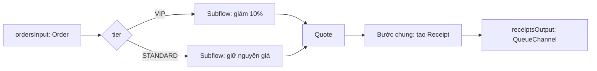
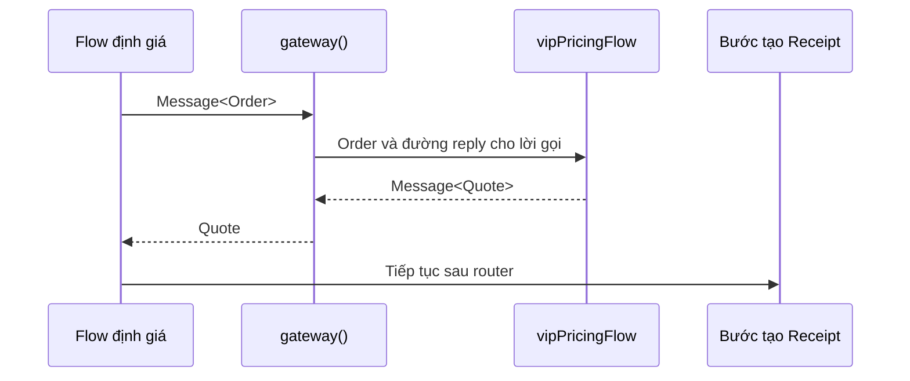

# Subflow trong Java DSL

## Mục tiêu và phạm vi

Trong chương **DSL nâng cao** của module **SPRING_INTEGRATION_CORE**, subflow giúp biểu diễn một nhánh xử lý gồm nhiều endpoint ngay trong định nghĩa luồng thông điệp. Bài này đi từ phân nhánh định giá đơn hàng đến tái sử dụng một flow qua gateway, xử lý thông điệp bị loại và phát thông báo cho nhiều bên nhận.

Sau bài học, bạn có thể:

- Đọc được điểm vào, điểm kết thúc và đường tiếp tục của từng nhánh.
- Dùng `subFlowMapping()` để xây dựng nhánh router có đầu ra thống nhất.
- Chọn `channelMapping()`, subflow nội tuyến hoặc `gateway()` theo hợp đồng thông điệp.
- Phân biệt nhánh router, nhánh discard của filter và subscriber của publish-subscribe.
- Nhận diện nguyên nhân thiếu reply, lỗi đồng bộ và lỗi sau ranh giới bất đồng bộ.
- Thiết kế kiểm thử kiểm tra cả nội dung lẫn số lượng thông điệp đầu ra.

**Điều kiện theo dõi:** đã biết `Message`, payload, headers, `MessageChannel`, transformer, router và service activator. Các ví dụ chọn **Java 17+ và API Spring Integration 6.5.x** làm mốc; không giả định phiên bản đang được cấu hình trong dự án. Java DSL nằm trong `spring-integration-core`. Ví dụ kiểm thử dùng JUnit Jupiter và `AnnotationConfigApplicationContext`, không cần Spring Boot.

## 1. Subflow là một phần của đồ thị thông điệp

Một subflow mô tả một đoạn của đồ thị endpoint và channel. Lambda `sf -> sf.transform(...)` được dùng khi Spring xây dựng cấu hình; nó không phải hàm nghiệp vụ được gọi trực tiếp cho mỗi đơn hàng.

Trong lúc chạy, thông điệp vẫn đi qua các thành phần quen thuộc:

```text
Message<Order>
    -> MessageChannel
    -> Router endpoint
    -> channel của nhánh được chọn
    -> Transformer endpoint
    -> channel của bước tiếp theo
```

`IntegrationFlow` là cách khai báo sự kết hợp đó. DSL đăng ký và nối các bean thực tế trong application context; vì vậy, hình thức lồng lambda không tự tạo thread, transaction hay tiến trình riêng. Xem [DSL Basics](https://docs.spring.io/spring-integration/reference/dsl/java-basics.html).

Có thể gặp subflow ở nhiều vị trí:

| Vị trí khai báo | Ý nghĩa của nhánh | Cần xác định điều gì? |
| --- | --- | --- |
| `route(..., r -> r.subFlowMapping(...))` | Xử lý theo khóa định tuyến | Nhánh có tạo kết quả để tiếp tục sau router không? |
| `route(..., r -> r.defaultSubFlowMapping(...))` | Xử lý khi không có mapping phù hợp | Đầu ra mặc định có cùng hợp đồng với các nhánh khác không? |
| `filter(..., f -> f.discardFlow(...))` | Xử lý thông điệp bị từ chối | Thông điệp sẽ kết thúc ở đâu? |
| `publishSubscribeChannel(p -> p.subscribe(...))` | Một subscriber nhận thông điệp được phát | Đây là tác vụ độc lập hay cần thu kết quả? |
| `routeToRecipients(r -> r.recipientFlow(...))` | Một bên nhận được chọn theo điều kiện | Có bao nhiêu điều kiện cùng khớp? |
| `gateway(...)` | Gửi yêu cầu đến một flow và nhận reply | Ai trả lời, trong bao lâu và khi lỗi thì sao? |

Không thể suy ra hành vi của mọi loại nhánh chỉ từ cách viết `sf -> ...`. Hãy đọc ý nghĩa của operator chứa nhánh.

## 2. Ví dụ hoàn chỉnh: hai nhánh định giá, một bước tạo biên nhận

### 2.1. Bài toán và hợp đồng

Hệ thống nhận `Order` và tính số tiền phải trả:

- Khách `VIP`: giảm 10%; phần giảm được lấy theo phép chia nguyên.
- Khách `STANDARD`: giữ nguyên giá.
- Hai nhánh đều tạo `Quote`.
- Một bước chung sau router chuyển `Quote` thành `Receipt`.

Tiền trong ví dụ là số nguyên đồng, dùng `long`. Quy tắc làm tròn này chỉ phục vụ bài thực hành.



Hai mũi tên vào bước chung biểu thị hai đường đi thay thế. Mỗi đơn hàng trong ví dụ đi qua một nhánh.

### 2.2. Cấu hình Java

Đây là một lớp cấu hình độc lập. Các đoạn mở rộng ở phần sau là phương án thay thế hoặc bổ sung có chỉ dẫn, không cần ghép tất cả vào lớp này.

```java
import java.util.Objects;

import org.springframework.context.annotation.Bean;
import org.springframework.context.annotation.Configuration;
import org.springframework.integration.channel.DirectChannel;
import org.springframework.integration.channel.QueueChannel;
import org.springframework.integration.config.EnableIntegration;
import org.springframework.integration.dsl.IntegrationFlow;

@Configuration(proxyBeanMethods = false)
@EnableIntegration
public class PricingConfig {

    public enum Tier {
        VIP, STANDARD
    }

    public record Order(String id, Tier tier, long amount) {
        public Order {
            Objects.requireNonNull(id, "id");
            Objects.requireNonNull(tier, "tier");
            if (amount < 0) {
                throw new IllegalArgumentException("amount must be >= 0");
            }
        }
    }

    public record Quote(String orderId, long payable, String policy) {
    }

    public record Receipt(
            String orderId,
            long payable,
            String policy,
            String status) {
    }

    @Bean
    public DirectChannel ordersInput() {
        return new DirectChannel();
    }

    @Bean
    public QueueChannel receiptsOutput() {
        return new QueueChannel(20);
    }

    @Bean
    public IntegrationFlow pricingFlow(
            DirectChannel ordersInput,
            QueueChannel receiptsOutput) {

        return IntegrationFlow.from(ordersInput)
                .<Order, Tier>route(Order::tier, routes -> routes
                        .id("pricingRouter")
                        .subFlowMapping(Tier.VIP, sf -> sf
                                .<Order, Quote>transform(order ->
                                        new Quote(
                                                order.id(),
                                                order.amount()
                                                        - order.amount() / 10,
                                                "VIP_10_PERCENT")))
                        .subFlowMapping(Tier.STANDARD, sf -> sf
                                .<Order, Quote>transform(order ->
                                        new Quote(
                                                order.id(),
                                                order.amount(),
                                                "STANDARD"))))
                .<Quote, Receipt>transform(quote ->
                        new Receipt(
                                quote.orderId(),
                                quote.payable(),
                                quote.policy(),
                                "QUOTED"))
                .channel(receiptsOutput)
                .get();
    }
}
```

Trong `.<Order, Tier>route(...)`, `Order` là kiểu payload đưa vào hàm chọn khóa, còn `Tier` là kiểu khóa. Kết quả `Order::tier` chọn mapping; nó không thay payload thành `Tier`. Transformer đầu tiên trong mỗi nhánh vẫn nhận `Order`.

Kết quả do nhánh nội tuyến tạo ra được DSL nối đến đoạn sau `route()`. Đây là đặc tính cần chú ý khi đọc router subflow. Xem [Sub-flows support](https://docs.spring.io/spring-integration/reference/6.5/dsl/java-subflows.html).

### 2.3. Lần theo một thông điệp

Với `new Order("O-101", Tier.VIP, 100_000)`:

1. `ordersInput` nhận `Message<Order>`.
2. Router tính khóa `Tier.VIP`.
3. Nhánh VIP tạo `Quote("O-101", 90_000, "VIP_10_PERCENT")`.
4. Transformer chung tạo `Receipt` có `status = "QUOTED"`.
5. `receiptsOutput` giữ thông điệp kết quả cho bên nhận.

Với đơn STANDARD cùng số tiền, kết quả có `payable = 100_000` và `policy = "STANDARD"`.

| Chặng | Payload |
| --- | --- |
| Trước router | `Order` |
| Vào nhánh VIP hoặc STANDARD | `Order` |
| Sau transformer của nhánh | `Quote` |
| Sau transformer chung | `Receipt` |

Sự thống nhất ở hàng thứ ba giúp phần sau router không phải đoán kiểu dữ liệu. Nếu một nhánh trả `String` còn bước chung chờ `Quote`, cấu hình fluent có thể vẫn được viết ra nhưng xử lý thông điệp sẽ gặp lỗi kiểu hoặc chuyển đổi.

**Điểm hội tụ của hai đường đi không phải aggregator.** Ví dụ này không giữ trạng thái để chờ kết quả từ cả VIP và STANDARD.

## 3. Hợp đồng đầu ra quyết định nhánh có tiếp tục hay không

### 3.1. Một nhánh trả kết quả và một nhánh chỉ tiêu thụ

Hai kiểu handler sau có mục đích khác nhau:

```java
// Nhánh tạo kết quả cho bước tiếp theo.
sf -> sf.<PricingConfig.Order>handle((order, headers) ->
        new PricingConfig.Quote(
                order.id(), order.amount(), "STANDARD"))

// Nhánh kết thúc bằng việc tiêu thụ thông điệp.
sf -> sf.handle(message -> {
    System.out.println(message.getPayload());
})
```

Handler thứ nhất trả về một đối tượng; handler thứ hai là `MessageHandler` một chiều. Nếu mục tiêu là tạo `Receipt` sau router, việc chỉ in đơn hàng chưa cung cấp `Quote` cho bước đó.

Tương tự, không dùng `return null` như một kết quả nghiệp vụ mang nghĩa “không giảm giá”. Nếu cần tiếp tục, hãy trả `Quote` với số tiền ban đầu. Nếu muốn kết thúc nhánh, hãy làm rõ đó là quyết định loại hoặc tiêu thụ thông điệp. Cách phân biệt endpoint một chiều và endpoint tạo reply được giới thiệu trong [DSL Basics](https://docs.spring.io/spring-integration/reference/dsl/java-basics.html).

### 3.2. Chuẩn hóa đầu ra trước khi rời nhánh

Khi mỗi nhánh gọi một hệ thống khác nhau, dữ liệu đầu ra có thể khác:

```text
Nhánh A: ExternalPriceA -> Quote
Nhánh B: ExternalPriceB -> Quote
                         |
                         v
                  tạo Receipt chung
```

Hãy để transformer cuối của từng nhánh chuyển về cùng một kiểu nghiệp vụ. Nhờ đó, router chịu trách nhiệm chọn đường đi, các nhánh chịu trách nhiệm thích nghi dữ liệu, còn bước chung thực hiện quy tắc dùng cho mọi kết quả.

Đối với ví dụ định giá, hợp đồng nên ghi rõ:

| Thuộc tính | Quy ước |
| --- | --- |
| Input | `Order` có `tier` hợp lệ |
| Output bình thường | Một `Quote` |
| Trường định danh | `Quote.orderId` giữ mã đơn |
| Trường số tiền | `Quote.payable` dùng cùng đơn vị với input |
| Lỗi kỹ thuật | Ném lỗi hoặc đi theo chính sách lỗi đã chọn |
| Loại đơn | Có nhánh kết thúc rõ ràng; không giả vờ đã định giá |

## 4. Phân biệt subflow, channel mapping và gateway

### 4.1. `channelMapping()` chỉ chọn đích gửi

Một đoạn cấu hình sau chọn channel đích:

```java
.<PricingConfig.Order, PricingConfig.Tier>route(
        PricingConfig.Order::tier,
        routes -> routes
                .channelMapping(
                        PricingConfig.Tier.VIP,
                        "vipPricingInput")
                .channelMapping(
                        PricingConfig.Tier.STANDARD,
                        "standardPricingInput"))
```

Hai channel cần tồn tại và có bên xử lý phù hợp. Router chuyển thông điệp đi; cấu hình này không tự thiết lập lời gọi yêu cầu–phản hồi quay về bước sau router.

Nếu các flow đích là tuyến xử lý độc lập, channel mapping diễn đạt đúng ý định. Nếu luồng gọi cần nhận một kết quả để tiếp tục, hãy khai báo hợp đồng gọi qua gateway. Quy tắc cho tham chiếu flow ngoài được nêu trong [RouterSpec](https://docs.spring.io/spring-integration/docs/6.5.0/api/org/springframework/integration/dsl/RouterSpec.html).

### 4.2. Tách nhánh VIP thành flow có đầu vào riêng

Giả sử nhiều luồng cần dùng chung nghiệp vụ định giá VIP. Có thể tách nghiệp vụ đó thành một `IntegrationFlow` bean nhận `Order`, trả `Quote`.

Các bean sau minh họa phương án thay thế nhánh VIP trong `PricingConfig`. Dùng các kiểu `Order`, `Tier`, `Quote`, `Receipt` đã định nghĩa ở phần 2. Khi đặt nhiều channel cùng kiểu trong một cấu hình, dùng `@Qualifier` để việc tiêm phụ thuộc không phụ thuộc tên tham số Java.

```java
@Bean
public DirectChannel vipPricingInput() {
    return new DirectChannel();
}

@Bean
public IntegrationFlow vipPricingFlow(
        @org.springframework.beans.factory.annotation.Qualifier(
                "vipPricingInput")
        DirectChannel input) {

    return IntegrationFlow.from(input)
            .<Order, Quote>transform(order ->
                    new Quote(
                            order.id(),
                            order.amount() - order.amount() / 10,
                            "VIP_10_PERCENT"))
            .get();
}
```

Flow này không gắn cứng output vào queue thu kết quả của một bên gọi. Khi được gọi bằng gateway, transformer cuối tạo reply về đường trả lời của yêu cầu.

Phương thức sau **thay thế** `pricingFlow()` ở phần 2:

```java
@Bean
public IntegrationFlow pricingFlow(
        @org.springframework.beans.factory.annotation.Qualifier(
                "ordersInput")
        DirectChannel input,
        @org.springframework.beans.factory.annotation.Qualifier(
                "vipPricingInput")
        DirectChannel vipInput,
        @org.springframework.beans.factory.annotation.Qualifier(
                "receiptsOutput")
        QueueChannel output) {

    return IntegrationFlow.from(input)
            .<Order, Tier>route(Order::tier, routes -> routes
                    .subFlowMapping(Tier.VIP, sf -> sf
                            .gateway(vipInput, gateway -> gateway
                                    .requestTimeout(500L)
                                    .replyTimeout(1_000L)
                                    .requiresReply(true)))
                    .subFlowMapping(Tier.STANDARD, sf -> sf
                            .<Order, Quote>transform(order ->
                                    new Quote(
                                            order.id(),
                                            order.amount(),
                                            "STANDARD"))))
            .<Quote, Receipt>transform(quote ->
                    new Receipt(
                            quote.orderId(),
                            quote.payable(),
                            quote.policy(),
                            "QUOTED"))
            .channel(output)
            .get();
}
```

`gateway()` có overload nhận tên channel, đối tượng `MessageChannel` hoặc một `IntegrationFlow`. Ở đây, việc tiêm trực tiếp channel đầu vào làm rõ đích gọi. Xem [Operator gateway()](https://docs.spring.io/spring-integration/reference/dsl/java-gateway.html).

### 4.3. Đường trả lời của lời gọi lồng nhau



Gateway thiết lập cơ chế nhận reply, thường dựa trên channel trả lời tạm thời trong header. Khi viết transformer chỉ để đổi payload, ưu tiên để framework giữ các header cần thiết. Nếu tự tạo `Message` mới, cần xem xét việc giữ `replyChannel`, `errorChannel` và các header tương quan liên quan. Xem [Messaging Gateways — Setting the Default Reply Channel](https://docs.spring.io/spring-integration/reference/6.5/gateway.html#setting-the-default-reply-channel).

Một lỗi thiết kế thường gặp là gắn `.channel("vipResults")` vào cuối flow dùng chung nhưng vẫn mong gateway nhận reply trực tiếp. Khi đó, kết quả đã có đường output cụ thể; việc có người đọc `vipResults` không tự hoàn tất lời gọi gateway.

### 4.4. Timeout phải đi cùng hợp đồng reply

| Tùy chọn trong ví dụ | Mục đích |
| --- | --- |
| `requestTimeout(500L)` | Giới hạn thời gian gửi khi channel đích có thể chặn |
| `replyTimeout(1_000L)` | Cấu hình thời gian chờ reply |
| `requiresReply(true)` | Xem việc endpoint gateway không tạo kết quả là lỗi |

Giá trị trên dùng mili giây và chỉ là ví dụ. Không nên xem `replyTimeout` như cơ chế ngắt một hàm Java đang chạy đồng bộ. Nếu downstream xử lý chậm ngay trên thread gửi qua `DirectChannel`, gateway không thể dùng thời gian chờ reply để tự hủy lời gọi đó. Tác vụ I/O cần timeout ở client hoặc thành phần thực hiện I/O.

Các tùy chọn có trong [GatewayEndpointSpec](https://docs.spring.io/spring-integration/docs/6.5.0/api/org/springframework/integration/dsl/GatewayEndpointSpec.html); ý nghĩa timeout được giải thích trong [Gateway Timeouts](https://docs.spring.io/spring-integration/reference/6.5/gateway.html#gateway-timeouts).

## 5. Nhánh mặc định và thông điệp không khớp mapping

Với enum chỉ có VIP và STANDARD, ví dụ đầu bao phủ toàn bộ giá trị được phép. Trong hệ thống thực, khóa có thể đến từ chuỗi bên ngoài và có giá trị chưa biết.

Cần chọn một chính sách rõ ràng:

- Từ chối khóa không được hỗ trợ.
- Chuyển sang một subflow xử lý mặc định.
- Cho thông điệp chưa khớp đi tiếp luồng cha nếu bước sau hiểu payload đó.

### 5.1. Một subflow mặc định có cùng kiểu đầu ra

Ví dụ độc lập sau chuẩn hóa phương thức thanh toán. Cả nhánh khớp và nhánh mặc định đều tạo `String`:

```java
@Bean
public IntegrationFlow paymentMethodFlow() {
    return IntegrationFlow.from("paymentMethodInput")
            .<String, String>route(
                    value -> value.strip()
                            .toUpperCase(java.util.Locale.ROOT),
                    routes -> routes
                            .channelKeyFallback(false)
                            .subFlowMapping("CARD", sf -> sf
                                    .<String, String>transform(
                                            value -> "PAY_BY_CARD"))
                            .defaultSubFlowMapping(sf -> sf
                                    .<String, String>transform(
                                            value -> "MANUAL_REVIEW")))
            .<String, String>transform(
                    result -> "DECISION:" + result)
            .channel(channel -> channel.queue("paymentMethodResults"))
            .get();
}
```

`channelKeyFallback(false)` ngăn dùng khóa chưa được map làm tên channel cần phân giải. Nhánh mặc định ở đây thể hiện quyết định chuyển sang kiểm tra thủ công. API `defaultSubFlowMapping()` được mô tả trong [AbstractRouterSpec](https://docs.spring.io/spring-integration/docs/6.5.0/api/org/springframework/integration/dsl/AbstractRouterSpec.html).

### 5.2. Cho thông điệp chưa khớp tiếp tục luồng cha

Nếu không cần biến đổi riêng cho trường hợp mặc định:

```java
@Bean
public IntegrationFlow labelFlow() {
    return IntegrationFlow.from("labelInput")
            .<String, Boolean>route(
                    text -> text.startsWith("VIP:"),
                    routes -> routes
                            .subFlowMapping(true, sf -> sf
                                    .<String, String>transform(
                                            text -> text.substring(4)))
                            .defaultOutputToParentFlow())
            .<String, String>transform(
                    text -> text.toUpperCase(java.util.Locale.ROOT))
            .channel(channel -> channel.queue("labelResults"))
            .get();
}
```

Kết quả dự kiến:

| Input | Đường đi | Output |
| --- | --- | --- |
| `VIP:alice` | Nhánh `true` bỏ tiền tố, rồi bước chung | `ALICE` |
| `bob` | Default đến bước chung | `BOB` |

`defaultOutputToParentFlow()` cấu hình đường mặc định đến phần tiếp theo của flow cha. Nó không có nghĩa gửi thêm một bản sao cho mọi thông điệp đã khớp nhánh. Với mapping router, tùy chọn này cũng tắt channel-key fallback trừ khi bị cấu hình lại sau đó. Xem [RouterSpec — defaultOutputToParentFlow](https://docs.spring.io/spring-integration/docs/6.5.0/api/org/springframework/integration/dsl/RouterSpec.html#defaultOutputToParentFlow()).

## 6. `discardFlow()`: xử lý thông điệp bị filter từ chối

Bổ sung điều kiện đơn hàng phải có số tiền lớn hơn 0:

```java
.<Order>filter(
        order -> order.amount() > 0,
        filter -> filter.discardFlow(discard -> discard
                .<Order, String>transform(order ->
                        "REJECTED:" + order.id() + ":ZERO_AMOUNT")
                .channel(channel ->
                        channel.queue("rejectedOrders"))))
```

Đặt đoạn này ngay trước router trong ví dụ định giá:

```text
Order.amount > 0
    -> router định giá
    -> Quote
    -> Receipt

Order.amount == 0
    -> discardFlow
    -> rejectedOrders
```

Thông điệp ở nhánh discard không quay lại đầu ra chấp nhận của filter. Vì vậy, không đặt logic bắt buộc cho cả hai loại đơn ở phía sau filter rồi mặc định rằng nó luôn chạy.

Nếu cần chuyển cả trường hợp hợp lệ lẫn không hợp lệ thành cùng một kiểu kết quả và tiếp tục xử lý chung, boolean router có hai subflow thường biểu đạt ý định rõ hơn. Filter phù hợp khi thật sự có quyết định cho đi tiếp hoặc loại khỏi tuyến chính. Xem [Filter](https://docs.spring.io/spring-integration/reference/filter.html).

**Khi dùng trong request–reply:** nếu một yêu cầu bị chuyển vào queue `rejectedOrders`, bên gọi không tự nhận được phản hồi nghiệp vụ. Hãy chọn rõ một trong các cách: trả kết quả từ chối theo hợp đồng của tuyến, ném lỗi bằng cấu hình phù hợp như `throwExceptionOnRejection(true)`, hoặc thiết kế đầu vào một chiều. Không thêm filter loại im lặng vào flow bắt buộc phải trả lời mà bỏ qua hậu quả thiếu reply.

## 7. Publish-subscribe: nhiều subscriber có vai trò độc lập

### 7.1. Phát sự kiện cho nhiều bên nhận

Sau khi tạo `Receipt`, hệ thống có thể muốn gửi thông báo đến audit và analytics:

```java
@Bean
public IntegrationFlow receiptEventsFlow() {
    return IntegrationFlow.from("receiptEventsInput")
            .publishSubscribeChannel(pubsub -> pubsub
                    .subscribe(audit -> audit
                            .channel(channel ->
                                    channel.queue("auditReceipts")))
                    .subscribe(analytics -> analytics
                            .channel(channel ->
                                    channel.queue("analyticsReceipts"))))
            .channel(channel ->
                    channel.queue("mainReceiptResults"))
            .get();
}
```

Trong ví dụ này, publish-subscribe có ba tuyến subscriber:

1. Nhánh đưa thông điệp đến `auditReceipts`.
2. Nhánh đưa thông điệp đến `analyticsReceipts`.
3. Đoạn tiếp theo của flow cha, đưa thông điệp đến `mainReceiptResults`.

Đoạn sau `publishSubscribeChannel()` là một subscriber bổ sung. Nó không phải điểm nhận kết quả trả về từ audit và analytics. Cách nối subscriber trong DSL được minh họa ở [Sub-flows support](https://docs.spring.io/spring-integration/reference/dsl/java-subflows.html).

### 7.2. Phát nhiều nơi khác với xử lý song song

`PublishSubscribeChannel` phát thông điệp cho các subscriber. Khi không cấu hình executor, việc dispatch diễn ra trên thread gửi; khai báo nhiều `subscribe()` không tự khiến chúng chạy song song. Với executor, cơ chế thực thi thay đổi, nhưng vẫn cần thiết kế cách thu kết quả nếu nghiệp vụ yêu cầu. Xem [Message Channel Implementations — PublishSubscribeChannel](https://docs.spring.io/spring-integration/reference/channel/implementations.html).

Ví dụ đã dùng record `Receipt` bất biến. Đây là lựa chọn hữu ích khi nhiều subscriber cùng nhận payload: tránh để nhánh audit sửa một đối tượng dùng chung rồi ảnh hưởng nhánh analytics.

Nếu cần đồng thời tính phí vận chuyển và kiểm tra tồn kho, sau đó chỉ tạo một kết quả khi đủ hai phản hồi, cần một cơ chế thu kết quả như aggregator hoặc scatter-gather. Aggregator có chiến lược tương quan và điều kiện giải phóng nhóm; nối `.aggregate()` sau một publish-subscribe không tự làm cho kết quả của mọi subscriber đi đến nó. Khi dùng sequence headers cho fan-out và gom nhóm, cần cấu hình `applySequence` phù hợp. Xem [Aggregator](https://docs.spring.io/spring-integration/reference/aggregator.html).

### 7.3. Recipient list khi chỉ một số bên nhận phù hợp

Nếu audit nhận mọi biên nhận nhưng analytics chỉ nhận một số loại, có thể dùng recipient list:

```java
.routeToRecipients(recipients -> recipients
        .recipientFlow(
                (Receipt receipt) -> true,
                audit -> audit.channel(channel ->
                        channel.queue("auditSelected")))
        .recipientFlow(
                (Receipt receipt) -> "VIP_10_PERCENT"
                        .equals(receipt.policy()),
                analytics -> analytics.channel(channel ->
                        channel.queue("vipAnalytics"))))
```

Đoạn này là ví dụ thay thế bước phân phối sự kiện. Một `Receipt` VIP có thể khớp cả hai điều kiện. Nếu cần tuyến cho thông điệp không khớp recipient nào, cấu hình default riêng; `defaultOutputToParentFlow()` của recipient list áp dụng cho trường hợp chưa có bên nhận được chọn. Xem [Message Routers — routeToRecipients](https://docs.spring.io/spring-integration/reference/6.5/dsl/java-routers.html).

## 8. Channel và lỗi: đọc cấu trúc lồng nhau là chưa đủ

### 8.1. Ranh giới thực thi nằm ở channel và endpoint

| Thành phần | Điều cần nhớ khi đặt trong subflow |
| --- | --- |
| `DirectChannel` | Gọi handler trên thread gửi trong cách dùng thông thường |
| `ExecutorChannel` | Dispatch qua executor; cần xem chính sách executor và xử lý lỗi |
| `QueueChannel` ở cuối nhánh | Là nơi đệm thông điệp cho consumer |
| `QueueChannel` ở giữa nhánh | Endpoint nhận từ queue cần poller để lấy thông điệp |

Các kết nối ngầm trong DSL thường dùng direct channel. Vì vậy, tách một đoạn thành subflow chỉ để đọc dễ hơn không làm một phép gọi HTTP chậm trở thành bất đồng bộ. Xem [Message Channel Implementations — DirectChannel](https://docs.spring.io/spring-integration/reference/6.5/channel/implementations.html#channel-implementations-directchannel).

Queue trong ví dụ đầu là **đầu ra được kiểm thử đọc bằng `receive()`**, nên không cần thêm endpoint poller. Nếu nối transformer sau queue, cần cấu hình poller cho endpoint đó.

Một queue đã nhận thông điệp cũng chưa chứng minh nghiệp vụ sau queue hoàn tất. Hãy phân biệt ba thời điểm: đã gửi, đã xử lý và đã nhận phản hồi.

### 8.2. Ngoại lệ đồng bộ và `ErrorMessage`

Trong tuyến chạy đồng bộ qua `DirectChannel`, ngoại lệ downstream có thể truyền ngược theo call stack tới bên gửi. Khi có executor hoặc poller, cần cơ chế xử lý lỗi của hạ tầng thực thi, thường thông qua `ErrorMessage`.

Ở cơ chế công bố lỗi chuẩn, header `errorChannel` của yêu cầu được xét trước channel lỗi toàn cục. Không nên cho rằng mọi lỗi đều tự đi vào một flow tên `errorChannel` khi gọi trực tiếp channel đồng bộ. Xem [Error Handling](https://docs.spring.io/spring-integration/reference/error-handling.html).

Với subflow gọi qua gateway, cần quyết định từ đầu:

| Tình huống | Quyết định cần có |
| --- | --- |
| Đơn hàng vi phạm quy tắc nghiệp vụ | Trả kết quả từ chối hoặc phát sinh lỗi nghiệp vụ theo hợp đồng |
| Dịch vụ định giá bên ngoài lỗi | Truyền lỗi, thử lại có giới hạn hoặc dùng phương án dự phòng |
| Gateway không nhận reply | Xử lý như lỗi hoặc cho phép kết thúc theo hợp đồng đã công bố |
| Audit thất bại sau ranh giới bất đồng bộ | Xử lý tại tuyến audit; không mặc định rollback được việc đã hoàn tất ở tuyến khác |

Nếu cấu hình một error flow để đổi lỗi thành reply, đầu ra của error flow phải tương thích với bên gọi. Một error flow chỉ ghi log chưa tạo ra `Quote`. Cơ chế gateway có error channel được mô tả trong [Messaging Gateways — Error Handling](https://docs.spring.io/spring-integration/reference/6.5/gateway.html).

## 9. Giữ subflow dễ đọc và có thể tái sử dụng

### 9.1. Chọn ranh giới theo nghiệp vụ

Với ví dụ định giá:

- Giữ nhánh STANDARD nội tuyến vì chỉ có một phép chuyển đổi.
- Tách định giá VIP khi có thêm gọi dịch vụ, dự phòng và nhiều nơi sử dụng.
- Đặt bước tạo `Receipt` sau router vì mọi `Quote` đều cần bước đó.
- Đưa thông báo audit sang tuyến phân phối sự kiện nếu nó có hợp đồng riêng.

Đây là các quyết định thiết kế cho ví dụ, không phải giới hạn số dòng của framework.

### 9.2. Tách hàm khai báo không đồng nghĩa tái sử dụng một endpoint

Có thể trích một đoạn cấu hình thành hàm:

```java
private static IntegrationFlow standardBranch() {
    return flow -> flow
            .<Order, Quote>transform(order ->
                    new Quote(
                            order.id(),
                            order.amount(),
                            "STANDARD"));
}
```

Sau đó:

```java
.subFlowMapping(Tier.STANDARD, standardBranch())
```

Ở đây hàm trả một khai báo nhánh mới, không được đánh dấu `@Bean` và không có đầu vào dùng chung đã đặt tên. Cách này giúp chia nhỏ mã cấu hình. Nếu cần một flow bean độc lập được nhiều nơi gọi để nhận reply, sử dụng đầu vào ổn định và gateway như phần 4.

Tránh tái sử dụng tùy tiện cùng một đối tượng endpoint có trạng thái trong nhiều flow. Tái sử dụng dịch vụ nghiệp vụ qua dependency injection thường đơn giản hơn việc chia sẻ các thành phần cấu hình đang được DSL đăng ký.

### 9.3. Hạn chế lồng nhiều tầng

Một nhánh lồng router, rồi publish-subscribe, rồi thêm router khiến người đọc khó xác định:

- Một input tạo bao nhiêu thông điệp?
- Kiểu payload tại điểm hội tụ là gì?
- Nhánh nào kết thúc, nhánh nào trả lời?
- Lỗi ở đâu còn truyền về bên gọi?

Khi phải kéo màn hình qua nhiều tầng để trả lời các câu trên, nên tách theo nghiệp vụ và viết rõ hợp đồng input/output cho từng phần.

## 10. Kiểm thử hành vi của ví dụ định giá

### 10.1. Kiểm tra kết quả và số lượng thông điệp

Lớp kiểm thử sau dành cho **`PricingConfig` nguyên bản ở phần 2**. Đây là mã minh họa để chạy trong môi trường đã có dependency phù hợp; bài viết không kèm kết quả thực thi.

```java
import org.junit.jupiter.api.Test;

import org.springframework.context.annotation.AnnotationConfigApplicationContext;
import org.springframework.integration.channel.DirectChannel;
import org.springframework.integration.channel.QueueChannel;
import org.springframework.messaging.Message;
import org.springframework.messaging.support.MessageBuilder;

import static org.junit.jupiter.api.Assertions.*;

class PricingFlowTest {

    @Test
    void vipBranchReturnsToTheCommonReceiptStep() {
        try (var context =
                     new AnnotationConfigApplicationContext(
                             PricingConfig.class)) {

            var input = context.getBean(
                    "ordersInput", DirectChannel.class);
            var output = context.getBean(
                    "receiptsOutput", QueueChannel.class);

            var order = new PricingConfig.Order(
                    "O-101", PricingConfig.Tier.VIP, 100_000);

            assertTrue(input.send(MessageBuilder
                    .withPayload(order)
                    .setHeader("traceId", "trace-101")
                    .build()));

            Message<?> result = output.receive(1_000);
            assertNotNull(result);

            var receipt = assertInstanceOf(
                    PricingConfig.Receipt.class,
                    result.getPayload());

            assertEquals("O-101", receipt.orderId());
            assertEquals(90_000L, receipt.payable());
            assertEquals("VIP_10_PERCENT", receipt.policy());
            assertEquals("QUOTED", receipt.status());
            assertEquals(
                    "trace-101", result.getHeaders().get("traceId"));

            assertNull(output.receive(0),
                    "One order should produce one receipt");
        }
    }

    @Test
    void standardBranchAlsoUsesTheCommonReceiptStep() {
        try (var context =
                     new AnnotationConfigApplicationContext(
                             PricingConfig.class)) {

            var input = context.getBean(
                    "ordersInput", DirectChannel.class);
            var output = context.getBean(
                    "receiptsOutput", QueueChannel.class);

            var order = new PricingConfig.Order(
                    "O-102", PricingConfig.Tier.STANDARD, 100_000);

            assertTrue(input.send(
                    MessageBuilder.withPayload(order).build()));

            Message<?> result = output.receive(1_000);
            assertNotNull(result);

            var receipt = assertInstanceOf(
                    PricingConfig.Receipt.class,
                    result.getPayload());

            assertEquals("O-102", receipt.orderId());
            assertEquals(100_000L, receipt.payable());
            assertEquals("STANDARD", receipt.policy());
            assertEquals("QUOTED", receipt.status());

            assertNull(output.receive(0));
        }
    }
}
```

Kiểm tra `status = "QUOTED"` chứng minh thông điệp đã qua bước chung sau router. Kiểm tra kiểu payload và `payable` cho thấy nhánh tương ứng tạo đúng dữ liệu. Kiểm tra queue không còn phần tử giúp phát hiện trường hợp phát sinh thừa biên nhận trong cấu hình đồng bộ của ví dụ.

Nhận thành công từ `input.send(...)` riêng lẻ chưa kiểm tra đủ kết quả nghiệp vụ. Thêm header `traceId` và kiểm tra ở đầu ra cũng giúp phát hiện việc vô tình làm mất metadata khi biến đổi thông điệp.

### 10.2. Ma trận kiểm thử cho các phần mở rộng

| Trường hợp | Quan sát cần kiểm tra |
| --- | --- |
| VIP và STANDARD | Đúng nhánh, đúng `Quote`, đều qua bước tạo `Receipt` |
| Đơn có amount bằng 0 với filter mở rộng | Có thông điệp ở `rejectedOrders`, không có biên nhận mới |
| Khóa thanh toán chưa biết | Đi nhánh mặc định, không bị hiểu nhầm thành tên channel |
| Flow VIP gọi qua gateway | Nhận reply và tiếp tục tạo `Receipt` |
| Flow VIP không tạo reply | Kết quả theo chính sách timeout/required reply đã chọn |
| Flow VIP ném lỗi đồng bộ | Lỗi hoặc reply dự phòng đến đúng bên gọi |
| Phát sự kiện biên nhận | Mỗi queue audit, analytics và tuyến chính nhận đúng số thông điệp |
| Chuyển sang executor | Kiểm tra bằng cơ chế chờ có giới hạn; không dựa vào thứ tự hoàn tất |

Với tuyến bất đồng bộ, `receive(0)` ngay lập tức không chứng minh sẽ không có thông điệp đến muộn. Cần thiết kế khoảng quan sát hoặc điểm đồng bộ phù hợp. Nếu cần cô lập service activator hoặc thay endpoint bằng mock, có thể dùng `spring-integration-test`. Xem [Testing support](https://docs.spring.io/spring-integration/reference/6.5/testing.html).

## 11. Chẩn đoán các lỗi thường gặp

| Triệu chứng | Cách kiểm tra và điều chỉnh |
| --- | --- |
| Có dữ liệu ở queue của nhánh nhưng bước chung không chạy | Xác định nhánh có chủ ý kết thúc ở queue không; nếu cần gọi và nhận kết quả từ flow độc lập, dùng gateway |
| Gateway chờ nhưng flow đích đã xử lý xong | Kiểm tra output channel cố định, handler không trả giá trị, filter loại thông điệp và header đường reply |
| Báo endpoint một chiều không phù hợp để gán output | Xem có nối bước tiếp theo sau handler chỉ tiêu thụ, hoặc tham chiếu flow ngoài mà thiếu gateway không |
| Lỗi kiểu sau router | So sánh payload cuối của tất cả các nhánh, kể cả default |
| Một khóa lạ gây lỗi phân giải channel | Xem `channelKeyFallback` và chính sách default |
| Nhánh discard xử lý xong nhưng caller thiếu kết quả | Discard đã rời tuyến chấp nhận; thiết kế lại hợp đồng phản hồi |
| Audit nhận payload nhưng tuyến chính thấy dữ liệu bị sửa | Kiểm tra payload có mutable và bị chia sẻ giữa subscriber không |
| Thêm executor khiến `try/catch` bên gửi không bắt lỗi như trước | Xác định ranh giới thread và cơ chế error channel |
| Nhánh dừng khi có queue ở giữa | Kiểm tra endpoint tiêu thụ queue và cấu hình poller |
| Mong đợi gom hai kết quả nhưng chỉ có một thông điệp | Vẽ lại đường đi; xác định fan-out, đích đưa kết quả về và aggregator |

Khi chẩn đoán, bắt đầu từ một đơn hàng có mã rõ ràng và đánh dấu ba điểm: ngay trước phân nhánh, cuối nhánh được chọn và đầu bước chung. Sau đó xem payload, header tương quan và thread thực thi tại từng điểm.

## 12. Bài thực hành củng cố

### Bài 1: Bổ sung khách đối tác

Thêm `PARTNER` vào `Tier`, giảm 5% và giữ đầu ra nhánh là `Quote`.

Tiêu chí hoàn thành:

- Đơn 100.000 đồng tạo `Receipt` có `payable = 95_000`.
- Bước tạo `Receipt` vẫn chỉ khai báo một lần.
- Đơn VIP và STANDARD giữ hành vi đã kiểm thử.
- Mỗi input tạo đúng một biên nhận.

### Bài 2: Tách nghiệp vụ VIP

Áp dụng biến thể gateway ở phần 4, rồi bổ sung một flow đầu vào khác cũng gọi `vipPricingInput`.

Tiêu chí hoàn thành:

- Hai bên gọi đều nhận đúng kết quả cho đơn của mình.
- Flow VIP không gắn cứng output vào queue của riêng một caller.
- Hợp đồng khi lỗi và khi thiếu reply được ghi rõ.
- Không gọi trực tiếp phương thức `@Bean` để thay cho việc tiêm channel hoặc flow cần dùng.

### Bài 3: Theo dõi đơn bị loại

Thêm filter từ phần 6 vào tuyến định giá. Gửi một đơn amount bằng 0 và một đơn hợp lệ.

Tiêu chí hoàn thành:

- Queue từ chối nhận thông tin đúng mã đơn amount bằng 0.
- Chỉ đơn hợp lệ tạo `Receipt`.
- Giải thích được vì sao nhánh discard không tự tạo phản hồi cho request–reply.
- Nếu đổi đầu vào sang gateway bắt buộc có reply, đề xuất một hợp đồng từ chối cụ thể.

### Bài 4: Phân phối sự kiện

Gửi một `Receipt` vào `receiptEventsInput` ở phần 7 và đọc ba queue đầu ra.

Tiêu chí hoàn thành:

- Mỗi queue nhận một thông điệp cho input đó.
- Giải thích được tại sao tuyến chính không đang chờ kết quả audit.
- Khi thêm executor, cập nhật cách chờ trong kiểm thử.
- Nếu nghiệp vụ đổi thành “chờ đủ phản hồi rồi quyết định”, vẽ thêm đường đưa phản hồi về điểm gom.

## 13. Những nguyên tắc cần ghi nhớ

- Với router subflow, xác định rõ kết quả nào được đưa đến phần sau router.
- Các nhánh cùng tiếp tục một bước nên thống nhất kiểu và ý nghĩa payload.
- Dùng gateway khi flow gọi cần phản hồi từ một flow độc lập.
- Nhánh discard và subscriber có hợp đồng riêng; không suy ra hành vi từ hình thức lambda.
- Điểm hội tụ đường đi, phát nhiều nơi và gom nhiều kết quả là các việc khác nhau.
- Channel và cơ chế thực thi quyết định thread, cách chờ và đường xử lý lỗi.
- Kiểm thử cả giá trị, headers cần giữ và số thông điệp phát sinh.

Khi thiết kế một subflow mới, hãy viết được một câu mô tả: **“Nhánh này nhận kiểu gì, tạo tối đa bao nhiêu kết quả, đưa kết quả đến đâu và làm gì khi không thể trả lời?”** Câu trả lời đó là cơ sở để chọn operator và kiểm thử luồng.
