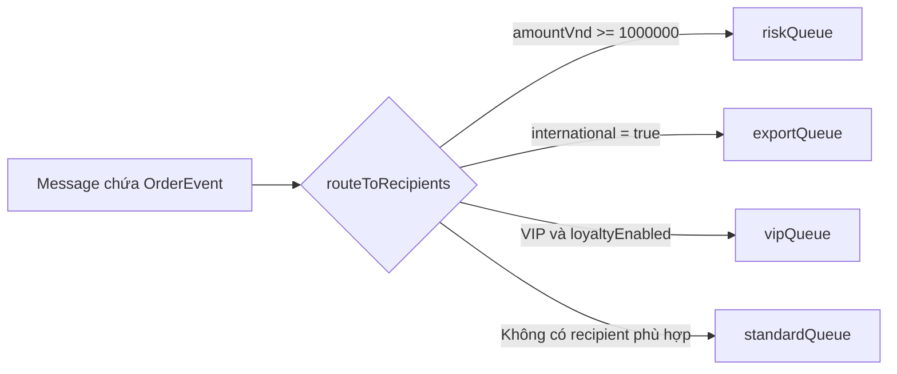
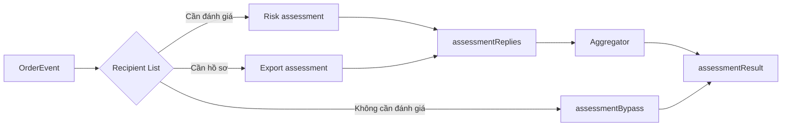

# routeToRecipients — định tuyến một thông điệp tới nhiều nơi nhận

## 1. Mục tiêu và bối cảnh

Trong module `SPRING_INTEGRATION_CORE`, luồng tích hợp được xây dựng từ `Message`, `MessageChannel`, endpoint và gateway bằng Java DSL. Bài này thuộc chương **DSL nâng cao**, tập trung vào `routeToRecipients`: cách biểu diễn mẫu Enterprise Integration Pattern **Recipient List** khi một sự kiện cần đi tới nhiều nhánh xử lý độc lập.

Sau bài học, bạn có thể:

- Chọn recipient bằng payload, header hoặc biểu thức SpEL.
- Phân biệt channel đích với subflow khai báo tại chỗ.
- Thiết kế đường mặc định khi không có điều kiện nào phù hợp.
- Giải thích ảnh hưởng của channel, lỗi gửi và sequence header tới luồng.
- Kết hợp transformer, filter, aggregator và gateway với hợp đồng thông điệp rõ ràng.
- Viết kiểm thử chứng minh message đến đúng tập recipient, kể cả khi nhiều điều kiện cùng đúng.

Ví dụ sử dụng cú pháp `IntegrationFlow.from(...)` của Spring Integration 6.x, đối chiếu tài liệu nhánh 6.4. Kiểu `record` trong mã cần Java 17 trở lên. Java DSL nằm trong `spring-integration-core`; với Spring Boot, dependency thường dùng là `spring-boot-starter-integration`. Dùng bộ phiên bản do dự án hoặc Spring Boot quản lý để các thư viện Spring tương thích.

## 2. Recipient List chọn một tập đích

Giả sử hệ thống nhận sự kiện đơn hàng:

- Đơn từ 1.000.000 đồng cần đánh giá rủi ro.
- Đơn quốc tế cần chuẩn bị hồ sơ xuất hàng.
- Đơn của khách VIP được gửi sang chương trình khách hàng thân thiết nếu header bật tính năng này.
- Nếu không cần nhánh đặc biệt nào, đơn được đưa sang hàng đợi xử lý thông thường.

Một đơn quốc tế giá trị cao của khách VIP có thể cần cả ba nhánh đầu. Kết quả định tuyến vì thế là **một danh sách recipient phù hợp**, không phải một lựa chọn duy nhất.



Router đánh giá selector để xác định danh sách đích, rồi gửi tới các đích được chọn. Hai selector cùng trả về `true` dẫn đến hai lượt gửi. Selector trả về `false` chỉ loại recipient tương ứng. Hành vi này thể hiện trong [mã nguồn RecipientListRouter 6.4.0](https://raw.githubusercontent.com/spring-projects/spring-integration/v6.4.0/spring-integration-core/src/main/java/org/springframework/integration/router/RecipientListRouter.java).

Cần phân biệt ba cấp độ:

| Cấp độ | Câu hỏi cần trả lời |
| --- | --- |
| Chọn recipient | Message cần đến những channel hoặc subflow nào? |
| Gửi vào channel | Channel đã tiếp nhận message hay phát sinh lỗi gửi? |
| Xử lý nghiệp vụ | Consumer đã thực hiện thành công tác vụ cần làm chưa? |

Gửi thành công vào `QueueChannel` mới xác nhận message đã vào queue. Nó chưa xác nhận email đã được gửi, hồ sơ đã được tạo hay giao dịch đã hoàn tất.

## 3. Các cách khai báo recipient

`routeToRecipients(...)` nhận cấu hình `RecipientListRouterSpec`:

```java
.routeToRecipients(r -> r
    .recipient("auditChannel")
    .recipient("riskChannel", (OrderEvent order) -> order.amountVnd() >= 1_000_000L)
    .recipient("exportChannel", "payload.international()")
    .recipientMessageSelector("vipChannel", message ->
        Boolean.TRUE.equals(message.getHeaders().get("loyaltyEnabled"))))
```

Đây là đoạn minh họa cú pháp; các channel có tên trong đoạn này phải tồn tại khi áp dụng vào application context.

| API | Dữ liệu selector nhận | Khi nào nên dùng |
| --- | --- | --- |
| `recipient("channel")` | Không có selector | Luôn gửi tới recipient này |
| `recipient("channel", (OrderEvent p) -> ...)` | Payload có kiểu `OrderEvent` | Điều kiện Java dựa trên payload |
| `recipient("channel", "...")` | Ngữ cảnh SpEL có `payload`, `headers` | Điều kiện ngắn viết bằng biểu thức |
| `recipientMessageSelector("channel", m -> ...)` | Toàn bộ `Message<?>` | Cần payload và header |
| `recipientFlow(selector, flow)` | Phụ thuộc overload selector | Khai báo luôn một nhánh xử lý |
| `recipientMessageSelectorFlow(selector, flow)` | Toàn bộ `Message<?>` | Subflow có điều kiện dựa trên message |

Các overload `recipient(...)` còn cho phép truyền trực tiếp đối tượng `MessageChannel`. Chữ ký các phương thức có trong [RecipientListRouterSpec Javadoc](https://docs.spring.io/spring-integration/api/org/springframework/integration/dsl/RecipientListRouterSpec.html).

### 3.1. Lambda theo payload và selector theo message

Ở đây, tham số lambda là payload, không phải `Message<OrderEvent>`:

```java
.recipient("riskQueue",
    (OrderEvent order) -> order.amountVnd() >= 1_000_000L)
```

Nếu cần header, hãy chọn API thể hiện rõ điều đó:

```java
.recipientMessageSelector("vipQueue", message -> {
    OrderEvent order = (OrderEvent) message.getPayload();
    return order.vip()
        && Boolean.TRUE.equals(message.getHeaders().get("loyaltyEnabled"));
})
```

Hợp đồng đầu vào yêu cầu payload là `OrderEvent` và `loyaltyEnabled` có kiểu `Boolean`. Header thiếu được hiểu là chưa bật. Chuỗi `"true"` không bằng `Boolean.TRUE`; nếu header từ HTTP hoặc broker là chuỗi, cần chuẩn hóa trước router.

Ghi rõ kiểu tham số giúp trình biên dịch chọn overload và giúp người đọc nhận ra hợp đồng dữ liệu.

### 3.2. SpEL theo payload và header

Với Java record, có thể gọi accessor tường minh:

```java
.recipient("exportQueue", "payload.international()")
.recipient("vipQueue",
    "payload.vip() and headers['loyaltyEnabled'] == true")
```

Biểu thức cần trả về kết quả boolean phù hợp. Quy tắc phức tạp hoặc cần tái sử dụng thường phù hợp với một hàm Java có tên rõ ràng.

Selector nên là phép kiểm tra không gây tác dụng phụ. Không cập nhật cơ sở dữ liệu, gửi thông báo hoặc sửa payload trong selector; đặt tác vụ đó vào endpoint của nhánh. Việc đánh giá điều kiện khi đó không làm thay đổi kết quả của những selector khác.

## 4. Ví dụ đầy đủ: phân phối sự kiện đơn hàng

Các queue trong ví dụ là điểm quan sát kết quả. Chưa gắn consumer nghiệp vụ vào queue để người học có thể lấy message ra và kiểm tra tập recipient.

```java
import org.springframework.context.annotation.Bean;
import org.springframework.context.annotation.Configuration;
import org.springframework.integration.channel.DirectChannel;
import org.springframework.integration.channel.QueueChannel;
import org.springframework.integration.config.EnableIntegration;
import org.springframework.integration.dsl.IntegrationFlow;

@Configuration
@EnableIntegration
public class OrderRecipientConfig {

    public record OrderEvent(
        String orderId,
        long amountVnd,
        boolean vip,
        boolean international
    ) {}

    @Bean
    public DirectChannel orderInput() {
        return new DirectChannel();
    }

    @Bean
    public QueueChannel riskQueue() {
        return new QueueChannel(100);
    }

    @Bean
    public QueueChannel exportQueue() {
        return new QueueChannel(100);
    }

    @Bean
    public QueueChannel vipQueue() {
        return new QueueChannel(100);
    }

    @Bean
    public QueueChannel standardQueue() {
        return new QueueChannel(100);
    }

    @Bean
    public IntegrationFlow orderRecipients() {
        return IntegrationFlow.from(orderInput())
            .routeToRecipients(r -> r
                .recipient("riskQueue", (OrderEvent order) ->
                    order.amountVnd() >= 1_000_000L)
                .recipient("exportQueue", "payload.international()")
                .recipientMessageSelector("vipQueue", message -> {
                    OrderEvent order = (OrderEvent) message.getPayload();
                    return order.vip()
                        && Boolean.TRUE.equals(
                            message.getHeaders().get("loyaltyEnabled"));
                })
                .defaultOutputChannel("standardQueue")
                .sendTimeout(500L))
            .get();
    }
}
```

`orderInput` là `DirectChannel`, nên khi bên gửi gọi `send(...)`, router chạy trong cùng luồng gọi. Queue đầu ra lưu message để bên nhận lấy sau. `.sendTimeout(500L)` giới hạn thời gian chờ gửi vào channel hỗ trợ chờ, đặc biệt khi queue có dung lượng hữu hạn.

Hợp đồng dữ liệu:

- `orderId` xác định đơn hàng ở cấp nghiệp vụ.
- `amountVnd` là số nguyên đồng Việt Nam; ngưỡng dùng phép so sánh `>=`.
- `vip` và `international` đã được chuẩn hóa trước router.
- `loyaltyEnabled` là header kiểu `Boolean`, có thể vắng mặt.

Mỗi recipient được chọn nhận payload `OrderEvent` của sự kiện đầu vào. Router phân phối message; việc biến đổi dữ liệu được đặt trong nhánh khi cần.

### 4.1. Bảng kết quả mong đợi

| Đơn | Số tiền | Quốc tế | VIP | `loyaltyEnabled` | Các queue nhận |
| --- | ---: | --- | --- | --- | --- |
| A | 1.500.000 | Có | Có | `true` | `riskQueue`, `exportQueue`, `vipQueue` |
| B | 1.000.000 | Không | Không | `true` | `riskQueue` |
| C | 250.000 | Có | Không | `true` | `exportQueue` |
| D | 250.000 | Không | Có | `true` | `vipQueue` |
| E | 250.000 | Không | Có | Không có header | `standardQueue` |
| F | 250.000 | Không | Không | `false` | `standardQueue` |

Đơn A giúp phân biệt Recipient List với chuỗi `if/else if`: ba điều kiện cùng đúng và cả ba nhánh đều phải nhận.

### 4.2. Đưa consumer vào nhánh

Consumer đọc `QueueChannel` cần poller. Có thể thêm bean sau vào cấu hình để tiêu thụ `riskQueue`:

```java
@Bean
public IntegrationFlow riskConsumer() {
    return IntegrationFlow.from("riskQueue")
        .handle(OrderEvent.class, (order, headers) -> {
            System.out.println("Đánh giá rủi ro đơn " + order.orderId());
            return null;
        }, endpoint -> endpoint.poller(poller -> poller.fixedDelay(100L)))
        .get();
}
```

`return null` kết thúc nhánh không sinh reply. Khi chạy kiểm thử ở mục 11, chỉ dùng cấu hình ban đầu để consumer không lấy mất message trước assertion.

Queue trong ví dụ nằm trong bộ nhớ. Nếu cần giữ message qua lần khởi động lại, phải thiết kế lưu trữ bền vững phù hợp cho channel hoặc dùng broker.

## 5. Đường mặc định và phần tiếp theo của flow

### 5.1. `defaultOutputChannel(...)`

Trong ví dụ chính, `standardQueue` nhận trường hợp không có selector nào chọn recipient. Nó không phải nhánh luôn chạy sau ba recipient.

Recipient vô điều kiện làm thay đổi thiết kế này:

```java
.routeToRecipients(r -> r
    .recipient("auditQueue")
    .recipient("riskQueue", (OrderEvent order) ->
        order.amountVnd() >= 1_000_000L)
    .defaultOutputChannel("standardQueue"))
```

Nếu gửi vào `auditQueue` thành công thì luôn có một đích nhận. Đơn thông thường chỉ đi `auditQueue`, không tự đi thêm `standardQueue`. Nếu cần vừa audit mọi đơn, vừa phân loại đơn thường, có thể đặt audit trước router bằng cơ chế phù hợp hoặc thêm selector tường minh cho nhánh đơn thường.

Khi không có đích và không cấu hình default output, router phát sinh `MessageDeliveryException`. Nếu nghiệp vụ chủ đích bỏ message không phù hợp, có thể chọn `nullChannel` làm default output và thiết kế cách theo dõi số message bị bỏ.

Khi bật `ignoreSendFailures(true)`, có một chi tiết: trong triển khai 6.4, router xét default output nếu **không có lượt gửi nào thành công**. Vì vậy default còn có thể nhận message khi mọi lượt gửi tới recipient đã chọn đều thất bại và lỗi được bỏ qua. Nếu một lượt gửi đã thành công, default không được gọi để bù cho recipient còn lại. Cơ chế này và lỗi thiếu default thể hiện trong [AbstractMessageRouter 6.4.0](https://raw.githubusercontent.com/spring-projects/spring-integration/v6.4.0/spring-integration-core/src/main/java/org/springframework/integration/router/AbstractMessageRouter.java).

Nên tách luồng lỗi khỏi đường phân loại đơn thường để tránh trộn đơn chưa cần xử lý đặc biệt với đơn không gửi được tới hệ thống đích.

### 5.2. `defaultOutputToParentFlow()`

Khi muốn xử lý trường hợp mặc định ngay sau router trong chuỗi DSL, dùng `defaultOutputToParentFlow()`:

```java
@Bean
public IntegrationFlow inlineOrderRecipients() {
    return IntegrationFlow.from("inlineOrderInput")
        .routeToRecipients(r -> r
            .recipientFlow(
                (OrderEvent order) -> order.amountVnd() >= 1_000_000L,
                flow -> flow
                    .<OrderEvent, String>transform(order ->
                        "RISK:" + order.orderId())
                    .channel(c -> c.queue("inlineRiskResult")))
            .recipientFlow(
                (OrderEvent order) -> order.international(),
                flow -> flow
                    .<OrderEvent, String>transform(order ->
                        "EXPORT:" + order.orderId())
                    .channel(c -> c.queue("inlineExportResult")))
            .defaultOutputToParentFlow())
        .<OrderEvent, String>transform(order ->
            "STANDARD:" + order.orderId())
        .channel(c -> c.queue("inlineDefaultResult"))
        .get();
}
```

Đây là bean bổ sung có thể đặt trong `OrderRecipientConfig`. Các channel dùng tên riêng để không trộn kết quả với ví dụ chính. DSL tạo `inlineOrderInput` làm input channel có tên; các lời gọi `queue(...)` đăng ký queue kết quả tương ứng.

Luồng này có hai điều kiện, độc lập với điều kiện VIP của ví dụ chính:

- Đơn giá trị cao và quốc tế tạo kết quả ở cả `inlineRiskResult` và `inlineExportResult`.
- Đơn không khớp hai điều kiện đi tiếp tới transformer tạo `STANDARD:...`.
- Transformer `STANDARD:...` không tự chạy sau mọi subflow đã nhận message.

Tài liệu [Message Routers trong Java DSL](https://docs.spring.io/spring-integration/reference/6.4/dsl/java-routers.html) mô tả `defaultOutputToParentFlow()` là cách đưa đường mặc định về phần tiếp theo của flow cha.

Không dùng operator này như bước chờ mọi nhánh hoàn tất. Nếu cần một kết quả chung từ nhiều recipient, phải thiết kế bước thu gom phản hồi.

## 6. Chọn `recipient(...)` hay `recipientFlow(...)`

`recipient("channelName", selector)` phù hợp khi đích là điểm kết nối có tên rõ ràng: một flow khác, queue hoặc adapter. Cấu hình định tuyến không cần biết chi tiết xử lý phía sau channel.

`recipientFlow(selector, flow -> ...)` phù hợp khi nhánh ngắn và việc đặt điều kiện cạnh transformer hoặc handler giúp đọc ngay hành vi. Subflow có thể biến đổi payload riêng mà vẫn giữ router dễ đọc.

Ví dụ, hai nhánh có thể tạo hợp đồng dữ liệu khác nhau:

```text
OrderEvent
  -> nhánh risk   -> RiskAssessmentRequest
  -> nhánh export -> ExportDocumentRequest
```

Hai message phục vụ hai hệ thống nhận khác nhau. Nếu cần gom kết quả, nên chuyển các phản hồi về một kiểu chung hoặc mô hình kết quả có nhãn nhánh.

Trong ví dụ inline, mỗi subflow kết thúc ở queue tường minh nên router không tự thu gom reply. Không suy diễn rằng mọi `recipientFlow` tự quay về dòng DSL sau `routeToRecipients`.

Router gửi tới **channel**, không trực tiếp broadcast tới mọi consumer của channel. Nếu một `DirectChannel` có nhiều subscriber, dispatcher của channel chọn subscriber theo ngữ nghĩa point-to-point. Muốn broadcast cho các subscriber của một channel, cân nhắc `PublishSubscribeChannel`.

## 7. Phối hợp aggregator bằng `applySequence(true)`

Recipient List giải quyết phân phối. Aggregator gom các phản hồi liên quan thành một kết quả.



Khi bật `applySequence(true)`, router bổ sung thông tin sequence cho message gửi tới recipient đã chọn. Tùy chọn này mặc định tắt trên recipient-list router, như mô tả trong [Router Implementations](https://docs.spring.io/spring-integration/reference/7.0/router/implementations.html).

| Header | Vai trò trong ví dụ |
| --- | --- |
| `correlationId` | Liên kết message của cùng lần phân phối; ở triển khai được xét, khóa liên quan tới ID message đầu vào |
| `sequenceNumber` | Vị trí message trong danh sách đích được chọn |
| `sequenceSize` | Số đích được chọn cho lần phân phối |

Nếu cấu hình có ba recipient nhưng chỉ hai recipient phù hợp, `sequenceSize` của các bản gửi là `2`. Giá trị này dựa trên tập đích đã chọn, không phải số nhánh xử lý nghiệp vụ thành công.

### 7.1. Hai nhánh đánh giá, một kết quả chung

Các bean sau có thể thêm vào `OrderRecipientConfig`; cần bổ sung `import java.util.List;`. Luồng đánh giá dùng input và output riêng, không thay thế `orderRecipients()`.

```java
public record Assessment(String orderId, String check) {}

@Bean
public QueueChannel assessmentResult() {
    return new QueueChannel(100);
}

@Bean
public QueueChannel assessmentDiscard() {
    return new QueueChannel(100);
}

@Bean
public IntegrationFlow assessmentRecipients() {
    return IntegrationFlow.from("assessmentInput")
        .routeToRecipients(r -> r
            .applySequence(true)
            .recipientFlow(
                (OrderEvent order) -> order.amountVnd() >= 1_000_000L,
                flow -> flow
                    .<OrderEvent, Assessment>transform(order ->
                        new Assessment(order.orderId(), "RISK_CHECKED"))
                    .channel("assessmentReplies"))
            .recipientFlow(
                (OrderEvent order) -> order.international(),
                flow -> flow
                    .<OrderEvent, Assessment>transform(order ->
                        new Assessment(order.orderId(), "EXPORT_CHECKED"))
                    .channel("assessmentReplies"))
            .defaultOutputChannel("assessmentBypass"))
        .get();
}

@Bean
public IntegrationFlow combineAssessments() {
    return IntegrationFlow.from("assessmentReplies")
        .aggregate(aggregator -> aggregator
            .groupTimeout(5_000L)
            .sendPartialResultOnExpiry(false)
            .discardChannel("assessmentDiscard"))
        .channel("assessmentResult")
        .get();
}

@Bean
public IntegrationFlow bypassAssessments() {
    return IntegrationFlow.from("assessmentBypass")
        .<OrderEvent, List<Assessment>>transform(order -> List.of(
            new Assessment(order.orderId(), "NO_EXTRA_CHECK")))
        .channel("assessmentResult")
        .get();
}
```

`assessmentReplies` được khai báo làm input có tên của flow gom kết quả. Mỗi transformer tạo đúng một phản hồi rồi gửi tới channel đó. Aggregator mặc định tập hợp payload các phản hồi thành danh sách khi nhóm đủ điều kiện giải phóng.

Các chuỗi `RISK_CHECKED` và `EXPORT_CHECKED` mô phỏng kết quả tác vụ. Khi nối dịch vụ thật, mỗi nhánh cần định nghĩa thế nào là thành công, thất bại và tạo kết quả đúng hợp đồng.

Aggregator mặc định nhóm theo `correlationId` và xác định đủ nhóm bằng thông tin sequence. Các chiến lược có thể tùy chỉnh; xem [tài liệu Aggregator](https://docs.spring.io/spring-integration/reference/6.4/aggregator.html).

### 7.2. Điều kiện để nhóm hoàn tất

Mô hình dựa vào hợp đồng **mỗi recipient được chọn sinh đúng một phản hồi đi tới aggregator**. Những thay đổi sau có thể phá vỡ hợp đồng:

- Filter trong nhánh loại message mà không gửi kết quả thay thế.
- Handler trả về `null` và kết thúc nhánh trước channel gom.
- Nhánh lỗi rồi chỉ ghi log, không tạo phản hồi thất bại.
- Mã tạo `Message` mới làm mất sequence header.
- Nhánh sinh nhiều kết quả trong khi bộ đếm giả định một kết quả cho mỗi recipient.

Nếu một trong hai nhánh không trả lời, nhóm không đủ hai message. Timeout giới hạn chờ cho trường hợp này; hợp đồng phản hồi vẫn cần được xác định rõ.

Ví dụ cấu hình không phát kết quả thiếu khi nhóm hết hạn; message bị loại được đưa tới `assessmentDiscard` để quan sát. `groupTimeout(5_000L)` dùng cơ chế lập lịch của aggregator, không phải hạn chót chính xác cho toàn bộ giao dịch nghiệp vụ. Hệ thống thực tế còn cần consumer cho discard channel, chính sách dọn nhóm và message store phù hợp.

Nếu bật `ignoreSendFailures(true)` rồi một lượt gửi bị bỏ qua, `sequenceSize` vẫn phản ánh số recipient đã chọn ban đầu. Aggregator có thể chờ phản hồi không bao giờ tới. Một cách thiết kế dễ kiểm soát là chuyển lỗi nhánh thành kết quả thất bại có nhãn nhánh, đồng thời giữ thông tin liên kết nhóm.

## 8. Luồng thực thi, timeout và lỗi gửi

### 8.1. Fan-out không tự tạo thực thi song song

Recipient List có nhiều đích nhưng không tự tạo thread cho từng đích. Channel quyết định nơi và thời điểm consumer thực thi:

| Channel đích | Bên gửi quan sát gì? | Hệ quả cần tính |
| --- | --- | --- |
| `DirectChannel` | Handler thường chạy ngay trên thread gửi | Nhánh chậm hoặc lỗi có thể ảnh hưởng lượt gửi tiếp theo |
| `ExecutorChannel` | Công việc giao cho executor theo cấu hình | Lỗi sau bàn giao cần đường xử lý bất đồng bộ; chính sách executor có ảnh hưởng |
| `QueueChannel` | Message được đặt vào queue nếu còn chỗ | Consumer cần poller; queue đầy gây sức ép ngược lên bên gửi |
| Channel nối broker | Tùy adapter, giao thức và cấu hình | Cần hiểu xác nhận gửi, lưu trữ, retry và redelivery |

Ngữ nghĩa các channel được mô tả trong [Message Channel Implementations](https://docs.spring.io/spring-integration/reference/6.4/channel/implementations.html).

Nếu ba recipient dùng `DirectChannel`, gửi nhánh đầu có thể thực thi hết handler của nhánh đó trước lượt gửi tiếp theo. Không suy luận rằng ba tác vụ bắt đầu cùng lúc chỉ vì có ba `.recipient(...)`.

Với executor, thứ tự gửi không bảo đảm thứ tự hoàn tất. Kết quả aggregator nên có nhãn nhánh hoặc mã tác vụ; tránh gán ý nghĩa nghiệp vụ theo thứ tự danh sách trả về.

### 8.2. `sendTimeout(...)` giới hạn thao tác gửi

Nếu `riskQueue` đầy, router có thể chờ chỗ trống trong giới hạn timeout. Đây không phải timeout gọi dịch vụ rủi ro vì dịch vụ chưa được gọi khi enqueue.

Đặt `.sendTimeout(500L)` không tự ngắt HTTP handler đồng bộ sau 500 ms. Timeout kết nối, timeout đọc hoặc thời hạn tác vụ phải được cấu hình tại thành phần thực hiện thao tác đó.

Với nhiều recipient, thời gian chờ có thể phát sinh ở từng lượt gửi. Giới hạn gửi của channel và ngân sách thời gian cho cả yêu cầu là hai khái niệm khác nhau.

### 8.3. `ignoreSendFailures(...)` cần theo hợp đồng

Mặc định, lỗi gửi không bị bỏ qua. Nếu A nhận thành công rồi gửi B thất bại, router có thể dừng trước khi gửi C; bên gọi nhận lỗi trong luồng đồng bộ. A có thể đã thực hiện tác dụng phụ.

```text
Gửi A thành công
  -> gửi B thất bại
  -> exception quay về bên gọi
  -> C có thể chưa được gửi
```

`ignoreSendFailures(true)` cho phép tiếp tục khi router bắt được lỗi gửi dạng `MessagingException`. Phạm vi của cờ này có giới hạn:

- Không xử lý thay lỗi đánh giá selector để lập danh sách đích.
- Không phát hiện lỗi nghiệp vụ xảy ra sau khi message đã vào queue.
- Không thu hồi message đã gửi tới recipient khác.
- Không bảo đảm mọi recipient đã thực hiện nghiệp vụ.

Cờ này phù hợp hơn với nhánh có thể thất bại độc lập và có cơ chế theo dõi, phục hồi riêng. Nhánh bắt buộc cần chính sách retry, xử lý lỗi và trạng thái nghiệp vụ rõ ràng.

### 8.4. `errorChannel` phụ thuộc ranh giới thực thi

Lỗi trong chuỗi `DirectChannel` thường truyền về bên gọi. Khi xử lý bởi task bất đồng bộ hoặc poller do Spring Integration quản lý, lỗi có thể được biểu diễn thành `ErrorMessage` rồi gửi tới error channel phù hợp. Chỉ đặt header `errorChannel` không tự biến lời gọi đồng bộ thành xử lý lỗi bất đồng bộ; xem [Error Handling](https://docs.spring.io/spring-integration/reference/6.4/error-handling.html).

Với mỗi nhánh, cần xác định thành phần chịu trách nhiệm xử lý lỗi: bên gọi đồng bộ, endpoint có advice phục hồi, poller, executor hay consumer nhận `ErrorMessage`. Kiểm thử tại ranh giới đã chọn.

### 8.5. Retry có thể gửi lặp tới nhánh đã thành công

Nếu retry bọc toàn bộ fan-out, thử lại có thể gửi lại A dù A đã thành công trước đó. Gọi `routeToRecipients` không tạo rollback toàn bộ các hệ thống nhận.

Khóa chống xử lý lặp có thể dựa trên `orderId + tên nhánh + phiên bản sự kiện`. Không nên chỉ dựa vào `MessageHeaders.ID` nếu message được tạo lại khi retry hoặc redelivery. Transaction cũng cần xét tài nguyên cụ thể tham gia; không suy diễn rằng mọi lời gọi ngoài hệ thống cùng rollback.

## 9. Liên hệ transformer, filter và gateway

### Transformer

Chuẩn hóa dữ liệu chung trước router nếu các selector cần cùng kiểu payload. Đặt transformer trong subflow nếu mỗi hệ thống nhận cần cấu trúc khác nhau. Khi có aggregator phía sau, giữ header liên kết nhóm hoặc thiết lập correlation tường minh.

### Filter

Dùng filter trước router cho điều kiện chấp nhận chung, chẳng hạn loại sự kiện không hợp lệ. Dùng selector recipient cho điều kiện chọn nhánh.

Nếu thêm filter sau recipient trong quy trình chờ gom kết quả, phải xác định message bị loại có cần phản hồi như `SKIPPED` hay không. Nhánh im lặng làm thay đổi số phản hồi thực tế mà aggregator nhận.

### Gateway

Gateway gửi sự kiện theo hợp đồng `void` phù hợp với phân phối không yêu cầu trả kết quả ngay. Nếu consumer chạy bất đồng bộ, gateway hoàn thành lời gọi không chứng minh mọi tác vụ đã xong.

Gateway request-reply cần một kết quả cuối rõ ràng. Nếu nhiều recipient đều tạo reply, phải quy định cách chọn hoặc gom trước khi trả về. Mục 7 dùng channel kết quả làm cơ sở cho hợp đồng một kết quả tổng hợp; cần nối đường trả lời phù hợp nếu dùng qua gateway thực tế.

## 10. Chọn operator theo bài toán

| Nhu cầu | Công cụ nên xem xét | Điểm phân biệt |
| --- | --- | --- |
| Kiểm tra quy tắc chấp nhận message | `filter(...)` | Quyết định đi tiếp hay loại/chuyển discard |
| Phân loại theo khóa như trạng thái đơn | `route(...)` | Ánh xạ kết quả phân loại sang đích |
| Mỗi nơi nhận có điều kiện riêng, có thể chồng lấp | `routeToRecipients(...)` | Chọn nhiều recipient bằng selector độc lập |
| Phát sự kiện tới các subscriber | `PublishSubscribeChannel` hoặc DSL `publishSubscribeChannel(...)` | Broadcast theo cấu hình channel/subscriber |
| Tách danh sách dòng hàng thành nhiều message | `split(...)` | Phân rã payload thành phần tử |
| Gửi yêu cầu tới nhiều nơi và gom phản hồi | Scatter-Gather hoặc fan-out kết hợp aggregator | Cần quy tắc phân phối lẫn quy tắc gom |

Không nên nói `route(...)` luôn chỉ gửi tới một channel: router có thể trả nhiều đích tùy cấu hình và giá trị trả về. Giá trị của `routeToRecipients` là cách diễn đạt trực tiếp điều kiện độc lập cho từng nơi nhận.

Nếu mọi recipient vô điều kiện và mục tiêu chính là broadcast, publish-subscribe channel có thể làm cấu hình dễ hiểu hơn. Nếu điều kiện cần loại trừ nhau, phải chứng minh bằng quy tắc và kiểm thử; DSL không tự biến predicate thành loại trừ nhau.

## 11. Kiểm thử tập recipient

Kiểm thử sau dành riêng cho `OrderRecipientConfig` gốc ở mục 4. Cần JUnit Jupiter, Spring Test và dependency của ví dụ. Với ứng dụng Boot, chúng thường được cung cấp qua `spring-boot-starter-test` cùng starter Integration.

Đặt test cùng package với lớp cấu hình để dùng tên `OrderRecipientConfig` như bên dưới. Các đoạn code trong bài lược bỏ dòng khai báo package.

```java
import org.junit.jupiter.api.BeforeEach;
import org.junit.jupiter.api.Test;
import org.springframework.beans.factory.annotation.Autowired;
import org.springframework.beans.factory.annotation.Qualifier;
import org.springframework.integration.channel.QueueChannel;
import org.springframework.messaging.Message;
import org.springframework.messaging.MessageChannel;
import org.springframework.messaging.support.MessageBuilder;
import org.springframework.test.context.junit.jupiter.SpringJUnitConfig;

import static org.junit.jupiter.api.Assertions.*;

@SpringJUnitConfig(OrderRecipientConfig.class)
class OrderRecipientConfigTest {

    @Autowired
    @Qualifier("orderInput")
    MessageChannel input;

    @Autowired
    @Qualifier("riskQueue")
    QueueChannel risk;

    @Autowired
    @Qualifier("exportQueue")
    QueueChannel export;

    @Autowired
    @Qualifier("vipQueue")
    QueueChannel vip;

    @Autowired
    @Qualifier("standardQueue")
    QueueChannel standard;

    @BeforeEach
    void clearQueues() {
        for (QueueChannel queue : new QueueChannel[] {
            risk, export, vip, standard
        }) {
            while (queue.receive(0) != null) {
                // Dọn message còn lại giữa các test dùng chung context.
            }
        }
    }

    @Test
    void sendsToEveryMatchingRecipient() {
        var order = new OrderRecipientConfig.OrderEvent(
            "ORDER-A", 1_500_000L, true, true);

        assertTrue(input.send(MessageBuilder.withPayload(order)
            .setHeader("loyaltyEnabled", true)
            .build()));

        assertPayload(order, risk.receive(0));
        assertPayload(order, export.receive(0));
        assertPayload(order, vip.receive(0));
        assertNull(standard.receive(0));
        assertAllQueuesEmpty();
    }

    @Test
    void includesTheExactAmountThreshold() {
        var order = new OrderRecipientConfig.OrderEvent(
            "ORDER-B", 1_000_000L, false, false);

        assertTrue(input.send(MessageBuilder.withPayload(order).build()));

        assertPayload(order, risk.receive(0));
        assertNull(export.receive(0));
        assertNull(vip.receive(0));
        assertNull(standard.receive(0));
        assertAllQueuesEmpty();
    }

    @Test
    void sendsToDefaultWhenVipHeaderIsMissing() {
        var order = new OrderRecipientConfig.OrderEvent(
            "ORDER-E", 250_000L, true, false);

        assertTrue(input.send(MessageBuilder.withPayload(order).build()));

        assertNull(risk.receive(0));
        assertNull(export.receive(0));
        assertNull(vip.receive(0));
        assertPayload(order, standard.receive(0));
        assertAllQueuesEmpty();
    }

    private void assertPayload(
        OrderRecipientConfig.OrderEvent expected,
        Message<?> actual
    ) {
        assertNotNull(actual);
        assertEquals(expected, actual.getPayload());
    }

    private void assertAllQueuesEmpty() {
        assertNull(risk.receive(0));
        assertNull(export.receive(0));
        assertNull(vip.receive(0));
        assertNull(standard.receive(0));
    }
}
```

Assertion kiểm tra cả đích nhận và đích không được nhận. Lần kiểm tra queue rỗng cuối cùng cũng phát hiện lượt gửi dư trong ví dụ đồng bộ.

`receive(0)` phù hợp ở đây vì router chạy qua `DirectChannel`, và enqueue đã hoàn tất khi `input.send(...)` trả về. Nếu thay bằng xử lý bất đồng bộ, cần cơ chế chờ có giới hạn phù hợp; không giả định message xuất hiện ngay khi assertion chạy.

### Các tình huống nên bổ sung khi mở rộng

| Tình huống | Điều cần chứng minh |
| --- | --- |
| `loyaltyEnabled = false` | VIP không đủ điều kiện khi tính năng tắt |
| Chỉ điều kiện quốc tế đúng | Chỉ `exportQueue` nhận |
| Queue hữu hạn đã đầy | Timeout và lỗi gửi đúng hợp đồng |
| Recipient đồng bộ ở giữa danh sách lỗi | Nhánh trước có thể đã nhận, nhánh sau có thể chưa nhận |
| `applySequence(true)` với hai recipient phù hợp | Cùng correlation, sequence size bằng 2, số thứ tự khác nhau |
| Hai nhánh trả lời aggregator | Một kết quả tổng hợp cho lần phân phối |
| Một nhánh không trả lời | Nhóm theo chính sách timeout/discard |

Đây là mã kiểm thử để thực hành; nội dung bài không thay thế việc biên dịch và chạy test với bộ dependency cụ thể của dự án.

## 12. Lỗi thiết kế thường gặp

| Hiện tượng | Nguyên nhân có thể có | Hướng sửa |
| --- | --- | --- |
| Đơn đi nhiều nhánh hơn dự kiến | Predicate chồng lấp nhưng người viết nghĩ theo `else if` | Lập bảng tổ hợp và xác nhận tập recipient |
| Đường mặc định không nhận đơn | Có recipient vô điều kiện luôn gửi thành công | Xét lại vai trò nhánh vô điều kiện và điều kiện mặc định |
| Đọc header sai | Lambda nhận payload hoặc header chưa đúng kiểu | Dùng message selector và chuẩn hóa header |
| Bước sau router không chạy cho message đã định tuyến | Hiểu sai đường tiếp tục của flow cha | Nối đường ra nhánh tường minh hoặc dùng bước gom |
| Nhánh chậm làm chậm fan-out | `DirectChannel` xử lý đồng bộ | Đánh giá queue/executor cùng ảnh hưởng tới lỗi, thứ tự và transaction |
| Aggregator chờ mãi | Thiếu phản hồi, mất header hoặc đếm sai | Xét hợp đồng nhánh, sequence và hết hạn |
| Hai nhánh tác động cùng dữ liệu mutable | Payload chia sẻ giữa các lượt gửi | Dùng dữ liệu bất biến hoặc sao chép tại ranh giới phù hợp |
| Retry tạo email/giao dịch trùng | Một số recipient đã thành công | Chống lặp theo khóa nghiệp vụ từng nhánh |

`Message` quản lý cấu trúc header theo hướng bất biến, nhưng không làm đối tượng payload tự bất biến sâu. Tạo message mới để thêm sequence header cũng không có nghĩa sao chép sâu payload. `OrderEvent` ở đây chỉ chứa `String` và primitive nên phù hợp để chia sẻ giữa các nhánh.

## 13. Bài thực hành

Mở rộng ví dụ theo các bước:

1. Thêm `fraudQueue` cho đơn từ 5.000.000 đồng. Giữ quy tắc `riskQueue` để đơn lớn có thể đi cả hai nhánh.
2. Viết bảng kết quả cho đơn 4.999.999 và 5.000.000 đồng, có và không có điều kiện quốc tế.
3. Thêm recipient đọc header `sourceSystem` để chọn riêng sự kiện từ đối tác, xác định cả hành vi khi header vắng mặt.
4. Cho hai nhánh đánh giá tạo `Assessment` và gửi về aggregator; kiểm tra số kết quả theo số recipient thực sự phù hợp.
5. Mô phỏng một nhánh không trả lời và quan sát timeout/discard. Sau đó thiết kế phản hồi thất bại có nhãn nhánh để nhóm vẫn đầy đủ theo hợp đồng.

Kết quả cần đạt là thiết kế cho phép chỉ ra tập recipient, đường mặc định, ranh giới xử lý lỗi và điều kiện hoàn tất của mỗi lần phân phối. Các hợp đồng này giúp luồng dùng `routeToRecipients` dễ hiểu và dễ kiểm chứng khi số nhánh tăng lên.
